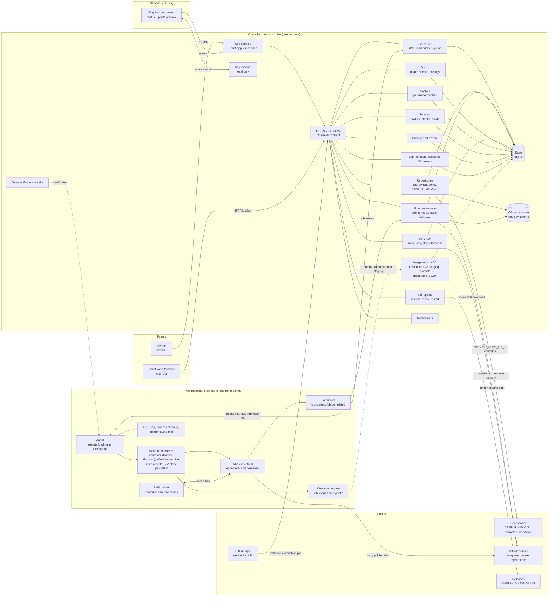

# Product components

crsp is **one program**, `crsp`, that runs in different modes. One machine runs the **controller**; every pool machine runs an **agent**; a person's desktop runs the **tray**. The diagram shows what each part holds and how they talk. A dashed box is planned, not built.

## The parts

| Part | Mode | Runs on | What it does |
|---|---|---|---|
| Controller | `crsp controller` | one machine of the pool, as a service | Holds all state (SQLite store), serves the web console and the API, talks to GitHub, decides which runners exist and where, runs the doctor, backups and the self-update. |
| Web console | embedded in the controller | the owner's browser | Every setup and admin step: machines, runners, repositories, images, jobs, doctor, settings. |
| CLI | `crsp <command>` | any computer with a token | The same API for scripts and the terminal. |
| Agent | `crsp agent` | every pool machine, as a service | Connects to the controller over the agent link (TLS with the controller's own CA), reports load, creates and removes runners through an isolation backend, caps CPU, cleans after jobs, serves the LAN cache. |
| Isolation backends | inside the agent | the pool machine | Container (Docker or Podman), Windows service, Linux, macOS, VM clone and persistent runners. |
| GitHub runners | started by the agent | the pool machine | The official runner; it long-polls GitHub for jobs that match its labels. The job hooks report job start and end to the controller. |
| Tray | `crsp tray` | a person's desktop | Status icon and menu, the update window; it talks to the controller over a local channel and opens the console. |
| Image registry (planned) | inside the controller, under `/v2/` | the controller | Owner decisions of 19 Nov 2026 (RES20): Distribution v3 embedded in the controller; a machine pushes only to its own staging area, the controller checks and promotes; other machines pull by digest instead of rebuilding. Never public. |

## How a job reaches the pool

1. A repository that opted in has `CRSP_RUNS_ON_*` variables that crsp sets to the pool's labels; its workflow uses `runs-on: ${{ vars.CRSP_RUNS_ON_LINUX }}`.
2. GitHub queues the job and sends a `workflow_job` webhook to the controller through the GitHub App.
3. The scheduler checks the slots and load budget; for an ephemeral runner the runners service tells an agent to start one.
4. The runner picks the job from GitHub, the job hooks report start and end, and the Jobs section shows it.
