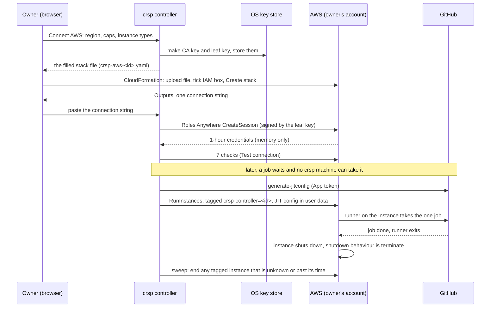

# AWS EC2 overflow runners

The top half (sections 1 to 4) is for every reader. The bottom half (5 to 12) is for engineers.

**PROPOSED (CRSP361, RELEASE-73). NOT YET IMPLEMENTED.** This is a spec for the owner to review. No code is written. Every requirement below is planned. The owner approves it before any code. Source: the CRSP361 accounts study (owner notes on the CRSP383 work branch) and owner decision D48 (2026-11-27: "AWS EC2 overflow runners: yes, crsp starts them") and D47 (the overflow cap applies to both the minutes and the money).

**Facts marked (verify) were not re-read from the AWS page for this spec.** `docs.aws.amazon.com` was not reachable from the session that wrote it; the facts were taken from the study (which read the pages on 2026-11-28) or from AWS's search snippets. Each must be checked against the live AWS page before the build task starts (section 8, Q11).

Related: [github-integration](../github-integration/spec.md) (manifest App R5.2, permissions R5.23, hosted fallback and `overflow_label` R5.42, JIT over stdin R5.40, secrets R6.1), [runners](../runners/spec.md) (ephemeral JIT runners R5.25 to R5.26), [scheduling](../scheduling/spec.md), [web-console](../web-console/spec.md), [cli](../cli/spec.md), [notifications](../notifications/spec.md), [decision 0002, GitHub auth and the OS secret store](../../architecture/decisions/0002-github-auth.md), [study runs-on vs crsp, gap G1](../../studies/runs-on-vs-crsp/study.md).

## 1. In one paragraph

When the owner's own machines are full or off, crsp starts a fresh EC2 instance in the owner's own AWS account for one queued job, gives it a single-use GitHub runner config, and makes sure it is gone after the job. crsp gets AWS access without any stored AWS key: at connect time it makes its own small certificate authority, the owner registers it in AWS with one CloudFormation stack, and crsp then trades a signed request for 1-hour credentials through IAM Roles Anywhere. The role in AWS can only start, stop and end instances that carry this controller's tag, in the chosen region, with the chosen instance types. Money is guarded first by crsp's own caps (instances at once, minutes per instance, money per month) and last by an AWS Budget. Everything is done from the crsp console in one wizard, on a Windows, Linux or macOS controller, and nothing needs an AWS account or a server of the crsp project.

## 2. Why

- **A full or sleeping pool makes jobs wait.** The hosted fallback (github-integration R5.42) solves this with GitHub-hosted minutes, which cost money on private repositories and cannot use the owner's own sizes or images. EC2 in the owner's account is cheaper per minute for large jobs and stays under the owner's control (study runs-on vs crsp, G1).
- **No vendor account exists.** crsp is self-hosted and open source; the project owns no AWS account and no server. The usual pattern (a role in the user's account that trusts the vendor's account, with an external ID) has nothing to trust. The design must work with the owner's account alone (owner requirement, binding).
- **A home PC has no cloud identity.** No instance profile, no metadata service, no public OIDC issuer. It needs a credential it can hold itself, and that credential must be short-lived.
- **All three controller systems.** Controllers run on Windows, Linux and macOS (product brief). Nothing here may be Windows-only (owner requirement, binding).
- **The fewest steps.** The owner rule says the console does the work; the user goes to AWS or GitHub only for what those sites forbid crsp to do (sign in, approve, press Create).

## 3. How it works

1. **Connect AWS (once).** A wizard in the console (section 4). crsp makes a private certificate authority (CA) and a leaf certificate for this controller, keeps both private keys in the OS key store (R5.20 to R5.25), and writes a CloudFormation template file with every value already filled in. The owner downloads it, uploads it in the AWS CloudFormation console, ticks the IAM box and presses Create stack. The stack makes the trust anchor (the CA certificate), the Roles Anywhere profile, the role, a small network with no inbound access, and an AWS Budget. The owner copies one connection string from the stack's Outputs and pastes it into crsp. crsp runs the 7 checks of Test connection (R5.30) and shows Done.
2. **Credentials.** Whenever crsp needs AWS, it signs a Roles Anywhere `CreateSession` request with the leaf key and gets credentials that last 1 hour. They are kept in memory only and fetched again about 5 minutes before they expire (R5.10).
3. **Overflow.** A repository whose fallback is *Run on crsp AWS runners* (R5.40) sends a job to AWS when no crsp machine can take it within the grace time. crsp checks its own caps (R5.50) first, asks GitHub for a JIT config for that one job, and launches one tagged instance. The instance runs the GitHub runner with the config, takes the one job, and shuts down; shutdown ends the instance.
4. **Nothing left behind.** Every instance has a hard end time. A sweep (R5.53) ends any tagged instance that is unknown to crsp or past its time, at start and every 5 minutes. Disconnect (R5.70) stops all of it and shows the one AWS link that deletes the stack.

### Where the template lives: options compared

CloudFormation quick-create links (the one-click "Launch stack" button that pre-fills a form) only accept a template stored in Amazon S3 (study 2.3; AWS API reference: a template URL "must point to a template ... located in an Amazon S3 bucket or a Systems Manager document"). A public bucket or a shared SSM document is someone's AWS account, so a quick-create link would need the crsp project's (the vendor's) AWS account, which the owner rules out. The options that remain:

| | A. crsp hands over the filled file; the owner uploads it in the CloudFormation console (recommended) | B. CloudShell one-liner | C. crsp creates a bucket in the owner's account | D. A public host other than S3 (GitHub Releases, Pages) | E. crsp sets up IAM by API from short-lived owner credentials, then discards them |
|---|---|---|---|---|---|
| What the owner does | Download (1), Open AWS (2), Upload a template file and choose it (3, 4), Next (5), Next (6), tick the IAM box (7), Submit (8), wait about 3 min, copy the Outputs value (9), paste (10) | Open CloudShell (1), wait for the shell, paste (2), Enter (3), wait about 3 min, copy the printed line (4), paste (5) | Same as E, plus the bucket | Not possible | Get temporary keys (3 to 6 steps, depends on how the owner signs in), paste 2 to 3 values (7); crsp does the rest and reads the outputs itself |
| Vendor account or server needed | None | None (the template is inside the command; no download) | None | A project host (not AWS) | None |
| What AWS allows | Yes: the console's "Upload a template file" stores the file in a `cf-templates-*` bucket of the owner's own account (verify) | Yes: `aws cloudformation deploy --template-file` sends the body directly; templates up to 51,200 bytes need no bucket (AWS quotas page) | Only with credentials crsp does not have yet; with them, a bucket is not needed at all (CreateStack takes the body directly) | **No**: CloudFormation refuses a template URL that is not S3 or an SSM document | Yes |
| Consent the owner sees | AWS's own review page, the stack's full resource list and the IAM acknowledgement box | A terminal; `--capabilities CAPABILITY_NAMED_IAM` acknowledges IAM inside the command, so there is no AWS box to tick | — | — | Only crsp's Review |
| Security | Best. crsp never holds an AWS admin credential. The file is readable before upload; its SHA-256 is shown in crsp and in the template's own description | Good. Same role, same template; but a pasted command is harder to read, and it runs with the owner's full console rights | — | — | Weakest. For a few minutes crsp holds credentials that can create IAM roles in the owner's account. An owner who signs in as root can only make a long-lived root key, which AWS strongly advises against |
| Owner rule "no terminal steps" | Kept | Broken (a terminal step) | — | — | Kept |
| Works in every region | Yes | Only where CloudShell runs (it can deploy to another region with `--region`) (verify) | — | — | Yes |
| Template versioning | The file is made by the running controller, so it always matches that controller's version | Same | — | — | Same |

**Recommendation: A.** It needs no vendor account and no host at all, crsp never holds an AWS credential stronger than its own role, the owner sees AWS's own list of what will be created and ticks AWS's own IAM box, and it works in every region and with the console the owner already knows. It costs 4 or 5 more clicks than B; the wizard makes each click one line with a picture of the AWS control (R5.62). Because crsp writes the values into the file as parameter defaults, the owner types nothing in AWS, and the CA certificate never has to fit into a URL (study risk 3 is gone). **B is offered as a second choice**, *Use AWS CloudShell instead*, folded under the main path, for owners who prefer one paste (Q2). **E is rejected** as the default because of the admin credential and the root-key trap; it can come later as an advanced choice if owners ask (Q3). **C and D are not possible** as stated.

## 4. Screens and states

Every screen follows design system v4 (the highest folder) and adds no rule of its own. The screens use the shared wizard part only (UX-54): the step bar, the lock of later steps, Stop, busy and Done come from it, and the page passes data only (CORE-2, CORE-6). New words go to `next-version/content.md` with a `CHANGES` entry in the build task (section 12). Checked against CORE-1 to CORE-7.

### 4.1 Where it lives

- **Pool > Overflow** (a new tab beside the pool setup page) holds one card per overflow target: *GitHub-hosted* (exists, R5.42) and *AWS EC2* (new). Cards share one shape and one row (CORE-7, UX-51). Each card says its status as a word, glyph and colour (UX-58): `ⓘ not connected`, `✓ ok`, `◷ expiring`, `✕ failed` with the reason. The card's one button is *Connect AWS* when not connected (UX-4), and *Open* when connected. The card only shows and links; commands live on the AWS page (UX-52).
- **The AWS page** (`/pool/overflow/aws`) shows *What this connection can do* (sentences made from the real policy, with the date of the last check and *Check again*), the caps (an edit form with the shared action bar, UX-71), the running instances (rows with job, type, started, ends at; each row says `VM` and `nothing kept between jobs` as UX-61 asks for any runner), and the actions *Renew certificate* and *Disconnect AWS*.
- **A repository's fallback** (Settings > Repositories, R5.42) gets a third answer: *Run on crsp AWS runners* (rows, UX-22). It is disabled with its reason until AWS is connected: "Connect AWS first, in Pool > Overflow." (UX-38, UX-6).

### 4.2 Connect AWS wizard

The wizard has four steps in the step bar: **1 Limits, 2 Review, 3 Connecting, 4 Done**, and before them the first-run screen. It changes something, so it ends Review, work, Done (UX-30). Back and the one primary sit in the action bar at the bottom (UX-5, UX-42).

**First run (no connection yet).** Headline: "Run jobs on AWS when your machines are busy" (CORE-3, UX-3). Three plain lines: "You need an AWS account and permission to create a CloudFormation stack." "crsp creates a role that can only start and end crsp runners, in one region." "Connecting costs nothing; each job costs what AWS charges for its instance." The one primary is *Start* (CORE-5, UX-4).

**Step 1, Limits.** Fields with the name above the box and help under the name (UX-20); defaults filled (CORE-4):

- Region: drop-down (more than 6 answers, UX-22), default the AWS region nearest by the controller's time zone (Q8).
- Runner systems: rows *Linux x64* and *Linux Arm64* (check boxes, UX-22). Windows instances are a later version (Q5).
- Instance types: rows of up to 6 sizes in plain words ("4 CPUs, 16 GB, about 0.20 USD an hour (verify)") (UX-22).
- Most runners at once: a count, default 2 (UX-20).
- Longest job in minutes: default 60, most 360.
- Monthly limit in USD: default 20. Under it: "crsp stops starting runners at this amount. AWS also sends an email at 80 percent if you add an address." Email for AWS budget alerts (optional, the only field marked optional, UX-20).

The primary *Next* stays pressable; mistakes show after it is pressed, above each box and as a list on top (UX-21).

**Step 2, Review.** "Nothing has changed yet." (UX-30). Two short lists:

- *crsp will make on this computer*: a private certificate authority and a certificate for this controller, kept in the system key store (it names the store: "Windows protected storage", "macOS Keychain", "Linux Secret Service" or "a file only crsp can read", R5.22).
- *The AWS stack will make in your account*: one role, one trust anchor, one profile, one network with no inbound access, one budget of 20 USD a month. And what the role can do, as sentences: "Start instances in eu-west-1 of the types you chose, only with the tag crsp-controller=gameroompc." "Stop and end only instances with that tag." "Read instance and network facts in eu-west-1." "It cannot read your data, change IAM, or touch any other instance."

A fold *Read the template* shows the file and its SHA-256 (CORE-3, CORE-4). The primary is *Make the key and the AWS file* with the reason above it: "Opens no page and changes nothing in AWS." (CORE-5, UX-42).

**Step 3, Connecting (the work step).** Named by its verb (UX-30). No Back (UX-30). Stop is in the action bar (UX-54). Three lines, each with a status glyph and word (UX-58), n of 3 above them (UX-29):

1. `✓ ok` *Making the key* (under a second, so it shows done at once).
2. `◷ waiting` *Waiting for you in AWS*. This line holds the guide (R5.62): *Download the AWS file* (a button, UX-8), *Open AWS CloudFormation* (a button, opens a new tab), then 5 numbered lines with a small picture of each AWS control: "Choose Upload a template file, then the file you downloaded." "Press Next twice." "Tick I acknowledge that AWS CloudFormation might create IAM resources." "Press Submit and wait for CREATE_COMPLETE, about 3 minutes." "Open Outputs and press the copy icon beside ConnectionString." Then one box: *Paste the connection string* (UX-20). A fold *Use AWS CloudShell instead* shows option B with one Copy button.
3. `◷ waiting` *Testing the connection*: the 7 checks of R5.30, each a row with its glyph and word.

The one primary is *Test connection*. It is disabled with the reason beside it until the pasted text is a valid connection string for this controller: "Paste the connection string from the stack's Outputs." (UX-38). While it runs it says *Testing...* and cannot be pressed until the server answers (UX-13). A propagation wait says so: "AWS is still applying the new role; trying again until 14:07" (UX-29).

**States of the wizard** (all ten states of the wizard harness, UX-30):

| State | What the owner sees |
|---|---|
| loading | One wait line in the current step, its primary locked, Back free (UX-30, UX-38). |
| first-run | The first-run screen above. |
| planning | Step 1, Limits, with the defaults. |
| ready-to-review | Step 2, Review, "Nothing has changed yet." (UX-30). |
| running | Step 3, Connecting, with the line in hand and n of 3 (UX-29). A check that fails and that the owner can fix (wrong stack, role not yet applied, budget missing) shows `✕ failed` on that row, the AWS answer in plain words, the next step, and the primary becomes *Test again* (UX-6, UX-26 Problem). |
| paused | The controller restarted while it waited for the paste: a stored "running" with no live run reads Paused (UX-30); the primary is *Go on*; the keys made in line 1 are kept. |
| stopped | Stop was pressed: Done in the Note tone says what was done and what is left: "The key was made on this computer and is now deleted. If you created the stack, delete it in AWS:" and one *Open the stack in AWS* button (UX-30, UX-6). Start again is the one primary. |
| failed | A fault crsp cannot get past (the key store cannot be written; the stack belongs to another controller; the account blocks Roles Anywhere by policy): Done in the Problem tone with what was done, what is left and the next step ("Your organization's policy blocks IAM Roles Anywhere. Ask your AWS administrator, or use an access key, which is less safe." R5.15). Start again is the one primary (UX-30, UX-6). |
| done | Done in the Done tone (UX-26): account (last 4 digits), region, role name, budget, certificate valid until 2031-11-28 (UX-18), and the 7 checks as rows. One primary: *Start again* (UX-30); a normal button *Run a test job on AWS* (costs about a cent) opens the test of R5.31. |
| done-after-reload | The same Done, read from the stored connection, not from the page (UX-19). |

### 4.3 Disconnect and renew

- **Disconnect AWS** asks first in one question card (UX-9): Cancel on the left, *Disconnect AWS* on the right. It names what goes (UX-62): "2 running AWS runners end now: build of api#412, test of web#88." "The key on this computer is deleted." "The stack stays in AWS until you delete it." It waits for the running jobs to drain or ends them, as the owner chose in the card (UX-62). The result says what happened and shows *Open the stack in AWS* to delete it (UX-27, CORE-5).
- **Renew certificate.** The leaf renews itself (R5.24). The CA renews by the same wizard with a short Review: "AWS needs the new authority. You will update the stack once." (CORE-6).

### 4.4 GitHub

Overflow needs the GitHub App that each controller already makes with the manifest flow (github-integration R5.2). It stays the simplest path: in the existing first-run wizard the owner presses *Create the App on GitHub*, GitHub shows the filled App page, the owner presses *Create GitHub App* there, GitHub returns to crsp, the owner picks the repositories and presses *Install*. Two additions (R5.80 to R5.82), both in the existing Review step of that wizard (UX-30, CORE-4):

- *Runner scope*: rows *Organization runners* (no Administration permission) and *Repository runners* (Administration, read and write) (UX-22), with one line saying what each allows.
- *Repositories*: the line "Pick only the repositories that will use the pool. You can add more later without a new App." (CORE-3).

The AWS wizard never asks for GitHub details: when the App is missing, *Start* on the first-run screen is disabled with the reason "Connect GitHub first." and a button to its wizard (UX-38, UX-6).

### 4.5 CLI

The CLI repeats the console with the same words: `crsp aws connect` (writes the file, prints its SHA-256 and the AWS link, then waits for `--connection-string` or stdin), `crsp aws test`, `crsp aws status`, `crsp aws caps --max-runners N --max-minutes N --monthly-usd N`, `crsp aws disconnect`, `crsp aws instances`. Every command uses the same API as the console.

## 5. Functional requirements

### 5.1 AWS identity (IAM Roles Anywhere)

**R5.10** — **Short-lived credentials only.** crsp gets AWS credentials only from IAM Roles Anywhere `CreateSession`, signed with the leaf key, with `durationSeconds` 3600 (AWS allows 900 to 43200; study 2.2). Credentials are kept in memory, never written, logged, audited or returned by the API, and fetched again 5 minutes before expiry. The signing is crsp's own Go code following AWS's published signing helper (`aws/rolesanywhere-credential-helper`, Apache 2.0 (verify), pinned to a version); no external process.

**R5.11** — **crsp is its own CA.** At connect the controller makes an ECDSA P-256 CA key and a self-signed CA certificate (valid 5 years, `basicConstraints CA:TRUE, pathlen:0`, `keyUsage keyCertSign, cRLSign`), and an ECDSA P-256 leaf key and certificate (valid 90 days, subject `CN=crsp-<controller-id>`, `keyUsage digitalSignature`, `extKeyUsage clientAuth`). Only the CA certificate goes to AWS, as the trust anchor. No private key leaves the computer.

**R5.12** — **The role trusts only this controller.** The role's trust policy allows `rolesanywhere.amazonaws.com` the actions `sts:AssumeRole`, `sts:TagSession` and `sts:SetSourceIdentity`, only when `aws:SourceArn` equals the trust anchor's ARN and the certificate subject CN tag equals `crsp-<controller-id>` (tag key syntax (verify), study 2.3).

**R5.13** — **The connection string.** The stack's single output `ConnectionString` is `v=1;account=<id>;region=<r>;role=<arn>;anchor=<arn>;profile=<arn>;controller=<id>;ca=<sha256 of the CA certificate>`. crsp refuses a string whose `controller` or `ca` does not match its own (the owner pasted another controller's stack). It holds no secret.

**R5.14** — **The stack file.** crsp writes `crsp-aws-<controller-id>.yaml` from a template embedded in the binary, with every parameter's `Default` set to the owner's choices and the CA certificate; it stays under 51,200 bytes so option B can send it without a bucket. Its `Description` holds the crsp version and the SHA-256 of the unfilled template; crsp shows both. The file holds no secret.

**R5.15** — **Fallback: an access key, marked less safe.** Only when Roles Anywhere is blocked (an AWS Organizations policy), the failed state offers *Use an access key (less safe)*. A second template makes an IAM user with the same permission policy (R5.40) and no console password; the owner makes the key in the IAM page and pastes it once; crsp stores it in the key store, shows only the last 4 characters and its age, reminds at 90 days, and *Rotate* makes a new key with the old one and deletes the old one (needs `iam:CreateAccessKey`, `iam:DeleteAccessKey`, `iam:ListAccessKeys` on that user only). The page says why it is less safe: the key lasts until it is deleted. Never `ec2:*`, `iam:*` or AdministratorAccess.

### 5.2 Key store on every controller system

**R5.20** — **One key store interface, one backend per system.** The controller's `secrets` package (decision 0002, github-integration R6.1) gains `Put`, `Get`, `Delete` and `Describe` (which store, how it is protected) for the AWS CA key, leaf key and fallback access key, beside the App secrets. Secrets are never in the database, config files, logs, crash files, API answers or the audit log.

**R5.21** — **The backend of each system.**

| Controller system | Store | Scope | Notes |
|---|---|---|---|
| Windows | DPAPI (`CryptProtectData`) blobs in the data folder, or Credential Manager for items under 2.5 KB | The account the controller service runs as (`LocalService` or its own virtual account); not machine scope, so another account on the PC cannot decrypt | The data folder's ACL already allows only that account (machines R5.65 owner-only file). Credential Manager limits a blob to 2,560 bytes (verify); a PEM key fits. |
| macOS | Keychain (Security framework, generic password items) | The user keychain for a controller run by a user (LaunchAgent); the System keychain for a LaunchDaemon | The item's access list names only the crsp binary; a binary update with the same signing identity keeps access (verify with a signed build, Q9). |
| Linux with a desktop session | Secret Service over D-Bus (libsecret API; GNOME Keyring or KWallet) | The user's default collection | Used only when a session bus exists and the collection is unlocked. |
| Linux without Secret Service (a server, a systemd service, no unlocked keyring) | Fallback, R5.22 | The controller's service account | |

**R5.22** — **The Linux fallback, and why.** A controller that runs as a systemd service has no session bus and no unlocked keyring at boot, so Secret Service cannot be the only store: it would block the controller until someone signs in. The fallback, in order:

1. **`systemd-creds` with the TPM2 when the machine has one** (systemd 250 or newer, verify): the secret is sealed to this machine's TPM and the host key, so a copied disk or backup does not reveal it.
2. **`systemd-creds` with the host key only** (`/var/lib/systemd/credential.secret`, readable by root only) when there is no TPM2.
3. **A file of mode 0600** in the data folder owned by the service account, the shape R6.1 already allows, when systemd is not there (a container, another init).

Why not the others: the kernel keyring does not survive a reboot; a key made from `/etc/machine-id` is readable by every local user, so it adds nothing over 0600; a passphrase typed at start breaks unattended starts. The console says which store holds the key, in words, and for the 0600 file it says "Protected by file permissions only" in the Note tone (CORE-3); the doctor shows the same as a finding with the fix "Install systemd 250 or newer" where that helps.

**R5.23** — **Nothing Windows-only.** The overflow code is the same on every controller system; only the key store backend differs. Every check of section 10 runs on Windows, Linux and macOS in CI (macOS with the Keychain on the CI runner).

**R5.24** — **Renewal.** The leaf renews itself 30 days before it expires, from the stored CA, with no AWS action. The CA renews at 4 years 6 months: crsp makes a new CA, writes a new stack file holding both the old and the new certificate as the trust anchor bundle (verify that a trust anchor takes a bundle, study 2.7), the owner updates the stack once (the same guide as step 3), and after the test passes crsp removes the old certificate at the next update. The console warns 60 days before (`◷ expiring`, UX-58).

**R5.25** — **Lost or stolen computer.** The AWS page and the Disconnect result show the two emergency steps: delete the stack (or disable the trust anchor) in AWS. A thief with the leaf key gets only the role of R5.40, which is still billable within the caps the stack enforces (instance types, region), not crsp's own caps. Hardware-held keys (Windows CNG with TPM, macOS Secure Enclave) are a later option (Q7).

### 5.3 Test connection: the 7 checks

**R5.30** — **Seven checks, in order, each a row.** Each row has a status word, glyph and colour (UX-58), the plain-words result and, on failure, the AWS error decoded into plain words and the next step.

| # | Check | Call | Passes when |
|---|---|---|---|
| 1 | Get credentials | Roles Anywhere `CreateSession` | Credentials come back (proves trust anchor, profile, role and certificate match) |
| 2 | Who am I | `sts:GetCallerIdentity` | The account and role are the ones of the connection string |
| 3 | Read EC2 | `ec2:DescribeInstances`, `ec2:DescribeSubnets` in the region | Both answer; the crsp subnet and security group exist |
| 4 | Can start a runner | `ec2:RunInstances` with `DryRun`, the exact tags, subnet, group, image and a chosen type | `DryRunOperation` (allowed); `UnauthorizedOperation` fails and is decoded with `sts:DecodeAuthorizationMessage` |
| 5 | Can end only crsp runners | `ec2:TerminateInstances` with `DryRun` on a crsp-tagged instance id when one runs, else on an untagged one found by `DescribeInstances`, which must be denied | Allowed for tagged, denied for untagged (when the account has no other instance, the row says "No other instance to test; checked by step 6") |
| 6 | Guard holds | `ec2:RunInstances` with `DryRun` and without the crsp tag | Denied: the row says `✓ ok` "Denied as expected" |
| 7 | Budget exists | `budgets:ViewBudget` on `crsp-<controller-id>` | The budget exists with the amount shown; a missing budget is `◷ waiting` "Budget missing: AWS will not warn you" (Needs you), not a failure |

IAM changes take time to apply (EC2 docs advise about 5 minutes, study 2.6), so checks 1, 4 and 6 retry with back-off for up to 3 minutes before they fail, and the line says until when (UX-29). The same checks run every 6 hours and on *Check again*; a failure turns the card to `✕ failed` with the reason and sends a notification (notifications R5.1).

**R5.31** — **Optional test job.** *Run a test job on AWS* launches the smallest allowed type with a JIT config for a crsp test workflow (the one the doctor uses), shows its live lines, and ends it. It costs cents and says so before it starts.

### 5.4 The AWS permission policy (least privilege, tag-scoped)

**R5.40** — **The role may do only this.** The policy of the study (2.4) with these rules, every value a stack parameter:

- Describe actions (`DescribeInstances`, `DescribeInstanceStatus`, `DescribeImages`, `DescribeSubnets`, `DescribeSecurityGroups`, `DescribeVpcs`, `DescribeInstanceTypes`, `DescribeInstanceTypeOfferings`, `DescribeTags`) on `*`, because EC2 Describe calls cannot be limited by resource, but only when `aws:RequestedRegion` is the chosen region.
- `ec2:RunInstances` on `instance/*`, `volume/*` and `network-interface/*` only with the request tag `crsp-controller=<id>`, tag keys only from `crsp-controller`, `crsp-job`, `crsp-expires-at` and `Name`, and `ec2:InstanceType` in the chosen list; on the one crsp subnet, the one crsp security group and images only (`image/*`, region-scoped).
- `ec2:CreateTags` only when `ec2:CreateAction` is `RunInstances`.
- `ec2:TerminateInstances` and `ec2:StopInstances` only on instances with the resource tag `crsp-controller=<id>`. No `StartInstances`: a stopped runner is never restarted, it is ended.
- Deny `ec2:CreateTags` and `ec2:DeleteTags` on the `crsp-controller` key outside `RunInstances`, so the tag that limits the role cannot be added to or removed from another instance.
- `ec2:ModifyInstanceMetadataOptions` is not granted; IMDSv2 is set at launch (R5.52).
- `sts:DecodeAuthorizationMessage` (for check 4), `budgets:ViewBudget` on `budget/crsp-<id>` only, `servicequotas:GetServiceQuota` for the On-Demand vCPU quota (R5.55), and `ssm:GetParameter` only on `arn:aws:ssm:<region>::parameter/aws/service/canonical/*` to find the current Ubuntu image (verify the path).
- No `iam:PassRole` and no instance profile: the runner instance needs no AWS access (study 2.4 note). Never `ec2:*`, `iam:*` or AdministratorAccess.

The Roles Anywhere profile repeats the policy as its session policy (belt and braces). The Review step and *What this connection can do* are made from this policy, not written by hand (CORE-4).

**R5.41** — **The stack makes the network.** One VPC (`10.213.0.0/24` unless it overlaps the owner's, a parameter), one public subnet, an internet gateway and a security group with no inbound rule and outbound HTTPS only (443 to GitHub and the package mirrors; DNS). No NAT gateway, which would cost about 32 USD a month (verify). Each instance gets a public IPv4 address, which AWS charges by the hour (verify, and show it in the price line). Using an existing VPC is Q4.

### 5.5 Overflow runners

**R5.50** — **crsp's caps come first.** Before every launch the controller checks, in its own store: running crsp instances below *Most runners at once*; this month's estimated spend plus the new instance's price for *Longest job* below *Monthly limit* (D47: the cap counts money as well as minutes); the region's vCPU quota (R5.55) has room. A refused launch leaves the job waiting with the reason ("AWS monthly limit of 20 USD reached; the job waits for a crsp machine.", UX-6) and the repository's minutes cap (github-integration R5.42) also counts AWS minutes. The spend estimate uses a price table shipped with crsp and refreshed from the AWS price list at most once a day (verify the API and its region); it is labelled an estimate.

**R5.51** — **One job, one instance, JIT config.** For a queued job routed to AWS (R5.42 answer *Run on crsp AWS runners*; its runner label is `crsp-aws-<controller-id>-linux-<arch>`, the value of `overflow_label` for that repository), the controller calls `generate-jitconfig` (github-integration R5.40) with that label, the runner group and a name `crsp-aws-<job-id>`, and launches one instance with it. A registration token is never used for AWS (study 3.3).

**R5.52** — **Launch settings.** The current Ubuntu LTS image of the chosen architecture; IMDSv2 required with hop limit 1; `InstanceInitiatedShutdownBehavior=terminate`; an encrypted gp3 root volume deleted on termination; tags `crsp-controller`, `crsp-job`, `crsp-expires-at` (launch time plus *Longest job* plus 10 minutes) and `Name`. User data (about 40 lines, embedded in the binary, shown on the AWS page) downloads the GitHub runner of the version crsp pins, checks its SHA-256, runs it once with the JIT config, then `shutdown -h now`; it also starts `shutdown -h +<minutes>` first as a dead-man switch.

**R5.53** — **The sweep.** At controller start and every 5 minutes, crsp lists instances with its tag in the region and ends every one that is past `crsp-expires-at`, or is not known to crsp and older than 15 minutes, or whose job GitHub reports finished. Each end is audited (`aws.instance_ended` with the reason). A controller that was off misses nothing: the dead-man switch has already ended its instances, and the sweep checks.

**R5.54** — **The JIT config on the instance.** User data is the one way to hand the config to a fresh instance without granting it AWS access. It is readable by anyone with `ec2:DescribeInstanceAttribute` in the account and from the instance's metadata service. Accepted because the config is single-use, valid only for that runner, and the instance lives for one job; the user-data script runs the runner and the job as a user that cannot reach the metadata service after start (a local firewall rule for `169.254.169.254` drops the job user's traffic). This differs from runners R5.25 ("never a file"); the owner decides (Q6).

**R5.55** — **The account's own ceiling.** The page shows the region's On-Demand vCPU quota ("Your account allows 32 vCPUs in eu-west-1") and refuses caps that cannot fit. A launch refused by AWS for the quota says so in words and sends no retry storm (back-off 1, 2, 4 minutes).

### 5.6 AWS Budgets, last

**R5.60** — **The budget is the last line.** The stack makes a monthly cost budget `crsp-<controller-id>` for the monthly limit, filtered by the tag `crsp-controller` (cost allocation tags must be activated by the owner in Billing to filter by tag (verify); until then the budget counts the whole account and says so). Alerts at 80 percent forecast and 100 percent actual go to the optional email. AWS budget data lags 8 to 12 hours (study 2.3), so the budget never replaces R5.50; it exists so a guard remains when the controller is off or broken.

**R5.61** — **Budget action, advanced, off by default.** A switch on the AWS page (saved at once, UX-22) adds a budget action that attaches a deny policy for `ec2:RunInstances` to the crsp role at 100 percent actual. It needs a stack update (the guide of step 3). Q10.

**R5.62** — **The AWS guide.** The guide lines of step 3 come from one list per AWS console version, with a picture per line, shown in the theme's frame. When AWS changes its console, only the list changes. The guide never claims a click that crsp cannot see; after the paste, the checks say what is true (CORE-5).

### 5.7 Disconnect and health

**R5.70** — **Disconnect.** After the question card (4.3): no new launches; running jobs drain or their instances are ended, as chosen; the CA, leaf and any access key are deleted from the key store; the connection row is removed; the result shows the stack's AWS page link and says the stack and budget still exist until deleted there. Audited as `aws.disconnected`.

**R5.71** — **Health.** The AWS card's status is `✓ ok` when the last check passed, `◷ expiring` within 60 days of the CA or leaf end, and `✕ failed` with the reason (credentials refused, role removed, budget reached, quota reached). A failure sends a notification once per cause.

### 5.8 GitHub

**R5.80** — **The manifest App stays.** Overflow uses the App each controller already makes (github-integration R5.2) and its installation token. No personal access token, no new App.

**R5.81** — **Runner scope choice.** The Review step of the first-run wizard asks for *Organization runners* or *Repository runners* (4.4). Organization runners need only Self-hosted runners (organization, read and write), Actions (read) and Metadata (read), not Administration (study 3.2). The manifest of R5.23 is made from the choice; Variables and Contents stay only when the `CRSP_RUNS_ON_*` flip and the `runs-on` check are on. A change of scope later opens the App's permission page on GitHub with one button (GitHub has no API for it).

**R5.82** — **Runner group.** The JIT call names the runner group (organization default id 1, or the repository's default). The AWS page shows the group and whether it allows the repository (a group can exclude public or chosen repositories).

## 6. Non-functional requirements

**R6.1** — **No secret anywhere but the key store.** Private keys, access keys, JIT configs and AWS session credentials are never in the database, config files, the stack file, the connection string, logs, crash files, API answers, audit lines or test fixtures. Tests build fake keys at run time (AGENTS.md secret scan).

**R6.2** — **No vendor dependency.** Connecting, testing, launching and disconnecting need no AWS account, bucket, server or domain of the crsp project.

**R6.3** — **Same on every controller system.** Windows, Linux and macOS controllers pass the same tests of section 10; only the key store backend differs (R5.23).

**R6.4** — **Bounded cost of a fault.** A controller crash, a lost network or a bad image can cost at most *Most runners at once* times *Longest job* plus 10 minutes of instance time, because of the dead-man switch and the shutdown behaviour.

**R6.5** — **Fast enough.** A launch decision takes under 1 second after the grace time; the instance's runner is online within about 90 seconds of the launch (Ubuntu image, verify on a real account).

## 7. Design

- `apps/controller/internal/providers/aws/`: Roles Anywhere signer and credential cache (R5.10), CA and leaf (R5.11, R5.24), stack file writer (R5.14), connection string parser (R5.13), the 7 checks (R5.30), EC2 calls (aws-sdk-go-v2 `ec2`, `sts`, `budgets`, `servicequotas`, `ssm` clients with a custom credentials provider).
- `apps/controller/internal/overflow/`: the target interface (`Connect`, `Test`, `DescribeGrants`, `Launch`, `Sweep`, `Disconnect`, `Health`, study 4) so GCP, Azure and others plug in later with the same screens (CORE-1, CORE-2); the caps (R5.50); the sweep (R5.53).
- `apps/controller/internal/secrets/`: the per-system backends of R5.21 behind build tags (`_windows.go`, `_darwin.go`, `_linux.go`), the Linux fallback order (R5.22).
- `apps/controller/assets/aws/`: the stack template, the access-key template (R5.15), the user-data script, the price table.
- Store: tables `overflow_targets` (public facts only: account, region, ARNs, caps, CA fingerprint, expiry dates) and `overflow_instances` (instance id, job, type, started, expires, ended, reason).
- Console: Pool > Overflow tab, the AWS page, the Connect AWS wizard on the shared wizard part, the repository fallback answer.

## 8. Open questions for the owner

- **Q1.** Template delivery: approve option A (download the filled file, upload it in the CloudFormation console) as the main path? It is about 10 clicks in AWS, no vendor account, no host, AWS's own IAM consent.
- **Q2.** Offer option B (AWS CloudShell one-liner, 5 steps, but a terminal step and no AWS IAM box) as a folded second choice, or leave it out to keep one path?
- **Q3.** Option E (crsp sets everything up from short-lived credentials the owner pastes, then discards them): leave it out (proposed), or offer it later as an advanced choice for owners who use IAM Identity Center?
- **Q4.** Network: always a new small VPC made by the stack (proposed), or also let the owner pick an existing VPC and subnet?
- **Q5.** Runner systems in the first version: Linux x64 and Arm64 only (proposed)? Windows EC2 runners cost more and start slower; macOS EC2 needs a dedicated host billed for at least 24 hours (verify), so it is not proposed at all.
- **Q6.** The JIT config in user data (R5.54) differs from runners R5.25 ("never a file"). Accept with the metadata block for the job user (proposed), or require SSM Run Command (needs an instance role and the SSM agent, more permissions)?
- **Q7.** Hardware-held leaf keys (TPM on Windows and Linux, Secure Enclave on macOS) in the first version, or later (proposed: later)?
- **Q8.** Default region: nearest by the controller's time zone (proposed), or always ask with no default?
- **Q9.** macOS: Keychain access across crsp updates needs a stable signing identity. Are macOS builds signed with a Developer ID now? If not, the macOS controller uses the 0600 file until they are.
- **Q10.** Budget action that blocks launches at 100 percent (R5.61): off by default (proposed) or on?
- **Q11.** Several facts are marked (verify) because the AWS pages could not be read from this session. Approve the spec now with a "verify on the live AWS pages" first step in the build task (proposed), or ask for a check pass first?
- **Q12.** Spot instances (cheaper, may be taken back mid-job): not in the first version (proposed), or a per-repository choice?
- **Q13.** Defaults: 2 runners at once, 60-minute longest job, 20 USD a month. Keep?
- **Q14.** Access-key fallback (R5.15): build it in the first version, or only when an owner reports a blocking policy?

## 9. Failure modes

| Failure | What crsp does |
|---|---|
| The pasted string is from another controller or CA | Refused with the reason, nothing stored (R5.13) |
| The role is not applied yet | Checks retry up to 3 minutes and say until when (R5.30) |
| An AWS Organizations policy blocks Roles Anywhere or IAM | Failed state names the policy and offers the access key (R5.15) |
| The key store cannot be written | Failed state names the store and links to the doctor; nothing made in AWS yet |
| Credentials refused later (stack deleted, trust anchor disabled) | Card `✕ failed`, launches stop, jobs wait for crsp machines, notification (R5.71) |
| AWS refuses a launch (quota, capacity, type not offered) | The job waits with the reason; back-off; the next allowed type is tried once (R5.55) |
| The controller is off while instances run | Dead-man switch and shutdown behaviour end them; the sweep confirms at start (R5.53) |
| The runner never connects (bad image, no network) | The sweep ends the instance after 15 minutes; GitHub removes the never-used JIT runner after a day (study 3.3) |
| The monthly limit is reached | No new launches, the job waits for a crsp machine, a notification (R5.50) |

## 10. How it is proven

All planned; each test is named before code and runs on Windows, Linux and macOS controllers unless noted.

| Requirement | Proof (planned) |
|---|---|
| R5.10, R5.11 | planned: apps/controller/internal/providers/aws/rolesanywhere_test.go: the signature matches AWS's published test vectors; leaf and CA fields; no key leaves the store |
| R5.13, R5.14 | planned: stackfile_test.go: values filled, under 51,200 bytes, no secret (scan), refused strings |
| R5.20 to R5.23 | planned: apps/controller/internal/secrets/*_test.go per system; Linux fallback order with a fake `systemd-creds` and a missing D-Bus |
| R5.30 | planned: checks_test.go against an AWS fake for each answer, plus one manual run on a real account recorded in the build report |
| R5.40 | planned: policy_test.go: the policy evaluated with IAM's policy simulator API in a real account (manual, recorded), and a static check that no `*` action is granted |
| R5.50 to R5.53 | planned: apps/controller/internal/overflow/caps_test.go, sweep_test.go with a fake clock |
| R6.1 | the secret scan and a log-scrape test over a full fake connect and launch |
| Screens | planned: e2e/tests/web-console/aws-overflow.spec.ts renders the ten wizard states (UX-30) and the AWS page at 360, 393 and 1300 px |

## 11. Not built yet

Everything in this spec. Later targets (GCP Workload Identity Federation, Azure app registration with a certificate, Hetzner and DigitalOcean tokens) use the same target interface and screens (study 4) and get their own specs.

## 12. Build order

1. Verify every (verify) fact on the live AWS pages; update this spec (Q11).
2. Key store backends for all three systems (R5.20 to R5.23).
3. CA, leaf, Roles Anywhere signer, stack file and connection string (R5.10 to R5.14).
4. The Connect AWS wizard with the 7 checks (R5.30); words in `next-version/content.md` with a `CHANGES` entry.
5. Caps, launch, sweep (R5.50 to R5.55) and the repository fallback answer.
6. Budget, disconnect, health, CLI.
7. GitHub runner scope choice (R5.81, R5.82).

A change to github-integration R5.42 (the new fallback answer) or runners R5.25 (Q6) updates those specs in the same branch.

## Versions

## Design-system proof

A rule this spec cites is proven by a test that exists. A rule whose guard is still `none yet` (ux-rules.md) is held by the follow guard, which fails when the rule table is malformed or a citation does not resolve.

Proof: CORE-1, CORE-2, CORE-3, CORE-4, CORE-5, CORE-6, CORE-7, UX-3, UX-5, UX-6, UX-8, UX-18, UX-19, UX-20, UX-21, UX-22, UX-26, UX-27, UX-29, UX-30, UX-42, UX-51, UX-52, UX-54, UX-58, UX-61, UX-62 `scripts/design/design-system-follow.test.ts`
Proof: UX-4 `e2e/tests/web-console/ux-routes.spec.ts`
Proof: UX-9 `e2e/tests/web-console/ux-static.spec.ts`
Proof: UX-13, UX-38 `scripts/design/wizard-behaviour.test.ts`
Proof: UX-71 `scripts/design/action-bar.test.ts`
