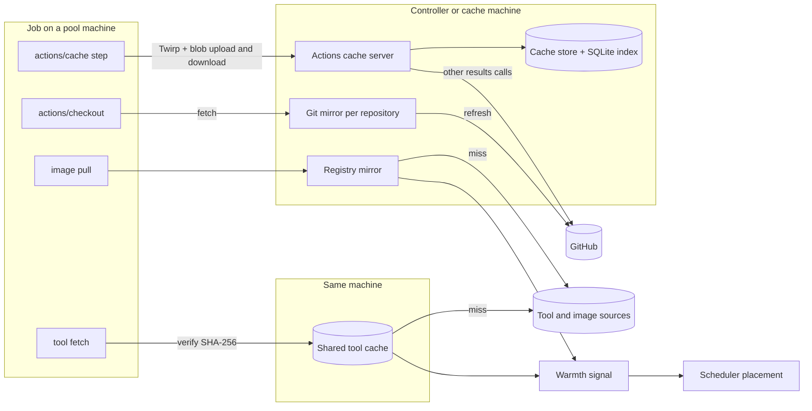
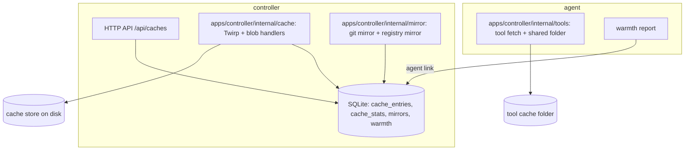

# Caches

The top half (sections 1 to 4) is for every reader. The bottom half (5 to 12) is for engineers.

**PARTLY BUILT (CRSP21, CRSP26, CRSP36, CRSP48).** Milestone 1 builds the per-runner cache quotas with eviction, the Rust cache cap with its per-key cap (R5.45), the pool-wide disk budget and size alert (R5.48, R5.49), the disk guard, the per-runner `CI_TOOLS_DIR`, the `vm_check` port (R5.36 to R5.40, built) and the list and wipe of those per-runner caches on the Images and caches screen (R5.42, built). Milestone 2 has the shared per-machine tool cache as library code (CRSP255, R5.14, R5.61 to R5.64), the VM cache (CRSP61, CRSP65, CRSP71) and the Docker disk compact (OPS52, CRSP136). Milestone 7 is built in part (CRSP272): the Actions cache receiver (`apps/controller/internal/lancache`), the git mirror (`apps/controller/internal/mirror`), cache warmth and wipe with a plan, and the cache switches; the registry mirror is built in the registry feature (REG9). The owner chose one hub in the controller with one budget (D5, CRSP342 option 1): the pool-wide budget, the native npm and PyPI proxy, the runner start that points npm and pip at it, the hub settings and numbers in the API and the hub on the Caches tab are built (R5.73 to R5.78, R5.80). Not built: the agent start that prepares the tool cache folder, the `tool_cache_cap_gib` setting, the doctor tool-cache check, the registry mirror re-check interval (R5.66), the receiver's LAN listener and the items of section 7.5, and apt and crates (R5.79, spike first). Every requirement not named here is planned.

## 1. In one paragraph

Jobs on the pool spend much of their time downloading the same things again: `actions/cache` archives, the repository's git history, pinned tools and container images. This feature keeps those on the local network. The pool gets its own Actions cache server that `actions/cache` talks to unchanged, a git mirror per repository, a shared tool cache on each machine with SHA-256 pinned downloads, and a mirror for container images. The console shows what each cache holds and how much it saves. A wipe names what goes, asks for a yes, and waits for running jobs to finish. The scheduler uses a warmth signal from this feature to send a job to the machine that already has its caches.

## 2. Why

**Problem.** A GitHub-hosted job fetches its caches and tools from the internet. On self-hosted machines that is slow on a home or office link, and it counts against GitHub's cache quota (10 GB per repository). The same tool is downloaded once per job and per runner user. Two runner users who race to add the same tool can corrupt it (product brief, learning 11).

**Users.** The pool owner and admins who run CI for many repositories on their own machines. Indirectly, every workflow author whose jobs get faster.

**Goals.**

- `actions/cache` steps work with no workflow change and read and write a store on the local network.
- Checkouts fetch from a local git mirror.
- Pinned tools are downloaded once per machine, verified, and safe under races between runner users.
- Container images are pulled once per pool.
- The owner sees sizes, hit rates and savings, sets a size cap, and wipes safely.
- The scheduler knows which machine is warm for a repository.

**Non-goals.**

- Managing GitHub's own hosted cache.
- Caching between different pools, or sharing a cache between repositories.
- A general CDN or proxy for any URL.
- A package proxy for crates and apt before their spike (R5.79). npm and PyPI are in milestone 7 (R5.74, R5.75).
- Build-system caches (Bazel remote cache, sccache, Turborepo). Workflows may run their own.

## 3. How it works



The steps in words:

1. **Actions cache.** The runner the product installs points `actions/cache` at the pool's cache server instead of GitHub's. A save asks the server for an upload address, uploads the archive, then finalizes it. A restore asks for a download address by key and restore keys, then downloads. Other calls to GitHub's results service, such as artifacts, pass through to GitHub unchanged.
2. **Git mirror.** The product keeps a bare mirror of each repository that has the pool turned on. A push webhook refreshes it. Each job's git is set to fetch that repository from the mirror. Pushes still go to GitHub.
3. **Tool cache.** Each machine has one shared tool folder. A job asks for a tool by name. The tool is used only when its SHA-256 matches the pin. A miss downloads to a private temporary file, checks it, then renames it into place in one step.
4. **Registry mirror.** Image builds and job image pulls go through a pull-through mirror. Content is kept by digest.
5. **Warmth.** After each job, the product records which caches the machine holds for that repository. The scheduler reads one warmth number per machine and repository.
6. **Wipe.** The owner picks what to wipe. The console lists each item that goes, asks for a yes, waits until no running job uses it, checks again right before deleting, then deletes and logs it.

## 4. Screens and states

Caches live on screen 7, **Images and caches** (product brief, Web console screens). No mocks yet. This section names the states and cites design system v1 rules; it adds no new rules.

The screen shows, per pool:

- **Actions cache:** used and cap as a bar (UX-41), entry count, hits and misses in the last 24 hours, bytes saved, last eviction. A table of repositories with entries, size and last hit (UX-25, sortable). Sizes and times follow UX-18.
- **Git mirrors:** a row per repository with size, last refresh and status (UX-58: `✓ ok`, `◷ waiting`, `✕ failed`).
- **Tool cache:** a row per machine with tool count and size; it opens to the tools, versions and platforms held.
- **Registry mirror:** image count, size, upstream registries.
- Long lists use the shared pager (UX-11).

States:

- **Empty:** "No cache entries yet. They appear after the first job that runs actions/cache." with a link to the setup help (UX-6).
- **Off:** a pool with the cache server off says so and why, with the setting that turns it on (UX-6, UX-38).
- **Loading:** a progress bar that names what loads (UX-29).
- **Could not load:** says what, why and what next (UX-28).
- **Wipe:** one primary action named by its work and count, for example "Wipe 214 entries (3.2 GB)" (UX-4). The question card lists every item that goes (UX-62, UX-9). The drain wait names the jobs it waits for and shows a bar (UX-29, UX-62). The running wipe shows in the running-work strip (UX-34). The button stays busy until the server answers (UX-13). The state comes from the server, not from a page flag (design system UX-19).
- Every status and chart has a text equivalent (UX-17). Messages use the four tones (UX-26).

## 5. Functional requirements

### Actions cache server (milestone 7)

**R5.1** — The cache server answers the Twirp service `github.actions.results.api.v1.CacheService` at `/twirp/github.actions.results.api.v1.CacheService/<Method>` for the methods `CreateCacheEntry`, `FinalizeCacheEntryUpload` and `GetCacheEntryDownloadURL`, with JSON and protobuf bodies and the field names of the toolkit's generated types (section 7.1). The LAN receiver that speaks this service to other machines is R5.50 step 3 (`apps/controller/internal/lancache`).

**R5.2** — The upload address the server returns accepts the Azure Blob calls that `BlockBlobClient.uploadFile` makes: Put Blob for a single shot (up to 128 MiB) and Put Block plus Put Block List for larger files. The download address answers a plain HTTP GET, with `Range` support.

**R5.3** — A restore looks up the exact key and version first, then each restore key as a prefix, newest entry first. It searches the job's own ref first, then the pull request's base ref, then the repository's default branch. It never returns an entry of another repository.

**R5.4** — An entry is never overwritten. `CreateCacheEntry` for a key and version that already exists in the same scope answers `ok: false` with a message. When two jobs create the same entry at once, exactly one gets an upload address.

**R5.5** — A job that may not write (a fork pull request, or any job the policy marks read-only) gets `ok: false` from `CreateCacheEntry` with a message that starts with `cache write denied:`, so the toolkit reports it as a write denial and the job goes on.

**R5.6** — Any request under the results address that is not the cache service (for example the artifact service) is passed to GitHub's results service unchanged, with its headers and body, and GitHub's answer is returned unchanged.

**R5.7** — For a pool with the cache server on, the runners the product installs send `actions/cache` to the pool's cache server. For a pool with it off, the runner is the stock runner and jobs use GitHub's cache.

**R5.8** — Each pool has one cache store with a size cap. When a finalize would pass the cap, the least recently read entries are evicted until the store fits. Entries not read for 7 days (configurable) are evicted. An entry that is being read or written is never evicted.

**R5.9** — An upload that is not finalized within 1 hour is deleted with its blocks.

**R5.10** — The server records a hit or a miss for every restore, per repository, and the bytes served.

### Git mirror (milestone 7)

**R5.11** — For each repository with the pool on, the product keeps a bare mirror with all branches, tags and pull request refs (`refs/pull/*`). A `push` or `pull_request` webhook refreshes it, and a refresh runs at least every 15 minutes (configurable).

**R5.12** — Each job's git fetches that repository from the mirror over the local network, through a git URL rewrite set by the product. A push from the job goes to GitHub, never to the mirror.

**R5.13** — When a job asks the mirror for a commit or ref it does not have, the mirror refreshes from GitHub before it answers. If the refresh fails, the job's fetch goes to GitHub directly.

### Tool cache (milestone 2)

Ported from dev-standards `claude/plugins/delivery/templates/shared/scripts/delivery/ci_tool.py` and `tools.json` (decision 0005). Its tests are ported with it (section 9).

**R5.14** — Each machine has one shared tool cache folder that survives jobs. The agent makes it available to every job at one fixed path and sets `CI_TOOLS_DIR` to it. Until this milestone-2 folder exists, a persistent runner gets its own folder instead (R5.39). It is never the job's temp folder or workspace. The layout is `<dir>/<tool>/<version>/<file>`. Peers share this folder over the LAN in R5.50 step 1, hash-checked.

**R5.15** — Pins use the `tools.json` format: per tool a `version` and per platform (`linux_x64`, `linux_arm64`, `darwin_x64`, `darwin_arm64`, `windows_x64`) an entry with `kind` (`file`, `archive`, `wheel`, `crate`), `url`, `sha256`, and optional `file`, `bin` and `bin_dir`.

**R5.16** — A cached file is used only when its SHA-256 equals the pin. A file that does not match is deleted and fetched again. A download whose SHA-256 does not match fails and leaves no file.

**R5.17** — A download goes to a temporary file unique to the process, is verified, then renamed into place in one atomic step. The temporary file never remains, also after an error.

**R5.18** — On Linux and macOS the shared root is world-writable with the sticky bit (mode 1777), and every folder the tool fetch makes in it gets mode 1777. Any runner user can add a tool, and no user can replace or delete another user's file. A process that loses a rename race uses the winner's file.

**R5.19** — On Windows the agent makes the shared root with an access list that gives runner accounts the right to create files and folders and gives only the creator the right to change or delete them.

**R5.61** (M2, Built CRSP255: `apps/controller/internal/caches/toolcache/store.go`) — **An entry is whole or not there.** An entry is the folder `<tool>/<version>` under the shared root (R5.14). A job or the agent builds it in a stage folder inside the same root (`.stage/<token>`), then renames it into place in one step. Nobody sees the stage folder as an entry. A rename onto an entry that is already there fails on every system, so the process that loses the race uses the winner's entry and its stage folder is removed. A failed build leaves nothing. A tool or version name is one plain folder name that does not start with a dot.

**R5.62** (M2, Built CRSP255: `apps/controller/internal/caches/toolcache/evict.go`) — **A size cap with eviction.** The cache has a size cap (default 20 GiB). Over the cap, the least recently used entries go first until it fits. A job that finds an entry marks it used now (`Lookup`), because volumes do not track reads. An entry used within the last 30 minutes is never evicted, so the cache may stay over its cap while jobs run. An entry is renamed into `.trash` and then deleted, so a reader never sees half an entry. Stage folders older than 24 hours (a crashed job) and everything in `.trash` are removed in the same pass. A tool folder with no version left is removed. The owner can wipe the whole cache of one machine (R5.30). The cap value is a code default and an option of the store; the machine setting that carries it (`tool_cache_cap_gib`) is **NOT YET IMPLEMENTED**.

**R5.63** (M2, Built CRSP255: `apps/controller/internal/backend/container/toolcache.go`; `PoolSpec.ToolCacheHost`, `Config.ToolCacheRoot`) — **Every pool container mounts the cache.** When the machine has a shared tool cache folder, each pool container gets it as a read-write bind mount at `/crsp-tool-cache`, with `CRSP_TOOL_CACHE` set to it. `CI_TOOLS_DIR` points at it too when no repository lane gives that variable (R5.43); a lane's own `CI_TOOLS_DIR` is left alone. The mount path is refused when it is an engine socket or holds a character a mount cannot carry (runners R6.1). The default host folder per system is `/var/lib/crsp/tool-cache` (Linux), `/Users/Shared/crsp/tool-cache` (macOS) and `C:\ProgramData\crsp\tool-cache` (Windows). **NOT YET IMPLEMENTED:** the agent start that fills `Config.ToolCacheRoot` and calls `Prepare`, and the sweep timer that calls `Evict`; today the store and the mount are library code with tests.

**R5.64** (M2, Built CRSP255: `apps/controller/internal/caches/toolcache/check.go`) — **The doctor reads the cache through one interface.** `toolcache.Checker` has one method, `CheckToolCache(ctx) Result`. The result has a state (`ok`, `warn`, `fail`), one plain sentence, the size, the cap, the entry count and the number of leftover stage or trash folders. It fails when the root is missing, cannot be written, or on Linux and macOS is not mode 1777. It warns at 90% of the cap and when leftovers wait for a sweep. The check changes nothing. The doctor package owns the finding and its wording; it takes a `Checker` and shows the result. **NOT YET IMPLEMENTED:** the doctor check that calls it (doctor feature).

**R5.65** (M2, Built CRSP268: `.github/workflows/ci.yml`) — **This repository's own CI runs on the pool, and falls back to GitHub-hosted.** The jobs `lint`, `types`, `go-race`, `web-tests` and `e2e-shards` of `ci.yml` read `runs-on` as `fromJSON(vars.CRSP_<JOB> || vars.CRSP_RUNS_ON_LINUX || '"ubuntu-latest"')`. With `CRSP_RUNS_ON_LINUX` set to the `crsp-home` labels they run on the pool and use the shared tool cache (R5.63). With the variable unset (the owner removes it when the pool is offline) they run on GitHub-hosted runners. Job names, `verify`, `decide`, the Windows and macOS jobs and the release workflows are unchanged, so no required check changes. A pull request's later heads carry forward (CRSP349): the `carry` job plans which jobs an earlier head already proved and no change since reaches (`scripts/delivery/carry_plan.py`, `scripts/delivery/ci-areas.json`), those jobs are skipped, and `tests`, `verify`, `e2e (Playwright)` and `carry-ok` count a carried skip as passed (`scripts/delivery/carry_verify.py`); the first run, a dispatch run and a failed plan run everything.

**Systems.** The logic is the same on Windows, Linux and macOS. What differs sits behind `Platform` (mode 1777 on Linux and macOS, `icacls` access list on Windows, R5.18, R5.19) and `FS`, with fakes in the tests. Verified here: Linux, by running the tests, and the Windows and macOS builds and vet by cross-compiling; the Windows `icacls` call is checked as a plan through a fake runner and is **not run on a real Windows machine in this change**. **macOS is compiled and unit-tested in CI only and has not been run on a real Mac.**

**R5.20** — If a folder in the shared cache cannot be written, the tool fetch prints one warning and uses a private per-user cache instead.

**R5.21** — A fetch makes up to 5 attempts, waits 10 seconds and then longer between them, uses a 20 second connect timeout, and retries on any error including HTTP 5xx.

**R5.22** — An archive, wheel or crate is unpacked once per platform. An entry whose path leaves the target folder is refused and nothing is unpacked. A crate is built once with `cargo install --locked`; a failed build leaves nothing behind.

**R5.23** — The binary has the commands `crsp tool <name> [--platform P] [--exe NAME] [--dir]` and `crsp tool fetch <url> --sha256 <hex> --name <tool>/<version>/<file>`. Each prints one absolute path and nothing else on standard output. Exit codes: 0 done, 1 a download, checksum or unpack failure (one line on standard error with the URL, the attempt count and the last error), 2 a usage error.

### Mirrors, warmth and wipe on the per-machine base (milestone 7, CRSP272)

**R5.65** (M7, CRSP272, Built: `apps/controller/internal/mirror/settings.go` `Layout`) — **One base folder per machine.** The cache holder machine keeps the receiver blobs, the git mirrors and the registry mirror data in sibling folders of the tool cache root (R5.14): `<base>/actions`, `<base>/git`, `<base>/registry`, where `<base>` is the parent of the tool cache root (`/var/lib/crsp`, `/Users/Shared/crsp`, `C:\ProgramData\crsp`). The folders are made with the same platform part as the tool cache (`toolcache.Platform`: mode 1777 on Linux and macOS, the `crsp-runners` access list on Windows), so the safety checks of R5.64 read one root. **Built in part:** the controller, the only holder today, uses `<data>/mirrors/{actions,git,registry}`; the sibling-of-the-tool-cache layout and the `toolcache.Platform` folder setup are not wired. Paths are built with `filepath` only; no shell string holds a path.

**R5.66** (M7, CRSP272, Built in part) — **Settings, each off until turned on.** Four settings per pool: `actions_cache` (the receiver, R5.1, R5.50 step 3), `git_mirror` (R5.11), `registry_mirror` (R5.24), and the numbers `git_refresh_minutes` (default 15, 1 to 1440) and `warmth_hours` (default 24, 1 to 720). A change is written to the audit log (R5.34) and reaches only runners started after it (R5.35). The web app and `crsp caches settings` are meant to read and write them. **Built:** `mirror.Settings` with defaults and checks, the audited `Put`, and the stored row (`apps/controller/internal/settings/mirrors.go`). **NOT YET IMPLEMENTED:** the `/api/v1/caches/settings` route, the console switches and the CLI command; they wait for the open pull requests that own `openapi.yaml`, the generated API files and `authz.go` (CRSP259, CRSP262).

**R5.67** (M7, CRSP272, Built: `apps/controller/internal/mirror/git.go`) — **Git mirror, built in the same way on three systems.** `mirror.Git` runs the `git` program through one command interface (no shell, a time limit, `GIT_TERMINAL_PROMPT=0`). `Ensure` makes `<base>/git/<owner>__<repo>.git` with `git init --bare` and a fetch refspec of `+refs/*:refs/*` plus `+refs/pull/*:refs/pull/*`; `Refresh` runs `git fetch --prune --tags` and records the time, size and status (`ok`, `waiting`, `failed`); a refresh of one repository never runs twice at once. `Rewrite(repo)` returns the two config pairs a job's git gets: `url.<mirror address>.insteadOf = <GitHub address>` and `url.<GitHub address>.pushInsteadOf = <GitHub address>`, so a fetch goes to the mirror and a push goes to GitHub (R5.12). `Resolve(repo, rev)` answers from the mirror when it has the commit; when it has not, it refreshes first (R5.13); when the refresh fails it answers `fall back to GitHub`, never an error that stops the job (R6.7). Repository names are checked (`owner/repo`, letters, digits, `-`, `_`, `.`); a name that would leave the git folder is refused.

**R5.68** (M7, CRSP272, Built: `apps/controller/internal/mirror/warmth.go`; the scheduler does not read it yet) — **Warmth.** `mirror.Warmth` keeps one value 0 to 100 per machine and repository (R5.27). A job report names what the machine holds (`image`, `tools`, `workspace`, `git`, `actions`); each kind adds 25 (workspace 20), up to 100. The value falls in a straight line to 0 at `warmth_hours` after the last report (R5.28) and goes to 0 at once for the kinds that a wipe removed on that machine. The scheduler reads `Value(machine, repo)`; this part never places a job.

**R5.69** (M7, CRSP272, Built: `apps/controller/internal/mirror/wipe.go`, `targets.go`) — **Wipe with a plan.** `mirror.Wiper` builds a plan for a scope (`actions_entry`, `actions_repo`, `actions_all`, `git_mirror`, `tool_cache`, `registry_mirror`): the items with sizes and the total (R5.31). The plan carries the running jobs that use the scope. A wipe with a yes waits while jobs run, checks again right before the delete (R5.32), deletes, resets the warmth of what went, and writes one audit entry with items and bytes freed (R5.34). A restore of a wiped Actions entry is a miss (R5.33). A viewer is refused (R5.30).

**R5.70** (M7, CRSP272, Built: `apps/controller/internal/lancache/stats.go`) — **Actions receiver numbers.** The LAN receiver counts a hit or a miss for every restore, per repository, and the bytes served (R5.10), and lists its entries per repository with size and last hit. A wipe by repository or for the whole store removes the blobs and the names; a blob that another name still holds stays.

**R5.71** (M7, CRSP272, Built in part: rows and wipe) — **Controls in the web app.** The Caches tab of Images and caches shows, per cache holder, one row each for the Actions cache, the git mirrors, the registry mirror and the tool cache (the `Cache` rows of R5.29 with the kinds `actions_cache`, `git_mirror`, `registry_mirror`, `tool_cache`), a settings card with the switches and numbers of R5.66, and **Wipe** on each row with the question card of R5.31. **Built:** the holder rows reach the existing `GET /api/v1/caches` list and `POST /api/v1/caches/{id}/wipe` (row ids start with `mirror:`; a git mirror's repository is the row's `runner_name`), through `caches.Service` and `apps/controller/internal/caches/mirrors.go`, so the existing Caches tab lists and wipes them with its question card. **NOT YET IMPLEMENTED:** the settings card, the status, last-refresh and hit fields in the `Cache` schema, and the CLI group `caches`; same blocker as R5.66.

**R5.72** (M7, CRSP272, Built) — **macOS.** The code compiles and its unit tests run for `darwin` in CI. It has not been run on a real Mac; the status says so.

### One hub in the controller, one budget (milestone 7, CRSP272, owner decision D5)

The owner chose option 1 of the CRSP342 study on 27 Nov 2026: the controller process is the one cache hub of the pool. It serves the Actions receiver, the repository mirrors, the registry mirror and a native npm and PyPI proxy, and all of them share one byte budget. Each part is marked below: **receiver** (R5.50 step 3), **mirrors** (R5.67), **registry mirror** (R5.24), **npm and PyPI proxy** (R5.74 to R5.76). Apt and crates are **later**: a spike of apt-cacher-ng and of a small native sparse-index proxy for crates comes first (R5.79).

**R5.73** (M7, CRSP272, Built: `apps/controller/internal/mirror/budget.go`) — **One pool-wide byte budget.** Every cache kind the hub keeps in its base folder (R5.65) counts against one budget, `budget_gib` (default 60 GiB, 1 to 4096): the Actions receiver entries and the package proxy entries (the content store, `<base>/actions`, namespaces `actions` and `packages`) and the git mirrors (`<base>/git`). When the total passes the budget, the least recently used item of any kind goes first, until the total fits: a store entry by its last read, a git mirror by its last refresh or use. A git mirror used in the last 30 minutes is never evicted, so the hub may stay over the budget while jobs fetch. The pass runs after each package write, every 10 minutes and when the budget changes. The content store's own cap follows the budget, so one entry larger than the budget is refused (413). The existing Wipe (R5.69) covers every kind, now also `packages` (all package proxy entries) and `git_all` (every git mirror). The registry mirror keeps its own folder (`<data>/registry-mirror`, registry R5.64) outside the base and is not evicted by this pass; its size shows on its card (section 11).

**R5.74** (M7, CRSP272, Built: `apps/controller/internal/lancache/npm.go`) — **npm proxy.** The controller listener answers `/pkg/npm/<repository>/<token>/` as an npm registry for one repository. A package document (`/<name>`, scoped names as `@scope/name` or `@scope%2fname`) is fetched from the upstream registry (`https://registry.npmjs.org`), stored, and served with every `dist.tarball` address rewritten to the hub; the hub asks for the short install document when the client does. A document younger than 5 minutes is served from the store; an older one is fetched again, and when the upstream cannot be reached the stored one is served (stale-serve). A tarball (`/<name>/-/<file>.tgz`) is served from the store; on a miss the hub finds the version's `dist.integrity` (SHA-512, else `dist.shasum`) in the package document, downloads the tarball, and stores it only when the bytes match that hash; a mismatch is answered 502 and nothing is stored. A package with no hash is never stored.

**R5.75** (M7, CRSP272, Built: `apps/controller/internal/lancache/pypi.go`) — **PyPI proxy.** The controller listener answers `/pkg/pypi/<repository>/<token>/simple/<project>/` as a PyPI simple index (HTML and the JSON form of PEP 691, as the client asks). The index is fetched from `https://pypi.org/simple/`, stored and refreshed like an npm document (5 minutes, stale-serve). Each file link that carries a SHA-256 is rewritten to `/pkg/pypi/<repository>/<token>/files/<sha256>/<path>`; a link without one keeps its upstream address and is never stored. A file is fetched from `https://files.pythonhosted.org/<path>` and stored only when its SHA-256 matches; a mismatch is answered 502 and nothing is stored.

**R5.76** (M7, CRSP272, Built: `apps/controller/internal/lancache/runnerenv.go`, `apps/controller/internal/agent/pkgproxy.go`) — **Runners pointed at the hub at start, with a fallback.** When the package proxy is on and a persistent runner belongs to one repository, the controller gives the runner spec the repository key and its token (agent link `RunnerSpec.package_proxy`). At runner start the agent asks the hub `GET /pkg/ping`. When the hub answers, the runner's environment gets `npm_config_registry` (the npm address), `PIP_INDEX_URL` (the PyPI address) with `PIP_EXTRA_INDEX_URL=https://pypi.org/simple` as the fallback list, `NODE_EXTRA_CA_CERTS` (the controller CA, which the agent reads from the pinned connection) and `PIP_CERT` (the host's public bundle plus the controller CA). When the hub does not answer, the runner gets none of these and uses the real registries; a hub that failed is not asked again for 30 s (the client rule of R5.50). A host with no public bundle file (Windows) gets the npm values only. A change reaches only runners started after it (R5.35). Container runners and org-wide runners get no package proxy yet (section 11).

**R5.77** (M7, CRSP272, Built: `apps/controller/internal/mirror/hub.go`, `apps/controller/internal/api/handlers_caches_hub.go`) — **Hub settings and numbers in the API.** `mirror.Settings` gains `package_proxy` (off until turned on) and `budget_gib` (R5.73). `GET /api/v1/caches/hub` (any signed-in user) answers the settings, the budget and the bytes used, one card per kind (`actions_cache`, `git_mirror`, `registry_mirror`, `package_proxy`) with on or off, size, entry count, hits, misses and bytes served, the hit rate of the receiver and the proxy, the machines with any warmth, and one row per repository with hits, misses, size and its highest warmth (R5.68). `PUT /api/v1/caches/settings` (admin) validates, stores and audits the settings (R5.66) and applies the budget at once. The CLI command `crsp caches settings` is not built (section 11).

**R5.78** (M7, CRSP272, Built: `apps/controller-console/src/screens/images/CacheHub.tsx`) — **The Caches tab shows the hub.** The Caches tab of Images and caches opens with the hub, as the CRSP342 option 1 screens show: a lead line, a summary line of the caches on and off, four stat tiles (hit rate, served, used of the budget, warm machines), a **One budget** section with one meter, four cards (Actions cache, Repository mirrors, Registry mirror, Package proxy), each with its switch and **Wipe** (the question card of R5.31), and the table **Warmth by repository**. A viewer sees the switches and Wipe turned off with the reason. The per-machine caches follow below as before; the hub's own rows (`mirror:` ids) are not listed twice. Shared parts only (PageHeader, SummaryLine, StatGrid, StatTile, Section, Meter, CardGrid, Card, Switch, Facts, Table, Button); no page stylesheet. Rules: CORE-1 to CORE-5, CORE-7, UX-4, UX-6, UX-13, UX-18, UX-19, UX-25, UX-28, UX-29, UX-41, UX-62.

**R5.79** (M7, later) — **Apt and crates: spike first.** Not built. A spike runs apt-cacher-ng (option 3 of CRSP342) for apt and a small native sparse-index proxy for crates, then the owner decides. The Package proxy card says "Apt and crates: not yet".

**R5.80** (M7, CRSP272, Built: `apps/controller/internal/lancache/pkgproxy.go`) — **Package proxy safety.** A proxy call is answered only from a private, link-local or loopback address (else 403), only with the token of its repository (an HMAC of the repository key with a secret the controller keeps in `<base>/packages.key`, mode 0600; else 401), and only while `package_proxy` is on (else 404). Every stored name carries the repository key, so one repository never reads another's entries. Only the two upstream hosts are fetched; a path that would leave them is refused. Tokens never reach a log line or the audit log (R6.5).

### Runner cache quotas and disk guard (milestone 1)

Owner decision of 2026-11-14 (CRSP21, CRSP26; dev-standards D302): on 14 Nov an old-pool runner's Rust build cache reached 320 GB, filled the system drive and stopped every runner. Persistent runners keep their caches between jobs, so the cap is built with them and not with the milestone 7 caches. Sizes are declared in configuration and checked, never measured live to decide a size.

**R5.36** (M1) — **A declared quota per runner cache.** Each persistent runner has two caches under its own folder, `cache/tools` (the tool cache) and `cache/rust-target` (the Rust build cache), each with a quota. The quotas are config keys: `cache_tool_gib` (default 20) and `cache_rust_gib` (default 40), the same for every runner. A key that is absent or 0 takes its default; a negative value is refused. The only measurement is the bytes the folder holds, to compare with the quota. Built (CRSP21, CRSP26).

**R5.37** (M1) — **Eviction between jobs, oldest first.** The job-completed hook brings each cache under its quota. It removes whole top-level entries (a tool version, a build profile folder), the least recently used first, and stops as soon as the folder fits. "Used" is the newest modification time of any file in the entry; a tie goes by path. A job that reuses a cached entry keeps it from the next eviction by touching it. Nothing is evicted while a job runs: the hook runs after the job, and a runner that is busy removes nothing. An eviction that fails is logged and never fails the hook. Built (CRSP21).

**R5.38** (M1) — **Disk guard in the job-started gate.** When the volume of the runner's cache folder has under 10% free (`cache_min_free_pct`, default 10, 1 to 50), the gate holds new jobs on that machine. They wait and are not failed. The hook writes one log line that names the free share, which reaches the job's Set up job step. The hold ends when 12% is free (the limit plus 2 points, so it does not flap). The hold counts against the gate's maximum wait; when that passes the job fails and can be re-run, also when the on-timeout rule is `run`, because a job that runs on a full disk can stop every runner on the machine. A disk that cannot be read never holds a job. The doctor check `machine.guard.disk` fails for a machine under the limit and says why jobs wait. Built (CRSP21). **Planned (CRSP83, M2):** the same hold, with a free-space floor, applies before a VM or job starts, machines R5.60.

**R5.39** (M1) — **A tool cache folder per runner.** Each persistent runner's `.env` sets `CI_TOOLS_DIR` to its own `<runner folder>/cache/tools`, `CARGO_TARGET_DIR` to its own `<runner folder>/cache/rust-target`, and the quotas as `CI_TOOLS_QUOTA_GIB` and `CRSP_RUST_CACHE_CAP_GIB`. Two runners never share a folder, so one runner cannot fill another's quota. The delivery scripts `ci_tool.py` and `rust_ci.py` read these values. Built (CRSP26).

**R5.40** (M1) — **`vm_check` in crsp.** The catalogue of expected VM images (the data of `scripts/delivery/vm-images.json`) and the logic of `scripts/delivery/vm_check.py` are in `apps/controller/internal/vmcheck`: checksum file parsing (BSD and sums formats, newest file for a `*` pattern), cache keys for bases and snapshots, the check that the cached image is the published one (`current`, `stale`, `missing`, `offline`), the host readiness report of a `kvm` runner (`/dev/kvm`, the six tools, a writable cache), the SELinux verdict and the prune plan. Booting a VM is not in this port; it comes with the KVM backend (runners M6). The plugin scripts are not edited. Built (CRSP26).

**R5.42** (M1) — **List and wipe of the per-runner caches.** Each agent measures the tool cache and the Rust build cache of every runner it finds (size, entry count, and the quota from the runner's own environment) when its session opens, every 5 minutes, and on request, and reports them over the agent link. The controller lists them with size against cap (`listCaches`); a machine whose agent has not reported lists nothing, and no size is invented. A wipe (`wipeCache`, admin) first answers `needs_confirmation` naming the cache, its size and the running jobs of that runner; after the yes the agent keeps new jobs of that runner out, waits until it is idle, checks again right before it deletes, empties the folder (the folder stays) and reports. A job is never cut (R5.32 for these caches). The controller writes an audit entry when the wipe starts and when it ends, with the bytes freed (R5.34). A failed wipe keeps its reason and frees nothing. The cache state and the jobs a wipe waits for come from the controller, not from the page. Built (CRSP36).

### Registry mirror (milestone 7)

**R5.24** — Each pool has one pull-through mirror for container images that speaks the OCI distribution API. It mirrors Docker Hub and `ghcr.io` by default; the owner can add other registries. Built (REG9, registry R5.63).

**R5.25** — The agent sets every container engine it manages to pull through the mirror: Docker's mirror setting for Docker Hub, and per-registry mirror settings (containerd `hosts.toml`, Podman `registries.conf`) for the others. The product's own image builds pull through it. Partly built (REG9, registry R5.65): the host step that writes the three engine settings is built; sending it and the builds' pull are not.

**R5.26** — The mirror stores content by digest and serves a blob only when its digest matches. A tag is checked with the upstream registry again after 1 hour (configurable). When the upstream cannot be reached, a cached tag is served and the console shows it as stale. Partly built (REG9, registry R5.66): the offline fallback and the setting are built; the re-check interval and the stale mark are not.

### Cache warmth (milestone 7)

**R5.27** — After each job, the agent reports which caches the machine holds for that repository: the image the job used, the tools it fetched, and, for a persistent runner, the workspace. The controller keeps one warmth value from 0 to 100 per machine and repository.

**R5.28** — Warmth falls to 0 after 24 hours without a job of that repository on that machine (configurable) and at once when the related cache on that machine is wiped. The scheduler reads warmth only after label match and free capacity (product brief, Scheduling and load); this feature never places a job.

### Screen data (milestone 7; tool cache rows in milestone 2)

**R5.29** — The API gives the Images and caches screen, per pool: Actions cache used bytes, cap, entry count, hits, misses and bytes served in the last 24 hours; per repository entries, size and last hit; per git mirror size, last refresh and status; per machine the tool cache tools, versions, platforms and size; registry mirror images, size and stale tags. The CLI shows the same data (`crsp caches list`).

### Wipe (milestone 7; tool cache wipe in milestone 2)

**R5.30** — The owner or an admin can wipe one Actions cache entry, one repository's entries, a pool's whole Actions cache, one git mirror, one machine's tool cache, or the registry mirror. A viewer cannot.

**R5.31** — Before a wipe, the console and the CLI list each item that goes with its size and the total, and ask for a yes (UX-62, UX-9). The CLI asks too, unless `--yes` is given. Nothing is deleted before the yes.

**R5.32** — A wipe waits until no running job uses what it would delete, names the jobs it waits for, and, past the machine's drain timeout, keeps waiting and warns (machines R5.33). The check for idle runs right before the delete (product brief, learning 1). A wipe that still waits deletes nothing and says "still draining, N jobs running, waited X".

**R5.33** — During and after a pool wipe, a restore of a wiped entry is a cache miss, never an error.

**R5.34** — Every wipe and every cap change is written to the audit log: who, what, when, items and bytes freed.

**R5.35** — Changing the cache server, git mirror or registry mirror setting for a pool takes effect only for runners started after the change. Runners that need a restart for it drain first.

**R5.41** (v0.4.0, Built CRSP55: `runnercache.BrowsersDir` and `BrowsersEnv`; Built CRSP68: the pool start sets it for a pool with the `browsers` layer, see runners open question 53) — **Playwright browsers path.** Each machine keeps one folder for Playwright browsers inside the tool cache folder (R5.14). The agent sets `PLAYWRIGHT_BROWSERS_PATH` to it for every job, so a job that needs a browser not in the runner image (runners R5.44) downloads it once per machine, SHA-256 checked, and later jobs reuse it. Until this is built, jobs that need it run on GitHub-hosted runners.

**R5.43** (M2, v0.3.0, Built CRSP53: `apps/controller/internal/runnercache/lane.go`, `apps/controller/internal/backend/container/lanes.go`; Built CRSP68: the pool start takes lane 1 of the repository when it makes the pool container, mounts it and sets the three variables, see runners open question 48) — **A cache lane per repository for container runners.** A container runner is new for each job, so its caches live outside it. On each machine a repository has one or more cache lanes (`lane-1` to `lane-N`, N is the repository's runner count, default 1). A lane is a folder tree under the machine's cache folder, `<cache>/<repository id>/lane-<n>/`, with `tools` (`CI_TOOLS_DIR`), `rust-target` (`CARGO_TARGET_DIR`), `tool-cache` (`RUNNER_TOOL_CACHE`, so `actions/setup-*` finds its downloads), `wine` and `browsers` (R5.41). A job takes the first free lane with a lock and mounts it read-write; a second job of the same repository takes another lane or waits, so two jobs never write one lane (cargo would block on the build lock). Lanes of different repositories are never mounted together. Each folder has the quota of R5.36, is evicted as R5.37 says, and counts in the disk guard (R5.38). A lane belongs to a repository, not to a runner, so removing a runner leaves it; removing the repository from the pool deletes it after a yes. This is the container form of R5.39 and keeps the old pool's per-agent cache behaviour.

**R5.44** (M2, v0.3.0, Built CRSP53: `apps/controller/internal/runnercache/shared.go`, `shared_acl.go`, `scope.go`) — **What of `ci_tool.py` and `rust_ci.py` crsp takes (dev-standards D308).** crsp takes only the cache parts: the shared-cache rules for a folder that several users write (R5.18 to R5.20), the per-runner quotas (R5.36, R5.37, R5.39) and the Rust cache cap (R5.45). The pinned download, unpack and build logic and the `tools.json` format (R5.15 to R5.17, R5.21 to R5.23) stay in the delivery scripts, because projects also run them on GitHub-hosted runners; R5.15 to R5.17 and R5.21 to R5.23 are **not built** in crsp unless the owner reverses D308. Jobs find the cache through `CI_TOOLS_DIR` and `CARGO_TARGET_DIR` only (runners R5.53); crsp never reads `tools.json`. The delivery scripts keep working unchanged when the two variables are set.

**R5.45** (M1, v0.2.0, Built CRSP48) — **The Rust cache cap keeps its old details, and each cache key has its own cap.** On top of R5.37, for the `rust-target` folder: before each job (in the job-started hook) and after it (in the job-completed hook), the cache is brought under `cache_rust_gib` and each key under `cache_rust_key_gib` (default 25, a value above `cache_rust_gib` counts as `cache_rust_gib`; 0 or absent takes the default, negative is refused). A key is a top-level folder of `rust-target`. The key the job uses is named by `CRSP_RUST_CACHE_KEY`; when that is not set, the key changed most recently stands for it. The steps, in order: (1) a key over the key cap loses its `incremental/` folders (largest first), then its content (a key that is not in use goes whole, the key in use keeps its folder); (2) while the folder is over `cache_rust_gib`, the other keys go whole, oldest first, so the newest other key is the last to go; (3) when the key in use alone is still over `cache_rust_gib`, its `incremental/` folders go first and then its whole content. A key a job uses is never removed whole, and a runner that is busy removes nothing. The hook writes one line per removal that names what went and why, which reaches the job's log. Cause: the 14 Nov 2026 disk-full and the 15 Nov one (handover lesson 24), when the old cleanup never touched the key in use and one run grew the current key to 308 GB (port DS R5.53, `rust_ci.py` `enforce_cap`). `CRSP_RUST_CACHE_CAP_GIB` is the same value as the old `RUST_TARGET_CAP_GB`; the runner `.env` also carries `CRSP_RUST_CACHE_KEY_CAP_GIB`.

**R5.46** (M2, v0.6.0, Built in part CRSP61: `crsp vm list` and `crsp vm boot <distro>`, `apps/controller/internal/vmcheck/boot.go`, `apps/controller/internal/jobcmd/vm.go`; CRSP65: `prepare` (the image part), `run` over ssh, `selinux`, the cloud-init seed and the per-run ssh key, `apps/controller/internal/vmcheck/guest.go`, `selinux.go`, `apps/controller/internal/jobcmd/vmguest.go`; CRSP71: `prune`, the prepared base disk and the run overlay on it, the memory warning; HND18: `doctor` and the package manifest of a base disk (`apps/controller/internal/jobcmd/vmdoctor.go`, `apps/controller/internal/vmcheck/manifest.go`); the install of packages into a base disk, snapshots and `--resume`, the guest clock and random pool after a resume, `--json` and `--images` are NOT YET IMPLEMENTED) — **`crsp vm` boots test VMs on a `kvm` runner.** This finishes R5.40, which ports the data and the checks but not the boot. `crsp vm prepare|run|selinux|prune|doctor` replace `scripts/delivery/vm_check.py` whole (dev-standards D302, D308). It uses `qemu-system-x86_64` of the `kvm` layer (runners R5.50), standard tools only, Linux only. Defaults `-m 1024 -smp 2`. `prepare` downloads and checksums the image (SHA-256 or SHA-512 as the catalogue says), builds the prepared base disk (keyed by image checksum and package list) and, with `--resume`, a snapshot (keyed by base key, qemu version, `-cpu host` model, memory and CPUs; a mismatch rebuilds it). `run` makes a thin overlay on the base (or a copy of the snapshot disk), boots or `-loadvm ready`, sets the guest clock from the host and reseeds the guest random pool after a resume, runs the commands over ssh with a key made once in the cache (mode 600), and always deletes the overlay and kills qemu, also on error or timeout. It exits with the code of the first failing command and `--json FILE` gets timings. `selinux` checks Enforcing, installs an rpm, loads an optional policy module and reports no AVC denial since boot. `prune --keep N` keeps the newest per distro. `doctor` reports the hypervisor, the tools, the seed tool, the base disks, the free disk, the network bridge and package drift (HND18, below). `--images FILE` takes the catalogue shape of `vm-images.json`. A checksum file that cannot be read (no network) falls back to the newest cached image. Port of DS R5.29 and `test_dl281_vm_check.py`.

**Built by CRSP61 (`crsp vm boot <distro> [--mem MiB] [--cpus N] [--timeout 5m] [--ready REGEXP] [--cache DIR]`):** it needs `/dev/kvm`; it reads the checksum file of the catalogue (a `*` in its URL is looked up in the directory listing), downloads the image into `<cache>/images/<distro>-<16 hex of digest>.qcow2` through a temporary name, checks the whole file against the published digest (SHA-256 or SHA-512 as the catalogue says) and renames it only when it matches; a file that is already there is not downloaded again. It makes a thin overlay with `qemu-img create -b`, so the cached image is never written, starts `qemu-system-x86_64 -enable-kvm -cpu host -display none -no-reboot -nic user` with the serial console in a log file, and reads the log every second until a line matches the readiness pattern (default `login:`) or the timeout (default 5 minutes) ends. It then kills the guest, deletes the overlay and the log, and exits 0 (PASS, with the line seen) or 1 (FAIL, with the last 20 log lines); 2 means the boot was not tried (wrong arguments, no `/dev/kvm`). Default memory is 1024 MiB and 2 CPUs. Every process starts with `exec.CommandContext`. The cache folder is `--cache`, else `CRSP_VM_CACHE`, else `~/.cache/crsp/vm`; the shared folder, its group, mode and lock of R5.47 are not built.

**Built by CRSP65 (`crsp vm prepare|run|selinux`):**

- `prepare <distro> [--cache DIR]` downloads and digest-checks the image into the cache and says where it is. It makes no ssh key and no seed: those are made fresh by each run and never kept, so there is nothing to prepare ahead of time.
- `run <distro> [--package PATH] [--install CMD]... [--check CMD]... [--mem] [--cpus] [--timeout 5m] [--run-timeout 30m] [--cache]` needs `/dev/kvm`. It makes a new ed25519 key with `ssh-keygen` in a folder of mode 0700 inside the run's work folder (the key file is mode 0600), builds a cloud-init seed with `cloud-localds` (one user named by the catalogue, `sudo` without a password, key login only, no password login, a new instance id), makes the overlay and starts QEMU with the seed disk and one forward from `127.0.0.1:<free port>` to the guest's port 22. It tries `ssh true` every 3 s until the guest answers or `--timeout` ends (the failure shows the last 20 serial lines). It then copies `--package` (a file or a folder's content) with `scp` into `crsp-job/` of the guest user's home and runs each `--install` command and then each `--check` command over ssh from that folder, with ssh in `BatchMode`, `IdentitiesOnly` and no stored host key. The commands share `--run-timeout`. The run stops at the first command that fails; the exit code is that command's own, 124 when the time ran out, and 1 when the guest could not be reached, ssh was lost (exit 255) or a command could not start. The output of the commands goes to the job log. The key and its folder, the seed, the overlay and the serial log are deleted at the end, also on error, timeout or a signal; the key is never printed, never put in a command line (only its path is) and never read by crsp.
- `selinux <distro> [--rpm FILE] [--module FILE.pp] [--service UNIT [--context TYPE]] [same boot and time flags]` runs in a fresh guest, each check a step, stopping at the first that fails: `getenforce` must say Enforcing; the rpm installs with `dnf install`; the module loads with `semodule -i` and is in `semodule -l`; the service starts and, with `--context`, the SELinux type of its main process (`ps -Z`) is the one named; and `/var/log/audit/audit.log` has no `avc: denied` line (the guest is new each run, so everything in it is since boot). It is refused for a distro whose image has no SELinux (`debian-*`, `ubuntu-*`).
- Tests (no real VM, ssh or key block): argument building, cloud-init text, the exit-code rules, the order and stop-at-first-failure, a timeout, ssh that never answers, the key's mode and deletion, that the key content is in no command line, and each SELinux finding.

**Built by CRSP71 (`crsp vm prune`, the prepared base disk, the shared cache, the memory warning):**

- `prune [--keep N] [--cap-gib N] [--dry-run] [--cache DIR]` removes, in `images/`, `bases/` and `snaps/`: files of a distro that `vm-images.json` does not list; all but the newest N (default 1) of each distro in each folder; and half-written `.tmp-` files older than a day. With a size cap it then removes the oldest remaining files until the cache fits, never the newest image of a distro. `--dry-run` names the files and removes none. `apps/controller/internal/vmcheck/cache.go` `PlanPrune` picks the files, `Prune` removes them under the cache's prune lock.
- **A disk a running VM uses is never touched.** Each boot and run writes a lease file `use/<pid>-<nonce>.lease` naming its image and base disk and deletes it at the end. Prune reads the leases, skips every path a live process holds (and says so), and deletes a lease whose process is gone. The size cap does nothing at all while any lease is live (it says the cap waits).
- **Prepared base disk.** `EnsureBase` makes `bases/<distro>-<base key>.qcow2`, a thin qcow2 on the image (`qemu-img create -f qcow2 -F qcow2 -b <image> <base>`, key = `BaseKey` of the image digest and an empty package list), once, under a lock, through a temporary name and a rename. Each run's overlay (`OverlayArgs`) is made on the base, so neither the image nor the base is ever written, and the overlay is deleted at the end. Packages in the base disk and the `--resume` snapshot (`snaps/`, `SnapKey`) are not built (open question 19).
- **Shared cache.** All kind folders and `use/` are made with mode 2775 (setgid, group write) where the process owns the folder. A download waits for the per-distro flock lock, looks again for the file, then writes to a `.tmp-` name, checks the whole file against the published digest and renames it; the base disk uses the same lock. After each `boot`, `run` and `selinux` the cache is trimmed to the size cap (default 60 GiB, `CRSP_VM_CACHE_GIB` or `--cap-gib` on prune; 0 turns it off). On Windows, which cannot run a check VM, the lock is an exclusively created file so the package still builds and tests.
- **Memory warning (runners R5.55).** Before `boot`, `run` and `selinux`, `crsp vm` reads the free memory (the smaller of the cgroup v2 `memory.max` minus `memory.current` and `MemAvailable` of `/proc/meminfo`) and prints a warning to stderr when it is below the guest memory plus 1 GiB. It warns and goes on (open question 21). A size that cannot be read prints nothing.

**Built by HND18 (`crsp vm doctor`, the package manifest of a base disk):**

- `doctor [--distro NAME]... [--need PACKAGE]... [--floor-gib N] [--bridge NAME] [--json] [--cache DIR]` checks the VM backend of the machine it runs on, with the doctor framework: the checks are `doctor.Check`s (`checks.RegisterVM`, `apps/controller/internal/doctor/checks/vm.go`, doctor R5.42) run by `doctor.Engine` on a `doctor.Env` whose `VM` source (`vmSource` in `apps/controller/internal/jobcmd/vmdoctor.go`) reads this machine. It prints one line for each finding, `OK|INFO|SKIP|WARN|FAIL <check>: <title>`, and under each warn, fail or skip a `why:` line and a `fix:` line (with the command when there is one). `--json` prints the findings. Exit 1 when a check fails, 2 for a wrong argument, else 0. It changes nothing.
- The checks: `vm.accel` (KVM on Linux: `/dev/kvm` opens for read and write; Hyper-V on Windows: the `Microsoft-Hyper-V-All` feature is Enabled, read with PowerShell; Virtualization.framework on macOS: `sysctl kern.hv_support` is 1), `vm.tools` (`qemu-system-x86_64`, `qemu-img`, `ssh`, `scp`, `ssh-keygen` on the PATH), `vm.seedtool` (`cloud-localds`), `vm.basedisk` (one line for each distro that has an image in the cache and for each `--distro`: the image is there, its digest starts with the 16 hex digits in its file name, and the prepared base disk made for that image is there; the digest is read from the whole file, so a big image takes a moment), `vm.disk` (free space of the cache's disk is at least the floor, default 20 GiB, `--floor-gib` or `CRSP_VM_FLOOR_GIB`), `vm.network` (the bridge `virbr0` on Linux or `Default Switch` on Windows, `--bridge` or `CRSP_VM_BRIDGE`; a missing bridge is a `warn` because guests still start on user-mode networking; macOS has none to ask, so `skip`) and `vm.packages` (the drift below). A source that cannot be read is a `skip`, never a fail.
- **Packages in the base disk.** Next to each base disk `bases/<distro>-<key>.packages` lists, one per line and sorted, the packages the base was built with (`ManifestFile`, `WriteManifest`, `ReadManifest`). `EnsureBasePackages` takes the package list (it is part of the base key, `BaseKey`) and an installer that runs on the new disk before it is renamed into place; the manifest is written before the rename, so a crash leaves a manifest and no disk, never a disk with a false list. A base with no manifest (made before this) reads as an empty list and gets one at its next use. `prune` and the size cap ignore manifests as files and remove a manifest with its base. Without an installer a non-empty list is refused (`ErrNoInstaller`): **nothing installs packages into a base disk yet** (it needs a guest boot on the base; open question 19). The doctor shows the drift: `vm.packages` is a `warn` for each base disk that lacks a package the runners need (`--need`, repeatable, plus `CRSP_VM_PACKAGES`, a list split on commas and spaces), naming the packages; its fix says to install the package in the job with `crsp vm run --install` or to take it off the list, because crsp cannot rebuild the base with it yet.
- Not built: the live controller does not run these checks (no agent reports the VM state), so they are not in the console; the base disk of a package list is chosen by the installer that does not exist yet, so `prepare` has no package flag.

**R5.47** (M2, v0.6.0, Built in part CRSP71: the folder layout and mode 2775, flock lock, temporary name and rename, sha-checked download, size cap, prune and leases, `CRSP_VM_CACHE` and `--cache`; the root owner and `kvm` group of a machine-wide folder are NOT YET IMPLEMENTED, they belong to the installer) — **One VM cache for all `kvm` runners.** The VM cache is the one folder several runner users write, so the shared-cache rules of R5.18 apply to it: on Linux and in containers it is `<cache>/vm-cache`, owned by root with the `kvm` group and mode `2775`; every write goes to a temporary name under a `flock` lock and is renamed, so two jobs never download or build the same thing twice. It has its own quota, evicted oldest first between jobs and never while a VM job runs. `CRSP_VM_CACHE` or `--cache` overrides the path.

**R5.48** (M1, v0.2.0, Built CRSP48) — **A pool-wide disk budget, enforced on a timer.** All cache folders of the runners on one machine (`cache/tools` and `cache/rust-target`) have one budget, `cache_budget_gib` (default 150; 0 or absent takes the default, negative is refused). The agent checks it every 10 minutes (not only at pool start). When the total passes the budget, it removes whole top-level cache entries across all runners, the least recently used first (the order of R5.37), and stops as soon as the total fits. Before it removes anything from a runner, it keeps new jobs out of that runner and checks in the same step that no job runs on it; a runner with a job running is counted but never touched, and the rest of the budget pass goes on with the idle runners. When only caches in use remain, the pass says so in the agent log and tries again at the next tick. The value reaches the agent through each runner's `.env` as `CRSP_CACHE_BUDGET_GIB`; a runner without it is not enforced. Cause: handover lesson 24.

**R5.49** (M1, v0.2.0, Built CRSP48) — **A size alert for one cache file or folder.** On the same timer the agent finds each cache file, and each top-level cache folder, that holds more than `cache_alert_gib` (default 20; 0 or absent takes the default). It writes one warning line in the agent log naming the path and its size, once for each path until that path falls under the threshold again. The value reaches the agent as `CRSP_CACHE_ALERT_GIB` in the runner `.env`. The alert is a log line; a notification waits for the notifications feature (question Q7). Nothing is removed by the alert.

**R5.50** (M7, Built CRSP87) — **Shared caches on the LAN, in three steps.** Machines of one pool can share caches over the local network, in this order, each its own setting and each off until turned on: (1) a shared tool cache (R5.14) that crsp owns end to end: a machine asks the cache holder for `<tool>/<version>/<file>` and checks the SHA-256 before use; (2) a package proxy for npm, PyPI, crates and apt, with its own folder, size cap and eviction; (3) an Actions cache receiver that speaks the Twirp protocol of R5.1 to other machines. Step 3 comes last because that protocol is not published by GitHub: it ships only behind a contract test that runs the real `@actions/cache` package against the receiver (R5.1), and a failure of that test turns step 3 off with a doctor message instead of breaking jobs. A LAN peer that cannot be reached is skipped, and the job falls back to its local cache or a fresh download. Peers authenticate with the machine key, and cache keys never cross repositories.

**Built by CRSP87 (`apps/controller/internal/lancache`):** one content-addressed store serves the three steps as three namespaces (`tools`, `packages`, `actions`). A peer call carries the machine id and the machine credential of the agent link and is checked through `machines.Service.Authenticate`; an unknown or revoked machine gets 401 and nothing is stored. A write to `tools` or `packages` must name its SHA-256 and is refused with 422 on a mismatch; an Actions entry takes the digest of what arrived. Every read hashes the stored blob first, and a changed blob is deleted and answered as a miss (R6.3). The store has a byte cap; past it the least recently used entries go, never the one just written, and an entry over the cap is refused with 413. The listener (`lancache.Listen`) accepts only one literal private, link-local or loopback address and serves the controller certificate over TLS 1.3, so no wildcard or public bind exists. The client (`lancache.Client`, `FetchOrFallback`) checks the digest of what it got, treats a down, slow, refusing or lying holder as a miss, skips a failed holder for 30 s, and calls the normal path. Step 3 answers the Twirp JSON methods of R5.1 with a signed 15-minute address for the upload (single Put Blob) and the download, and scopes every key by the repository id, so keys never cross repositories. Not built: Put Block / Put Block List and protobuf bodies for step 3; the real `@actions/cache` contract test (R5.1) has not been run, so step 3 has no doctor message yet; the package proxy speaks no npm, PyPI, crates or apt wire format yet (it stores what a peer sends); the settings, the agent wiring that starts the holder and points runners at it, and the `doctor` line are not wired.

**R5.51** (M1, CRSP136) — **The `docker-compact` host helper.** The agent has a built-in host command `docker-compact` (run through `RunHostCommand`, cli R5.29): the agent runs the helper itself, never a program of that name. It runs only on a machine the controller holds drained and idle (the agent checks that again). All OS calls go through one interface, run with `exec.CommandContext` and a time limit, and use no shell. On **Windows** it finds the Docker Desktop disk files (`.vhdx`) from Docker Desktop's settings (`settings-store.json`, `settings.json`: the data and WSL folder), from the WSL registry (`Lxss`, distros named `docker-desktop*`) and from the default folders under `%LOCALAPPDATA%\Docker\wsl`, and keeps those that exist. It refuses, before it stops anything, when the agent has no administrator rights, and when no disk file is found. Then, in this order: read the file sizes and what Docker uses inside (`df` in the distro); `fstrim` inside the distro (a failed trim only means less is reclaimed); stop Docker Desktop (`docker desktop stop`, else close the app); `wsl --shutdown`; compact each file with `Optimize-VHD -Mode Full` when the Hyper-V tools exist, else with `diskpart` through a script file (`select vdisk file=...`, `attach vdisk readonly`, `compact vdisk`, `detach vdisk`); start Docker Desktop (`docker desktop start`, else start the app); wait until `docker info` answers (every 5 s, up to 5 minutes). From the stop on, the start always runs, also when a step failed, so a failure never leaves Docker stopped; a failed `diskpart` is followed by a detach of the file. The answer holds the text of the steps and one line `RESULT {json}` with the platform, the file sizes before and after, what Docker used before and after, the steps in order, whether `docker info` answers and the error. On **Linux and macOS** there is no disk-file step: it removes the build cache and the dangling images that nothing uses (`docker builder prune --force`, `docker image prune --force`), never a volume, never an image or container in use, never `--all`. The agent also reports the disk file, what Docker uses, the administrator right and its time zone offset in each machine report (`DockerDiskReport`). The real compact never runs in a test.

**R5.52** (M1, CRSP136) — **The compact policy and when it runs.** Each machine has a Docker disk compact policy (settings in machines R5.66): automatic, on or off; the reclaimable threshold (default 30 GiB: file size minus what Docker uses); the idle time (default 30 minutes with no job running and none queued or waiting for the machine's runners); at most one compact in 24 hours. There is no time-of-day window (quiet hours were dropped, OPS51): it runs at any hour, when the checks below hold, and the Machine page says so. Automatic means on for a Windows machine whose agent reported a Docker Desktop disk file, off for the others; on forces it, also on Linux and macOS (the prune of R5.51, which has no threshold). The controller looks at each machine every 5 minutes and compacts only when all of these hold, checked in this order and with these reasons when not: policy on (`off`), machine online (`offline`), no compact running (`already_running`), machine active and not drained or draining by someone else (`not_active`), no other change open (`change_open`), a report seen (`no_report`), on Windows the disk file is present and the agent has administrator rights (`no_admin`) and the reclaimable space reaches the threshold (`below_threshold`), not within 24 hours of the last compact (`done_today`), no job running and none queued (`busy`; a queue that cannot be read counts as busy), idle for the idle time (`not_idle_long_enough`; the idle time starts when the controller first sees the machine). The last reason is shown on the Machine page and by `crsp machine settings`.

**R5.53** (M1, CRSP136) — **It runs through the maintain path.** The compact is `crsp machine maintain` (cli R5.29) done by the controller: it drains the machine (a drain someone else holds is left alone and not lifted), waits until the machine is drained (up to the machine's drain timeout, and no job is stopped), sends `docker-compact` to the agent with a limit of 3 hours, and **always** releases the machine afterwards, on a context that shutdown does not cancel: when the drain wait fails or times out, when the command fails or times out, and when the agent link is lost. A job that is queued while the machine is held waits in the queue and starts when it is released; it never fails because of the compact. If the release itself fails, an audit entry says so and names `crsp machine resume`.

**R5.54** (M1, CRSP136) — **Notices and audit.** Before the compact the projects that use the machine (the repositories of its running jobs and of the jobs waiting for it) get one notice with the sizes: `<machine> is making Docker's disk smaller (<file> on disk, <used> used). New jobs wait in the queue and start again when it is done; no job is stopped.` After it they get `<machine> made Docker's disk smaller: <before> to <after>. Jobs take the machine again.`; after a failure, `<machine> could not make Docker's disk smaller: <why>. Jobs take the machine again.` The notices go through the optional `CompactNotifier` part of the machine notifier, the same way as the drain alerts (machines R5.33, R5.56); the delivery to channels waits for notifications R5.1 to R5.5. The audit log gets `machine.compact.start`, `machine.compact.done`, `machine.compact.failed`, `machine.compact.skipped` (the machine was held by someone else) and `machine.compact.release_failed`, each with the sizes or the reason, plus the usual `machine.drain` and `machine.resume` entries.

**R5.55** (M2, LOOK12) — **The Images tab says what each image holds.** An image is per machine and OS, and every repository on that machine uses it. `listImages` answers one image for each machine that can run container jobs (Linux with a usable container engine), also before the first build (state `not_built`, no size, no build time). Each image carries `base_tools`: Ubuntu with its version, then the tools of the base layer with the versions pinned in `images/linux-base/Dockerfile` (node as its major version), read from the embedded Dockerfile so they cannot drift (`container.BaseTools`). It carries `extra_packages`: the extra packages of each repository that uses the pool (runners R5.51), from the repository policy. Each optional layer carries `adds` (its tools, `container.Layers`), `purpose` (one line, "Pick it when") and `needed_by`: the repositories on the machine whose labels ask for the layer (`browsers` or `playwright`, `kvm`, `llvm`, `windows-packaging`, `linux-packaging`) and a `failing` count. `failing` is always 0 for now (open question Q22). The choice of layers is saved per machine and OS (`updateImageLayers`, admin, audited as `image.layers.set`) and also works before the first build; `rebuildImage` on an image that is not built answers 409, because the first runner builds it. On the screen (owner decision LOOK D23: the first design with a card and a table per image was too much at once) the Images section is a list with one row per image: machine and OS as heading, one status line, and a quiet note at the end. The line is amber "Missing <layers> · needed by <repositories>" when a repository on the machine needs a layer the image lacks, else "Not built yet" for an image not built, else "✓ Has what its repositories need"; the note is "<n> extra layers ›" or "base only ›". The whole row opens the image (Enter works, UX-57); the list has no table and no tool list. The image has its own screen (`/images/:imageId`, breadcrumb "‹ Images", machine as heading): one quiet line with the build time, the size and "used by <repositories>" (or "Not built yet. Choose layers now; it is built when its first runner starts."); an amber banner "<repository> needs <Layer>" with "Add it" or "Add them" that ticks the layers without saving; the pane "Layers" with a check list (tick, bold layer name with one quiet line of purpose, and at the end "needed by N", amber when needed and not ticked); a footer with Cancel (left, on only when something changed) and the one primary "Save and rebuild" ("Save" before the first build), on only when something changed, and under them, when changed and built, "Rebuilds after running jobs finish. The old image keeps working until then." Saving the layers rebuilds after the running jobs finish; a plain "Rebuild" without a change stays only in the folded part "What is inside this image", which also holds "Always included:" with the base tools and "Extra packages set by repositories:" per repository. On a phone the rows stack and the footer buttons are full width, primary on top (UX-37). The screen uses only shared parts (OpenRow, Disclosure, CheckRow, Pane, Message, Breadcrumbs, Status, FormActions); the words are in design system `next-version/content.md`. Rules: CORE-1 to CORE-7, UX-4, UX-10, UX-16, UX-22, UX-24, UX-37, UX-57, UX-58.

**R5.56** (M1, Built by OPS28; owner decision D95, 2026-11-18; runners R5.90, R5.91) — **A persistent runner has its own dependency cache, kept only when its setting is on.** The dependencies a persistent runner downloads (the tool cache `RUNNER_TOOL_CACHE` and `CI_TOOLS_DIR`, the npm and pnpm store, the Go module and build cache, the cargo registry, the pip cache, the Playwright browsers and, where they apply, Docker image layers; the exact list is runners R5.91) live in **one folder of that runner, never shared with another runner**. They are kept between jobs only while the runner's setting **Keep downloaded dependencies** is on (the default); with it off they are removed after every job. A job's temporary files (the `_work` workspace, the temp folder, `/tmp` entries of the runner user) are never part of this cache and are always removed (runners R5.91). **Images and caches** counts each runner's dependency folder (the size is the runner's `dependency_cache_bytes`), lists it under its machine next to the shared caches, and offers **Clear now** for it with a question card that names the runner and the size; clearing is safe while the runner is idle and waits for a running job (runners R5.90). **Relation to the shared caches (R5.37):** the shared caches (the Actions cache, git mirrors, the registry mirror and the folders several users write, R5.18 to R5.20) are a different thing: they serve every runner of a machine, have a cap (R5.36, R5.37) and stay as they are; a per-runner dependency folder has no shared writer, so it needs no shared-cache rule and counts against the machine's disk guard (R5.38) like any other folder. The size of the per-runner folders is not capped by crsp in this version (the user clears one, or turns the setting off). Reasoning: one folder per runner keeps a bad or poisoned download on one runner and lets the owner read, clear and size it per runner.

**R5.57** (M1, Built OPS52; source: on 20 Nov a second runner on the same machine got `Permission denied` (errno 13) on cargo-target, cargo-home, rustup-home, xwin and the other shared folders the first runner's user had made) — **Shared tool folders for the runners of one repository, with group access.** When crsp adds a persistent runner tied to a repository on Linux or Windows it makes the repository's shared tool folders (`<root>/<repository id>/` with `cargo-target`, `cargo-home`, `rustup-home`, `xwin`, `tool-cache`; the root is `/var/lib/crsp/tools` or `C:\ProgramData\crsp\tools`, or `CRSP_SHARED_TOOLS_ROOT`; `CRSP_NO_SHARED_TOOLS` keeps every runner's own folders; macOS and pool runners keep their own). Each runner has its own build output, `cargo-target/<runner>`, so two builds never write one target. Every runner user of the repository gets read and write access to the shared folders: on Linux the group `crsp-repo-<id>` (made once; each runner user joins it), `chgrp -R`, `chmod g+rwX`, setgid on every folder, and POSIX ACLs `setfacl -R -m g:<group>:rwX` plus the default ACL `setfacl -R -d -m ...` so files made later are writable by the group whatever the user's umask; on Windows `icacls <root> /grant crsp-runners:(OI)(CI)(M) /T /C`, inherited Modify (the Windows form of a default ACL; every runner account is in `crsp-runners`, runners R5.14). The runner's `.env` exports `CARGO_TARGET_DIR`, `CARGO_HOME`, `RUSTUP_HOME`, `XWIN_CACHE_DIR` and `RUNNER_TOOL_CACHE` from them, and the systemd unit allows writes to the root (`ReadWritePaths`). The plan is safe to repeat. The doctor checks the result and shows the fix (doctor R5.51). `runnercache.SharedTools`, `LinuxSharePlan`, `WindowsSharePlan`, `Service.sharedTools`.

**R5.58** (M1, Built OPS52; source: the compact of the old pool on 20 Nov, where `docker_data.vhdx` went from 313 GB to 112 GB with 97 GB in use) — **Compact now, and the steps that make a compact safe.** The owner can start the compact by hand: `POST /api/v1/machines/{id}/docker-compact` (admin). Without `confirm=true` it answers 409 and names what can be reclaimed (the file size minus what Docker uses), that new jobs wait in the queue, and that Docker restarts; with it the compact starts in the background (it can last an hour) and the machine shows it running. It is the same maintain path as R5.53: drain first (running jobs finish), compact, always resume. There is no quiet-hours rule in this path: the compact is started by the owner, or by the existing automatic policy after a drain. Refused when the machine is offline, the agent reports no disk file, it has no administrator rights, or a compact or change already holds the machine. The host helper (R5.51) trims the disk inside the Docker VM first (`fstrim -av`; a trim that fails only means less is reclaimed, so the compact still runs), and when `/dev/kvm` was in the Docker VM before, it checks after the restart that it is back, loads `kvm_intel` or `kvm_amd` when it is not, and fails the compact with a clear message when it still is not; a machine without KVM is never asked. The admin steps run in the agent, which runs as LocalSystem or root (machines R5.44); no separate elevated helper is needed. The console has the button **Make the disk smaller now** on the Docker disk section, with a question card that names the size (design-system content.md, Docker disk words). NOT YET IMPLEMENTED: restarting the pool's compose stack after the compact (the pool start of runners R5.27 does it when Docker answers again).

## 6. Non-functional requirements

**R6.1** — Performance: `GetCacheEntryDownloadURL` answers within 50 ms at the 95th percentile with 100,000 entries in the index. A 1 GiB entry downloads from the server on loopback at 200 MB/s or more.

**R6.2** — Limits: the default cap per pool is 20 GiB. The ceiling is the store disk's size minus 10%. When free space on the store disk falls under 10%, new uploads are refused with `ok: false` and eviction runs.

**R6.3** — Integrity: the server records each entry's SHA-256 at finalize. A read whose stored content no longer matches is deleted and reported as a miss.

**R6.4** — Access: every cache, mirror and upload request is tied to a running job of the same repository on the pool. A request from no known job, or for another repository's entries, is refused. Upload and download addresses are signed by the controller and expire: upload after 1 hour, download after 10 minutes.

**R6.5** — Secrets: runtime tokens, installation tokens and the signatures in signed addresses are never written to logs, the database or the audit log.

**R6.6** — Transport: the cache server and the git mirror are served over TLS with the controller's certificate. Each job trusts that certificate (for Node.js actions through `NODE_EXTRA_CA_CERTS`).

**R6.7** — Fail open: when the cache server, git mirror or registry mirror cannot be reached, jobs still run. `actions/cache` reports a miss or a failed save as a warning, checkout falls back to GitHub, and pulls go to the upstream registry.

**R6.8** — Load: mirror refreshes, eviction and wipes count against the machine's load budget. They wait when the machine is over its budget (product brief, learning 13). They never stop a running job.

**R6.9** — Data kept: cache entries until evicted or wiped; hit and miss counts for 30 days; audit entries as the audit log keeps them.

**R6.10** — Platforms: the tool cache works on Windows, Linux and macOS, on amd64 and arm64.

**R6.11** — Accessibility: the Images and caches screen meets UX-17 in every theme.

## 7. Design

### 7.1 Protocol checked

Checked on 2026-11-14 against `actions/toolkit` `main` at `0c3a9c3` and `actions/runner` `main` at `8cfa104`:

- `packages/cache/src/generated/results/api/v1/cache.twirp-client.ts`: service `github.actions.results.api.v1.CacheService` with `CreateCacheEntry`, `FinalizeCacheEntryUpload`, `GetCacheEntryDownloadURL`.
- `packages/cache/src/generated/results/api/v1/cache.ts`: `CreateCacheEntryRequest {metadata, key, version}` → `{ok, signed_upload_url, message}`; `FinalizeCacheEntryUploadRequest {metadata, key, size_bytes, version}` → `{ok, entry_id, message}`; `GetCacheEntryDownloadURLRequest {metadata, key, restore_keys, version}` → `{ok, signed_download_url, matched_key}`. No list or delete method.
- `packages/cache/src/internal/shared/cacheTwirpClient.ts`: path `/twirp/{service}/{method}` on the base address; bearer token; JSON body; retries on 500, 502, 503, 504; 429 is not retried.
- `packages/cache/src/internal/config.ts`: v2 is used when `ACTIONS_CACHE_SERVICE_V2` is set (never on GHES); the v2 base address is `ACTIONS_RESULTS_URL` only.
- `packages/cache/src/internal/uploadUtils.ts`: upload with the Azure `BlockBlobClient.uploadFile`, single shot up to 128 MiB.
- `packages/cache/src/internal/cacheHttpClient.ts`: a download address whose host does not end in `.blob.core.windows.net` is fetched with a plain HTTP client.
- `packages/cache/src/cache.ts`: a reservation message that starts with `cache write denied:` becomes a `CacheWriteDeniedError`.
- `actions/runner` `src/Runner.Worker/Handlers/NodeScriptActionHandler.cs`: the runner sets `ACTIONS_RESULTS_URL` from the job's `ResultsServiceUrl` and sets `ACTIONS_CACHE_SERVICE_V2` from the job variable `actions_uses_cache_service_v2`. It overwrites any value set in the runner's `.env`, so `.env` alone cannot redirect the cache.

Third-party prior art (read, not used): falcondev-oss `github-actions-cache-server` redirects with a patched runner (`CUSTOM_ACTIONS_RESULTS_URL`); MxOrbit `GitHubActionCacheServer` is a Go server for the v2 API. There is no official GitHub document for a self-hosted v2 cache server. The protocol is checked again before milestone 7 starts, and a contract test runs the real `@actions/cache` package against the server (R5.1 test).

### 7.2 Runner redirect

Decision D2 (proposed): the product's runner images and persistent runner installs use a runner patched at install so that a product-set address wins over `ResultsServiceUrl` for `ACTIONS_RESULTS_URL`. The patch is tied to the pinned runner version and its SHA-256; an unknown runner version gets no patch and the pool falls back to GitHub's cache (R6.7). The doctor reports which runners are redirected. Because the whole results address is redirected, the server passes every non-cache call to GitHub (R5.6).

### 7.3 Parts



- **Store.** Blobs on the store disk under `<data>/cache/<pool>/<repository id>/<entry id>`. The index is in the controller's SQLite database (decision 0001). This adds a local file store; the stack profile's "Cache: none" row needs a change note when this is built.
- **Tables.** `cache_entries` (pool, repository, scope ref, key, version, size, sha256, created, last read, state `uploading|ready|evicting`), `cache_stats` (pool, repository, day, hits, misses, bytes served), `git_mirrors` (repository, path, size, last refresh, status), `warmth` (machine, repository, value, updated).
- **Identity.** Each request is mapped to a running job by the runner's network address, which the agent assigns, and the job's runtime token claims are checked against it (owner question Q3).
- **Contract.** New OpenAPI paths under `/api/caches` and the CLI command group `caches`; the agent link gains a warmth report message.
- **Tool cache.** A Go port of `ci_tool.py` in `apps/controller/internal/tools`. Its tests are ported test by test (section 9).

### 7.4 Design of CRSP272 (mirrors, warmth, wipe)

- **Where it lives.** `apps/controller/internal/mirror` (git mirror, warmth, wipe plan, settings, status rows). The Actions receiver stays in `apps/controller/internal/lancache` and gains counters and a wipe by scope. The registry mirror stays in `apps/controller/internal/registry/mirror`; this task only reads its size and wipes its folder through the same `Wiper`. The API serves the rows through the existing `Cache` list and `wipeCache` route, so the screen and the CLI need one new settings route (`/api/v1/caches/settings`).
- **Rows, not new screens.** The controller keeps the mirror rows in `mirror.Status`; `caches.Service.List` merges them with the agent reports, so the console shows them without a new list. Wipe goes through the same 409 `needs_confirmation` answer that the per-runner caches use (R5.31).
- **Per-system parts.** Everything that differs by system sits behind `toolcache.Platform` (folders, access) and the command interface (`git`). Tests use a fake command interface and the real `git` on the CI runners for the three systems; the macOS job compiles and tests only.
- **Fail open.** Each call has a time limit; a failure makes the row `failed` and the job goes to GitHub (R6.7).
- **Not in this task.** The refresh timer and the push webhook that call `Refresh`, the agent step that sets the git rewrite pairs (R5.12) in a runner, the LAN listener of the receiver (its row says "waiting"), the registry mirror's size and stale tags in its row (only the folder size shows), Put Block and protobuf bodies for the receiver, the real `@actions/cache` contract test, and the agent start that points a runner at the receiver (R5.7) stay open; section 11 lists them.

### 7.5 Design of the hub (CRSP272, option 1)

```mermaid
flowchart LR
  subgraph runner[Persistent runner]
    npm[npm / pnpm]
    pip[pip]
  end
  subgraph ctl[Controller listener]
    ping[/pkg/ping]
    pn[/pkg/npm/repo/token/]
    pp[/pkg/pypi/repo/token/]
    st[(Content store: actions + packages)]
    git[(Git mirrors)]
    bud[Budget pass, 60 GiB]
  end
  up1[(registry.npmjs.org)]
  up2[(pypi.org, files.pythonhosted.org)]
  npm --> pn --> st
  pip --> pp --> st
  pn -- miss, integrity checked --> up1
  pp -- miss, sha256 checked --> up2
  pip -. hub down: extra index .-> up2
  bud --> st & git
```

- **Where it lives.** The proxy is `lancache.Proxy`, a handler on the controller's own listener next to the registry mirror (`/pkg/`), using the receiver's content store. The budget pass is `mirror.Budget`. The hub numbers are `mirror.Service.Hub`.
- **Token.** `token = hex(HMAC-SHA256(secret, "pkg\n" + repository))[:32]`. The secret is made once and kept in `<base>/packages.key`; tokens stay valid across restarts and a runner holds only its own repository's token.
- **Fallback.** pip gets the real index as an extra index, so a hub that dies during a job still resolves. npm has no list, so the agent sets the npm address only when the hub answered at start.
- **Not in this task.** The receiver's LAN listener, Put Block, protobuf and the `@actions/cache` contract test (R5.1, R5.50); the refresh timer and webhook; the scheduler reading warmth; the git rewrite at runner start (R5.12); the doctor lines; the CLI; container runners; the registry mirror inside the budget; apt and crates. Section 11 lists them.

## 8. Failure modes

| Dependency | When it fails | Open or closed | Why |
|---|---|---|---|
| Cache server | Jobs see a cache miss or a failed save warning | Open | The cache only speeds jobs up; a job must not fail for it. |
| Cache store disk full | New uploads refused, eviction runs | Open for jobs, closed for writes | Never fill the machine's disk. |
| GitHub results service (pass-through) | Artifact calls fail as they would without the product | Closed | The product must not fake GitHub's answers. |
| Git mirror | Fetch goes to GitHub | Open | Correct code matters more than speed. |
| Tool source | Fetch fails after 5 attempts, exit 1 | Closed | An unverified tool must never run. |
| Tool checksum | File deleted, exit 1 | Closed | Same. |
| Registry upstream | Cached tag served, marked stale | Open | Jobs keep running offline; the console shows the risk. |
| Registry blob digest | Blob refused | Closed | Never serve content that does not match its digest. |
| Identity of a request | Request refused | Closed | Never leak one repository's cache to another. |
| Wipe drain | Past the timeout the wipe keeps waiting and warns, nothing deleted | Closed | Never cut a running job (learning 1). |
| Cache hub down at runner start | The runner gets no proxy values and uses the real registries; the hub is skipped for 30 s | Open | The cache only speeds jobs up. |
| Package upstream down | A stored document is served as it is (stale); a file not stored is a 502 | Open for what is stored | Jobs keep running offline on what the pool already has. |
| Package hash | The file is refused and not stored | Closed | Never serve or keep a package that does not match its published hash. |
| Proxy token or address | Request refused (401, 403) | Closed | Never leak one repository's packages to another or to a public address. |

## 9. How it is proven

Rows for R5.36 to R5.40, R5.42, R5.43, R5.44, R5.45, R5.48, R5.49 and R5.51 to R5.54 are built and run in CI. Every other row is planned: none of those tests exist yet (NOT YET IMPLEMENTED). Paths are written without code marks until the files exist.

| Requirement | Planned test |
|---|---|
| R5.1 | apps/controller/internal/cache/twirp_test.go (each method, JSON and protobuf); e2e/caches/actions-cache-contract.test.ts (the real @actions/cache package saves and restores against the server) |
| R5.2 | apps/controller/internal/cache/blob_test.go (Put Blob, Put Block, Put Block List, GET with Range) |
| R5.3 | apps/controller/internal/cache/lookup_test.go (exact, prefix, newest first, ref order, no other repository) |
| R5.4 | apps/controller/internal/cache/create_test.go (existing entry refused; 20 parallel creates, one winner) |
| R5.5 | apps/controller/internal/cache/create_test.go (fork job gets "cache write denied:") |
| R5.6 | apps/controller/internal/cache/passthrough_test.go (artifact call reaches a fake GitHub unchanged) |
| R5.7 | apps/controller/internal/cache/redirect_test.go; e2e/caches/runner-redirect.test.ts (a real job on a pool runner hits the local server; with the pool off it does not) |
| R5.8 | apps/controller/internal/cache/evict_test.go (cap, least recently read first, 7-day age, busy entry kept) |
| R5.9 | apps/controller/internal/cache/evict_test.go (stale upload removed after 1 hour) |
| R5.10 | apps/controller/internal/cache/stats_test.go |
| R5.11 | apps/controller/internal/mirror/git_refresh_test.go (all refs incl. refs/pull/*, webhook and timer) |
| R5.12 | apps/controller/internal/mirror/git_rewrite_test.go (fetch from mirror, push to GitHub) |
| R5.13 | apps/controller/internal/mirror/git_miss_test.go (missing commit refreshes; failed refresh falls back) |
| R5.14 | apps/controller/internal/tools/dir_test.go (port of test_dl115_ci_tool.py test_ci_tools_dir_is_honoured; planned, M2); mount in part (CRSP255): apps/controller/internal/backend/container/toolcache_test.go |
| R5.61 | Built (CRSP255): apps/controller/internal/caches/toolcache/toolcache_test.go TestInstallPutsAWholeEntryInPlaceAndLeavesNoStage, TestFailedBuildLeavesNothing, TestSecondInstallUsesTheExistingEntry, TestRaceNeverShowsAHalfEntryAndHasOneWinner, TestBadNamesAreRefused |
| R5.62 | Built (CRSP255): apps/controller/internal/caches/toolcache/toolcache_test.go TestEvictRemovesLeastRecentlyUsedAndKeepsRecentOnes, TestEvictDropsEmptyToolFolderAndOrphans, TestLookupKeepsAnEntryOutOfEviction, TestWipe |
| R5.63 | Built (CRSP255): apps/controller/internal/backend/container/toolcache_test.go TestToolCacheMountArgsMountReadWriteAndNameIt, TestToolCacheMountArgsRefuseBadPaths, TestRunArgsMountsToolCacheAndStaysSafe |
| R5.65 to R5.72 | Built (CRSP272): apps/controller/internal/mirror/mirror_test.go TestRefreshMirrorsBranchesTagsAndPullRefs, TestMissRefreshesThenFallsBack, TestRewriteSendsFetchToMirrorAndPushToGitHub, TestBadRepoNamesRefused, TestWarmthFallsAndResets, TestWipePlansWaitsChecksAgainAndAudits, TestWipeStillDrainingDeletesNothing, TestRestoreOfWipedEntryIsAMissAndCountsStats, TestSettingsDefaultsValidateAndAudit, TestRowsFollowSwitchesAndToolCache, TestLayoutIsSiblingOfToolCache; apps/controller/internal/caches/mirrors_test.go TestHolderRowsJoinTheListAndWipeNeedsAYes |
| R5.64 | Built (CRSP255): apps/controller/internal/caches/toolcache/toolcache_test.go TestCheckStates, TestUnixModeIsStickyAndVerifyCatchesAWideOpenRoot, TestPlatformsBehindInterfaces |
| R5.65 | Built (CRSP268): `.github/workflows/ci.yml` four `runs-on` lines; the CI run of the pull request |
| R5.15 | apps/controller/internal/tools/pins_test.go (port of test_ds199_tool_fetch.py test_every_pin_has_url_and_sha, test_missing_pin_and_platform) |
| R5.16 | apps/controller/internal/tools/fetch_test.go (port of test_dl115_ci_tool.py test_first_fetch_downloads_and_verifies, test_second_fetch_makes_no_request, test_corrupted_cache_is_replaced, test_wrong_pin_exits_1_and_leaves_no_file) |
| R5.17 | apps/controller/internal/tools/fetch_test.go (no temporary file after success, failure or kill) |
| R5.18 | Built in crsp for the cache part (CRSP53, D308): apps/controller/internal/runnercache/shared_test.go TestSharedRootAndNewFoldersHaveSharedMode, TestLostReplaceRaceUsesTheWinnerFile, TestRacingPutsEndWithOneGoodFile. Planned: the fetch itself stays in the delivery scripts |
| R5.19 | Built in part (CRSP53): apps/controller/internal/runnercache/shared_test.go TestSharedACLPlanGivesCreateButNotDelete checks the access list the agent applies; the test with two real runner accounts is not written (it needs a Windows host with two accounts) |
| R5.20 | Built (CRSP53): apps/controller/internal/runnercache/shared_test.go TestUnwritableSharedFolderFallsBackWithOneWarning, TestWritableSharedFolderIsUsed (skipped when run as root) |
| R5.21 | apps/controller/internal/tools/fetch_test.go (port of test_dl115_ci_tool.py test_retries_after_504, test_always_failing_server_stops_after_5_attempts) |
| R5.22 | apps/controller/internal/tools/unpack_test.go (port of test_ds199_tool_fetch.py test_archive_kind_and_exe, test_zip_archive, test_unsafe_archive_path_rejected, test_unpacks_once, test_crate_kind_builds_once_with_cargo_install, test_failed_cargo_leaves_nothing) |
| R5.23 | apps/controller/internal/tools/cli_test.go (port of test_dl115_ci_tool.py test_usage_error_exits_2, test_gitleaks_extracts_binary_once; test_dl189_ci_tool_file_name.py; one path on stdout) |
| R5.24 | `apps/controller/internal/registry/mirror/mirror_test.go` (a proxy per upstream, added registries) |
| R5.25 | `apps/controller/internal/registry/mirror/engineconf/engineconf_test.go` (Docker, containerd and Podman settings written, idempotent) |
| R5.26 | apps/controller/internal/mirror/registry_test.go (digest check, tag re-check after 1 hour, stale tag when offline) |
| R5.27 | apps/controller/internal/cache/warmth_test.go (report after job sets the value) |
| R5.28 | apps/controller/internal/cache/warmth_test.go (decay to 0 after 24 hours; 0 after a wipe) |
| R5.29 | apps/controller/internal/api/caches_test.go; apps/controller-console/src/caches/CachesScreen.test.tsx |
| R5.30 | apps/controller/internal/api/caches_wipe_test.go (owner and admin may, viewer refused) |
| R5.31 | apps/controller/internal/api/caches_wipe_test.go (list and total before yes; nothing deleted without yes); e2e/caches/wipe.spec.ts |
| R5.32 | apps/controller/internal/cache/wipe_drain_test.go (waits for named jobs; idle check right before delete; still waiting past the timeout deletes nothing) |
| R5.33 | apps/controller/internal/cache/wipe_drain_test.go (restore during wipe is a miss) |
| R5.34 | apps/controller/internal/api/caches_wipe_test.go (audit entry fields) |
| R5.35 | apps/controller/internal/cache/settings_test.go (new runners only; restart drains) |
| R5.36 | apps/controller/internal/runnercache/runnercache_test.go TestQuotaDefaultsAndValidate, TestScanCountsBytesPerEntry; apps/controller/internal/config/config_test.go TestCacheQuotaKeys |
| R5.37 | apps/controller/internal/runnercache/runnercache_test.go TestEvictionOrderOldestFirstUntilItFits, TestEvictionStopsAsSoonAsItFits, TestEvictionTieBreaksByPath, TestUnderQuotaRemovesNothing, TestNeverEvictsWhileARunnerIsBusy, TestTouchKeepsAReusedEntry, TestSweepAppliesToolQuotaAndRustCapSeparately; apps/controller/internal/hooks/hooks_test.go TestJobDoneEvictsOldestOverQuota |
| R5.38 | apps/controller/internal/runnercache/runnercache_test.go TestGuardHoldsUnderTenPercentAndResumesWithMargin, TestGuardReasonAndUnknownDisk; apps/controller/internal/hooks/hooks_test.go TestDiskGuardHoldsAndResumes, TestDiskGuardTimeoutFailsWithoutSlotEvenOnTimeoutRun, TestDiskGuardFailsOpenOnReadError; apps/controller/internal/doctor/checks/checks_test.go TestDiskGuard |
| R5.39 | apps/controller/internal/runnercache/runnercache_test.go TestEnvExportsToolsDirAndQuotas, TestCapsFromEnv; apps/controller/internal/backend/linux/linux_test.go and apps/controller/internal/backend/windows/windows_test.go (the runner env file holds CI_TOOLS_DIR); apps/controller/internal/runners/service_test.go TestAddPassesCacheQuotaToTheAgent |
| R5.40 | apps/controller/internal/vmcheck/vmcheck_test.go (catalogue, TestParseChecksumsBSDAndSums, TestResolveChecksumURLPicksNewestListed, TestKeys, TestVerifyComparesCachedWithPublished, TestReadiness, TestSELinuxVerdict, TestPrunePlanKeepsNewestPerDistroAndOldTempFiles, TestCatalogueMatchesThePluginFile) |
| R5.42 | apps/controller/internal/caches/caches_test.go (list order and filters, the question names cache, size and jobs, lifecycle, audit, failure, offline); apps/controller/internal/api/handlers_caches_test.go (list, 409 then 202, error mapping, empty images); apps/controller/internal/agent/caches_test.go TestMeasureCachesSizesBothFoldersWithTheirQuota, TestGateHoldRunnerKeepsOnlyThatRunnersJobsOut, TestWipeWaitsForTheRunningJobThenEmptiesTheFolder (a real agent link); apps/controller-console/src/screens/images/ImagesAndCaches.test.tsx |
| R5.41 | Built: apps/controller/internal/runnercache/playwright_test.go TestBrowsersPathSharedPerMachine |
| R5.43 | Built (CRSP53): apps/controller/internal/runnercache/lane_test.go TestLaneLockOneJobAtATime, TestLaneWaitsForAFreeLane, TestLaneOfADeadHolderIsTakenOver, TestLanesNeverMixRepositories, TestLaneVarsAreTheJobsOnlyView, TestLaneQuotasAndEvictionAsARunner, TestRemoveRepositoryLanesNeedsYesAndNoJob; apps/controller/internal/backend/container/lanes_test.go; CRSP68: apps/controller/internal/backend/container/poolstart_test.go TestPoolStartMountsLaneAndSetsJobEnvironment, TestPoolMadeAgainTakesOverItsLane |
| R5.44 | Built (CRSP53): apps/controller/internal/runnercache/scope_test.go TestJobsReadOnlyTheTwoVariables, TestNoGoCodeReadsToolsJSON; apps/controller/internal/runnercache/shared_test.go (the rules of R5.18 to R5.20); the pinned-download scope is a decision, nothing to test |
| R5.45 | apps/controller/internal/runnercache/rustcap_test.go TestIncrementalFirstThenWholeEntry, TestEntryInUseKept, TestNewestOtherKeyGoesLastAndInUseTrimmedAlone, TestKeyCapTrimsOneKeyWithoutTouchingTheRest, TestNewestKeyStandsForTheOneInUseWhenUnnamed, TestRustCapBusyRunnerRemovesNothing, TestRustKeyCapClampsToTotalAndEnvCarriesIt; apps/controller/internal/hooks/hooks_test.go TestGateBringsRustCacheUnderItsCapBeforeTheJob, TestJobDoneTrimsKeyInUseIncrementalFirst; apps/controller/internal/config/config_test.go TestCacheQuotaKeys |
| R5.46 | apps/controller/internal/vmcheck/cache_test.go TestBaseDiskIsMadeOnceThinOnTheImage, TestPruneKeepsNewestPerDistroAndDropsUnlisted, TestPruneNeverTouchesADiskARunningVMUses, TestPruneDryRunRemovesNothing, TestUseBaseTakesALeaseOnImageAndBase; apps/controller/internal/jobcmd/vmprune_test.go TestVMPruneUsageAndResult; apps/controller/internal/vmcheck/boot_test.go TestQemuAndOverlayArgs, TestNormalizeRefusesWhatCannotBoot, TestReadyAndTail, TestDownloadChecksDigestAndCachesByDigest, TestDownloadRefusesAWrongDigestAndLeavesNothing, TestBootPassesOnTheReadinessLineAndStopsTheGuest, TestBootFailsOnTimeoutWithTheLogTail, TestBootFailsWhenQemuEndsEarly, TestBootNeedsKVMAndAKnownDistro, TestBootDigestMismatchIsAFailNotAStart; apps/controller/internal/vmcheck/guest_test.go TestGuestCommandBuilding, TestVerdictIsTheFirstFailure, TestRunCopiesThePackageAndRunsInstallThenCheck, TestRunKeyIsPrivateNeverLoggedAndDeleted, TestRunTwoRunsMakeTwoKeys, TestRunStopsAtTheFirstFailureAndKeepsItsExitCode, TestRunTimeoutIsReportedAsTimedOut, TestRunFailsWithTheSerialTailWhenSSHNeverAnswers, TestRunWaitsForSSHThenRuns, TestRunRefusesWhatCannotRun, TestSELinuxParsers, TestSELinuxValidate, TestSELinuxPassesWhenEnforcingLoadedRightContextAndNoAVC, TestSELinuxFindsEachProblem, TestSELinuxRefusesADistroWithoutSELinux; apps/controller/internal/jobcmd/vm_test.go TestParseBootTakesTheDistroBeforeOrAfterFlags, TestVMListUsageAndExitCodes, TestParseRunTakesRepeatedCommandsAndTheDistroAnywhere, TestVMRunPrepareSELinuxUsageAndExitCodes (no real VM runs in a test); apps/controller/internal/vmcheck/manifest_test.go TestManifestRoundTripSortedAndMissingReadsEmpty, TestMissingPackages, TestEnsureBaseWritesAnEmptyManifestAndFillsOneForAnOldBase, TestEnsureBasePackagesInstallsThenListsThem, TestEnsureBasePackagesRefusesWithoutInstallerAndLeavesNothingOnFailure, TestPruneRemovesTheManifestWithItsBaseAndCountsOnlyDisks; apps/controller/internal/jobcmd/vmdoctor_test.go TestVMDoctorGoodMachineIsOneLinePerCheckAndExitsZero, TestVMDoctorEachFailureHasItsFix, TestVMDoctorImageMissingForAskedDistroAndEmptyCache, TestVMDoctorBaseWithoutManifestReadsAsNoPackages, TestVMDoctorBaseOfAnotherImageIsNotTheBase, TestVMDoctorUnreadableImageSkips, TestVMDoctorWindowsAndMacProbes, TestVMDoctorJSONAndUsage, TestVMDoctorSettingsFromEnvironment; planned: TestResumeKeyMismatchRebuilds (snapshots, v0.6.0; port of test_dl281_vm_check.py) |
| R5.47 | apps/controller/internal/vmcheck/cache_test.go TestSharedCacheModeAndLock, TestSizeCapEvictsOldestFirstKeepsNewestImageAndWaitsForRunningVMs, TestPruneNeverTouchesADiskARunningVMUses; apps/controller/internal/jobcmd/vmprune_test.go TestCapComesFromFlagThenEnvThenDefault; apps/controller/internal/vmcheck/boot_test.go TestDownloadChecksDigestAndCachesByDigest, TestDownloadRefusesAWrongDigestAndLeavesNothing |
| R5.48 | apps/controller/internal/runnercache/budget_test.go TestBudgetEvictsOldestAcrossRunnersAndSkipsBusy, TestBudgetStaysOverWhenOnlyBusyCachesRemain, TestBudgetUnderOrOffRemovesNothing; apps/controller/internal/agent/cachebudget_test.go TestBudgetPassWithoutBudgetOrOverDoesNothing, TestBudgetPassAlertsOnceAndKeepsBusyRunner |
| R5.49 | apps/controller/internal/runnercache/budget_test.go TestSizeAlertPastThresholdForFileAndFolder; apps/controller/internal/agent/cachebudget_test.go TestBudgetPassAlertsOnceAndKeepsBusyRunner |
| R5.50 | apps/controller/internal/lancache/lancache_test.go TestToolCacheHitAndMiss, TestDigestMismatchRefused, TestChangedBlobBecomesMiss, TestEvictionAtCap, TestUnknownMachineRefused, TestFallbackWhenDown, TestKeysNeverCrossRepositories, TestActionsCacheTwirpRoundTrip, TestListenRefusesWildcardAndPublic; planned: e2e/caches/actions-cache-lan-contract.test.ts (real @actions/cache against the receiver) |
| R5.73 | Built (CRSP272): apps/controller/internal/mirror/budget_test.go TestBudgetEvictsLeastRecentlyUsedAcrossKinds, TestBudgetUnderCapRemovesNothing, TestBudgetKeepsARecentGitMirror, TestBudgetSettingDefaultAndRange, TestWipePackagesAndAllGitMirrors |
| R5.74 | Built (CRSP272): apps/controller/internal/lancache/pkgproxy_test.go TestNpmDocumentIsRewrittenToTheHub, TestNpmTarballIsCheckedAgainstTheUpstreamIntegrity, TestNpmTarballWithAWrongHashIsRefusedAndNotStored, TestNpmScopedNames, TestStaleDocumentServedWhenUpstreamIsDown |
| R5.75 | Built (CRSP272): apps/controller/internal/lancache/pkgproxy_test.go TestPypiHTMLIndexRewritesOnlyHashedLinks, TestPypiJSONIndexIsRewritten, TestPypiFileIsCheckedAgainstItsSha256 |
| R5.76 | Built (CRSP272): apps/controller/internal/lancache/runnerenv_test.go TestRunnerEnvPointsNpmAndPipAtTheHubWithAFallback, TestRunnerEnvWithoutABundleIsNpmOnly, TestProbeSkipsADownHubFor30Seconds; apps/controller/internal/agent/pkgproxy_test.go TestPackageEnvOnlyWhenTheHubAnswers; apps/controller/internal/backend/linux/linux_test.go TestEnvCarriesThePackageProxy; apps/controller/internal/runners/service_test.go TestAddPassesThePackageProxyGrant |
| R5.77 | Built (CRSP272): apps/controller/internal/mirror/hub_test.go TestHubCardsBudgetAndWarmth; apps/controller/internal/api/handlers_caches_hub_test.go TestCacheHubRoute, TestPutCacheSettingsValidatesAndAudits |
| R5.78 | Built (CRSP272): apps/controller-console/src/screens/images/CacheHub.test.tsx (cards, budget, warmth table, switch saves, wipe asks first, viewer) |
| R5.80 | Built (CRSP272): apps/controller/internal/lancache/pkgproxy_test.go TestProxyRefusesABadTokenAPublicAddressAndOff, TestProxyKeysNeverCrossRepositories, TestTokenSecretIsKeptAndPrivate |
| R6.1 | apps/controller/internal/cache/bench_test.go (lookup p95 with 100,000 entries; 1 GiB download speed) |
| R6.2 | apps/controller/internal/cache/evict_test.go (default 20 GiB, ceiling, refuse under 10% free) |
| R6.3 | apps/controller/internal/cache/integrity_test.go (changed blob becomes a miss and is deleted) |
| R6.4 | apps/controller/internal/cache/access_test.go (unknown job refused; other repository refused; expired address refused) |
| R6.5 | apps/controller/internal/cache/secrets_test.go (tokens and signatures absent from logs, database and audit) |
| R6.6 | apps/controller/internal/cache/tls_test.go; e2e/caches/actions-cache-contract.test.ts (Node trusts the controller certificate) |
| R6.7 | e2e/caches/fail-open.test.ts (server, mirror and registry stopped; job passes) |
| R6.8 | apps/controller/internal/mirror/budget_test.go (refresh waits over budget; never stops a job) |
| R6.9 | apps/controller/internal/cache/stats_test.go (counts older than 30 days removed) |
| R6.10 | apps/controller/internal/tools CI matrix on Windows, Linux and macOS, amd64 and arm64 |
| R6.11 | e2e/caches/caches-a11y.spec.ts (axe in dark and light) |
| R5.51 | apps/controller/internal/dockercompact/dockercompact_test.go TestWindowsCompactStepsInOrder, TestWindowsOptimizeVHDWhenHyperVToolsExist, TestWindowsWithoutAdminChangesNothing, TestWindowsNoDiskFileStopsNothing, TestWindowsCompactFailureRestartsDocker, TestWindowsShutdownFailureRestartsDockerAndSkipsCompact, TestWindowsStopFallsBackToKillingTheApp, TestWindowsStartFallsBackToTheApp, TestWindowsWaitsUntilDockerAnswers, TestWindowsDockerNeverAnswersIsAClearError, TestWindowsTrimFailureDoesNotStopTheCompact, TestFindsDisksFromSettingsAndWSLRegistry, TestInspectReclaimable, TestUnixPrunesOnly, TestUnixPruneFailureIsReported, TestParseDockerSize; apps/controller/internal/agent/host_command_test.go TestHostCommandDockerCompactRunsTheHelper, TestHostCommandDockerCompactFailureKeepsTheOutput (fake host; the real compact never runs) |
| R5.52 | apps/controller/internal/machines/compact_test.go TestDecideCompact (threshold, idle, any hour of the day, once per day, busy, offline, admin), TestCompactPassIdleOncePerDay, TestCompactPassRunningJobAndUnreadableQueue; apps/controller/internal/store/queued_test.go TestIntegrationQueuedFor |
| R5.53 | apps/controller/internal/machines/compact_test.go TestCompactMachineHoldsDrainsRunsAndReleases, TestCompactMachineFailureReleasesAndNotifies, TestCompactMachineHostErrorReleases, TestCompactMachineDrainTimeoutReleases, TestCompactMachineLeavesAnotherDrainAlone, TestCompactJobQueuedDuringTheCompactWaits |
| R5.54 | apps/controller/internal/machines/compact_test.go TestCompactMachineHoldsDrainsRunsAndReleases (notices with sizes and projects, audit order), TestCompactMachineFailureReleasesAndNotifies |
| R5.55 | apps/controller/internal/backend/container/content_test.go TestBaseToolsReadTheDockerfile, TestOptionalLayersHaveWords; apps/controller/internal/api/handlers_images_test.go TestImageNotBuiltYetShowsContents, TestImageLayersSaveWithoutBuild, TestImageLayersSaved; apps/controller-console/src/screens/images/ImagesAndCaches.test.tsx (list statuses, detail, Add from the banner, Cancel, Save and rebuild, not built, rebuild question); e2e/tests/web-console/runners-images-doctor.spec.ts (image detail at 360, 393 and 1300 px) |
| R5.56 | planned in the OPS28 code branches: per-runner dependency folder size in the caches list, Clear now while idle and while a job runs, kept or removed by `keep_dependencies` |
| R5.57 | apps/controller/internal/runnercache/sharedtools_test.go; apps/controller/internal/backend/linux/linux_test.go TestSecondRunnerSharesToolFoldersByGroup; apps/controller/internal/backend/windows/windows_test.go TestSharedToolFoldersGetGroupModify; apps/controller/internal/runners/service_test.go TestAddPassesSharedToolFoldersOfTheRepository |
| R5.58 | apps/controller/internal/machines/compact_test.go TestStartCompactNamesTheReclaimableSizeThenRuns, TestStartCompactRefusals; apps/controller/internal/dockercompact/dockercompact_test.go TestWindowsCompactLoadsKVMAgainAfterTheRestart, TestWindowsCompactSaysWhenKVMDoesNotComeBack, TestWindowsCompactAsksNothingOfAMachineWithoutKVM; apps/controller/internal/api/machines_command_test.go TestStartDockerCompactRefusals; apps/controller-console/src/screens/machines/CompactNow.test.tsx |

## 10. Decisions

| ID | Question | Chosen | Date |
|---|---|---|---|
| D1 | Which cache protocol to serve | The v2 Twirp cache service only; v1 is not served (current toolkit uses v2 on github.com) | 2026-11-14 (proposed) |
| D2 | How to send `actions/cache` to the pool | A runner patched at install for the pinned runner version (section 7.2); owner to confirm (Q1) | 2026-11-14 (proposed) |
| D3 | Tool cache language | A Go port of `ci_tool.py` inside the one binary, with its tests ported | 2026-11-14 (proposed) |
| D4 | Wipe at drain timeout | Delete nothing and say so; never cut a job | 2026-11-14 (proposed) |
| D5 | Where the caches and the package proxy live (CRSP342) | Option 1: one hub in the controller, one byte budget (default 60 GiB), native npm and PyPI proxies; apt and crates after a spike. Answers Q2 (the controller's machine) | 2026-11-27 (owner) |

Open questions for the owner:

- **Q1** — Is patching the runner at install acceptable for the cache redirect, or should the cache server wait until GitHub supports a supported override?
- **Q2** — Where does the cache store live: on the controller's machine, or on a machine the owner picks as the cache machine? Answered by D5: on the controller's machine.
- **Q3** — Is tying a request to a job by the runner's network address plus the runtime token's claims enough, given GitHub's runtime token signature cannot be checked locally?
- **Q4** — Default size cap: 20 GiB per pool, and should there also be a cap per repository (GitHub uses 10 GB)?
- **Q5** — Should persistent runners also get the git URL rewrite, or only ephemeral ones?
- **Q7** (CRSP53) — Lane count: a repository gets as many lanes as it has runners (default 1) and a job waits when all are taken. Chosen, the conservative option: one job per lane, never two (cargo would block on the build lock). Should a job instead fail after a wait limit?
- **Q8** (CRSP53) — A lane lock whose holder is gone is taken over (the caller says how it knows). Chosen: a dead holder never keeps a lane. The agent's holder test (job container still running) comes with the pool lifecycle.
- **Q9** (CRSP53) — R5.19: the runners group gets create but not change or delete; the creator (CREATOR OWNER) gets full control of what it makes. Chosen as written in R5.19. The two-account test needs a Windows host; until then only the access list is tested.
- **Q10** (CRSP53) — Inside a container the shared root is mounted from the host folder; the lane mounts (`/ci-tools`, `/rust-target`, `/opt/hostedtoolcache`, `/wine`, `/ms-playwright`) are fixed names. Right?
- **Q11** (CRSP48) — Where should the size alert (R5.49) go besides the agent log: a notification, a finding in the doctor, or both? Chosen now: the log line only, the safe option because a wrong notification costs attention and no data. Alternative: a `cache.size` doctor check once the agent reports the biggest item of each cache (needs a field on the cache report).
- **Q12** (CRSP48) — How does a job name its Rust cache key? Chosen now: `CRSP_RUST_CACHE_KEY`, else the most recently changed key counts as in use (nothing in use is ever removed whole). Alternative: the hook reads the key from the job's `CARGO_TARGET_DIR` subfolder when workflows set one per key.
- **Q13** (CRSP48) — Is the pool budget per machine (chosen now, because the disk is per machine) or should the controller divide one budget across machines? Alternative: a per-machine value in the machine settings, which waits for `cache_cap_bytes` to be read.
- **Q14** (CRSP48) — The budget pass removes whole entries of idle runners, including a Rust key a runner will reuse next. Chosen: yes, oldest first, because the lesson is that a full disk stops every runner. Alternative: spare the newest Rust key of each runner until nothing else is left.
- **Q15** (CRSP48) — Are the default disk limits right (one key 25 GiB, Rust cache 40 GiB, pool budget 150 GiB, alert at 20 GiB)? Chosen now: the most cautious values that keep one repository from filling a disk.
- **Q6** — Does the tool cache command run inside jobs from the product binary (mounted read-only), or does the product also ship the Python `ci_tool.py` for workflows that call it today?
- **Q16** (CRSP61) — What says a guest is up? Chosen now, the conservative option: the serial console shows a line that matches `login:` (changeable with `--ready`), with no cloud-init seed and no ssh, so a boot proves the image and KVM work and nothing more. Alternative: the old way, a cloud-init seed with a key and an ssh command inside the guest, which also proves the network and lets a job run commands (needs `cloud-localds` and ssh, in the `kvm` layer already).
- **Q17** (CRSP65) — Where do the install and check commands of `crsp vm run` come from? `vm-images.json` holds only the images, so the commands are `--install` and `--check` arguments of the job. Chosen now, the conservative option: the workflow names them, crsp reads no commands from the catalogue and runs no shell script it did not get. Alternative: a `commands` object per distro in the catalogue file.
- **Q18** (CRSP65) — The `selinux` checks go beyond what could be read of the old script (mode, rpm, module, no AVC): they add the module listed and the service's context type. Chosen now: all checks are opt-in by flag except the mode and the AVC scan, and Debian and Ubuntu are refused because their images have AppArmor. Alternative: an AppArmor check for those distros. Confirm the list of checks, or send the old script's exact steps.
- **Q19** (CRSP71) — The prepared base disk is a thin qcow2 on the image with no package in it, and there is no snapshot (`--resume`). Chosen now, the conservative option: a base that holds nothing a job did not ask for, so a run always starts from a clean image and nothing needs a boot to prepare. Alternative: boot once, install the package list, save the disk (and a `-loadvm` snapshot keyed by `SnapKey`) for a faster run, at the price of a longer prepare and a larger cache.
- **Q20** (CRSP71) — Size cap and owner of the VM cache. Chosen now: 60 GiB, trimmed after each VM job and only when no VM job runs, never the newest image of a distro; mode 2775 is set where crsp owns the folder, and the root owner and `kvm` group of a machine-wide folder are left to the installer. Alternative: a cap per machine setting in the console, or crsp making the folder with `chown` when it runs as root.
- **Q21** (CRSP71) — A guest that does not fit in the free memory: warn or refuse? Chosen now, as runners R5.55 says: warn on stderr and boot anyway, because the load budget already counts the guest and a refusal could stop a job the machine would have run. Alternative: refuse (exit 2) when free memory is below the guest memory alone.
- **Q22** (LOOK12) — Which jobs failed for lack of a layer? `needed_by.failing` stays 0 until the controller can read recent job failures that name a missing layer tool (clang-cl, wine, qemu) cheaply; today `needed_by` comes from repository labels only (TODO). The controller also does not read built images from the machines yet, so every image shows as not built, and layer sizes are 0 (shown as a dash) until the agent reports them (open question 20 of runners). Alternative: have the agent report the images it built and a failure scan of the last jobs.

## 11. Not built yet

Built in milestone 2 (CRSP53): R5.43 and R5.44 as library code and mounts; CRSP68: the pool start takes the lane when it makes the pool container. Built in milestone 1: R5.36 to R5.40, R5.45, R5.48 and R5.49. Not built there: the folders are made by the runner's first job, not by the agent at install; the alert of the disk guard is the job log line and the doctor finding (no notification yet); the quotas are the same for every runner (a per-machine value waits for the machine settings, whose `cache_cap_bytes` is stored but not yet read by the quota); the VM boot of `vm_check`. Later milestones are built in part, see the status line at the top. In addition:

- **Package proxy, the rest** (CRSP272 follow-ups): apt and crates after their spike (R5.79, Cargo `source.replacement`, apt proxy file); container runners (the CA file must be mounted into the pool container); org-wide runners (no single repository to scope by); the doctor line per cache that turned itself off; `crsp caches settings`; the registry mirror's folder inside the one budget; hit and served numbers kept across a controller restart (they are in memory today).
- **Hub, row V** (CRSP272 follow-ups, unchanged): the receiver's LAN listener, Put Block and protobuf bodies and the real `@actions/cache` contract test; the refresh timer and push webhook; the scheduler reading warmth; the git rewrite at runner start (R5.12).
- **Cache sharing between pools**: not planned. The seam is the pool column in `cache_entries`.
- **Remote cache machines outside the local network**: waits for cloud machines (decision 0004).

## 12. Code map

Built (milestone 1):

- apps/controller/internal/runnercache/ (quota, scan and oldest-first eviction, disk guard, the runner's cache environment, the real disk read per OS)
- apps/controller/internal/runnercache/ also holds the Rust cap (`rustcap.go`), the pool-wide budget (`budget.go`) and the size alert (`alert.go`); apps/controller/internal/agent/cachebudget.go runs them on a timer
- apps/controller/internal/vmcheck/ (port of `vm_check.py` logic and `vm-images.json` data); `cache.go` (shared cache, base disk, leases, prune), `memory.go` (memory warning), `lock_unix.go` and `lock_other.go` (the lock)
- apps/controller/internal/mirror/ (CRSP272: git mirror, warmth, wipe, settings, rows), apps/controller/internal/lancache/stats.go (receiver counters and scoped wipe), apps/controller/internal/caches/mirrors.go (rows and wipe in the caches list), apps/controller/cmd/crsp/mirror_wiring.go
- apps/controller/internal/lancache/pkgproxy.go, npm.go, pypi.go, runnerenv.go (CRSP272: the npm and PyPI proxy, its token, the runner environment and the hub probe), apps/controller/internal/mirror/budget.go and hub.go (the one budget and the hub numbers), apps/controller/internal/api/handlers_caches_hub.go, apps/controller/internal/agent/pkgproxy.go, apps/controller-console/src/screens/images/CacheHub.tsx
- apps/controller/internal/caches/toolcache/ (CRSP255: the shared per-machine tool cache: store with atomic install, cap and eviction, platforms behind interfaces, the `Checker` for the doctor) and apps/controller/internal/backend/container/toolcache.go (the mount)
- apps/controller/internal/jobcmd/vmprune.go (`crsp vm prune`, the cache trim and the warning print)
- apps/controller/internal/hooks/gate.go `diskHold` and apps/controller/internal/hooks/jobdone.go `sweepCaches` call them; apps/controller/internal/config/config.go has the keys; apps/controller/internal/backend/{windows,linux,macos} write the `.env`.

No code yet. Planned folders, from the `code:` globs:

- apps/controller/internal/cache/ (Actions cache server, eviction, warmth, wipe)
- apps/controller/internal/mirror/ (git mirror, registry mirror)
- apps/controller/internal/tools/ (tool cache, port of dev-standards `ci_tool.py`)

Source: apps/controller/internal/runnercache/evict.go, apps/controller/internal/runnercache/guard.go, apps/controller/internal/runnercache/env.go, apps/controller/internal/vmcheck/vmcheck.go, apps/controller/internal/hooks/gate.go, apps/controller/internal/hooks/jobdone.go

Ported from (dev-standards, read-only):

- `claude/plugins/delivery/templates/shared/scripts/delivery/ci_tool.py`
- `claude/plugins/delivery/templates/shared/scripts/delivery/tools.json`
- `claude/plugins/delivery/tests/test_dl115_ci_tool.py`, `test_dl194_pool_tool_cache.py`, `test_ds199_tool_fetch.py`, `test_dl189_ci_tool_file_name.py`
- `claude/plugins/delivery/templates/runner-pool/Dockerfile` (`/ci-tools` made with mode 1777)

## Design-system proof

A rule this spec cites is proven by a test that exists. A rule whose guard is still `none yet` (ux-rules.md) is held by the follow guard, which fails when the rule table is malformed or a citation does not resolve.

Proof: CORE-1, CORE-7, UX-6, UX-11, UX-18, UX-19, UX-22, UX-24, UX-25, UX-26, UX-28, UX-29, UX-34, UX-37, UX-41, UX-58, UX-62 `scripts/design/design-system-follow.test.ts`
Proof: UX-4, UX-10, UX-16, UX-17 `e2e/tests/web-console/ux-routes.spec.ts`
Proof: UX-9 `e2e/tests/web-console/ux-static.spec.ts`
Proof: UX-13, UX-38 `scripts/design/wizard-behaviour.test.ts`
Proof: UX-57 `e2e/tests/web-console/ux-keyboard.spec.ts`
Proof: CORE-5 `e2e/tests/web-console/ux-routes.spec.ts`
