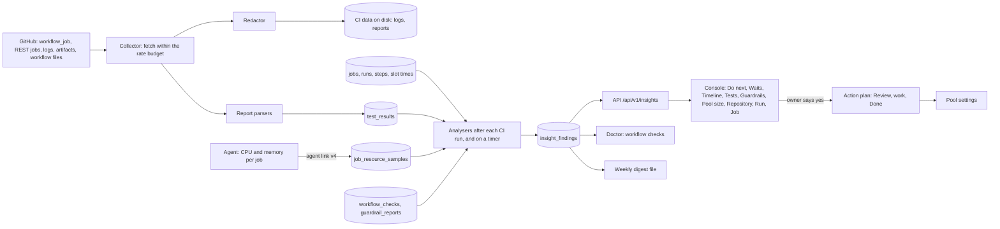

# CI run insights

The top half (sections 1 to 4) is for every reader. The bottom half (5 to 12) is for engineers.

**PROPOSED, CONTRACT ONLY (CIX8).** The shared contract is committed: migration 00030 and its queries, the Go types and interfaces under `internal/insights/`, `internal/jobsdata/reconcile/` and `internal/agent/jobsample/`, the agent link message for resource samples (protocol version 4) and the API under `/api/v1/insights/*`, which answers 501 "not built yet". Every requirement below is **NOT YET IMPLEMENTED**; the wave plan names the task that builds each group. Owner decisions of 20 Nov 2026: all 16 ideas and the Job page faults are built in one wave and one release (CIX).

## 1. In one paragraph

crsp already sees every CI job of the repositories it watches: the jobs its own runners run, and the jobs other runners run (an old pool, GitHub-hosted runners). This feature audits all of them, per project and across projects, and turns what it finds into a short list of things to do, each with its fix in plain words and the minutes a week it would save. It tells the owner how to size the pool to real demand, tells each project how to make its CI faster and where it stands against the dev-standards test guardrails G1 to G7, and fixes the Job page so it always says who ran a job, shows its steps and never stays "queued" after GitHub finished it. Nothing changes the pool by itself: a recommendation that changes the setup is an action the owner reviews and starts. Everything stays on the owner's machines.

## 2. Why

**Problem.** Three studies of the owner's CI (dev-standards research, November 2026) found the same thing: waiting costs far more than testing. Jobs wait in the queue for a runner, hold a slot while a runner starts, lose slots to housekeeping jobs of a few seconds, and run for commits that were already replaced or a tree that a pull request already tested. Meanwhile guardrails G1 (per-test timeout) and G2 (job `timeout-minutes` of 30 or less) fail in every repository. None of this is visible today: the Jobs section shows what ran, not what it cost or how to fix it.

**Users.**

- The owner: sizes the pool and decides what to change.
- Admins: start the changes the owner agrees with.
- Viewers (developers of each project): see what slows their CI and how to fix it in their workflow files.

**Goals.**

- One list, across projects, of what to do next, ranked by minutes saved a week, each item with its fix.
- Size the pool from measured demand, with an estimate of the wait after a change.
- Show where each project stands on G1 to G7 and what breaks each.
- Find slow, flaky, duplicated and empty tests from the test reports CI already writes.
- Make the Job page tell the truth: who ran the job, its steps, its real state.

**Non-goals.**

- No change to a repository: crsp never edits a workflow file, opens a pull request or pushes. The fix is words and a snippet the developer applies.
- No auto-resize, no auto-merge, no change to the pool without the owner's yes (owner decision 20 Nov).
- No static scan of test source files (that is the dev-standards guard's job); crsp reads test reports, logs and workflow files only.
- No upload anywhere: the digest is a local file, never sent (observability R6.7).
- A finding is never deleted or closed by hand: one goes away when its condition ends. The owner can hide it for 7 days; it comes back if it is still true (R5.8, owner decision D17).

## 3. How it works

1. **Collect.** For every job crsp sees, the ingest already stores runs, jobs, steps and slot times (observability R5.35). The collector adds, in the background and within a share of the GitHub rate budget: the job's steps when no webhook gave them, the job's real state when its row looks stale, its log, the run's test report and guardrail report artifacts, and the workflow file at the head commit (already fetched for `needs`).
2. **Store.** Logs and reports go through the redactor first and land in the CI data folder on the owner's machine, with a retention limit and a size cap per repository (owner decision D4). Parsed test results, checks and samples go to the main database.
3. **Measure.** Each agent samples CPU and memory per running job and sends the samples over the agent link.
4. **Analyse.** Analysers run after each CI run (a job reaching done, from its webhook) and on a 15 minute timer, over the last 7 days (14 days for flaky tests, 28 days for trends). Each pass is measured (R5.45); the owner can choose a slower period in Settings (R5.44). Each one writes findings: what is wrong, the fix in words, the evidence and the minutes it would save a week.
5. **Rank and show.** Findings across projects form one Do next list, ranked by minutes saved a week. Each screen shows the findings that belong to it; the Overview shows only a count and a link.
6. **Act.** A finding whose fix is a crsp setup change offers an action: a plan the owner reviews, then the work, then Done. A finding whose fix is in a repository says what to change there.
7. **Resolve.** When an analyser no longer sees a finding's condition over a full window, the finding is resolved. A hidden finding (R5.8) that is still true comes back after 7 days; one that is not is resolved like any other.
8. **Digest.** Every Monday at 08:00 Europe/Lisbon crsp writes a local digest file, a draft that is never sent, with the top 3 findings and what changed. The tray menu links to it (R5.38).

## 4. Screens and states

Screens follow design system v3: UX rules, components and content words. New words go to `next-version` content first (section 11).

### 4.1 Jobs, Charts area

The Charts tab (web-console 4.6) gets a segment row (component 12) under its title: **Trends** (the charts of today, the default at `#/jobs/charts`), **Do next**, **Waits**, **Timeline**, **Tests**, **Guardrails**. Each segment has its own address: `#/jobs/charts/do-next`, `#/jobs/charts/waits`, `#/jobs/charts/timeline`, `#/jobs/charts/tests`, `#/jobs/charts/guardrails`. A filter by repository (filter chips, component 12, design system UX-31) is kept across the segments.

**Trends.** Unchanged, plus a Do next pane at the top with the 5 highest items and "See all N" (design system UX-11, UX-14).

**Do next (idea 1).** One table (component 15, design system UX-25, UX-72): what to do, project (or "the pool"), area, about how many minutes a week it saves, since when, and the row action *Open*. Ranked by minutes saved; a tie goes to the older finding. A guardrail finding names its guardrail ("G2"). A folded section (component 47) holds the latest weekly digest as text. Empty: "Nothing to do. crsp found no waste in the last 7 days." (design system UX-6). Not enough data (under 50 finished jobs in the window): "Not enough finished jobs yet to rank anything. crsp needs a few days of CI." (design system UX-6).

**Finding page (`#/jobs/charts/do-next/<id>`).** One headline in words (design system UX-3), the fix in plain words, a copyable snippet where the fix is a workflow change (component 39), the evidence as a table and, where it helps, a chart (design system UX-41), the minutes saved labelled "estimate" with how it was counted, first and last seen (design system UX-53). A finding whose fix changes the crsp setup has one primary, *Review the change*, in the action bar (component 48, design system UX-4, UX-71); it opens the wizard of 4.7. A finding whose fix is in a repository has no change primary. *Open the workflow on GitHub* comes back once the finding carries the repository address from the API (the web console holds no absolute address, guard `no-hardcoded-addresses`; CRSP208 left it out). A secondary action *Hide for 7 days* (busy word Hiding) hides the finding from Do next and the counts; the page then says "Hidden until {time}. It comes back then if it is still true." and the button is disabled with that reason (design system UX-38). A resolved finding has no such button (R5.8).

**Waits (idea 11).** A Trend chart (component 52) of wait, hold and run per day, stacked, with a table view (design system UX-17, UX-41); a table per repository and per job key: jobs, median and p95 of wait, hold and run, and holds over the cap with their reason in words (design system UX-29). Range 7, 14 or 30 days, named (design system UX-33).

**Timeline (idea 3, 16).** One lane per runner (crsp runners and other runners by name), on one time axis like the Waterfall (component 50): a bar per job, labelled with the project; idle time in a lighter segment; a queued job for which a runner sat idle is marked "idle while {job} waited"; after-merge (push on the default branch) work that held a slot while a pull request job waited is marked "after-merge work"; the time a job of a follow-up run (event `workflow_run`, such as Installers after CI) waited for its runner is a row of its own, "Waited for a runner", noted "follow-up run" (R5.49). A range picker of 1 to 24 hours (date and time pickers, components 35, 36). The text equivalent is a table of every segment (design system UX-17, UX-41). Phone width: lanes stack, each lane a list (design system UX-16, UX-49).

**Tests (ideas 7, 8).** Segments of one table each: Slowest, Flaky, Duplicated, No assertions. Columns: test, project, job, runs, median and p95 time, failures, last seen. A test over its G1 limit shows "over the {kind} limit of {n} s". A test name is shown as text (design system UX-3). Empty: "No test reports found. crsp reads JUnit, Playwright, vitest, go test, nextest and TRX reports your CI uploads." with a link to the guide (design system UX-6).

**Guardrails (idea 6).** A table, one row per project, one column per guardrail G1 to G7: `✓ pass`, `✕ break {n}`, `off ({reason})`, `◷ unknown` (design system UX-58), and the source (guard report of {date}, or crsp check). A Sparkline (component 53) of the known-list count over 30 days. *Open* goes to the project's Repository page.

### 4.2 Overview

One line in the Overview: "{n} things to do next, about {m} min a week" linking to Do next. No button (design system UX-52).

### 4.3 Pool, Size and backends (`/pool/size`, idea 2, 12)

A Demand section above the machine rows: per label set, slots, utilisation, jobs per hour, median and p95 wait, as a table (component 15), and a Trend chart of p95 wait per day (component 52). Under it, the estimate: "With 1 more slot the p95 wait would be about {x} min (now {y} min). An estimate from the last 7 days." for 1 to 4 more slots, as rows. When the queue grows faster than slots finish work: "The queue grows: at least {k} more slots are needed." Each estimate shows its inputs under *Details* (design system UX-41). A pool sizing finding shows *Review the change* as the page's one primary (design system UX-4) when the change fits the measured headroom; otherwise its reason is beside the disabled primary (design system UX-38).

### 4.4 Repository page (ideas 5, 6, 12)

New panes (component 8): **CI checks** lists the workflow file checks of the latest default-branch commit (status word, check, job, line, fix; design system UX-58) and **Guardrails** shows G1 to G7 for this project as on the Guardrails segment. **Job slots** shows the advice of R5.18 in words with *Review the change* as a normal button that opens the wizard (the page's one primary stays Save, design system UX-4, UX-71).

### 4.5 Run page (idea 4, 14, 15)

**Started next (CIX24, owner decision D27).** The facts of the Run page gain *Started next* when the run started other runs: one line for each, "{workflow}, {state}" (for example "Installers, running"), the workflow a link to its Run page. While one of them is queued or running the status line adds the word *follow-up running* beside the run's own result, which does not change (design system UX-58, CORE-3, CORE-4). The Done and All lists show the same word in their Result column, with "Started next: {workflow}, {state}" as its hover text; the details panel of a row shows both as facts. The words come from `docs/design-system/next-version/content.md`; the parts are the shared Status, Facts, Cluster, Table and SearchTable.

A **Savings** pane under the critical path: up to 3 lines "The run would end {n} min sooner if {change}." with the evidence (design system UX-41). When the run was superseded, ran twice for one commit or ran past its first failure, a Note message says so with the minutes (design system UX-26).

### 4.6 Job page (idea 9, 17)

- **Runs on** fact: "crsp runner {runner} on {machine}", "Another runner: {name} (group {group}; labels {labels})" or "GitHub-hosted runner ({label})"; "not known yet" while queued.
- **Steps**: shown for every job; the source is named under the waterfall ("from GitHub events" or "read from GitHub") (component 50).
- **Checked**: "Last checked with GitHub {x ago}" (design system UX-53) for a job crsp re-read.
- **CPU and memory** pane for a job a crsp runner ran: a Trend chart of CPU cores and memory over the job (component 52), peak and p95 as text (design system UX-17).

### 4.7 The action wizard

A recommendation that changes the crsp setup (pool slots of a machine, a repository's parallel jobs limit, a light lane) is an action, never a silent change. Steps: **Review**, then the work named by its verb (**Changing**), then **Done** (design system UX-30, UX-54, UX-5). Review lists each change in numbers and words, the evidence and the estimate, and says "Nothing has changed yet." A change that lowers slots or stops running work names the jobs and waits for them (design system UX-62). Done says what really changed. The work step is not pressable twice (design system UX-13).

### 4.8 Doctor (idea 5)

Workflow checks show as Doctor findings in an area Workflows, with the fix (doctor feature).

### 4.9 Settings, Data

A pane **CI data** in the Data tab: a switch "Keep CI logs and test reports" (on by default, owner decision D4; design system UX-22), days to keep (number keypad, component 37), size per repository, and the space used now per repository as a table. The tab's one Save sends them (design system UX-71).

A pane **CI run insights** in the same tab: a one-choice list *Update period* (*After every CI run*, the default; *After every few CI runs*; *Once an hour*) and, for the middle choice, a number *Runs between updates* (2 to 50, default 5). Only the owner changes it. It is saved with the tab's one Save (R5.44; design system UX-22, UX-71).

### 4.10 States

Every new screen has loading, empty, could not load (with Try again; design system UX-28) and live. A list waits on GitHub's limit with "Waiting for GitHub's hourly limit until {time}; {n} jobs not read yet." (design system UX-29). A screen keeps its h1 in every state (design system UX-17).

## 5. Functional requirements

Requirement IDs are this spec's own. "Idea n" is the owner's list of 20 Nov 2026.

### Collecting CI data (owner decision D4)

**R5.1** — **What is seen.** crsp analyses every job of every repository it watches: jobs of crsp runners and jobs of other runners (self-hosted runners of another pool, GitHub-hosted runners). The source is the existing ingest (observability R5.35, github-integration R5.96 to R5.99). A job crsp did not run has no slot times; its wait is GitHub's `created_at` to `started_at`.

**R5.2** — **Job logs.** After a job completes, the collector downloads its log (`GET /repos/{owner}/{repo}/actions/jobs/{job_id}/logs`), passes every line through the redact package (`internal/redact`, with the values the controller holds) and drops the values of the runner's `env:` block, keeping names only. The redacted log is stored gzipped in the CI data folder (`<data dir>/ci-data/<repository id>/logs/<run id>-<attempt>-<job id>.log.gz`) and indexed in `ci_job_logs` (size, lines, sha256, stored and expiry times, state). A log over 64 MiB is not stored; its row says `too_large`.

**R5.3** — **Test and guardrail reports.** After a run completes, the collector lists its artifacts and downloads those whose content is a test report (R5.33) or a guardrail report (R5.31), up to 50 MiB each and 200 MiB per run. Raw files are stored redacted in `<data dir>/ci-data/<repository id>/reports/` and indexed in `ci_report_files`; parsed rows go to `test_results` and `guardrail_reports`.

**R5.4** — **Never stored.** Secrets, environment values, the actor's email, commit messages. Test and step names are stored as text and shown as text, never as markup. Everything stays on the owner's machines (observability R5.38, R6.7).

**R5.5** — **Settings, Data.** `insights_keep_ci_data` (on by default), `insights_ci_data_days` (default 30, 7 to 365), `insights_ci_data_mib_per_repository` (default 1024, 64 to 20480), `insights_test_results_days` (default 90, 14 to 400), `insights_resource_samples_days` (default 7, 1 to 30). Turning keeping off stops new downloads; the stored files leave by retention. A change writes an audit row (observability R5.24).

**R5.6** — **Retention.** The hourly retention job (observability R5.32) deletes CI data past its days, then the oldest files of a repository over its size cap, and their index rows. Parsed rows keep their own retention (R6.2).

### Findings

**R5.7** — **Shape.** A finding has: kind (section 7), scope (`repo` or `pool`), repository, subject (what it is about: a job key, a label set, a workflow file, a test), title in plain words, fix in plain words, optional snippet, evidence (JSON with the numbers the screens show), minutes saved a week (an estimate), guardrail (G1 to G7 or none), action kind (none when the fix is outside crsp), first seen, last seen, resolved at.

**R5.8** — **Resolve by condition; hide for 7 days.** Nothing deletes or closes a finding by hand: the `FindingStore` has no such method. An analyser run over a full window that no longer reports a finding sets its `resolved_at`. An admin can hide an open finding with `dismissInsightFinding` (owner decision D17): it leaves the Do next list and the counts for 7 days (`insight_findings.hidden_until`) and is back after that if it is still true. The engine keeps refreshing a hidden finding, so "still true" needs no second check; a hidden finding whose condition ends is resolved as usual, and a resolved one cannot be hidden (409). The same condition seen again later opens a new finding; the resolved one is kept for the retention (R6.2) as history.

**R5.9** — **Minutes saved a week.** Every kind states how it counts minutes (section 7, Minutes table). The figure is the minutes of the last 7 days the fix would have removed, rounded to whole minutes, and is labelled "estimate". A finding that saves no time (G4, G5) has 0 and ranks by guardrail order after the others.

**R5.10** — **Actions, never silent.** A finding whose fix changes the crsp setup has an action kind: `machine_slots` (job slots of a machine, the pool size of machines R5), `repo_parallel_limit` (a repository's maximum parallel jobs, scheduling), `light_lane` (light slots for short jobs, scheduling). The action is a plan (`createInsightPlan`), reviewed in the wizard (4.7) and started by an admin (`startInsightPlan`). Each change writes an audit row. crsp never starts a plan by itself, never resizes the pool by itself, and never merges anything.

### Do next (idea 1)

**R5.11** — **One list across projects.** `listInsightFindings` returns the open findings of every project and of the pool, ranked by minutes saved a week, then by first seen. Filters: repository, kind, area, guardrail, open or resolved. The Charts area shows it (4.1); the Overview shows only the count and the minutes (`getInsightSummary`, design system UX-52).

### Wait, hold and run (idea 11)

**R5.12** — **Split per job.** For a crsp job: wait = GitHub `created_at` to `slot_at` (GitHub wait until `queued_at`, then crsp queue wait until `slot_at`), hold = `slot_at` to `started_at` (runner start and set-up while the slot is held), run = `started_at` to `completed_at`. For another runner's job: wait = `created_at` to `started_at`, no hold. The timing rules of observability R5.9 apply (never negative, unknown is not zero).

**R5.13** — **Per repository and day.** `getWaitSplit` groups the split by repository, job key or day over 7, 14 or 30 days, with count, median and p95 of each part and the total minutes.

**R5.14** — **Hold over the cap.** A hold over the cap (default 2 min, setting `insights_hold_cap_seconds`, 30 to 900) is flagged with its reason from the runner set-up log and wait reasons: image pull, runner start, registration, load over budget, unknown. A job key whose holds over the cap add up to 10 min or more a week gives a `wait.hold` finding.

### Pool sizing (idea 2) and job slots (idea 12)

**R5.15** — **Demand per label set.** For each label set the pool serves: slots that can take it, utilisation (busy slot minutes over available slot minutes, per hour and over the window), jobs per hour, mean and coefficient of variation of the gaps between arrivals and of run plus hold times, and the median and p95 wait. `getPoolSizing` returns them.

**R5.16** — **Estimate with N more slots.** For 1 to 4 more slots, the mean wait is estimated with the Allen-Cunneen approximation for a G/G/c queue, using Sakasegawa's term for the chance of waiting: Wq ≈ (ca² + cs²) / 2 · ρ^(√(2(c+1)) − 1) / (c · (1 − ρ)) · E[S]. The p95 wait is scaled from the mean by the ratio seen now. When ρ ≥ 1 no number is given: the answer is the smallest c with ρ < 0.85. The screens call it an estimate and show its inputs.

**R5.17** — **Pool size finding.** When the p95 wait of a label set is over 2 min and an extra slot would cut it by at least 30 percent, a `pool.size` finding names the machine that can take the slot within the budget of 85 percent memory and 60 percent CPU, measured (R5.19), and has the action `machine_slots`. When no machine has the room, the fix says so ("add a machine with at least {n} GiB free") and has no action.

**R5.18** — **Job slots per repository.** For each repository with a parallel jobs limit (`repository_parallel_limit`): when its jobs waited 30 min or more a week for the limit itself (wait reason "repository parallel limit") while the pool had free slots, a `repo.slots` finding advises raising the limit to the p95 of its concurrent jobs, within the measured memory headroom; when one repository held more than half the slots while others waited, it advises a limit. Action `repo_parallel_limit`.

### CPU and memory per job (idea 9)

**R5.19** — **Sampling on the agent.** While a job runs on a crsp runner, the agent samples every 5 s the CPU (cores used) and memory (resident bytes) of the job: the container's cgroup for a container or VM backend, the runner process tree for a persistent runner. It sends a `JobResourceSamples` batch about every 15 s and a final one at the end (agent link protocol version 4). An agent that cannot read a value sends `known = false` with the reason.

**R5.20** — **Storage and use.** The controller stores the samples (`job_resource_samples`) and, at the job's end, a summary (`job_resource_summary`: samples, CPU p50, p95 and peak, memory p50, p95 and peak). The summaries per job key feed R5.17 and R5.18 (slot sizing: the p95 memory of the jobs a slot takes). `getJobResources` returns both; the Job page draws them (4.6).

### Cross-project timeline (idea 3) and idle next to a queue (idea 16)

**R5.21** — **Timeline.** `getPoolTimeline` returns, for a range of up to 24 hours, one lane per runner that ran a job in the watched repositories (crsp runners with their machine, other runners by name), the jobs on each lane with project, job key, event and times, the idle gaps of crsp runners, and markers: "idle while a job waited" (an online crsp runner idle while a job it could have taken by labels waited), "after-merge work" (a push run on the default branch holding a slot while a pull request job waited).

**R5.22** — **Idle next to a queue.** When an online crsp runner of one operating system or label set sat idle for 2 min or more while jobs for another waited, and this adds up to 15 min or more of waiting a week, a `pool.idle_next_to_queue` finding names both sides and the minutes. The fix says how to make the idle capacity useful (for example Linux runners on a Windows machine, runners feature, or moving a slot); a fix inside crsp has the action `machine_slots`.

### Run critical path with savings (idea 4)

**R5.23** — **Savings on a run.** For a finished run, `getRunSavings` takes the critical path over the needs graph (observability R5.42) with real times and computes, for each job on it, the run's end if that job (a) had not waited or held a slot, (b) had run at the median of its job key, (c) had started as soon as its needs ended. It returns up to 3 changes that save the most, each as "The run would end {n} min sooner if {change}". A workflow whose runs would end 10 min or more sooner a week from the same change gives a `run.critical_path` finding.

### Superseded and duplicate runs (idea 14)

**R5.24** — **Superseded.** A job that started after a newer commit was pushed to its branch (a later run of the same workflow on the same branch had been created) and was not cancelled is superseded work. A workflow with 10 min or more of it a week gives a `run.superseded` finding; the fix is a `concurrency` group with `cancel-in-progress: true` (snippet).

**R5.25** — **Two events on one head.** Two runs of the same workflow on the same head commit from two events (for example `push` and `pull_request`) give a `run.duplicate_event` finding with the minutes of the second; the fix names the trigger to narrow.

**R5.26** — **Default branch re-runs a tested tree.** A push run on the default branch whose commit tree equals the tree a pull request run already tested green (the tree is read once per commit, `GET /repos/{owner}/{repo}/git/commits/{sha}`, cached) is re-run work; 10 min or more a week gives a `run.retested_tree` finding with the fix in words (skip the job when the tree was tested, or use a merge queue).

### Fail-fast order (idea 15)

**R5.27** — **Ran past its first failure.** In a failed run, the minutes other jobs ran after the first failed job ended (and jobs that started after it) are counted. A workflow with 10 min or more a week gives a `run.fail_fast` finding; the fix names the order change: `fail-fast: true` for a matrix, cheap checks (lint, types) as `needs` of long jobs, cancel the run on failure.

### Housekeeping lane (idea 13)

**R5.28** — **Short jobs that wait long.** A job key whose median run is under 1 min and whose median wait is over 2 min (artifact prune, clean-up, smoke) gives a `housekeeping.lane` finding. The fix is one of: a light lane (scheduling light slots; action `light_lane` when a machine has room), moving it to a schedule out of busy hours (the busiest hours from the heatmap of web-console R5.110), or running it on a GitHub-hosted runner.

### Workflow file checks (idea 5)

**R5.29** — **The checks.** For the workflow files at each new head commit of the default branch and of open pull requests (the files crsp already fetches for `needs`, github-integration R5.99; cached by commit), crsp runs these checks per job and stores them in `workflow_checks`:

| Check ID | Fails when | Guardrail |
|---|---|---|
| `workflow.timeout` | a job has no `timeout-minutes` or one over 30 | G2 |
| `workflow.retry` | a step retries tests (a retry action, `--retries`, `--reruns`, `rerun-failed`, `retry:` over 0) | G3 |
| `workflow.matrix_axis` | a matrix gained an axis or values since the last default-branch commit checked; the detail gives the job count before and after | none |
| `workflow.step_order` | an end-to-end job does not need the lint or type check job of the same workflow, or a lint or type step comes after a test step in one job | none |
| `workflow.cache` | a job sets up a package manager without its cache (`setup-node` without `cache`, `setup-go` with `cache: false`, cargo or pip without `actions/cache`) | none |
| `workflow.slow_tests_on_pr` | a mutation or many-run property test runs on `pull_request` or a non-default push | G6 |

**R5.30** — **Where they show.** The Repository page (4.4), the Doctor in an area Workflows with check IDs as above (doctor feature), and as findings: one finding per repository and check ID that fails, with the jobs and lines in the evidence. Minutes: `workflow.cache` counts the set-up step time over the median of the same step with a cache in other repositories; the others count 0 unless a run proved the cost (a timed-out job ran past 30 min: its minutes over 30).

### Guardrail status (idea 6)

**R5.31** — **Guard report.** When a run uploads the dev-standards test guardrails report (the JSON of `test_guardrails.py --json`: `mode`, `results.G1` to `results.G7` each with `state` pass, break or off, `reason`, `count`, `breaks` of file, line and message), crsp stores one `guardrail_reports` row per guardrail and run, and the count of the guard's known list when the report holds it. The artifact is found by content (that JSON shape); its name pattern is a setting (`insights_guardrail_artifact`, default `test-guardrails*`).

**R5.32** — **crsp's own checks.** Without a report, or for a guardrail the report does not cover, crsp fills what it can: G1 from test times over the limit (R5.34), G2 and G3 and G6 from workflow checks (R5.29), G3 also from test reports that show retries, G7 from whether any test report was found in the last 7 days. G4 and G5 are "unknown, needs the guard report". Each value carries its source and date. `listGuardrailStatus` returns per repository the latest state of each guardrail and the known-list count per day for 30 days.

### Tests (ideas 7, 8)

**R5.33** — **Formats.** Parsers, chosen by content: JUnit XML (also cargo nextest and pytest), Playwright JSON reporter, vitest JSON reporter, `go test -json` (from an artifact or from the job log), cargo libtest JSON, dotnet TRX. Each parser streams its file and keeps per test: suite, name, file, result (passed, failed, skipped, error), duration, retries, assertions when the format reports them. A test id is the format, suite and name, normalised (no durations, no random seeds).

**R5.34** — **Test times.** Per test and job key: runs, median and p95 duration, failures over the window. A test over its G1 limit (unit 10 s, integration 60 s, end-to-end 2 min; the kind is read from the job and file names, else unit) is marked. The slowest tests of a repository with 5 min or more a week give a `test.slow` finding.

**R5.35** — **Flaky.** Over the last 14 days (owner decision D21; the other test findings keep 7), a test is flaky when, for the same job key and the same head commit, it has different results across attempts, or it passed after a retry inside one job. Each flaky test gives a `test.flaky` finding with the runs that prove it; minutes are the re-run time it caused.

**R5.36** — **Duplicated.** The same test id run in two or more job keys of one run (not a matrix of the same job) gives a `test.duplicate` finding with the minutes of the extra runs.

**R5.37** — **No assertions.** Where the format reports assertions (JUnit `assertions`, TRX counters), a test that passed with zero assertions gives a `test.no_assertions` finding. Where the format does not report them, the test is "not reported", never zero. Static scanning of test source is out of scope.

### Weekly digest (idea 10)

**R5.38** — **Local digest.** Every Monday at 08:00 Europe/Lisbon time (owner decision D18; the zone is built into the program, so a machine without a zone database writes at the same moment) crsp writes `<data dir>/ci-data/digests/<YYYY>-W<ww>.md`: the top 3 open findings by minutes saved with their fixes, findings opened and resolved in the week, guardrail changes per repository, and the week's totals of wait, hold and run. It is a draft file and is never sent. `listInsightDigests` returns the last 12 with their text; the Do next segment shows the latest (4.1). The last 52 files are kept. The tray menu shows *Open weekly digest* when a digest file exists and opens it (tray status field `digest_path`).

### Job page faults (item 17)

**R5.39** — **Who runs a job.** From GitHub's job fields `runner_name`, `runner_group_name` and `labels`, and crsp's runner registry, each job row stores `runner_origin` (`crsp`, `other`, `hosted`, or empty while not known), `runner_group` and `runner_labels`. A runner name crsp made is `crsp`; a group named "GitHub Actions" is `hosted`; any other runner is `other`. The Job page says it (4.6).

**R5.40** — **Steps for poller-only jobs.** A job whose steps did not come from webhooks gets them from `GET /repos/{owner}/{repo}/actions/jobs/{job_id}`: once when the job completes, and while it runs at most every 60 s while its Job page is open. `steps_source` says `events` or `rest`. Calls are background calls within the rate budget (R6.1).

**R5.41** — **Reconcile stale states.** Every 5 min, job rows in `queued` or `running` with no update for 10 min, or whose run GitHub reports completed, are re-read from GitHub (one call per run, `GET /repos/{owner}/{repo}/actions/runs/{run_id}/attempts/{attempt}/jobs`), oldest first, up to 100 runs a pass. A completed job is set `done` with GitHub's conclusion and times; a job GitHub no longer has gets the result `lost` with the reason. `checked_at` records the read. The Job page and lists never show `queued` for a job GitHub completed more than one reconcile pass ago.

### Interfaces

**R5.42** — **API.** Read routes are viewer role (`user`): `listInsightFindings`, `getInsightFinding`, `getInsightSummary`, `getWaitSplit`, `getPoolTimeline`, `getPoolSizing`, `listTestInsights`, `listGuardrailStatus`, `listInsightDigests`, `getRunSavings`, `listWorkflowChecks`, `getJobResources`, `getInsightPlan`. Changes are admin: `createInsightPlan`, `startInsightPlan`, `dismissInsightFinding`. The contract is `packages/contract/openapi.yaml`.

**R5.44** — **When insights update (owner decisions D18, D19).** Analysers run again after each CI run: the job ingest tells the engine when a job first reaches done (`Trigger`), and the engine starts a pass at once; runs that finish during a pass are counted and decided after it, so passes never overlap. The 15 minute timer stays as a safety net. The *update period* (settings `insights_update_period`: `every_run`, the default, `every_nth_run`, `hourly`; and `insights_update_every_n_runs`, 2 to 50, default 5) says how often: `every_run` runs after each finished run and on the timer; `every_nth_run` after every Nth finished run and, as a safety net, once an hour; `hourly` only on an hourly timer. The engine reads the setting at every decision, so a change takes effect without a restart.

**R5.45** — **The analysis measures itself (owner decisions D18, D19).** Every pass is measured: the average CPU over the pass (percent of one core, the whole process, so an upper bound), the peak memory of the process during the pass, and the size on disk of the insights store (the CI data folder and the database file with its log). Over 5 percent CPU, 300 MB memory or 1 GB disk, the engine opens a pool-scope finding of kind `insights.cost` (area pool, 0 minutes) that names what is over and recommends a slower update period: after every 5th CI run, or once an hour; when the period is already once an hour, it recommends keeping less CI data or a bigger machine. The owner chooses the period in Settings (4.9); nothing changes by itself (R6.6). A pass back under all three limits resolves the finding.

### Follow-up runs (CIX24, owner decision D27)

**R5.46** — **Link a follow-up to its run.** A run started by another run's completion (event `workflow_run`, such as the Installers workflow after CI) is stored with the run that started it, in `run_follow_ups` (migration 00033): `payload` when the source names the triggering run, `inferred` otherwise. The inferred parent is the run of the same repository and head sha with a lower run id that finished last before the follow-up was created; a run whose finish crsp has not stored yet counts only when it is the single candidate. A run counts as finished when it has a conclusion or all its jobs are done. The link is recomputed after every run or job write of that head sha, so a follow-up that arrives before the parent's last job still ends up linked; a `payload` link is never replaced. Links of pruned runs are pruned with them.

**R5.47** — **Run detail and summary.** `getRun` returns `started_next`, a list of `{workflow_name, run_id, attempt, state, result, started_at, completed_at, link}`, oldest first; a run summary (`listRuns`) carries the same list, the counts `follow_ups` and `follow_ups_open`, and `started_by` for a follow-up. A run summary and a run carry `overall_state`: the run's own state until it is done, then `follow_up_running` while any follow-up is queued or running, then `done`. `state` and `result` keep the run's own values.

**R5.48** — **Console.** The Run page and the Done list say "Started next: {workflow}, {state}" and show *follow-up running* beside the run's own result while a follow-up is not finished (section 4.5).

**R5.49** — **Timeline.** The run timeline includes follow-up runs: a job of a `workflow_run` run is marked as a follow-up on its lane, and when it waited a minute or more for its runner the wait is a segment of kind `wait` (`getPoolTimeline`), so a gap such as 06:51 to 06:57 shows.

**R5.43** — **Doctor.** The doctor reads `workflow_checks` and shows the failing checks as findings in an area Workflows, one per repository and check ID (doctor feature, R5.2 shape).

## 6. Non-functional requirements

**R6.1** — **Rate budget.** All collection (R5.2, R5.3, R5.26, R5.40, R5.41) is background work (github-integration R6.6: stops at half the installation's hourly limit). Within that, insights use at most 25 percent of the hourly limit per installation, in this order: reconcile (R5.41), steps (R5.40), workflow files, run artifacts, logs, commit trees. Work over the share waits for the next hour and the screens say how many jobs are not read yet (4.10). Webhook-driven and user-driven calls are never held back by it.

**R6.2** — **Storage.** Defaults, floors and ceilings:

| Data | Default | Floor | Ceiling |
|---|---|---|---|
| CI logs and raw reports (files) | 30 days and 1 GiB per repository | 7 days, 64 MiB | 365 days, 20 GiB |
| `test_results` rows | 90 days | 14 days | 400 days, and at most 5,000,000 rows |
| `job_resource_samples` | 7 days | 1 day | 30 days |
| `job_resource_summary` | 90 days (as job rows) | 7 days | 400 days |
| `workflow_checks`, `guardrail_reports` | 90 days, and always the latest per repository | 30 days | 400 days |
| Resolved findings | 90 days | 30 days | 400 days |
| Digests | 52 files | 4 | 260 |

Whichever of a time or a size limit is reached first applies; the oldest goes first. A typical repository of 2,000 jobs a week keeps about 0.6 GiB of gzipped logs for 30 days and about 40 MiB of database rows.

**R6.3** — **CPU cost of analysis.** Analysers run after each CI run and every 15 min (R5.44), one at a time, on the last window only (incremental where the kind allows). On a controller with 20,000 jobs a week the analysis uses under 2 percent of one CPU core averaged over an hour, and one pass of any analyser ends within 30 s; a pass over that is logged and shown to the doctor. Parsers stream: under 64 MiB of memory per file. The analysis never runs inside a scheduler transaction and never delays a slot.

**R6.4** — **Agent cost.** Sampling (R5.19) uses under 0.5 percent of one CPU core per machine and under 1 KiB/s on the agent link per running job.

**R6.5** — **Privacy.** As R5.4 and observability R5.38 (reworded by CIX7) and R6.5 to R6.7: every stored log and report passes the redactor; the redaction test (observability R6.6) covers the CI data sink; no insights package makes a network call other than to GitHub through `internal/github` and the agent link.

**R6.6** — **Never silent.** No analyser writes to pool, machine, runner or repository settings. Only `startInsightPlan`, called by an admin after Review, changes the setup, with an audit row per change (observability R5.24, R5.25).

**R6.7** — **Speed.** `listInsightFindings` answers a page of 50 in under 300 ms with 10,000 findings stored; `getPoolTimeline` for 24 hours and 200 runners in under 1 s.

**R6.8** — **Fail open.** A failed fetch, parse or analyser run never stops or slows a job, a runner or the scheduler; the failure is counted, logged and shown to the doctor. A finding is never resolved by a failed run (only by a full, successful window).

**R6.9** — **Times.** Stored in UTC, shown in local 24-hour time, year-month-day (design system UX-18).

## 7. Design

### Parts

| Package | Job | Ideas |
|---|---|---|
| `internal/insights` | Finding, kind, scope, window, job facts; the `Analyser`, `FindingStore` and `JobSource` interfaces; the engine that runs analysers and resolves | 1 |
| `internal/insights/collect` | Fetch steps, logs, artifacts, commit trees within the budget; redact; store files; retention of files | D4 |
| `internal/insights/waits` | Wait, hold and run split; hold cap; housekeeping lane | 11, 13 |
| `internal/insights/capacity` | Demand per label set, the G/G/c estimate, pool size and repository slots advice, resource summaries | 2, 9, 12 |
| `internal/insights/timeline` | Runner lanes, idle gaps, idle next to a queue, after-merge work | 3, 16 |
| `internal/insights/runs` | Critical path savings, superseded, two events, re-tested tree, fail-fast | 4, 14, 15 |
| `internal/insights/workflows` | Workflow file checks | 5 |
| `internal/insights/guardrails` | Guard report parser, crsp's own guardrail checks | 6 |
| `internal/insights/tests` | Report parsers, test times, flaky, duplicated, no assertions | 7, 8 |
| `internal/insights/digest` | The weekly local digest | 10 |
| `internal/insights/actions` | Plans for setup changes: review, start, audit | R5.10 |
| `internal/agent/jobsample` | Agent-side CPU and memory sampling per job | 9 |
| `internal/jobsdata/reconcile` | Runner origin, steps by REST, stale state reconcile | 17 |
| `internal/github/rest_insights.go` | REST calls of the collector: logs, artifacts, commit trees | D4, 14 |
| `internal/github/rest_insights_jobs.go` | REST calls of reconcile: one job, the jobs of a run attempt | 17 |

### Kinds and minutes

| Kind | Scope | Area | Minutes saved a week | Action |
|---|---|---|---|---|
| `wait.hold` | repo | waits | hold time over the cap | none |
| `housekeeping.lane` | repo | waits | wait of the short jobs over 1 min | `light_lane` or none |
| `pool.size` | pool | pool | wait now minus the estimated wait, times jobs | `machine_slots` or none |
| `pool.idle_next_to_queue` | pool | pool | the waiting that overlapped idle runners | `machine_slots` or none |
| `repo.slots` | repo | pool | wait for the repository limit while slots were free | `repo_parallel_limit` |
| `run.critical_path` | repo | runs | the run-end gains of the change, summed | none |
| `run.superseded` | repo | runs | runner minutes of superseded jobs | none |
| `run.duplicate_event` | repo | runs | runner minutes of the second run | none |
| `run.retested_tree` | repo | runs | runner minutes of the re-run | none |
| `run.fail_fast` | repo | runs | runner minutes after the first failure | none |
| `workflow.timeout`, `workflow.retry`, `workflow.matrix_axis`, `workflow.step_order`, `workflow.cache`, `workflow.slow_tests_on_pr` | repo | workflows | R5.30 | none |
| `guardrail.g1` to `guardrail.g7` | repo | guardrails | 0, except G1 (minutes of tests over the limit) | none |
| `test.slow`, `test.flaky`, `test.duplicate`, `test.no_assertions` | repo | tests | R5.34 to R5.37 | none |
| `insights.cost` | pool | pool | 0 (a warning about the analysis itself, R5.45) | none |

A subject is the stable key of a finding inside its kind; the store keeps one open finding per (kind, scope, repository, subject).

### The contract (CIX8)

- Migration `internal/store/migrations/00031_insight_dismiss.sql` (CIX23, D17): `insight_findings.hidden_until`.
- Migration `internal/store/migrations/00030_ci_insights.sql`: `insight_findings`, `insight_analyser_runs`, `insight_plans`, `ci_job_logs`, `ci_report_files`, `test_results`, `job_resource_samples`, `job_resource_summary`, `workflow_checks`, `guardrail_reports`, `insight_digests`, and the job columns `runner_origin`, `runner_group`, `runner_labels`, `steps_source`, `checked_at`. Numbers 00022 to 00029 stay reserved for the registry wave.
- Queries in `internal/store/queries/insights_*.sql`, one file per family; sqlc writes `internal/store/sqlcgen/insights_*.sql.go`.
- API: `/api/v1/insights/*`, `/api/v1/runs/{runId}/savings`, `/api/v1/repositories/{repositoryId}/workflow-checks`, `/api/v1/jobs/{jobId}/resources`; new optional fields on `Job` and `Settings`. Handlers in `internal/api/handlers_insights.go` (CIX21); a service not wired answers 501.
- Agent link: `JobResourceSamples` (request field 31), protocol version 4. The agent sends it only when the controller's HelloAck says version 4 or more.

### The queue estimate

The Allen-Cunneen form with Sakasegawa's waiting probability is used because it needs only means and coefficients of variation, which the job history gives, and is within about 10 percent of simulation for utilisation between 0.5 and 0.95. It ignores label overlap between label sets: a slot that serves two label sets is counted in both, and the screens say "an estimate".

## 8. Failure modes

| Dependency | Fails how | Behaviour | Open or closed |
|---|---|---|---|
| GitHub REST | Rate limit, 5xx, unreachable | Collection waits for the reset; screens say how many jobs are not read yet; findings keep their last state, none is resolved | open |
| Log download | 404 (log expired), 410, too large | Row state `missing` or `too_large`; analysers that need it skip the job | open |
| Report artifact | Unknown format, broken file, over the cap | Skipped with the reason in `ci_report_files.state` | open |
| Redactor | Error or panic | The file is not stored | closed: never store a secret |
| CI data folder | Disk full | Downloads stop; retention runs; doctor reports it | open |
| Agent sampling | cgroup or process tree not readable | Samples with `known = false` and the reason; no slot advice from that machine | open |
| Analyser | Error or over 30 s | Its findings stay as they were; the run is logged in `insight_analyser_runs` | open |
| Action plan | A change fails half way | Done says what changed and what did not; audit rows for each done change | closed per change |
| Workflow file | Not readable at the commit | Checks for that commit are `skip` with the reason | open |

## 9. How it is proven

Every row is planned; the paths are where each test will live (wave CIX).

| Requirement | Test |
|---|---|
| R5.1 | internal/insights/engine_test.go TestSeesOtherRunnersJobs |
| R5.2 | internal/insights/collect/logs_test.go TestLogRedactedAndEnvValuesDropped, TestTooLargeNotStored, TestLogOnceAndKeepOff, TestRedactorFailureStoresNothing; internal/github/rest_insights_test.go TestJobLogAndArtifactFollowRedirectWithoutToken, TestLogErrors |
| R5.3 | internal/insights/collect/artifacts_test.go TestReportArtifactsByContentWithinCaps, TestBrokenReportAndRunCap, TestClassifyByContent; internal/github/rest_insights_test.go TestRunArtifactsPagesAndCommitTree |
| R5.4 | internal/insights/collect/privacy_test.go TestNoSecretNoEnvNoEmailStored, TestSecretOnTheChunkBoundary; internal/store/insights_test.go TestNoForbiddenColumns |
| R5.5 | internal/settings/settings_test.go TestInsightsRanges; apps/web/src/screens/settings/CiData.test.tsx |
| R5.6 | internal/insights/collect/retention_test.go TestDaysThenSizeCapOldestFirst, TestMissingFileDoesNotStopPrune |
| R5.7 | internal/store/insights_test.go TestFindingRoundTrip |
| R5.8 | internal/insights/engine_test.go TestResolvedWhenConditionEnds, TestFailedRunResolvesNothing, TestNoDismissRoute; internal/store/insights_test.go TestDismissHidesForSevenDays; internal/api/handlers_insights_test.go TestDismissRoute; apps/web/src/screens/insights/Finding.test.tsx |
| R5.9 | internal/insights/engine_test.go TestMinutesRoundedAndLabelled |
| R5.10 | planned: internal/insights/actions/actions_test.go TestNothingChangesBeforeStart, TestStartWritesAuditPerChange; apps/web/src/screens/insights/ActionWizard.test.tsx |
| R5.11 | internal/insights/rank_test.go TestRankByMinutesThenAge, TestRankZeroMinutesByGuardrail, internal/store/insights_test.go TestListRankFilterPage; apps/web/src/screens/insights/DoNext.test.tsx |
| R5.12 | internal/insights/waits/split_test.go TestCrspSplit, TestOtherRunnerNoHold, TestUnknownNotZero |
| R5.13 | internal/insights/waits/split_test.go TestGroupByRepositoryKeyDay |
| R5.14 | internal/insights/waits/hold_test.go TestHoldOverCapWithReason |
| R5.15 | internal/insights/capacity/demand_test.go TestUtilisationAndArrivals |
| R5.16 | internal/insights/capacity/queue_test.go TestAllenCunneenKnownValues, TestSaturatedGivesMinimumSlots |
| R5.17 | internal/insights/capacity/advice_test.go TestPoolSizeWithinHeadroom, TestNoRoomNoAction |
| R5.18 | internal/insights/capacity/advice_test.go TestRepoLimitRaiseAndCap |
| R5.19 | internal/agent/jobsample/sampler_test.go TestCgroupAndProcessTree, TestUnknownWithReason; internal/agent/jobsample_link_test.go TestJobSampleSenderV3SendsNothing; internal/machines/job_samples_test.go TestJobSamplesReachHook |
| R5.20 | internal/insights/capacity/resources_test.go TestSummaryAtJobEnd, internal/store/insights_resources_test.go TestResourcesStoreSummaryAtEnd |
| R5.21 | internal/insights/timeline/timeline_test.go TestLanesIdleAndAfterMerge |
| R5.22 | internal/insights/timeline/idle_test.go TestIdleNextToQueueFinding |
| R5.23 | internal/insights/runs/savings_test.go TestTopThreeSavings |
| R5.24 | internal/insights/runs/superseded_test.go TestSupersededMinutes |
| R5.25 | internal/insights/runs/superseded_test.go TestTwoEventsOneHead |
| R5.26 | internal/insights/runs/superseded_test.go TestRetestedTree |
| R5.27 | internal/insights/runs/failfast_test.go TestMinutesAfterFirstFailure |
| R5.28 | internal/insights/waits/housekeeping_test.go TestShortJobsWaitingLong |
| R5.29 | internal/insights/workflows/checks_test.go TestEachCheck, TestStepOrderLintAfterTest, TestMatrixAxisGrowth; internal/store/insights_checks_test.go TestWorkflowChecksStoreRoundTrip |
| R5.30 | internal/insights/workflows/checks_test.go TestAnalyserFindings; internal/doctor/checks/workflows_test.go TestWorkflowFindings; apps/web/src/screens/insights/RepositoryPanes.test.tsx |
| R5.31 | internal/insights/guardrails/report_test.go TestParseGuardJSON |
| R5.32 | internal/insights/guardrails/status_test.go TestOwnChecksAndSources |
| R5.33 | internal/insights/tests/parsers_test.go TestEachFormatFromFixture |
| R5.34 | internal/insights/tests/times_test.go TestOverG1Limit |
| R5.35 | internal/insights/tests/flaky_test.go TestSameCommitDifferentResult, internal/insights/tests/service_test.go TestFlakyWindowIs14Days |
| R5.36 | internal/insights/tests/duplicate_test.go TestSameIdTwoJobs |
| R5.37 | internal/insights/tests/assertions_test.go TestZeroOnlyWhenReported |
| R5.38 | internal/insights/digest/digest_test.go TestWeeklyFileTopThree, TestNextRunMonday0800, TestNextRunLisbon, TestKeepsLast52; internal/tray/menu_test.go TestDigestItemOnlyWithAFile; cmd/crsp/insights_wiring_test.go TestLatestDigest |
| R5.39 | internal/jobsdata/reconcile/origin_test.go TestCrspOtherHosted; apps/web/src/screens/jobs/JobPage.test.tsx; internal/jobsdata/ingest/origin_test.go TestOnRunnerRecordsOrigin; internal/store/insights_jobs_test.go TestIntegrationSetRunnerOriginKeepsStored; internal/github/rest_insights_jobs_test.go TestRESTJobReadsRunnerAndSteps; internal/api/handlers_insights_test.go TestRunnerInfoOnJob |
| R5.40 | internal/jobsdata/reconcile/steps_test.go TestStepsByRESTOnce, TestWatchReadsAtMostEveryMinute; internal/jobsdata/ingest/origin_test.go TestOnStepsMarksSourceEvents; internal/store/insights_jobs_test.go TestIntegrationApplyKeepsEventSteps |
| R5.41 | internal/jobsdata/reconcile/stale_test.go TestStaleQueuedBecomesDone, TestGoneBecomesLost; internal/store/insights_jobs_test.go TestIntegrationApplyDoneAndOrigin, TestIntegrationMarkLost, TestIntegrationCompletedRunListedWhenFresh |
| R5.42 | internal/api/handlers_insights_test.go TestRolesAndShapes, TestWaitSplitHoldCapAndRanges, TestTimelineSpan, TestUnwiredServiceAnswers501 |
| R5.43 | internal/doctor/checks/workflows_test.go TestWorkflowFindings, TestWorkflowFindingsWithoutSource |
| R5.44 | internal/insights/engine_cost_test.go TestPeriodDue, TestFinishedRunStartsAPass, TestEveryNthRunWaitsForN, TestHourlyIgnoresFinishedRuns; internal/jobsdata/ingest/recorder_test.go TestOnJobCompletedCallsOnceAtDone; internal/settings/settings_test.go TestInsightsUpdatePeriod; cmd/crsp/insights_wiring_test.go TestBridgeForwardsFinishedRuns, TestPeriodOfSettings; apps/web/src/screens/settings/InsightsUpdate.test.tsx |
| R5.45 | internal/insights/engine_cost_test.go TestCostWarningOpensAndResolves, TestCostAdviceFollowsThePeriod, TestProcessMeterMeasuresAPass; cmd/crsp/insights_wiring_test.go TestNewInsightsEngineMeasuresEachPass |
| R5.46 | internal/jobsdata/followup_test.go TestInferParentPicksTheRunThatFinishedLastBeforeTheChild; internal/store/jobsdata_followups_test.go TestIntegrationFollowUpLinkedWhenTheChildArrivesFirst, TestIntegrationFollowUpPayloadParentWinsOverInference |
| R5.47 | internal/jobsdata/followup_test.go TestOverallStateStaysRunningWhileAFollowUpIs; internal/api/handlers_jobsdata_test.go TestRunDetailAndListCarryTheFollowUps |
| R5.48 | apps/web/src/screens/jobs/followUps.test.tsx |
| R5.49 | internal/insights/timeline/timeline_test.go TestFollowUpRunnerWaitIsASegment; apps/web/src/screens/insights/Views.test.tsx |
| R6.1 | internal/insights/collect/budget_test.go TestQuarterShareAndOrder, TestCollectorWaitsForTheShare; internal/github/rest_insights_test.go TestInsightsCallsAreBackground |
| R6.2 | internal/insights/collect/retention_test.go TestDefaultsFloorsCeilings |
| R6.3 | internal/insights/engine_bench_test.go BenchmarkPass20kJobs, internal/insights/engine_test.go TestRunSchedule |
| R6.4 | internal/agent/jobsample/sampler_bench_test.go BenchmarkSample |
| R6.5 | internal/insights/collect/privacy_test.go TestRedactionCoversCIData, TestNoNetworkImportInInsights |
| R6.6 | internal/insights/engine_test.go TestAnalysersNeverWriteSettings |
| R6.7 | internal/store/insights_bench_test.go BenchmarkFindingsPage |
| R6.8 | internal/insights/engine_test.go TestFailOpen |
| R6.9 | internal/store/insights_test.go TestStoredUTC |

## 10. Decisions

| ID | Question | Chosen | Date |
|---|---|---|---|
| D1 | Build which ideas, when? | All 16 ideas and the Job page faults, one wave, one release (owner) | 2026-11-20 |
| D2 | May crsp store CI logs and reports? | Yes, on the owner's machines only, redacted, with retention and a size cap per repository (owner decision D4; observability R5.38 reworded) | 2026-11-20 |
| D3 | Can a finding be dismissed? | Changed by owner decision D17 (20 Nov): an admin can hide it for 7 days and it comes back if it is still true; nothing closes or deletes it by hand (R5.8) | 2026-11-20 |
| D8 | When do insights update, and what may they cost? | After each CI run and on a timer; a pass over 5% CPU, 300 MB or 1 GB shows a warning with a slower period to choose (owner decisions D18, D19; R5.44, R5.45) | 2026-11-20 |
| D9 | When is the weekly digest written, and how long is the flaky window? | Monday 08:00 Europe/Lisbon, a draft file the tray links to; 14 days for flaky tests (owner decisions D18, D21; R5.38, R5.35) | 2026-11-20 |
| D27 | Is a run finished while the run it started next is not? | No. A run linked to follow-ups (event `workflow_run`) shows *follow-up running* and "Started next" until they finish; its own result stays (owner decision D27 of 21 Nov, after run 44877168728 showed done while the Installers run 44877464364 still ran; R5.46 to R5.49) | 2026-11-21 |
| D4 | May crsp change the pool to follow its advice? | Only as an action the owner reviews and an admin starts (Review, work, Done); no auto-resize, no auto-merge (owner) | 2026-11-20 |
| D5 | Where does Do next live? | Jobs, Charts area; the Overview shows a count and a link (owner, UX-52) | 2026-11-20 |
| D6 | How is the wait after a change estimated? | Allen-Cunneen G/G/c with Sakasegawa's waiting probability, shown as an estimate with its inputs | 2026-11-20 |
| D7 | Static test scan? | Out of scope; only test reports and logs (owner) | 2026-11-20 |

Open owner questions: see the wave plan's report (CIX8).

## 11. Not built yet

Everything. The seams that change when it is built:

- New words (the segment names, the finding titles and fixes, the wizard words, the Runs on fact) go into `docs/design-system/next-version/content.md` with a CHANGES entry before the screens use them.
- The dev-standards guard report artifact (R5.31) is read by content; its upload step lives in dev-standards.

## 12. Code map

Contract (CIX8):

- internal/insights/ (types, interfaces, kinds)
- internal/insights/collect, waits, capacity, timeline, runs, workflows, guardrails, tests, digest, actions (interfaces)
- internal/agent/jobsample/ (sampler interface)
- internal/jobsdata/reconcile/ (interfaces)
- internal/store/migrations/00030_ci_insights.sql, internal/store/queries/insights_*.sql
- internal/api/handlers_insights.go, internal/api/jobs_mapping.go, cmd/crsp/insights_wiring.go

Source: internal/insights/insights.go
Source: internal/store/migrations/00030_ci_insights.sql
| Source: internal/api/stubs_insights.go |
| Source: internal/insights/collect/collector.go |
| Source: internal/github/rest_insights.go |
| Source: internal/store/insights_ci_data.go |
|  |
| Planned: internal/github/rest_insights_jobs.go, internal/doctor/checks/workflows.go, internal/agentlink/insights.go, cmd/crsp/insights_wiring.go, internal/store/insights*.go, internal/api/handlers_insights*.go, apps/web/src/screens/insights/. |
| Source: internal/api/handlers_insights.go |
| Source: cmd/crsp/insights_wiring.go |
| Planned: internal/github/rest_insights.go, internal/github/rest_insights_jobs.go, internal/doctor/checks/workflows.go, internal/agentlink/insights.go, internal/store/insights*.go, apps/web/src/screens/insights/. |
