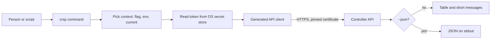
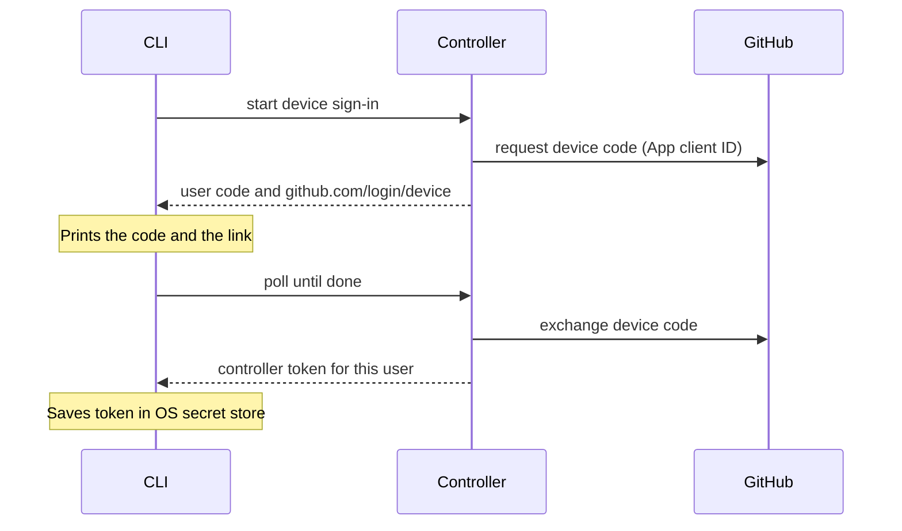
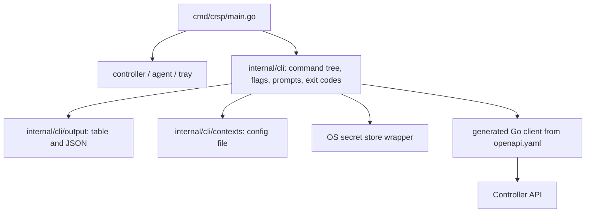

# Command line (CLI)

The top half (sections 1 to 4) is for every reader. The bottom half (5 to 12) is for engineers.

Today the binary has three commands: `controller`, `agent` (it says it is not built yet) and `version`. Everything else in this spec is NOT YET IMPLEMENTED. On a Mac, `crsp agent` also gives the agent a counter of macOS VMs for its machine report (machines R5.14, CRSP114); it adds no command.

The controller and the agent write their logs through a redacting handler (`internal/logging`, github-integration R6.3), so no token, PEM block or stored secret value reaches a log line.

## 1. In one paragraph

`crsp` is one program. It runs the controller, the agent and the tray. It is also the command line for people. The command line can do everything the web console can do: sign in, turn the pool on for a repository, add machines, add runners, watch jobs, run the doctor, and export or import the configuration. It suits headless machines and scripts. It talks to the controller through the same API contract as the web console. It prints plain tables for people and JSON for scripts.

## 2. Why

**Problem.** Many pool machines have no screen. Admins also want to script setup and checks. The web console alone cannot serve them.

**Users.**

- The owner and admins, at a terminal on any machine on the local network.
- Scripts and CI jobs that read state or apply a configuration file.
- Viewers, who can list and watch but not change anything.

**Goals.**

- The same powers as the web console, through the same API. No hidden paths.
- Safe by default: a command that removes or stops something names what goes and asks first.
- Easy to script: JSON output, stable exit codes, no questions when `--yes` is given.
- Works with several controllers (for example home and office).
- Never prints a secret.

**Non-goals.**

- It does not talk to GitHub directly. The controller does that.
- It does not manage GitHub-hosted runners.
- It does not repeat behaviour that other feature specs own. It calls it. See the table in section 7.

## 3. How it works

1. The user runs a command, for example `crsp machine list`.
2. The CLI picks the controller: the `--context` flag, then the `CRSP_CONTEXT` variable, then the current context in the CLI config file.
3. It reads that context's token from the OS secret store. With no token, it says to run `crsp login`.
4. It calls the controller through the client generated from `packages/contract/openapi.yaml`. It checks the controller's certificate against the fingerprint it pinned at login.
5. It prints the result: a table for people, or JSON with `--json`.
6. It exits with a code from the table in R5.12.

Sign-in uses GitHub's device flow (decision 0002):

The GitHub user token stays on the controller. The CLI only holds a controller token.

## 4. Screens and states

The CLI has no screens. Its words follow the design system's content rules: one word per action, message tones, dates and numbers (`docs/design-system/v1/content.md`). The tray has its own spec, `tray`.

States a person sees:

- **Empty:** "No machines yet. Run `crsp machine add` to add one."
- **Waiting:** "Waiting for 2 jobs to end on build-01 (about 4 min left)."
- **Needs you:** "This removes runner linux-03 and waits for 1 running job. Type yes to go on:"
- **Problem:** "Could not reach the controller at https://pool.lan:8460. The connection timed out. Make sure the address is right, then try again."
- **Done:** "Runner linux-03 removed."

## 5. Functional requirements

Milestones (M1 to M8) are those of the product brief (`docs/overview/product.md`).

### Command tree

| Command | What it does | Milestone | Owner spec of the behaviour |
|---|---|---|---|
| `controller` | Run the controller (built today) | built | `web-console`, `github-integration` |
| `agent` | Run the agent; `agent join` uses a join command; `agent install` needs admin rights (it stops first with one plain line otherwise) and the agent commands default `--data-dir` to the machine-wide folder of the OS (CRSP119) | M1 | `machines` |
| `tray` | Run the tray in the user's session | M8 | `tray` |
| `version` | Print the version (built today) | built | this spec |
| `login` | Sign in with the device flow | M1 | `github-integration` |
| `logout` | Forget this context's token | M1 | this spec |
| `open` | Print, and on a desktop open, a one-time console link | M1 | `web-console` |
| `context list\|use\|remove` | Choose between controllers | M1 | this spec |
| `repo list\|enable\|disable\|policy` | Repositories and their pool policy, with the runner kind (OPS28) | M1 | `github-integration`, `scheduling` |
| `machine list` | List machines with load and slots | M1 | `machines` |
| `machine add` | Print a join command with a one-time code | M1 | `machines` |
| `machine drain\|remove` | Drain or remove a machine | M3 | `machines` |
| `machine maintain NAME -- COMMAND...` | Hold new jobs, wait until idle, run one command on the machine, lift the hold | built | this spec (R5.29), `machines` |
| `machine leftovers MACHINE`, `machine leftovers remove MACHINE NAME...` | List the runner leftovers of the latest doctor finding, and remove named ones (OPS38) | built | this spec (R5.63), `doctor` (R5.48) |
| `runner list\|create\|update\|clear-cache\|remove` | Runners on machines, with kind, dependency setting and cache clear (OPS28) | M1 | `runners` |
| `job list\|watch` | Queue and history; live view | M1 | `scheduling` |
| `doctor` | Run every check and print fixes | M2 | `doctor` |
| `parity check\|soak\|report` | The parity gate against the old pool | M7 | this spec; [parity plan](../../architecture/parity-plan.md) |
| `config export\|import --dry-run\|apply` | Configuration as a file | M8 | `config-as-code` |
| `backup\|restore` | Back up and restore the controller | M1 | `backup` |
| `app rotate-key --file PATH\|-` | Replace the GitHub App private key (owner only; the controller checks it with GitHub first) | M8 | `github-integration` (R5.7) |
| `update` | Update this machine's binary, with drain | M3 | `updates` |
| `completion bash\|zsh\|fish\|powershell` | Print a shell completion script | M1 | this spec |

**R5.1** — The binary MUST provide every command in the table above, each with `--help`. A command whose milestone is not reached yet MUST say it is not built yet, in `--help` and when run, and exit non-zero without changing anything.

**R5.2** — Every CLI call to the controller MUST go through the Go client generated from `packages/contract/openapi.yaml`, the same contract the web console's client is generated from. The CLI MUST NOT call controller paths by hand.

**R5.3** — Every operation in the contract that a signed-in person can call MUST be reachable from a CLI command. An operation the CLI leaves out MUST carry `x-cli: none` with a reason. A test fails when a new operation has neither.

### Sign-in and contexts

**R5.4** — `login [URL]` MUST sign in with GitHub's device flow through the controller. It prints the user code and the link `https://github.com/login/device`, waits, and then saves a controller token for that user in the OS secret store (Windows Credential Manager, macOS Keychain, Linux Secret Service, or a file with mode 0600 where no Secret Service exists).

**R5.5** — At first login to a controller, `login` MUST show the controller certificate's SHA-256 fingerprint and ask for a yes (or take `--fingerprint`). It pins that fingerprint in the context. A later certificate with another fingerprint MUST be refused.

**R5.6** — `login` MUST add or update a context (name, controller URL, pinned fingerprint) in the CLI config file and make it current. `context list` shows the contexts and marks the current one. `context use NAME` changes it. `context remove NAME` deletes the context and its token, after a yes.

**R5.7** — The context MUST be picked in this order: `--context NAME`, then `CRSP_CONTEXT`, then the current context in the file. `--controller URL` MUST work only for a URL that some context already pins.

**R5.8** — `logout` MUST delete this context's token from the secret store and ask the controller to revoke it. It MUST delete the local token even when the controller cannot be reached, and say so.

**R5.9** — `open` MUST ask the controller for a one-time console link, print it, and open it in the default browser when a desktop session exists. `--print` only prints. The link MUST work once and expire after 60 seconds.

### Output and exit codes

**R5.10** — By default, list commands MUST print an aligned table to stdout with a header row. Messages, progress and questions MUST go to stderr. Dates, times and numbers MUST follow the content rules (for example `2026-11-02 14:30`, `12 345`, `45%`).

**R5.11** — With `--json`, a command MUST print one JSON document to stdout that matches the contract's response schema. `job watch --json` MUST print one JSON event per line. On failure, `--json` MUST print the contract's `ErrorEnvelope` to stderr.

**R5.12** — Commands MUST exit with these codes:

| Code | Meaning |
|---|---|
| 0 | Done |
| 1 | The operation failed (the controller said no, or it failed while running) |
| 2 | Usage error: unknown command or flag, or a bad value |
| 3 | Not signed in, token expired, or not allowed (role too low) |
| 4 | Not found: no such repository, machine, runner or job |
| 5 | Not confirmed: no yes was given; nothing changed |
| 6 | The controller could not be reached, or its certificate did not match |
| 7 | Conflict: the state changed since it was read; nothing changed |
| 8 | `doctor` found a problem, or `config import --dry-run` found changes |

**Refusals exit non-zero.** A command that is refused MUST exit with a non-zero code and MUST say what it did not do. It never prints a refusal and exits 0. The code says why:

| The refusal | Code | Example message |
|---|---|---|
| A needed yes was not given (no `--yes` and no terminal, or an answer other than yes) | 5 | `Nothing changed. Run it again with --yes to go on without a question.` |
| The role is too low, or there is no sign-in (including `logout` with no token) | 3 | `Draining a machine needs the admin role.` |
| A precondition failed because the state changed or does not allow it (already drained, a change already waiting) | 7 | `the machine is already drained` |
| The thing does not exist | 4 | `No machine "nope".` |
| A bad flag, a missing argument, a removed flag (`--stop-jobs`, `--drain-timeout`), or a command that is not built yet | 2 | `error: update is not built yet (planned for M3). Nothing changed.` |
| The controller refused for another reason, or the change was cancelled or needs the user | 1 | `The change was cancelled. Nothing more changed.` |
| The controller cannot be reached | 6 | `Could not reach the controller.` |

With `--json`, a refusal prints the contract's `ErrorEnvelope` to stderr and uses the same code. A drain that is past its timeout is not a refusal: see R5.16.
**R5.13** — Colour MUST be off when stdout is not a terminal, when `NO_COLOR` is set, or with `--no-color`. No meaning MUST rest on colour alone.

### Changes that remove or stop

**R5.14** — A command that removes, disables, restores, applies or restarts (`repo disable`, `machine drain`, `machine maintain`, `machine remove`, `runner remove`, `runner delete-offline`, `context remove`, `config apply`, `restore`, `update`) MUST first print what goes: each item by name, and the running jobs it would wait for or stop. It then MUST ask "Type yes to go on:" when stdin is a terminal.

**R5.15** — With `--yes`, the command MUST skip the question but still print the list. Without `--yes` and without a terminal, it MUST change nothing and exit 5.

**R5.16** — `machine drain`, `machine maintain`, `machine remove` and `runner remove` MUST NOT cut a running job. They wait until the jobs end. The drain timeout is one per machine (its setting, default 60 minutes); the commands have no `--drain-timeout` and no `--stop-jobs`. They show what they wait for. When the machine's drain timeout passes they keep waiting, print `Still draining <machine>: N jobs running, waited X. Nothing is stopped.` on stderr at most every 5 minutes, and exit 0 only when the change is done. Ctrl-C stops the waiting, not the drain on the controller. A change that is cancelled or needs the user exits 1 and says that no job was stopped. `update` follows the update spec (an automatic update postpones).

### Resource commands

**R5.17** — `repo list` MUST list the repositories the user can administer, with pool on or off, labels, parallel limit, priority and repository variable status. `repo enable OWNER/NAME` and `repo disable OWNER/NAME` turn the pool on or off. `repo policy OWNER/NAME` shows the policy; with flags (`--labels`, `--max-parallel`, `--priority`, `--allow-fork-prs`, `--runner-kind`) it changes it. `--allow-fork-prs` MUST print the fork warning and need a yes.

**R5.18** — `machine list` MUST show each machine with state (active, drained, offline), OS, backends, slots used and free, memory and CPU load. `machine add [--name NAME] [--expires 15m]` MUST print one join command with a one-time join code, and how long it is valid.

**R5.19** — `runner list` MUST show each runner with machine, OS, backend, labels, persistent or ephemeral, current job and age. `runner add --machine M --os OS [--backend B] [--persistent] [--count N]` MUST refuse a machine that does not support that OS or backend, and say which machines do. **Built by OPS28 (R5.62):** the runner kind and the dependency setting are flags of `runner add` and `runner update`.

**R5.20** — `job list` MUST show the queue and history, with filters `--repo`, `--machine`, `--result`, `--since`. `job watch` MUST stream live events (queued, started, ended) until stopped with Ctrl+C, and reconnect after a dropped stream.

**R5.21** — `doctor` MUST print every finding with its fix. `--machine M` narrows it to one machine.

**R5.22** — `config export [--out FILE]` MUST write the configuration file. `config import FILE --dry-run` MUST print the plan (each change: add, edit, remove) and change nothing; "Nothing has changed yet." ends the plan. `config import FILE` without `--dry-run` MUST exit 2 and point to `config apply`. `config apply FILE` MUST print the same plan, ask for a yes (R5.14), and apply it.

**R5.23** — `backup --out FILE` MUST download a backup of the controller's configuration. `restore FILE` MUST show what it replaces, need a yes, and be allowed for the owner only.

**R5.24** — `update` MUST find the newest release, verify its SHA-256 checksum and signature, name the jobs on this machine it would wait for, drain, replace the binary, and restart the local services. `update --dry-run` only reports the newest version and the jobs it would wait for. It changes nothing.

**R5.25** — `completion SHELL` MUST print a completion script for bash, zsh, fish or PowerShell. Completion MUST suggest commands and flags without a network call, and names (repositories, machines, runners) from the controller when it answers within 1 second.

**R5.26** — `version` MUST print `crsp <version> (<Go version>)` and exit 0. `version --json` MUST print `{"version": ..., "go": ...}`. (Built today, without `--json`.)

**R5.27** — A command run with no subcommand, or `help`, MUST print usage. Usage to stdout exits 0 when asked for; usage after an error goes to stderr and exits 2. (Built today.)

**R5.28** — `parity check` MUST read the runners and a doctor run from the controller and write the parity report: one check per class (linux-container, windows, vm) that a runner of the class is online, one that no runner name is listed twice, and one that the doctor has no `warn` and no `fail`. `parity soak` MUST judge a soak either from an observation file (`--observations`) or as a dry run with fakes (`--dry-run`), and MUST refuse both or neither. A class passes the soak only when at least N jobs of it were submitted, no job is lost, no listener is duplicate and the p95 queue wait is at most the bound; the report passes only when every check and every class passes, and an empty report never passes. A dry run and a check-only run MUST never set `counts_for_gate`. `parity report FILE` MUST judge the file again from its parts, so an edited verdict cannot pass. A report that did not pass exits 8. The report is the JSON file `parity-report.json`, uploaded by `.github/workflows/parity.yml` as the artifact `parity-report`. Source: `internal/cli/cmd_parity.go`, `internal/parity/`; plan: parity plan sections 6 and 8.

**R5.29** — `machine maintain NAME [--yes] [--command-timeout 30m] -- COMMAND [ARG...]` MUST do host maintenance without cancelling a job (handover lesson 30, HND24), in this order:

1. It MUST refuse, with exit 4 for an unknown machine and exit 7 for a machine that is offline, already drained or draining (that hold is someone else's, so crsp does not lift it). Nothing changes. It MUST exit 2 without `--` and a command, and exit 5 without `--yes` and without a terminal.
2. It MUST print what it does (R5.14): the machine, the command, the drain timeout of the machine, each running job it waits for, and that queued jobs stay queued.
3. It MUST hold new jobs by draining the machine and wait as R5.16 says: running jobs finish, queued jobs stay queued, nothing is cancelled, and the wait has no end of its own.
4. Only when the machine is drained, it MUST send the command to the machine's agent through the controller (`POST /api/v1/machines/{id}/command`, owner role). The agent runs the arguments as given with `exec.CommandContext`, without a shell and without interpolation, and stops the command at `--command-timeout`. The controller and the agent each refuse the command when the machine takes jobs or a job runs.
5. It MUST always lift the hold (the same as `machine resume`, with the yes for a drain that still waits), on a context that Ctrl-C does not cancel. This holds when the drain wait is stopped, when the command fails, times out or is cut by Ctrl-C, and when the controller refuses the command. If the hold cannot be lifted, it MUST say so and print `crsp machine resume NAME`.
6. It MUST print the command's output to stdout and the messages to stderr, and exit 0 only when the command exited with code 0 and the hold is lifted; otherwise exit 1 and say that no job was stopped. With `--json` it MUST print `{machine, ok, exit_code, output, message, released}`.

A command that Ctrl-C cut off may still run on the machine until its own timeout; the message says so.

**R5.60** (built, CRSP134) — With no login context, the CLI MUST sign in from the environment, for every command that talks to the controller: `CRSP_URL` (the controller address), `CRSP_ACCESS` (an access credential, github-integration R5.82) and `CRSP_CA_FINGERPRINT` (the SHA-256 of the controller's CA certificate, 64 hex characters, colons allowed). The names end in none of `_KEY`, `_TOKEN`, `_SECRET`, `_PASS`. A login context always wins: the environment is the way in only when no context exists. The fingerprint MUST be pinned for an `https` address, by the same rule as the agents (the chain holds the CA with that fingerprint, or the server certificate is that certificate); there is no flag or variable that turns the check off, and a missing or wrong fingerprint sends no request. `http` is allowed for `127.0.0.1` and `[::1]` only, as in R6.3. A partial set names the missing variables and says where to make them (the console, Settings, Access for CI). With none set the answer is the old "Not signed in", now naming the three variables. The access value is never printed, written to the config file or put in an error, and the redactor masks `crsp_acc_` values. The environment sign-in has no stored token: `logout` has nothing to forget. Source: `internal/cli/session.go`.

**R5.61** (built, CRSP136) — `machine settings NAME [--docker-compact on|off|auto] [--docker-compact-threshold GIB] [--docker-compact-idle MINUTES]` MUST show the Docker disk compact policy of a machine (machines R5.66) and, with a flag, change it with one `PATCH` of the machine's settings and show the result; the same rights as the Machine page (admin). A value out of range MUST exit 2 and send nothing. With `--json` it prints the settings. The compact itself is `machine maintain NAME -- docker-compact` (R5.29) when done by hand.

**R5.62** (M1, Built by OPS28; owner decisions D93, D94 and D95; runners R5.1, R5.90 to R5.93; github-integration R5.60) — **Runner type, dependency setting and cache clear.** (a) `runner add --machine M --os OS [--count N] [--persistent | --ephemeral] [--keep-dependencies | --no-keep-dependencies]` adds pool runners (no `--repo`). `--persistent` keeps its meaning; `--ephemeral` adds an ephemeral ceiling (`--count` is the most that run at once on the machine, runners R5.92). With neither flag the kind is the default of Add runners (Ephemeral while a public repository uses the pool, otherwise Persistent) and the command prints which kind it chose and why. `--keep-dependencies` and `--no-keep-dependencies` apply to a persistent runner only (default on); with `--ephemeral` they are refused with a plain reason. A kind the machine cannot run is refused with the reason and the machines that can, as in R5.19. (b) `runner update NAME [--keep-dependencies | --no-keep-dependencies]` changes the setting of a persistent runner with one `PATCH /runners/{id}/settings` and prints the result (admin). (c) `runner clear-cache NAME` clears the runner's own dependency folder (`POST /runners/{id}/clear-cache`): at once when the runner is idle, and after the running job when it is busy (the command says which); it asks first unless `--yes` is given (R5.14). (d) `runner list` also shows the kind, for a persistent runner the Keep downloaded dependencies setting and the size of its dependency folder, and the word `unclean` with its reason for a runner that failed its cleanup (runners R5.91). (e) `repo policy OWNER/NAME --runner-kind ephemeral-only|any-runner` sets the per-repository runner kind and `repo policy OWNER/NAME` and `repo list` show it with `(default)` when it follows the visibility; setting a public repository to `any-runner` prints the warning of github-integration R5.60 and needs a yes, as `--allow-fork-prs` does (R5.17). `repo list` also shows `no ephemeral capacity` for a repository that has none.

**R5.63** (built, OPS38; owner decision D104; doctor R5.48) — `machine leftovers MACHINE` MUST list the runner services, folders, local accounts and downloads that no runner of this controller owns, taken from the items of the latest doctor finding `machine.runner_leftovers` of that machine (kind, name, size, why); with none it says so and exits 0; with `--json` it prints `{"items": [...]}`. `machine leftovers remove MACHINE NAME... [--yes]` MUST take each NAME from that list (a name not on it exits 4 and sends nothing), print what goes and ask "Type yes to go on:" (R5.14, R5.15), then call `POST /api/v1/machines/{machineId}/runner-leftovers/remove` once and print one line per item (`removed`, `already gone`, `refused` or `failed`, with the controller's reason). It exits 1 when any item was refused or failed. It changes nothing on a machine the scan did not list; the controller refuses anything owned or outside the crsp runners folders. The same rights as the console (admin).

## 6. Non-functional requirements

**R6.1** — The CLI MUST NOT print, log or write to its config file any secret: controller tokens, GitHub tokens, the App private key, the webhook secret, registration or remove tokens. The one-time join code (`machine add`) and the one-time console link (`open`) are the only short-lived codes it prints, and only on those commands.

**R6.2** — The CLI config file MUST hold only context names, URLs, fingerprints and the current context. Tokens MUST live only in the OS secret store. The fallback file MUST have mode 0600 and the CLI MUST refuse to use it when its mode is wider.

**R6.3** — The CLI MUST talk to the controller over HTTPS with the pinned certificate, except for a controller at `http://127.0.0.1:<port>` or `http://[::1]:<port>`, which serves plain HTTP (web-console R5.1, D38) and has no certificate to pin. Any other `http` address is refused. It MUST NOT offer a flag that turns certificate checks off.

**R6.4** — `version`, `help` and `completion` MUST finish in under 100 ms and make no network call.

**R6.5** — A list command MUST finish in under 1 second for 1 000 items when the controller is on the local network. Every call MUST have a timeout (default 30 seconds, `--timeout` to change it).

**R6.6** — The role check MUST happen on the controller. A viewer's change command MUST fail with exit 3 and a plain message naming the role it needs.

**R6.7** — Human output MUST fit 80 columns for the default columns of every list command; longer cells are cut with an ellipsis. `--json` output is never cut.

**R6.8** — The `--json` output of a command MUST stay stable within a major version of the contract. A field may be added; a field is never renamed or removed without a new major version.

## 7. Design

- **Entry.** `main.go` keeps the mode dispatch (`controller`, `agent`, `tray`). All other commands go to `internal/cli`.
- **Client.** `packages/contract/oapi-codegen.yaml` gains a client target. The web console's TypeScript client and the Go client come from the same file. That makes R5.3 a test, not a promise.
- **Contract operations the CLI needs.** Each is added to the contract by its owner spec: device sign-in start and poll, token revoke (`github-integration`); one-time console link (`web-console`); repositories and policy (`github-integration`, `scheduling`); machines and join codes (`machines`); runners (`runners`); jobs and the live event stream (`scheduling`); doctor (`doctor`); config export, plan and apply (`config-as-code`); backup and restore (`backup`); releases (`updates`).
- **Config file.** `<user config dir>/crsp/cli.toml`. Keys: `current`, and per context `url` and `fingerprint`.
- **Secret store key.** `crsp/cli/<context>`.
- **Prompts.** One helper prints the list of what goes, then asks, then maps the answer to go on or exit 5. Every destructive command uses it.
- **Errors.** One function maps HTTP status and transport errors to the exit codes in R5.12. 401 and 403 map to 3, 404 to 4, 409 to 7.

## 8. Failure modes

| Dependency | Fails | Why |
|---|---|---|
| Controller unreachable | Closed: exit 6, nothing changed | A change must never be half-done without the user knowing. |
| Certificate fingerprint differs | Closed: exit 6 | It may be another machine posing as the controller. |
| OS secret store unavailable | Closed: `login` fails and says why | A token in plain text would leak. |
| Live event stream drops (`job watch`) | Open: reconnect with backoff, print "Reconnecting" | Watching is read-only. |
| Completion lookup slow or failing | Open: no name suggestions | Completion must never block the shell. |
| Update checksum or signature wrong | Closed: nothing replaced, exit 1 | A bad binary would run on every machine. |
| Controller logout fails | Open locally: the token is deleted here anyway | The user asked to forget it. |

## 9. How it is proven

Tests are planned unless marked built. Planned paths are written in plain text until the files exist.

| Requirement | Test |
|---|---|
| R5.1 | built: internal/cli/core_test.go TestEveryCommandHasHelp, TestUnbuiltCommandExits2 (unbuilt commands exit 2) |
| R5.2 | built: internal/cli/core_test.go TestNoHandWrittenControllerCalls |
| R5.3 | built: internal/cli/core_test.go TestEveryOperationHasCommand |
| R5.4 | built: internal/cli/login_test.go TestDeviceFlowSavesToken |
| R5.5 | built: internal/cli/login_test.go TestFingerprintPinnedAndMismatchRefused |
| R5.6 | built: internal/cli/contexts/contexts_test.go TestAddUseRemove; internal/cli/core_test.go TestContextCommands |
| R5.7 | built: internal/cli/contexts/contexts_test.go TestPickOrder; internal/cli/core_test.go TestControllerFlagNeedsPinnedURL |
| R5.8 | built: internal/cli/login_test.go TestLogoutOffline |
| R5.9 | built: internal/cli/login_test.go TestOneTimeLinkPrinted |
| R5.10 | built: internal/cli/output/output_test.go TestTableAndFormats |
| R5.11 | built: internal/cli/core_test.go TestJSONErrorEnvelopeOnStderr; internal/cli/resources_test.go TestWatchNDJSON; internal/cli/output/output_test.go TestJSONGolden |
| R5.12 | built: internal/cli/core_test.go TestStatusToExitCode, TestUnreachableExits6, TestNotSignedInExits3; internal/cli/exitcodes_test.go TestRefusalsExitNonZero (one case per refusal path), TestRefusalWrongAnswerAndNotSignedIn, TestRefusalJSONEnvelope |
| R5.13 | built: internal/cli/output/output_test.go TestNoColor; internal/cli/core_test.go TestNoColor |
| R5.14 | built: internal/cli/resources_test.go TestDestructiveListsWhatGoes |
| R5.15 | built: internal/cli/resources_test.go TestYesFlagAndNoTerminal |
| R5.16 | built: internal/cli/resources_test.go TestWaitsForJobsAndTimeout; internal/cli/exitcodes_test.go TestDrainPastTimeoutWarnsAndKeepsWaiting |
| R5.17 | built: internal/cli/resources_test.go TestRepoCommands, TestRepoPlanOutcomes, TestForkWarning |
| R5.18 | built: internal/cli/resources_test.go TestMachineListAndAdd |
| R5.19 | built: internal/cli/resources_test.go TestRunnerCreateRefusesUnsupported, TestRunnerListAndRemove |
| R5.20 | built: internal/cli/resources_test.go TestJobListFilters, TestWatchReconnects |
| R5.21 | built: internal/cli/resources_test.go TestFindingsAndExitCode |
| R5.22 | planned (M8): internal/cli/config_test.go TestDryRunChangesNothing, TestApplyNeedsYes |
| R5.23 | built: internal/cli/resources_test.go TestBackupRestoreOwnerOnly (backup --out is not built: no download operation in the contract) |
| R5.24 | planned (M3): internal/cli/update_test.go TestChecksumAndDrain |
| R5.25 | built: internal/cli/completion_test.go TestScriptsAndOfflineCompletion |
| R5.26 | built: cmd/crsp/main_test.go TestRunVersion, TestRunVersionJSON; internal/cli/core_test.go TestVersionJSON |
| R5.27 | built: cmd/crsp/main_test.go TestRunUsageErrors; internal/cli/core_test.go TestUsageErrors |
| R5.28 | built: internal/parity/parity_test.go TestEachCriterionFailsItsClass, TestReportEvaluate, TestPercentile95; internal/cli/cmd_parity_test.go TestParityCheckPassesAndWritesReport, TestParitySoakDryRun, TestParityReportIsRejudged |
| R5.29 | built: internal/cli/cmd_maintain_test.go TestMaintainDrainsRunsAndReleases, TestMaintainJSON, TestMaintainReleasesWhenTheCommandFails, TestMaintainReleasesWhenTheControllerRefusesTheCommand, TestMaintainReleasesWhenCancelledWhileDraining, TestMaintainReleasesWhenCancelledWhileRunning, TestMaintainRefusals; internal/agent/host_command_test.go TestHostCommandRunsOnADrainedMachine, TestHostCommandFailureKeepsExitCodeAndOutput, TestHostCommandTimeoutStopsTheCommand, TestHostCommandNeverMeetsAJob, TestHostCommandRefusesEmptyAndUnknown; internal/api/machines_command_test.go TestRunMachineCommandRefusals, TestRunMachineCommandNeedsADrainedMachine; internal/agentlink/agentlink_test.go TestHostCommandOnlyToAnAgentThatCan |
| R6.1 | built: internal/cli/login_test.go TestNoSecretInOutputOrConfig (runs commands with a canary token) |
| R6.2 | built: internal/cli/contexts/contexts_test.go TestNoTokenInFile; internal/cli/core_test.go TestFallbackFileMode |
| R6.3 | built: internal/cli/core_test.go TestNoInsecureFlag; internal/cli/login_test.go TestLoginErrors |
| R6.4 | built: internal/cli/completion_test.go BenchmarkOfflineCommands, TestScriptsAndOfflineCompletion |
| R6.5 | built: internal/cli/resources_test.go TestJobList1000; internal/cli/core_test.go TestCallTimeout |
| R6.6 | built: internal/cli/resources_test.go TestViewerChangeExits3 |
| R6.7 | built: internal/cli/output/output_test.go TestFits80Columns |
| R6.8 | built: internal/cli/output/output_test.go TestJSONGolden |
| R5.60 | built: internal/cli/envlogin_test.go TestEnvSignInWorksWithoutAContext, TestEnvSignInWorksForOtherCommands, TestEnvSignInPinsTheFingerprint, TestEnvSignInNeedsTheFingerprintForHTTPS, TestEnvSignInPartialSetNamesWhatIsMissing, TestNoContextNoEnvKeepsNotSignedIn, TestLoginContextWinsOverEnv |
| R5.61 | built: internal/cli/cmd_machine_settings_test.go TestMachineSettingsShowsThePolicy, TestMachineSettingsSetsThePolicy, TestMachineSettingsRefusesBadValues |
| R5.62 | planned in the OPS28 code branches (names reconciled when they land): `internal/cli` tests for `runner add --ephemeral`, the dependency flags, `runner update`, `runner clear-cache` and `repo policy --runner-kind` |
| R5.63 | built: internal/cli/cmd_machine_leftovers_test.go TestMachineLeftoversLists, TestMachineLeftoversListEmpty, TestMachineLeftoversRemove, TestMachineLeftoversRemoveNeedsConfirmation, TestMachineLeftoversRemoveRefusedAndUnknown |

## 10. Decisions

| ID | Question | Chosen | Date |
|---|---|---|---|
| D1 | How does the CLI sign in? | GitHub device flow through the controller; the CLI keeps only a controller token (decision 0002). | 2026-11-13 |
| D2 | How does the CLI reach the API? | The Go client generated from the same OpenAPI contract as the web console (decision 0001). | 2026-11-13 |
| D3 | How does a headless machine open the console? | `crsp open` prints a one-time link (decision 0005). | 2026-11-13 |
| D4 | Which command library? | The standard `flag` package with a small command table in `internal/cli`: no new dependency; completion scripts are written from the table. (CRSP25, answers open question 6; the owner may still choose cobra.) | 2026-11-14 |
| D5 | What is the verb for new runners? | `runner add` (owner decision for M1; answers open question 1). | 2026-11-14 |

Open questions for the owner (not decided):

1. `runner create`: the content rules say "Add", never "Create". Rename to `runner add`?
2. Which milestone ships the `tray` mode? This spec says M8; the brief does not say.
3. `config import` without `--dry-run`: refuse and point to `config apply` (this spec), or apply after a yes?
4. Does `backup` include secrets (App private key, webhook secret), encrypted with a passphrase, or leave them out?
5. Should scripts be able to pass a token in an environment variable (for example `CRSP_TOKEN`), or only through `login`?
6. Command library: the standard `flag` package or `spf13/cobra` (built-in completion)?
7. Commands for the remaining console screens (users, notifications, budgets, images and caches, audit log): add them here, or in their own specs? R5.3 requires them in the end.
8. Feature folder names of other specs are assumed (`runners`, `web-console`, `tray`, `doctor`, `config-as-code`, `backup`, `updates`). Confirm them.

## 11. Not built yet

Built in milestone 1 (CRSP25): `controller`, `agent` and `tray` dispatch, `version` (with `--json`), `help`, `login`, `logout`, `open`, `context list|use|remove`, `repo list|enable|disable|policy`, `machine list|add|drain|resume|remove`, `runner list|add|remove`, `job list|watch`, `doctor`, `backup`, `restore`, `completion`, the generated Go client, contexts, the token in the secret store, `--json`, exit codes, and the confirmation helper.

NOT YET IMPLEMENTED:

- `config export|import|apply` (M8), `update` (M3), the `tray` mode (M8). Each says it is not built yet and exits 2.
- `backup --out FILE`: the contract has no download operation, so `backup` starts a backup on the controller and names its file. A download operation is needed first.
- OS secret stores (Windows Credential Manager, macOS Keychain, Linux Secret Service): the CLI uses the 0600 file store behind `internal/secrets` until each store lands. The file is refused when its mode is wider than 0600.
- `login` runs GitHub's device flow with the URLs from `getCliLoginConfig` (the contract's shape) and then calls `exchangeCliToken`. The sequence diagram in section 3 shows the controller doing the polling; the contract does not.
- `machine add --name` is printed as a hint only: the contract's join code has no name field.
- `runner add` takes no repository: without `--repo` the runners are pool runners that serve every repository that uses the pool (runners R5.88); `--repo` is kept for a runner bound to one repository.
- `runner add --backend` is checked against the machine's backends on the client; the contract's plan request has no backend field.
- The contract still lists a `stop_jobs` decision (`decideMachineChange`). The controller refuses it with 400 and the CLI never sends it; removing it from the contract is a follow-up that touches the generated client (CRSP19 changes the same files).
- Operations with `x-cli: none` in the contract (users, settings, audit, repository plans for other areas, slots, setup, webhooks) have no command yet (open question 7).

## 12. Code map

Source: cmd/crsp/main.go
Source: cmd/crsp/browser.go
Source: cmd/crsp/main_test.go
Source: internal/cli/app.go
Source: internal/cli/session.go
Source: internal/cli/confirm.go
Source: internal/cli/filestore.go
Source: internal/cli/tree.go
Source: internal/cli/parity.go
Source: internal/cli/cmd_auth.go
Source: internal/cli/cmd_repo.go
Source: internal/cli/cmd_machine.go
Source: internal/cli/cmd_runner.go
Source: internal/cli/cmd_job.go
Source: internal/cli/cmd_ops.go
Source: internal/cli/cmd_parity.go
Source: internal/parity/soak.go
Source: internal/parity/judge.go
Source: internal/parity/checks.go
Source: internal/parity/report.go
Source: internal/parity/fake.go
Source: internal/cli/contexts/contexts.go
Source: internal/cli/output/output.go
Source: internal/api/client/client.gen.go
Source: packages/contract/openapi.yaml
Source: packages/contract/oapi-codegen.yaml
Source: packages/contract/oapi-codegen-client.yaml

Tests: internal/cli/*_test.go, internal/cli/contexts/contexts_test.go, internal/cli/output/output_test.go.

Controller wiring note (CRSP127): `cmd/crsp` treats a Windows machine whose engine runs Linux containers, with the container backend allowed, as serving Linux for container runner hosts and for `RUNS_ON_LINUX` (runners R5.47). No command or flag changed.
