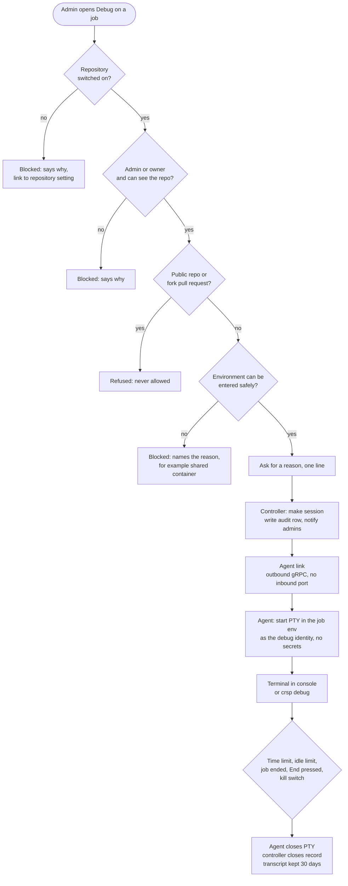
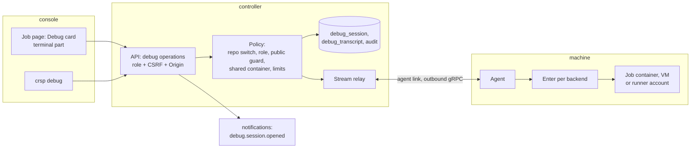

# Debug access to a running job

The top half (sections 1 to 4) is for every reader. The bottom half (5 to 11) is for engineers.

**PROPOSED (CRSP266). NOT YET IMPLEMENTED.** This is a spec for the owner to review. No code is written. Every requirement below is planned. Source: study `docs/studies/runs-on-vs-crsp/study.md`, gap G4 (runs-on offers controlled SSH and AWS SSM sessions into a job machine; CRSP can only join machines over SSH, CRSP123).

**macOS is not run on a real Mac yet.** The macOS rows of this spec are written from Apple's documented behaviour and the macOS backend specs (runners R5.23, R5.29). They are tested with fakes only until a real Mac runs them (section 8, Q6). Windows and Linux rows are proven on real machines when built.

Related: [runners](../runners/spec.md) (backends R5.8, what a job can reach R5.82), [web-console](../web-console/spec.md) (roles R5.13, Settings), [cli](../cli/spec.md), [observability](../observability/spec.md) (audit log), [notifications](../notifications/spec.md), [github-integration](../github-integration/spec.md) (public-repo guard), [decision 0004, agent link](../../architecture/decisions/0004-agent-link.md).

## 1. In one paragraph

When a job fails and the log is not enough, an admin opens a **debug session** on that job from the web console: a terminal in the browser, inside the job's own container or VM, with the job's files in front of them. Nothing is open by default. A repository must be switched on first, a session ends by itself after a set time, every session is written to the audit log with who, when and why, and the shell never gets the job's secrets or any other job's data. A `crsp debug` command does the same from a terminal. A failed job can be held for a few minutes so the shell can look at what it left behind. This closes the runs-on advantage "SSH or SSM into a job machine".

## 2. Why

**Problem.** A job fails only on the pool: a missing library, a wrong path, a display, a disk. The user reads the log, edits the workflow, pushes, waits and repeats. Each round costs a full run. runs-on lets the user open a shell in the job; CRSP today shows the log only.

**Users.**

- Owner and admins who keep the pool and fix failing jobs.
- Viewers: they never open a session. They can see that sessions happened (the audit log, R5.13 of web-console).

**Goals.**

- Look inside a live or just-failed job in one click, on Windows, Linux and macOS targets.
- Off by default. On per repository, by an admin who can see that repository.
- Limited in time, in who, and in what the shell can reach.
- Fully recorded: nobody can use a session without a trace.
- Same product, one frame: console first, CLI second, same rules for both.

**Non-goals.**

- No inbound port on any machine (decision 0004). The agent already connects out; the session rides that link.
- No SSH server that the user exposes to the internet or LAN. No cloud SSM.
- No shared sessions for viewers, no "watch over the shoulder", no pairing.
- No access to the machine's host OS shell. Only the job's own environment (container, VM or runner account).
- No debugging of GitHub-hosted runners (decision 0005).
- No file upload or download in this version (Q9).
- Not a way around the public-repository guard (R5.5).

## 3. How it works

1. The admin presses **Debug** on a running job, or on a failed job that was held (section 5, "Hold a failed job").
2. The controller checks, in this order: the repository switch, the user's role and sight of the repository, the public and fork guard, and whether the environment can be entered safely (R5.5 to R5.10). The first failure stops it and says why (UX-38).
3. The admin types a one-line reason. The controller writes the session row and the audit row in one transaction (R6.4), then tells the agent over the existing link.
4. The agent starts a shell in the job's own environment with the rights of a debug identity that holds no secrets (R5.11 to R5.14). Bytes go agent, controller, browser or CLI. The browser never reaches the machine.
5. The session ends at the time limit, the idle limit, the end of the job (unless held), the **End** button, an admin's **End session** or the kill switch. The controller closes the record and keeps the transcript for 30 days.

### Targets

One interface, one row per backend and OS. "Enter" is how the agent starts the shell. Every row ends in the same session record and the same limits.

| OS | Backend (runners spec) | Enter | Shell | Status |
|---|---|---|---|---|
| Linux | Container, rootless Podman or Docker (R5.27) | `exec` into the job container by the agent, user 1001, no `--privileged`, no engine socket | `bash`, else `sh` | planned |
| Linux | MicroVM or KVM VM (runners R5.30) | agent opens a PTY over vsock or the guest's private address with a key made for this session and thrown away after | guest `bash` | planned |
| Linux | Persistent runner, systemd (runners R5.21) | PTY as the debug identity (a second account beside the runner's own) | `bash` | planned, off unless R5.10 is switched on |
| Windows | Hyper-V VM (R5.28) | PowerShell Direct from the agent (no network, no WinRM listener) | PowerShell | planned |
| Windows | WSL2 distro (R5.28) | `wsl.exe -d <distro> -u <debug user>` run by the agent | `bash` | planned |
| Windows | Persistent runner (runners R5.13) | ConPTY as the debug account (not admin, not the runner's account) | PowerShell | planned, off unless R5.10 is switched on |
| macOS | macOS VM, Virtualization.framework (R5.29) | agent opens a PTY to the guest over the private virtual network with a session key | `zsh` | planned, **not run on a real Mac yet** |
| macOS | Persistent runner, launchd (R5.23) | PTY as the debug user (hidden `crsp-debug-<slug>`, no login shell on the host) | `zsh` | planned, **not run on a real Mac yet** |

## 4. Screens and states

No mocks yet. Screens use design system v4 by ID and add no rules of their own. Every screen below exists in the web console first; the CLI repeats it (R5.30).

**Repository setting (Settings, Repositories).** In each repository row's detail: a switch **Debug access** (saved at once, UX-22), off by default. When on, four fields appear: who may open (Admins and owner; or Owner only), session limit in minutes (default 30, most 120), idle limit in minutes (default 10), and **Hold failed jobs** for N minutes (default off, most 30). A line under the switch says in words what it allows and never allows (R5.14 to R5.17). A public repository shows the switch disabled with "Not available for public repositories." (UX-38). The settings page holds configuration only; the command to open a session is not here (UX-52).

**Job detail, Debug panel.** On the job page, one card **Debug access** holds the one place where a session starts (UX-52):

- Running job, repository on, user allowed: button **Open debug session**, the question card asks for a reason (one line, 3 to 200 characters), then the terminal opens in the page.
- Held failed job: a status word `◷ held, 12 min left` (UX-58) and the same button.
- Not allowed: the button is disabled and the reason sits beside it (UX-38): "Debug access is off for this repository.", "Only admins can open a session.", "Another job of this repository is running in the same container.", "This is a pull request from a fork." and so on.
- Open session: a terminal in a panel, a header with who opened it, the time left as a count, and **Extend** (once, +15 min, never past the repository's limit) and **End** (a question card first, UX-9). The panel never auto-focuses over text the user is typing elsewhere.
- Past sessions of this job: a table (who, from, to, reason, how it ended, transcript link). Times follow UX-18.

**Debug sessions list (Settings, Audit log tab, filter Debug sessions; also the Machine page).** A table of sessions across the pool: time, user, repository, job, machine, OS, backend, reason, length, how it ended (word, glyph and colour, UX-58). Admins and owner can open the transcript; viewers see the row but not the transcript. **End session** on an open row asks first (UX-62: names the user, the job and the machine). **Export** is the one primary of the toolbar, like the rest of the Audit log.

**Pool-wide switch (Settings, Access).** One switch **Allow debug sessions on this pool**, owner only, on by default (the per-repository switch is still off by default). Turning it off ends every open session at once after a question card that names how many are open (UX-62). This is the kill switch (R5.26).

**States.**

- Empty: "No debug sessions yet. Open one from a running job." (UX-6)
- Opening: the button is busy and says "Opening the session..." until the shell answers (UX-13).
- Failed to open: a Problem line under the button says what failed and why ("The machine did not answer within 10 s.") (UX-27).
- Lost link: the terminal says "The connection to build-02 dropped. The session ends in 60 s unless it comes back." The session never stays open past its limit because of a dropped link (R6.3).
- Ended: the panel keeps its output on screen, shows how it ended in words and offers the transcript link.

**CLI (same rules, same API).** `crsp debug open <job>` (reason with `--reason`), `crsp debug list`, `crsp debug end <session>`, `crsp debug extend <session>`, `crsp debug repo <owner/repo> --on|--off [--limit N --idle N --hold N]`. The CLI authenticates as the user's console role (the CLI spec's token). Output uses the same words as the console (CLI spec, UX words).

## 5. Functional requirements

### Opt in and who may open

**R5.1** — Debug access MUST be off for every repository until an admin or the owner switches it on for that repository. A new repository, a repository added by a config import (config-as-code) and a repository restored from backup MUST be off. A config import MUST NOT switch it on without the same role check as the console.

**R5.2** — Only the owner and admins who can see the repository MAY open a session. Viewers MUST NOT, and the console MUST show the command disabled with the reason (web-console R5.13, UX-38). The API MUST refuse it too (web-console R6.5). A repository may be narrowed to **Owner only**; it MUST NOT be widened beyond admins.

**R5.3** — Opening a session MUST need a reason of 3 to 200 characters. The reason MUST be in the session row and the audit row.

**R5.4** — A user MUST have at most 2 sessions open at once; a job MUST have at most 1 open session by default (setting, at most 2). A second request on the same job MUST say who has it open.

### What can be entered

**R5.5** — A session MUST be refused on a public repository and on a job run for a pull request from a fork. The refusal MUST say why and MUST NOT be settable (github-integration R5.41 and R5.47).

**R5.6** — A session MUST open only into the environment of one job: a container, a VM, a microVM, or the runner account of a persistent runner. It MUST NOT open a shell on the host OS.

**R5.7** — A container backend shares one container between jobs of one repository (runners R5.27, R5.82). A session on such a container MUST be refused while another job of that repository runs in it, and the reason MUST name the other job. It MUST be allowed when the container holds only this job, or when the backend gives each job its own environment (Hyper-V, WSL2 per job, microVM, macOS VM).

**R5.8** — The session MUST show only this job's files and processes where the backend allows it (own PID namespace, own VM). Where it cannot (a persistent runner), the panel MUST say so before the session opens.

**R5.9** — The agent MUST check, before it starts the shell, that the environment is the one the controller named (job id, runner name, backend). A mismatch MUST fail closed and write a `doctor.finding`.

**R5.10** — A persistent runner keeps state between jobs (runners R5.7). A session on one MUST be refused unless the repository's setting **Allow on persistent runners** is on (default off). When on, the panel MUST warn before opening: "This runner keeps files between jobs."

### The debug identity: what the shell has

**R5.11** — The shell MUST run as a debug identity that is not the job's step process and not an administrator: on Linux a user without sudo, setuid rights or capabilities, with the job's workspace group-readable; on Windows a local account that is not in Administrators; on macOS a hidden `crsp-debug-<slug>` user (runners R5.23). For a container the shell MUST keep the container's own limits (runners R5.81): no `--privileged`, no engine socket, `no-new-privileges`, the same seccomp profile.

**R5.12** — The shell MUST NOT receive, and MUST NOT be able to read from the agent's side, any of these: the job's secrets and `GITHUB_TOKEN`; the JIT config and runner credential; the agent's key and the controller's keys; registry credentials; the agent's own files; the sessions of other jobs. The environment of the shell MUST be built from an allow list (`PATH`, `HOME`, `TERM`, `LANG`, `CI_TOOLS_DIR`, `CARGO_TARGET_DIR` and the other pool values of runners R5.53), never copied from the runner.

**R5.13** — The debug identity MUST NOT be able to read the environment, memory or open files of the runner listener, the runner worker or the agent: separate account, `hidepid` or equivalent, no ptrace, no `/proc/<pid>/environ` of processes it does not own. On Windows the runner folders hold an ACL that denies the debug account. Where a platform cannot enforce this, the spec of that backend MUST list the gap in section 7 and the panel MUST show it before the session opens.

**R5.14** — A step process of the same job still holds the job's secrets in its own memory. The shell MUST be described in the console as "can see this job's files and its running processes' output, not its secrets". The owner MUST be told once, in Settings next to the switch, that a person with write access to the repository can already read masked secrets by writing a workflow, and that debug access does not widen that.

**R5.15** — The network of the shell MUST be the network of the job: no wider. The agent MUST NOT open a listening port on the host for a session (decision 0004).

**R5.16** — A shell MUST NOT be able to start a long-lived service that outlives the session in the environment. When the session ends the agent MUST end every process of the debug identity.

### Time limits

**R5.17** — Every session MUST have a time limit: default 30 minutes, set per repository, at most 120. A session MUST be closed by the agent at the limit even if the controller is gone (R6.3).

**R5.18** — A session MUST end after an idle limit with no keystroke (default 10 minutes, range 1 to 60).

**R5.19** — The user MUST be able to extend a session once by 15 minutes, never past the repository's limit. An extension MUST be an audit row.

**R5.20** — A session on a running job MUST end when the job ends, with a 60-second notice in the terminal, unless the repository holds failed jobs (R5.21) and the job failed.

### Hold a failed job

**R5.21** — A repository MAY switch on **Hold failed jobs** (default off, 0 to 30 minutes). When on and a job fails, the agent MUST keep the job's container or VM (not the runner slot) for the hold time so a session can open. The GitHub job result, the runner and the slot MUST be released as normal; only the environment waits.

**R5.22** — A hold MUST count against a pool-wide cap of 2 held environments per machine, and MUST be dropped when the machine's free memory or disk falls under the floors (runners R5.83 disk floor; the memory floor of the machine's slot limits). A hold MUST end at its time, when a session ends, or when an admin presses **Release**. The job page MUST show the time left.

**R5.23** — A held environment MUST keep every other rule of this spec: opt-in, role, reason, no secrets, limits. The secrets of the failed job MUST be wiped from the environment before the hold starts (the runner's temporary files and its env file are deleted with the runner).

### Record and audit

**R5.24** — Every session MUST write one session row and these audit rows: opened (who, job, repository, machine, backend, reason, source console or CLI, source address), extended, ended (how: time limit, idle, job ended, user, admin, kill switch, link lost, error), and refused (who, job, why). An audit row MUST be written in the same transaction as the change (observability R5.24). It MUST be written even if the session never opened.

**R5.25** — The controller MUST keep a transcript of the terminal output of each session, default on, for 30 days, readable by admins and the owner. The transcript MUST be cleaned by the shared redaction (`internal/redact`) before storing; it MUST NOT claim that it caught everything (Q4). The audit rows MUST be kept as long as the audit log. A transcript MUST NOT be turned off for a session; the owner MAY turn recording off pool-wide in Settings, and then the audit row MUST say "no transcript".

**R5.26** — The owner MUST have a kill switch (pool-wide switch, section 4) that ends every open session and refuses new ones. An admin MUST be able to end any single session. Both MUST be audit rows.

**R5.27** — Opening a session MUST notify owner and admins through the notifications feature: a new event `debug.session.opened` (subject: the job, default tone Note, default on for the tray of owner and admins, off for email) and `debug.session.long` (a session passed 80% of its limit; resolved when it ends). The notice MUST name who and which job. The same branch MUST add both types to the table of notifications R5.1.

### Console and CLI

**R5.28** — Every part of this feature with a screen MUST exist in the web console: the repository setting, the Debug card and terminal on the job page, the sessions list, the pool-wide switch, the transcript link and the held-job state. The CLI MUST NOT be the only way to do anything.

**R5.29** — The console terminal MUST be a shared part of the web UI package (a terminal component of the design system, added to `next-version` first, with a `CHANGES` entry). The page passes data only. No hand-made terminal box, no `style=` for layout or colour (AGENTS.md checklist). Its words go into design system `content`: Debug access, Open debug session, End, Extend, Release, Hold failed jobs.

**R5.30** — `crsp debug` MUST call the same API operations as the console (`openDebugSession`, `getDebugSession`, `listDebugSessions`, `extendDebugSession`, `endDebugSession`, `setRepoDebugAccess`, `releaseHeldJob`) and show the same refusals in the same words. The stream MUST be one WebSocket on the controller's own port with the session cookie or the CLI token, the CSRF and Origin checks, and the role check on every message that opens, extends or ends (web-console R5.1, R6.1 to R6.5).

**R5.31** — A terminal in the console MUST work without an SSH client. A user who wants a native `ssh` client MUST get one only through `crsp debug ssh <job>`, which is a stdio proxy (`ProxyCommand`) on the user's PC to the same controller stream, with the same rules, record and limits. It MUST NOT open a port on the PC or on the machine (Q2).

### Platform rows

**R5.32** — Each row of the Targets table MUST implement one `Enter` interface in the backend (`debugaccess.Enter(ctx, job) (Shell, error)`) next to the existing backend interface (runners R5.8), so a new backend is one more `Enter`. A backend that cannot enter safely MUST return a typed error that the console shows as the reason.

**R5.33** — Windows targets MUST NOT need WinRM, SSH Server or any inbound firewall rule. Linux and macOS targets MUST NOT need `sshd` running on the host. A VM guest MAY run its own guest agent or `sshd` bound to the private virtual network only, with a key made for this session and removed after.

**R5.34** — macOS rows MUST be built and tested with fakes first and MUST say "not run on a real Mac yet" in the console's Debug card for a macOS target until a real-Mac test has passed (the same wording rule as runners R5.29).

## 6. Non-functional requirements

**R6.1** — A session MUST open within 10 s of the request on a local machine, and the first prompt MUST show within 3 s after that. Typed input MUST echo within 150 ms on the LAN.

**R6.2** — A session MUST carry at most 1 MB/s of output; more is slowed (back pressure), so a runaway `cat` cannot flood the agent link. The agent link's other traffic (load, logs) MUST keep its latency (decision 0004).

**R6.3** — Limits MUST be enforced on the agent as well as on the controller. If the link is down, the agent MUST close the session at the limit it was given, or 60 seconds after the link dropped, whichever is first.

**R6.4** — The session row and audit row MUST be written in one transaction. A controller crash MUST NOT leave an open session without a row; at start the controller MUST close sessions it cannot find on the agent and the agent MUST close those the controller does not list.

**R6.5** — No secret MUST appear in the database, a log line, a crash file, the audit log, an API answer, a transcript (as far as redaction can tell, R5.25) or a notice. A session key for a VM guest MUST live in memory and be removed from the guest after the session.

**R6.6** — The transcript store MUST cap at 5 MB per session and 500 MB for the pool (settings, default); at the cap the oldest transcripts go first and the audit rows stay.

**R6.7** — Text MUST follow design system v4 content: times per UX-18, status per UX-58, no retired words.

**R6.8** — The feature MUST add no inbound port, no new listening socket on any machine and no new credential store (stack profile; decision 0004).

**R6.9** — The terminal MUST be usable by keyboard and a screen reader, and MUST pass the axe check at 360, 393 and 1300 px (web-console R6.6, enforcement kit).

## 7. Design

Planned. Package `internal/debugaccess` holds the session state, the policy checks and the transcript store. The agent holds the `Enter` implementations beside each backend.

**Data.** `debug_session` (id, job id, repository, machine, backend, user, reason, source, opened at, ends at, ended at, end reason). `debug_transcript` (session id, bytes, redacted text, expires at). Repository settings add `debug_enabled`, `debug_who`, `debug_limit_min`, `debug_idle_min`, `debug_hold_min`, `debug_persistent_ok`. Pool settings add `debug_pool_enabled`, `debug_record`.

**Per-OS gaps to confirm when built** (each must be written into this section with the platform's real limit): the Windows ACL that hides the runner folders from the debug account; `hidepid` on a Linux host that cannot remount `/proc`; macOS process visibility between users, which is not hidden by default.

## 8. Open questions for the owner

- **Q1.** Who may open: admins and owner (proposed), or owner only by default? R5.2 allows narrowing per repository.
- **Q2.** Native `ssh` client (R5.31) in the first release, or console terminal first and `crsp debug ssh` later? Proposed: console and `crsp debug open` first.
- **Q3.** Hold failed jobs (study option B) in the first release? It is the biggest safety win for the least risk; proposed yes, default off.
- **Q4.** Transcript default on with redaction, 30 days (proposed). A transcript can still catch a secret the user prints. Keep metadata only, or keep the transcript?
- **Q5.** Shared repository container (R5.7): refuse while another job of the repo runs in it (proposed), or open anyway with a warning?
- **Q6.** macOS: ship the spec and fakes now (proposed), or keep macOS out of the first release until a real Mac runs the tests?
- **Q7.** Should a second admin have to approve a session (two-person rule) for the owner's most sensitive repositories? Proposed: no, not in this version.
- **Q8.** Persistent runners (R5.10): allow at all, or only containers and VMs? Proposed: allow, off by default, with the warning.
- **Q9.** File copy in and out (like `scp`): not now (proposed). Add as a later version?

## 9. Failure modes

| Dependency | Fails | Behaviour | Why |
|---|---|---|---|
| Agent link | Drops during a session | Terminal shows the loss; the agent ends the session at its limit or after 60 s (R6.3). | A dropped link must not leave a shell open. |
| Controller | Down or restarted | Agent closes sessions at once after 60 s; at start the controller reconciles (R6.4). | The controller owns the record. |
| Agent | Cannot enter (no shell, no guest agent) | Session refused with the named reason; audit row "refused". | Fail closed. |
| Backend | Environment changed (job ended, container replaced) | Check of R5.9 fails; no shell. | Never enter a different job's environment. |
| Machine | Low memory or disk | Hold dropped first (R5.22); new session refused with the reason. | A debug session must not starve jobs. |
| Redaction | Misses a secret | The transcript may hold it; stays 30 days only, readable by admins; the panel says the transcript is "cleaned as far as possible". | Honest limit (R5.25). |
| Secret store, key made for guest | Cannot be made | No guest session. | No key, no shell. |
| Notifications | Down | Session still opens; the audit row is the record. | Audit must not depend on notices. |

## 10. How it is proven

Every row is planned. The path is where the test will live. Each requirement has at least one test; platform rows have a fake-backed test, and a real-machine test where marked.

| Requirement | Test |
|---|---|
| R5.1 | planned: internal/debugaccess/policy_test.go, TestOffByDefaultAndAfterImportAndRestore |
| R5.2 | planned: internal/api/handlers_debug_test.go, TestViewerRefusedAdminAllowedOwnerOnlyNarrowing; apps/web/src/screens/jobs/DebugCard.test.tsx (disabled with reason) |
| R5.3 | planned: internal/debugaccess/policy_test.go, TestReasonLength3To200 |
| R5.4 | planned: internal/debugaccess/limits_test.go, TestUserAndJobSessionCaps |
| R5.5 | planned: internal/debugaccess/policy_test.go, TestPublicAndForkNeverAllowed |
| R5.6 | planned: internal/backend/enter_test.go, TestNoHostShellEverReturned |
| R5.7 | planned: internal/debugaccess/policy_test.go, TestSharedContainerRefusedNamesOtherJob |
| R5.8 | planned: internal/backend/linux/enter_test.go, TestOwnPIDNamespace; real Linux machine |
| R5.9 | planned: internal/agent/debug_test.go, TestWrongEnvironmentFailsClosed |
| R5.10 | planned: internal/debugaccess/policy_test.go, TestPersistentRefusedUnlessOn |
| R5.11 | planned: internal/backend/linux/enter_test.go, TestDebugUserNoCapsNoSudo; internal/backend/windows/enter_test.go, TestDebugAccountNotAdmin; internal/backend/macos/enter_test.go (fakes) |
| R5.12 | planned: internal/debugaccess/env_test.go, TestShellEnvironmentIsAllowListOnly |
| R5.13 | planned: internal/backend/linux/enter_test.go, TestCannotReadRunnerEnviron; internal/backend/windows/enter_test.go, TestRunnerFolderAclDeniesDebugAccount |
| R5.14 | planned: apps/web/src/screens/jobs/DebugCard.test.tsx (words); docs check on the owner note |
| R5.15 | planned: internal/agent/debug_test.go, TestNoListenSocketOpened |
| R5.16 | planned: internal/agent/debug_test.go, TestEndKillsAllDebugProcesses |
| R5.17 | planned: internal/agent/debug_test.go, TestHardLimitWithControllerGone |
| R5.18 | planned: internal/debugaccess/limits_test.go, TestIdleLimit |
| R5.19 | planned: internal/debugaccess/limits_test.go, TestExtendOnceNotPastLimit |
| R5.20 | planned: internal/debugaccess/session_test.go, TestJobEndClosesAfterNotice |
| R5.21 | planned: internal/agent/hold_test.go, TestFailedJobHeldSlotReleased |
| R5.22 | planned: internal/agent/hold_test.go, TestHoldCapAndFloors |
| R5.23 | planned: internal/agent/hold_test.go, TestHeldEnvironmentHasNoSecrets |
| R5.24 | planned: internal/debugaccess/audit_test.go, TestEveryStepIsOneAuditRowInOneTransaction |
| R5.25 | planned: internal/debugaccess/transcript_test.go, TestRedactedAndKept30Days |
| R5.26 | planned: internal/api/handlers_debug_test.go, TestKillSwitchEndsAll |
| R5.27 | planned: internal/notify/events_test.go, TestDebugSessionEvents |
| R5.28 | planned: e2e/tests/web-console/debug-access.spec.ts (all screens), guard: every `crsp debug` command has a console screen |
| R5.29 | planned: guards (no-app-CSS scan, shared terminal part used); axe at 360, 393, 1300 px |
| R5.30 | planned: cmd/crsp/debug_test.go, TestCLIMatchesConsole; internal/api/handlers_debug_test.go, TestCSRFOriginRoleOnStream |
| R5.31 | planned: cmd/crsp/debug_ssh_test.go, TestProxyCommandOpensNoPort |
| R5.32 | planned: internal/backend/enter_test.go, TestEveryBackendImplementsEnter |
| R5.33 | planned: guards (no sshd, WinRM or inbound rule created); real Windows machine |
| R5.34 | planned: apps/web/src/screens/jobs/DebugCard.test.tsx (macOS wording) |
| R6.1 | planned: internal/debugaccess/latency_test.go, TestOpenWithin10s |
| R6.2 | planned: internal/agent/debug_test.go, TestBackPressureAt1MBs |
| R6.3 | planned: internal/agent/debug_test.go, TestLinkDropClosesAt60s |
| R6.4 | planned: internal/debugaccess/session_test.go, TestReconcileAtStart |
| R6.5 | planned: internal/debugaccess/secrets_test.go, TestNoSecretInStoreLogsAuditTranscript |
| R6.6 | planned: internal/debugaccess/transcript_test.go, TestCaps |
| R6.7 | planned: guards (design system retired-words guard over debug text) |
| R6.8 | planned: guards (no listening socket added by this feature) |
| R6.9 | planned: e2e/tests/web-console/debug-access-a11y.spec.ts |

## 11. Build order

1. M-next: policy, session row, audit, repository setting, console Debug card and terminal for the Linux container and VM targets, `crsp debug open`. Windows Hyper-V and WSL2 targets follow in the same release as their runner backend.
2. Hold failed jobs (R5.21 to R5.23).
3. `crsp debug ssh` (R5.31) if Q2 says yes.
4. macOS targets with fakes, then a real-Mac run (R5.34).

A runner or console feature that changes `Enter`, the repository setting or the session record updates this spec in the same branch. Cross-links to add when built: a pointer in `web-console` 4.5/4.9 and `runners` R5.8 (new `Enter` method) and `notifications` R5.1 (two event types).
