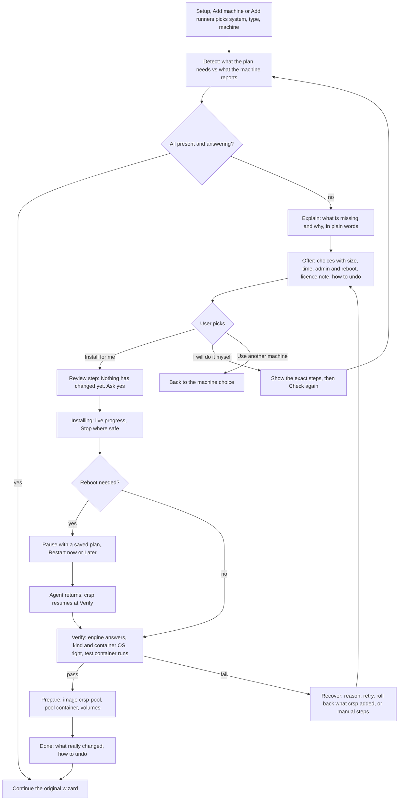

# Dependency setup

Study CRSP243; milestone M1 built in CRSP248 (see section 11). M2 and M3 are not built. The top half (sections 1 to 4) is for every reader; the bottom half (5 to 12) is for engineers.

## 1. In one paragraph

Owner question: if Docker is uninstalled, will crsp install it and make the images and containers (`crsp-pool:*`, `crsp-persistent-pool`) so everything works, simply and guided? **Today: no.** crsp detects a missing engine and says so, but it installs nothing. Once an engine answers, crsp does make the images and the pool container by itself. This page proposes the missing half: a guided, consented, verified **dependency setup** in the web app, used by Setup, Add machine and Add runners, for each system, runner type and target machine, with no terminal.

## 2. Why

**Problem.** A fresh Windows PC with no Docker gets: Persistent greyed with "the container backend is not allowed", a doctor warning whose fix is "install Docker in WSL2 (preferred) or Docker Desktop", and no way forward inside the app. The user must leave crsp, pick an installer, reboot, return. That breaks CORE-6 (guided) and the owner rule that the web app does everything.

**Users.** The owner and admins adding a machine or a runner. Viewers see state only.

**Goals.**

- Name what is missing, why it matters, what will be installed, how long, and how to undo it, before anything changes.
- Install with consent, verify, and recover from failure, from the web app.
- The same flow for Setup, Add machine and Add runners.
- Idempotent: running it again on a good machine changes nothing.

**Non-goals.**

- Buying or accepting a licence for the user (D-DEP-4).
- Changing a Docker Desktop setting that crsp does not own (the doctor already says crsp never does).
- Managing Kubernetes; crsp does not use it.

## 3. How it works

### 3.1 What crsp does today (read from the code, 25 Nov 2026)

| Thing | Detected | Installed | What happens when missing |
|---|---|---|---|
| crsp itself | yes | **yes**: MSI, `install.sh`, SSH join (the Windows path downloads the installer and checks its SHA-256, `apps/controller/internal/machines/sshwin.go`) | n/a |
| Docker command and engine | yes: `docker version` (`apps/controller/internal/agent/backends.go` `detectDocker`); reasons `docker is not installed`, `docker is installed but the engine does not answer; start Docker` | **no** | backend `Present=false`/`Usable=false`; container runners cannot start |
| Engine kind | yes: Docker Desktop, Docker in WSL2 via Windows CLI, via `wsl docker`, native (`apps/controller/internal/agent/engine.go` `DetectEngine`); Linux or Windows containers (`ContainerOS`) | no | `EngineNone` with a reason |
| WSL2 | yes: `wsl --status`, `wsl --version`; reasons `wsl.exe is not installed`, `WSL is installed but not ready; run wsl --install` | **no** | reason text only |
| Podman, nerdctl, Hyper-V, KVM, Tart, Firecracker | yes (`backends.go`) | no | reason text only |
| Doctor check `machine.engine` | yes | no; "never starts or changes an engine" | Warning with a **text** fix (`engineFix`: start Docker Desktop, `sudo service docker start`, or "install Docker"); a link to the machine page |
| Add runners page | yes (`AddRunners.tsx`, `kinds.ts`) | no | Persistent greyed with the reason; note "The container backend must be allowed on the machine" |
| Image `crsp-pool:<key>` | yes (local engine) | **yes, once an engine answers**: ensure-image order is local, then registry by digest, then a local build from the embedded `images/` Dockerfiles (registry R5.13; `apps/controller/internal/backend/container/ensure.go`) | job waits for the controller; build is local |
| Container `crsp-persistent-pool` and its two volumes | yes | **yes, once an engine answers**: `StartPersistent` makes the pool container run, with `docker run` and checked arguments (runners R5.93, `persistent.go`) | start fails with a crsp error |
| `pool-refresh` | not a crsp command; it is the dev-standards script. Open task OPS95 records that it built the image but did not make a missing container | n/a | lesson: crsp's own path must create a missing container, never assume it exists |

**Answer to the owner.** Docker uninstalled: crsp reports it and stops. Docker installed and running: images and containers are made without a step from the user. The gap is only the engine (and, on Windows, WSL2 under it).

### 3.2 Proposed flow

Every box that changes something is a step of one wizard (UX-5, UX-30, UX-54), drawn by the shared wizard part. The page passes data only.

### 3.3 What the plan needs

The need comes from the choice, never from a global rule:

| Choice | Needs |
|---|---|
| Linux runner, ephemeral or persistent, on a Linux machine | container engine (Docker Engine, or Podman as an allowed backend) |
| Linux runner on a Windows machine (container runner, R5.93, R5.139) | WSL2, then an engine that runs Linux containers (Docker in WSL2 preferred; Docker Desktop allowed) |
| Linux runner on a macOS machine | a Linux VM engine (Docker Desktop, or another allowed engine); see D-DEP-9 |
| Windows runner on a Windows machine, macOS runner on a macOS machine (persistent, on the machine itself) | nothing beyond crsp |
| KVM, Hyper-V, Tart microVM runner | their own backend (out of scope here; same flow, other rows in 7.1) |

## 4. Screens and states

One wizard, "Get this machine ready", opened from the place that found the gap. Steps: Look, Choose, Review, Installing, Verify, Done ("Check" is a retired word in the design system, so the first step is "Look" and the retry button is "Try again"). Later steps are greyed (UX-5). Buttons that start work say so and are not pressable while they run (UX-13).

| State | What the user sees | Rules |
|---|---|---|
| Nothing missing | No wizard. The original wizard goes on. | CORE-4 |
| First run, engine missing (Windows) | Headline "This PC cannot run Linux containers yet". Facts: WSL2 missing, Docker missing. One primary: "Install WSL2 and Docker (about 10 minutes, one restart)". Beside it: "Do it myself", "Use another machine". | CORE-3, CORE-5, UX-6 |
| Engine installed but stopped | "Docker is installed but not running." Primary "Start Docker". No install. | UX-6, UX-38 |
| Review | List of exact items, sizes, admin and reboot, licence note, "Nothing has changed yet." Primary "Install 2 items". Cancel left. | UX-30, UX-38 |
| Running | Step name in "-ing" form, progress bar with bytes and time left, live log folded, Stop where it is safe. Primary says "Installing…" and is disabled. | UX-13, UX-29, components 16, 26 |
| Paused for restart | "Restart needed to finish." Primary "Restart this PC now" (asks first, UX-9). Other: "Later". Progress kept; crsp resumes when the agent is back. | UX-9, UX-6 |
| Stopped | What was done and what is left. Primary "Continue". Other: "Undo what was installed". | UX-30, UX-62 |
| Failed | What, why, what next, in words (Message, Problem tone). Primary "Try again". Others: "Show the steps for myself", "Undo". | UX-6, UX-26, component 18 |
| Done | What really changed (list), what to remove to undo, a Verify result with the engine version. Primary: back to the original task. | UX-30 |
| Done after reload | Same Done, read from the audit record. | UX-30, UX-54 |
| Machine offline | "crsp cannot reach <machine>." No install is offered. Primary "Try again". | UX-6 |

Words go into `content` before build (words such as "Get this machine ready", "Install 2 items", "Restart needed to finish").

## 5. Functional requirements

IDs `DEP1` and up. Milestone is a proposal.

**DEP1** (M1) — **Detect by need.** Before Add runners, Add machine and Setup continue, the controller asks the agent whether the plan's needs (3.3) are met. The result names each item: missing, installed but stopped, installed but wrong kind (for example Windows containers when Linux is needed), or ok. It reuses `DetectEngine`, `detectDocker`, `detectWSL2`; nothing new is guessed.

**DEP2** (M1) — **Explain before offering.** Each missing item has one sentence of why ("Linux runners on Windows run in a container, and containers need Docker"). No raw path or code is the main text (CORE-3).

**DEP3** (M1) — **Offer choices with facts.** For each item the offer shows: what will be installed (name, version, source), download size, disk use, typical time, whether admin rights are needed, whether a restart is likely, licence note where one applies (D-DEP-4), and how to undo. A recommended choice is marked; the others stay visible (CORE-4).

**DEP4** (M2) — **Install only with consent.** Nothing is installed until the Review step is confirmed. The consent is recorded (actor, machine, item, version, source, time) in the audit log. No install runs from a read-only role.

**DEP5** (M2) — **Install by the system's own safe method, from a pinned list.** crsp keeps a list of allowed installers per OS (name, source URL, SHA-256 or signature, minimum version). The agent downloads, checks the hash before running, and refuses a mismatch (as `sshwin.go` already does for crsp). No `curl | sh`. See 7.1.

**DEP6** (M2) — **Live feedback.** A running step shows three things from the `ProgressEvent` stream, all drawn by the shared wizard (component 4): (1) the **Terminal** (component 82, UX-88): each command, its output as it arrives, and per block the machine name, its role (controller or agent) and its system; it opens with the step and stays after it ends, and the copyable log of the manual steps stays component 39; (2) the **Download progress** line (component 83, UX-90): bytes done of the total, the measured speed and the time left worked out from it, "Measuring speed" until a rate exists; (3) the **honest bar** (component 16, UX-88/UX-89): the real percent of the whole job from weighted phases, and for a phase with no percent an indeterminate bar that names the phase, says why no percent is reported and shows the time elapsed, so the bar never sits stuck. The page passes events only. A silent wait over 10 seconds names what it waits for (UX-29). Design-system rules: UX-88, UX-89, UX-90, CORE-1, CORE-3, CORE-5, CORE-6.

**DEP7** (M2) — **Reboot is a step, not an accident.** If an install needs a restart, crsp stops, saves the plan (item list and next step) in the controller, tells the user, and offers Restart now or Later. It never restarts a machine with a running job without an explicit yes, and drains first (scheduling hold). After the agent reconnects, crsp resumes at Verify.

**DEP8** (M2) — **Verify.** Done is only after: the engine answers, `ContainerOS` is what the plan needs, and a small test container runs and is removed (`docker run --rm` of a tiny image the controller already holds or pulls through the registry mirror). A verify failure is a failed step, not a Done.

**DEP9** (M1) — **Prepare images and containers.** After verify, crsp prepares what the plan needs: `crsp-pool:<key>` through ensure-image (registry R5.13), the persistent pool container `crsp-persistent-pool` and its two volumes (R5.93). If the container is absent crsp creates it (the OPS95 lesson); an image that exists is not rebuilt. This already exists; the wizard shows its progress instead of hiding it in the runner start.

**DEP10** (M2) — **Recover.** Every failure ends with the reason, a retry, the manual steps (copyable), and an undo of only what crsp added in this run. Undo uses the recorded list; it never removes software that was there before (UX-62 asks first and names each item).

**DEP11** (M2) — **Idempotent.** Re-running on a machine that already meets the need detects it and changes nothing, like a declarative package check (research R4). A half-done earlier run is resumed from its record.

**DEP12** (M2) — **Per target machine.** The agent on the target does the install. For the controller's own machine it runs there. For a remote machine with a connected agent it is a command over the agent link. For a machine joined over SSH, before an agent runs, the install is offered after join, not during. An offline machine is not offered an install (4).

**DEP13** (M2) — **One flow, three doors.** Setup (first machine), Add machine (after join) and Add runners (at the machine or type choice) open the same wizard; coming back continues the original step with the choices kept.

**DEP14** (M1) — **Doctor links to it.** `machine.engine` keeps its text fix and adds a link "Get this machine ready" to the wizard. The doctor still only reads (`machine.engine` today never changes an engine); the change is by the wizard.

**DEP15** (M3) — **Offline machines.** A machine with no internet gets the same offer with "Use a downloaded installer": the controller (which has internet) fetches and checks the file, then serves it to the agent over the agent link or the LAN (D-DEP-8).

**DEP16** (M1) — **No install without need.** crsp never installs a dependency that no runner choice asks for, never upgrades an engine the user installed, and never changes Docker Desktop's settings.

## 6. Non-functional requirements

- **Safety.** Pinned sources, hash check before run, no shell string built from user input, no engine socket given to a job (R5.81 stays).
- **Time budget.** The offer shows a typical time; a run that exceeds 3 times its typical time says so and offers Stop.
- **Resumable.** Controller restart, agent restart or machine reboot never loses the plan.
- **Accessible and responsive.** UX-16, UX-17; checked at 360, 393 and 1300 px.
- **Privacy.** The install log redacts tokens and paths of the user's profile.

## 7. Design

### 7.1 Method per system (proposal; confirm each source at build)

| System | Missing | Recommended method | Admin | Restart | Notes |
|---|---|---|---|---|---|
| Windows 10 or 11 | WSL2 | `wsl --install --no-distribution` (Microsoft documents the command; a restart is usually needed) | yes | likely | Needs virtualization on in firmware: Verify reads it and says so when off (the user changes it in firmware; crsp cannot) |
| Windows | Docker in WSL2 | in the crsp WSL distro: Docker's apt repository install, then `systemctl`/service start; reached through `wsl docker` (an engine kind crsp already supports) | no more than WSL | no | Preferred: no Docker Desktop licence (D-DEP-4); matches `engineFix` text today |
| Windows | Docker Desktop (alternative) | Docker's installer, silent; WSL2 backend; the Docker MSI **reboots by default** unless told not to | yes (all users) or per-user | likely | Licence note; verify flag names against the current Docker page at build |
| macOS | engine | Docker Desktop through the Homebrew cask `docker-desktop` (Homebrew checks the file); crsp then opens the app and waits for the engine. The first start asks the user for a system permission that crsp cannot click. Without Homebrew: "Do it myself" | yes (the privileged helper prompt) | no | Needs a person at the screen once: the wizard says so and waits (D-DEP-9) |
| Linux (Debian, Ubuntu) | engine | Docker's signed apt repository, then the packages, then enable the service; remove conflicting unofficial packages first, with a yes | yes (sudo, no password prompt possible: see D-DEP-1) | no | The `get.docker.com` convenience script is for development and is not recommended for production; crsp uses the repository method |
| Linux (Fedora, Red Hat family) | engine | Docker's rpm repository: crsp fetches `docker-ce.repo` for `fedora`, `rhel` or `centos` (Rocky and Alma use `centos`) from download.docker.com over https, then `dnf -y install` the Docker packages and enables the service | yes | no | Conflicting unofficial packages are named, never removed without a yes (same rule as apt) |
| Linux (other families) | engine | "Do it myself" with exact steps | yes | no | Snap Docker is not supported by tools such as Coolify; crsp treats it as "installed, wrong kind" and says so |
| any | stopped engine | start the service or app; no install | per system | no | |

### 7.2 Per runner type and target machine

| Runner | Target | What the wizard installs | Then prepares |
|---|---|---|---|
| Ephemeral, Linux | Linux machine | engine | `crsp-pool:<key>`, job network |
| Ephemeral, Linux | Windows machine | WSL2, engine in WSL2 | the same |
| Persistent, Linux | Windows machine | WSL2, engine in WSL2 | `crsp-pool:<key>`, `crsp-persistent-pool`, volumes `-state`, `-deps` |
| Persistent, Linux | Linux machine | usually nothing (runs on the host); engine only if the user chose a container pool | per choice |
| Persistent, Windows | Windows machine | nothing | runner service |
| Persistent, macOS | macOS machine | nothing | runner service |
| Ephemeral, macOS | macOS machine | the Tart or Virtualization path; out of scope here | |

### 7.3 Parts

- Agent: an `InstallPlan` command on the agent link (items, pinned source, expected hash); progress and result events; the result is checked by Verify, never trusted.
- Controller: a plan record (state machine: checked, chosen, consented, installing, paused, verifying, done, failed, undone), audit rows, resume after reconnect.
- Web: one wizard on the shared wizard part (components 4, 16, 18, 19, 26, 39, 48). No page-level layout or colour.
- Pinned list: data in the repository, shipped with the release; updated by release, not fetched at run time from an unpinned place.

## 8. Failure modes

| Failure | Result |
|---|---|
| Virtualization off in firmware | Verify fails with the exact reason and a manual step; no retry loop |
| Download fails or hash mismatch | Nothing runs; "The file did not match; nothing was installed"; Retry |
| No admin rights | Stops at Review with "needs an administrator"; offers "Do it myself" |
| Restart needed, user says Later | Plan kept; the Add runners wizard offers Continue when verify passes |
| Machine goes offline mid-install | Plan kept as paused; on return crsp verifies and resumes or fails |
| Docker Desktop installed but licence prompt blocks | Verify times out with a message pointing to the licence note |
| Engine kind wrong (Windows containers) | Offer "Switch to Linux containers" only where the engine allows it by command; else manual |
| Disk too small | Review shows the need and the free space; blocked with the reason (UX-38) |
| Conflict with an unofficial Docker package | Named, asked, removed only with a yes |
| Another install already running on the machine | Waits and says so |

## 9. How it is proven

Tests of M1 (go and vitest, with fakes for Windows and WSL so CI on Linux runs them): `apps/controller/internal/agent/deps_test.go`, `apps/controller/internal/agent/install/install_test.go`, `apps/controller/internal/depsetup/*_test.go`, `apps/controller/internal/agentlink/deps_test.go`, `apps/controller/internal/store` jobs test, `apps/controller/internal/api/handlers_dependencies_test.go`, `apps/controller-console/src/screens/dependencies/GetReady.test.tsx` (every state, wizard harness). Plan for the rest:

| Req | Test |
|---|---|
| DEP1 | `apps/controller/internal/agent` table test: reports for no docker, stopped engine, wrong container OS, WSL missing, WSL not ready (fake `Sys`) |
| DEP3, DEP4 | web test of Review: lists items, size, time, admin, restart, licence; "Nothing has changed yet."; no call before yes |
| DEP5 | `apps/controller/internal/agent/install` test: hash mismatch runs nothing; unknown item refused |
| DEP7 | controller test: paused plan survives restart and resumes at Verify; no restart with a running job |
| DEP8 | agent test: Verify fails when the test container fails, though install exited 0 |
| DEP9 | `apps/controller/internal/backend/container` test: missing pool container is created; existing image is not rebuilt |
| DEP10, DEP11 | test: second run changes nothing; undo removes only the recorded items |
| DEP12 | machines test: offline machine is not offered an install |
| Screens | `e2e` wizard harness (UX-54) for every state of section 4 at 360, 393, 1300 px |
| Real PCs | `docs/guides/real-machine-test.md` gets a clean-Windows, clean-macOS and clean-Linux run |

## 10. Decisions

Open. Each has a recommended default; the owner answers.

| ID | Question | Recommended default |
|---|---|---|
| D-DEP-1 | Admin rights: how does crsp get them? Windows: the agent runs as LocalSystem (service) so it can install. Linux: non-interactive `sudo` is not possible without setup. macOS: needs a prompt. | Windows: the service does it. Linux: the service runs as root already if installed by `install.sh` with sudo; if not, show one copyable command run once ("Do it myself"). macOS: a person approves one prompt; the wizard waits |
| D-DEP-2 | Reboot: automatic or the user's choice? | The user's choice, always; drain first; resume after (DEP7) |
| D-DEP-3 | WSL: install it for the user? | Yes, with consent, `--no-distribution`, then a crsp-owned distro only if Docker in WSL2 is chosen; never touch the user's own distros |
| D-DEP-4 | Docker Desktop licence: paid for companies over 250 employees or over $10 million revenue (Docker's published terms). | Recommend **Docker in WSL2** on Windows, no Desktop; offer Desktop only with a licence note and a tick "I have the right to use it". crsp does not judge licences |
| D-DEP-5 | Which engine on Linux: Docker Engine or Podman? | Docker Engine (the code and registry path are tested for it); Podman stays detected and allowed, not installed |
| D-DEP-6 | Ask or auto-install on Add runners? | Ask. Never install without the Review step (DEP4) |
| D-DEP-7 | Undo: how far? | Undo only what this run added, from its record; leave images and volumes the user may have used |
| D-DEP-8 | Offline machines | The controller fetches and checks, the agent receives over the link (DEP15, M3); until then "Do it myself" |
| D-DEP-9 | macOS | Offer Docker Desktop with the human prompt; no unattended path promised. Revisit if Linux-in-macOS runners are used by the owner |
| D-DEP-10 | Pinned list or latest | Pinned per release; a newer one only by a crsp update |
| D-DEP-11 | Setup first-run: install during the very first setup? | Yes, as a step after the machine is chosen, only if a runner type that needs it is picked |

## 11. Built and not built

**Built in CRSP248 (M1).** Owner decisions D-DEP-1..11 are at their recommended defaults.

- DEP1 detect by need: `apps/controller/internal/agent/deps.go` (`DetectDeps`, reuses `DetectEngine`, `detectDocker`, `detectWSL2`), answered to `DepsCheck` over the agent link.
- DEP2, DEP3 explain and offer with facts: `apps/controller/internal/depsetup/offer.go`, facts from the pinned list `apps/controller/internal/depsetup/pinned.json` (shipped with the release). One recommended choice; Docker Desktop only with the licence note and tick.
- DEP4 consent (built early with M1): the Review step is the consent; `POST .../dependencies/jobs` does nothing without `confirmed`; audit row `dependency.consent`. DEP5 pinned installers with hash check before run, unknown item refused (`apps/controller/internal/agent/install`). DEP6 live events with real command lines and bytes. DEP7 reboot is the user's choice (`restart-host`, asks first, refused while a job runs); the job is stored (migration 00044) and resumes after the agent returns. DEP8 verify including a test container. DEP9 prepare (see below). DEP10 undo of only the recorded items; DEP11 idempotent; DEP14 doctor text names the wizard and links `?setup=deps`; DEP16 no install without need.
- Web: wizard "Get this machine ready" (`apps/controller-console/src/screens/dependencies/`), doors in Add runners, Add machine and Setup.
- Events: `DepsEvent` on the agent link has the shape of the CRSP247 progress contract; the API sends it snake_case (`DependencyEvent`) and the page maps it with `toProgressEvent`.

**Built in CRSP265 (step one, all systems).** On top of CRSP248, for Windows, Linux and macOS.

- DEP9 prepare is real: after Verify, `container.Backend.PreparePool` makes the base image `crsp-pool:<key>` through the existing local, registry, build path and, for a persistent Linux runner on a Windows or macOS machine, the persistent pool container `crsp-persistent-pool` with its two volumes. It registers no runner, builds nothing that is there and never re-creates a pool container. A machine without the container backend says the image is made at the first runner, as before. Wired by `Config.PreparePool` (agent) and `agentPreparePool` (`apps/controller/cmd/crsp`).
- DEP1, DEP2, DEP3 on Linux: Fedora and the Red Hat family are installed through Docker's rpm repository (undo kinds `rpm-repo-file`, `rpm-package`); the offer for every Linux family shows the same facts and, for families crsp does not install, the manual steps.
- DEP1, DEP2, DEP3 on macOS: Docker Desktop through the Homebrew cask, with the licence tick; a stopped Docker Desktop is opened (no install, no tick); Verify waits up to 4 minutes for the engine and then says the person may need to approve one system prompt (undo kind `brew-cask`). A stopped Docker in the crsp WSL distro on Windows is started the same way (no install).
- DEP14 on every system: the doctor text of `machine.engine` names Docker Desktop on a Mac (it showed a Linux `systemctl` line before) and links `?setup=deps` for all three systems.
- DEP16: tests that a machine that meets the need, an unknown item, a stopped engine and a missing licence tick install nothing.

**Verified where.** Windows and Linux paths: unit tests with fakes on Linux; CI runs the suites on Windows, Linux and macOS (macos-latest). **macOS was built and CI-tested only; it was not run on a real Mac.** The Windows paths were not run on a real Windows machine in this task. The Homebrew cask name `docker-desktop` and the `docker-ce.repo` paths were not fetched at build; confirm them on a real Mac and a real Fedora before relying on them.

**Known gaps of M1.**

- Docker Desktop on Windows: installer URL and SHA-256 are not pinned (the vendor host was not readable at build). The agent refuses it with "not pinned in this release"; the wizard offers "Do it myself". Installable paths: Docker in WSL2 (Windows), Docker Engine (Ubuntu, Debian, Fedora and the Red Hat family), Docker Desktop through Homebrew (macOS). Other Linux families, and a Mac without Homebrew, give "Do it myself" steps.
- DEP9 (closed in CRSP265): the prepare step uses the base image of the machine. Layer images of a runner with extra layers are still made at its first start.
- Removing conflicting unofficial Docker packages needs a yes that the protocol does not yet carry; the install is refused and names them.
- The engine inside the crsp-owned WSL distro `crsp-docker` is found by the setup code; the container backend elsewhere still looks only at `wsl docker`.
- Resume after a restart is sent when a capable agent reports again, not only after "Restart now".
- Unknown progress arrives as 0 in the API with a `reason` (generated type); `toProgressEvent` maps it to `pct: null`. Since CRSP247 the wizard draws the Terminal, the Download progress line and the weighted bar from the events (DEP6); the folded log is gone from this page.
- Not run on real Windows, macOS or Linux machines: the silent flags and `wsl --install -d ... --name crsp-docker` were tested against fakes only.

**Built in CRSP270 (step two).** DEP13: the Setup summary shows the "Get this machine ready" door for every online machine of the pool that has no container engine, not only this PC; an offline machine gets none (DEP12). The door keeps the way back (`return=/setup/summary`). DEP4 to DEP8, DEP10 and DEP11 were already built in CRSP248 and CRSP265 (above); CRSP270 changed nothing there.

**Not built (M2, M3).** DEP12 for a machine joined over SSH (offer after join: the Add machine door shows once the agent is online, no separate SSH-only path), DEP15 offline machines (needs a new agent-link message and file serving; until then "Do it myself"), time budget "3 times typical", resume only after "Restart now", the yes for removing conflicting Docker packages.

## 12. Research and code map

**What others do** (searched 25 Nov 2026; check each source before relying on a detail):

- R1. **Docker Desktop for Windows**: WSL 2 backend is the default; per-user install needs no admin, all-users does; installer flags and the MSI exist for silent installs; the MSI **reboots by default**, and `/norestart` stops that. Sources: [Install Docker Desktop on Windows](https://docs.docker.com/desktop/setup/install/windows-install.md), [MSI install](https://docs.docker.com/desktop/setup/install/enterprise-deployment/msi-install-and-configure), [Enterprise FAQ](https://docs.docker.com/desktop/enterprise/enterprise-deployment/faq/).
- R2. **Licence**: paid subscription above 250 employees or $10 million revenue. Sources: [Docker FAQ](https://docker.io/pricing/faq/), [Docker updates subscriptions](https://www.docker.com/press-release/docker-updates-product-subscriptions/).
- R3. **WSL**: `wsl --install` enables the components; a restart may be needed; `--no-distribution` is listed in the commands. Sources: [WSL basic commands](https://learn.microsoft.com/en-us/windows/wsl/basic-commands), [WSL install](https://learn.microsoft.com/en-us/windows/wsl/install), [WSL troubleshooting](https://learn.microsoft.com/en-us/windows/wsl/troubleshooting).
- R4. **Idempotent checks**: Ansible package modules and check mode (dry run); a dry run can mislead later steps that depend on an install, so crsp's detect step reads real state and never fakes it. Sources: [Ansible check mode](https://docs.ansible.com/projects/ansible-core/2.15/playbook_guide/playbooks_checkmode.html), [ansible.builtin.package](https://docs.ansible.com/projects/ansible/latest/collections/ansible/builtin/package_module.html).
- R5. **Docker on Linux**: the signed apt repository is the standard; the convenience script is for development, can cause major-version drift and is not designed to upgrade. Remove conflicting unofficial packages first. Source: [Install Docker Engine on Ubuntu](https://docs.docker.com/engine/install/ubuntu/).
- R6. **Coolify**: its install script installs Docker when it is missing, needs a minimum Docker 24.0, does not support snap Docker, and says some distros need Docker installed first. A good model for "detect, auto-install on the common path, fall back to manual steps with a link". Sources: [Coolify installation](https://coolify.io/docs/get-started/installation), [Docker install failed](https://coolify.io/docs/troubleshoot/installation/docker-install-failed).
- R7. **Rancher Desktop**: a first-run dialog lets the user pick the engine (dockerd or containerd) and whether to allow admin access; admin is optional and explained. Models the "choose, explain, optional elevation" screen. Sources: [Container engine preferences](https://docs.rancherdesktop.io/1.8/ui/preferences/container-engine/), [FAQ](https://docs.rancherdesktop.io/faq/). Defaults differ by version; check the installed version.
- R8. **GitHub Actions runner**: `bin/installdependencies.sh` must be run with sudo before `config.sh`, which refuses to run as root; the missing-dependency error is clear but leaves the fix to the user. A model of what not to leave to the user. Source: [Self-hosted runner requirements](https://docs.github.com/en/enterprise-server@3.15/actions/reference/runners/self-hosted-runners) (partly read; the script's package list came from a third-party guide, not used here).
- R9. **actions-runner-controller**: the older mode needed cert-manager installed first; scale-set mode dropped it. Lesson: remove prerequisites where you can; where you cannot, check them first. Source: [ARC quickstart](https://docs.github.com/en/enterprise-server@3.15/actions/tutorials/use-actions-runner-controller/quickstart), [installing ARC](https://github.com/actions/actions-runner-controller/blob/master/docs/installing-arc.md).
- Not verified in this study: Portainer's setup wizard; the exact `winget` and Homebrew cask behaviour for Docker; Docker Desktop silent flag names today. Verify at build time.

**Code map**: `apps/controller/internal/agent/backends.go` (detection), `apps/controller/internal/agent/engine.go` (engine kind), `apps/controller/internal/doctor/checks/engine.go` (doctor text fix), `apps/controller/internal/backend/container/ensure.go` (image ensure), `apps/controller/internal/backend/container/persistent.go` (pool container), `images/persistent/compose.yaml` (readable form), `apps/controller/internal/machines/sshjoin.go` and `sshwin.go` (installs crsp, not Docker), `apps/controller-console/src/screens/runners/AddRunners.tsx` and `kinds.ts` (greying), `docs/features/runners/spec.md` R5.47, R5.93, R5.139.

## Design-system proof

Checked: CORE-1, CORE-3, CORE-4, CORE-5, CORE-6, CORE-7 (one card shape for the offer facts). Design system v4. Sections used: `ux-rules`, `components`, `content`. Nothing is built, so the proof is the existing general guards for each rule; the tests of section 9 (the wizard harness for every state of section 4) are planned and will be added to these lines when written. New words go to `content` before build.

Proof: CORE-1, CORE-3, CORE-4, CORE-5, CORE-6, CORE-7, UX-5, UX-6, UX-26, UX-29, UX-30, UX-38, UX-42, UX-62 `scripts/design/design-system-follow.test.ts`
Proof: UX-16, UX-17 `e2e/tests/web-console/ux-routes.spec.ts`
Proof: UX-9 `e2e/tests/web-console/ux-static.spec.ts`
Proof: UX-13, UX-54 `scripts/design/wizard-behaviour.test.ts`
Proof: UX-88, UX-89, UX-90 `packages/ui/src/components/LiveProgress.test.tsx`
