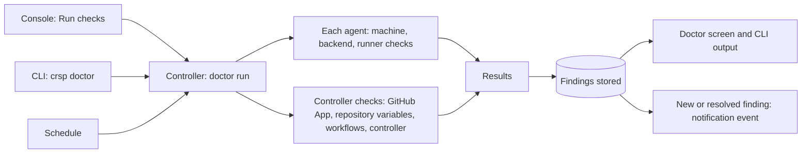

# Doctor

The top half (sections 1 to 4) is for every reader: product, design, UX. The bottom half (5 to 12) is for engineers.

Partly built (CRSP23, wired into the controller by CRSP41 in `cmd/crsp/areas_wiring.go`: the doctor routes answer, runs are kept in memory, the OS service list of a machine is not read yet so those checks skip): the engine, the check interface, the M1 core checks, the API routes and `crsp doctor` exist. Everything marked NOT YET IMPLEMENTED below is still to do. Each check names the milestone that adds it.

## 1. In one paragraph

The doctor checks that the whole pool is healthy and says how to fix each problem. It looks at every machine, every isolation backend, every runner, the GitHub App, the repository variables `RUNS_ON_*`, the `runs-on` labels of every workflow, and the runner hooks. Each problem is a finding with a severity and one clear fix. The user runs it from the Doctor screen of the web console, from the CLI (`crsp doctor`), or lets the controller run it on a schedule. New findings feed the notifications. The doctor only reads. It never changes anything.

## 2. Why

**Problem.** A self-hosted pool fails in quiet ways. A machine goes offline, a runner loses a label, a hook points at the wrong file, a repository variable is unset. Jobs then queue forever, or run on GitHub-hosted runners and bill minutes. The dev-standards pool learned this the hard way (product brief, learnings 4, 6, 7 and 8).

**Users.** The owner and admins of a pool. Viewers can read the findings.

**Goals.**

- One place that answers "is my pool healthy, and if not, what do I do?"
- Every finding has a fix the user can follow: words, and a command or a console link.
- Findings that matter reach the user without opening the console (notifications).
- The same checks and the same result from the console, the CLI and the schedule.
- Port the checks of dev-standards' `delivery_doctor.py`, `runner_health.py` and `runner_plan.py` with their tests (decision 0005).

**Non-goals.**

- The doctor does not repair. It shows the fix; the user runs it, or presses the button on the screen where that command lives (UX-52).
- It does not check GitHub-hosted runners.
- It does not watch single jobs. Job waits are the scheduling feature's work.
- It does not check the dev-standards delivery plugin (its config, Claude hooks, ledger, plugin versions).

## 3. How it works



1. A run starts from the console, the CLI or the schedule. It has a scope: everything, or some machines, repositories or checks.
2. The controller runs its own checks: the GitHub App, the repository variables, the workflow labels, the controller itself.
3. It asks each agent in scope to run the machine, backend and runner checks there, over the agent link (decision 0004).
4. Each check returns findings. A finding has an ID, a subject (what it is about), a severity, a detail and a fix.
5. A check that cannot run returns `skip` with the reason, never `ok`. A check that needs admin rights it does not have says so (learning 6).
6. The controller stores the run and its findings. It compares them with the last run and sends an event for each finding that is new or resolved.
7. The console shows the findings live. The CLI prints them, or JSON, and exits with a code by the worst severity.

## 4. Screens and states

The Doctor screen is screen 8 of the brief. No mocks yet (NOT YET IMPLEMENTED); they go in `images/` with alt text when drawn.

Layout:

- Page header "Doctor" with the time of the last run, as "x ago" that keeps ageing (components 1; UX-3, UX-18, UX-53).
- One primary action, **Run checks**, in the sticky action bar (UX-4; components 5). While a run is going it says "Running checks", is not pressable, and its state comes from the server (UX-13, UX-19).
- A summary line with counts per severity (components 17).
- Search bar and filter chips: severity, group (Machines, Backends, Runners, GitHub App, Repositories, Workflows, Controller) and machine (UX-31; components 11, 12, 21).
- Findings as list rows, worst first, grouped by subject (UX-25; components 15). Each row: the status word and glyph (UX-58), the title, the subject, the fix in words, the command with a copy button, and a link to the screen where the fix is done. A runner subject names its isolation (UX-61). A check that needs admin says "needs admin" in words.
- Long lists use the shared pager (UX-11; components 10).
- The overview screen shows the doctor's worst severity and counts as a link to this screen, with no command button (UX-52).

States:

| State | What the screen shows |
|---|---|
| Never run | Empty state: "No checks have run yet." with Run checks (UX-6; components 19) |
| Running | Progress bar with checks done, n of N, and the check in hand (UX-29; components 16). Findings appear as they come |
| All healthy | Done tone: "All N checks passed." (UX-26; components 18) |
| Findings | The list, worst first. Problem and Needs you tones never by colour alone (UX-26, UX-17) |
| Partial | A note names the machines or services that could not be checked and why (UX-6) |
| Could not run | What, why and what next (UX-28; components 19) |

## 5. Functional requirements

### 5.1 Runs

**R5.1** — A doctor run has a scope: all, or a list of machines, repositories and check ID prefixes. It runs every check in scope and returns one finding per check and subject. Built (CRSP23).

**R5.2** — A finding has: check ID, subject (kind, ID, name), severity, title, detail, fix, `needs_admin`, milestone, and the time it was checked. Built (CRSP23).

**R5.3** — Severities, best to worst: `ok`, `info`, `skip`, `warn`, `fail`. `skip` means not checked, with the reason. The run's result is its worst severity. Built (CRSP23).

**R5.4** — Every finding that is not `ok` has a fix: one or more sentences that say what to do, and, where one exists, a CLI command and a console link. Built (CRSP23): the engine fills a generic fix when a check gives none.

**R5.5** — A check that cannot run (a timeout, an unreachable agent, GitHub not reachable, no rights) returns `skip` with the reason. It never returns `ok`. Built (CRSP23): a check that does not finish in time is `skip`.

**R5.6** — A check that crashes returns `fail` with "check crashed" and the error. The other checks still run. Built (CRSP23).

**R5.7** — The doctor never changes state: no write to GitHub, the database (other than its own run records), a machine or a runner. Built (CRSP23): the sources a check reads (`doctor.Fleet`, `doctor.GitHub`) have no write method.

**R5.8** — Only one run per scope runs at a time. A second request for the same scope joins the running run and gets its ID. Built (CRSP23).

### 5.2 Machines and backends

**R5.9** — Machine checks: agent online, load figures fresh, load within budget, disk space, clock, slot queue health, and the machine config readable by runner accounts. See the catalogue (7.2). Built (CRSP23): `machine.online`, `machine.load.fresh`, `machine.load.budget`, `machine.disk`; built (CRSP76): `machine.load.measured` (a machine that cannot measure its load is a `fail`, because the gate holds its jobs, scheduling R5.22); built (CRSP21): `machine.guard.disk`. NOT YET IMPLEMENTED: clock, slot queue health, machine config (milestones 1 and 3).

**R5.10** — Backend checks, for each backend a machine allows: it is still detected and works, and it keeps the isolation rules of decision 0003 (no Docker socket in jobs, no privileged container, KVM as a device, caps set and applied, image layers present, macOS VM limit). See 7.2. NOT YET IMPLEMENTED (milestones 2, 4, 5, 6).

### 5.3 Runners

**R5.11** — The agent finds the runners on its machine from the OS service list: Windows services named `actions.runner.*`, systemd units `actions.runner.*.service`, launchd jobs `actions.runner.*`. It does not need to read the runner folder to find a runner (learning 6). A runner in the service list that the product does not manage is an `info` finding. Built (CRSP23): the parsers and command lines for Windows, systemd and launchd; the agent calling them lands with the agent link.

**R5.12** — Each managed runner is checked: registered on GitHub and online there, service present and running, runner version current, both job hooks set and usable. GitHub runners with the pool's name prefix that no machine has are a `warn` finding. Built (CRSP23): registered, service, orphan. NOT YET IMPLEMENTED: runner version.

**R5.13** — When the agent cannot read a runner folder (it is locked to the runner's account), the checks that need it return `skip` with `needs_admin: true`. The fix says how to run them as an administrator on that machine (`crsp doctor --local`). The runner itself is still found and its service checks still run. Built (CRSP23) for the hook check (`runner.hooks`); the CLI `--local` part is NOT YET IMPLEMENTED.

**R5.14** — The hook check fails when a job-started or job-completed hook is missing, ends in `.cmd`, points into a user profile, or, on Windows, is a `.ps1` that the service account's execution policy would block (learning 4). An execution policy that cannot be read is `skip`, not `fail`. Built (CRSP23): the check reports the problems the agent finds; reading the hooks and the execution policy is the agent's part, NOT YET IMPLEMENTED.

**R5.15** — The version check is `warn` when a newer runner release exists and `fail` when GitHub no longer accepts the runner's version. NOT YET IMPLEMENTED (milestone 1).

### 5.4 GitHub App

**R5.16** — GitHub App checks: installed on every account that has a pool repository and not suspended; the installation grants every permission the product needs; an installation token can be made now from the stored private key; the rate limit is not nearly used up; recent webhook deliveries succeed. Built (CRSP23): installation and permissions. Built (CRSP77): webhook deliveries (`github.webhook`, from GitHub's delivery list for the App: warn when the newest delivery in 24 h failed or at least half failed, or when none arrived in 24 h while a pool repository has open jobs). NOT YET IMPLEMENTED: token, rate limit.

### 5.5 Repository variables and workflows

**R5.17** — For each pool repository and each OS that has runners for it, `RUNS_ON_<OS>` is set, is a JSON list of strings, and equals the labels the product would write. Unset where a workflow uses it is `fail`; different is `warn`. A variable set for an OS with no online runner is `fail` (its jobs would queue forever). Built (CRSP23).

**R5.18** — For each pool repository, the doctor reads every workflow file on the default branch and every job's `runs-on`: a string, a flow list, a block list, or `${{ fromJSON(vars.NAME) }}` with an optional `|| '<default>'`, resolved through the repository variable. A label set with `self-hosted` must be carried in full by at least one online runner; otherwise `fail`, with file and line. GitHub-hosted label sets are skipped. An expression it cannot resolve (a matrix value) is `info`, "not checked". Built (CRSP23).

**R5.19** — A self-hosted job with literal labels instead of `fromJSON(vars.RUNS_ON_*)` is `warn`. A runner label that is not generic (not `self-hosted`, an OS, an architecture, `docker`, `kvm`, `gpu` or a pool name) is `warn` (learning 7). Built (CRSP23).

### 5.6 Where it runs

**R5.20** — Console: the Doctor screen of section 4 starts runs, shows progress and findings live, and filters by severity, group and machine. NOT YET IMPLEMENTED (milestone 1).

**R5.21** — CLI: `crsp doctor` starts a run through the controller's API and prints the findings, worst first, one block per finding with its fix. Flags: `--machine NAME`, `--repo OWNER/NAME`, `--check PREFIX` (each may repeat), `--min-severity info|warn|fail` (default `warn`: hides `ok`, `info` and `skip` from text output), `--json`, `--local`. Built (CRSP23) without `--local`.

**R5.22** — CLI exit code by the worst severity: 0 when nothing is `warn` or `fail`, 1 when the worst is `warn`, 2 when the worst is `fail`, 3 when the run could not happen (bad flags, controller not reachable, not signed in). Built (CRSP23) with the owner's CRSP23 codes: exit 1 when the worst is `fail`; 0 for `warn` and below; 3 when the run could not happen. This replaces the codes written here.

**R5.23** — `--json` prints one JSON object (schema in 7.4) with every finding, `ok` ones included, whatever `--min-severity` says. Built (CRSP23).

**R5.24** — `--local` runs the machine, backend and runner checks of this machine in the process, without the controller. It is the way to run the checks that need admin, from an administrator shell. It prints the same findings and uses the same exit codes. NOT YET IMPLEMENTED (milestone 1).

**R5.25** — Schedule: the controller runs a full run every `doctor.full_interval` (default 30 minutes) and a quick run of `machine.online`, `machine.load.fresh`, `machine.disk` and `runner.registered` every `doctor.quick_interval` (default 60 s). It also runs a full run at start and when an agent connects again. NOT YET IMPLEMENTED (milestone 2).

### 5.7 Findings feed notifications

**R5.26** — After each run the controller compares findings with the last result for the same check and subject. A finding that becomes `warn` or `fail` sends a `doctor.finding.opened` event. One that goes back to `ok` sends `doctor.finding.resolved`. A finding that stays the same sends nothing. NOT YET IMPLEMENTED (milestone 2; delivery by email, webhook and desktop in milestone 8).

**R5.27** — The brief's notification cases come from doctor findings: machine offline (`machine.online`), disk nearly full (`machine.disk`), runner version outdated (`runner.version`). NOT YET IMPLEMENTED (milestone 2).

### 5.8 Milestones

**R5.28** — Each milestone adds the checks of the parts it builds, as the catalogue marks them. A milestone is not done until its checks exist with tests. A check for a part that is not built yet does not appear in a run. NOT YET IMPLEMENTED (every milestone).

**R5.29** — The hook run check (`runner.hookrun`) runs each persistent runner's real `job-started` hook script as the runner's service account with `CRSP_HOOK_PROBE=1`, so it takes no slot and starts no job, and reads its exit code and output. A hook is fine when it exits 0 and prints `crsp hook ok`. It is `fail` when the script cannot start, exits non-zero, prints a `::warning` annotation (crsp missing or broken, scheduling R5.61), or does not reach crsp. Hooks depend on nothing but the shell the runner already uses. An agent that did not run the hook gives `skip`. Problems the hooks wrote to `crsp-hook-problem.txt` show in `runner.hooks` (R5.14). Built (CRSP22): the check; the agent running the hook as the account is NOT YET IMPLEMENTED.

**R5.30** — The listener check (`runner.listener`) reads, for each persistent runner, the processes of `Runner.Listener` that run from its folder and the state of its service (runners R5.46). It is `ok` with exactly one listener under a running service, or none with a stopped service. It is `fail` with more than one listener (GitHub keeps one session and refuses the others), or with a listener while the service is stopped (the next start would be a second listener). It is `warn` when the service runs with no listener (the runner takes no job). An agent that did not look gives `skip`. The hook run check (R5.29) also warns when the hook reaches crsp but does not print `crsp hook non-interactive`, which means it did not turn prompts off (scheduling R5.62). Built (CRSP38): the checks; the agent filling `ListenerPIDs`, `ListenerKnown` and `ServiceRunning` is NOT YET IMPLEMENTED, as for R5.14.

**R5.31** (M2, v0.3.0, Built CRSP53: `internal/doctor/checks/container.go`; the agent giving the doctor its engine and the pool list is the pool lifecycle, the next wave, so the checks are not registered in the controller yet) — **Container checks.** For a machine that allows the container backend: the engine answers (Windows `docker` CLI first, then `wsl docker`); the image of each pool matches its declared layers and pinned versions (`image.current`, port of `pool.<name>.files-current`); each tool of each layer in the image is found (port of `pool.<name>.layer-*`, runners R5.50); the tool cache folder is writable; and the pool settings and the runner records agree. A tool that the probe ran and did not find is `fail`. A probe that could not run (engine errors, a timeout) is `warn` with "cannot probe", never `fail`. A warning also shows when the engine cannot be read at all.

**R5.32** (M2, v0.6.0, Built in part CRSP56 and CRSP61: `checks.RegisterKVM` and the five checks in `internal/doctor/checks/kvm.go`, fed by `doctor.KVMSource`; CRSP63: `kvm.wslconfig` and `kvm.module` are in the live doctor, 28 checks in all, fed by the KVM state each online agent reports in its `MachineReport`; `kvm.host`, `kvm.container` and `kvm.label` stay out until the agent reports the pool container and label) — **KVM checks.** For a pool with KVM on: `kvm.host` (the device check; `fail` only when KVM is on and the host has none), `kvm.container` (`/dev/kvm` usable inside a container), `kvm.label` (the `kvm` label matches reality; the fix names the label call), and on Windows `kvm.wslconfig` (`nestedVirtualization=true` under `[wsl2]`; the fix prints the line to add and says `wsl --shutdown` is needed) and `kvm.module` (CRSP61: `kvm_intel` or `kvm_amd` is loaded in the WSL VM; `fail` when it is not and nesting is not off, with the compose command that starts the loader and the one-time `wsl -u root modprobe` line; `info` when nesting is off, pointing at `kvm.wslconfig`). Neither check changes a file or loads a module. Port of `pool.<name>.kvm-*` (machines R5.53).

**R5.33** (M1, v0.2.0 first version Built CRSP47, extended in each parity release) — **Capability coverage per repository.** For each pool repository the doctor reads the workflow files (as R5.18 does) and lists, for each job, the capabilities it needs and whether this pool offers each. A job needs a capability when its text shows it: a self-hosted `runs-on`; `playwright`; `cargo xwin` or `XWIN_`; `wine`, `msitools`, `dotnet` packaging steps (`DELIVERY_SHARD: msi`); `rpmbuild`, `checkmodule`, `createrepo`; `vm_check` or `crsp vm`; `pool-db-env`, `crsp db-env` or a `DATABASE_URL`; `windows` labels. The result is one row per repository and OS: `covered`, or `missing: <capability>` with the release of the [parity plan](../../architecture/parity-plan.md) that adds it. A job that the doctor cannot classify is `info` ("not checked"), never `ok`. This list tells the owner which repository can move (the move order of the plan) and is read by the parity test.

*Built by CRSP47* (`internal/doctor/checks/coverage.go`, check `repo.coverage`): the table of capabilities has one row per need with the release that adds it (`database` and `browsers` v0.4.0, `llvm`, `windows-packaging` and `linux-packaging` v0.5.0, `kvm` v0.6.0, `linux-container` v0.3.0); Windows jobs are covered now. The first version reads each job's own text (a word of another job never counts), resolves `runs-on` through the repository variables including the old names `CI_RUNS_ON` and `CI_RUNS_ON_WINDOWS` (github-integration R5.39), skips GitHub-hosted jobs, and gives one finding per repository and OS: `covered` is `ok`, `missing: <capability> (<release>)` and `not checked` are `info`. The table is static; it is not read from the live fleet. Each later parity release sets `Built` for what it adds. Not built: the `--check coverage` flag of `crsp doctor` and the run URL per kind (parity test P3).

**R5.34** (M1, v0.2.0, Built CRSP48; the lane part waits for caches R5.43) — **Cache checks.** `cache.cap` warns when a runner's cache is over its cap (caches R5.36, R5.45); a cache with no declared cap is left out, and a lane's cache joins when caches R5.43 is built. `cache.disk` warns when free disk on a machine that holds runner caches is under 10% (the same limit as the disk guard, caches R5.38, which already fails `machine.guard.disk` at the limit); it names the bytes the caches hold. Both read what the agents measured (caches R5.42) through the optional `CacheFleet` part of the fleet and `skip` when it is not there or cannot be read. Both belong to the `machine` filter group, so the console's group list and the API do not change. The doctor deletes nothing (R5.7).

**R5.35** (M1, Built OPS3) — **Tool cache access.** The tool cache check (`runner.toolcache`) is `ok` when the runner's own account can read the files in its tool cache (`_work/_tool` or the configured tool cache folder). The agent opens a file there as the runner account; when that is not possible it reads the owner and the inheritance flag of the files. It is `fail` when a file cannot be opened ("Access is denied"), has another owner than the runner account, or does not inherit access; the detail names the file, and the fix is the two commands `takeown /F <folder> /R /D Y` and `icacls <folder> /reset /T /C` (runners R5.58). An agent that did not look gives `skip`. Built (OPS3): the check and the `ToolCacheProbe` data; the agent filling `ToolCache` is NOT YET IMPLEMENTED, as for R5.14 and R5.30.

**R5.36** (M1, v0.6.0, Built CRSP61: `machine.engine` in `internal/doctor/checks/engine.go`, fed by `doctor.EngineSource`; CRSP63: the live doctor reads the engine each online agent reports in its `MachineReport`, and skips it for a machine that has not reported) — **Container engine check.** `machine.engine` says, for each machine, which container engine it uses and whether it answers: Docker in WSL2 through the Windows `docker` command, Docker in WSL2 through `wsl docker`, Docker Desktop, or Docker on Linux. `ok` names the engine and its version. When the engine does not answer or is not there the finding is `warn` (the machine only cannot run container runners; `container.engine` fails for a machine that has a container pool) with the reason from the agent and a fix for that OS (Windows: start Docker Desktop, or `sudo service docker start` in a WSL2 distro, or install Docker in WSL2 first). The check reads and never starts an engine or changes a Docker Desktop setting (runners R5.47). Port of the machine facts of `delivery_doctor.py`; parity plan row 14.

**R5.37** (M2, built in part CRSP83: check `machine.floor.disk` fails for a machine paused with `disk_low`, runners R5.83; NOT YET IMPLEMENTED: the warning at the floor plus 20%, the names of the largest crsp folders, `unknown` for a disk that cannot be read) — **`machine.disk`: free disk before the floor.** For each machine the doctor reads the free space of the volume that holds runner folders and VM disks and warns when it is under the floor plus 20% of the floor (a margin above the hold of machines R5.60), says how much is free and what the floor is, and names the largest crsp folders so the owner knows what to prune. It goes to failed when the floor holds work. A disk that cannot be read is `unknown`, never red.

**R5.38** (M2, NOT YET IMPLEMENTED, CRSP81) — **`security.reach`: the "What a job can reach" link.** For each served repository the doctor shows one info line that links to the section `What a job can reach` (runners R5.64), and warns when a host service listens on the loopback address of a machine that runs container jobs.

**R5.39** (M1, v0.3.0, Built CRSP74) — **Jobs that wait for a machine.** The check `repo.waiting` names each pool repository whose jobs wait because no crsp machine is up for an OS it uses and whose hosted fallback is off (github-integration R5.42). It is `info`, never `fail`: waiting costs nothing, and the finding says GitHub keeps the jobs queued up to 24 hours. The fix is to start or resume a machine, or to turn the fallback on for the repository. A repository with the fallback on is not listed.

**R5.40** (M1, v0.3.0, Built CRSP74) — **The hosted fallback warns while it runs.** The check `repo.fallback` covers each pool repository that turned the fallback on. It is `warn` while the repository's jobs run on GitHub-hosted runners, because GitHub may bill those minutes for a private repository; it is `ok` while the repository runs on crsp machines. `repo.vars` and `repo.vars.runner` treat the hosted label as correct while the fallback holds (github-integration R5.43).

**R5.41** (M1, Built HND23) — **A refused session right after a restart is not a finding.** (Runners R5.67, handover lesson 29.) The listener check (`runner.listener`, R5.30) reads two more facts of a runner: `SessionRefused` (the listener's output says a session for the runner already exists) and `RestartedAt` (when its pool, VM or service started). Inside the wait window after `RestartedAt` (`SessionWait`, the pool setting `session_wait_minutes`, default 6 minutes since OPS52) a refused session is `ok`, with the title "waits for GitHub to drop the old session" and the end time in the detail; the console shows no problem. Past the window it is `warn`, with a fix: look for a second listener or another machine with the same runner name, else remove the runner in GitHub and add it again. More than one listener stays `fail` inside the window too.

**R5.42** (M1, Built HND20 in part: the check and the `SymlinkProbe` data; Built CRSP109: the agent fills `MachineReport.symlink` (`agent.ProbeSymlink`: Windows makes one link in a temporary folder and reads Developer Mode, other systems always yes; `doctor.SymlinkProbeFrom` maps it). Not built: reading it into each runner of the live doctor, and `SymlinkWanted`; source: runners R5.14, R5.68) — **Symbolic link right.** The check `runner.symlink` looks at each persistent Windows runner. When the machine or label setting asks for the right, it is `ok` when the runner's account holds `SeCreateSymbolicLinkPrivilege`, or when Developer Mode is on (the finding says which), and `fail` when neither is true: jobs that make symbolic links fail with "A required privilege is not held by the client", and the fix is to add the runner again from the Runners screen, which gives the right to that account only. When the setting does not ask but the account holds the right, it is `warn` (a rerun takes it away). An agent that did not look gives `skip`, as does a read that failed. The check reads and never grants a right or turns Developer Mode on. Linux and macOS runners have no finding.

**R5.43** (M2, Built in part HND18: `checks.RegisterVM` in `internal/doctor/checks/vm.go`, fed by `doctor.VMSource`; `crsp vm doctor` runs them; the live controller does not) — **VM backend checks.** (Caches R5.46.) Seven checks on the VM backend of one machine: `vm.accel` (KVM, Hyper-V or Virtualization.framework is available; `fail` with the fix for that OS), `vm.tools` (qemu, `qemu-img`, ssh tools on the PATH; `fail` naming the missing ones), `vm.seedtool` (`cloud-localds`; `fail`), `vm.basedisk` (one finding for each distro in the cache: image present, its digest matches its name, the base disk made; `fail` for a missing or damaged image, `warn` for a base not made yet, `skip` for an unreadable image, `info` for an empty cache), `vm.disk` (free space of the cache's disk against the floor; `fail` below it), `vm.network` (the bridge is there; `warn` when it is not, because guests still start on user-mode networking) and `vm.packages` (the packages the runners need are in the manifest of each base disk; `warn` for a drift, naming the packages). Every finding that is not ok has a fix. A source that cannot be read is a `skip`. They are not in the live registry: `crsp vm doctor` registers them and reads this machine.

**R5.44** (M1, CRSP136) — **`machine.docker.compact`: the agent can make Docker's disk smaller.** For each online machine whose Docker disk compact policy is on (caches R5.52) and that has a Docker Desktop disk file, the doctor says `ok` when the agent runs with administrator rights, and `warn` when it does not: "The agent on <machine> cannot make Docker's disk smaller", with the size of the disk file and that the compact is skipped every night. The fix names the Machine page (the console action: the Docker disk section, with the action Turn off and the words to install the agent again from an administrator window) and the CLI `crsp machine settings <machine> --docker-compact off`. A machine that is offline is `skip`; a machine without the policy on or without a disk file has no finding. The check reads only.

**R5.45** (M1, Built OPS24; runners R5.89) — **`runner.logon`: the account of a Windows runner can log on as a service.** For each persistent Windows runner of an online machine the check reads what the agent reported after it gave the account the right again: `ok` when the account holds `SeServiceLogonRight` and the service runs; `fail` when the account does not hold it (the finding names the account and the service, for example `.\crsp-gameroompc-1` and `actions.runner.<scope>.crsp-gameroompc-1`), and `fail` when the right is held but the service does not run (the detail gives the reason Windows gave). `skip` for an agent that did not report the service or could not read the rights; an offline machine is `skip`. A Linux or macOS runner has no finding. The fix is one click: the finding's fix text says Press Start and links to the machine, and the Doctor screen draws a **Start** button on it that asks that machine's agent to check again now, which gives the account the right and starts the service (it is the call of Redetect, admin only). The check only reads; the repair is the agent's own pass.

**R5.46** (M1, Built by OPS28; runners R5.91; owner decision D95) — **`runner.unclean`: a persistent runner whose cleanup failed.** For each persistent runner of an online machine the check reads `unclean_reason` of the runner record. `ok` when it is empty; `fail` when it is set: the finding names the runner and the machine and gives the reason in words (for example the folder or the process that could not be removed), and says the runner **takes no new job until a cleanup passes**. `skip` for an offline machine and for an ephemeral runner (a fresh container has nothing left over). The fix text says that the agent tries again at the next idle moment and before every start, and links to the runner page; no one-click fix is offered because the cause is on the machine. The check clears by itself when the next cleanup passes. Reasoning: a runner that cannot clean takes no job (runners R5.91), so without a finding it would look like an idle runner that never gets work.

**R5.47** (M1, Built by OPS28; github-integration R5.60; runners R5.92) — **`repo.ephemeral_capacity`: a public repository's jobs would wait for lack of an ephemeral runner.** For each repository that uses the pool, is public and has the runner kind `ephemeral_only` (the default for a public repository, github-integration R5.60), the check is `ok` when at least one online machine can run ephemeral runners (the container backend is allowed and usable and an ephemeral ceiling above zero was added, runners R5.92) and `fail` when none can: the finding names the repository and says its jobs would wait because no runner may take them. The fix is a link to **Add runners** with Ephemeral chosen, or, for the owner, setting the repository to Any runner (with the warning of github-integration R5.60). `skip` for a private repository and for a repository set to Any runner. The Repositories page shows the same state (`ephemeral_capacity: false`, web-console R5.102).

**R5.48** (M1, Built OPS33) — **`machine.runner_leftovers`: runner leftovers no controller owns, and the action Remove.** Each online agent scans for what a runner left behind that no runner of this pool owns: Windows services named `actions.runner.*` whose program lies under the crsp runners folder (`C:\ProgramData\crsp\runners`) or whose account is a crsp runner account (name starts with `crsp-` and description "CRSP runner account"), runner folders under that folder, those local accounts, and `_download-*` files (not changed in the last 10 minutes). Linux (systemd units) and macOS (launchd jobs) have the same kinds. The controller sends the runners it owns on that machine, by name and service name, from its registry; whatever one of them owns is never listed. A service is opened by its exact name (the Windows service control manager), never found by a wildcard on the display name, so a name of 84 characters works. The scan reads only. The check gives one finding for each machine: `ok` with none; `fail` with a list of every item (kind, name, size, account, why it is not owned) and the action **Remove**. An agent without administrator rights still lists the leftovers, but the finding says `needs_admin` and the console disables Remove with the reason. An offline machine, an old agent, or a scan that fails is `skip` with the reason. The doctor itself only reads (R5.7): the action runs from the Doctor screen through `POST /api/v1/machines/{id}/runner-leftovers/remove` (admin). The console asks first with a question card that names every item (UX-62). The controller accepts only items of the machine's latest scan; the agent scans again and removes an item only when it is still found, still not owned, and lies inside the crsp runners folder or is a crsp runner service or account. It stops and deletes the service by its exact name, removes the folder, deletes the account, and deletes the download, in that order; it logs and returns each step, one result per item (`removed`, `already_gone`, `refused`, `failed`), and one item failing does not stop the others. The controller audits the call and each item.

**R5.49** (M1, Built CIX18; ci-run-insights R5.29, R5.30, R5.43) — **Workflows area: workflow file checks.** Six checks, `workflow.timeout`, `workflow.retry`, `workflow.matrix_axis`, `workflow.step_order`, `workflow.cache` and `workflow.slow_tests_on_pr`, read the results crsp stored for the latest default-branch commit it checked (`workflow_checks`). Each gives one finding per repository: `warn` listing every failing job with file and line and the fix; `ok` with the number of jobs checked; `skip` when nothing was stored yet, a file could not be read, or the controller has no store. The doctor only reads; the checks run when crsp sees a new head commit, not in the doctor run. They belong to the `workflow` filter group.

**R5.59** (M1, Built in part OPS53: the check and `runners.Postgres.Logins`/`RemoveLogin`; runners R5.97; NOT YET IMPLEMENTED: the agent link that reads the logins into `Env.Postgres`, the remove route and the console button) — **`runner.postgres_logins`: a Postgres login that no runner uses.** The check reads the runner logins (`r_*`) of the pool's Postgres server and the runners the controller owns, and gives one `warn` finding for each login that is not the login of any runner (`r_` and the runner id, runners R5.54), for example a leftover `r_<id>` of a runner removed while the server was down. The finding names the login, says which shared owner role it belongs to (or that an older build made it), and says that nothing was removed. The fix offers the removal as an action; it runs only when the owner presses it, through the same call that removes a runner's login, never from the doctor itself (R5.7). The same check also warns (OPS54, runners R5.97) when a login lacks `createrole_self_grant = 'set, inherit'`, or differs in role attributes or memberships from the other logins of its shared owner role (the most common set is the reference); it only reads and changes nothing. `ok` when every login belongs to a runner; `skip` when no Postgres server is read or it cannot be reached. It belongs to the `runner` group.

**R5.50** (M1, Built OPS52; runners R5.94) — **Both halves of a half-registered runner, and the Remove button.** The doctor finds a runner that exists on one side only. `runner.orphan` lists a GitHub runner with the pool's name prefix that no local record owns (warn); `runner.registered` fails for a local record GitHub does not list. Each finding carries the action `remove_github_runner` or `remove_runner_record` with its `args` (the GitHub runner id and name, the installation and scope, or the runner id). The console asks first with a question card that names what goes (UX-9, UX-62) and then calls `POST /api/v1/doctor/registration-fixes` with `confirm=true`; the server reads GitHub and the records again and refuses when the state changed, when the runner has a job, or when the name lacks the pool's prefix. The doctor only reads (R5.7) and nothing is removed on its own. The words are in design-system next-version content.md (Half-registered runner words).

**R5.51** (M1, Built OPS52; caches R5.57) — **`runner.cachewrite`: a runner can write its shared tool folders.** The agent tries to create and remove a file in each shared tool folder (cargo-target, cargo-home, rustup-home, xwin, tool-cache) as the runner's own user (`runuser -u <user>`; an agent running as root would always succeed). The finding is `fail` with the folders that gave `Permission denied`, and its fix names the group and shows the commands (`chgrp`, `chmod g+rwX`, setgid, `setfacl` with a default ACL on Linux; `icacls` with inherited Modify for `crsp-runners` on Windows) as text; adding a runner runs the same plan itself. `skip` when the agent did not look or the runner keeps its own folders. The doctor reads only. `doctor.Runner.CacheWrite` carries the probe. NOT YET IMPLEMENTED: the agent filling the probe over the link, the same open point as `runner.toolcache`.

**R5.48 (OPS52 addition).** An agent folder in the runners folder that belongs to no known runner is a leftover on its own: no service, account, download or record is needed for the scan to list it, with its size, and the scan removes nothing. Remove runs only after the yes of the question card.
**R5.60** (M1, OPS55; scheduling R5.73, R5.75; runners R5.98) — **`runner.slots`: runners and hold against the job slots.** For each machine with known job slots the check compares the most runners one repository can use on it (pool runners plus the repository's own) with the job slots, and the machine's gate maximum wait with the 30-minute job timeout. `ok` when the runners do not exceed the slots and the wait is below the timeout. `warn` when the runners exceed the slots: the title names the machine, the repository and both numbers, and the fix says to remove runners on the machine page until there are at most as many as slots, or raise Job slots (Pool size sets how many fit). `warn` when the stored maximum wait is not below the job timeout (the hook cuts it to 10 minutes anyway); the fix says to set Gate maximum wait to 10 minutes or less on the machine page.

**R5.61** (M1, OPS59; machines R5.70, R5.68) — **`machine.reset`: settings or runners that look reset.** For each machine the check is `ok` unless it finds a sign: the machine joined again (it kept its settings and runners, but the owner should look); its settings are all the defaults while an earlier machine of the same computer (host name, OS, architecture) had chosen ones; or, on the controller machine, runner records belong to a machine that is not in the pool. `warn` names the machine and the signs, and the fix says to check allowed backends, pool size and runners on the machine page and points at the `machine.rejoin` audit entry.
**R5.62** (M1, Built OPS58; scheduling R5.76 to R5.78) — **`machine.load.budget` warns at once when a machine is over its budget with jobs running.** The check keeps its 10-minute warning for a machine over budget with nothing running. In addition it is `warn` as soon as the controller's load watch has raised a warning for the machine: the title says the machine is over its load budget while jobs run; the detail gives the measured memory and CPU against the budget and lists the running jobs; it says running jobs are not stopped and new jobs wait until the load is under the budget. The warning clears after 60 s steady under budget (scheduling R5.78), so the finding does not flap. The finding is the existing doctor channel; it adds no new screen.
**R5.63** (M1, OPS57; runners R5.102; owner decision 21 Nov "Same-label tool check") — **`runner.tools.same`: runners that can get the same job have the same tools.** Source: on 21 Nov 03:40 two persistent Windows runners served one repository with the same labels; the second, cloned one failed on plain `cargo` (not found) and the first passed only through cached helper binaries, so a job passed or failed by luck. The check groups persistent runners by repository scope and label set (case and order ignored); a pool runner is in the group of each repository it serves through its hidden registration. Only groups of two or more are checked. Runners with other labels (another image profile, another OS) and ephemeral runners differ on purpose and are never compared. It compares the tools the agent found on each runner's PATH as its service sees it (runners R5.102): git, node, npm, pnpm, go, cargo, rustc, python, docker. `warn` for each runner that lacks a tool other runners of its group have: the title names the runner, the tools and the group (repository, labels), the detail names where each tool is, and the fix says to install it for the runner's account and add it to the runner's PATH, to use the same image profile, or to give the runners different labels if they differ on purpose (`/runners`). `ok` for a group with the same tools. `skip` with the reason (machine offline, agent did not report, probe error) when fewer than two runners of a group reported; never `fail`. Only found against not found is compared, never versions. The doctor reads only. NOT YET IMPLEMENTED: the agent link carrying `agent.ProbeRunnerTools` into `doctor.Runner.Tools`, the same open point as `runner.toolcache`; until then the check skips with "the agent did not report its tools".

**R5.64** (M1, Built OPS61; machines R5.71) — **`machine.pool.memory`: the pool or the WSL cap is more than the PC can spare.** For each machine with a pool memory set or a `.wslconfig` memory cap, once its agent has measured 24 hours of the PC's own use, the check compares both with total RAM less the host p95 (the memory the PC uses without the pool, 7 days). It is `ok` when both fit and `warn` when the pool, the cap or both are above it, saying how much the PC uses ("Windows and the programs of the PC use up to 10.2 GiB (p95, 7 days)"), the figure to stay at or below, and that a `.wslconfig` change applies after WSL restarts. The fix is a link to the machine page, where the Pool size block shows the recommended size and the cap lines to copy. A machine with no pool size and no cap, one still measuring and one with no memory fact has no finding; an offline machine is skipped. New check; the safety margin of the recommendation is not part of this check, so a pool at the recommended size never trips it.

## 6. Non-functional requirements

**R6.1** — Speed: a full run over 10 machines, 50 runners and 100 repositories ends within 60 s. Each check has a timeout: default 10 s, ceiling 60 s. A quick run ends within 10 s. NOT YET IMPLEMENTED.

**R6.2** — GitHub use: a full run makes at most 3 REST calls per repository plus 2 per installation, and reuses one installation token per installation per run. When under 10% of the rate limit is left, the GitHub checks return `skip` with the reset time. NOT YET IMPLEMENTED.

**R6.3** — No secret in any finding, log line, event or JSON output: no token, private key, webhook secret, join code or password. Values that look like one are replaced with `[redacted]`. NOT YET IMPLEMENTED.

**R6.4** — Rights: owner and admins can start a run and read findings. Viewers can read findings only. The CLI uses the signed-in user's role. NOT YET IMPLEMENTED.

**R6.5** — Data kept: runs and findings for `doctor.keep_days` (default 30, ceiling 365). Old runs are deleted at the next run. NOT YET IMPLEMENTED.

**R6.6** — Load: a run never starts while the machine is over its load budget for machine-side checks that read disks (`_work` size); those return `skip` with "machine busy" instead (learning 13). NOT YET IMPLEMENTED.

**R6.7** — Accessibility: the Doctor screen meets UX-16 and UX-17; every severity has a word, not only a colour (UX-58). NOT YET IMPLEMENTED.

**R6.8** — Same result everywhere: the console, the CLI text, the CLI JSON and the schedule read the same stored findings for one run. NOT YET IMPLEMENTED.

## 7. Design

### 7.1 Parts

```mermaid
flowchart TB
  subgraph controller[Controller]
    api[API: /api/v1/doctor] --> eng[doctor.Engine]
    sch[Scheduler] --> eng
    eng --> reg[Check registry]
    reg --> cc[Controller checks]
    eng --> st[(SQLite: doctor_runs, doctor_findings)]
    st --> ev[Events: opened, resolved]
  end
  subgraph agent[Agent on each machine]
    ar[RunChecks handler] --> ac[Machine, backend, runner checks]
    ac --> svc[OS service list]
  end
  eng -- gRPC RunChecks --> ar
  cli[CLI doctor] --> api
  cli -- --local --> ac
  web[Doctor screen] --> api
```

- `internal/doctor`: the engine, the `Check` interface, the registry, severities, the finding type, redaction, the diff that makes events, the schedule.
- `internal/doctor/checks/...`: one package per group: `machine`, `backend`, `runner`, `github`, `repovars`, `workflow`, `controller`.
- `internal/doctor/runson`: the `runs-on` parser and label resolver (port of `runner_health.py` and `workflow_jobs`).
- `internal/doctor/svclist`: runner discovery from the OS service list (port of `service_rows`).
- A check is `interface { ID() string; Group() Group; Milestone() int; NeedsAdmin() bool; Run(ctx, Env) []Finding }`. `Env` gives read-only access to the store, a GitHub client, and on the agent the OS probes. Probes are interfaces so tests use fakes, as the Python `Probe` does.
- API (OpenAPI contract, `packages/contract/openapi.yaml`): `POST /api/v1/doctor/runs` (scope; returns the run ID), `GET /api/v1/doctor/runs/{id}` (run with findings), `GET /api/v1/doctor/findings` (latest per check and subject, with filters), and run progress on the console's event stream.
- Agent link (`packages/contract/proto/agent/v1/agent.proto`): `RunChecks(scope) returns (stream CheckResult)`.

### 7.2 Check catalogue

Severity is what a bad result gives. Admin: `yes` means the check returns `skip` with `needs_admin` when the agent lacks the rights. M is the milestone that adds it.

Machines:

| Check | Finds | Severity | Fix | Admin | M |
|---|---|---|---|---|---|
| `machine.online` | The agent's last message is older than the offline timeout (default 90 s) | fail | Start the agent service on that machine; the command per OS | no | 1 |
| `machine.load.fresh` | The load figures are older than 60 s | fail | Restart the agent; it measures every 15 s | no | 1 |
| `machine.load.measured` | Neither memory nor CPU can be read on an online machine, so the gate holds every job there with "load not measured" (scheduling R5.22, decision D53) | fail | Restart the agent and check it may read memory and CPU figures; jobs go on as soon as one is read | no | 1 |
| `machine.load.budget` | Memory or CPU over the budget while jobs run (at once, R5.62), or for more than 10 minutes with none | warn | Lower slots or raise the budget on the Machines screen | no | 1 |
| `machine.disk` | Free space on the work volume under 15% or 10 GB (warn), under 5% or 2 GB (fail); total size of runner work folders | warn, fail | Clean the work folders of idle runners: `crsp runners clean-work --machine NAME` | no | 1 |
| `machine.guard.disk` | Free space on the runner volume under 10%, where the job-started gate holds new jobs (they wait, they are not failed) until 12% is free | fail | Free space on the volume, or lower the cache quotas: `crsp runners clean-work --machine NAME` | no | 1 |
| `machine.floor.disk` | The machine is paused with the reason `disk_low`: free disk under the floor (default 10 GiB, `disk_floor_gib`), so no job and no VM starts until the floor plus 1 GiB is free. The fix names what to clean: container images and build cache, runner caches, left-over job folders, VM disks and checkpoints | fail | `crsp runners clean-work --machine NAME`, `docker system df`, `docker image prune -a` | no | 1 |
| `machine.clock` | Clock differs from the controller or from GitHub's `Date` header by over 30 s (warn) or 120 s (fail) | warn, fail | Turn on time sync (NTP) on that machine | no | 1 |
| `machine.config` | The machine config the hooks read is missing or not readable by runner accounts | fail | Grant read rights; the command per OS | no | 1 |
| `machine.reset` | The machine joined again, has default settings after an earlier machine of the same computer had chosen ones, or runner records belong to a machine not in the pool | warn | Check backends, pool size and runners on the machine page; set them again | no | 1 |
| `machine.pool.memory` | The configured pool memory or the `.wslconfig` memory cap is above total RAM less the 7-day p95 of what the PC itself uses (24 h of samples needed) | warn | Open the Machine page: the Pool size block shows the recommended size and the cap lines | no | 1 |
| `machine.slots` | A slot held by a dead holder or past `slot_stale_min`; a queue ticket older than that | fail | `crsp slots free-stale --machine NAME` (the next job gate also frees them) | no | 1 |
| `machine.slots.heavy` | Heavy slots above total slots, so the heavy limit never bites | warn | Lower heavy slots on the Machines screen | no | 1 |
| `machine.agent.version` | Agent version differs from the controller's | warn | Update the agent (drains first) | no | 3 |
| `machine.agent.key` | The agent key is missing from the OS secret store or not accepted | fail | Join the machine again with a new join code | no | 3 |
| `machine.tls` | The pinned controller certificate does not match, or expires within 30 days | fail, warn | Renew the controller certificate; join again if the pin changed | no | 3 |

Backends:

| Check | Finds | Severity | Fix | Admin | M |
|---|---|---|---|---|---|
| `backend.available` | An allowed backend is no longer detected or does not answer (`docker info`, `podman info`, `wsl --status`, Hyper-V, `/dev/kvm`, `tart list`) | fail | Start or install the backend, or turn it off for the machine | no | 2, 4, 5, 6 (per backend) |
| `backend.socket` | A job container mounts the Docker socket | fail | Remove the mount; the product never adds it | no | 2 |
| `backend.privileged` | A job container is privileged, or KVM is not passed as a device | fail | Rebuild the runner from the console | no | 2 |
| `backend.kvm` | KVM on the host, in the container, and the `kvm` label disagree | fail, warn | Turn KVM on or off for the machine; fix the label | no | 2 |
| `backend.cap` | No memory or CPU cap set, or the running cap differs from the set one | fail | Recreate the runner with the cap (drains first) | no | 2 |
| `backend.cap.size` | Under 1 GiB per CPU, or under 4 GiB per slot (learning 3) | warn | Raise the memory cap or use fewer slots | no | 2 |
| `backend.users` | Two runner slots share a user, or a user clashes with an image user | fail | Rebuild the runner image | no | 2 |
| `backend.image.layers` | A layer the user turned on lacks its tools in the image (browsers, build tools) | fail | Rebuild the image on the Images screen | no | 2 |
| `backend.toolcache` | The tool cache is not a kept volume, or not writable by runner users | fail | Recreate with the tool cache volume | no | 2 |
| `backend.running` | A runner container or VM that should run is not running | warn | Start it from the Runners screen | no | 2 |
| `backend.macos.vms` | More than two macOS VMs on one Mac | fail | Stop the extra VM | no | 5 |
| `backend.snapshot` | No snapshot, or a snapshot older than its image | warn | Rebuild the snapshot | no | 6 |

Runners:

| Check | Finds | Severity | Fix | Admin | M |
|---|---|---|---|---|---|
| `runner.detected` | A runner service the product does not manage | info | Import it or remove it from the Runners screen | no | 1 |
| `runner.registered` | A managed runner GitHub does not list, or lists as offline | fail | Restart the runner service; re-register from the Runners screen | no | 1 |
| `runner.orphan` | A GitHub runner with the pool's name prefix that no machine has | warn | Remove it (uses a remove token, asks first, UX-62) | no | 1 |
| `runner.service` | Service missing, stopped, or not set to start with the machine | fail | Start the service; set it to automatic | no | 1 |
| `runner.version` | A newer runner release exists (warn); GitHub no longer accepts this version (fail) | warn, fail | Update the runner (drains first) | no | 1 |
| `runner.hooks` | A job hook missing, ending in `.cmd`, pointing into a user profile, or blocked by the execution policy | fail | Set the hooks again from the Runners screen | yes | 1 |
| `runner.listener` | A runner with more than one `Runner.Listener`, a listener beside a stopped service (warn: a service with no listener) | fail, warn | Stop and start the runner from the Runners screen when it is idle; crsp waits for the listener itself to end | no | 1 |
| `runner.toolcache` | The runner account cannot read a file in its tool cache, or the file has another owner or does not inherit access | fail | Run `takeown /F <folder> /R /D Y` and `icacls <folder> /reset /T /C` from an administrator shell | no | 1 |
| `runner.cachewrite` | A runner cannot write a shared tool folder (cargo-target, cargo-home, rustup-home, xwin, tool-cache) that another runner of the repository made | fail | Give the group read and write access with default ACLs (the commands are shown) | no | 1 |
| `runner.symlink` | A Windows runner whose setting asks for the symbolic link right can link neither with the right nor through Developer Mode (warn: it holds the right without being asked) | fail, warn | Add the runner again from the Runners screen (it gives the right to that account only) | no | 1 |
| `runner.hookrun` | The real job-started hook, run as the service account in probe mode, cannot start, exits non-zero, prints a crsp warning, or does not reach crsp | fail | Install crsp for all users again; set the hooks again | no | 1 |
| `runner.machine` | The runner reads another machine config or hook folder than the pool | warn | Set the hooks again | yes | 1 |
| `runner.env` | Runner env lacks the tool cache settings | warn | Set the runner env again | yes | 2 |
| `runner.account` | A Windows runner service runs as a shared, system or admin account, or outside the runner group | warn | Replace it with its own non-admin account (learning 4) | no | 4 |

GitHub App:

| Check | Finds | Severity | Fix | Admin | M |
|---|---|---|---|---|---|
| `github.app.installation` | The App is not installed, or suspended, on an account with a pool repository | fail | Install or unsuspend the App; link to its GitHub page | no | 1 |
| `github.app.permissions` | A needed permission is missing (fail) or an update waits for approval (warn) | fail, warn | Accept the permission update; link | no | 1 |
| `github.app.token` | No installation token can be made: key missing from the secret store, key rejected, or clock skew | fail | Restore the key, or make a new key in the App settings and store it with `crsp github key set` | no | 1 |
| `github.ratelimit` | Under 10% of the hourly limit left | warn | Wait for the reset time shown | no | 1 |
| `github.webhook` | Recent webhook deliveries failed or none arrived in 24 h while jobs ran (built, CRSP77) | warn | Check that GitHub can reach the controller; the polling fallback is in use | no | 1 |

Repositories and workflows:

| Check | Finds | Severity | Fix | Admin | M |
|---|---|---|---|---|---|
| `repo.vars` | `RUNS_ON_<OS>` unset where used (fail), not a JSON list (fail), different from the product's value (warn) | fail, warn | Set it from the Repositories screen; the `gh variable set` command | no | 1 |
| `repo.vars.runner` | A `RUNS_ON_<OS>` whose labels no online runner carries | fail | Add or start a runner with those labels | no | 1 |
| `runner.light_leftover` | An old light runner could not be removed by the reconcile of an upgrade; says why (runners R5.57, decision D110). Nothing is shown while no removal failed | warn | Fix the cause named; if it is still there after 5 tries, remove the runner by hand | no | 1 |
| `demand.quiet` | A pool repository has jobs queued on GitHub whose `runs-on` resolves to crsp, but the demand source has seen no demand for it for 10 minutes (config `demand_quiet_minutes`). The controller restarts the demand loop once when it first finds this; the finding says whether it did. Built, CRSP77; github-integration R5.37 | warn | First detection: run the doctor again in a minute. Still quiet after the restart: restart the controller service, check that GitHub is reachable and the App can read Actions, read the log for "poll queued jobs" | no | 1 |
| `repo.waiting` | A pool repository's jobs wait because no crsp machine is up and its hosted fallback is off | info | Start or resume a machine, or turn the fallback on | no | 1 |
| `repo.fallback` | A repository with the hosted fallback on runs on GitHub-hosted runners now (GitHub may bill the minutes) | warn (ok while on crsp machines) | Start or resume a machine | no | 1 |
| `repo.forks` | A public repository lets fork pull requests reach the pool | warn | Turn fork jobs off unless meant | no | 2 |
| `workflow.labels` | A self-hosted `runs-on` label set no online runner carries, with file and line | fail | Add a runner with the labels, or change the workflow to `fromJSON(vars.RUNS_ON_<OS>)` | no | 1 |
| `workflow.generic` | A self-hosted job with literal labels | warn | Use `${{ fromJSON(vars.RUNS_ON_<OS>) }}` | no | 1 |
| `workflow.unresolved` | A `runs-on` expression the doctor cannot resolve | info | None needed; it says it was not checked | no | 1 |
| `workflow.timeout` | A job has no `timeout-minutes` or one over 30 | warn | Add `timeout-minutes: 30` or less to each job | no | 1 |
| `workflow.retry` | A step retries tests | warn | Remove the retry; fix or quarantine the flaky test | no | 1 |
| `workflow.matrix_axis` | A matrix gained an axis or values since the last default-branch commit checked | warn | Keep the new axis only where it finds bugs, or run it on a schedule | no | 1 |
| `workflow.step_order` | An end-to-end job does not need the lint or type check job, or lint comes after a test step | warn | Make the job need the lint job; put lint before tests | no | 1 |
| `workflow.cache` | A set-up step has no package manager cache | warn | Turn the cache on in the set-up step | no | 1 |
| `workflow.slow_tests_on_pr` | Mutation or many-run property tests run on pull requests | warn | Run them on a schedule or on the default branch only | no | 1 |
| `runner.labels.generic` | A runner carries a label that is not generic | warn | Remove the label; target by repository variable | no | 1 |
| `runner.registrations` | A machine holds more than 20 runner registrations (pool runners have one hidden registration for each repository that uses the pool, runners R5.88) | warn | Remove long-lived runners from the machine, or stop using the pool for repositories that do not need them | no | 1 |
| `runner.slots` | A machine has more runners for one repository than job slots, or its stored hold maximum wait is not below the 30-minute job timeout (scheduling R5.73, R5.75) | warn | Remove runners on the machine page, or raise Job slots; set Gate maximum wait to 10 minutes or less | no | 1 |
| `runner.tools.same` | A tool (git, node, npm, pnpm, go, cargo, rustc, python, docker) is on some runners that can get the same job (same repository, same labels) and not on others (R5.63) | warn | Install it for the runner's account and add it to its PATH, use the same image profile, or give the runners different labels | no | 1 |
| `runner.unclean` | A persistent runner whose cleanup failed, so it takes no new job (runners R5.91) | fail | Wait for the next cleanup, or fix the cause named in the finding on the machine | no | 1 |
| `repo.ephemeral_capacity` | A public repository that is Ephemeral only uses the pool and no machine has ephemeral capacity, so its jobs would wait (github-integration R5.60) | fail | Add runners with Ephemeral, or set the repository to Any runner | no | 1 |

Controller:

| Check | Finds | Severity | Fix | Admin | M |
|---|---|---|---|---|---|
| `controller.db` | The database fails a quick integrity check or is near the disk limit | fail | Restore from backup | no | 1 |
| `controller.tls` | The console certificate expires within 30 days | warn | Renew the certificate | no | 1 |
| `cache.*` | The Actions cache, git mirror or registry mirror is down or over its cap | fail, warn | Restart the cache; lower its cap | no | 7 |
| `controller.backup` | No backup in the last 7 days | warn | Run a backup | no | 8 |

### 7.3 Ported checks and their tests

Each port brings its tests (decision 0005). Source paths are in dev-standards; `DS` is `claude/plugins/delivery/scripts/delivery_doctor.py`, `POOL` is `claude/plugins/delivery/scripts/delivery_runner_pool.py`, `RH` is `claude/plugins/delivery/templates/shared/scripts/delivery/runner_health.py`, `RP` is `.../runner_plan.py` in the same folder. Test paths are under `claude/plugins/delivery/tests/` unless they start with `tools/`.

| Check | Ported from | Source tests | Planned Go test |
|---|---|---|---|
| `machine.load.fresh` | DS `machine_items` (`machine.hostload`) | `test_machine.py` HostLoad, DoctorMachine | `internal/doctor/checks/machine/load_test.go` TestLoadFresh |
| `machine.load.measured` | new (scheduling R5.22, decision D53) | none | `internal/doctor/checks/checks_test.go` TestLoadMeasured |
| `machine.guard.disk` | new (caches R5.38) | none | `internal/doctor/checks/checks_test.go` TestDiskGuard |
| `machine.floor.disk` | new (runners R5.83, CRSP83) | none | `internal/doctor/checks/checks_test.go` TestDiskFloorNamesWhatToClean |
| `machine.disk` | DS `machine_items` (`machine.disk`), `clean_work` | `test_machine.py` `test_disk_warning_and_clean_work` | `internal/doctor/checks/machine/disk_test.go` TestDisk |
| `machine.config` | DS `machine_items` (`machine.config`) | `test_machine.py` `test_option_1_without_machine_json_fails` | `internal/doctor/checks/machine/config_test.go` TestConfigReadable |
| `machine.slots` | DS `machine_items` (`machine.slots`) | `test_machine.py` `test_healthy_layer_and_stale_slot_and_old_files` | `internal/doctor/checks/machine/slots_test.go` TestStaleSlotsAndTickets |
| `machine.slots.heavy` | DS `machine_items` (`machine.heavy`) | `test_machine.py` DoctorMachine | `internal/doctor/checks/machine/slots_test.go` TestHeavySlots |
| `backend.socket` | POOL `doctor_checks` (`socket`) | `test_runner_pool.py` `test_doctor_fails_socket_shared_user_public_agent_no_cap` | `internal/doctor/checks/backend/container_test.go` TestNoSocket |
| `backend.privileged`, `backend.kvm` | POOL `_kvm_checks` | `test_dl274_kvm_layers.py` (base compose, override, kvm-host, kvm-label cases) | `internal/doctor/checks/backend/kvm_test.go` |
| `backend.cap` | POOL `doctor_checks` (`cap`, `live-cap`) | `test_dl92_pool_fixes.py` DoctorTests (`test_live_cap_*`) | `internal/doctor/checks/backend/cap_test.go` TestCapSetAndLive |
| `backend.cap.size` | POOL `doctor_checks` (`mem-per-cpu`, `mem-per-agent`) | `test_runner_pool.py` `test_doctor_warns_under_four_gib_per_agent`, `test_doctor_warns_under_one_gib_per_cpu` | `internal/doctor/checks/backend/cap_test.go` TestCapSize |
| `backend.users` | POOL `doctor_checks` (`users`) | `test_runner_pool.py` `test_doctor_fails_socket_shared_user_public_agent_no_cap` | `internal/doctor/checks/backend/container_test.go` TestOneUserPerSlot |
| `backend.image.layers` | POOL `_layer_checks`, `_browser_checks` | `test_dl274_kvm_layers.py`, `test_dl101_pool_browsers.py`, `test_dl184_pool_doctor_agree.py` | `internal/doctor/checks/backend/image_test.go` |
| `backend.toolcache` | POOL `_layer_checks` (`tool-cache`) | `test_runner_pool.py` `test_doctor_ok` | `internal/doctor/checks/backend/image_test.go` TestToolCacheVolume |
| `backend.running` | POOL `doctor_checks` (`running`) | `test_runner_pool.py` `test_doctor_ok` | `internal/doctor/checks/backend/container_test.go` TestRunning |
| `repo.forks` | POOL `doctor_checks` (`private`) | `test_runner_pool.py` `test_doctor_fails_socket_shared_user_public_agent_no_cap` | `internal/doctor/checks/repovars/forks_test.go` |
| `runner.version` | POOL `doctor_checks` (`runner-sha`), runner pin | `test_dl92_pool_fixes.py` EnvShaTests; `tools/test_delivery_runner.py` `dl60_runner_sha_reads_the_marked_release_note` | `internal/doctor/checks/runner/version_test.go` |
| `runner.detected` | DS `service_rows`, `_windows_services` | `test_dl318_doctor_locked_runner.py` `test_service_rows` | `internal/doctor/svclist/svclist_test.go` (Windows, systemd, launchd fixtures) |
| needs-admin marking (R5.13) | DS `_folder_locked`, `_locked_runner_items` | `test_dl318_doctor_locked_runner.py` `test_locked_folder_is_found_and_warns`, `test_permission_error_reads_as_locked`, `test_hook_check_never_says_no_runner` | `internal/doctor/checks/runner/locked_test.go` |
| `runner.hooks` | DS `machine_items` (`machine.hooks`), `_execution_policy_problem` | `test_machine.py` `test_runner_hooks_both_required_and_warning_for_old_file_difference`, DoctorHookAndPush; `test_doctor.py` RunnerExecutionPolicyTests | `internal/doctor/checks/runner/hooks_test.go` |
| `runner.machine`, `runner.env`, `runner.service` | DS `windows_runner_items` | `test_dl310_windows_runner.py` DoctorFindings (`test_missing_service_warns`, `test_env_lacking_names_are_listed`, `test_another_machine_folder_warns`) | `internal/doctor/checks/runner/windows_test.go` |
| `runner.account` | DS `_account_item` | `test_dl310_windows_runner.py` DoctorFindings (`test_good_runner`, `test_shared_accounts_warn`, `test_admin_account_warns`, `test_not_in_the_group_and_other_names_warn`) | `internal/doctor/checks/runner/account_test.go` |
| `runner.registered` | RP `runners` (offline report), RH `list_online_runners` | `tools/test_delivery_runner.py` `offline_runner_is_reported_at_once_then_repaired_before_rerun`, `unreadable_status_is_not_online_and_missing_runner_counts_offline`, `runners_online_does_nothing` | `internal/doctor/checks/runner/registered_test.go` |
| `repo.vars` | DS `machine_items` (`machine.runs_on`), `workflow_items` (`workflows.windows_var`) | `test_dl318_doctor_locked_runner.py` `test_generic_warning_and_windows_var`; `test_dl184_pool_doctor_agree.py` `test_superset_with_the_pool_label_passes_and_plain_value_does_not` | `internal/doctor/checks/repovars/vars_test.go` |
| `workflow.labels` | DS `workflow_jobs`, `workflow_items`; RH `parse_runs_on`, `resolve_labels`, `runner_carries`, `is_hosted` | `test_dl318_doctor_locked_runner.py` Workflows (`test_parse`, `test_missing_label_fails_with_file_and_line`, `test_offline_runner_does_not_count`); `tools/test_delivery_gate.py` `sc_runner_health` and its runner_health mutation rows | `internal/doctor/runson/runson_test.go`, `internal/doctor/checks/workflow/labels_test.go` |
| `workflow.generic` | DS `workflow_items` (`workflows.generic`) | `test_dl318_doctor_locked_runner.py` `test_generic_warning_and_windows_var` | `internal/doctor/checks/workflow/labels_test.go` TestGeneric |
| `workflow.unresolved`, `skip` when runners cannot be listed | RH `check`, `report` | `tools/test_delivery_gate.py` `sc_runner_health` (skipped case) | `internal/doctor/checks/workflow/labels_test.go` TestUnlistableRunnersSkip |
| exit codes and JSON (R5.22, R5.23) | DS `main` | `test_doctor.py` `test_cli_exit_codes_and_output` | `internal/doctor/cli/cli_test.go` |
| crash isolation (R5.6) | DS `machine_items` (pool and workflow crash handling) | `test_machine.py` `test_pool_checks_are_called_when_the_module_imports` | `internal/doctor/engine_test.go` TestCrashIsolated |

New checks with no source: `machine.online`, `machine.load.budget`, `machine.clock`, `machine.agent.*`, `machine.tls`, `backend.available`, `backend.macos.vms`, `backend.snapshot`, `runner.orphan`, `github.*`, `repo.vars.runner`, `runner.labels.generic`, `runner.registrations`, `controller.*`, `cache.*`. Each gets its own test file in its group's package.

Not ported, with the reason:

- `config`, `gh`, `tz`, `hooks` (Claude plugin hooks), `ledger`, `ci` options, `rust`, `scripts`, `plugins`: they check the delivery plugin, not a runner pool.
- `machine.legacy`: the old `~/.claude` machine file does not exist here.
- `machine.push` (push probe from a kept checkout): a dev-standards CI wait-ref detail.
- `pool.stray-dockerfile`, `pool.layers-config`, `pool.required-vars`, pool files drift: they check plugin template files; the product builds images itself.
- `runner_plan.py` repair and re-run of failed runs, heavy-job lock and memory floor: they act, so they belong to the runners and scheduling features. The doctor only reports.

### 7.4 JSON output

```json
{
  "schema": 1,
  "run_id": "01J...",
  "trigger": "cli",
  "scope": {"machines": [], "repos": [], "checks": []},
  "started_at": "2026-11-14T10:00:00Z",
  "finished_at": "2026-11-14T10:00:21Z",
  "worst": "fail",
  "counts": {"ok": 41, "info": 1, "skip": 2, "warn": 3, "fail": 1},
  "findings": [
    {
      "check": "workflow.labels",
      "subject": {"kind": "repository", "id": "123", "name": "owner/app"},
      "severity": "fail",
      "title": "No online runner carries [self-hosted, linux, arm64]",
      "detail": ".github/workflows/ci.yml:12 needs [self-hosted, linux, arm64]",
      "fix": {"text": "Add a runner with these labels, or use fromJSON(vars.RUNS_ON_LINUX).", "command": null, "link": "/runners"},
      "needs_admin": false,
      "milestone": 1,
      "checked_at": "2026-11-14T10:00:12Z"
    }
  ]
}
```

### 7.5 Data

- `doctor_runs(id, trigger, scope_json, started_at, finished_at, worst, counts_json, started_by)`.
- `doctor_findings(run_id, check, subject_kind, subject_id, subject_name, severity, title, detail, fix_json, needs_admin, milestone, checked_at)`.
- `doctor_state(check, subject_kind, subject_id, severity, since)`: the latest severity per check and subject, used for the event diff (R5.26).

## 8. Failure modes

| Dependency | When it fails | Behaviour | Why |
|---|---|---|---|
| Agent link | Agent not connected or no answer in time | `machine.online` fails; that machine's checks `skip` with the reason | Never report `ok` for what was not checked (fail closed in reporting) |
| GitHub API | Not reachable, 5xx, or rate limit low | GitHub, variable and workflow checks `skip` with the reason and retry time | Same; the user sees GitHub is the cause |
| GitHub App key | Secret store cannot be read | `github.app.token` fails; other GitHub checks `skip` | The key is the root cause; one clear finding |
| OS service list | Cannot be read | `runner.detected` `skip`; runners from the database are still checked | Partial truth is better than none, and it says so |
| Runner folder | Locked to the runner account | Folder checks `skip` with `needs_admin` (R5.13) | Learning 6 |
| A check's code | Panic or error | That check `fail`s with "check crashed"; others run (R5.6) | One bug must not hide every other finding |
| Database | Cannot write the run | The run still returns its findings to the caller; the CLI exits 3 only when no result came back | The user still gets the answer |
| Notifications | Delivery fails | Findings stay stored; delivery retries in the notifications feature | The doctor's job ends at the event |

## 9. How it is proven

Rows that name a file without "planned" are built (CRSP23). Planned rows are NOT YET IMPLEMENTED.

| Requirement | Test |
|---|---|
| R5.1 | internal/doctor/engine_test.go TestScopeByCheckPrefix; internal/doctor/checks/checks_test.go TestMachineScopeAppliesToMachineChecks |
| R5.2 | internal/doctor/engine_test.go TestRunResultIsWorstSeverityWithCounts |
| R5.3 | internal/doctor/engine_test.go TestRunResultIsWorstSeverityWithCounts |
| R5.4 | internal/doctor/engine_test.go TestEveryNotOkFindingHasAFix; internal/doctor/checks/checks_test.go TestMachineOnline |
| R5.5 | internal/doctor/engine_test.go TestSlowCheckIsSkipNotOk; internal/doctor/checks/checks_test.go TestRunnerService, TestRunnerRegistered, TestUnlistableRunnersSkip |
| R5.6 | internal/doctor/engine_test.go TestCrashIsolated |
| R5.7 | internal/doctor/registry_test.go TestChecksAreReadOnly, fakes record and refuse writes (planned) |
| R5.8 | internal/doctor/engine_test.go TestSecondRunOfSameScopeJoinsTheFirst |
| R5.9 | internal/doctor/checks/machine/*_test.go (planned; ports in 7.3) |
| R5.10 | internal/doctor/checks/backend/*_test.go (planned; ports in 7.3) |
| R5.11 | internal/doctor/svclist/svclist_test.go |
| R5.12 | internal/doctor/checks/checks_test.go TestRunnerRegistered, TestRunnerService, TestRunnerOrphan, TestRunnerDetected |
| R5.13 | internal/doctor/checks/checks_test.go TestRunnerHooksNeedAdmin |
| R5.14 | internal/doctor/checks/runner/hooks_test.go (planned; port of RunnerExecutionPolicyTests and DoctorHookAndPush) |
| R5.15 | internal/doctor/checks/runner/version_test.go (planned) |
| R5.16 | internal/doctor/checks/checks_test.go TestAppInstallationAndPermissions, TestAppRateLimitIsSkipWithResetTime; internal/doctor/checks/demand_test.go TestGithubWebhook (REST client on the fake GitHub server), TestDemandQuiet |
| R5.17 | internal/doctor/checks/checks_test.go TestRepoVars, TestRepoVarsRunner |
| R5.18 | internal/doctor/runson/runson_test.go; internal/doctor/checks/checks_test.go TestWorkflowLabels, TestWorkflowUnresolved |
| R5.19 | internal/doctor/checks/checks_test.go TestWorkflowGeneric, TestRunnerLabelsGeneric |
| R5.20 | apps/web Doctor screen test (Vitest) and e2e/tests/doctor.spec.ts covering the states of section 4 (planned) |
| R5.21 | internal/doctor/cli/cli_test.go TestFlagsAndTextOutput; cmd/crsp/doctor_test.go |
| R5.22 | internal/doctor/cli/cli_test.go TestExitCodes; cmd/crsp/doctor_test.go TestDoctorCommandExitCodes |
| R5.23 | internal/doctor/cli/cli_test.go TestJSONHasEveryFinding |
| R5.24 | internal/doctor/cli/cli_test.go TestLocalRunsWithoutController (planned) |
| R5.25 | internal/doctor/schedule_test.go TestIntervalsAndStartRuns, fake clock (planned) |
| R5.26 | internal/doctor/diff_test.go TestOpenedResolvedNoRepeat (planned) |
| R5.27 | internal/doctor/diff_test.go TestBriefNotificationCases (planned) |
| R5.28 | internal/doctor/registry_test.go TestMilestoneGating and TestEveryCheckHasATest (planned) |
| R5.29 | internal/doctor/checks/checks_test.go TestRunnerHookRun; internal/hooks/visibility_test.go TestProbeAnswersWithoutTheGate |
| R5.30 | internal/doctor/checks/checks_test.go TestRunnerListener, TestRunnerHookRun | new |
| R5.31 | Built (CRSP53): internal/doctor/checks/container_test.go TestEngineCheck, TestImageCurrent, TestToolProbeFailVsCannotProbe, TestLayerScriptQuotesAndChecksFolders, TestToolCacheWritable, TestRecordsAgree, TestContainerChecksRespectMachineScope (fake engine; port of test_dl149_pool_layers.py, test_doctor.py) |
| R5.32 | internal/doctor/checks/kvm_test.go TestKvmHostFailOnlyWhenOn, TestKvmContainerAndLabel, TestWslconfigNested, TestKvmModuleLoadedInTheWSLVM, TestRegisterKVMIsSeparate (port of test_dl343_kvm_autoload.py); cmd/crsp/remote_wiring_test.go TestReportSourcesReadTheAgentReport, TestKVMReportedChecksRunOnTheReport; internal/doctor/wire/wire_test.go TestNewDoctorWithReportedKVMChecksRegistersTwentyNine |
| R5.33 | internal/doctor/checks/coverage_test.go TestCapabilitiesFromWorkflowText, TestUnknownJobIsInfo (CRSP47) |
| R5.34 | internal/doctor/checks/cache_test.go TestCacheOverQuotaWarns, TestDiskUnderTenPercentWarns, TestCacheChecksSkipWithoutCacheData |
| R5.35 | internal/doctor/checks/checks_test.go TestRunnerToolCache | new |
| R5.36 | internal/doctor/checks/engine_test.go TestMachineEngineSaysWhichEngineAndWhetherItAnswers, TestMachineEngineSkipsWithoutAReport; internal/doctor/checks/checks_test.go TestEveryRegisteredCheckIsM1AndHasAnID and internal/doctor/wire/wire_test.go TestNewDoctorRegistersCoreChecksAndRuns (31 checks since CRSP76) ; cmd/crsp/remote_wiring_test.go TestReportSourcesReadTheAgentReport | new |
| R5.37 | planned: internal/doctor/checks/disk_test.go TestWarnsBeforeTheFloor, TestFailsWhenTheFloorHoldsWork, TestUnreadableIsUnknown (CRSP83) |
| R5.38 | planned: internal/doctor/checks/reach_test.go TestReachLinkPerRepo, TestLoopbackListenerWarns (CRSP81) |
| R5.39 | internal/doctor/checks/fallback_test.go TestRepoWaitingIsInfoOnlyWithFallbackOff (CRSP74) |
| R5.40 | internal/doctor/checks/fallback_test.go TestRepoFallbackWarnsWhileOn (CRSP74) |
| R5.41 | internal/doctor/checks/checks_test.go TestRunnerListenerStaleSession |
| R5.42 | internal/doctor/checks/checks_test.go TestRunnerSymlink, TestSymlinkProbeFrom; internal/agent/symlink_test.go TestProbeSymlinkNonWindowsAlwaysYes, TestProbeSymlinkWindows, TestMachineReportCarriesSymlink (CRSP109); internal/agent/symlink_real_test.go TestProbeSymlinkReal (OPS31: a real link with Developer Mode on, run by the Windows step of `go test (windows-latest)` in CI with `CRSP_REAL_SYMLINK=1`, skipped otherwise) |
| R5.43 | internal/doctor/checks/vm_test.go TestVMEveryCheckIsOkOnAGoodMachine, TestVMChecksSkipWithoutASourceOrWhenItFails, TestVMAccelFixPerOS, TestVMToolsNamesWhatIsMissing, TestVMSeedToolMissing, TestVMBaseDiskStates, TestVMBaseDiskOneLinePerDistroAndInfoWhenCacheIsEmpty, TestVMDiskFloor, TestVMNetworkBridge, TestVMPackagesDriftNamesTheMissingOnes, TestVMPackagesInfoWithoutNeedOrBase, TestVMChecksAreNotInTheLiveRegistry |
| R6.1 | internal/doctor/engine_test.go TestSlowCheckIsSkipNotOk (the timeout); benchmark planned |
| R6.2 | internal/doctor/checks/checks_test.go TestCallCountBudget |
| R6.3 | internal/doctor/engine_test.go TestSecretsAreRedactedInFindings |
| R6.4 | planned: internal/doctor/api_test.go TestRoles (roles come with the auth layer); internal/api/handlers_live_test.go TestDoctorRoutes covers the routes |
| R6.5 | internal/doctor/store_test.go TestRetention (planned) |
| R6.6 | internal/doctor/checks/machine/disk_test.go TestBusyMachineSkipsDiskScan (planned) |
| R6.7 | e2e/tests/doctor.spec.ts layout at 360, 393 and 1300 px and axe scan (planned) |
| R6.8 | internal/api/handlers_live_test.go TestDoctorRoutes (API); internal/doctor/cli/cli_test.go (CLI) |
| R5.44 | internal/doctor/checks/dockercompact_test.go TestDockerCompactNeedsAdminRights, TestDockerCompactOfflineMachineIsSkipped |
| R5.45 | internal/doctor/checks/checks_test.go TestRunnerLogon; apps/web/src/screens/doctor/Doctor.test.tsx (the logon right finding) |
| R5.46 | internal/doctor/checks/runnerkind_test.go TestRunnerUnclean |
| R5.47 | internal/doctor/checks/runnerkind_test.go TestRepoEphemeralCapacity |
| R5.48 | internal/leftovers/leftovers_test.go (owned and not owned, the 84-character service name, the account check, refused paths, refused owned, partial failure, no change during a scan); internal/agent/leftovers_test.go (scan and remove over the link); internal/agentlink (leftovers); internal/machines (leftovers); internal/api/machines_leftovers_test.go; internal/doctor/checks (machine.runner_leftovers); apps/web/src/screens/doctor/Doctor.test.tsx (the finding, the question card, Remove); e2e/tests/design-layout.spec.ts (Doctor with runner leftovers at 360, 393 and 1300 px) |
| R5.49 | internal/doctor/checks/workflows_test.go TestWorkflowFindings, TestWorkflowFindingsWithoutSource (CIX18) |
| R5.59 | internal/doctor/checks/lightleftover_test.go TestRunnerPostgresLogins; internal/runners/postgres_test.go TestLoginsListedAndRemovedByName |
| R5.50 | internal/doctor/checks/checks_test.go TestRegistrationHalvesOfferRemove; internal/api/handlers_runners_test.go TestRemoveRegistrationFixes; apps/web/src/screens/doctor/Doctor.test.tsx (half-registered runners) |
| R5.51 | internal/doctor/checks/checks_test.go TestRunnerCacheWrite; internal/runnercache/sharedtools_test.go TestProbeRunsAsTheRunnerUser, TestFixCommandsAreTheSamePlan |
| R5.48 (OPS52) | internal/leftovers/leftovers_test.go TestUnusedAgentFolderIsFlaggedAlone |
| R5.60 | internal/doctor/checks/runnerslots_test.go TestRunnerSlotsWarns |
| R5.61 | internal/doctor/checks/machinereset_test.go TestMachineResetWarns; internal/store/controllerstate_test.go TestResetSigns |
| R5.62 | internal/doctor/checks/checks_test.go TestLoadBudgetWarnsWhileJobsRun |
| R5.63 | `internal/doctor/checks/runnertools_test.go` TestRunnerToolsSameWarnsForMissingTool, TestRunnerToolsSameOKWhenEqual, TestRunnerToolsSameSkipsWithoutProbe, TestRunnerToolsSameNeedsTwoRunners |
| R5.64 | `internal/doctor/checks/poolmemory_test.go` TestPoolMemoryFinding, TestPoolMemoryOfflineMachineIsSkipped; `internal/doctor/wire/wire_test.go` (51 core checks) |

## 10. Decisions

| ID | Question | Chosen | Date |
|---|---|---|---|
| D1 | Does the doctor repair? | No. It reads only; each finding gives words, a command and a link to where the fix lives (UX-52) | 2026-11-14 |
| D2 | Severity levels | `ok`, `info`, `skip`, `warn`, `fail`; `needs_admin` is a flag on `skip` | 2026-11-14 |
| D3 | CLI exit codes | 0 healthy, 1 worst `warn`, 2 worst `fail`, 3 could not run | 2026-11-14 |
| D4 | Variable names | `CRSP_RUNS_ON_LINUX`, `CRSP_RUNS_ON_WINDOWS`, `CRSP_RUNS_ON_MACOS`, from the product brief (decision 0002 still says `CRSP_RUNS_ON_LINUX`) | 2026-11-14 |
| D5 | How runners are found | From the OS service list first, then the database; never only by reading runner folders (learning 6) | 2026-11-14 |
| D6 | Which milestone starts the doctor | Milestone 1, with the checks of milestone 1 parts, since every milestone ends with the doctor covering its parts | 2026-11-14 |

## 11. Not built yet

The seams that change as it is built:

- The `Check` interface and registry in `internal/doctor`: each milestone adds checks there.
- The OpenAPI paths `/api/v1/doctor/*` and the `RunChecks` call in `agent.proto`.
- The notifications feature reads `doctor.finding.opened` and `doctor.finding.resolved` events (milestone 8).
- Open questions for the owner (until answered, the choices in section 10 stand):
  00. R5.31 (CRSP53): the checks are `container.engine`, `container.image.current`, `container.layer.tools`, `container.toolcache` and `container.records`. The image key is read from the image label `org.crsp.image-key` and compared with the key of the declared layers; the layer tool lists are in `internal/backend/container/layers.go` (the `playwright` layer checks that `PLAYWRIGHT_BROWSERS_PATH` names a folder). Chosen, the conservative option: an image with no key label is out of date (fail), and a probe that did not finish is `warn`, never `fail`. Are the tool lists right for the first release?
  0. R5.33 (CRSP47): the capability table is static per release, so a repository is `covered` by what the release offers, not by what the fleet has online. Alternative: also require a live runner for the OS. Which one?
  1. The brief lists the doctor under milestone 2 but says every milestone ends with the doctor covering its parts. Start it in milestone 1 (D6)?
  2. Answered in CRSP23: only `fail` exits 1; `warn` exits 0 (see R5.22).
  3. Decision 0002 still shows `CRSP_RUNS_ON_LINUX` as an example; the product writes `RUNS_ON_*` (D4, D300).
  4. UX-58 has no glyph for a warning. Add one in the next design-system version (for example `! warn` in Needs you amber)?
  5. Schedule defaults: full run every 30 minutes and quick run every 60 s (R5.25). Right?
  6. May viewers start a run, or only read findings (R6.4)?

## 12. Code map

Built (CRSP23):

- `internal/doctor/`: engine, check interface, registry, severities, redaction, store (in memory), API conversion.
- `internal/doctor/checks/`: the M1 core checks in one package, one file per group (spec 7.1 planned one package per group).
- `internal/doctor/runson/`: `runs-on` parser and label resolver.
- `internal/doctor/svclist/`: runner discovery from the OS service list.
- `internal/doctor/cli/`: the `doctor` CLI command and its HTTP client.
- `internal/doctor/wire/`: one constructor for the doctor and one for the live view.
- `internal/api/handlers_doctor.go`: the three doctor routes.

Source: internal/doctor/doctor.go
Source: internal/doctor/engine.go
Source: internal/doctor/checks/checks.go
Source: internal/doctor/runson/runson.go
Source: internal/doctor/svclist/svclist.go
Source: internal/doctor/cli/cli.go
Source: internal/doctor/wire/wire.go
Source: internal/api/handlers_doctor.go

Still planned: the diff that makes `doctor.finding.*` events, the schedule, the SQLite store adapter, backend and controller checks, `--local`.

- Outside this spec's globs: the Doctor screen in `apps/web/`, the API paths in `packages/contract/openapi.yaml`, `RunChecks` in `packages/contract/proto/agent/v1/agent.proto`.
