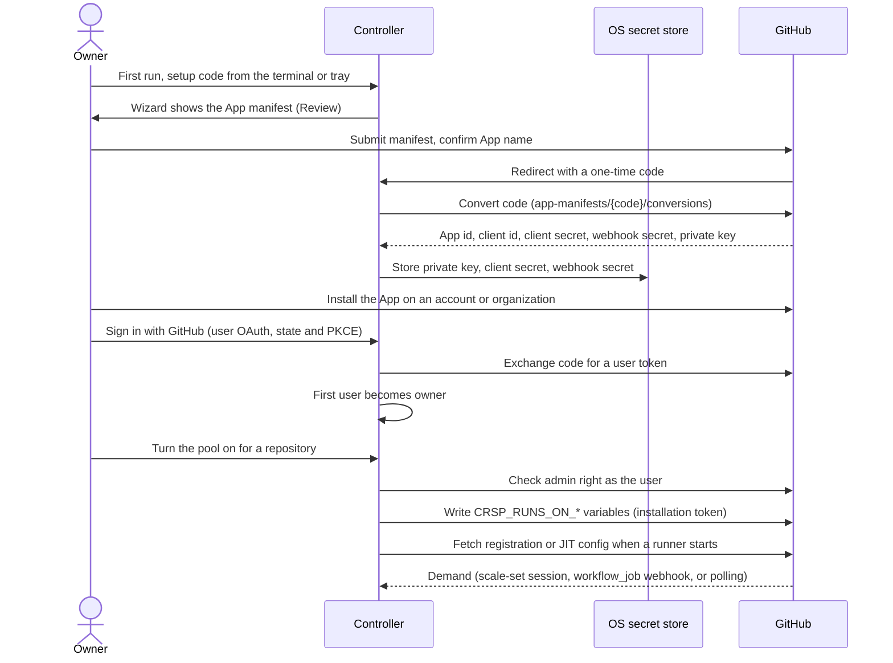
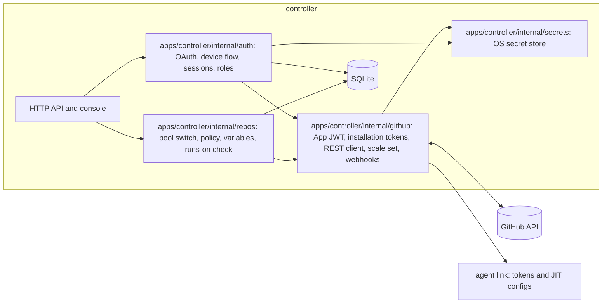

# GitHub integration

The top half (sections 1 to 4) is for every reader. The bottom half (5 to 12) is for engineers.

The M1 sign-in, session, repository and policy requirements marked built have tests in section 9. A requirement not marked built is NOT YET IMPLEMENTED. Each one names the milestone that builds it (M1 to M8, from the product brief).

## 1. In one paragraph

Each controller registers its own GitHub App in the first-run wizard. People sign in to the web console with GitHub, and to the CLI with a device code. The first person to sign in becomes the owner. The owner lets other GitHub users in as admin or viewer. After sign-in the console lists the App's installations and the repositories the user can administer. An admin turns the pool on or off per repository (and later per organization) and sets a policy for it. The controller then registers runners with short-lived tokens, keeps three repository variables correct, checks workflow `runs-on` labels, and learns about queued jobs from GitHub. Its secrets live only in the OS secret store.

## 2. Why

**Problem.** The pool must act on GitHub for the user: list repositories, register and remove runners, write variables, and see queued jobs. The product is open source and self-hosted, so it cannot ship a shared secret. It must never store a personal access token (decision [0002](../../architecture/decisions/0002-github-auth.md)).

**Users.**

- The owner, who installs the controller and runs the first-run wizard.
- Admins, who turn the pool on for repositories they administer on GitHub.
- Viewers, who watch the pool and change nothing.

**Goals.**

- One-click App creation with the exact permissions the product needs, no more.
- Sign-in that acts as the user, so a user sees only what GitHub lets them see.
- Runners that work with `runs-on: ${{ fromJSON(vars.CRSP_RUNS_ON_LINUX) }}` without the user writing labels by hand.
- No secret in the database, config files, logs or test fixtures.

**Non-goals.**

- GitHub-hosted runners. The product manages self-hosted runners only.
- GitHub Enterprise Server. Only github.com in the first milestones (see section 11).
- A shared App owned by the project.
- Personal access tokens or classic OAuth Apps.

## 3. How it works

The steps in words:

1. The controller starts with no GitHub App. It prints a one-time setup code to its terminal and gives it to the tray.
2. The owner opens the console and enters the code. The first-run wizard starts.
3. The wizard shows what it will create: the App name, the account, the callback URLs and the permissions. Nothing has changed yet.
4. The owner sends the manifest to GitHub and confirms there. GitHub sends the browser back with a one-time code.
5. The controller trades the code for the App's credentials. It puts the secrets in the OS secret store. It keeps only public facts (App id, slug, client id) in the database.
6. The owner installs the App on their account or an organization, from the link the wizard shows.
7. The owner signs in with GitHub. The first person to sign in with the setup code becomes the owner.
8. An admin picks a repository they administer on GitHub and turns the pool on. They set its policy.
9. The controller writes the repository variables and checks the workflows' `runs-on` labels.
10. When a job waits, the controller learns it from GitHub and starts a runner with a fresh token. The scheduling spec decides where.
11. The CLI signs in with the device flow and gets its own controller token.

## 4. Screens and states

Screens are from the product brief: 1 (sign-in and first-run wizard), 3 (repositories) and 9 (settings, users). No mocks exist yet. Images will go in `images/` with alt text.

**First-run wizard** (components 4, rules UX-5, UX-30, UX-54). Steps:

1. *Setup code*. One field for the code from the terminal or tray.
2. *Console address*. The controller shows the addresses it listens on. A loopback address uses `http`. Any other address uses `https`. The owner picks the ones to register as callback URLs.
3. *Account*. A personal account or an organization the App belongs to.
4. *Review*. App name, account, callback URLs, webhook on or off, and the permission list from R5.23. It says "Nothing has changed yet."
5. *Creating the App*. The browser goes to GitHub and comes back. Live progress per sub-step: code received, credentials stored, App read back.
6. *Done*. What was created, with the App's GitHub link. Next actions: install the App, then sign in.

**Sign-in.** One primary action: "Sign in with GitHub". A user who is not allowed sees a Problem message (rules UX-26) with their GitHub login and what to do: ask the owner to add them.

**Repositories** (components 15, rules UX-22, UX-58). One row per repository the user can see through the App. Columns: repository, visibility, your GitHub right, pool switch, variable status, `runs-on` check. The pool switch saves at once (rules UX-22). A repository the user does not administer on GitHub shows the switch disabled, with the reason beside it (rules UX-38). **Built by OPS28:** a column **Runner type** shows `Ephemeral only` or `Any runner` per repository and the owner can change it (R5.60).

**Repository policy.** Allowed runner groups and labels, maximum parallel jobs, priority, and fork pull requests. Turning fork pull requests on asks first with a warning card (components 9, rules UX-9).

**Hosted fallback** (repository page, section *Hosted fallback*; components 13, 14, rules UX-9, UX-22). One choice, *When no crsp machine can take these jobs*: *Wait for a crsp machine* (the default) or *Run on GitHub-hosted runners* (disabled with its reason for a public repository). With the second: the monthly cap (0 is none) and a hosted label per OS, and a note that GitHub may bill the minutes. Saving it turned on asks first in the question card (UX-9, R5.40). The state block of the page and a column of the list say where jobs go now and why (R5.42).

**Users** (Settings). Each user with GitHub login, role and who added them. Add by GitHub login. Removing a user asks first and names the user (rules UX-62).

**States** (components 18, components 19, rules UX-6, UX-28, UX-29):

- *No installation*. Empty state with the next step: "Install the App on an account", which opens GitHub's install page.
- *No repository you can administer*. Empty state that says why and links to the App's installation settings to add repositories.
- *GitHub rate limit*. A wait that names the limit and the reset time (rules UX-29).
- *GitHub unreachable*. Could not load: what, why, what next (rules UX-28).
- *Secret store unavailable*. A Problem message that names the store and points to the doctor.
- *Variable drift*. A Needs-you status on the repository row when a variable was changed outside the product.

## 5. Functional requirements

Each requirement names its milestone and its source when it is ported. "runner-pool" means `docs/features/runner-pool/spec.md` in dev-standards. "DELIVERYSPEC" means `docs/architecture/DELIVERYSPEC.md` in dev-standards.

### 5.1 The GitHub App

**R5.1** (M1, built) — **First-run gate.** A controller with no App and no owner serves only the first-run wizard and health. The wizard needs a one-time setup code that the controller prints at start and hands to the tray. The code is single use and void once an owner exists. `getSetupState` reports three steps: `connect_github` is done with an App and an owner, `first_machine` is done when at least one machine has joined (any state), and `first_repository` is done when at least one repository has its pool on. A failed read is logged and leaves the step todo.

**R5.2** (M1, built) — **Manifest flow.** The wizard creates the App with GitHub's App manifest flow, for a personal account or an organization. The manifest holds the name, the console URL, the callback URLs, the setup URL, the webhook settings, the permissions of R5.23 and the event `workflow_job`. The `state` value is random, single use and expires after 10 minutes.

**R5.3** (M1, built) — **Code conversion.** The redirect handler trades the code through `POST /app-manifests/{code}/conversions` once. It stores the private key, the client secret and the webhook secret in the OS secret store (R6.1). It stores the App id, slug, client id, owner account and HTML URL in the database. A second use of the same code is refused. An App made without a webhook has an empty webhook secret from GitHub; it is not stored, and the webhook route then refuses every delivery. When anything fails after GitHub made the App, the redirect is `/setup?error=<code>&app_url=<the App's https://github.com address>` and the failure is audited (`setup.app_incomplete`), so the person can delete the App at GitHub.

**R5.4** (M1, built) — **Callback URLs.** The App's callback URLs are the console addresses chosen in the wizard, each ending in `/auth/github/callback`. A loopback address uses `http://127.0.0.1:<port>`. Any other address uses `https`. The controller never registers `https://localhost` (GitHub rejects it) and never registers `http` for a non-loopback host. The dev App uses `http://127.0.0.1:8460/auth/github/callback`.

**R5.5** (M1, built) — **Webhooks off for a local-only controller.** When no public HTTPS webhook URL is given (always the case when every console address is loopback), the manifest carries no `hook_attributes` and no `default_events`: GitHub refuses a manifest whose hook URL it cannot reach, even an inactive one (found in the v0.1.0 owner test, OPS7). Demand then comes from the scale-set API or polling (R5.29 to R5.31). The owner turns webhooks on later in the console, with a public HTTPS address (R5.51, OPS25); no terminal and no GitHub settings page are needed.

**R5.6** (M1, built CRSP107) — **App health.** The controller reads `GET /app` with an App JWT at start and every hour. When GitHub says the App or its key is gone, GitHub work stops, the console says so, and it offers to run the wizard again. Running jobs are not touched. Built: `github.AppHealth` reads `GET /app` at start and every hour. A 404 (the App is deleted), a 401 or 403 (the key is refused) or a missing key in the secret store means gone; GitHub being down or rate limited keeps the last verdict and settles nothing. While gone, the REST poller has no targets, the 10-minute installation and variable loops and the hourly workflow check do not run, and an installation webhook starts no reconcile; machines, running jobs and runners that exist are not touched. A new App made by the wizard clears the verdict at once. `GET /api/v1/github/app-health` gives `gone`, `reason` and `checked_at`; the Overview shows a banner that names the reason, says running jobs keep running and links to the setup wizard.

**R5.7** (M8, built) — **Key rotation.** The owner can upload a new private key from Settings (`PUT /api/v1/app/private-key`, owner only, and `crsp app rotate-key --file PATH`). The controller signs an App JWT with the new key and reads `GET /app`; the answer must be for the same App id. Only then does it replace the old key in the secret store. When the file is not a PEM RSA key, GitHub refuses the key, or the store fails, the old key stays and keeps working. The key is sent once and is never returned, logged or written to the audit log; the audit log records who rotated it, and a refused try, without the key.

### 5.2 Sign-in and users

**R5.8** (M1, built) — **Web sign-in.** The console signs in with the App's user OAuth flow (`/login/oauth/authorize`, then `/login/oauth/access_token`). It sends a random `state` and a PKCE `S256` challenge. Both are single use and expire after 10 minutes. The redirect URI is always one GitHub knows (OPS16). GitHub cannot edit an App's callback URLs, so the controller keeps the list the App was made with (settings row `github_callback_origins`; an App made before the list was kept knows `http://127.0.0.1:<port>` only) and every address a dry sign-in confirmed. **(a)** When the browser's address is on the list, the redirect URI is its callback URL. **(b)** When it is not and the browser is on the controller's PC (the request came from a loopback or an own address), the round trip goes through the registered loopback callback and returns to the address the browser started on: the callback makes the session, keeps the cookie behind a one-time code (single use, 60 seconds, bound to the sign-in `state`, to the start address and to the browser by the host-only `crsp_handoff` cookie) and redirects to `GET /auth/github/handoff`, which sets the session cookie on that address; any mismatch burns the code and ends the session. **(c)** Otherwise a dry sign-in asks GitHub (`/login/oauth/authorize`, no redirect followed, 404 means unknown) and keeps a confirmed address; when GitHub does not know it, the browser is never sent to GitHub: the sign-in page shows the guided step "Add this sign-in address to your GitHub App" with the exact callback URL, Copy, a button to the App's settings page and "Check and sign in". The address chooser (operations R5.90) shows the same step, with Check, before it switches (`POST /api/v1/settings/signin-address`). **(d)** Every sign-in failure has its own code on `/sign-in?error=` and a plain message on the page: `state_missing` (used, old or never made), `state_mismatch` (made for another callback address), `address_refused`, `exchange_failed` (GitHub refused the code), `user_failed`, `session_failed`, `handoff_failed`, `not_allowed` (names the login, R5.11), `callback_not_registered`, `no_app`, `secret_store_unavailable`; any other is `sign_in_failed`, never `internal`. Each is logged at WARN as "sign-in failed" with `stage`, `code` and `cause`, never a token, a code or a verifier (OPS17). Sign-in does not depend on the cookies of the other listener: the state, the verifier and the redirect live in the controller, so with TLS on the LAN address the plain loopback address signs in, and its session cookie is not `Secure` (R5.13). The console server logs a browser that refuses the self-signed certificate ("TLS handshake error") at DEBUG, and its other errors at WARN. Source: `apps/controller/internal/auth/registered.go`, `apps/controller/internal/auth/signin.go`, `apps/controller/internal/api/handlers_auth.go`, `apps/controller-console/src/auth/CallbackGuide.tsx`.

**R5.9** (M1, built) — **Identity.** A user is identified by their numeric GitHub user id, never by login. The login is shown and refreshed at each sign-in.

**R5.10** (M1, built) — **Owner.** The first user who signs in with a valid setup code (R5.1) becomes the owner. There is exactly one owner. Ownership moves only when the owner hands it to an admin, and the owner asks first.

**R5.11** (M1, built) — **Allowed users.** The owner adds other GitHub users by login, as admin or viewer. The controller resolves the login to a user id when it is added. A GitHub user who is not on the list cannot sign in; the page names their login and says to ask the owner.

**R5.12** (M1, built) — **Roles.** A viewer can read every screen and change nothing. An admin can change pool, policy, machines and runners, but not users. The owner can do everything. Every API operation declares its role in `x-auth`, and the route-coverage test checks it.

**R5.13** (M1, built) — **Sessions.** A web session is a random id in a cookie (`HttpOnly`, `SameSite=Lax`, and `Secure` on every address except `127.0.0.1` and `::1`, where the console is plain HTTP: web-console R5.1, R6.1). The database keeps only a hash of the id. A session never expires by time, idle or absolute (owner decisions for M1 and D39, 14 Nov). It ends at sign-out, when the user is removed, and when their role changes.

**R5.14** (M1, built) — **CLI device flow.** `crsp login` runs GitHub's device flow with the App's client id. It shows the code and the URL, and waits at the interval GitHub gives. It sends the GitHub user token once to the controller, which checks it with `POST /applications/{client_id}/token` and that the user is allowed. The controller returns its own CLI token. The CLI keeps that token in the OS secret store and drops the GitHub token.

**R5.15** (M1, built) — **CLI token.** A CLI token carries the user's role, expires after 30 days, and is listed in Settings. The owner or the user can revoke it.

**R5.16** (M1, built) — **Audit.** Every sign-in, failed sign-in, user change, role change, pool change, policy change and variable write is logged in the audit log: who, what, when. The audit log never holds a token.

### 5.3 Installations and repositories

**R5.17** (M1, built) — **List installations.** The console lists the App's installations with the App's own key (`GET /app/installations` with the App JWT), so the list needs no personal sign-in and survives a restart (OPS13).

**R5.18** (M1, built) — **List repositories.** For each installation that is not suspended the console lists the repositories through `GET /installation/repositories` with an installation token, all pages (OPS13). While the user's own GitHub token is in memory, the refresh also reads `GET /user/installations/{id}/repositories` to set whether the user has the GitHub `admin` permission on each row; without it (after a restart) the refresh asks the App for each repository, as the admin check does: the owner of a user-account installation is admin, any other user is read with `GET /repos/{owner}/{repo}/collaborators/{login}/permission`, and the flag stays for the next refresh. A GitHub error leaves that flag unknown (`user_admin_known` false on the Repository), never "not admin" (OPS15). The user's token is kept only where a person's own rights are checked (the admin check, R5.19, granting repositories, the organization owner check); those paths may still answer `session_expired`.

**R5.19** (M1, built) — **Enable needs GitHub admin.** Turning the pool on or off, or changing a repository's policy, needs the product role admin or owner and the GitHub `admin` permission on that repository. The controller reads that permission fresh, as the user, at the moment of the change. A missing right disables the switch and says why; an unread right (`user_admin_known` false) never does: the switch stays usable and this check decides at the change, with the real reason (OPS15).

**R5.20** (M1, built) — **Pool per repository.** An admin turns the pool on or off per repository. On means the controller may register runners for it and writes its variables. Off means the controller registers no new runner for it. Its runners are removed after their running jobs end (drain, never kill).

**R5.21** (M3, built CRSP113) — **Pool per organization.** An admin who is an owner of a GitHub organization can turn the pool on for the organization. The controller then uses organization runners in a runner group named for the pool, with selected repositories only. Repository-level runners are used for personal accounts. Built: `PUT /api/v1/github/installations/{id}/org-pool` and `crsp org-pool on|off ORGANIZATION` (a switch on the repositories screen, section Pool per organization). The caller is an admin of the product and, read fresh from GitHub, an active owner of the organization (`GET /user/memberships/orgs/{org}` with the user token; as the App for a CLI token). The group is found or created by the pool's name and is never the default group. It is always `selected` and visible to the repositories whose pool is on and to no others: a wider group is narrowed first, the repositories are replaced, and the group is read back; a group that is still wider is not used. The group follows each pool switch and the reconcile. A repository of an organization with the mode on registers its runners (registration token and JIT config) at organization level, in that group; the runner record keeps the organization scope, so it is removed with the scope it was registered with. Turning the mode off registers new runners at repository level again; runners that have a job finish it. A personal account is refused and keeps repository runners. Not built: scale-set runners still register where their scale set lives (the repository); the mode is kept with the rest of the repository state (R5.88).

**R5.22** (M1, built: the webhook route and the 10-minute reconcile run in the controller since CRSP41; the console reason text for a repository that left, CRSP107) — **Installation changes.** The controller follows installation changes (repositories added or removed, App suspended or uninstalled) by webhook when on, and by a reconcile every 10 minutes. A repository that leaves the installation is turned off, and the console says why. Built (CRSP107): the reconcile turns the pool off with the marker `installation` as the changer; the repository carries `pool_off_reason: left_installation` until it is back in the installation (it then stays off, without the reason). The repositories list says "left the installation" and the repository page gives the reason in its State facts.

### 5.4 Permissions

**R5.23** (M1, built) — **Exact App permissions.** The manifest asks for exactly these, and no others:

| Level | Permission | Access | Used for |
|---|---|---|---|
| Repository | Administration | Read and write | Repository runners, registration and remove tokens, JIT configs, fork approval setting |
| Repository | Actions | Read | Workflow runs and jobs for polling; `workflow_job` events |
| Repository | Variables | Read and write | `CRSP_RUNS_ON_*` variables |
| Repository | Contents | Read | Reading `.github/workflows/` for the `runs-on` check |
| Repository | Metadata | Read | Required by GitHub |
| Organization | Self-hosted runners | Read and write | Organization runners and runner groups (R5.21) |

**R5.24** (M1, built) — **Permission check.** At start and after each installation change, the controller compares the installation's granted permissions with R5.23. A missing permission blocks the parts that need it, and the console names the permission and links to the page where the owner accepts it.

### 5.5 Policy

**R5.25** (M1 stored, enforcement as noted, built) — **Repository policy.** Each enabled repository has a policy:

- Allowed runner groups and labels. Only generic labels: `self-hosted`, OS, architecture, `docker`, `kvm`, `gpu`, a pool name. Never a project name. (Source: runner-pool R5.36, product brief.)
- Maximum parallel jobs. Default 2. Enforced by the scheduling spec (M1).
- Priority. Default normal. Enforced by the scheduling spec (M3).
- Fork pull requests. Default off (R5.26).
- Light runner: removed (owner decision D110, 19 Nov 2026; runners R5.57, scheduling R5.65, R5.100). Light jobs run on the pool runners like any job. An old stored value is ignored.

**R5.26** (M1, built; the fork-approval setting and the job-started hook guard are built, CRSP108: `apps/controller/internal/hooks/forkpr.go`, run first by `crsp hook job-started`, tested for the sh and PowerShell hooks) — **Fork pull requests off by default.** For a public repository, jobs from pull requests whose head repository is a fork never run on the pool unless the policy allows it. Two guards apply. The controller sets the repository's fork-approval setting to require approval for all outside contributors. The runner's job-started hook reads the event payload and fails a forked pull request job at once, before any step runs, with a message that names the policy. Turning it on asks first with a warning that fork code runs on the user's machines. Built by CRSP108: the hook reads `GITHUB_EVENT_PATH` for `pull_request` and `pull_request_target` events, and the job fails with exit 1 and an `::error` line that names the policy when the head repository is a fork (or is gone) and the repository is public. A visibility or payload that cannot be read counts as public and a fork. The policy allows forks only when the runner environment has `CRSP_ALLOW_FORK_PRS=1`; absent means off. Writing that variable into a runner's environment from the repository policy is NOT YET IMPLEMENTED, so today every forked pull request on a public repository fails at the hook. **Finished by R5.41 and R5.54 (CRSP131):** a public repository can be on the pool only while the setting Public repositories is on; the fork guard above applies to every public repository that is served.

**R5.27** (M1, built) — **Labels stay generic.** A label that is not generic is refused in a policy. A runner that carries a leftover non-generic label loses it only after a yes that names the label, and only when no workflow names it. When a workflow still names it, the console lists the files that must switch to the variable. (Source: runner-pool R5.37, DL316.)

### 5.6 Repository variables and `runs-on`

**R5.28** (M1, built) — **Variables kept correct.** The controller writes `CRSP_RUNS_ON_LINUX`, `CRSP_RUNS_ON_WINDOWS` and `CRSP_RUNS_ON_MACOS` as repository Actions variables (D300). Each is a JSON list of labels, for example `["self-hosted","linux","x64"]`; an unset variable means GitHub-hosted. A variable is set for an OS only while the repository has at least one crsp runner for that OS and the pool is on for it (the policy enables the OS). It is deleted when the repository has no runner for that OS, or the pool is turned off for that OS. The controller writes and deletes them on enable, on policy change and when a runner is added or removed, and checks them every 10 minutes. Labels are case-insensitive: they are compared ignoring case and written lowercase (`linux`, not `Linux`). A value that differs only in case is not drift. A value changed outside the product is restored, logged in the audit log, and shown as drift on the repository row. **Upgrade from the old names (CRSP229).** Versions before CRSP229 wrote `RUNS_ON_LINUX`, `RUNS_ON_WINDOWS`, `RUNS_ON_MACOS`, `RUNS_ON_LIGHT`, the size variables `RUNS_ON_<OS>_<SIZE>`, and, with the removed setting `legacy_vars` (R5.39), `CI_RUNS_ON` and `CI_RUNS_ON_WINDOWS`. The controller deletes each of these only where its store lists the name as written by crsp, and only after the new name that replaces it is written (`RUNS_ON_LIGHT` has none and goes with the first write), so a workflow never finds neither. A name crsp never wrote (one a person set, or the old pool's `CI_RUNS_ON`) and `NIGHTLY_RUNS_ON` are never touched. A repository with the pool off writes nothing, so it keeps its old names until the pool is turned on again or turned off with a yes (R5.29 names them). This replaces the CRSP25 migration, which deleted the `CRSP_RUNS_ON_*` names: those are now the current names and are never deleted as old ones. The audit entry says `variable.deleted RUNS_ON_LINUX (old name; CRSP_RUNS_ON_LINUX replaces it)`. (Source: runner-pool R5.36, D300; tests TestLegacyVariablesMigrated, TestPlanNeverDeletesCrspRunsOn.) **Capacity must be known and stay absent before a delete (OPS63).** The controller never deletes a `CRSP_RUNS_ON_*` variable (or its size variable) because an OS has no capacity unless capacity is known: every machine that was online has reported its facts since this start, or `CapacitySettle` (20 minutes, two report intervals) has passed. Even then, the OS must be absent in two syncs at least `DeleteHold` (15 minutes) apart; one missing reading never deletes, and a reading with the OS present starts the count again. A policy that turns an OS off still deletes at once. Writing and restoring stay immediate. The audit entry says why, for example `CRSP_RUNS_ON_LINUX no Linux runner for 15 min`. Deletes in a confirmed plan (`ActDeleteVariable`) are owner-confirmed and unchanged.

**R5.29** (M1, built) — **Variables when the pool is off.** Turning the pool off for a repository names the `CRSP_RUNS_ON_*` variables the controller would delete. It deletes them only after a yes. The question says that workflows that read them will fail to start.

**R5.30** (M1, built) — **`runs-on` check.** The controller reads every file in `.github/workflows/` of an enabled repository on enable, on policy change and every hour (with ETags). Built (HND3): `repos.Service.CheckAllRunsOn` and the hourly tick of `runsOnLoop` in `apps/controller/cmd/crsp/areas_wiring.go`; like the 10-minute CRSP_RUNS_ON restore it does nothing until a GitHub App exists and stops its round at a rate limit (R6.6). It reports a finding with file and line when:

- a self-hosted job names a literal label set that no runner of the pool carries (fail);
- a self-hosted job uses literal labels instead of `fromJSON(vars.CRSP_RUNS_ON_<OS>)` (warning);
- a workflow reads a `CRSP_RUNS_ON_<OS>` variable that is not set (fail).

Findings show on the repository row and feed the doctor. (Source: runner-pool R5.39; DELIVERYSPEC DL-09.)

### 5.7 Runner tokens

**R5.31** (M1, built) — **Registration token on demand.** For a persistent runner the controller fetches a registration token (`POST .../actions/runners/registration-token`) right before registration. It passes it to the agent over the agent link and drops it after use. It is never stored or logged. (Source: runner-pool R5.32.)

**R5.32** (M1, built) — **Remove token to deregister.** To deregister a runner the controller fetches a remove token (`POST .../actions/runners/remove-token`). GitHub refuses a registration token there. The step checks the result and stops on failure, so a failed removal leaves the old runner working. A runner with a running job is never removed. (Source: runner-pool R5.32 rerun and R5.33, DL315.)

**R5.33** (M1, built; the yes path built by CRSP108, the automatic sweep built by CRSP80) — **Offline runner cleanup.** When an agent cannot run the remove step (machine gone), the controller deletes the runner with `DELETE .../actions/runners/{id}` after a yes that names it. Built by CRSP108 (`runners.Service.DeleteOfflineRegistration`): `DELETE /api/v1/runners/{runnerId}/registration` (admin) answers 409 `needs_confirmation` naming the runner until `confirm=true`; then it deletes the registration, cleans the machine if it answers, drops the record and writes `runner.delete_offline` to the audit log. Only a runner crsp made, that GitHub lists as offline and not busy, is deleted: an online runner is refused (remove it instead, which drains), a busy one is left alone (also on a 422), and an unreadable list changes nothing. The CLI is `crsp runner delete-offline NAME [--yes]`; the console runners screen shows *Delete registration* on an offline managed runner. **Automatic sweep (M2, Built CRSP80, `apps/controller/internal/runners/sweep.go`, started by `apps/controller/cmd/crsp/sweep_wiring.go` every hour).** The controller also sweeps offline registrations by itself. One setting, `runner_sweep_days` in `config.toml`, on by default at 7 days, names the age past which an offline runner registration that crsp made is deleted with `DELETE .../actions/runners/{id}`, without a question each time. Setting it to 0 turns the sweep off and returns to the yes of the first paragraph. The sweep never touches a registration crsp did not make, never one that GitHub reports busy (a 422 means leave it), and logs each deletion with the runner name and age. **What counts as made by crsp** is decided by crsp's own record, not by what GitHub lists: a managed ephemeral runner record, whose name starts with `crsp-` (the name crsp gives a job runner), older than the grace and not in a live state (creating, busy, draining, updating, removing), whose name and (when the record has one) GitHub id match the registration GitHub lists as offline and not busy. A runner with no record is never looked at, whatever its name or labels. Persistent runners are not swept: a laptop that is off for a week keeps its registration. The agent clean-up (stop the service, remove the folder) runs after the delete; a machine that is gone does not keep the record alive. An unreadable runner list changes nothing. The age is the age of crsp's record, because GitHub does not give the time a runner went offline.

**R5.34** (M2, v0.3.0, Built CRSP52) — **JIT config.** For an ephemeral runner the controller calls `generate-jitconfig` (repository or organization level) with the runner name, runner group and labels. It passes the encoded config to the agent over the agent link and drops it. The config is a secret: never stored or logged. Built: `GenerateJITConfig` in `apps/controller/internal/github/jitconfig.go`. The value is a `JITConfig` that masks itself in `%v`, `%#v`, `String` and JSON; the one way out is `Encoded()`, used by the controller to fill the agent call. **Tightened by R5.40 (CRSP79, built):** the config is never a file; it reaches the runner process on standard input only.

### 5.8 Demand

**R5.35** (M2, Built CRSP79 behind the setting `scaleset_demand`, off by default) — **Scale-set API first.** The controller learns demand from the runner scale-set API through crsp's own client (`apps/controller/internal/github/scaleset.go`, written from the public protocol; the `github.com/actions/scaleset` module is not a dependency): one scale set per repository, named like the pool, a long-poll message session, and the job messages (available, started, completed) as the signal, a long-poll message session, and `TotalAssignedJobs` as the signal. Because the API is a public preview, every answer the client does not know ends the session and polling takes over (decision 0002); see R5.40. A job from a scale set is reported as queued only after `acquirejobs` gave it to this session. The message does not say whether a pull request comes from a fork, so every `pull_request` event counts as a fork pull request until the repository's policy allows it (R5.26). A runner for such a job takes its JIT config from the scale set (`generatejitconfig`), because only a runner of that scale set is given its jobs. Workflows that target the scale set use its name (the pool name) in `runs-on`.

**R5.36** (M1, built) — **`workflow_job` webhook.** When webhooks are on, `POST /webhooks/github` takes `workflow_job` events (queued, in_progress, completed) and installation events. It checks `X-Hub-Signature-256` with the webhook secret before it reads the body. It records each delivery id and ignores a repeat.

**R5.37** (M1, built; wired into the controller by CRSP58, container runners only; CRSP63: the runner starts on any connected Linux machine through the agent link, runners R5.61) — **REST polling fallback.** With no scale set and no webhook, the controller polls queued and in-progress workflow runs and their jobs for each enabled repository. The default interval is 30 seconds. It sends ETags, backs off when idle, and keeps within the rate budget of R6.6. Built: `github.Poller` and `REST.ListOpenJobs` list the queued and in-progress runs and their jobs; the runs list is sent with `If-None-Match` and a 304 reuses the last answer (it costs no rate limit); rate-limit headers feed the half-budget rule (R6.6) and a limit makes the poller wait for the reset. The controller polls every 15 seconds (`demandPollEvery`, not 30) and backs off to 5 minutes while nothing changes. Only repositories with the pool on are polled, and nothing is polled while no machine has the container backend in its allow list. `apps/controller/internal/demand` matches the `runs-on` labels of each queued job (`self-hosted`, `linux`, an architecture, `docker`, the pool name; a project label, `kvm`, `gpu`, Windows or macOS match nothing) to a machine and starts one ephemeral JIT runner for the job (runners R5.25, R5.27), within the machine's job slots. A fork pull request waits unless the policy allows forks (R5.26). Scale set and webhook are not used for demand. **Quiet-demand watchdog** (owner decision D54, 2026-11-15; built CRSP77, `demand.Watchdog`): every minute the controller lists the queued jobs of each polled repository itself and keeps those whose `runs-on` resolves to crsp (the match of `apps/controller/internal/demand`). When it finds such a job and the demand source (the REST poller today, `Poller.LastDemand`; the scale-set listener later) has listed no queued job for that repository for 10 minutes (config key `demand_quiet_minutes`, default 10, 1 to 1440), it restarts the demand loop once for that episode and logs it. The loop keeps its state across the restart, so no job gets a second runner. If the source is still quiet after another interval, nothing restarts again and the doctor check `demand.quiet` stays warn (doctor R5.16). The episode ends when the source lists a queued job again or GitHub lists none.

**R5.38** (M1, built CRSP107) — **Reconcile.** Whatever the source, the controller reconciles its job view with REST every 5 minutes. A missed webhook or a broken session never leaves a job waiting unseen for longer than that. Built: `github.Reconciled` wraps the demand source (the scale-set source with its polling fallback); every 5 minutes it lists the open jobs of each polled repository over REST, emits a job the source never showed or whose status changed, and closes a job GitHub no longer lists. A repository whose listing failed closes nothing. The REST poller alone already reads at least every 5 minutes, so it is not wrapped.

**R5.39** — **Removed (CRSP229).** The repository setting `legacy_vars`, which also wrote `CI_RUNS_ON` and `CI_RUNS_ON_WINDOWS` for workflows that follow the old dev-standards templates, is gone. Reason: the pool variables now have their own prefix, `CRSP_RUNS_ON_*`, and a workflow moves to crsp by reading `CRSP_<JOB>` with `CRSP_RUNS_ON_<OS>` as fallback (R5.107), so crsp keeps no second copy under another project's names. The field is gone from the API and from the policy; migration `00043_drop_legacy_vars.sql` removes it from every saved policy. A `CI_RUNS_ON` or `CI_RUNS_ON_WINDOWS` that crsp wrote earlier is deleted under R5.28; one the old pool wrote is not ours and stays. The doctor no longer reads those names as crsp's. `NIGHTLY_RUNS_ON` is never touched. Test TestIntegrationDropLegacyVarsMigration, TestOldDevStandardsNamesNotWritten.

**R5.40** (M2, Built CRSP79) — **Scale-set demand behind the Demand seam, JIT config over stdin only.** Demand from `actions/scaleset` (R5.35) enters the controller only through crsp's own `Demand` interface, the one the REST poller (R5.37) already fills, so the library's preview status never reaches the rest of the code. The controller names the scale-set source in its log at start. The setting is `scaleset_demand = true` in `config.toml` (default off). When the scale-set session cannot be opened, drops, or reports an API change, `demand.Failover` switches to polling by itself, says so in the log (the doctor line is not built yet), and tries the session again after a back-off that starts at 30 seconds and doubles to 10 minutes. Exactly one source runs at a time. A job the poller reported before a switch can be offered again by the scale set under another id; the extra runner is removed after the idle time (runners R5.26). A runner started for a job gets its JIT config (R5.34) from the controller over the agent link and hands it to the runner process on standard input only. The config is never written to a file, never put in a command line or a container or exec setting, and so never shows in `docker inspect`, `ps` or a process listing. The runner binary takes the config only as `--jitconfig` or in its own environment, so the start script reads one line of standard input and sets it in the environment of that one runner process, nowhere else.

**R5.41** (M2, built in part CRSP82; amended CRSP131 by owner decision D79; NOT YET IMPLEMENTED: the visibility re-read right before each runner starts, the notification, the job-started hook guard of R5.26 is built) — **A repository that turns public is not stopped on its own.** crsp offers private repositories by default (R5.54). When GitHub sends the `repository` webhook with action `publicized`, or the periodic visibility check (the installation reconcile, every 10 minutes, R5.22) reads a repository as public, the controller stores `visibility = public` and writes the audit row `repository.publicized` when the pool is on; it stops nothing. A repository that is already on the pool keeps working. While the setting Public repositories is off it carries the problem `public_pool_on_while_off` (R5.56) and the owner chooses: turn the setting on, or turn the pool of that repository off. With the setting on, nothing stops a public repository. The pool of public repositories is stopped only when the setting is switched off (R5.55). A visibility that cannot be read keeps the last stored value. This finishes the fork guard of R5.26: the job-started hook guard is built and tested together with this requirement, so that a forked pull request job fails at once with the policy message.

**R5.42** (M1, v0.3.0, Built CRSP74) — **Hosted fallback is a setting of the repository, off by default.** A repository's policy has `hosted_fallback` ("When no crsp machine can take these jobs": *Wait for a crsp machine*, the default, or *Run on GitHub-hosted runners*), an optional monthly cap `fallback_cap_minutes` (none by default), and a hosted label per OS (`hosted_labels`; `ubuntu-latest`, `windows-latest` and `macos-latest` unless set). **Cloud overflow is target-neutral (CRSP261).** The label a repository falls back to is not tied to GitHub. The label for an OS is, in order: the repository's own `hosted_labels` entry, the controller setting `overflow_label` (one runner label of any cloud, for example a third-party runner provider's label; empty by default; no spaces, commas or quotes, up to 100 characters; PATCH `/api/v1/settings`, audited as `settings.update`), then the GitHub-hosted default. Opt-in, the confirmation, the cap, the grace time and the public-repository refusal are unchanged, and minutes on the overflow label count against the cap like hosted ones. Tests TestOverflowLabelReplacesHostedDefault, TestOverflowLabelPolicyLabelWins, TestOverflowLabel. The project exists to save money, so anything that can cost money is opt-in (owner decision D52, 2026-11-15): by default jobs wait in GitHub's queue for a crsp machine, which is free. Turning it on needs a yes to the question card (UX-9) whose words say that GitHub may bill these minutes for a private repository and that crsp switches back as soon as a machine is up; without the yes the update answers `needs_confirmation`. A public repository is refused, because the fallback is for private repositories (hosted minutes of a public repository are not what the owner wants to switch on by a setting). See [content.md](../../design-system/next-version/content.md) for the words.

**R5.43** (M1, v0.3.0, Built CRSP74) — **The controller flips `CRSP_RUNS_ON_<OS>` for opted-in repositories only.** Every 30 seconds the controller reads, per OS, whether a machine is *up*: online on the agent link **and** accepting jobs (`Accepting`, not paused, not on battery; `PauseReason` says why). A paused machine counts as down. When no machine of an OS has been up for the grace time (the setting `fallback_grace_minutes`, default 3, 1 to 60; it has no field in the console yet), the variable of that OS in every opted-in repository with the pool on is rewritten to the hosted label as a JSON list in the same format as the labels the writer writes (`["ubuntu-latest"]`), by the same writer (R5.28), and it is written back to the crsp labels as soon as a machine of the OS is up again. The reconcile (R5.28) keeps the hosted value while the fallback holds, so it is not undone as drift. A repository that did not opt in is never read for this and never written. An OS with no machine at all has no variable (R5.28) and no fallback. Every switch goes to the audit log (`fallback.started`, `fallback.ended`) with the OS and the reason. Turning the setting off while on restores the crsp labels at once. The state of a fallback is kept in memory: after a restart the grace time counts again.

**R5.44** (M1, v0.3.0, Built CRSP74) — **Where the jobs go now.** The repository view has `routing`: `where` (`crsp`, `hosted` or `waiting`), `why` (`machine_up`, `fallback_on`, `fallback_off`, `grace`, `cap_reached`, `public_repository`), the OSes it is about and the hosted minutes used this month. It is absent while the pool is off for the repository. The Repositories screen shows it as a column and with its reason on the repository page (web-console R5.34); the Overview notice and the doctor read it (R5.46).

**R5.45** (M1, v0.3.0, Built CRSP74) — **Fallback minutes and the cap.** While a repository is on fallback, and while a job it started on a hosted label still runs, the controller reads the open jobs of the repository (the call the poller makes, R5.37) every pass and counts the time of each in-progress job whose labels carry a hosted label, per repository and per calendar month (UTC). It is best effort: a job is counted from its start, or from when it was first seen, and a job that ends between two passes loses up to 30 seconds. When the minutes of the month reach the cap, the repository goes back to waiting (reason `cap_reached`); the next month starts from zero. Running hosted jobs are not stopped.

**R5.46** (M1, v0.3.0, Built CRSP74) — **The doctor and the Overview say it.** The doctor names the repositories whose jobs wait because no machine is up and whose fallback is off (info, never fail: waiting costs nothing), and warns while a repository runs on hosted runners (doctor R5.39, R5.40). `repo.vars` and `repo.vars.runner` accept the hosted label while the fallback holds. The Overview shows one line while any repository is on fallback (web-console R5.35).

**R5.47** (M2, Built CRSP82; source `docs/architecture/landscape-2026-11.md`, `SECURITY.md`) — **A repository that turns public is stopped at once.** crsp serves private repositories only. When GitHub sends the `repository` webhook with action `publicized`, or the periodic visibility check (the installation reconcile, every 10 minutes, R5.22) reads a served repository as public, the controller, in this order: turns the pool off (no runner is registered after this), sets each `CRSP_RUNS_ON_*` variable that exists on the repository to the hosted label of its OS (a legacy alias only where the controller wrote it), removes the light runners and every job runner that has no job (a runner with a job ends that job), and writes the audit entries `pool.off` (with the reason and where it was learned), `runners.removed` and, when a step failed, `public.stop_failed`. Every step is tried even if an earlier one failed. A repeat event changes nothing. The App subscribes to the `repository` event. Not built: refusing to turn the pool on for a repository that is already public. **Amended by CRSP131:** the stop on `publicized` and on the visibility check is gone (R5.41); the same steps, in the same order, now run when the setting Public repositories is switched off (R5.55). The audit text of `pool.off` says "the repository is public and public repositories are off". The note "Not built: refusing to turn the pool on for a repository that is already public" is built by R5.55.

**R5.48** (M2, Built CRSP82) — **A forked pull request never reaches a pool runner by guesswork.** A job read from a `workflow_job` webhook does not say which event started its run or whether the head repository is a fork, so it is marked partial: the demand loop gives it no runner until the poller has read its run, and a later webhook never wipes what the poller read. The loop serves a repository whose pool is on, public or private; a public repository can have its pool on only under R5.54 and R5.55. A fork job of a private repository still waits unless its policy allows fork pull requests after the warning (R5.26).

**R5.49** (M1, Built CRSP88) — **Trial modes before a repository is switched.** The owner can run a private repository in a trial mode, one per repository, stored in the settings table: `observe` (crsp only records which jobs it would take and how long they wait; no variable or workflow is touched), `shadow` (a copy of the selected jobs runs on crsp through a `workflow_dispatch` of the shadow workflow, default `crsp-shadow.yml`; the result is recorded; the real job stays on hosted), `canary` (a percentage of the jobs, or named jobs, read the crsp labels from one `CRSP_RUNS_ON_CANARY_<JOB>` variable each; the other jobs stay hosted) and `off`. The canary choice depends on the job name only, so it is the same on every run and a job chosen at 10% stays chosen at 50%. The variables are written and deleted only through the owner code in `apps/controller/internal/repos` (audit row, store record), never the controller's own `CRSP_RUNS_ON_<OS>` ones. On entering a canary the CRSP_RUNS_ON family variables are saved; `off` puts back exactly those. Public repositories are refused for every mode but `off`. A report per repository compares hosted and crsp runs, results, waits and run times per job. `crsp trial OWNER/NAME [observe|shadow|canary|off]` sets and shows it; `GET /api/v1/repositories/{id}/trial` is the read-only report and `PUT` of the same path sets the mode (the CLI needs it). The hook `trial.Manager.OnJob` takes a finished job; it is not yet called from the webhook (RES14 owns that code). The hosted fallback (R5.42 to R5.46) and the public-repository stop (R5.41) are unchanged. CRSP267: the mode `live` follows `canary`; a repository moves one step forward at a time and back to any earlier step; `PUT .../trial` needs `confirmed` and answers 409 `needs_confirmation` without it (operations R5.42).

**R5.50** (M1, RES14, built) — **Webhook health per repository.** The controller keeps, for each repository, the time and result of the last webhook delivery (`webhook` of the repository: `last_delivery_at`, `last_result` `ok`, `failed` or `missed`, `mode`, `failures_in_a_row`). A verified `workflow_job` that the controller cannot read counts as `failed`; a queued job that polling lists and that no delivery announced within two minutes counts as `missed`. After three failures in a row the repository is in `polling` mode: the console says so and offers *Switch back to webhooks* (`setRepositoryWebhookMode`, admin; only `webhook` is accepted). A delivery that works resets the count but never leaves polling mode by itself. Jobs are learned by the REST poller (R5.37) for every repository with the pool on, so the mode changes what the console says and what the owner sees, not which repositories are polled. The code is in `apps/controller/internal/webhookhealth`; the webhook handler calls it through the small `OnDelivery` hook, and the poller through `OnQueued`. **OPS22:** when the App has no webhook (no webhook secret in the secret store, R5.3, R5.5), nothing can be delivered, so polling listing a job first is not a miss: the tracker records no `missed`, the repository carries `webhook.webhooks_off: true`, the console shows the status "no webhook", "Jobs are learned by: polling" and a note that jobs still run. With a webhook, a `missed` result shows a note that says GitHub did not announce a job, crsp found it by polling, and what to check (public https webhook address, Recent Deliveries in the App settings). **OPS25:** `webhooks_off` follows the stored webhook secret, so it turns false the moment the owner turns webhooks on (R5.51) and misses count from then on; turning them off removes the secret and the repository goes back to "Jobs are learned by: polling". With webhooks on and healthy the repository says "Jobs are learned by: webhooks".

**R5.51** (M1, OPS25, owner decision D89, built) — **Turn on real webhooks from the console.** The crsp App is made without a webhook (R5.5), so jobs are learned by polling, up to 15 seconds late. Settings > Access > Webhooks (`getAppWebhook`, `setAppWebhook`, `clearAppWebhook`; owner changes, admin reads) turns real webhooks on. The section shows the state (`off`, `on`, or `failing` when the newest delivery of any repository failed or was missed, with its time) and one field, a public https address that forwards to the controller. The address is refused unless it is `https://` with a public name: loopback, private and link-local addresses, a name without a dot and `.local`, `.lan`, `.internal` and similar names do not work, because GitHub cannot reach them; a user name, query or fragment is refused too. On Save the controller (1) makes a 32-byte random secret and keeps it in the OS secret store under `webhook-secret`, like every App secret, (2) sends a **self-test**, a signed `ping` to `<address>/webhooks/github`, with certificate checking on and no redirect (a self-signed certificate fails, as at GitHub; the client refuses to connect to a loopback or LAN address), and only when the controller's own handler accepts the signature (3) sets the App's webhook at GitHub with `PATCH /app/hook/config` (`url`, `secret`, `content_type: json`, `insecure_ssl: 0`) using an App JWT. A failed test or a refusal by GitHub puts the old secret back and changes nothing at GitHub; the page says in plain words what failed (not reachable, certificate not trusted, 404 or a different server answered). GitHub has no API to change the events of an App, so when `GET /app` shows no `workflow_job` event the answer carries `events_link` (the App's `/permissions` page on github.com) and the section shows one guided step with the button *Open the App on GitHub*. Turning off (the check box cleared, then Save) empties the hook config at GitHub, removes the secret and the stored address and returns to polling. The address is kept in the settings row `github_webhook_address`; the secret is never returned, logged or audited (`app.webhook_on`, `app.webhook_off`, `app.webhook_failed`). The section says why in plain words: jobs start at once instead of within 15 seconds, it needs an address GitHub can reach (a tunnel or a reverse proxy with a real certificate), and LAN addresses and self-signed certificates do not work. Source: `apps/controller/internal/auth/webhooks.go`, `apps/controller/internal/github/rest_app.go`, `apps/controller/internal/api/handlers_webhook_health.go`, `apps/controller-console/src/screens/settings/Webhooks.tsx`.

**R5.54** (M2, CRSP131, owner decision D79) — **The setting Public repositories.** crsp offers private repositories by default. The setting `public_repositories` is off until the owner turns it on. It is stored in the settings table as `{enabled, changed_at, changed_by}`; a missing or unreadable row means off. `GET /api/v1/settings/public-repositories` (any signed-in user) returns `enabled`, `changed_at` and `changed_by` (absent until first changed) and `public_on_pool`, the number of public repositories whose pool is on now (the console names it in the confirm of switching off). `PUT` of the same path with `{enabled}` is for the owner only and returns the same fields plus `stopped` (R5.55). The CLI is `crsp settings public-repositories` (shows the state and the count), `--on`, and `--off` (asks first with the count; `--yes` goes on without asking). Switching on stops nothing and turns no pool on by itself.

**R5.55** (M2, CRSP131) — **While the setting is off.** (a) A request to turn the pool on for a public repository, by plan or by applying a plan made earlier, and a request to add runners for a public repository (`POST /runner-plans` and the apply of that plan, `crsp runner add`), is refused with HTTP 409, code `public_repositories_off`, and a plain reason that names the setting: "<repository> is a public repository, and the setting Public repositories is off, so crsp does not serve it. Turn the setting on first." Nothing changes. A private or internal repository is never refused; a setting that cannot be read refuses a public repository. The CLI prints the same reason. With the setting on both are allowed, and the fork guard of R5.26 still applies. (b) **Switching off** (`PUT enabled=false`) first stores the setting, then, for every public repository whose pool is on and in this order: turns the pool off (its policy and settings are kept), sets each `CRSP_RUNS_ON_*` variable that exists to the hosted label of its OS, removes the light runner and every job runner that has no job (a runner with a job ends that job, runners R5.4), and audits `pool.off` and `runners.removed`. Every step is tried even when an earlier one failed. The answer says how many repositories it stopped (`stopped`). Private repositories are not touched. A repeated `PUT enabled=false` runs the same stop again, so one that failed half way is finished by asking once more. (c) The org pool group follows each switch (R5.21), so a stopped repository leaves the group.

**R5.56** (M2, CRSP131) — **The problem on a public repository that stayed on.** A repository that is public, has its pool on, while the setting is off (a repository that turned public after it was turned on, R5.41, or one that was on before this setting existed) keeps working and carries `problem` on the Repository: `code` `public_pool_on_while_off`, `text` that names the repository and says it keeps working until the owner acts, and `actions`: `turn_on_public_repositories` ("Turn on public repositories") and `turn_off_pool` ("Turn off the pool"). `problem` is absent for any other repository and while the setting is on. The console shows it on the repository and offers the two actions; the pool switch is the ordinary one (R5.19).

**R5.57** (M2, CRSP131) — **Audit.** Each change of the setting writes one audit row in the same transaction as the change: `public_repositories.on` or `public_repositories.off`, with the actor (owner, source web or cli) and `enabled: before -> after`. The stops of R5.55 write the existing `pool.off` and `runners.removed` rows with the same actor and the reason "public repositories are off". A repeat that changes nothing writes no `public_repositories.*` row. The webhook or check that sees a repository turn public writes `repository.publicized` when its pool is on (R5.41).

**R5.58** (M2, CRSP131) — **Visibility is stored on every sync.** Every listing that fills the repositories (the user's listing, R5.18, and the App's listing of the reconcile, R5.22) stores the visibility GitHub reports (`public`, `private` or `internal`; an answer without `visibility` is read from `private`), and the `publicized` webhook sets it at once. A change in either direction shows after the next sync or the next reconcile. The API returns it as `visibility` of the repository; the console shows it as a column (web-console).

**R5.60** (M2, Built by OPS28; owner decision D94, 2026-11-18; runners R5.91 to R5.93; web-console R5.102) — **Per-repository runner kind: public repositories run on ephemeral runners by default.** Each repository that uses the pool has the policy field **`runner_kinds`** with two values: `ephemeral_only` (its jobs run only on ephemeral runners, each in a fresh container) and `any_runner` (its jobs may also run on persistent runners). **The default follows the visibility** (R5.58): a **public** repository is `ephemeral_only`, a **private or internal** one is `any_runner`. `runner_kinds_set` says whether the owner chose the value; while it is false the value follows the visibility, so a repository that turns public changes to `ephemeral_only` by itself and one that turns private changes back, and once the owner chose, the choice stays whatever the visibility does. The owner (an admin) changes it on the **Repositories** page (the Runner kind column and the repository's policy form, web-console R5.102) and with `crsp repo policy OWNER/NAME --runner-kind ephemeral-only|any-runner` (cli R5.62); the change is audited like any policy change. **Mechanism.** The label **`ephemeral`** (`runners.EphemeralLabel`, runners R5.92) is on every ephemeral runner and on no persistent runner. For an `ephemeral_only` repository the controller writes that label into each of its `CRSP_RUNS_ON_*` variables (as the last label of the JSON list, so `runs-on: ${{ fromJSON(vars.CRSP_RUNS_ON_LINUX) }}` asks for `self-hosted`, the OS, the pool label and `ephemeral`); for an `any_runner` repository it leaves the label out. GitHub matches the labels of a job against the runner's labels, so **a persistent runner can never be offered a job of an ephemeral-only repository**, and a job of an `any_runner` repository can go to either kind. **Reasoning.** (1) No scheduler change: the controller does not assign jobs, GitHub does, and the label is the one place a rule can live that GitHub itself enforces. (2) It works with GitHub's own queueing and with re-runs: a re-run reads the variable again, so a changed setting applies to the next run and a queued job keeps its labels. (3) It needs no check in each runner: the persistent runner never sees the job. (4) The runner for an ephemeral-only repository stays light: it is a container that exists for one job, so there is no standing runner to keep for it (the light runner of runners R5.57 follows the same label rule: a light runner of an ephemeral-only repository carries the `ephemeral` label). **Relation to the public-repository rules.** R5.41, R5.55 and R5.56 decide whether crsp serves a public repository at all (the setting Public repositories, off by default, R5.54); R5.47's old stop on `publicized` is gone (R5.41). R5.60 applies only once a public repository is served: it decides on which kind of runner its jobs run, because a public repository's jobs can come from a fork's pull request (R5.26) and a persistent runner carries state from job to job. **Warning.** Setting a **public** repository to `any_runner` asks first and says in plain words that jobs of a public repository, including a fork's pull request, would then run on runners that keep their state between jobs (the Repositories page and the CLI both need a yes). **No ephemeral capacity.** When a public repository that is `ephemeral_only` uses the pool and no online machine has ephemeral capacity (no ephemeral runner added, or the container backend not usable), its jobs would wait. The repository view says so with `ephemeral_capacity: false`, the Repositories page shows the state *No ephemeral capacity* with a link to Add runners, and the Doctor check `repo.ephemeral_capacity` (doctor R5.47) fails with the same fix. Nothing is moved to a persistent runner automatically.

### 5.9 Access for CI, the parity setup and the permission grant (CRSP134, removed by CRSP227 except the grant)

**R5.82** (removed, CRSP227) — **Access credentials.** Removed. The scoped access credentials, the operations `listAccessCredentials`, `createAccessCredential` and `revokeAccessCredential` and the table `access_credentials` existed only for the parity check. The parity test is gone (owner decision, 2026-11-22), so migration 00038 drops the table. The ID stays so old notes and tests keep their meaning. Existing `crsp_acc_` values on repositories are not touched; the redactor still masks them.

**R5.83** (removed, CRSP227) — **The parity scope is read only.** Removed with R5.82: there is no access scope any more, so every request is judged by the role table only.

**R5.84** (removed, CRSP227) — **Set up parity for this repository.** Removed. The operations `setupRepositoryParity` and `getParityAddress` are gone from the contract. crsp no longer writes the secret `CRSP_ACCESS` or the variables `CRSP_URL` and `CRSP_CA_FINGERPRINT`; the ones already on repositories stay until the owner deletes them (see the move runbook).

**R5.85** (removed, CRSP227) — **The App asks for what parity needs from the start.** Removed. The App manifest asks for the permissions of R5.23 only; it no longer asks for `secrets: write`, because nothing writes a repository secret. An App made earlier keeps the permission it was given, and the doctor finding `github.app.permissions` does not judge it.

**R5.86** (built, CRSP139) — **One guided grant for every missing permission or access.** Every task that needs an App permission it lacks (Turn on the pool, the repositories list, the pool per organization) MUST use the same grant. On the repositories list the one primary is the Turn on the pool button, and Clear sits beside Select all N (CRSP168) (operation `getGithubGrant`, `GET /api/v1/github/grant?permissions=…&repository_id=…|installation_id=…`, `x-auth: admin`). The controller reads **both sides of GitHub**: what the App asks for (`GET /app` with the App JWT) and what the installation has accepted (`GET /app/installations/{id}`, read fresh). It answers one step list with the live state of each step: `install` (the App is installed on the account; its page is `https://github.com/apps/<slug>/installations/new`), `ask` (the App asks for the permission; the App page `…/settings/apps/<slug>/permissions`, or the organization form) and `accept` (the installation accepted it; `…/settings/installations/<id>`, or the organization form). Each step names the exact permissions still waiting at it (GitHub's names, such as `secrets`). A permission the installation holds at the level R5.23 asks for (or above) is done at every step; one the App asks for and the installation does not hold waits at `accept`; the rest waits at `ask`. `next` is the first step that is not done, `ready` is true when none waits, and `missing` lists what is not accepted. Without an installation the first step is `install`. Source: `apps/controller/internal/github/grant.go` (`DiffGrant`, `GrantPages`), `apps/controller/internal/repos/grant.go`, `apps/controller/internal/api/handlers_grant.go`.

**R5.87** (built, CRSP139) — **Accepted permissions count at once.** A token keeps the permissions it was made with, so when the permissions an installation holds change (read fresh by the grant), the stored copy is updated and the cached installation token is dropped; the next call asks GitHub for a new one. The `installation` webhook with action `new_permissions_accepted` does the same without waiting for anyone to look: it drops the cached token of that installation and reads the installations again (R5.22). Source: `apps/controller/internal/github/client.go` (`ForgetInstallationToken`), `apps/controller/internal/github/webhook.go` (`ParseInstallationEvent`), `apps/controller/internal/repos/grant.go` (`PermissionsAccepted`), `apps/controller/cmd/crsp/areas_wiring.go`.

**R5.88** (built, CRSP148) — **The repository state survives a restart.** The installations, repositories with their pool switch, policies, managed variables, findings, plans and organization pool modes are saved in the database (table `repos_state`, one row, written after each change and read at start). An upgrade restarts the controller and must not turn a pool off. A repository the store does not know after a restart, whose variables show the pool runs it (`RUNS_ON_LIGHT = crsp-light`, or a `CRSP_RUNS_ON_` variable with a `crsp-` label), gets its pool switch back at the first reconcile (audit `pool.adopted`). The reconcile never turns a pool off for a suspended installation or for an installation whose repositories it could not read. An installation token is asked for without a `permissions` map, so an installation that lacks a permission still gets a token and the missing permission shows as the grant step (R5.86), never as GitHub being down.

**R5.89** (built, CRSP148) — **A list that could not be refreshed says why.** The lists are read with the App's key (R5.17, R5.18), so a restart does not stale them; the user's GitHub token is held in memory only (R6.2) and is needed only for actions that act as the user. A repository or installation list that is the last copy carries `stale.reason` (`session_expired`, `permission_missing`, `unreachable`, `github_error`), and for a GitHub answer its `status` and `message` word for word (UX-28). When the App call fails, the reason is the App's error (`unreachable`, `github_error` or `permission_missing`), never `session_expired`. The console says "Your GitHub sign-in ended" for `session_expired`, with the action "Sign in with GitHub again" that starts the sign-in and returns to the same screen (UX-6), never "GitHub is not answering", and while the list is the last copy it does not say "you need admin rights": the admin flag is unknown then, and the plan reads it again from GitHub at the change (R5.19).

**R5.90** (built, OPS23) — **The pool switch drives the hidden registrations of long-lived runners.** Turning the pool on for a repository makes one hidden registration for each long-lived pool runner (runners R5.88); turning it off, or the repository leaving the installation (R5.22), drains and removes them. The switch is stored first; a registration that fails does not undo it, is audited as `pool.registrations_failed` and is tried again by the reconcile loop.

**R5.89a** (built, LOOK15) — **The session says whether the GitHub sign-in holds.** `getSession` returns `github_signin`: `active` with `expires_at` while the memory-only user token (R6.2) is held and not past its end (8 hours from GitHub), or `ended` after a restart, the 8 hours or a sign-out. The token itself is never returned. The console shows it in the account menu (web-console R5.95).

### 5.10 Jobs data ingest (OPS34)

**R5.96** (OPS34, owner decision 5) — **Steps from `workflow_job` events.** The `workflow_job` webhook (R5.36) and the existing REST poller (R5.37) feed the Jobs section: runs from `workflow_run` events, jobs and their `steps[]` (name, number, start, end, result) from `workflow_job` events (`in_progress` updates and `completed`). A hook mark per step may refine them later. The ingest is in `apps/controller/internal/jobsdata/ingest`; it is idempotent per delivery id and a finished row never changes (observability R5.12).

**R5.97** (OPS34) — **No new polling.** The Jobs section adds no polling loop. A job or run that arrives only by the poller is stored without steps. Missed deliveries are filled by the poller's existing reads within the rate-limit rules.

**R5.98** (OPS34, owner decision 3) — **The workflow file, once per head commit.** To draw the job graph the controller reads the workflow file of a run's head commit once through the contents API with the installation token, parses its `needs`, and caches the result by repository, path and commit sha. The read goes through the rate budget of R6.6 (no read when the budget is low); a failed read is retried later and meanwhile the graph falls back to timing overlap with a note (web-console R5.112). Only the job names and `needs` are kept, never the file text.

**R5.99** (OPS34) — **What is kept from an event.** Only the fields of observability R5.38; no logs, commit messages or actor email.

**R5.100** (OPS49; owner decision D110, 19 Nov 2026; runners R5.57, scheduling R5.65) — **`RUNS_ON_LIGHT` points at the normal labels.** Older versions wrote the repository variable `RUNS_ON_LIGHT` with the plain label `crsp-light` once a light runner was placed, so a workflow could say `runs-on: ${{ vars.RUNS_ON_LIGHT }}`. Light runners are gone, so nothing may wait for that label. The reconcile that restores the `CRSP_RUNS_ON_*` variables every 10 minutes (and the policy save) rewrites a `RUNS_ON_LIGHT` that holds `crsp-light` to the pool's normal labels: the value of the first operating system (Linux, Windows, macOS) the repository has a `CRSP_RUNS_ON_<OS>` variable for, the same JSON list a normal job type gets, hosted label and ephemeral label included. A copy that crsp wrote itself keeps following those labels; a value a person set by hand is left alone. The variable is never created and never deleted by crsp any more. A repository with no `CRSP_RUNS_ON_<OS>` variable (no machine serves it) is left as it is. Each rewrite is audited as `variable.migrated`. A second pass changes nothing. The saved policy of an older version may still hold `LightRunner`; it is read and ignored. Built (OPS49).

### 5.11 Per-job routing labels and variables (OPS73, job sizing wave 1; owner decisions of 21 Nov 2026, routing option A)

Back end only. Admission (OPS74) and runner creation before assignment (wave 2) call into this section; the console screens come later.

**R5.101** (OPS73, built) — **One label per job.** For each routed job of a repository crsp makes the label `crsp-<job>-<hash>`: the job key lowercased (letters and digits, other runs become one dash, at most 24 characters) and a 4-character hash of the repository and the job key, for example `crsp-e2e-7f3a`. A routed job is a job whose `runs-on` reads `CRSP_RUNS_ON_<OS>` or a size variable. The label is a generic label (runners R5.36, R5.27 pool-name form), the same on every sync, and different in two repositories. `routing.JobLabel`.

**R5.102** (OPS73, built) — **One variable per job.** Each routed job has the repository variable `CRSP_<JOB>` (for example `CRSP_E2E`); two keys that give the same name get the hash of the later key added. The prefix `CRSP_RUNS_ON_` is reserved for the pool variables (`routing.PoolVarPrefix`, `routing.IsPoolVar`; `routing.IsJobVar` is false for it): a job whose name would fall under it, such as `runs-on-linux`, gets `CRSP_JOB_<NAME>_<hash>` (`CRSP_JOB_RUNS_ON_LINUX_1A2B`), and the sync never deletes a pool variable, a canary variable `CRSP_RUNS_ON_CANARY_<JOB>` included, as a stale per-job one (CRSP229; test TestVarNamesReservePoolPrefix). It holds the JSON list of labels the job asks for: the labels of `CRSP_RUNS_ON_<OS>` (generic labels and the OS) without routing labels, then the job label. A job whose `CRSP_RUNS_ON_<OS>` does not name the pool (the hosted fallback is on) or is not set gets no per-job variable. `CRSP_RUNS_ON_<OS>` is never removed or changed by this. `routing.VarNames`, `routing.Service.Sync`.

**R5.103** (OPS73, built) — **The label cap.** A runner carries at most 100 labels, read-only ones included; GitHub fails the 101st add with HTTP 500. crsp counts the labels a runner has (`Reserved`, default 10, plus the routing labels it added) before it plans. While the jobs fit it makes one label per job. Over the cap the jobs of one size class share one label `crsp-<class>-<hash>` (for example `crsp-large-4c1d`; light is small, normal is medium, heavy is large). When even the class labels do not fit, the largest classes go first and their jobs keep the fallback and are named in the result. A persistent runner never gets an add that would pass the cap (`ErrLabelCap`). `routing.MakePlan`, `routing.Service.Assign`.

**R5.104** (OPS73, built) — **Which runners carry a label.** Only the runners crsp chose for the job: the runners of its OS whose pool room (CPUs and memory, machines R5.58) reaches the floor of its size class (`routing.Carriers`). An ephemeral runner gets the label at creation and it is read-only afterwards (`ServedLabels` lists the labels to give it). A persistent runner registers with `self-hosted` and the OS only; its routing labels are added and removed as custom labels through the runner labels API (`AddRunnerLabels`, `RemoveRunnerLabel`), and crsp keeps the runner, the label and the repository in `routing_runner_labels` (`Assign`, `Unassign`). A label is added once.

**R5.105** (OPS73, built) — **Changing the choice.** A changed label goes into the variable (GitHub reads the variable once per run). crsp keeps serving the old label, on the runners and for new ephemeral runners, until no run created before the change is queued or running; then the sweep removes it from the runners (`Sweep`, run after each sync and by the 5-minute reconcile). A job with no variable, no scan row yet or no pool variable uses the fallback and counts 1/1; it is never blocked (`Label` says `ok = false`).

**R5.106** (OPS73, built) — **When the variables are written.** At repository opt-in (after the pool is on and `CRSP_RUNS_ON_*` are written, `Config.OnPoolOn`) crsp scans the default branch (jobsize, scheduling R5.80) and writes the variables. On each push webhook to the default branch it scans again and updates only what changed (`OnPush`); a push to another branch does nothing. A variable is written only when its value differs from the one GitHub holds. A job that left the workflows loses its variable and its label retires. The state is stored in `routing_jobs`, `routing_labels` and `routing_runner_labels` (migration 00036).

**R5.107** (OPS73, built) — **The one workflow change.** Workflows read the variable with a fallback: `runs-on: ${{ fromJSON(vars.CRSP_E2E || vars.CRSP_RUNS_ON_LINUX || '"ubuntu-latest"') }}`. On a repository of the owner (`luis-mc/*`) crsp opens ONE pull request per repository that changes each routed `runs-on` to this form (`routing.MakePatch`, `Service.OpenPR`, `github.PullRequester`): the branch `crsp/per-job-runs-on`, one commit per file, a body that lists the jobs. A second call opens no second pull request and a repository with nothing to change gets none. A `runs-on` that is not on one line is left and named. A default the job already had stays the last fallback. A `runs-on` that still reads a name older versions wrote, `RUNS_ON_<OS>` or `RUNS_ON_<OS>_<SIZE>`, alone or as the fallback of the per-job form, is routed too, and the patch writes the new `CRSP_RUNS_ON_*` name (CRSP229; tests TestMakePatchWritesTheNewPoolNames, TestWorkflowPerJob). Another owner's repository gets no pull request (`ErrNotOwned`). Tests open nothing: they use fakes and the fake GitHub server.

**R5.108** (OPS73, built) — **The Doctor shows the patch; writes are throttled.** The check `workflow.perjob` (doctor) is info for a routed job that still reads only `CRSP_RUNS_ON_<OS>`: on the owner's repositories it says crsp opens the pull request; on any other it carries the patch as a unified diff to copy or download as `crsp-per-job.patch`. The doctor reads the fallback form `fromJSON(vars.A || vars.B || '...')` (doctor R5.18, R5.19): the first variable that is set wins, then the default; a routing label is not checked against the pool's label sets. Writes to GitHub (variables, runner labels, the pull request) go through one shared throttle with a gap of one second (injected clock); a rate limit stops the bulk write, keeps what was written, holds the throttle until the reset and the next sync finishes the rest (OPS65).

**R5.109** (OPS80, built) — **The workflow_job events drive the assign controller.** `queued`, `in_progress` and `completed` go to `assign.Events`, which implements `JobDetailEvents`. It queues the event for one worker and returns, so the webhook answers at once and the controller still sees the events one at a time. A full queue drops the event: the poller finds the job within a minute (R5.110). The `in_progress` event carries the job and the runner name; crsp moves its lease to that job (runners R5.128).

**R5.110** (OPS80, built) — **A poller catches a lost webhook.** At start and every 30 to 60 s one poller (`assign.Poller`) lists the queued and in-progress jobs of every repository and gives each to the controller; a repeat makes no second runner (runners R5.126). The reads are conditional: the runs list and the jobs list of each run send `If-None-Match` and reuse the last answer on a 304, which GitHub does not count against the rate limit. A job missing from a complete listing is vanished (its lease ends); a repository that failed to list is skipped and its leases are left alone; a rate limit ends the round.

**R5.111** (OPS80, built) — **The queue reasons are in the API.** `GET /api/v1/assign/leases` (`listAssignLeases`, optional `state`) lists the leases with `reason` (the console text, for example `waiting for room on M1: needs 6 CPU, 5 free`) and `reason_code` (`pool`, `load`, `reserved`, `never`, `no_machine`, `start_failed`, `starting`). No console screen reads it yet.

**R5.112** (OPS80, built) — **Runner labels and variables stay within GitHub's limits.** An ephemeral runner gets its labels at JIT creation and they are read-only; a persistent runner gets custom labels through the runner labels API (`AddRunnerLabels`, `RemoveRunnerLabel`, behind `assign.RunnerLabels`). At most 100 labels per runner, read-only ones included; the 101st add is HTTP 500 and is never sent. Bulk writes are throttled: write only on a change, a few at a time (`assign.PlanLabels`). A per-job variable is deleted and never blanked (an empty variable is HTTP 422), and `CRSP_RUNS_ON_<OS>` always exists for a routed repository (the Doctor check `repo.runson_always`).
**R5.113** (OPS85, built) — **The owner opens the runs-on pull request.** Nothing opens the R5.107 pull request but an explicit owner action. Two operations on `/api/v1/runs-on-pr` (admin role, GitHub admin of each repository checked at the call): `previewRunsOnPullRequests` (GET, optional `repository_id`; without it every repository whose pool is on and that is not archived) reads the workflow files and answers per repository the files and the unified diff, writing nothing to GitHub; `openRunsOnPullRequests` (POST, `repository_id` or `all: true`) opens the pull request per repository through `Service.OpenPR`. It is idempotent: an open crsp pull request (the stored one, or GitHub's open pull request of the branch) is returned as `existing`, never a second one. Each repository answers `opened`, `existing`, `nothing_to_change`, `not_owned` or `error`; for one repository a refusal (viewer role, not a GitHub admin) is the error, for all it is that row's `error` and the others go on. Each pull request writes one audit row (`runs_on_pr.opened`, `runs_on_pr.existing`: repository, number and address). crsp never merges, and no loop, webhook or schedule calls it. `crsp repos runs-on-pr [--repo OWNER/NAME | --all] [--preview]` does the same through the API (cli R5.3).

**R5.114** (CRSP281, built) — **Overflow priority rules: which cloud takes a queued job.** The owner sets, in the console (Settings, Repositories, *Cloud overflow*) or by `PATCH /api/v1/settings` (`overflow_targets`, owner only, audited as `settings.update`), an ordered list of overflow targets: `github_hosted` (GitHub-hosted runners) and `aws_ec2` (AWS EC2 runners), each at most once. A target has `enabled`, a runner `label` (empty is allowed for `github_hosted`, which then uses `ubuntu-latest`, `windows-latest` and `macos-latest`; `aws_ec2` needs one while it is on; no spaces, commas or quotes, up to 100 characters), `cap_minutes` (minutes per repository and month, 0 or absent for no cap) and `systems` (`linux`, `windows`, `macos`; empty for all). When a repository that turned the fallback on (R5.42) has no crsp machine up for an OS past the grace time (R5.43), its jobs go to the first target in the owner's order that is on, serves the OS and has not used its `cap_minutes` for that repository this month. A label the repository sets for the OS (`hosted_labels`) still comes first. When no target can take the jobs the repository waits for a crsp machine, as it does when the repository cap is reached (R5.45), and its routing says `cap_reached`. When the target in use runs out of minutes, the repository moves to the next target at the next 30-second pass (audit `fallback.retargeted`, with the old and new label) and moves back to crsp machines as soon as one is up (`fallback.ended`). An empty list, or one with no target on, keeps the single `overflow_label` rule (R5.42, CRSP261), so nothing changes until the owner sets a rule. The controller routes by label only: it does not start, size or pay for an EC2 runner, so the label must be served by a runner provider the owner set up. Minutes are counted per target from the open jobs that carry the target's label (R5.45), kept next to the monthly total (the key `<month>#<kind>`), and also count against the repository cap. A target's cap is per repository, not per account: the free minutes of GitHub belong to the account, so the owner sets a cap that fits the repositories that use it (open question Q23). Tests TestOverflowTargetsFirstTargetWins, TestOverflowTargetsNextWhenCapUsed, TestOverflowTargetsAllUsedWaits, TestOverflowTargetsSystemFilter, TestOverflowTargets.

**R5.115** (CRSP281, built) — **The console sets the rules from shared parts.** Settings, Repositories has the section *Cloud overflow*: one line that says what the order does and that it can cost money, the shared order list *Overflow order* (move up and down), and for each target a pane with a checkbox *Use <target>*, the *Label of <target>*, the *Minutes of <target> per repository and month* and one checkbox per system. The tab's one Save saves it (UX-71); a form that cannot be saved says why in the error summary (an EC2 target that is on with no label, a label with a space, a cap outside 0 to 1000000) and sends nothing. Only the owner can change it. Shared parts only: Section, Pane, OrderList, CheckRow, TextField, NumberField, ErrorSummary, Message. The words are in design system `next-version/content.md` (Cloud overflow words). Rules: CORE-1 to CORE-7, UX-2, UX-22, UX-71. Tests Overflow.test.tsx.

## 6. Non-functional requirements

**R6.1** (M1, built, CRSP106) — **Secrets only in the OS secret store.** The App private key, client secret, webhook secret, CLI tokens and any GitHub user refresh token live only in the OS secret store: Windows Credential Manager or DPAPI, macOS Keychain, Linux Secret Service, or a file with mode 0600 when no service exists. They never go to the database, config files, environment files, logs, crash files, API responses or the audit log.

**R6.2** (M1, built) — **Short-lived tokens in memory.** App JWTs live at most 10 minutes. Installation tokens are cached in memory only and renewed 5 minutes before expiry. Registration tokens, remove tokens and JIT configs are dropped after their one use. No personal access token is ever asked for or stored.

**R6.3** (M1, built, CRSP106) — **Redaction.** The logger redacts every value that matches a GitHub token prefix (`ghs_`, `ghu_`, `ghr_`, `gho_`, `ghp_`, `github_pat_`), a PEM block, or a known secret value. A test feeds each kind through every log path and finds none in the output.

**R6.4** (M1, built, CRSP33, changed by CRSP42, D38) — **Transport.** Any non-loopback console address serves only HTTPS, with the controller CA's certificate (TLS 1.3). Plain HTTP is served only on `127.0.0.1` and `::1`. An OAuth callback that arrives over HTTP on a non-loopback host is refused (`ErrInsecure`). The callback of a local controller stays `http://127.0.0.1:<port>/auth/github/callback` (R5.4).

**R6.5** (M1, built) — **Webhook safety.** A delivery without a valid signature gets 401 and is not parsed. The signature is compared in constant time. A body over 25 MB is refused. Webhooks are off for a local-only controller (R5.5).

**R6.6** (M1, built) — **Rate budget.** Background work (polling, reconcile, variable checks, `runs-on` checks) uses at most half of each installation's hourly REST limit. On a primary or secondary rate limit the controller waits until the reset GitHub gives, and the console shows the wait and its end time.

**R6.7** (M1, built) — **Timeouts and retries.** Every GitHub call has a 10-second deadline, except the scale-set long poll. Writes retry at most 3 times with backoff and jitter, and only when GitHub's answer allows a retry.

**R6.8** (M1, built) — **API version.** Every REST call sends `X-GitHub-Api-Version` with one pinned version. Changing it is a reviewed change with new fixtures.

**R6.9** (M1, built) — **Tests use a fake GitHub.** No test calls github.com. Tests run against a fake GitHub API server in `apps/controller/internal/github/githubfake` that serves recorded real responses as fixtures. Fixtures are recorded from the dev App with a recorder that scrubs every token, key and secret before writing. A guard test fails when a fixture holds a token pattern or a PEM block.

**R6.10** (M1, built) — **Data kept.** The database keeps per user: GitHub id, login, role, who added them, and dates. Sessions keep a hashed id and end as R5.13 says. The data inventory (stack profile section 7) lists these fields before the first release.

**R6.11** (M1, built) — **Limits.** The repository list handles at least 1,000 repositories per installation, 100 per page from GitHub and the console's pager on screen. The first page shows within 3 seconds on a normal home connection.

**R6.12** (M1, built by CRSP111) — **Accessibility.** The wizard, sign-in, repositories and users screens follow design system v1 (rules UX-17 and the components cited in section 4). No new UX rule is made here.

## 7. Design

**Packages.**

- `apps/controller/internal/secrets`: one interface (`Get`, `Put`, `Delete` by key) with one implementation per OS store and the 0600 file fallback. Keys look like `crsp/github-app/<app-id>/private-key`.
- `apps/controller/internal/github`: the App client (JWT signing, installation token cache), a typed REST client over `go-github`, the scale-set adapter over `github.com/actions/scaleset`, the webhook handler, and the poller. One `Demand` interface hides the three demand sources.
- `apps/controller/internal/github/githubfake`: the fake GitHub server and the fixture recorder for tests.
- `apps/controller/internal/auth`: the manifest flow handlers, web OAuth with state and PKCE, the device-flow exchange, sessions, CLI tokens and role checks.
- `apps/controller/internal/repos`: pool switch, policy, variable reconcile and the `runs-on` parser.
- `apps/controller/internal/cli/auth`: the `login` and `logout` commands.

**Data (planned tables).** `github_app` (id, slug, client id, owner, HTML URL; no secrets), `users` (GitHub id, login, role, added by, dates), `sessions` (id hash, user, created, last seen), `cli_tokens` (id hash, user, created, expires, revoked), `installations`, `repositories` (id, full name, installation, visibility, pool on), `repo_policies`, `managed_variables` (repository, name, value written, written at), `webhook_deliveries` (delivery id, received at), `runs_on_findings`.

**API (planned; added to `packages/contract/openapi.yaml` when built).**

| Operation | Path | x-auth |
|---|---|---|
| Setup status | `GET /api/v1/setup` | public |
| Start manifest flow | `POST /api/v1/setup/github-app` | setup code |
| Manifest redirect | `GET /auth/github/app-created` | setup state |
| Sign-in start | `GET /auth/github/login` | public |
| OAuth callback | `GET /auth/github/callback` | OAuth state |
| CLI token exchange | `POST /api/v1/auth/cli` | GitHub user token |
| Sign out | `POST /api/v1/auth/logout` | viewer |
| Current user | `GET /api/v1/me` | viewer |
| Users | `GET`, `POST /api/v1/users`; `PATCH`, `DELETE /api/v1/users/{id}` | owner |
| Installations | `GET /api/v1/github/installations` | viewer |
| Repositories | `GET /api/v1/github/repositories` | viewer |
| Pool switch | `PUT /api/v1/repositories/{id}/pool` | admin and GitHub admin |
| Policy | `GET`, `PATCH /api/v1/repositories/{id}/policy` | viewer to read, admin and GitHub admin to change |
| `runs-on` findings | `GET /api/v1/repositories/{id}/runs-on` | viewer |
| Webhook | `POST /webhooks/github` | webhook signature |

**Jobs.** Variable reconcile (10 minutes), installation reconcile (10 minutes), `runs-on` check (hourly), job reconcile (5 minutes), App health (hourly). Each is a row in the `job_queue` table (stack profile section 11).

**Ports.** The console and API listen on 8460 by default (product brief). The current config default is `127.0.0.1:8080` (`apps/controller/internal/config/config.go`); M1 moves it to 8460 so the dev callback URL holds.

## 8. Failure modes

| Dependency | Fails | Behaviour | Why |
|---|---|---|---|
| GitHub API | Unreachable or 5xx | Fail closed for sign-in and changes. Running jobs and runners go on. Reads show the last known state with its age. | No change may be made without GitHub's answer; jobs must never be cut. |
| GitHub rate limit | Primary or secondary limit | Wait until reset; show the wait (R6.6). | Retrying early makes the limit longer. |
| Scale-set session | Broken or API changed | Fall back to webhook, then polling (R5.36, R5.37). | The client is a preview. |
| Webhook delivery | Lost or late | The 5-minute reconcile finds the job (R5.38). | GitHub does not retry every failed delivery. |
| OS secret store | Locked or missing | Fail closed: GitHub work stops, the console and doctor name the store. | A key in any other place breaks R6.1. |
| App key or App | Deleted or revoked on GitHub | Stop GitHub work; offer the wizard again (R5.6). | Every call would fail. |
| User's GitHub admin right | Removed | Changes to that repository are refused; the pool stays as it is and the row says the user lost the right. | The right is checked at each change, not polled. |
| Variable write | Fails | Retry as R6.7; the row shows the stale state. | Workflows keep the last good value. |
| Remove token step | Fails | Stop; the old runner stays registered and working (R5.32). | A half-removed runner is worse than an old one. |

## 9. How it is proven

Rows marked planned are not built yet; the others name the test files. The fake GitHub server and its fixtures (R6.9) back every Go test that touches GitHub.

| Requirement | Test |
|---|---|
| R5.1 | apps/controller/internal/auth/setup_test.go; apps/controller/internal/api/handlers_github_test.go (setup needs cookie and code) |
| R5.2 | apps/controller/internal/auth/manifest_test.go |
| R5.3 | apps/controller/internal/auth/manifest_test.go; apps/controller/internal/api/handlers_github_test.go (secrets only in the store) |
| R5.4 | apps/controller/internal/auth/callback_urls_test.go |
| R5.5 | apps/controller/internal/auth/manifest_test.go |
| R5.6 | apps/controller/internal/github/apphealth_test.go; apps/controller/internal/api/handlers_apphealth_test.go; apps/controller/cmd/crsp/apphealth_gate_test.go; apps/controller-console/src/screens/overview/Overview.test.tsx (CRSP107) |
| R5.7 | planned: apps/controller/internal/github/key_rotation_test.go |
| R5.8 | apps/controller/internal/auth/oauth_test.go; apps/controller/internal/auth/handoff_test.go (OPS16); apps/controller/internal/github/redirect_check_test.go; apps/controller/internal/api/handlers_github_test.go; apps/controller/internal/api/samemachine_test.go; apps/controller-console/src/auth/SignIn.callback.test.tsx; apps/controller-console/src/screens/settings/ListenAddress.test.tsx |
| R5.9 | apps/controller/internal/auth/oauth_test.go |
| R5.10 | apps/controller/internal/auth/oauth_test.go; apps/controller/internal/auth/users_test.go |
| R5.11 | apps/controller/internal/auth/users_test.go; apps/controller/internal/api/handlers_github_test.go |
| R5.12 | apps/controller/internal/api/handlers_github_test.go (roles per operation; table equals openapi x-auth) |
| R5.13 | apps/controller/internal/auth/session_test.go (no time or idle expiry, restart, cookie flags by address); apps/controller/internal/api/handlers_github_test.go, apps/controller/internal/api/session_cookie_test.go (cookie flags, sign-out) |
| R5.14 | apps/controller/internal/auth/cli_test.go; apps/controller/internal/api/handlers_github_test.go |
| R5.15 | apps/controller/internal/auth/cli_test.go; apps/controller/internal/api/handlers_github_test.go |
| R5.16 | apps/controller/internal/auth/audit_test.go |
| R5.17 | apps/controller/internal/github/client_test.go; apps/controller/internal/api/handlers_github_test.go |
| R5.18 | apps/controller/internal/github/client_test.go; apps/controller/internal/api/handlers_github_test.go (paging, admin flag) |
| R5.19 | apps/controller/internal/repos/enable_test.go; apps/controller/internal/api/handlers_github_test.go |
| R5.20 | apps/controller/internal/repos/enable_test.go |
| R5.21 | built: apps/controller/internal/repos/org_pool_test.go (owner, non-owner, group restricted to selected repositories, personal account); apps/controller/internal/github/orgs_test.go; apps/controller/internal/runners/orgscope_test.go; apps/controller/cmd/crsp/org_scope_test.go; apps/controller/internal/api/orgpool_test.go; apps/controller/internal/cli/cmd_orgpool_test.go; apps/controller-console/src/screens/repositories/OrgPools.test.tsx |
| R5.22 | apps/controller/internal/repos/reconcile_test.go; apps/controller/internal/api/handlers_apphealth_test.go TestRepositoryThatLeftSaysWhy; apps/controller-console/src/screens/repositories/Repositories.test.tsx (CRSP41, CRSP107) |
| R5.23 | apps/controller/internal/auth/manifest_test.go |
| R5.24 | apps/controller/internal/github/client_test.go |
| R5.25 | apps/controller/internal/repos/policy_test.go; apps/controller/internal/repos/policy_survive_test.go TestRepositoryPolicyNeverRevertsOnItsOwn (RES6) |
| R5.26 | apps/controller/internal/repos/policy_test.go (approval setting); apps/controller/internal/hooks/forkpr_test.go TestForkPullRequestFailsAtJobStart, TestForkPullRequestDecisions; packaging/hooks/hooks_test.go TestForkGuardFailsForkedPullRequestJob (sh and PowerShell hooks) (CRSP108) |
| R5.27 | apps/controller/internal/repos/labels_test.go |
| R5.28 | apps/controller/internal/repos/variables_test.go (set and delete per OS on runner add and remove, delete when the policy turns an OS off, delete with the pool off, migration of old names, case-insensitive compare and lowercase labels); apps/controller/internal/github/fake (variable names upper case, `VariableNames`); apps/controller/internal/repos/policy_survive_test.go TestRepositoryPolicyNeverRevertsOnItsOwn (the restore loop keeps the policy, RES6); apps/controller/internal/repos/variables_test.go TestRestartWithNoFactsDeletesNothing, TestRealLossDeletesOnlyAfterHold (OPS63) |
| R5.29 | apps/controller/internal/repos/variables_test.go |
| R5.30 | apps/controller/internal/repos/runson_test.go |
| R5.31 | apps/controller/internal/github/client_test.go |
| R5.32 | apps/controller/internal/github/client_test.go |
| R5.33 | apps/controller/internal/github/client_test.go TestDeleteRunner; apps/controller/internal/runners/sweep_test.go TestSweepDeletesOnlyOldOfflineCrspRunners, TestSweepWaitsForTheGrace, TestSweepLeavesBusyAndForeignRunners, TestSweep422IsBusy, TestSweepOffWhenZero, TestSweepSkipsLiveAndMismatched; apps/controller/internal/config/config_test.go TestScaleSetAndSweepSettings (CRSP80); apps/controller/internal/runners/offline_test.go TestOfflineRunnerNeedsAYesThatNamesIt, TestOfflineDeleteRefusesWhatIsNotOfflineAndCrsps; apps/controller/internal/api/handlers_runners_test.go TestDeleteRunnerRegistrationNeedsAYesThatNamesTheRunner; apps/controller/internal/cli/resources_test.go TestRunnerDeleteOffline; apps/controller-console/src/screens/runners/Runners.test.tsx "deletes the registration of an offline runner" (CRSP108) |
| R5.34 | apps/controller/internal/github/jitconfig_test.go TestJitConfigNeverStoredOrLogged, TestJitConfigOrganizationScopeAndName |
| R5.35 | apps/controller/internal/github/scaleset_test.go TestScaleSetDemandJobs, TestScaleSetPullRequestFailsClosed, TestScaleSetAPIChangeEndsStream, TestScaleSetNeedsSetup (CRSP79) |
| R5.36 | apps/controller/internal/github/webhook_test.go; apps/controller/internal/api/handlers_github_test.go |
| R5.37 | apps/controller/internal/github/poller_test.go; apps/controller/internal/github/client_test.go TestOpenJobsUsesETag; apps/controller/internal/demand/demand_test.go TestQueuedJobStartsOneRunner, TestLabelsThatDoNotMatchStartNothing, TestSlotBudgetHoldsJobsBack, TestForkPullRequest, TestTakenJobAndFailedStart, TestRunnerTookAnotherJob; apps/controller/internal/demand/watchdog_test.go TestQuietDemandRestartsOnceAndStaysQuiet, TestQuietDemandHealthyAndRecovered, TestQuietDemandIgnoresJobsNotForThePool, TestQuietDemandNoQueuedJobsNoFinding (fake GitHub server); apps/controller/internal/github/poller_test.go TestPollerLastDemandIsTheLastQueuedJobListed; apps/controller/internal/config/config_test.go TestDemandQuietMinutes |
| R5.38 | apps/controller/internal/github/reconciled_test.go (CRSP107) |
| R5.39 | Removed (CRSP229): apps/controller/internal/store/legacy_vars_migration_test.go TestIntegrationDropLegacyVarsMigration; apps/controller/internal/repos/variables_test.go TestOldDevStandardsNamesNotWritten |
| R5.40 | apps/controller/internal/demand/scaleset_test.go TestScaleSetBehindDemandSeam, TestFallsBackToPollingAndRetries, TestFailoverRunsOneSourceAtATime, TestScaleSetJobGetsScaleSetJIT; apps/controller/internal/backend/container/jitstdin_test.go TestJitConfigOnlyOnStdin, TestInspectShowsNoJitConfig, TestEmptyConfigStartsNothing (CRSP79) |
| R5.41 | apps/controller/internal/repos/public_test.go TestPublicizedKeepsServingAndShowsProblem, TestReconcileKeepsPublicRepositoryServed (CRSP131); planned: apps/controller/internal/repos/visibility_test.go TestRecheckBeforeEachRunnerStart; packaging/hooks/hooks_test.go TestForkGuardFailsForkedPullRequestJob (built by CRSP108) |
| R5.42 | apps/controller/internal/repos/fallback_test.go TestFallbackNeedsConfirmAndRefusesPublic; apps/controller-console/src/screens/repositories/Repositories.test.tsx "asks first before the hosted fallback is turned on", "refuses the fallback choice for a public repository" (CRSP74); apps/controller/internal/repos/fallback_edges_test.go TestFallbackEdges (public repository, opt-out while on fallback, RES13) |
| R5.43 | apps/controller/internal/repos/fallback_test.go TestFallbackDefaultOffNeverRewritten, TestFallbackFlipsAfterGraceAndBack, TestFallbackOtherRepositoriesUntouched, TestFallbackOptOutWhileOnRestores; apps/controller/cmd/crsp/fallback_up_test.go TestUpByOS (a paused machine counts as down) (CRSP74); apps/controller/internal/repos/fallback_edges_test.go TestFallbackEdges (grace boundary, flapping, an OS with no machine, opt-out logs fallback.ended; fixtures in apps/controller/internal/repos/testdata/fallback_edges.json); apps/controller/cmd/crsp/machine_up_edges_test.go TestMachineUpEdges (heartbeat age, an agent report that the machine is not accepting for a reason the controller reads: budget, a missing base image; the agent's own paused and on_battery are not read, machines R5.62; fixtures in apps/controller/cmd/crsp/testdata/machine_up.json) (RES13) |
| R5.44 | apps/controller/internal/repos/fallback_test.go (the routing checks in the tests above); apps/controller-console/src/screens/repositories/Repositories.test.tsx "shows where the jobs go now and why" (CRSP74) |
| R5.45 | apps/controller/internal/repos/fallback_test.go TestFallbackCapStopsFallingBack (CRSP74); apps/controller/internal/repos/fallback_edges_test.go TestFallbackEdges (cap reached mid-month, month rollover) (RES13) |
| R5.47 | `apps/controller/internal/repos/public_test.go` TestStopPublicOnPoolKeepsPolicyAndCounts (the stop, now on the switch, CRSP131), TestPrivateRepositoryStaysServed; `apps/controller/internal/github/webhook_test.go` TestWebhookRepositoryEvent (CRSP82) |
| R5.48 | `apps/controller/internal/demand/demand_test.go` TestWebhookJobWaitsForForkFlag; `apps/controller/internal/github/webhook_test.go` TestWebhookJobIsPartial (CRSP82) |
| R5.46 | apps/controller/internal/doctor/checks/fallback_test.go; apps/controller-console/src/shell/Shell.test.tsx "says in one line on the Overview" (CRSP74) |
| R5.49 | apps/controller/internal/trial/trial_test.go (each mode, canary stable per job name, public refused); apps/controller/internal/repos/trialvars_test.go TestTrialCanaryThroughOwnerCode (off restores the exact variables); apps/controller/internal/api/handlers_trial_test.go; apps/controller/internal/cli/cmd_trial_test.go (CRSP88) |
| R5.51 | apps/controller/internal/auth/webhooks_test.go (secret made and stored, signed self-test, hook config at the fake GitHub, failure puts the old secret back, address checks, off path, events link); apps/controller/internal/api/handlers_webhook_health_test.go TestAppWebhookEndpoints; apps/controller/internal/webhookhealth/health_test.go TestLastIsTheNewestDeliveryOfAnyRepository; apps/controller-console/src/screens/settings/Webhooks.test.tsx |
| R5.50 | apps/controller/internal/webhookhealth/health_test.go; apps/controller/internal/github/webhook_test.go TestOnDeliverySeesRepositoryJobAndUse; apps/controller/internal/api/handlers_webhook_health_test.go; apps/controller-console/src/screens/repositories/Repositories.test.tsx "Webhook health (RES14)" (RES14) |
| R5.54 | apps/controller/internal/settings/public_test.go TestPublicRepositoriesDefaultsOff, TestPublicRepositoriesChangeIsStoredAndAuditedBothWays, TestPublicRepositoriesUnreadableRowIsOff; apps/controller/internal/api/public_repositories_test.go TestPublicRepositoriesSettingOverHTTP (default, owner only, count); apps/controller/internal/cli/cmd_settings_test.go TestSettingsPublicRepositories (CRSP131) |
| R5.55 | apps/controller/internal/repos/public_test.go TestTurnOnPublicRefusedWhileOff, TestStopPublicOnPoolKeepsPolicyAndCounts; apps/controller/internal/runners/gate_test.go TestGateRefusesAddBeforeAndAtApply; apps/controller/internal/api/public_repositories_test.go TestPublicRepositoriesSettingOverHTTP (409 and code, off drains and counts), TestRunnerFailMapsPublicOff; apps/controller/internal/cli/cmd_settings_test.go TestRepoEnablePublicRefusalPrintsTheReason (CRSP131) |
| R5.56 | apps/controller/internal/repos/public_test.go TestPublicizedKeepsServingAndShowsProblem, TestReconcileKeepsPublicRepositoryServed, TestNoProblemForPrivateOrPoolOff; apps/controller/internal/api/public_repositories_test.go TestPublicRepositoriesSettingOverHTTP (problem on the repository) (CRSP131) |
| R5.57 | apps/controller/internal/settings/public_test.go TestPublicRepositoriesChangeIsStoredAndAuditedBothWays; apps/controller/internal/repos/public_test.go TestStopPublicOnPoolKeepsPolicyAndCounts (pool.off, runners.removed with the actor), TestPublicizedKeepsServingAndShowsProblem (repository.publicized); apps/controller/internal/api/public_repositories_test.go (CRSP131) |
| R5.58 | apps/controller/internal/repos/public_test.go TestSyncStoresVisibilityEverySync; apps/controller/internal/github/client_test.go (visibility of both listings) (CRSP131) |
| R5.60 | planned in the OPS28 code branches (names are reconciled when they land): `apps/controller/internal/repos` policy tests (default by visibility, `runner_kinds_set`, the `ephemeral` label in `CRSP_RUNS_ON_*`, ephemeral capacity); `apps/controller/internal/api` repository policy handler tests; `apps/controller-console/src/screens/repositories/Repositories.test.tsx` |
| R6.1 | apps/controller/internal/secrets/store_test.go; apps/controller/internal/store/no_secrets_test.go TestIntegrationSchemaHasNoSecretColumn; apps/controller/internal/logging/redact_test.go TestStoreValuesBecomeKnownSecrets (CRSP106) |
| R6.2 | apps/controller/internal/github/client_test.go |
| R6.3 | apps/controller/internal/logging/redact_test.go TestEverySecretKindIsRedactedOnEveryLogPath, TestStoreValuesBecomeKnownSecrets, TestPlainRecordsAreUntouched; apps/controller/internal/redact/redact_test.go (CRSP106) |
| R6.4 | apps/controller/internal/webui/serve_tls_test.go (loopback serves HTTP, anything else TLS only); apps/controller/internal/auth/oauth_test.go TestCallbackOverHTTPOnNonLoopbackRefused; apps/controller/internal/auth/callback_urls_test.go |
| R6.5 | apps/controller/internal/github/webhook_test.go; apps/controller/internal/api/handlers_github_test.go |
| R6.6 | apps/controller/internal/github/client_test.go |
| R6.7 | apps/controller/internal/github/client_test.go |
| R6.8 | apps/controller/internal/github/client_test.go |
| R6.9 | apps/controller/internal/github/fake/fixtures_guard_test.go |
| R6.10 | apps/controller/internal/store/retention_test.go (user and session columns) |
| R6.11 | apps/controller/internal/github/client_test.go (1,001 repositories over 11 pages, both listings); apps/controller/internal/api/handlers_github_test.go (API paging); planned: e2e/github-repositories.spec.ts (console pager) |
| R6.12 | e2e/tests/web-console/a11y.spec.ts (axe in both themes, visible focus, focus order: sign-in, wizard, repositories, users); e2e/tests/design-layout.spec.ts (sign-in, wizard, repositories, users at 360, 393 and 1300 px); scripts/design/no-app-css.test.ts (CRSP111) |
| R5.82 | removed (CRSP227) |
| R5.83 | removed (CRSP227) |
| R5.84 | removed (CRSP227) |
| R5.85 | removed (CRSP227): apps/controller/internal/auth/manifest_test.go TestManifestPermissionsExact (the set has no `secrets`) |
| R5.86 | built: apps/controller/internal/github/grant_test.go TestDiffGrantStates, TestGrantPagesForAUserAndAnOrganization; apps/controller/internal/api/handlers_grant_test.go TestGrantReadsBothSidesOfGitHub, TestGrantWithoutAnInstallationStartsWithInstall, TestGrantNeedsAPermissionNameAndAnAdmin |
| R5.87 | built: apps/controller/internal/github/grant_test.go TestForgetInstallationTokenMakesANewToken, TestParseInstallationEvent; apps/controller/internal/api/handlers_grant_test.go TestAcceptedPermissionsRefreshTheInstallationToken |
| R5.90 | built: apps/controller/internal/repos/registrations_test.go TestPoolSwitchSyncsRegistrationsAfterTheSwitchIsStored, TestRegistrationFailureDoesNotUndoThePoolSwitch, TestReconcileInstallationsSyncsRegistrations |
| R5.96 | `apps/controller/internal/jobsdata/ingest/recorder_test.go` TestWorkflowJobStepsFromEvents, TestIdempotentPerDelivery |
| R5.97 | `apps/controller/internal/jobsdata/ingest/recorder_test.go` TestPollerOnlyJobHasNoSteps, TestNoNewPollLoop |
| R5.98 | `apps/controller/internal/jobsdata/ingest/recorder_test.go` TestWorkflowReadOncePerSha, TestNeedsParsed, TestReadFailureFallsBack, TestRateLimitSkipsRead |
| R5.99 | `apps/controller/internal/jobsdata/ingest/recorder_test.go` TestNothingSecretStored |
| R5.100 | `apps/controller/internal/repos/lightvar_test.go` TestLightVariableRewrittenToNormalLabels, TestLightVariableNotCreated, TestLightVariableByHandIsKept, TestLightVariableLeftWhenNoOSServed, TestOldPolicyWithLightRunnerKeyStillLoads |
| R5.101 | `apps/controller/internal/routing/routing_test.go` TestJobLabelShapeAndStability |
| R5.102 | `apps/controller/internal/routing/routing_test.go` TestVarNames; `apps/controller/internal/routing/service_test.go` TestOptInWritesVariablesOnlyOnChange |
| R5.103 | `apps/controller/internal/routing/routing_test.go` TestMakePlanCap; `apps/controller/internal/routing/service_test.go` TestAssignRefusesPastCap; `apps/controller/internal/github/routing_test.go` TestRunnerLabelCapIsAnError |
| R5.104 | `apps/controller/internal/routing/routing_test.go` TestCarriersBySizeClassAndRoom; `apps/controller/internal/routing/service_test.go` TestChangedLabelRetiresOnlyWhenOldRunsAreDone; `apps/controller/internal/github/routing_test.go` TestRunnerLabelsAddAndRemove |
| R5.105 | `apps/controller/internal/routing/service_test.go` TestChangedLabelRetiresOnlyWhenOldRunsAreDone, TestFirstRunJobIsNeverBlocked, TestGoneJobLosesVariable |
| R5.106 | `apps/controller/internal/routing/service_test.go` TestOptInWritesVariablesOnlyOnChange, TestOnPush; `apps/controller/internal/repos/enable_test.go` TestEnableCallsRoutingHook; `apps/controller/internal/store/routing_test.go` TestIntegrationRoutingStateRoundTrip |
| R5.107 | `apps/controller/internal/routing/patch_test.go` TestMakePatchRewritesRoutedRunsOn, TestPatchIgnoresBrokenAndUnroutedFiles; `apps/controller/internal/routing/service_test.go` TestOpenPROnceAndOnlyForOwner; `apps/controller/internal/github/routing_test.go` TestOpenPullRequestOnce |
| R5.108 | `apps/controller/internal/routing/patch_test.go` TestPatchDiff; `apps/controller/internal/routing/routing_test.go` TestThrottleSpacesWrites; `apps/controller/internal/routing/service_test.go` TestRateLimitStopsBulkWrite; `apps/controller/internal/doctor/checks/checks_test.go` TestWorkflowPerJob; `apps/controller/internal/doctor/runson/runson_test.go` TestParseFallbackChain; `apps/controller/internal/repos/runson_test.go` TestCheckPerJobFallbackChain |
| R5.109 | `apps/controller/internal/assign/sweep_test.go` TestEventsDispatchByAction |
| R5.110 | `apps/controller/internal/assign/sweep_test.go` TestPollerFindsALostWebhookAndSeesJobsVanish, TestPollerIntervalIsWithin30And60Seconds, TestPollerRunPollsAtStartThenEveryInterval; `apps/controller/internal/github/client_test.go` TestOpenJobsReadsEachRunsJobsWithETag |
| R5.111 | `apps/controller/internal/api/handlers_assign_test.go` TestListAssignLeasesShowsTheReason |
| R5.112 | `apps/controller/internal/assign/controller_test.go` TestPersistentLabelsWriteOnChangeAFewAtATimeUnderTheCap; `apps/controller/internal/doctor/checks/checks_test.go` TestRunsOnAlwaysExistsForARoutedRepository; `apps/controller/internal/runners/jit_test.go` TestRoutingLabelPassesValidation |
| R5.113 | `apps/controller/internal/repos/runsonpr_test.go` TestPreviewRunsOnPRShowsFilesAndDiff, TestPreviewRunsOnPRNothingToChange, TestOpenRunsOnPROpensAndAudits, TestOpenRunsOnPRSecondCallReturnsTheFirst, TestOpenRunsOnPRRefused, TestOpenRunsOnPRAllCoversOptedInOnly, TestOpenRunsOnPRAllKeepsGoingAfterAFailure, TestRunsOnPRNotOwnedAndBadTarget; `apps/controller/internal/cli/cmd_repos_runson_test.go` TestReposRunsOnPR; `apps/controller/internal/cli/core_test.go` TestEveryOperationHasCommand |
| R5.114 | `apps/controller/internal/repos/overflow_targets_test.go` TestOverflowTargetsFirstTargetWins, TestOverflowTargetsNextWhenCapUsed, TestOverflowTargetsAllUsedWaits, TestOverflowTargetsSystemFilter; `apps/controller/internal/settings/settings_test.go` TestOverflowTargets |
| R5.115 | `apps/controller-console/src/screens/settings/Overflow.test.tsx` |

## 10. Decisions

| ID | Question | Chosen | Date |
|---|---|---|---|
| GI-1 | Variable names | `CRSP_RUNS_ON_LINUX`, `CRSP_RUNS_ON_WINDOWS`, `CRSP_RUNS_ON_MACOS`, the size variables `CRSP_RUNS_ON_<OS>_<SIZE>`, and per job `CRSP_<JOB>` (CRSP229). Replaces the names `RUNS_ON_*` of CRSP25 and the old `CI_RUNS_ON` names; the controller deletes those it wrote once the new ones are written (R5.28). The prefix `CRSP_RUNS_ON_` is reserved for the pool (R5.102). | 2026-11-22 |
| GI-2 | How the first owner is protected on a network | A one-time setup code from the terminal or tray gates the wizard and the owner claim (R5.1, R5.10). | 2026-11-14 |
| GI-3 | How the CLI authenticates to the controller | Device flow to GitHub, then a controller CLI token; the GitHub token is dropped (R5.14). | 2026-11-14 |
| GI-4 | How fork pull requests are kept off | Fork approval setting plus a job-started hook guard (R5.26). | 2026-11-14 |
| GI-5 | Milestone of the scale-set API | M2, with JIT runners. M1 uses webhook and polling for the queue view. | 2026-11-14 |
| GI-6 | Test strategy | A fake GitHub server with scrubbed recorded fixtures; no test calls github.com (R6.9). | 2026-11-14 |
| GI-7 | Public repositories | Private by default; the owner can turn the setting Public repositories on. Off stops the pool of public repositories on it; a public repository already on the pool is never stopped by a webhook or a check, it carries a problem (R5.41, R5.54 to R5.58). D79. | 2026-11-16 |

## 11. Not built yet

Built by CRSP19: the requirements marked built. Still NOT YET IMPLEMENTED: R5.6 (hourly health loop), R5.7, R5.22 (webhook-driven), R5.33 (the yes path; the sweep is built by CRSP80), R5.35 (built later by CRSP79), R5.38, R6.1 (key import from a file), R6.4. The controller wiring is built by CRSP41 (`apps/controller/cmd/crsp/areas_wiring.go`: the App record, users, sessions, repositories and the one-time setup link printed at start; the webhook route; the CRSP_RUNS_ON restore every 10 minutes). The production SQL store is also open: users, sessions and the App record last until the controller restarts. The web screens are open too. The seams:

- The HTTP contract: `packages/contract/openapi.yaml` gains the operations of section 7.
- The schema: a new goose migration in `apps/controller/internal/store/migrations/` adds the tables of section 7.
- The config: `apps/controller/internal/config/config.go` gains the console addresses and moves the default port to 8460.
- The agent link: `packages/contract/proto/agent/v1/agent.proto` gains messages that carry a registration token or JIT config to the agent.

Open questions (CRSP47):

- R5.39 (removed by CRSP229): an old name (`CI_RUNS_ON`, `CI_RUNS_ON_WINDOWS`, `RUNS_ON_*`) is deleted only when the store lists it as written by the controller, because the old pool or a person may have written it and it is not ours to remove. Alternative: delete every old name on upgrade. The conservative choice is built.

Open questions (CRSP281):

- Q23: the cap of a target is per repository and month, because crsp counts minutes per repository. The free minutes of GitHub are shared by the whole account, so a cap of 2000 on five repositories can use 10000. Alternative: one cap per target across all repositories (needs a monthly total per target), or reading the minutes used from GitHub billing.
- Q24: a cap in money (a budget) instead of minutes, and a runner size (GitHub larger runners, EC2 instance types) as a rule. Chosen now: minutes and the operating system only. Alternative: a price per minute for each target and a monthly budget.
- Q25: the controller only routes by label. Starting EC2 runners (and their cost) belongs to the runner provider the owner set up. Alternative: crsp creates and ends EC2 runners itself with an AWS role.
- Q26: `overflow_targets` is not yet in the config file section `settings` (config as code). Alternative: add it as a list field.
- Q27: when every target is used up the routing says `cap_reached`; it has no code of its own. Alternative: a new `targets_used_up` code with its own words.

Open questions (CRSP58):

- R5.37: the poll interval is 15 seconds with a back-off to 5 minutes. The old pool polled every 15 seconds. Alternative: 30 seconds as before, to spend less of the hourly limit; the runs list is conditional, so a quiet repository costs two 304 answers per round.
- R5.37: the webhook `workflow_job` event still only logs. Alternative: feed it to the same demand loop when webhooks are on, so a job starts a runner at once and the poll is the 5-minute reconcile (R5.38).

Open checks for M1, each recorded as a fixture when built:

- Whether the App manifest can turn on the device flow, or the wizard's Done step must tell the owner to tick it in the App settings.
- Whether organization runner groups with selected repositories are available on the owner's GitHub plan (R5.21).
- The scale-set client's API at the time of M2 (R5.35).
- GitHub Enterprise Server support (a base URL in config) is out of scope until a user asks.

## 12. Code map

- Source: packages/contract/openapi.yaml
- Source: apps/controller/internal/config/config.go
- Source: apps/controller/internal/api/server.go
- Source: apps/controller/internal/api/handlers_auth.go
- Source: apps/controller/internal/api/handlers_repos.go
- Source: apps/controller/internal/github/client.go
- Source: apps/controller/internal/github/fake/server.go
- Source: apps/controller/internal/auth/service.go
- Source: apps/controller/internal/repos/service.go
- Source: apps/controller/internal/routing/service.go
- Source: apps/controller/internal/routing/patch.go
- Source: apps/controller/internal/github/routing.go
- Source: apps/controller/internal/store/routing.go
- Source: apps/controller/internal/secrets/memory.go

Code lives in `apps/controller/internal/github/` (with the fake in `apps/controller/internal/github/fake/`, not `githubfake`), `apps/controller/internal/auth/`, `apps/controller/internal/repos/`, `apps/controller/internal/secrets/` and `apps/controller/internal/logging/`. Planned and not built: `apps/controller/internal/cli/auth/` and the web features `apps/controller-console/src/features/setup/`, `auth/`, `repositories/` and `users/`.

## Design-system proof

A rule this spec cites is proven by a test that exists. A rule whose guard is still `none yet` (ux-rules.md) is held by the follow guard, which fails when the rule table is malformed or a citation does not resolve.

Proof: UX-5, UX-6, UX-22, UX-26, UX-28, UX-29, UX-30, UX-54, UX-58, UX-62 `scripts/design/design-system-follow.test.ts`
Proof: UX-9 `e2e/tests/web-console/ux-static.spec.ts`
Proof: UX-17 `e2e/tests/web-console/ux-routes.spec.ts`
Proof: UX-38 `scripts/design/wizard-behaviour.test.ts`
