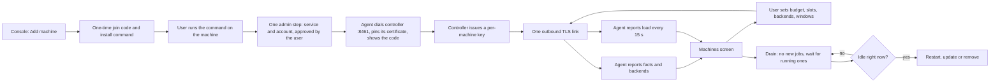
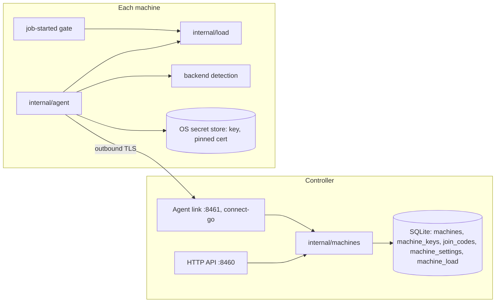

# Machines

PARTLY BUILT (CRSP20). The M1 agent link, join codes, machine keys, detection, load measurement, settings, drain and the controller's own agent are built; see the change note. Not built: R5.14, R5.27 to R5.29, R5.49, R6.9, R6.10. Every requirement not built is NOT YET IMPLEMENTED. Each one names its milestone: **M1** (one machine, the controller's own) or **M3** (more machines, placement and removal), or a later one where it says so. CRSP75 built the machine mode, the battery pause, the `Accepting` status and the CPU cap (R5.61 to R5.64); quiet hours (R5.28) were dropped (OPS51).

Sources: the product brief ([product.md](../../overview/product.md)), decisions [0003](../../architecture/decisions/0003-isolation-backends.md), [0004](../../architecture/decisions/0004-agent-link.md) and [0005](../../architecture/decisions/0005-product-boundary.md). Requirements ported from dev-standards cite their origin there: `docs/features/runner-pool/spec.md` (runner-pool R5.x) and `docs/architecture/DELIVERYSPEC.md` (DL-x).

## 1. In one paragraph

A machine is any computer on the user's local network that runs the `crsp` agent. The user adds machines before anything else. The console shows one install command with a one-time join code. The agent joins, gets its own key, and keeps one outbound TLS link to the controller. It reports what the machine is (OS, CPU, memory, disk, GPU, isolation backends) and how loaded it is. The user sets, per machine, whether it takes jobs, its load budget, its job slots and its allowed backends. Changes that restart runners wait for running jobs to finish. They never cut a job.

## 2. Why

**Problem.** Runners need somewhere to run. A pool of the user's own computers differs in OS, hardware and isolation. Each computer is also someone's working machine. A pool that overloads it, or cuts a job to restart, loses the user's trust.

**Users.** The owner and admins who add and look after machines. Viewers see machines and load.

**Goals.**

- Add a machine with one command and one approval.
- Know what each machine can run, and how loaded it is now.
- Keep each machine within its load budget.
- Never cut a running job.
- Remove a machine cleanly: its runners go, its key stops working.

**Non-goals.**

- Cloud machines (later; decision 0005).
- Placing jobs on machines. That is the scheduling spec; this spec gives it the facts, the settings and the load.
- Building images and running runners. That is the runners spec and decision 0003.
- An inbound port on any machine (decision 0004).

## 3. How it works

1. In milestone 1 the controller starts its own agent on the same machine. It joins without a code.
2. From milestone 1 the user presses **Add machine**. The console shows the install command for each OS with a one-time join code.
3. The user runs it on the new machine. The one step that needs admin rights lists what it does and asks first. It installs the agent as a service under its own account.
4. The agent dials the controller on port 8461. It checks the controller's certificate against the fingerprint in the command and keeps it. It shows the join code.
5. The controller checks the code, uses it up and issues a key for this machine. The agent keeps the key in the OS secret store.
6. The agent sends the machine's facts and backends, then its load every 15 seconds.
7. The user sets the machine's budget, slots, allowed backends, maintenance windows.
8. A change that restarts runners drains the machine first. It says which jobs it waits for. Right before the restart it checks again that nothing runs.
9. If the link drops, the agent reconnects with backoff. The controller marks a silent machine offline.
10. Removing a machine names what goes and asks for a yes. Its key is revoked.

## 4. Screens and states

The Machines screen and the Add machine wizard follow design system v1 ([ux-rules.md](../../design-system/v1/ux-rules.md)). Rules are cited by ID, never copied.

| Screen or state | What it shows | Rules |
|---|---|---|
| Machines, list | One card per machine: name, OS, state word (online, offline, not taking jobs, finishing N jobs), backends, load bars for memory and CPU against the budget, slots used of total, last seen | UX-10, UX-41, UX-51, UX-53, UX-58 |
| Machines, empty | "No machines yet." and the **Add machine** action | UX-6, UX-4 |
| Machine detail | Facts, backends with their reason when not usable, settings, running jobs, the install command again | UX-25, UX-22, UX-61 |
| Machine detail, When it works | The mode (Automatic, Always, Paused), the Pause on battery switch, the CPU cap (25, 50, 75, 100%), the power source, and the reason when the machine takes no new job. Each control saves at once. A pause from the tray shows with its end and a Resume | UX-13, UX-22, UX-38, UX-58 |
| Machine detail, Budget and slots | The four fields (Memory budget, CPU budget, Job slots, Time to finish running jobs) top-align in one row with their boxes on one line; the help of a field sits under its box, so a long name or help never moves the other boxes | UX-23, UX-78 |
| Machines, list column Takes jobs | The word Taking jobs, Paused, On battery or Busy | UX-58 |
| Add machine | Wizard: pick the OS, copy the command, wait for the machine to join, Done | UX-5, UX-29, UX-30, UX-54 |
| Waiting for join | Names what it waits for and when the code expires | UX-29, UX-6 |
| Finishing jobs | Names each job it waits for and the time left before the drain timeout | UX-29, UX-34 |
| Drain past its timeout | Still draining: a Needs you message that says "still draining, N jobs running, waited X", names the jobs, and offers wait longer or cancel. No choice stops a job | UX-26, UX-38 |
| Remove machine | Question card that lists every item that goes | UX-9, UX-62 |
| Offline | Offline state word, last seen, what the agent was doing | UX-58, UX-6 |
| Load unknown | "Load unknown" with the reason; the machine takes no new job | UX-26, UX-28 |

The overview shows machines and load and only links here (UX-52). Busy buttons follow UX-13. Running state comes from one source (UX-19). Times follow UX-18. Every screen works from 360 px (UX-16) and meets UX-17.

## 5. Functional requirements

### 5.1 The controller's own machine

**R5.1** (M1, built, CRSP120) — The controller runs its own agent on the same machine. At first run it joins that agent without a join code, over the same link and port as any other agent (loopback). The machine then appears in the console like any other. The agent keeps its machine id and key in the controller's data directory (`agent/secrets`), so a restart reuses the machine and makes no second one. If a separately installed agent on the same host (same host name) has already joined, the controller does not make a second machine: it keeps that one, skips its own agent and says so in the log. The setup step "Add the first machine" shows this PC as done.

**R5.2** (M1, built, CRSP120) — The controller's own machine follows every rule below (load, settings, drain, privilege). It has no special path.

### 5.2 Join

**R5.3** (M1) — **Add machine** shows one install command per OS (Windows, Linux, macOS). The command carries the controller address, port 8461, the controller certificate's SHA-256 fingerprint and a one-time join code.

**R5.4** (M1) — A join code works once. It expires after 15 minutes by default (ceiling 24 hours). The console shows when it expires. A new code makes the old unused one invalid.

**R5.3a** (M1, RES3, owner decision D59; Windows added by CRSP123, D70) — **Copy-and-wait, plus an optional SSH join.** The default is one Copy button with a one-line join command that holds a short-lived, single-use join code (15 minutes, R5.4). The optional path *I have SSH* is for Linux, macOS and Windows machines that run the OpenSSH server: the console asks for the host, the user, an optional port and an SSH key file. The controller (`createJoinCode` then `joinMachineOverSsh`) signs in once with that key, runs the install command with `sudo -n` (Linux and macOS) and signs out. A downloaded installer (R5.65) is the third way to join, for every system. On Windows the controller's own installer address is reached only with the pinned certificate (CRSP133): the PowerShell script checks that the chain the controller presents holds the certificate with the fingerprint the join command carries (`--fingerprint`) and that the server certificate is signed by it and in its dates, before one byte is downloaded; another certificate is refused. The GitHub release fallback keeps the normal TLS check. The SHA-256 of the installer is still checked before it runs. The command carries `--yes`, because nobody can type the yes of `agent install` over SSH. The key is used for that one join: it is never written to the database, to disk or to a log, its bytes are zeroed afterwards, and the answer never holds it. There is no password option; a key that needs a passphrase is refused. The first call only reads the host key and answers `needs_confirmation` with its SHA256 fingerprint; the console asks the owner to confirm it, and the second call carries `host_fingerprint`, which the controller pins for that session. If the command fails, the code made for it is withdrawn and the answer names the failure without the code.

On **Windows** the controller first reads the default shell (`echo %OS%`: cmd answers `Windows_NT`, PowerShell does not), then runs every script as an encoded PowerShell command, so both shells take it the same way. It checks that the SSH user is an administrator with `net session` and, if not, refuses at once with the reason *the SSH user is not an administrator on this machine*; nothing is installed and the code is withdrawn. If `crsp.exe` is not on the machine (not on `PATH`, not in `%ProgramFiles%\crsp`), the machine downloads the Windows installer of the controller's own version, the controller having named its address and its SHA-256 (a `PackageSource`: today the GitHub release asset with its line of `SHA256SUMS`; the controller's own package endpoint can replace it behind that one method), checks the SHA-256 before it runs anything, and installs it quietly with `msiexec`. Then it runs `crsp.exe agent install --controller ... --fingerprint ... --join-code ... --yes`, which keeps the elevation check and the folder `C:\ProgramData\crsp-agent`. Progress is the same as the Linux path (`getJoinCode`: waiting, connected, ready); each phase (shell, administrator, installing, agent install) is also written to the audit log without any secret.

**R5.4a** (M1, RES3) — **Live join progress.** `getJoinCode` carries `progress`: `waiting` (no agent used the code), `connected` (the agent joined) and `ready` (the machine sent its first heartbeat). It is absent once the code expired or was withdrawn. The wizard shows the three steps live and ends at Done when the machine is ready.

**R5.5** (M1) — At join the agent checks the controller certificate against the fingerprint in the command. On a mismatch it stops and says so. It never joins a controller it cannot verify.

**R5.6** (M1) — At join the controller checks the code, marks it used, and issues a key for this machine only. A used, expired or unknown code is refused with the reason ("this code was already used", "this code expired at 14:05").

**R5.7** (M1) — The agent keeps its key and the pinned certificate in the OS secret store: Windows Credential Manager or DPAPI, macOS Keychain, Linux Secret Service or a file with mode 0600 owned by the account the agent runs as (root on Linux and macOS).

**R5.8** (M1) — Every connection after join proves the machine's key over TLS and checks the pinned certificate. The controller refuses an unknown or revoked key.

**R5.9** (M1) — The agent only dials out. It opens no listening port on the machine (decision 0004).

### 5.3 Facts and backends

**R5.10** (M1) — The agent reports: host name, OS name and version, kernel version, CPU model, core and thread count, architecture, total memory, total and free disk on the agent's data volume, and each GPU (vendor, model, memory).

**R5.11** (M1) — The agent detects each backend and reports, for each: present or not, usable or not, its version, and the reason when it is not usable. Backends: Docker, Podman (rootless or not), containerd with nerdctl, WSL2, Hyper-V, KVM (`/dev/kvm` readable by the agent, which runs as root), Tart (Apple Virtualization) and Firecracker. A persistent runner is always listed as usable.

**R5.12** (M1) — Detected does not mean allowed. A backend runs jobs only when the user allows it on that machine (R5.22).

**R5.13** (M1) — The agent detects again at start, every 10 minutes, and when the user presses **Check again**. A change in facts or backends is shown on the machine and written to the audit log.

**R5.14** (M5, Built in part CRSP114: the report; the controller's start limit and the count on a real Mac are NOT YET IMPLEMENTED) — On a Mac the agent reports how many macOS VMs run (crsp's own VMs on Apple's Virtualization.framework, runners R5.29, and any other macOS VM it can see), and the controller never starts more than two at once (decision 0003).

### 5.4 Load measurement

Ported from dev-standards `claude/plugins/delivery/scripts/load.py` and `load_guard.py` (DL-77, DL-79), and the pool sizing in `delivery_runner_pool.py` (DL176, DL177). Each port brings its tests (decision 0005).

**R5.15** (M1) — The agent measures total memory use % and total CPU use % of the machine. Windows: `GlobalMemoryStatusEx` and `GetSystemTimes`. Linux: `/proc/meminfo` and `/proc/stat`. macOS: `vm_stat` with `hw.memsize`, and CPU from `host_processor_info` or `top`. CPU is the delta of raw counters between two samples, never a sleep inside a hook.

**R5.16** (M1) — The agent samples every 5 seconds. The figure that decides is the median of the last 5 samples, so one spike does not decide (DL176). The one-shot job hooks use their own cached mean of up to 3 samples in 30 s (scheduling R5.42, D7); both rules are built and apply to different readers.

**R5.17** (M1) — On Windows with WSL2, the WSL VM's memory is the larger of the `vmmem` or `vmmemWSL` working set and its private bytes, and at least the memory its containers use (DL177). Windows trims the working set, so it alone reads too low.

**R5.18** (M1) — On Windows, Docker figures are read through the Windows `docker` CLI first, then through WSL, then reported as unknown. On Linux and macOS the agent never calls `wsl`. Built by CRSP127: the agent's machine report also says which OS the container engine runs containers for (`container_os`, from `docker info`); the machines service records it per machine and the machine API shows it as `container_os`, so the machine list says "Windows, runs Linux containers" for a Windows machine with Docker Desktop on WSL2. The `wsl2` backend is reported usable when `wsl --status` fails but the docker engine runs on the WSL2 kernel, and the console writes the reason a backend cannot be used once.

**R5.19** (M1) — An agent that runs inside a container also reads the cgroup v2 figures (`memory.current`, `memory.max`, `cpu.stat`) and decides on the worse of host and container.

**R5.20** (M1) — When CPU cannot be measured, the agent decides on memory only and says so. When memory cannot be measured, the load is "unknown" and the machine takes no new job until it can be measured. The console shows the reason.

**R5.21** (M1) — The agent only measures. It never kills, suspends or lowers the priority of any process to meet the budget (DL-77). It only holds new jobs.

### 5.5 Machine settings

**R5.22** (M1) — Each machine has these settings. Defaults are in brackets.

| Setting | Default | Range |
|---|---|---|
| State | active | active, drained |
| Load budget, memory | 85% | 10 to 95% |
| Load budget, CPU | 60% | 10 to 95% |
| Job slots | 2 | 0 to 64 |
| Allowed backends | persistent runner only | any usable backend (R5.11) |
| Cache size cap | 20 GiB | 1 GiB to the free disk |
| Time to finish running jobs, `drain_timeout_minutes` (one per machine) | 60 minutes | 5 minutes to 24 hours |
| Maintenance windows | none | weekly windows, local time |
| Mode | automatic | automatic, always, paused (R5.61) |
| Pause on battery | on | on or off (R5.63) |
| CPU cap for runners | 100% | 25, 50, 75, 100% (R5.64) |

**R5.22a** (M1) (built, CRSP37) — The pool has its own defaults for a machine that joins: memory budget (10 to 95%, default 85%), CPU budget (10 to 95%, default 60%), whether slots are sized from the machine's cores and memory within the budget (default yes), job slots when they are not sized or the machine does not report its size (0 to 64, default 2) and the drain timeout (5 to 1440 minutes, default 60). An admin changes them in Settings, Budgets (`getPoolSettings`, `updatePoolSettings`); each change writes one audit row. A change reaches only machines that join afterwards. A machine that already joined keeps its own settings, so the change restarts no runner and waits for no running job (UX-62). A machine that already joined is changed in its own settings (R5.22).

**R5.23** (M1) — A machine starts a new job only when all hold: its state is active, a slot is free, measured load is under the budget in force, the job's backend is allowed, and no maintenance window is open. The job-started gate on the machine checks this right before the job runs (runner-pool R5.2, DL-79). Placement across machines is the scheduling spec.

**R5.24** (M1) — A setting saved in the console or CLI reaches the agent within 5 seconds while it is online. The agent keeps the last settings it got and applies them while the link is down.

**R5.25** (M1) — A settings change that does not restart runners (budget, slots, windows) takes effect for the next job. Running jobs keep going even when the new budget is already exceeded.

**R5.26** (M1) — A settings change that restarts runners (allowed backends, cache cap when it forces an image or cache rebuild) goes through drain (R5.30).

**R5.27** (M3) — During a maintenance window the machine starts no new job. Agent updates and image rebuilds for that machine are scheduled into its next window when one is set.

**R5.28** — DROPPED (OPS51, owner decision 20 Nov: "Drop the concept"). A machine has no quiet hours, no quiet budget and no quiet slot count. The number stays so that no other requirement moves.

**R5.29** (M1) — The agent keeps its caches under the cache size cap and evicts the least recently used entries first. Milestone 1 enforces the per-runner quotas of the persistent runners (caches R5.36 and R5.37, config keys `cache_tool_gib` and `cache_rust_gib`) between jobs. The machine setting `cache_cap_bytes` is stored from M1 and returned by the machine API; it does not yet change the quotas (they are the same for every runner). The pool caches of milestone 7 use the setting when they land.

### 5.6 Drain, never kill

Ported from runner-pool R5.10 (no rebuild under a running job) and learning 1 of the brief.

**R5.30** (M1) — **Drain** stops new jobs on the machine. Running jobs finish. The console and CLI name each job it waits for: repository, workflow, job, runner and start time.

**R5.31** (M1) — Every change that restarts runners or the agent drains first: agent update, runner image rebuild, a new cap, a backend change, a service restart and machine removal. Each says, while it waits, which change waits and for which jobs.

**R5.32** (M1) — The idle check runs right before the restart, in the same step that keeps new jobs out. If a job started since the drain began, the change waits again. An idle check taken earlier never counts.

**R5.33** (M1) — **One drain timeout per machine.** It is the machine setting `drain_timeout_minutes` (default 60 minutes, 5 minutes to 24 hours). When it passes with jobs still running, crsp never stops a job: it keeps waiting and warns. The change stays waiting and the machine stays draining; nothing is stopped and nothing is offered that stops a job (no "stop those jobs now", no `stop_jobs` decision). The controller records the timeout once in the audit log and raises one warning (an alert event) that names the machine, the change and the jobs. The console and the CLI show "still draining, N jobs running, waited X" and the jobs. The user may wait longer (5 minutes to 24 hours from now) or cancel the change; both leave the jobs running. An automatic update does not wait past its limit: it postpones and tries again at the next check (operations spec, CRSP19). Built (HND5): that limit is this setting on the machine that updates, for the controller's own update and for an agent's follow update (`update.Manager` reads `Drainer.DrainTimeoutMinutes`, the agent's `UpdateDrainer` reads it from the settings the controller sent); there is no fixed 60 minutes left in the code, only the default of the setting.

**R5.34** (M1) — **Resume** returns a drained machine to active. A change that is still waiting is cancelled first, after a yes.

### 5.7 Offline and reconnect

**R5.35** (M1) — The agent sends a heartbeat every 10 seconds. The controller marks a machine offline after 30 seconds without one. An offline machine gets no new job.

**R5.36** (M1) — The agent reconnects with exponential backoff: 1 second, doubled each time, capped at 60 seconds, with up to 20% random jitter. A successful session resets the backoff.

**R5.37** (M1) — A lost link does not stop runners. Jobs already running keep running. The machine's own gate keeps enforcing slots and budget from its last settings.

**R5.38** (M1) — On reconnect the agent sends its facts, current load and the jobs it runs. The controller reconciles them with what it thought was running. Slots held by jobs that ended while offline are freed (scheduling spec; learning 2 of the brief).

**R5.39** (M1) — When the controller refuses the key (machine removed), the agent stops retrying, logs "this machine was removed from the pool", and waits for a new join.

### 5.8 Remove a machine

**R5.40** (M3) — **Remove machine** drains it first (R5.30). Then a question card names every item that goes: the machine, each runner on it (deregistered from GitHub with a remove token), its images and caches, its settings and its key. The user answers yes before anything goes.

**R5.41** (M3) — On yes, the controller revokes the machine's key at once and closes its link. If the agent is online it removes its runners, images and caches and reports each result. Items it could not remove are listed with the reason.

**R5.42** (M3) — If the machine is offline, removal still revokes the key and deregisters its runners from GitHub. The console says the agent will learn this on its next connect (R5.39) and that its local files stay until it is uninstalled.

**R5.43** (M1) — A removed machine joins again only with a new join code. It gets a new key.

### 5.9 Least privilege and the service

**R5.44** (M1, changed by CRSP42, D41) — The agent runs as LocalSystem on Windows and as root on Linux and macOS, like the controller (owner decision, 14 Nov). It needs the right to install its own update after the drain (operations R5.39 to R5.41), which a non-admin account cannot do. There is no `crsp-agent` or `_crsp_agent` account. Runner jobs do not run as the agent: each runner runs under its own non-admin per-runner account (runners R5.14, RN-4), which the agent makes. An agent installed before D41 under a non-admin account says `unsupported` to an update ask (operations R5.41) until the install command is run again.

**R5.45** (M1, changed by CRSP119) — Admin rights are needed in one install step only. Before it runs, it lists each admin action (create the data folder, install the service that runs as LocalSystem or root, join the controller, start the service) and asks for a yes. It never runs without that yes. Without admin rights (a Windows PowerShell that is not elevated, or a Unix user that is not root) it stops first with one plain line, "open PowerShell as Administrator and run this command again" or "run this command again with sudo", before the list is shown, and changes nothing. The data folder is the machine-wide one of the OS unless `--data-dir` is given: `C:\ProgramData\crsp-agent`, `/Library/Application Support/crsp-agent` or `/var/lib/crsp-agent`; `agent run` and `agent join` use the same default, and the service and the join step get the same folder as `--data-dir`. PowerShell steps run with `-NoProfile -NonInteractive -OutputFormat Text`; a failed step is reported as one plain line with the exception message ("step 2 (register the Windows service ...): Access is denied"), never as raw CLIXML. When a step fails after earlier ones worked, the line also names what was left (the data folder, the service or unit) and how to remove it.

**R5.46** (M1) — The agent is installed as a service that starts at boot and restarts after a crash: a Windows service, a systemd unit, a launchd LaunchDaemon (decision 0005).

**R5.47** (M1) — On Windows the service and any scheduled task are registered with the PowerShell cmdlets, never with a cmd-quoted command line (learning 5 of the brief).

**R5.48** (M1) — At run time the agent never asks for admin rights. A step that needs them (a new backend's group, a new right) goes back through the approved install step.

**R5.49** (M3) — Uninstall reverses the install step. It names what goes and asks for a yes.

### 5.10 Console and CLI

**R5.50** (M1) — The Machines screen lists every machine with its state, OS, backends, load against budget, slots used and last seen. Load updates live (server-sent events).

**R5.51** (M1) — The CLI has the same powers: `crsp machines list`, `show`, `set`, `drain`, `resume`, `join-code` (M1), and from M3 `remove`. A destructive command lists what goes and asks for a yes; `--yes` answers it in a script.

**R5.52** (M1) — Settings, drain, resume and removal need the admin or owner role. Viewers see machines and load only.

### 5.11 Parity with the old pool (after v0.1.0)

Each requirement below targets a milestone after v0.1.0 and is **NOT YET IMPLEMENTED**. Until this is built, jobs that need it run on GitHub-hosted runners. Source: the handover page ([section 3 items 8 and 13](../../architecture/dev-standards-handover.md)).

**R5.53** (after v0.1.0, Built in part CRSP56 and CRSP61 (`agent.ReadWSLKVM` and `ParseWSLKVM` read the WSL VM: `/dev/kvm` and whether `kvm_intel` or `kvm_amd` is loaded, read-only; the doctor check `kvm.module` says how to fix it, doctor R5.32): `agent.ParseWslconfig`, `PlanKVMLoad`, `container.LoaderModule`, `KVMWait` and the loader service of `images/layers/compose.kvm.yaml`; the agent does not yet read `.wslconfig` on a real machine or report KVM state to the doctor) — **KVM on WSL2.** On Windows with WSL2, after `wsl --shutdown` or a reboot `/dev/kvm` is gone until the module `kvm_intel` or `kvm_amd` is loaded in the WSL VM. The agent checks `nestedVirtualization=true` in the user's `.wslconfig` and reports it as the backend reason when it is off ("nested virtualization is off in .wslconfig"); it never edits that file without a yes. When it is on and `/dev/kvm` is missing, the agent loads the module through a one-shot privileged helper that exits after the load; runners are never privileged. The `kvm` label (runners R5.36) is added only after `/dev/kvm` is usable. The step runs again at every WSL start. The pool container gets no `/dev/kvm` mapping (lesson 28, HND1): it is given the cgroup rule `c 10:232 rwm`, and its `kvm-wait.sh` creates the node with `mknod` once `/proc/misc` lists `kvm`, inside the bounded wait; when the wait ends without the device the pool starts without KVM and logs it.

**R5.54** (M2, v0.3.0, partly built, CRSP50) — **WSL memory sizing.** The agent reads the `memory=` and `processors=` values of `.wslconfig` and the memory the WSL VM holds (R5.17), and shows them in the machine facts. The runner count and per-runner memory cap are set from the declared value, never from a live reading. It exports the CPU limit to jobs and splits it per runner, so `nproc` in a container matches the cap. A declared value above what the machine can give is refused with the reason. A change to `.wslconfig` needs `wsl --shutdown`, so the console says it waits for the machine to drain (R5.30). Built (CRSP50): the agent reads `.wslconfig` (`memory=`, `processors=`, `nestedVirtualization=`) from the console user's profile, then its own, into the machine facts (`internal/poolsize`, `internal/agent/wslconfig.go`); a declared value above what the machine has is refused with the reason; the CPU split (`poolsize.PerRunner`, the pool CPUs over the job slots) is exported to jobs as `CI_MAX_PARALLEL` (runners R5.53). Built (HND17): a container pool gets a pinned CPU set from the machine's CPU budget and a memory cap (`--cpuset-cpus`, `--memory` and `--memory-swap` equal) in `internal/backend/container` (`CPUAllocator`, `ResourceArgs`, `Config.CPUBudget`, default 60% of the CPUs). Sets never overlap between concurrent pool containers; a set is freed when its container is removed or gone (image swap, a failed create, `CleanUp`), and `RecoverCPUSets` adopts the sets of live containers after a crash. A full budget refuses the start with the reason and takes nothing. The unit is the pool container, as the docker flags are set when it is made; a split per runner inside it is not built. NOT YET IMPLEMENTED: calling `RecoverCPUSets` at agent start, the console showing the declared values and the drain wait for a `.wslconfig` change.

**R5.58** (M2, v0.3.0, built, CRSP50 and CRSP70) — **The pool size is the owner's, checked against the budget.** The owner sets the memory (GiB) and CPUs the pool may use on a machine. The setting is accepted when it fits: the memory budget (85% of the total, counting the memory used outside WSL, the WSL VM and the guests R5.54 of runners), the CPU budget (60%), the floors (4 GiB and 2 CPUs) and 1.5 GiB per CPU. Otherwise it is refused, naming the budget that is short and the nearest sizes that pass (for example "10 GiB fits 6 CPUs; 7 CPUs needs 10.5 GiB"). Memory used outside WSL is the median of about 5 samples, one second apart, so a short spike of another program does not shrink the room. A change that lowers the size below the current one needs a second, explicit confirmation, never a side effect of another change. The sizing inputs (machine total, used outside WSL, budget, room, Docker ceiling, the figure that decided) are shown with the result. Port of DS R5.20 to R5.24 and `test_dl176_pool_resize.py`. Built (CRSP50): `poolsize.Check` (the floors, the CPU budget, 1.5 GiB per CPU, the memory budget, the Docker ceiling, the nearest sizes), the 5-sample sizing read (`load.SizingRead`, scheduling R5.47), the settings fields `pool_memory_gib` and `pool_cpus` (OpenAPI, migration 00012, wire), the refusal with the sizing inputs in its text, and the shrink rule: a size below the current one, or clearing it, answers 409 `needs_confirmation` and is saved only with `confirm_shrink` (the general `confirm` does not stand for it; another change never touches the pool size, and a lower budget that no longer holds it is refused). Built by CRSP70: the dry run `POST /api/v1/machines/{id}/pool-size-check` (admin; `PoolSizeCheck`: the result, the sizing figures, the nearest sizes and whether the size is below the current one; it saves nothing), and the console form on the machine's page (LOOK22: a plain section, no wizard; OPS47: its one Save bar is the page's action bar, component 48, UX-42, sticky at the foot of the main content above the key-hint bar and never inside a wrapper of its own, so it does not scroll away). It reads the budget when it opens and shows the room and the CPU budget, offers a choice of Recommended half of the free room, Recommended three quarters of it, or Custom (OPS47: the choice that shows the size now is selected when the page opens, so the group is never blank: half or three quarters when the size set equals that recommended size, else Custom with the current memory and CPUs filled in; nothing is selected only while no size is set), checks the size live 250 ms after the last edit, asks for its own tick ("Yes, lower the pool size") before a lower size, is saved by the page's one Save, which reads the check once more right before saving and sends nothing when the size changed meanwhile, and sends `confirm_shrink` only for a lower size. The controller computes the two recommended sizes (LOOK22): `PoolSizeCheck.recommended_half` and `recommended_three_quarters`, each `memory_gib` (that share of `room_gib`, rounded down to whole GiB, at least the 4 GiB floor) and `cpus` (the same share of the CPU budget, at most memory / 1.5, at least 2); `poolsize.Recommend`. NOT YET IMPLEMENTED: clearing the pool size from the console (open question M-10), the controller taking its own 5-sample read (it uses the newest load the agent reported), guest memory in the room (0 until the container backend), and the agent resizing its slots from the pool size. Built by CRSP64: the pool CPUs and memory are the limits (`--cpus`, `--memory`) of each repository pool container of the container backend (runners R5.27, open question 42).

**R5.59** (M2, v0.3.0, Built CRSP63) — **The agent reports what the machine can do.** The agent sends a `MachineReport` after Hello, on `ReportMachine`, with every Redetect and every `RedetectEvery`: the KVM state (`/dev/kvm` present, on Windows whether `.wslconfig` was read and sets `nestedVirtualization`, and whether `kvm_intel` or `kvm_amd` is loaded in the WSL VM), the container engine (`agent.DetectEngine`) the job images of the container backend, and whether the agent's account can make symbolic links (`agent.ProbeSymlink`, Built CRSP109; doctor R5.42). A value the agent could not read is marked not known, never false. The controller keeps the last report of each machine in memory and the doctor reads it (doctor R5.32, R5.36). The agent reads only: it never loads a module, edits `.wslconfig` or starts an engine. A machine that is offline or has not reported yet is left out of the doctor checks. The report is not stored: after a controller restart it is empty until each agent reports again.

### 5.13 A stuck job and a runner set (M1)

**R5.55** (M1) — **A drain names its holder.** (Lesson 20 of the old pool.) A job that does not end blocks every drain behind it. While a change waits, the console and the API show the job that holds it longest (`holder` on the change): its repository, job and runner, how long it has run, and its usual duration. The usual duration is the median of the last finished runs of the same repository and job name in the job history (at least 3 runs; with fewer there is no usual duration and nothing is flagged). The agent reports the start time of each running job (`JobRef.started_unix_ms`). The machine screen shows the holder under "Waiting for a drain". Built (CRSP38).

**R5.56** (M1) — **A job far past its usual time is flagged, and the user has a named choice.** When the holder has run twice as long as its usual duration or more, the change marks it (`over_usual`), the audit log records `machine.drain.stuck` once, and the notifier is told once (`StuckNotifier`). Once the drain timeout has passed (R5.33) or the holder is flagged, the change lists its named choices (`choices`): wait longer or cancel the change. The drain never waits silently, and it offers nothing that stops a job (R5.33). The drain timeout stays 60 minutes per machine by default. Built (CRSP38).

**R5.57** (M1) — **A change for a runner set waits only for that set.** (Lesson 21.) A drain, restart or image swap can name the runners it touches (`runner_names`, `Drain.runner_names`). The controller counts only the jobs on those runners (names compare without case), whatever else the machine runs, including a busy runner of the same repository. The agent keeps new jobs out of those runners only (the gate answers `runner_draining`), the machine stays active, and the change runs when no job runs on its runners. The idle check and the hold are one step, as in R5.32. Without runner names the change is the whole machine, as before. Built (CRSP38).

**R5.60** (M2, built in part CRSP83 as runners R5.83: setting `disk_floor_gib`, default 10 GiB, resume at the floor plus 1 GiB; NOT YET IMPLEMENTED: default of 20 GiB, the percentage form, the hold counting against the gate's maximum wait) — **Free-disk floor before a job or VM starts.** Each machine has a setting `disk_min_free_gib` (default 20, with a percentage form like `cache_min_free_pct` in caches R5.38). Before the agent starts a runner container, a VM or a differencing disk, it reads the free space of the volume that holds the runner folders and VM disks. Under the floor it starts nothing new: the job waits and is not failed, the gate log line names the free space, and the hold ends when the free space is the floor plus 2 GiB (so it does not flap). Running jobs are never cut. A disk that cannot be read never holds a job (caches R5.38). The hold counts against the gate's maximum wait like the cache hold. The doctor warns before the floor is reached (doctor R5.37).

### 5.14 Laptop and desk policy (CRSP75, owner decision D51)

**R5.61** (M1, built CRSP75) — **A machine has a mode.** `Automatic` (default) takes jobs, and pauses while the machine runs on battery (R5.63) and while the user has paused it from the tray with a timer ("Pause for 1 hour") or until they resume ("Pause until I resume"). `Always` takes jobs on battery too. `Paused` takes no new job and lets the running jobs finish; it never cuts one and uses the drain rules (R5.30 to R5.32: the idle check and the hold are one step). A pause from the tray holds in every mode, also `Always`. The mode, the pause and the battery switch are machine settings: the console, the tray and the CLI change the same values, so they follow each other (they reach the agent as R5.24). The pause timer is an absolute time set by the controller's clock; the agent compares it with its own clock.

**R5.62** (M1, built CRSP75) — **The machine status says whether it takes new jobs.** Machine status has `Accepting bool` and `PauseReason string`. The reason is one of `paused`, `on_battery`, `budget`, `base_image_missing` or `disk_low`, and is empty while accepting; the names are exact because another feature reads `online && Accepting` to decide on hosted fallback. The agent reports (`AcceptingReport`, over the existing agent link, with each change, after Hello, and every 15 seconds) and the controller decides the answer the console reads (OPS29): the machine record carries one computed `taking` (`taking_jobs`, and the `reason` when not): `offline`, `stopped` (drain: Stop new jobs from the console), `mode_paused`, `tray_paused`, `on_battery` (mode Automatic, the battery switch on, the machine on battery), `busy`, `base_image_missing` or `disk_low`, checked in that order. The controller reads its own online flag, drain state, mode, tray pause and battery switch first, because it wrote them and a report lags them; it reads the agent's report only for what the agent alone knows (`budget`, `base_image_missing`, `disk_low`, and the power source). The agent's own `paused` and `on_battery` are not read. `accepting` and `pause_reason` stay for other features and follow the same answer (`stopped`, `mode_paused` and `tray_paused` all stay `paused`); `taking` adds offline. A machine that reported nothing accepts. A drained or draining machine is `stopped` at once, without waiting for a report. A full slot table is not a reason: the machine still accepts and the job waits for a slot. There is no quiet-hours reason (OPS51). The scheduling gate holds new jobs with the reason (scheduling R5.68).

**R5.63** (M1, built CRSP75) — **Battery detection is per OS, and unknown is mains.** Windows reads `GetSystemPowerStatus` (AC line offline with a system battery is on battery). Linux reads `/sys/class/power_supply` (a battery with no mains or USB supply online, or a lone discharging battery, is on battery; a peripheral's battery does not count). macOS reads the first line of `pmset -g batt`. A state that cannot be read, a desktop with no battery, or an unknown line status counts as on mains, so a desktop is never paused for a battery. The agent reports the power source with the Accepting report; the console shows it.

**R5.64** (M1, built CRSP75) — **A CPU cap for runner processes, per machine.** Values 25, 50, 75 and 100% of all the machine's cores (default 100, no cap). Windows puts the runner service process trees (services named `actions.runner.*`, and the children they start) in a Job Object with a hard CPU rate. Linux writes cgroup v2 `cpu.max` in the cgroup that crsp owns for each runner service (`system.slice/actions.runner.*.service`). macOS is not supported yet: the console says so and offers no value. The agent applies the cap when the setting changes and again every minute, so a runner service that started since is capped within a minute; it reports `applied`, `not_supported` or `failed` with the reason, and the percent the result is about. While that percent differs from the chosen one the console shows `applying` and drops the old result, so an error of the last value never shows beside a new choice. The cap is separate from the admission budget (85% memory, 60% CPU, R5.22), which is unchanged: the budget decides whether a job may start, the cap limits what runners use once running.

**R5.65** (M1, CRSP122, owner decision D70) — **Download an installer.** Beside the copied command (R5.3) and SSH (R5.3a), Add a machine offers a file to download for the machine's system: a `.cmd` for Windows (CRLF line ends), a `.sh` for Linux and a `.command` for macOS (LF). The file holds the controller address and agent port, the certificate fingerprint, the release version, the SHA-256 of the release's installer packages and a one-time join code; it holds no other secret. The code follows R5.4 unchanged: it works once, lives 15 minutes (ceiling 24 hours) and makes an older unused code invalid. The file is made only when the owner presses the action (`createJoinFile`, admin or owner): that call mints the code and answers the file in the same answer; the code is not stored and the audit entry (`join_file.create`) names who, the system and the expiry, never the code. The file name says the system and the expiry: `crsp-join-<os>-until-<UTC stamp>.<ext>`. The answer carries the code's id in `X-Join-Code-Id`, so the wizard waits on the code's progress (R5.4a) as for a copied command. `crsp machine join-file --os windows|linux|macos [--out FILE] [--expires 15m]` does the same from the CLI and saves the file owner-only on every system: mode 0600 (0700 for a shell file) on Linux and macOS, and on Windows a protected access list that gives the current user and SYSTEM and nobody else (CRSP133). The browser download is saved by the browser, so the file says in its first lines, and the console says when it is saved, that it holds a one-time code that works once and only until the time in the file (15 minutes by default), and to delete it after use. The file pins the controller's certificate for its package download (CRSP133): the `.sh` and `.command` files read the chain with `openssl`, find the certificate with the fingerprint, check that the server certificate is signed by it and in its dates, and download with `curl --pinnedpubkey` on that server key; the `.cmd` file does the same check in PowerShell 5.1 before `DownloadFile`. A controller with another certificate is refused before anything is downloaded or installed. The files need `openssl` and `curl` (Linux and macOS); `wget` is no longer used.

On the machine the file does the install and the join. Windows: the `.cmd` starts PowerShell on itself, asks for administrator rights once, uses an installed `crsp.exe` (on the path or in `%ProgramFiles%\crsp`), and otherwise downloads the MSI from the controller, checks its SHA-256 against the value written in the file and installs it with `msiexec`; then it runs `crsp.exe agent install` with the values. Linux: the `.sh` uses `sudo` when it is not root, installs the `.deb`, the `.rpm` or the `.tar.gz` (in that order of preference for the distribution) when `crsp` is not there, checks each download the same way, then runs `crsp agent install`. macOS: the `.command` downloads the `.pkg`, checks it, installs it with `installer` (macOS asks for the password) and runs `crsp agent install`. A package whose SHA-256 differs is never installed.

The controller serves the packages of the release it was built from at `GET /api/v1/packages/{name}` (`getPackage`, public like the GitHub release, and `SHA256SUMS` at the same path). It reads the release of its own version from GitHub, keeps `SHA256SUMS` and each package in its data folder (`packages/<version>/`), and serves a package only after its SHA-256 matches `SHA256SUMS`; a name that `SHA256SUMS` does not list as an installer answers 404 (a release names its installers with the version, `crsp-windows-amd64_0.1.15.msi`, operations R5.119; a join file asks for the plain name and downloads the name `SHA256SUMS` lists) and a mismatching download is deleted and not served. The SHA-256 the file checks was taken from that `SHA256SUMS` when the file was made in the owner's session, so the download needs no trust in the controller's self-signed certificate; the join still pins the certificate fingerprint (R5.5). A development build, or a controller whose console is only on the loopback address, has no packages: `createJoinFile` answers 501 and says to copy the command. Not verified on a real Windows or macOS machine in CRSP122; a downloaded `.command` may need `chmod +x` or `sh <file>` because a browser does not set the execute bit.

**R5.66** (M1, CRSP136) — **The Docker disk compact policy is a machine setting.** Each machine's settings carry the policy of caches R5.52: `docker_compact` (`auto`, `on` or `off`; `auto` is the default and means on for a Windows machine with a Docker Desktop disk file), `docker_compact_threshold_gib` (1 to 100000, default 30), `docker_compact_idle_minutes` (1 to 1440, default 30). The API refuses anything else with 400. A change is saved at once and needs no drain, and the audit entry `machine.settings` names the change. The agent's machine report carries the Docker disk (`DockerDiskReport`: present, files, file bytes, used bytes, administrator right) and the machine shows it as `docker_compact_status` (enabled, the reason of the last look, file, used and reclaimable bytes, the last time and result, running). The Machine page has a Docker disk section with these settings, built from shared parts only (design-system content.md, Docker disk words), and `crsp machine settings NAME` shows and sets them from the CLI (cli R5.61).

**R5.67** (M1, built CRSP205) — **The pool survives a controller restart.** (Since OPS59 the pool is in the database, R5.68; this describes the file it replaced.) The controller keeps its machines, their key hashes, settings, join codes and open changes in `machines.json` in the data folder, written at once when access changes and at most every 2 seconds for a routine change, and again when the controller stops. A restart therefore keeps every key: the controller's own agent and every other agent connect again with the key they hold, and none is told "this machine was removed from the pool" (that message is only for a machine that was removed). Every machine reads as offline until its session opens. A pool file that cannot be read stops the controller at start; it is never replaced by an empty pool. Only hashes are stored (R6.2).

**R5.68** (OPS59) — **The pool lives in the controller database.** Machines, their settings, key hashes (live and revoked), join codes and changes are rows of the controller database (migration 00032, `ctl_*` tables), written before each call returns. A restart or an update of the controller keeps all of them. This replaces the `machines.json` file of R5.67: at start the controller imports an existing `machines.json` once, when the database holds no machine, then renames the file to `machines.json.imported-<time>` as a backup and never deletes it; the import is audited (`machine.import`). The controller supports one database engine, SQLite. Only hashes are stored (R6.2).

**R5.69** (OPS59) — **Machine actions are in the console audit log.** Every machine audit entry (join, rejoin, settings saved with the diff, a change started, cancelled or done, drain, resume, remove, key revoke, import) is written to the console audit log as an entry on a machine, with the actor and the detail.

**R5.70** (OPS59) — **Joining again keeps the machine.** When an agent joins again, the controller reuses the machine record (same id, name, settings, policy and runners), gives it a new key, revokes the old keys and audits `machine.rejoin`; the machine shows `RejoinedAt`. Matching rule: the local credential (the controller's own agent) is the controller machine; any other join matches a machine that is not removed, is offline, and has the same host name (without case), OS and architecture, the newest by last seen. A removed machine never matches: it joins again as a new machine (R5.43). An online machine is never matched.

## 6. Non-functional requirements

**R6.1** (M1) — The agent link uses TLS 1.3 only. A connection without a valid pinned certificate and a valid machine key is refused.

**R6.2** (M1) — No key, join code or certificate private key is written to the database, a log or the console in clear. The controller stores join codes and machine keys only as hashes.

**R6.3** (M1) — A join code has at least 128 bits of entropy. After 10 failed join attempts from one address in one minute, that address is refused for 5 minutes.

**R6.4** (M1) — Every join, settings change, drain, resume, removal and key revocation is written to the audit log: who, what, when.

**R6.5** (M1) — An idle agent uses under 1% of one CPU core and under 50 MB of memory on average over 10 minutes.

**R6.6** (M1) — Taking one load sample takes under 100 ms. The job-started gate never waits for a sample; it reads the newest one.

**R6.7** (M1) — The load shown in the console is at most 20 seconds old, or it is marked stale with its age.

**R6.8** (M1) — The controller keeps current facts and load per machine, and load history at 15-second steps for 24 hours. Older load is dropped.

**R6.9** (M3) — One controller serves up to 50 machines with the targets above.

**R6.10** (M1) — The Machines screen and the Add machine wizard meet design system v1, including UX-16 and UX-17.

## 7. Design

**Packages.**

- `internal/machines`: join codes, keys, the machine record, settings, drain and removal, offline detection. Controller side.
- `internal/agent`: the agent mode. Link, reconnect, facts and backend detection, settings cache, drain execution, service install and uninstall.
- `internal/load`: the load measurement per OS, medians, WSL VM and Docker reads, cgroup v2. Pure functions over parsed input, with the OS calls behind one probe interface so tests feed fixed output (as `load.py` does with its test seams).

**Agent link contract.** `packages/contract/proto/agent/v1/agent.proto` grows:

- `Join(JoinRequest{join_code, facts}) returns (JoinResponse{machine_id, machine_key})`, replacing the placeholder `Register`.
- `SessionRequest` adds `Facts`, `LoadReport{memory_pct, cpu_pct, cpu_known, wsl_vm_bytes, containers_bytes, slots_used, sampled_at}`, `JobsRunning`, `DrainStatus` and `CommandResult`.
- `SessionResponse` adds `Settings`, `Drain`, `Resume`, `Remove` and `Redetect`.

The machine key travels as connection metadata on every call after join.

**Data model (planned tables).**

- `machines`: id, name, os, arch, facts JSON, backends JSON, state, last_seen, created_at.
- `machine_keys`: machine_id, key hash, created_at, revoked_at.
- `join_codes`: code hash, created_by, expires_at, used_at, machine_id.
- `machine_settings`: machine_id, budgets, slots, allowed backends, cache cap, drain timeout, windows JSON.
- `machine_load`: machine_id, sampled_at, memory_pct, cpu_pct (24 hours, R6.8).

**Certificate.** The controller makes its own certificate at first run and keeps its private key in the OS secret store. The install command carries its fingerprint.

## 8. Failure modes

| Dependency | When it fails | Behaviour | Why |
|---|---|---|---|
| Agent link | Link drops | Fail closed for new jobs on that machine after 30 s; running jobs continue | A machine the controller cannot see must not take new work, but a job must never be cut |
| Load measurement | Memory unknown | Fail closed: no new job; reason shown | The budget protects the owner's machine |
| Load measurement | CPU unknown | Decide on memory only and say so | Matches `load.py`; Windows can lack a CPU figure for the first sample |
| Docker CLI on Windows | Not found | Read through WSL, then unknown | DL177 |
| OS secret store | Unavailable at join | Join fails with the reason; no key is written to a plain file except the Linux 0600 fallback | Never store a secret in the clear |
| Certificate pin | Mismatch | Fail closed: the agent refuses to connect | A changed certificate may be another controller |
| Controller database | Unavailable | The controller refuses joins and settings changes; agents keep their last settings | Agents stay safe without the controller |
| Drain | Timeout passes | Keep waiting and warn once; nothing stops (R5.33) | Never cut a job |
| GitHub, at removal | Remove token refused | Removal reports the runner it could not deregister and keeps the item listed | A failure must leave a visible state, not a silent orphan |

## 9. How it is proven

Every test below is planned and NOT YET IMPLEMENTED. Paths are where the tests will live.

| Requirement | Test | Status |
|---|---|---|
| R5.1 | internal/machines/local_agent_test.go | built (CRSP120) |
| R5.2 | internal/machines/local_agent_test.go | built (CRSP120) |
| R5.3 | internal/machines/joincode_test.go | planned |
| R5.4 | internal/machines/joincode_test.go | planned |
| R5.3a | internal/machines/sshjoin_test.go (fake and real SSH exchange); internal/machines/sshwin_test.go (Windows: cmd and PowerShell shells, non-admin refusal, download with SHA-256 before install, install command with `--yes`, key never persisted, progress, TestSSHJoinWindowsPinsTheControllerCertificate: the pin is set before the download and the GitHub fallback keeps normal TLS); cmd/crsp/agent_install_test.go TestInstallYesNeedsNoStdin; internal/api/machines_ssh_join_test.go; apps/web/src/screens/machines/AddMachine.test.tsx (RES3, CRSP123) |
| R5.4a | internal/api/machines_ssh_join_test.go TestJoinCodeProgressWaitingConnectedReady; apps/web/src/screens/machines/AddMachine.test.tsx (RES3) |
| R5.5 | internal/agent/join_test.go | planned |
| R5.6 | internal/machines/join_test.go | planned |
| R5.7 | internal/agent/secretstore_test.go | planned |
| R5.8 | internal/machines/auth_test.go | planned |
| R5.9 | internal/agent/nolisten_test.go | planned |
| R5.10 | internal/agent/facts_test.go | planned |
| R5.11 | internal/agent/backends_test.go | planned |
| R5.12 | internal/machines/settings_test.go | planned |
| R5.13 | internal/agent/backends_test.go | planned |
| R5.14 | internal/agent/macvm_limit_test.go | built in part (CRSP114) |
| R5.15 | internal/load/sample_test.go | planned; ports `test_load.py` |
| R5.16 | internal/load/median_test.go | Built: `internal/load/median_test.go` TestMedianIgnoresASpike, TestSamplerDecidesOnMedianOfLastFive |
| R5.17 | internal/load/wslvm_test.go | planned; ports `test_dl177_pool_measure.py` VmReadTests |
| R5.18 | internal/load/docker_test.go; internal/machines/engine_test.go TestMachineReportRecordsTheEngine; internal/agent/backends_test.go TestBackendsWSL2NotReadyFalseReportWhenDockerDesktopRunsOnWSL2; apps/web/src/screens/machines/Machines.test.tsx | planned; ports `test_dl177_pool_measure.py` DockerReadTests |
| R5.19 | internal/load/cgroup_test.go | Built: `internal/load/cgroup_test.go` TestCgroupWorseOfHostAndContainer |
| R5.20 | internal/load/unknown_test.go | planned |
| R5.21 | internal/load/measure_only_test.go | planned |
| R5.22 | internal/machines/settings_test.go | planned; internal/machines/settings_survive_test.go TestUserSettingsNeverRevertAfterReconnectOrSync, TestUserSettingsSurviveAControllerRestart (RES6) |
| R5.22a | internal/machines/pool_defaults_test.go; internal/settings/pool_test.go; internal/api/handlers_pool_test.go | built, CRSP37 |
| R5.23 | internal/agent/gate_test.go | planned; ports runner-pool R5.2 cases |
| R5.24 | internal/agent/settings_cache_test.go | planned; internal/agent/settings_survive_test.go TestAgentReconnectKeepsTheUsersSettings (RES6) |
| R5.25 | internal/machines/settings_test.go | planned |
| R5.26 | internal/machines/drain_test.go | planned |
| R5.27 | internal/machines/windows_test.go | planned |
| R5.28 | dropped (OPS51) | none |
| R5.29 | internal/runnercache/runnercache_test.go TestEvictionOrderOldestFirstUntilItFits, TestNeverEvictsWhileARunnerIsBusy; internal/hooks/hooks_test.go TestJobDoneEvictsOldestOverQuota | built for the runner quotas; planned (M7) for the machine setting |
| R5.30 | internal/machines/drain_test.go | planned; internal/machines/settings_survive_test.go TestSettingChangedWhileADrainWaitsIsNotUndone, TestFactsSyncDoesNotRevertARename (RES6) |
| R5.31 | internal/machines/drain_test.go | planned |
| R5.32 | internal/agent/drain_idle_test.go | planned |
| R5.33 | internal/machines/drain_timeout_test.go TestDrainTimeoutWarnsAndKeepsWaiting, TestDrainTimeoutIsPerMachine, TestNoDecisionStopsJobs | built |
| R5.34 | internal/machines/drain_test.go | planned |
| R5.35 | internal/machines/offline_test.go | planned; cmd/crsp/machine_up_edges_test.go TestMachineUpEdges (a heartbeat dated more than 30 s ahead is not fresh and is logged as machine.heartbeat.skew, RES13) |
| R5.36 | internal/agent/backoff_test.go | planned |
| R5.37 | internal/agent/link_loss_test.go | planned |
| R5.38 | internal/machines/reconcile_test.go | planned |
| R5.39 | internal/agent/revoked_test.go | planned |
| R5.40 | internal/machines/remove_test.go | planned |
| R5.41 | internal/machines/remove_test.go | planned |
| R5.42 | internal/machines/remove_offline_test.go | planned |
| R5.43 | internal/machines/join_test.go | planned |
| R5.44 | internal/agent/plan_test.go TestServiceAccounts (built, CRSP42) |
| R5.45 | internal/agent/plan_test.go TestInstallWithoutAdminRightsStopsFirst, TestFailedStepNamesWhatWasLeftBehind, TestCLIXMLErrorIsDecodedToOneLine; cmd/crsp/agent_install_test.go (built, CRSP119) |
| R5.46 | internal/agent/service_install_test.go | planned; plus a CI start of the built agent per OS |
| R5.47 | internal/agent/service_windows_test.go | planned |
| R5.48 | internal/agent/install_plan_test.go | planned |
| R5.49 | internal/agent/uninstall_test.go | planned |
| R5.50 | apps/web/src/machines/Machines.test.tsx | planned |
| R5.51 | cmd/crsp/machines_cmd_test.go | planned |
| R5.52 | internal/api/machines_auth_test.go | planned |
| R5.53 | internal/agent/engine_test.go TestParseWSLKVM, TestReadWSLKVMOnlyOnWindowsAndOnlyReads; internal/agent/wsl_kvm_test.go TestParseWslconfig, TestWslKVMLoadsOnlyWhenNestedIsNotOff; internal/backend/container/kvm_test.go TestKVMWaitIsBoundedAndStartsWithoutKVM, TestLoaderModuleByVendor, TestComposeKVMLoaderOnlyPrivileged | built in part; CRSP56 |
| R5.54 | `internal/poolsize/poolsize_test.go` TestParseWSLConfigReadsOnlyWSL2, TestDeclaredAboveMachineIsRefused, TestCPUSplitAndEnv; `internal/agent/wslconfig_test.go` TestFactsReadWSLConfig; `internal/backend/container/cpuset_test.go` TestAllocationNeverOverlaps, TestCPUsAreFreedOnRelease, TestRefusesWhenBudgetExhaustedAndHoldsNothing, TestResourceArgsMemoryAndSwapEqual, TestCrashRecoveryAdoptsLiveSets; `internal/machines/pool_size_test.go` TestWSLConfigFactsAndDockerCeiling | partly built; the console is planned (v0.3.0) |
| R5.55 | `internal/machines/holder_test.go` TestDrainNamesTheHolderAndHowLongItRuns; `internal/api/machines_holder_test.go` TestChangeShowsTheDrainHolderAndChoices; `apps/web/src/screens/machines/Machines.test.tsx` Machine detail, a drain that waits | new, from the 14 Nov runs of the old pool |
| R5.56 | `internal/machines/holder_test.go` TestHolderFarPastItsUsualDurationIsFlaggedOnceWithChoices; `internal/api/machines_holder_test.go` TestChangeShowsTheDrainHolderAndChoices | new |
| R5.57 | `internal/machines/holder_test.go` TestScopedDrainCountsOnlyItsOwnRunners; `internal/agent/drain_idle_test.go` TestScopedHoldCountsOnlyItsOwnRunners, TestHoldRunnersWithoutNamesIsTheWholeMachine | new |
| R5.58 | `internal/poolsize/poolsize_test.go` TestPoolSizeThatFitsIsAccepted, TestMemoryBudgetRefusalNamesNearestSize, TestRatioRefusalSaysTheNeed, TestShrinkNeedsExplicitConfirm; `internal/machines/pool_size_test.go` TestPoolSizeShrinkNeedsItsOwnConfirm, TestAnotherChangeDoesNotShrinkThePool; `internal/api/machines_pool_size_test.go` TestPoolSizeThroughTheAPI; `internal/load/sizing_test.go` TestSizingReadIsMedianOfFiveSamplesOneSecondApart; `internal/runners/jit_test.go` TestJitRunnerCarriesPoolSize; `internal/backend/container/stage_test.go` TestPoolSizeBecomesPoolLimits | built; `internal/machines` PoolSizeCheck is covered by `internal/api/machines_pool_size_test.go` TestPoolSizeCheckDryRun and the console by `apps/web/src/screens/machines/Machines.test.tsx` (Machine detail, the pool size; OPS47 preselect) and `e2e/tests/web-console/ux-action-bar.spec.ts` (the bar stays at the foot on every page that has one) `internal/poolsize/poolsize_test.go` TestRecommendHalfAndThreeQuarters, TestRecommendKeepsTheFloors, TestCheckFillsRecommendedSizes and `internal/api/machines_pool_size_test.go` (recommended sizes). Port of `test_dl176_pool_resize.py` in the checks above |
| R5.59 | `internal/agent/runner_link_test.go` TestMachineReportArrivesAfterHello; `cmd/crsp/remote_wiring_test.go` TestReportSourcesReadTheAgentReport, TestKVMReportedChecksRunOnTheReport | new |
| R5.60 | planned: internal/agent/diskfloor_test.go TestNoNewRunnerUnderTheFloor, TestHoldEndsWithMargin, TestUnreadableDiskNeverHolds (CRSP83) |
| R5.61 | `internal/machines/policy_test.go` TestPolicyDefaults, TestModeTransitions, TestPauseFromTheTray, TestPolicyReachesTheAgent; `internal/agent/policy_test.go` TestAutomaticAcceptsOnMains, TestAlwaysIgnoresBattery, TestPausedTakesNoNewJobAndFinishesRunning, TestTimedPauseEndsAndUntilResumedDoesNot, TestTrayPauseHoldsInAlways; `internal/api/machines_policy_test.go` TestMachinePolicyThroughTheAPI; `apps/web/src/screens/machines/MachinePolicy.test.tsx` | new |
| R5.62 | `internal/machines/policy_test.go` TestAcceptingReportSetsMachineStatus; `internal/machines/taking_test.go` TestComputeAvailability, TestViewTakingFollowsStopAndResume; `internal/agent/policy_test.go` TestAcceptingReportAndCPUCapOverTheLink, TestOverBudgetReportsBudget, TestDrainedMachineReportsPaused; `internal/api/machines_policy_test.go` TestMachineStatusShowsTheAgentsReport; `internal/scheduler/accepting_test.go` | new |
| R5.63 | `internal/power/power_test.go` TestLinuxSupplies, TestPmset, TestSystemPowerStatus; `internal/agent/policy_test.go` TestAutomaticPausesOnBatteryAndNeverCutsARunningJob, TestBatteryPauseSwitchOff | new |
| R5.64 | `internal/cpucap/cpucap_test.go` TestCPUMax, TestApplyCgroupsWritesCPUMaxOfEachRunnerService, TestApplyCgroupsWithoutCgroupV2; `internal/cpucap/cap_windows_test.go` (GOOS=windows) TestJobObjectCapReadsBack, TestJobObjectAssignsAProcessTree; `internal/machines/policy_test.go` TestCPUCapValues; `internal/agent/policy_test.go` TestAcceptingReportAndCPUCapOverTheLink; `internal/machines/policy_test.go` TestCPUCapStateFollowsTheChosenPct; `apps/web/src/screens/machines/MachinePolicy.test.tsx` the CPU cap state follows the chosen value | new |
| R5.65 | `internal/joinfile/joinfile_test.go` (names, values, code once, CRLF and LF, shellcheck of the sh, bad values refused); `internal/packages/packages_test.go` (SHA-256 checked, mismatch never served or kept, unlisted name refused); `internal/machines/joinfile_test.go` TestJoinFileCodeWorksOnceAndExpires, TestJoinFileWithdrawsAnOlderCode, TestJoinFileAuditHasNoCode, TestJoinFileRefusals; `internal/api/machines_joinfile_test.go` (admin only, file per system, single use and polling, audit without the code, 501 without packages, package endpoint with SHA-256); `internal/cli/cmd_joinfile_test.go` (owner-only file), `internal/cli/ownerfile_windows_test.go` (reads the DACL back: protected, no Everyone or Users), `internal/cli/ownerfile_unix_test.go`; `internal/joinfile/pin_test.go` (the pin is in every template, the first lines say one-time and delete, the shell file accepts the pinned controller and refuses another certificate and a server certificate not signed by the pin) | built (CRSP122, CRSP133) |
| R6.1 | internal/machines/tls_test.go | planned |
| R6.2 | internal/machines/secrets_test.go | planned |
| R6.3 | internal/machines/joincode_test.go | planned |
| R6.4 | internal/machines/audit_test.go | planned |
| R6.5 | internal/agent/idle_cost_test.go | planned (benchmark) |
| R6.6 | internal/load/sample_bench_test.go | planned (benchmark) |
| R6.7 | internal/machines/stale_test.go | planned |
| R6.8 | internal/machines/load_retention_test.go | planned |
| R6.9 | internal/machines/scale_test.go | planned |
| R6.10 | e2e/tests/machines.spec.ts | planned |
| R5.66 | internal/machines/compact_test.go TestSettingsValidateCompact; internal/api/machines_policy_test.go TestMachineDockerCompactSettingsAndStatus; internal/cli/cmd_machine_settings_test.go; apps/web/src/screens/machines/MachineDockerDisk.test.tsx | built (CRSP136) |
| R5.67 | internal/machines/filerepo_test.go TestFileRepoKeepsMachinesAndKeysAcrossARestart, TestFileRepoRefusesADamagedFile | built (CRSP205) |
| R5.68 | internal/store/controllerstate_test.go TestMachinesSurviveRestart, TestImportMachinesJSON | built (OPS59) |
| R5.69 | cmd/crsp/machines_wiring.go auditedRepo (console audit); internal/store/controllerstate_test.go TestLocalRejoinKeepsMachine (machine.rejoin entry) | built (OPS59) |
| R5.70 | internal/store/controllerstate_test.go TestLocalRejoinKeepsMachine, TestAgentRejoinMatchesHostOSArch; internal/machines/join_test.go TestJoinMakesNamesUnique | built (OPS59) |

## 10. Decisions

| ID | Question | Chosen | Date |
|---|---|---|---|
| 0004 | How does an agent reach the controller? | Outbound gRPC over TLS, per-machine key, pinned controller certificate | 2026-11-13 |
| 0003 | How do machines differ in isolation? | Backends behind one interface; detected per machine, allowed by the user | 2026-11-13 |
| 0005 | Which comes first, machines or runners? | Machines first; any LAN computer; ported, never imported, from dev-standards | 2026-11-13 |
| M-1 | What happens when a drain times out? | One drain timeout per machine, default 60 minutes. crsp never stops a job: it keeps waiting and warns (R5.33). Owner decision | 2026-11-14 |
| M-2 | Which backends are allowed by default? | Proposed: persistent runner only; the user turns others on. Waiting for the owner | 2026-11-14 |

Open questions for the owner are listed in `docs/work/CRP4-report.md` on this branch.

Open questions from CRSP50 (the conservative choice is built; change it by answering):

| ID | Question | Built (conservative) | Alternatives |
|---|---|---|---|
| M-3 | Where does the agent find `.wslconfig`? The agent runs as LocalSystem. | The signed-in console user's profile first, then the agent account's own. | Only a path in the agent config; or every profile under `C:\Users`. |
| M-4 | A pool size is set while the machine's memory use is not known yet. | Refused ("not known yet"), so the check never runs blind. | Accept with a warning and check at the next load report. |
| M-5 | The pool memory is above the declared WSL memory (the Docker ceiling). | Refused; the pool cannot be given more than WSL gives. | Warn only. |
| M-6 | Does clearing the pool size (back to "not set") count as a shrink? | Yes, it needs `confirm_shrink`. | No, clearing is free. |
| M-7 | Guest memory of runners (R5.54) in the room. | Counted as 0 until the container backend reports it. | Estimate from the declared per-runner cap. |
| M-8 | How long is a machine report fresh? (CRSP63) | Kept until the machine goes offline or a new one comes; an offline machine is left out of the checks. | Expire a report after 30 minutes and skip the check. |
| M-10 | Can the console clear the pool size back to "not set"? (CRSP70) | No: the form takes a size of at least 4 GiB and 2 CPUs. The API still clears it with `confirm_shrink` (M-6). | A Clear button on the form that counts as a shrink and needs the same tick. |
| M-11 | The size is changed by someone else while the form is at Review. (CRSP70) | The save reads the check again; when the current size differs from the one reviewed, the wizard ends at Done as stopped and saves nothing. | Save anyway; or lock the form for one editor. |
| M-9 | `.wslconfig` has the file but no `nestedVirtualization` line. (CRSP63) | Reported as off, so `kvm.wslconfig` fails and says to add the line, though WSL2 may default to on. | Report not known and skip. |

Open questions from CRSP75 (the conservative choice is built; change it by answering):

| ID | Question | Built (conservative) | Alternatives |
|---|---|---|---|
| M-12 | Does a pause from the tray hold in `Always` mode? | Yes. `Always` ignores the battery only; an explicit pause is the user's word. | The pause applies in `Automatic` only, so the tray's Pause does nothing in `Always`. |
| M-13 | Does the controller gate hold on the `budget` reason? | No. The gate checks the live load itself; a report up to 15 seconds old would hold a job that fits now. `budget` is shown, not held. | Hold on the reported reason too. |
| M-14 | What does a drained or draining machine report? | `Accepting` false with `paused`, since the four reasons are fixed. | Add a fifth reason `draining`. |
| M-15 | Should an agent that still holds an older settings file (no mode) pause on battery? | No: with no field the battery pause is off, so an old cache never pauses a desktop by surprise. A new machine starts with it on. | Treat a missing field as on. |
| M-16 | Where does the Linux CPU cap apply when the agent is not root? | The write is tried and reported as `failed` with the reason; the console shows it. | Set `CPUQuota=` in the runner unit when crsp writes it, so systemd owns the cap. |

## 11. Not built yet

Everything not named as built at the top is NOT YET IMPLEMENTED. The seams that will change:

- `packages/contract/proto/agent/v1/agent.proto`: `Register` becomes `Join`; session messages grow (section 7).
- `internal/store/migrations`: new tables for machines, keys, join codes, settings and load.
- `packages/contract/openapi.yaml`: machine endpoints for the console and CLI.
- `cmd/crsp/main.go`: the `agent` mode and the `machines` subcommands.
- `internal/config/config.go`: the agent link port (8461) and the controller address for the agent.
- Pool defaults (R5.22a, CRSP37): built for a machine that joins. Not built: applying a changed pool default to machines that already joined. That would restart runners, so it has to name the jobs it waits for (UX-62) through the drain of R5.30.

## 12. Code map

Source: packages/contract/proto/agent/v1/agent.proto
Source: internal/config/config.go
Source: cmd/crsp/main.go

Planned, not yet in the tree: `internal/agent/`, `internal/machines/`, `internal/load/`, `apps/web/src/machines/`.

Built in CRSP75: `internal/power/` (battery), `internal/cpucap/` (CPU cap), `internal/machines/policy.go`, `internal/agent/policy.go`, `apps/web/src/screens/machines/MachinePolicy.tsx`.
