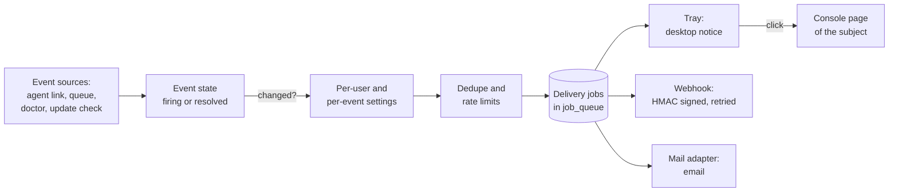
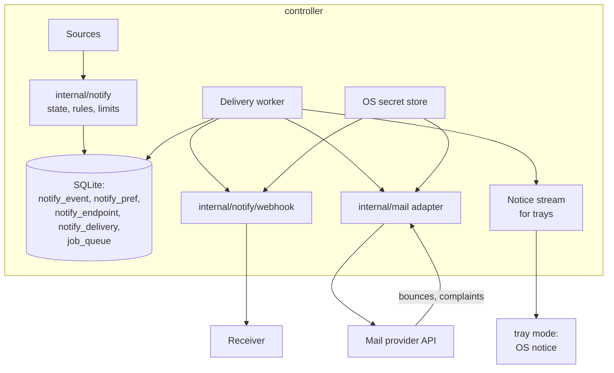

# Notifications

The top half (sections 1 to 4) is for every reader. The bottom half (5 to 12) is for engineers.

**Partly built (CRSP37, CRSP258).** Built: the channels, their events and lowest severity, who may change them, the secrets in the OS secret store, the audit rows and **Send test** (CRSP37); and, since CRSP258, real notices: the event sources and states, dedupe and rate limits, the delivery queue with retries, real delivery to webhook and email, the pool thresholds and the notices list (section 7, "Built in CRSP258"). **NOT YET IMPLEMENTED**, each with its reason in section 11: the tray notice stream (so a desktop notice is kept and waits, and a desktop test cannot show one), the mail provider adapter with bounce feedback and address confirmation (they need an outside mail provider account), per-event switches with the role defaults, and the CLI.

**Platforms.** Built for every system the controller runs on. Run and tested on Windows and Linux. The macOS build is compiled and its unit tests run in CI; it was not run on a real Mac.

## 1. In one paragraph

The pool tells people when something needs them: a machine went offline, a job has waited too long, a disk is nearly full, a runner version is old, the doctor found a problem, or an update is ready. It tells them once per change, not over and over. People get the news as a desktop notice from the tray, as a signed webhook to their own tools, or by email. Each user picks which events reach them and how. A **Send test** button proves that a channel works before a real event needs it.

## 2. Why

**Problem.** A self-hosted pool fails quietly. A machine sleeps, a disk fills, or a runner falls out of date, and jobs queue for hours before anyone looks at the console. The old runner pool in dev-standards had no notices at all.

**Users.**

- The owner and admins, who keep the machines running.
- Viewers, who want to know when their jobs are stuck.
- Other tools (chat bots, pagers, home automation) that take a webhook.

**Goals.**

- Tell the right person once, soon after a change, with a link to the place to fix it.
- Never flood: one notice per change, a cap per hour, and one summary for a burst.
- Keep secrets safe: webhook secrets and mail credentials live in the OS secret store.

**Non-goals.**

- No mobile push (the stack has no push transport; stack profile section 2).
- No chat integrations built in (Slack, Teams, Discord). A webhook covers them.
- No notices about GitHub-hosted runners (decision 0005).
- No paging rota, escalation or acknowledgement workflow.

## 3. How it works



1. A source reports a fact: the agent link dropped, a job is still queued, free disk fell, the doctor ran, a new version exists.
2. The controller keeps one state per event key (event type plus subject, such as "machine offline, machine `build-02`"). The state is **firing** or **resolved**.
3. Only a change of state makes a notice. A fact that repeats with no change makes nothing.
4. For each user who can see the subject, the controller reads that user's settings: which events, which channels, and for doctor findings the lowest severity.
5. Dedupe and rate limits drop repeats, and fold a burst into one summary.
6. Each notice that is left becomes a delivery job in the same transaction as the state change.
7. A worker delivers each job: to the user's tray, to each webhook whose filter matches, and to the user's email through the one mail adapter. Failed webhook and email jobs are tried again with backoff.
8. Clicking a desktop notice opens the console on the subject's page, signed in through a one-time link (decision 0005).

## 4. Screens and states

No mocks yet. The screens below cite the design system v1 by ID and add no rules of their own.

**Settings, Notifications (per user).** One row per event (components 15). Each row has a switch per channel, saved at once (UX-22). The doctor row has a choice of the lowest severity to send. The job-waiting row shows the pool's threshold in minutes. Each channel sits in its own card (components 8) with **Send test** at the bottom of the card (UX-37). The result of a test is one line under the button (UX-27). The button is busy until the server answers (UX-13).

**Settings, Webhooks (owner and admin).** A list of endpoints with name, URL, event filter and last delivery status as a word, glyph and colour (UX-58). Adding one is a form (components 14, UX-20). The new secret is shown once, with a copy button and the note "This secret is shown once." Removing an endpoint asks first and names it (UX-9).

**Settings, Mail (owner).** The mail adapter's provider, the sender address and the provider credential field. The credential is never shown again after Save (design system components 14, UX-20).

**Notices list.** The console keeps the last 30 days of notices: time (UX-18), event, subject, state and tone (UX-26). It only shows and links (UX-52).

**Built screen (CRSP258).** One page, Notices (`/notices`), reached by the button **See the notices** on Settings, Notifications. A table of shared parts (page, section, table, status, empty state) with columns When, Event, About, State, Tone, What happened and Sent. The Sent column is one status word (the worst delivery decides it) and a row opens to one line per delivery: channel, host or address, result, tries, the next try and the last error. A notice that no channel carries says "Kept here only". A viewer sees only the deliveries of their own channels; an admin or the owner sees all. It has no switch and no form; the button **Open notification settings** goes back to Settings.

**Built screen (CRSP37).** One page, Settings, Notifications (`/settings/notifications`, web-console 4.9), holds all channels instead of the per-event switch grid above: a table (name, kind, where it sends, events, lowest severity, on or off, last test), **Add** and **Edit** open one form that ends with Cancel and Save (UX-24), and each row has **Send test** and **Delete**. **Send test** locks while it runs and says so (UX-13, UX-38); its one result line sits under the table (UX-27). **Delete** asks first and names the channel and the events it stops carrying (UX-62). An email channel needs an address, a mail server, a port and a sender (user name and password are optional); a webhook needs an https address and a signing secret of 16 characters or more, which **Make a secret** fills in. A secret is never shown again: the form says only that one is set, and a field left empty keeps it. Words: Send test, Delete and the event words are in the design system `next-version` content (C7). The page does not yet have the per-event switches with role defaults, the doctor-row severity choice, the job-waiting threshold, the mail-adapter card or the notices list.

**States.**

- Empty: "No notices yet. Notices appear here when a machine, job or disk needs you." (UX-6)
- Webhook failing: a Needs you message (components 18) names the endpoint, the last error, and the next try time.
- Send test, failed: a Problem line under the button says what failed and why ("Could not reach hooks.example.lan. The connection timed out after 10 s.").
- Blocked: email switches are disabled until the owner sets up the mail adapter and the user confirms an address; the reason sits beside them (UX-38).

**Desktop notice.** Title is the event in plain words ("Machine offline"). Body names the subject and the time ("build-02 stopped answering at 14:30."). A resolved notice says so in the past tense ("build-02 is back online."). The tone is a word in the text, never colour alone (design system UX-26).

## 5. Functional requirements

### Events

**R5.1** (built, CRSP258: `machine.offline`, `job.waiting`, `disk.low`, `runner.outdated`, `doctor.finding` and `update.available` are read by polling every 5 s, section 7; "Problem when GitHub has set a date" for `runner.outdated` is planned, GitHub does not publish the date to the pool yet) — The controller MUST raise these events, each with a stable type name and a subject:

| Type | Fires when | Resolves when | Default tone |
|---|---|---|---|
| `machine.offline` | A machine's agent link has been down longer than the grace time (default 2 min, range 1 to 60 min). | The link is back. | Problem |
| `job.waiting` | A queued job has waited longer than N minutes (default 15, range 1 to 1440). | The job starts, or is cancelled. | Needs you |
| `disk.low` | Free space on a machine's work disk is below the threshold (default 10%, range 1% to 50%). | Free space is 2 points above the threshold. | Needs you |
| `runner.outdated` | A runner's version is older than the pinned version, or GitHub has said it will stop accepting it. | The runner is updated or removed. | Needs you; Problem when GitHub has set a date |
| `doctor.finding` | The doctor reports a new finding. | The finding is gone on a later run. | By the finding's severity |
| `update.available` | A newer stable release of `crsp` exists. | The pool runs that version. | Note |

**R5.2** (built, CRSP258) — Each event MUST have a key of type plus subject. The controller MUST keep one state per key: firing or resolved, with the time of the last change.

**R5.3** (built, CRSP258) — A notice MUST be made only when a key's state changes (firing to resolved, or resolved to firing). A repeat of the same state MUST make no notice. This is "told once per change".

**R5.4** (built, CRSP258: the lowest severity is the channel's, default `warning`; a doctor `fail` is `error`, `warn` is `warning`) — A doctor finding MUST carry its severity (`error`, `warning`, `info`). A user MUST be able to pick the lowest severity they get, per channel (default: `warning`).

**R5.5** (built, CRSP258) — A `machine.offline` grace time MUST be applied before firing, so that an agent restart or update with drain makes no notice.

### Who gets what

**R5.6** (partly built, CRSP258: every signed-in user sees every machine, so no machine is hidden from a notice; the console has no per-repository view rights yet, so a `job.waiting` notice names its repository for everyone; the deliveries a user sees are only those of their own channels) — A user MUST get notices only about machines and repositories they can see in the console.

**R5.7** (partly built, CRSP37: a user adds personal email and desktop channels, each with its own events and lowest severity; the role defaults and the per-event grid are planned, a user has no channel until they add one) — Each user MUST be able to turn each event on or off for each personal channel (tray, email). Defaults: owner and admins get every event on the tray; viewers get `job.waiting` on the tray; email is off for all.

**R5.8** (built, CRSP258: API and audit; the CLI and a settings form are planned) — The owner and admins MUST be able to set the pool-wide thresholds: the offline grace time, N minutes for `job.waiting`, and the disk percent. Viewers MUST NOT change them.

**R5.9** (built, CRSP37; a viewer does not see webhooks, because a webhook address can carry a token of its own) — Webhooks MUST be pool-wide. Only the owner and admins MUST be able to add, edit, remove or test them. Each webhook MUST carry its own event filter (types and lowest doctor severity).

**R5.10** (planned: `crsp notify`; the settings exist as API operations, which the CLI will wrap) — Every setting in the console MUST also be readable and settable from the CLI (`crsp notify ...`), with the same rights.

### Dedupe and rate limits

**R5.11** (built, CRSP258) — A key that fires again within the flap window (default 10 min) after it resolved MUST NOT make a new firing notice. Instead the existing notice stays open, and the notices list counts the flaps.

**R5.12** (built, CRSP258: for personal channels; a webhook is paced by R5.14) — Each user MUST get at most a set number of notices per channel per hour (default 20, ceiling 200). Notices over the cap MUST be held and replaced by one summary at the end of the hour ("12 more notices. Open the console to see them.").

**R5.13** (built, CRSP258: the first four go out at once, the fifth and later inside the 60 s are counted into one grouped notice sent when the window ends; personal channels) — When five or more notices of one type are made within 60 s, they MUST be sent as one grouped notice ("6 machines are offline") per user and channel.

**R5.14** (built, CRSP258) — Each webhook endpoint MUST get at most 60 deliveries per minute. Deliveries over that wait in the queue; none are dropped.

### Tray and desktop notices

**R5.15** (planned: the tray and its stream belong to the tray spec; the controller keeps each desktop notice as a delivery that waits for the tray, `Service.PendingDesktop` and `AckDesktop`) — The tray MUST show each notice for its signed-in user as one OS notice: a Windows toast, a macOS user notification, or a freedesktop notification on Linux.

**R5.16** (planned: tray) — Clicking a desktop notice MUST open the console on the subject's page, signed in through a one-time link (decision 0005).

**R5.17** (planned: tray) — The tray MUST remember the last notice it showed, so that a tray restart MUST NOT show a notice twice. Notices made while the tray was closed MUST be shown as one summary when it starts ("3 notices while you were away."), never one by one.

**R5.18** (planned: tray) — When the tray loses the controller for longer than 2 min, it MUST show one local notice ("Lost the controller.") and one more when it is back. It needs no controller to do this.

### Webhooks

**R5.19** (built, CRSP37 and CRSP258: https is required on save and again at connect time, no redirect is followed, for the test send and for real deliveries) — A webhook MUST be an HTTPS URL. The controller MUST NOT follow redirects.

**R5.20** (built, CRSP37 and CRSP258: a real delivery has these fields, plus `count` for a grouped one, and no secret) — Each delivery MUST be a JSON POST with: schema version, event id, delivery id, type, subject, state, tone, time, a plain-English summary, and a console link. It MUST NOT carry any token, key or secret.

**R5.21** (built, CRSP37 and CRSP258: the test and real deliveries are signed this way; the delivery id is the same on every retry; the receiver guide is planned, see section 11) — Each delivery MUST be signed with HMAC-SHA256 over `<timestamp>.<body>`. The headers MUST be `X-CRP-Timestamp` (Unix seconds), `X-CRP-Signature` (`sha256=<hex>`) and `X-CRP-Delivery` (the delivery id, the same on every retry). The guide for receivers MUST say to reject a timestamp older than 5 min.

**R5.22** (partly built, CRSP37; Rotate is planned: the secret lives only in the OS secret store, is write-only and is replaced by writing a new one; the console, not the controller, makes it (32 random bytes from the browser) and shows it once in the form) — The controller MUST make each webhook secret (32 random bytes), show it once, and store it only in the OS secret store. Rotate MUST make a new secret and show it once; the old one stops at once.

**R5.23** (built, CRSP258: a non-2xx redirect is final like any other 4xx; a refused address is final) — A delivery that fails with a network error, a timeout (10 s), HTTP 408, 429 or 5xx MUST be tried again with exponential backoff and jitter: after about 30 s, 2 min, 10 min, 30 min, 1 h and 2 h. A `Retry-After` up to 1 h MUST be honoured. Any other 4xx MUST NOT be tried again.

**R5.24** (built, CRSP258) — After the last try fails, the delivery MUST be marked failed, and the endpoint MUST show as failing in the console with the last error. Three failed deliveries in a row MUST raise a `doctor.finding` of severity `warning` for that endpoint.

### Email

**R5.25** (planned: needs an outside mail provider account; today email goes by raw SMTP, N5) — Email MUST go through one mail adapter (`internal/mail`), set up by the owner. Nothing outside the adapter MUST talk to a mail provider.

**R5.26** (planned: needs an outside mail provider account to send bounce feedback) — The adapter MUST take bounce and complaint feedback from the provider, check its signature, and keep a suppression list. It MUST consult the list before every send (STACKSPEC 8.1).

**R5.27** (planned: the one-time code needs the mail provider, R5.25; until then an email channel sends to the address its owner typed) — A user MUST confirm an email address with a one-time code before any notice is sent to it. A suppressed address MUST show as such in the user's settings.

**R5.28** (built, CRSP258: a send runs in the delivery worker, never in a request; a 5xx answer of the mail server is final, anything else is retried) — Email sends MUST be enqueued as jobs and retried with the backoff of R5.23. A send MUST never run inside a request.

### Send test

**R5.29** (partly built, CRSP37: email and webhook travel the real path (SMTP, signing) and are marked as a test in body and headers; a desktop test cannot, see section 7) — Each channel (the user's tray, the user's email, each webhook) MUST have **Send test**. A test MUST travel the real path (signing, adapter, OS notice), MUST be marked as a test in its body and headers, and MUST NOT count toward the rate limits of R5.12.

**R5.30** (built, CRSP37) — Send test MUST answer with the result of the first try: delivered, or what failed and why (status code, timeout, refused, suppressed). It MUST NOT be retried.

**R5.31** (built, CRSP37) — Send test MUST be limited to one per channel per 10 s per user.

### History

**R5.32** (built, CRSP258) — The console MUST list every notice of the last 30 days, with its deliveries and their results, for the subjects the user can see.

## 6. Non-functional requirements

**R6.1** (built for the queue, CRSP258: the sources are read every 5 s and the delivery is written in the same transaction; the desktop part waits for the tray stream) — A firing notice MUST reach the delivery queue within 5 s of the state change, and a desktop notice MUST appear within 10 s when the tray is connected.

**R6.2** (partly built, CRSP37: holds for channels; no mail credential of an adapter or tray credential exists yet) — No webhook secret, mail credential or tray credential MUST appear in the database, a log line, a crash file, the audit log, an API answer after creation, or a notice body.

**R6.3** (built, CRSP37 and CRSP258: neither the test nor a real delivery goes out unsigned or with a guessed password; a delivery waits, is not counted as a try, and the finding names the endpoint) — Sending MUST fail closed: if the secret store cannot give the webhook secret, the delivery MUST NOT be sent unsigned; it stays queued and raises a `doctor.finding`.

**R6.4** (built, CRSP258: the delivery rows are the queue, in the same database; `job_queue` is not used) — A delivery job MUST be written in the same transaction as the state change that made it, so a controller crash loses no notice (stack profile section 11).

**R6.5** (partly built, CRSP258: notices, deliveries and resolved states are pruned after 30 days; the suppression list needs R5.26) — Notices and delivery records MUST be deleted after 30 days. The suppression list MUST be kept until the owner removes an entry.

**R6.6** (partly built, CRSP37 and CRSP258: every create, change, delete and test of a channel, and every change of the pool thresholds, is in the audit log, with no secret; the mail adapter is not built) — Every change to webhooks, the mail adapter and pool-wide thresholds MUST be written to the audit log: who, what, when (product brief, Security).

**R6.7** (partly built, CRSP258: the words come from one table in `internal/notify/text.go`; the retired-words guard over them is planned) — Desktop notice text and console text MUST use the words and formats of design system v1 content: dates and times per UX-18, tones per UX-26, no retired words.

**R6.8** (built, CRSP258: the title carries the tone as a word) — A desktop notice MUST be readable without its colour or icon: the tone and the subject are in its words (UX-26, UX-58).

**R6.9** (built, CRSP258) — The notifier MUST hold at most 10 000 queued deliveries. Over that, the oldest Note-tone deliveries MUST be dropped first, and a `doctor.finding` MUST say how many.

## 7. Design

The picture below is the design. The channels (CRSP37) and the state, rules, queue and notices list (CRSP258) are built as described in "Built so far" and "Built in CRSP258"; the mail adapter and the tray stream in the picture are NOT YET IMPLEMENTED.



**Data.**

- `notify_event`: key, type, subject kind and id, state, tone or severity, first fired, last change, flap count, payload.
- `notify_pref`: user, event type, channel, on or off, lowest severity.
- `notify_settings`: pool-wide thresholds (R5.8) and rate caps.
- `notify_endpoint`: webhook name, URL, filter, secret reference (the secret store entry name, never the value), created by.
- `notify_delivery`: event, channel, target, attempt, status, next try, last error, test flag.
- `mail_address`: user, address, confirmed at. `mail_suppression`: address, reason, time.

**Interfaces.**

```go
// internal/notify
type Channel interface {
    Name() string
    Deliver(ctx context.Context, n Notice) (Result, error) // one try; the worker retries
}

// internal/mail
type Adapter interface {
    Send(ctx context.Context, m Message) error
    HandleFeedback(r *http.Request) error // checks the signature, updates the suppression list
}
```

**Tray link.** The tray reads a server-sent event stream of notices for its signed-in user from the controller API, and acknowledges each by id. How a tray signs in on a machine that is not the controller belongs to the tray spec.

**API.** New paths in `packages/contract/openapi.yaml`: notice list, notice stream, user settings, pool thresholds, webhook endpoints (add, edit, remove, rotate, test), mail adapter settings, mail address confirm, mail feedback. Each answers in the shared error shape.

### Built so far (CRSP37)

Operations: `listNotificationChannels`, `createNotificationChannel`, `updateNotificationChannel`, `deleteNotificationChannel`, `testNotificationChannel` (`packages/contract/openapi.yaml`; code in `internal/notify`, `internal/api/handlers_notify.go`, `internal/store/notify.go`).

- **Channels.** Table `notification_channels` (migration `00010_notifications.sql`, queries `notifications.sql`). A channel has a kind (`email`, `webhook`, `desktop`), a name, a scope (`personal` for email and desktop, with the signed-in user as owner; `pool` for a webhook), `enabled`, its events, the lowest severity (default `warning`), and by kind an address and mail server, or an https address. The table has no column for a secret, only the flags `has_signing` and `smtp_has_password`.
- **Who.** Any signed-in user adds, changes, deletes and tests their own personal channels. Another user's personal channel does not exist for anyone else, not even the owner (404). A webhook needs an admin or the owner for every change and test (403 otherwise), and is listed only to them. The service checks this, not only the route.
- **Secrets.** The webhook signing secret and the SMTP password go only to the OS secret store (`internal/secrets`), under the keys `crsp/notify/<channel id>/signing` and `crsp/notify/<channel id>/smtp-auth`. They are write-only: a response carries `secret_set` and `smtp.has_password`, never the value. In an update, a secret left out stays, and a secret sent as an empty string is removed. Deleting a channel removes both. If the secret store cannot be reached, the request fails and no channel is kept without its secret. The audit rows name the changed fields and never a value; logs name only the key.
- **Checks on save.** The name is one line of at most 80 characters. At least one event, each one of the six types of R5.1. An email address and a sender are plain addresses (no display name, no list, no control character, so they are safe in a mail header). The port is 1 to 65535. A webhook address is an https URL without a user name or password. A signing secret is at least 16 characters.
- **Address guard (SSRF).** The controller never sends to itself or to an address that only the controller machine can reach: loopback, the unspecified address, link-local (which includes the cloud metadata address 169.254.169.254) and multicast are refused, for the webhook and for the mail server. Local network addresses (10.x, 172.16.x, 192.168.x, fd00::/8) are allowed, because a self-hosted pool lives there. The check runs twice: on save, for a literal address or `localhost`, and at connect time on the address really dialled, so a name that resolves to a refused address is stopped as well. No proxy is used and no redirect is followed. A mail server on the controller machine itself must be named by the machine's network address, not by 127.0.0.1. This answers open question 2 for now: `http://` is refused everywhere.
- **Webhook test.** One POST with a 10 s limit and no retry. The body is JSON: `schema_version` (1), `event_id`, `delivery_id`, `type` (`test`), `test` (true), `subject`, `state`, `tone`, `time`, `summary`. Headers: `X-CRP-Timestamp` (Unix seconds), `X-CRP-Signature` (`sha256=` and the hex of HMAC-SHA256 over `<timestamp>.<body>` with the signing secret), `X-CRP-Delivery` (the delivery id) and `X-CRP-Test: true`. A receiver rejects a timestamp older than 5 minutes and compares the signature in constant time. A 2xx answer is delivered; any other answer, a redirect, a timeout or a refused connection is a failed test with the reason. The result names the host only, never the path or the query, because they can hold a token. If the signing secret cannot be read, nothing is sent (R6.3).
- **Email test.** One message through `net/smtp` to the channel's address, with a 15 s limit and no retry: implicit TLS on port 465, otherwise STARTTLS wherever the server offers it, then PLAIN (or LOGIN, when the server offers only that) when a password is set. A password is never sent over an unencrypted link. The message is marked as a test by its subject `[crsp test] Test notice`, its body and the header `X-CRP-Test: true`. A refusal says which step the server refused and its answer (the password is removed from any text shown).
- **Desktop test.** `ok: false` with the message: "No desktop notice was shown. The controller has no way to send a notice to a tray yet: the tray only asks the controller for its status, and nothing lets the controller push a notice to it (notifications R5.15)." What is missing: a notice stream from the controller to the tray (section 7, "Tray link"). `internal/tray` can show a notice (`DesktopNotice`) and `internal/trayserver` serves the tray's requests, but neither can be reached by the controller in the other direction.
- **Limits.** One test per channel per user per 10 s (429 `rate_limited`, R5.31). The contract also names 5 tests per minute per user; no rate-limit middleware enforces that yet.
- **Audit.** `notification.channel.create`, `.update`, `.delete` (in the same transaction as the change) and `.test` (with the kind and the result, not the message).
- **Delete.** Without `confirm=true` the answer is 409 `needs_confirmation` naming the channel and its events (UX-62).
- **Events and delivery (as of CRSP37; replaced by CRSP258 below).** The live event hub (`internal/events`) carries only the M1 live-view events (`job.waiting` among them); `machine.offline`, `disk.low`, `runner.outdated`, `doctor.finding` and `update.available` are not published anywhere yet, and R5.1 puts the events in milestone 8. So no event is delivered to a channel: delivery is NOT YET IMPLEMENTED (section 11).

### Built in CRSP258

Operations: `listNotices` (GET `/api/v1/notices`), `getNotificationThresholds` and `setNotificationThresholds` (GET and PUT `/api/v1/notification-thresholds`, the last for admins and the owner). Code: `internal/notify` (`engine.go`, `queue.go`, `deliver.go`, `list.go`, `text.go`), `internal/store/notices.go`, `cmd/crsp/notify_wiring.go`, `apps/web/src/screens/notices/`.

- **Data.** Migration `00044_notices.sql`: `notify_event` (one row per key: type, subject kind, id and name, state, tone, severity, summary, link, first fired, last change, flap count, the id of the open notice), `notices` (one row per notice made) and `notice_deliveries` (one row per notice and channel: status, tries, next try, last error, and for a grouped or summary delivery its count). The delivery rows are the queue; no `job_queue` row is used, so there is one transaction and one place to look. A delivery names its channel and a host or address only, never a path, a token or a secret (R6.2). The pool thresholds are one settings row, `notify_thresholds`, with the defaults of R5.1 when it is unset. `notify_pref` and `mail_address` are not built (section 11).
- **Sources.** `Service.Observe(scope, facts)` takes the complete set of facts of one event type (and subject kinds); a key that is new or resolved and has a fact fires, a firing key in scope with no fact resolves. A source that fails changes nothing: silence from a source is never an all-clear. `cmd/crsp/notify_wiring.go` reads the other areas through their public interfaces and changes none of them: `machines.Service.List` (offline: the agent is not online, was seen once, is not the controller; fires `grace` after its last sign of life), the store's queued jobs (waiting longer than N minutes), `machinehealth.Service.Views` (a known volume below the threshold; it resolves 2 points above it; a runner app or agent older than the pinned version), `doctor.Service.Findings` (`fail` is `error`, `warn` is `warning`, `info` is `info`) and `update.Manager.Status`. The sources are read every 5 s. `Service.Report` sets one key and serves the notifier's own findings.
- **State and notices.** `change` runs in one transaction: it reads the key, and only on a change of state writes the new state, the notice and one delivery per carrying channel. A channel carries a notice when it is on, names the event, and for a doctor finding the finding's severity is at least the channel's lowest. A key that fires again less than the flap window (default 10 min) after it resolved makes no new notice: the open notice counts the flap.
- **Limits.** Personal channels: at most `hourly_cap` (default 20, ceiling 200) deliveries in any hour; later ones are held and replaced after an hour by one summary notice (`notice.summary`, "12 more notices. Open the console to see them."). The fifth delivery of one type and state inside 60 s becomes one grouped delivery that counts every later one and goes out when the 60 s end ("5 machines are offline."); the first four go out at once. A webhook endpoint gets at most 60 deliveries a minute; the rest wait in the queue. The queue holds at most 10 000 deliveries: over that the oldest Note-tone ones are dropped and a `doctor.finding` says how many.
- **Delivery worker.** `Service.Run` ticks every 2 s. A webhook delivery is the JSON of R5.20 (and `count` for a grouped one), signed as in "Built so far"; an email delivery is a plain message through the channel's mail server; a desktop delivery becomes `waiting_tray` and is kept for the tray (`PendingDesktop`, `AckDesktop`). Retry (webhook and email): network error, timeout, 408, 429 and 5xx wait about 30 s, 2 min, 10 min, 30 min, 1 h and 2 h (jitter of 20 %); a Retry-After up to 1 h is honoured; any other 4xx, a redirect, a refused address and a 5xx answer of a mail server are final; after the seventh try the delivery is `failed` and shows its last error. A secret that cannot be read keeps the delivery queued (the try is not counted) and raises a `doctor.finding` for the endpoint; nothing is sent unsigned.
- **Failing endpoint.** After three failed deliveries in a row, or an unreadable secret, the notifier raises a `doctor.finding` of severity `warning` with subject kind `endpoint`; it resolves when the endpoint delivers again.
- **Retention.** Notices, deliveries and resolved states older than 30 days are deleted once a minute at most.
- **Words.** Titles, tones, the resolved line and the group line come from `internal/notify/text.go`; a delivery's title carries the tone as a word ("Machine offline (Problem)").
- **Who sees what.** `GET /api/v1/notices` is for any signed-in user and lists the last 30 days (up to 500). An admin or the owner sees every delivery; another user sees the deliveries of their own channels. The thresholds can be read by anyone and changed only by an admin or the owner; the change is audited with the old and new values.
- **Not run on a real machine.** The tests use fake receivers (an in-process TLS server and an in-process mail server) and a fake clock. Nothing was sent to an outside address.

## 8. Failure modes

| Dependency | Fails | Behaviour | Why |
|---|---|---|---|
| Controller | Down | No notices at all; each tray shows its own "Lost the controller" (R5.18). | The controller cannot report on itself. |
| OS secret store | Unavailable | Webhook and email jobs wait; nothing is sent (fail closed, R6.3). | An unsigned webhook or a send with a guessed credential is worse than a late one. |
| Webhook receiver | Down or slow | Retry with backoff (R5.23), then failed and shown (R5.24). Other endpoints are not held up. | One bad receiver must not block the rest. |
| Mail provider | Down | Retry with backoff (R5.28), then failed and shown. | Same as webhooks. |
| Mail feedback | Missing or bad signature | The feedback is refused and logged; the suppression list is not changed. | Forged feedback must not silence an address. |
| OS notices | Turned off by the user or the OS (focus mode) | The notice is still kept in the console list (fail open). | The console is the record; the desktop is a convenience. |
| Event source | Silent (agent gone) | `machine.offline` fires after the grace time. | Silence is the event. |

## 9. How it is proven

A row with a path has that test. A row that says planned names why it is not built; it is NOT YET IMPLEMENTED. Tests from CRSP258 are in `internal/notify/engine_test.go` (engine) and `internal/notify/queue_test.go` (queue and delivery).

| Requirement | Test |
|---|---|
| R5.1 | internal/notify/engine_test.go, TestEachEventFiresAndResolves; TestSourcesAreReadAndAFailingSourceChangesNothing; cmd/crsp wiring is typechecked and linted, the sources are not unit-tested against a real machines service (planned) |
| R5.2 | internal/notify/engine_test.go, TestNoticeOnlyOnChange |
| R5.3 | internal/notify/engine_test.go, TestNoticeOnlyOnChange |
| R5.4 | internal/notify/engine_test.go, TestDoctorSeverityFloor |
| R5.5 | internal/notify/engine_test.go, TestOfflineGraceSkipsRestart |
| R5.6 | partly: internal/notify/queue_test.go, TestListShowsDeliveriesOnlyToTheirOwner; the per-repository part is planned (no per-repository view right exists) |
| R5.7 | internal/notify/notify_test.go, TestScopes (personal channels); internal/notify/engine_test.go, TestChannelsGetOnlyTheirEvents; the role defaults are planned |
| R5.8 | internal/notify/queue_test.go, TestThresholdsNeedAdminAndAreValidated; internal/api/handlers_notify_test.go, TestThresholdsNeedAdmin |
| R5.9 | internal/notify/notify_test.go, TestScopes; internal/api/handlers_notify_test.go, TestNotifyRolesAndSecretsNeverReturned |
| R5.10 | planned: cmd/crsp/notify_test.go, TestCLIMatchesConsole |
| R5.11 | internal/notify/engine_test.go, TestFlapWindow |
| R5.12 | internal/notify/engine_test.go, TestHourlyCapAndSummary |
| R5.13 | internal/notify/engine_test.go, TestBurstIsGrouped |
| R5.14 | internal/notify/queue_test.go, TestEndpointRateNeverDrops |
| R5.15 | planned: internal/tray/notice_test.go, TestOSNoticePerPlatform; the controller side is internal/notify/queue_test.go, TestDesktopWaitsForTheTray |
| R5.16 | planned: internal/tray/notice_test.go, TestClickOpensSubjectWithOneTimeLink |
| R5.17 | planned: internal/tray/notice_test.go, TestRestartShowsNoRepeatAndOneSummary |
| R5.18 | planned: internal/tray/notice_test.go, TestLostControllerNotice |
| R5.19 | internal/notify/notify_test.go, TestValidation, TestWebhookTestFailures (redirect), TestGuardRefusesLoopbackAtConnectTime, TestGuardAddresses; internal/notify/queue_test.go, TestOtherClientErrorsAreNotRetried (a redirect and a refused address are final) |
| R5.20 | internal/notify/notify_test.go, TestWebhookTestIsSignedAndMarked; internal/notify/queue_test.go, TestRealDeliveryIsSignedAndComplete |
| R5.21 | internal/notify/notify_test.go, TestWebhookTestIsSignedAndMarked, TestSignKnownVector; internal/notify/queue_test.go, TestRealDeliveryIsSignedAndComplete, TestRetryScheduleAndRetryAfter (same delivery id) |
| R5.22 | internal/notify/notify_test.go, TestCreateWebhookKeepsSecretOnlyInSecretStore, TestUpdateSecretSemantics; apps/web/src/screens/settings/Notifications.test.tsx (Make a secret); Rotate is planned |
| R5.23 | internal/notify/queue_test.go, TestRetryScheduleAndRetryAfter, TestRetryAfterIsHonouredUpToAnHour, TestOtherClientErrorsAreNotRetried, TestNetworkErrorIsRetried |
| R5.24 | internal/notify/queue_test.go, TestFailingEndpointRaisesFinding |
| R5.25 | planned: needs an outside mail provider account; guard: only internal/mail imports a mail client |
| R5.26 | planned: needs an outside mail provider account |
| R5.27 | planned: needs an outside mail provider account |
| R5.28 | internal/notify/queue_test.go, TestEmailGoesThroughTheQueue, TestEmailRefusedIsFinalAndShown |
| R5.29 | internal/notify/notify_test.go, TestWebhookTestIsSignedAndMarked, TestEmailTestStartTLSAndAuth, TestDesktopTestSaysWhatIsMissing; e2e/tests/web-console/notifications.spec.ts |
| R5.30 | internal/notify/notify_test.go, TestWebhookTestFailures, TestEmailTestFailures; apps/web/src/screens/settings/Notifications.test.tsx (Send test) |
| R5.31 | internal/notify/notify_test.go, TestTestRateLimitPerChannelAndUser; internal/api/handlers_notify_test.go, TestNotifyUpdateDeleteConfirmAndTest |
| R5.32 | internal/notify/queue_test.go, TestListShowsDeliveriesOnlyToTheirOwner; apps/web/src/screens/notices/Notices.test.tsx |
| R6.1 | partly: internal/notify/engine_test.go, TestStateNoticeAndDeliveryTogether (queued in the state change); the 5 s poll is a constant, not a timing test |
| R6.2 | internal/notify/notify_test.go, TestCreateWebhookKeepsSecretOnlyInSecretStore, TestCreateEmailKeepsPasswordOnlyInSecretStore; internal/store/notify_test.go, TestNotificationChannelsHoldNoSecretColumn; internal/store/no_secrets_test.go; internal/notify/queue_test.go, TestRealDeliveryIsSignedAndComplete (no secret, no path in a body or a target) |
| R6.3 | internal/notify/notify_test.go, TestWebhookTestFailures; internal/notify/queue_test.go, TestNoSecretNoSend |
| R6.4 | internal/notify/engine_test.go, TestStateNoticeAndDeliveryTogether |
| R6.5 | internal/notify/queue_test.go, TestThirtyDayPrune |
| R6.6 | internal/notify/notify_test.go, TestCreateWebhookKeepsSecretOnlyInSecretStore, TestDeleteNeedsConfirmAndRemovesSecrets; internal/api/handlers_notify_test.go, TestNotifyUpdateDeleteConfirmAndTest; internal/notify/queue_test.go, TestThresholdsNeedAdminAndAreValidated (the audit row) |
| R6.7 | planned: guards (design-system retired-words guard over notice text) |
| R6.8 | partly: internal/notify/queue_test.go, TestEmailGoesThroughTheQueue (the subject carries the tone as a word); apps/web/src/screens/notices/Notices.test.tsx |
| R6.9 | internal/notify/queue_test.go, TestQueueCeiling |

## 10. Decisions

| ID | Question | Chosen | Date |
|---|---|---|---|
| N1 | When to notify | Once per change of state, not per check | 2026-11-14 |
| N2 | Webhook signing | HMAC-SHA256 over timestamp and body, secret in the OS secret store | 2026-11-14 |
| N3 | Mail | One adapter in `internal/mail`, provider API with bounce feedback (STACKSPEC 8.1); raw SMTP only with a recorded deviation | 2026-11-14 |
| N4 | Order | Tray notices ship with the tray; the rest in milestone 8 | 2026-11-14 |
| N5 | Channels before delivery | Channel store, secrets, audit and Send test are built first (CRSP37); email goes by raw SMTP (`net/smtp`) with STARTTLS, a deviation from N3 that stays open for the owner (open question 1) | 2026-11-14 |

**Open for the owner.**

1. Raw SMTP. Many self-hosters have only an SMTP relay. STACKSPEC 8.1 needs bounce feedback, which bare SMTP cannot give. Allow SMTP as a recorded deviation in the stack profile section 15, or provider APIs only?
2. Webhooks to plain `http://` on the local network. R5.19 asks for HTTPS. Allow `http://` to private addresses with a warning?
3. Per-repository threshold for `job.waiting`, or one pool-wide value (R5.8)?
4. The word for the test button. Answered in CRSP37: "Send test" is in `next-version` content (C7). The owner may still change it.
5. UX-52 says Settings hold configuration only. Is **Send test** on a channel card allowed there, or does it move to another page?
6. Tray on a machine that is not the controller: which user does it sign in as, and how (tray spec)?
7. Which mail providers the adapter supports first.

## 11. Not built yet

Built by CRSP37: the channel store, the secrets, the audit rows, the five operations, Send test for email and webhook, and the Notifications settings page. Built by CRSP258: the event sources, the state per key, dedupe, the hourly cap, grouping, the delivery queue with retries, real delivery to webhook and email, the failing-endpoint finding, retention, the queue ceiling, the pool thresholds (API and audit) and the Notices page.

NOT YET IMPLEMENTED, with the reason:

- **Desktop notices on screen (R5.15 to R5.18).** The tray and its signed-in user belong to the tray spec (open question 6). The controller keeps each desktop notice as a delivery that waits for the tray (`PendingDesktop`, `AckDesktop`); no stream route exists, so a desktop **Send test** still answers `ok: false`. Not run on any system's OS notice.
- **The mail provider adapter, bounce feedback, the suppression list and address confirmation (R5.25 to R5.27).** They need an account with an outside mail provider to send and to receive signed feedback, which a test cannot have. Email goes by raw SMTP (N5, open question 1) and is queued and retried like a webhook (R5.28).
- **Per-event switches with the role defaults (R5.7) and a thresholds form.** A user has no channel until they add one. The thresholds can be set through the API (R5.8); no screen sets them yet.
- **The CLI (R5.10).** `crsp notify` is not written; the operations it will wrap exist.
- **A Rotate action and the controller making the webhook secret (R5.22).**
- **The receiver guide (R5.21)** that says to reject a timestamp older than 5 minutes; the rule is in section 7, "Built so far".
- **`runner.outdated` as Problem when GitHub has set a date (R5.1)**, and a per-repository view right for R5.6.
- **The retired-words guard over notice text (R6.7).**
- **Not run on a real Mac.** The macOS build is compiled and unit-tested in CI only. Windows and Linux are the systems the tests ran on.
- Doctor findings and update checks are read through the doctor and the update manager; a change to either area's public interface needs a change here.

## 12. Code map

Source: internal/notify/notify.go
Source: internal/notify/guard.go
Source: internal/notify/send.go
Source: internal/api/handlers_notify.go
Source: internal/store/notify.go
Source: internal/store/queries/notifications.sql
Source: internal/store/migrations/00010_notifications.sql
Source: apps/web/src/screens/settings/Notifications.tsx
Source: internal/notify/engine.go
Source: internal/notify/queue.go
Source: internal/notify/deliver.go
Source: internal/notify/list.go
Source: internal/notify/text.go
Source: internal/store/notices.go
Source: internal/store/queries/notices.sql
Source: internal/store/migrations/00044_notices.sql
Source: cmd/crsp/notify_wiring.go
Source: apps/web/src/screens/notices/Notices.tsx

Planned paths, NOT YET IMPLEMENTED: `internal/mail/`, the tray notice stream and mode. The webhook delivery lives in `internal/notify/deliver.go`, not in a `webhook/` package.

## Design-system proof

A rule this spec cites is proven by a test that exists. A rule whose guard is still `none yet` (ux-rules.md) is held by the follow guard, which fails when the rule table is malformed or a citation does not resolve.

Proof: UX-6, UX-18, UX-20, UX-22, UX-24, UX-26, UX-27, UX-37, UX-52, UX-58, UX-62 `scripts/design/design-system-follow.test.ts`
Proof: UX-9 `e2e/tests/web-console/ux-static.spec.ts`
Proof: UX-13, UX-38 `scripts/design/wizard-behaviour.test.ts`
