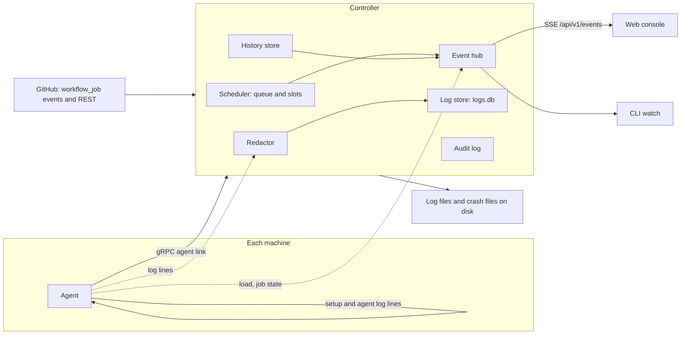

# Observability

Partly built (CRSP18, CRSP23): the audit log (R5.24 to R5.27, without the hash chain), retention (R5.32, R6.8 for audit, job history, raw load samples and log files), the live stream (R5.1 to R5.3, R6.2 load throttle, R6.3) and minutes saved today (R5.15). Everything else is NOT YET IMPLEMENTED. Every requirement names the milestone that builds it.

## 1. In one paragraph

The owner and the admins of a pool see what the pool is doing right now, what it did, and who changed it. A live view shows the queue, the running jobs and each machine's load (memory, CPU, slots), pushed to the browser as it changes. A job history shows, for each job, how long it waited, how long it ran, where it ran and how it ended. The product counts the minutes the pool saved compared with GitHub-hosted runners. Runner setup logs and agent logs are kept and searchable for a limited time. An audit log records every change: who, what and when. All of this stays on the owner's machines. Nothing is sent anywhere else, and no secret is ever written to a log.

## 2. Why

**Problem.** A shared pool is a black box without this. A job that waits does not say why. A slow machine is not visible until someone logs in to it. A crash leaves no trace. A changed budget has no author. The dev-standards pool learned this the hard way: jobs queued forever because no runner carried a label (product brief, learning 7), and a change was called green before every run on the commit had finished (learning 8).

**Users.**

- The owner: runs the pool, wants to know it is healthy and worth it.
- Admins: fix stuck jobs and machines.
- Viewers: see whether their jobs are queued or running.

**Goals.**

- See the queue, running jobs and machine load live, with the reason for every wait.
- Know each job's wait time, run time, machine, backend and result.
- Know the minutes and the money saved, from a rate the owner can check and change.
- Find the log line that explains a failed runner setup.
- Know who changed what, and when.
- Keep every secret out of every log.

**Non-goals.**

- No telemetry, analytics or hosted error tracker (stack profile, section 14, `STACKSPEC 10.1`). Errors go to local logs, crash files and the doctor.
- No copy of the job's own step logs in the job history; the history links to GitHub. CI run insights may keep a redacted copy on the owner's machines (R5.38, owner decision D4 of 20 Nov 2026).
- No metrics export (Prometheus, OpenTelemetry) in these milestones.
- Notifications (email, webhook, desktop) are a separate feature (milestone 8).
- The doctor's checks are a separate feature. This spec only feeds it crash files and log health.

## 3. How it works

1. Each agent samples its machine's memory and CPU every 5 seconds and sends the load and its slot use over the agent link (decision 0004).
2. The scheduler changes the queue: a job is queued, gets a slot, starts, ends. Each change goes to the event hub in the same step that writes it.
3. GitHub tells the controller when a job is queued, starts and completes (decision 0002). The controller joins that with its own slot times to get the wait time and the run time.
4. The event hub gives every change a number and pushes it to every open console over server-sent events (SSE). A console that reconnects gets what it missed, or a fresh snapshot.
5. The agent sends runner setup lines and its own log lines to the controller. The redactor removes secrets first, on the agent and again on the controller. The lines go to a separate log database with full-text search.
6. Every change made through the console, CLI, tray or API writes an audit row in the same database transaction as the change.
7. Each process writes structured log files and, when it crashes, a crash file. The next start reports the crash to the doctor and the console.
8. A retention job deletes old history, logs and audit rows by the limits in section 6.

## 4. Screens and states

The screens are the Overview (screen 2), Jobs (screen 6), the Runners and Machines details (screens 4 and 5) and Settings, Audit log (screen 9) from the product brief. No images yet; mocks come with milestone 1 work.

**Overview.** Machines with load bars for memory and CPU, the budget line and slots in use ("3 of 4 slots"). The queue, then the running jobs. Today's minutes saved. The overview only shows and links (design system UX-52). Each status is a word, a glyph and a colour (design system UX-58): `▶ running`, `◷ waiting`, `✓ ok`, `✕ failed`.

**Waits.** A queued job names what it waits for and since when (design system UX-29):

- "waits for a free slot on build-01 (4 of 4 in use)"
- "waits for the load to fall: memory 87%, budget 85%"
- "waits: no online runner carries labels [self-hosted, linux, gpu]"
- "waits for the repository's limit of 2 parallel jobs"

**Running work.** The running-jobs strip and the Overview read one value from the live stream (design system UX-34, UX-19). No screen keeps its own running flag.

**Ageing times.** "Queued 4 min ago" and "running for 12 min" tick from one shared clock (design system UX-53).

**Jobs.** History grouped by period with the range named (design system UX-33). Columns: repository, job, wait, run time, machine, backend, result. A commit row says "all runs done" only when every run on that commit has finished.

**Logs.** One search bar with filter chips (design system UX-31): machine, runner, level, time.

**Audit log.** Read-only rows: when, who, what, target, result.

**States.**

- Empty: "No jobs yet. Turn the pool on for a repository to start." with a link to Repositories (design system UX-6).
- Loading: the first snapshot shows a busy bar (design system UX-29).
- Live link lost: a Needs-you line "Live updates paused, reconnecting" and the time of the last update; data stays on screen (design system UX-28, UX-58).
- Could not load: says what, why and what next (design system UX-28).
- Charts and bars have a text equivalent (design system UX-17, UX-41).

## 5. Functional requirements

Milestone numbers are those of the product brief.

### Live view

**R5.1** — (M1) The live view shows: every queued job (repository, workflow, job, labels, queued since, wait reason); every running job (repository, job, machine, runner, backend, isolation, started at); every machine (online, offline or drained; memory %, CPU %, budget, slots used and total).

**R5.2** — (M1) The controller pushes the live view over server-sent events at `GET /api/v1/events` (`text/event-stream`). The first event is a full snapshot. Later events are changes. Each event has an increasing `id`.

**R5.3** — (M1) A client that reconnects with `Last-Event-ID` gets every event it missed, in order. When those events are no longer kept, it gets a fresh snapshot instead, marked as such.

**R5.4** — (M1) The web console keeps one live store fed by the stream. The Overview, the running-jobs strip and every running state read that store (design system UX-19, UX-34).

**R5.5** — (M1) Every queued job carries one wait reason from a fixed list: free slot, load over budget, no online runner with the labels, repository parallel limit, machine drained, load not measured (scheduling R5.22, decision D53), unknown. The reason names the machine, the numbers or the labels. "No runner with the labels" is raised once the job has waited 2 minutes (setting) and no online runner carries all its labels (ported from `warn_queued_jobs` in dev-standards `ci_watch.py`). The overview also returns `waiting`: each queued job with its reason in words (scheduling R5.48, CRSP76).

**R5.6** — (M1) Relative times ("4 min ago") read one shared clock that pauses while the page is hidden and catches up when shown (design system UX-53). Statuses use the word, glyph and colour set (design system UX-58).

### Job history

**R5.7** — (M1) The controller stores one history row per job attempt. Key: repository, run id, run attempt, job id. Fields: workflow, job name, head commit, trigger, labels, machine, runner, backend, isolation, queued at, slot at, started at, completed at, wait time, run time, result.

**R5.8** — (M1) Wait time is the time from GitHub's job `created_at` to the job's `started_at`. It is split into GitHub wait (until the slot was asked for) and slot wait (from `queued_at` to `slot_at` in the slot queue). Run time is `started_at` to `completed_at`, minus the slot wait spent inside "Set up job", so the gate is counted once (ported from `build_finished` in dev-standards `scripts/ci_runs.py`).

**R5.9** — (M1) Timing rules, ported from dev-standards `scripts/ci_runs.py` and `ci_watch.py`: a duration is never negative; a missing or zero time (`0001-01-01…`) gives "unknown", never 0; an end before its start gives "unknown"; a re-run counts from its own attempt start, not the first attempt.

**R5.10** — (M1) The result is one of: success, failure, cancelled, timed out, lost (the runner or machine went away). `startup_failure` and `timed_out` count as failure in totals, as in `ci_runs.py`.

**R5.11** — (M1; the Jobs screens of OPS34 show it as runs and jobs, R5.35 to R5.46) History lists newest first, filters by repository, machine, backend and result, and pages through any range. The CLI gives the same rows (`crsp history --json`).

**R5.12** — (M1) A finished history row never changes after its job completes and is never fetched again from GitHub (the cache rule of `ci_runs.py`). A failed GitHub read keeps the stored rows and says the data is stale.

**R5.13** — (M2) A commit view lists every workflow run and job of one head commit. It says "all runs done" only when every run on that commit has finished, including runs started on demand (product brief, learning 8). It names the slowest job, its share of the wall time, and its two slowest steps (ported from `summary_lines` in `ci_watch.py`). Bookkeeping steps (set up job, complete job, post steps) are left out of "now running", as in `ci_runs.py`.

**R5.14** — (M8) History exports to CSV with every row of the filter, in the order shown (design system UX-39). The daily summaries export is R5.45.

### The Jobs section data and forecast (OPS34)

Owner decisions of 2026-11-18 (RES15 review). Web screens: `web-console` section 4.6. Ingest: `github-integration` R5.96 to R5.99. Queue start range: `scheduling` R5.72.

**R5.35** (OPS34) — **What is stored.** The controller stores runs, attempts, jobs, steps, needs edges, daily summaries and the forecast made when a job started: `job_history` (one row per job attempt, R5.7, with the added columns job key, job type, matrix values, branch, event, pull request, runner kind, clean-up time, cache state, task id, worktree as reported, attempt), `job_steps` (job, number, name, started, completed, result), `job_needs` (repository, run, job name, needed job name), `job_key_daily` (job key, day, count, median and p90 run time, median wait, failures) and `forecast_log` (job, low, middle, high, basis, samples). Package `internal/jobsdata`; the SQLite store is in `internal/store`.

**R5.36** (OPS34, decisions 6, 9, 10) — **Derived fields.** The job key is repository + workflow + job name with matrix values. The job type is the job name without matrix values. The task id is parsed from a branch that starts with one (`<TASK>-<slug>`); the worktree is stored only when the job reported it. The runner kind is persistent or ephemeral. A job is light or heavy by the scheduler's class.

**R5.37** (OPS34, decisions 1, 2) — **Retention.** Job rows (with their runs and attempts) are kept 90 days, step rows 30 days, daily summaries 400 days (R6.8). Rows leave in that order: the daily summary of a job key is written before its raw rows are deleted. The Done list shows 25 rows, *Show more* adds 25 up to 100 per page, and older rows are reached by filter and time range, within the retention. This replaces the "last 100 finished jobs" rule of the earlier Jobs screen (web-console D34).

**R5.38** (OPS34; reworded by CIX7, owner decision D4 of 20 Nov 2026) — **Privacy.** Stored: repository, workflow file name, job name, matrix values, step names, branch name, commit sha, pull request number, timings, runner and machine names. CI run insights may also store, on the owner's machines only, CI job logs, test reports, guardrail reports and the datasets built from them (test results, CPU and memory samples, workflow checks) to improve its features (ci-run-insights R5.2 to R5.6). Every log and report passes the redact package (`internal/redact`) before it is written; the values of the runner's `env:` block are dropped, names kept. Each repository's CI data has a retention limit and a size cap, set in Settings, Data (ci-run-insights R5.5, R6.2). Never stored: secrets, environment values, actor email, commit messages. Step, job and test names are shown as text and never as markup. Everything stays on the owner's machines (R6.7).

**R5.39** (OPS34) — **Read-only API.** `listJobs` (filters: repository, machine, runner, runner kind, job key, branch, result, range, cursor), `getJob` (steps, attempts, needs, history, critical path), `getRun`, `getJobStats` (daily waits and run times, weekday by hour counts, forecast-against-actual points, filtered like `listJobs`) and `getForecast` are viewer role (R6.4).

**R5.40** (OPS34, decisions 4, 7) — **Forecast key, sample, point and range.** One explainable rule, no model. The key of a job is its job key; the key of a step is the job key plus the step name. The sample is the last 30 successful attempts of the key, no older than 90 days; cancelled, failed-early and lost attempts are left out, and a timeout is stored apart and never lowers the forecast. The same machine class is preferred when it has at least 5 samples, else all. The point is the median run time. The range is p25 to p90 of the same sample, never narrower than plus or minus 10 percent of the median, said as "about 6 to 9 min". The basis is shown with it ("median of the last 20").

**R5.41** (OPS34, decision 7) — **Fallback chain.** The job key with 5 or more samples; else the median of the workflow for the same job name; else the median of the repository; else "not enough history yet" and no number. Under 5 runs the screens say "not enough history yet" and show the workflow's or repository's typical time, labelled.

**R5.42** (OPS34) — **Run ETA and drift.** The run ETA is the longest path over the needs graph using each job's forecast; its range is the sum of the p25 values to the sum of the p75 values along the path, marked "about". If the median of the last 10 runs differs from the median of the 20 before by a ratio above 1.25 or below 0.8, and by more than 3 MAD of the older window, the forecast is marked "changed lately" and uses the last 10. A dynamic matrix or a reusable workflow is not forecast beyond what ran ("expands at run time").

**R5.43** (OPS34, decision 8) — **Queue ETA.** The start range of a queued job comes from scheduling R5.72 with the forecasts of R5.40.

**R5.44** (OPS34) — **Forecast against actual.** The forecast made when a job starts is stored in `forecast_log`. Charts show how many finished jobs landed inside their range; the aim is about 80 percent. The page says "not enough finished jobs yet" instead of a percentage below 20 jobs.

**R5.45** (OPS34, decision 12) — **Exports.** The filtered job list exports to CSV in the order shown (R5.14), and the daily summaries (`job_key_daily`) export to CSV. Both are viewer role and carry only fields of R5.38.

**R5.46** (OPS34) — **Steps and needs may be missing.** A job without stored steps or needs edges is shown without them and says why (older than the step retention, not reported, workflow file not read); no number is invented.

### Measured job peaks (OPS66)

**R5.60** (OPS66, owner decisions of 21 Nov 2026 on job sizing, build plan T3) — **Measure each job's peaks.** While a job runs on a crsp runner the agent measures its CPU and memory and reports, per job run: the **peak CPU** (cores; the 95th percentile over the sample windows, one window per sample, so a 1 s window for the cgroup and Job Object readers; the largest window is one noisy reading and is not the peak), the **peak memory** (the largest reading, or the peak the system kept for the whole job when it keeps one: cgroup `memory.peak`, Job Object `PeakJobMemoryUsed`), the **sample count** and the **duration**. All three operating systems are built together. A job the agent cannot read ends with a final batch that says why, and shows "not measured" with the reason, never a zero. Built (OPS66). Source: `internal/jobsize/jobsize.go` `Measure`.

**R5.61** (OPS66) — **Flags.** A run carries `oom_killed` (the system killed it for memory: a cgroup `oom_kill` count above the count at the first sample, or a Job Object that ended a process for a limit) and `cut_short` (it ended before the agent could read it to the end: the agent stopped, the runner went away, the link was lost). A run with either flag, or with fewer than 2 known samples, is not good: it is stored and shown, and counts for no summary (R5.63). Built (OPS66). Source: `internal/jobsize/jobsize.go` `Measurement.Good`; `internal/agent/jobsample_run.go`.

**R5.62** (OPS66) — **One reader per system behind one interface.** The agent's `jobsample.Sampler` has one reader per system: Linux reads the job's cgroup v2 (`cpu.stat` `usage_usec`, `memory.current`, `memory.peak`, `memory.events` `oom_kill`) for a container or VM job, and the `/proc` process tree for a persistent runner; Windows puts the runner's process into a named Job Object and reads `JOBOBJECT_BASIC_AND_IO_ACCOUNTING_INFORMATION` (user and kernel time, terminated processes) and `JOBOBJECT_EXTENDED_LIMIT_INFORMATION.PeakJobMemoryUsed`; macOS lists the process tree with `ps` (`proc_pid_rusage` needs cgo, and the agent is built without it). A Job Object keeps no current memory, only its peak, so its memory samples are the peak so far. The agent attaches at the job-started and job-completed points of its gate (`Gate.Start`, `Gate.Finish`, `Gate.FinishCut`) through the `JobObserver` seam, and sends `JobResourceSamples` over the agent link (protocol version 4; fields `oom_killed`, `cut_short`, `memory_peak_bytes`). Built (OPS66); **open:** the lookup of the runner's process id or cgroup for a started job (`JobSampling.Locate`) has no production implementation yet, so until it lands a job is reported "not measured" with the reason "no runner process for this job" (see section 11). Source: `internal/agent/jobsample/`, `internal/agent/jobsample_run.go`, `internal/agent/gate.go`.

**R5.63** (OPS66) — **Per job key summary.** The controller stores one row per job run (`job_run_peaks`, migration 00034), keyed by repository, workflow, job key and runner, written when the final batch arrives. The summary of a job key (repository, workflow, job key) reads its **last 30 good runs** and gives the **p90** of their peak CPU and of their peak memory, and `measured` is true from **5 good runs** on, the same 5-run rule as the time forecast (R5.41). Under 5 runs the console says "Not measured yet: {n} of 5 good runs" and later sizing work must not use the number. Built (OPS66). Source: `internal/jobsize/jobsize.go` `Summarise`; `internal/store/insights_peaks.go`.

**R5.64** (OPS66) — **Cost and interval.** Sampling stays under 1 percent of one CPU core (R6.4 of ci-run-insights). The readers that cost one or two small reads (cgroup files, a Job Object query) sample every **1 s**: `BenchmarkRealReaders` measures 6 us for the four cgroup files, 0.0006 percent of a core. The process-tree reader lists every process, about 5 us each, so about 2.5 ms on a 500-process machine and once per running job: at 1 s with 8 jobs that would be 2 percent of a core, so it samples every **5 s** (0.4 percent). A batch goes out every 15 s. Built (OPS66). Source: `internal/agent/jobsample/jobsample.go`.

**R5.65** (OPS66) — **Read and show.** `GET /api/v1/jobs/{jobId}/resources` (`getJobResources`, viewer role) carries an optional `measured` object (`JobMeasured`: peak CPU, peak memory, sample count, duration, flags, source, runner, and `key`, the summary of R5.63). The job detail page shows "Measured peak CPU" and "Measured peak memory" with the shared UI parts only (design system v4), the OOM and cut-short flags, and the job key line. Built (OPS66). Source: `internal/api/handlers_insights.go` `GetJobResources`; `apps/web/src/screens/insights/JobInsights.tsx`.

### Minutes saved

**R5.15** — (M1) Minutes saved counts every job that ran on the pool. Each job counts its run time rounded up to the next whole minute, the way GitHub bills hosted jobs. The Overview shows today's minutes saved, split by OS.

**R5.16** — (M8) Money saved is minutes saved times the per-minute rate of the GitHub-hosted runner that matches the job's OS and size. The rates ship in a table copied from GitHub's published Actions runner pricing (docs.github.com, "Actions runner pricing" in the billing docs). The table stores the source URL and the date it was copied. The figure is labelled "estimate" and shows that date.

**R5.17** — (M8) The owner can change every rate, and the size each machine maps to, in Settings and in the config file. A change writes an audit row. "Reset to shipped rates" restores the table.

**R5.18** — (M8) Jobs of public repositories count their minutes but save no money, because GitHub-hosted standard runners are free for public repositories. The report says so.

**R5.19** — (M8) A minutes-saved report covers today, 7 days, 30 days and a chosen range, per repository, OS and machine.

### Runner setup and agent logs

**R5.20** — (M1) The agent captures every runner setup step (prepare image, register, start, stop, clean up, deregister) and its own log lines. Each line has time, level, machine, component, and when known runner and job. Lines go to the controller over the agent link.

**R5.21** — (M2) Logs are searchable by full text and by machine, runner, job, level and time range. A result links to its runner and job.

**R5.22** — (M2) A runner's setup log shows live in its detail while setup runs.

**R5.23** — (M1) An agent that cannot reach the controller buffers lines on disk up to its cap (section 6), then sends them in order when it reconnects. When the buffer is full, the oldest lines go first and one line says how many were dropped.

### Audit log

**R5.24** — (M1) Every change writes one audit row: when (UTC), who (GitHub login and user id, or `system`, or the machine for agent actions), source (web, CLI, tray, API, system), action, target type and id, a short before-and-after summary, and the result (done or refused). Changes include: settings, budgets, retention, rates, users and roles, repositories on or off, machines joined, drained or removed, runners created or deleted, secrets rotated (never their values), sign-ins and failed sign-ins.

**R5.25** — (M1) The audit row is written in the same database transaction as the change. When the audit row cannot be written, the change is rolled back and refused.

**R5.26** — (M1) The audit log is append-only. No API, CLI or screen edits or deletes a row. Only the retention job deletes rows past their limit, and it writes its own audit row with the count.

**R5.27** — (M1) Settings, Audit log lists rows newest first and filters by who, action, target and time. The CLI gives the same rows (`crsp audit --json`).

**R5.28** — (M8) Each audit row stores the hash of the row before it. The doctor checks the chain and names the first broken row.

### Structured logs and crash files

**R5.29** — (M1) Every mode (controller, agent, CLI, tray) logs JSON lines through `log/slog` with: time, level, message, component, version, and the ids it has (machine, runner, job, request). Files rotate by size in the data folder. A process in the foreground also writes readable lines to stderr.

**R5.30** — (M1) A panic in any long-lived goroutine is caught at the top of that goroutine and written to a crash file (`crash-<UTC time>-<mode>.txt`) with version, OS, architecture, mode, the redacted panic message and the stack. A fatal runtime error goes to the same folder through `runtime/debug.SetCrashOutput`.

**R5.31** — (M1) At the next start, the controller finds crash files it has not reported, shows one Problem notice in the console and hands them to the doctor. An agent's crash files go to the controller when it reconnects.

### Retention

**R5.32** — (M1) A retention job runs every hour and deletes data past the limits in R6.8. Owners change the limits in Settings, within the floor and ceiling. A value outside them is refused with the allowed range.

**R5.33** (M3, NOT YET IMPLEMENTED, CRSP92) — **Speed comparison.** The owner picks one workflow of one repository. crsp runs it on the pool and on GitHub-hosted runners, once each on the same commit, and shows the two times next to each other with the minutes saved (R5.15) and the machine it ran on. The comparison is started by hand, asks first because it uses hosted minutes, runs at most once at a time, and never runs without the owner starting it. The result is kept with the date and the commit, and the console shows a number only when both runs succeeded.

**R5.34** (M3, CRSP92) — **Speed comparison from history.** `crsp compare <owner/repo> [--days N]` and the read-only route `GET /api/v1/compare?repository=owner/repo&days=N` read the finished workflow-run jobs of one repository from GitHub (the window is 14 days when absent, at most 90) and match jobs by name across the two runner kinds: a job whose runner labels hold `self-hosted` ran on crsp, any other ran on a GitHub-hosted runner. Queue wait is started minus created, run time is completed minus started; only successful and failed jobs with real timestamps count. For each job name seen on both kinds the answer holds the median and the 95th percentile of queue wait and run time per kind, the minutes saved (for every crsp run, the hosted median of queue plus run minus the crsp median, so a slower pool shows a negative number) and the hosted cost avoided (each crsp run rounded up to whole minutes, times the per-minute price). The price table is one file, `internal/compare/prices.json`, keyed by `runs-on` label with a default. A public repository is excluded, with the reason, because hosted minutes there are free (R5.18). It reads only and starts no job. An optional workflow template for a fair A/B run is in `docs/guides/speed-comparison-workflow.md`; the by-hand run of R5.33 stays separate.

## 6. Non-functional requirements

**R6.1** — (M1) A change on a machine or in the queue reaches an open console within 2 seconds at the 95th percentile on a local network.

**R6.2** — (M1) Load is sampled every 5 seconds and reported as the median of the last 3 samples (medians, as the product brief's load-measurement port from dev-standards `scripts/load.py` and `load_guard.py` asks; the measuring itself is the machines feature's). The hub sends at most one load event per machine per 5 seconds.

**R6.3** — (M1) Stream limits: a comment line every 15 seconds keeps the stream open; the hub keeps the last 2,000 events or 10 minutes for replay, whichever is less; one stream that falls 500 events behind is closed and reconnects to a snapshot; at most 50 open streams per controller (setting, ceiling 200). A slow stream never slows the scheduler.

**R6.4** — (M1) The stream, history, logs and audit need a signed-in session. The stream sends nothing before the session is checked, and closes when the session ends or the user's role is removed. Viewers see the live view and history. Logs and the audit log are for admins and the owner (owner question 3).

**R6.5** — (M1) No secret is ever written to any sink: log files, the log database, crash files, the audit log, the event stream, API error bodies and CLI output. One redactor sits in front of all of them. It removes every secret value the process holds (App private key, webhook secret, installation, OAuth and refresh tokens, registration and remove tokens, JIT configs, join codes, machine keys, session cookies) and every string that matches known secret shapes (`ghp_`, `gho_`, `ghs_`, `ghu_`, `ghr_`, `github_pat_`, `-----BEGIN … PRIVATE KEY-----`, `Authorization:` and `Cookie:` values, JWTs). It replaces each with `[redacted:<kind>]`.

**R6.6** — (M1) A redaction test plants one value of every secret kind in every path that writes to a sink: a log call, an error, a panic, an agent log line, an audit summary, a stream event, an API error. It then reads every sink and fails if any planted value, or its base64 form, appears. A new secret kind cannot be added without adding it to this test.

**R6.7** — (M1) Logs stay local. No logging, history or audit package makes a network call, except the agent link to its own controller. There is no telemetry and no remote log sink (stack profile, `STACKSPEC 10.1`, `10.3`).

**R6.8** — (M1) Retention defaults, floors and ceilings:

| Data | Default | Floor | Ceiling |
|---|---|---|---|
| Event replay buffer (memory) | 2,000 events or 10 min | n/a | 10,000 events |
| Raw load samples (5 s) | 24 hours | 1 hour | 7 days |
| Load per minute (median) | 30 days | 1 day | 400 days |
| Job history rows (jobs, runs, attempts, forecast log) | 90 days | 7 days | 400 days, and at most 1,000,000 rows |
| Job step rows | 30 days | 7 days | 90 days |
| Job daily summaries | 400 days | 90 days | 400 days |
| Measured peaks per job run (`job_run_peaks`, R5.63) | 400 days | 90 days | 400 days |
| Runner setup and agent logs (controller) | 14 days and 512 MiB per machine | 1 day, 64 MiB | 90 days, 10 GiB per machine |
| Agent disk buffer while offline | 64 MiB | 8 MiB | 1 GiB |
| Audit log | 400 days | 90 days | 5 years |
| Structured log files, per mode | 10 files of 50 MiB | 2 files | 50 files |
| Crash files | 30 days, newest 20 | 7 days, 5 files | 365 days, 200 files |
| CI logs and raw reports, files (ci-run-insights R6.2) | 30 days and 1 GiB per repository | 7 days, 64 MiB | 365 days, 20 GiB |
| Test results, workflow checks, guardrail reports (ci-run-insights R6.2) | 90 days | 14 days (checks 30) | 400 days |
| CPU and memory samples per job (ci-run-insights R6.2) | 7 days | 1 day | 30 days |

Whichever of a time or a size limit is reached first applies. The oldest data goes first.

**R6.9** — (M1) Logs fail open: a log write that fails, or a full log store, never stops or slows a job, a runner or the scheduler. The failure is counted and shown to the doctor. The audit log fails closed (R5.25).

**R6.10** — (M1) The log database is a separate SQLite file (`logs.db`) from the main database. Heavy log writes never block a scheduler write.

**R6.11** — (M1) The history list returns a page of 50 rows in under 200 ms with 1,000,000 rows stored. (M2) Log search returns its first page in under 1 second over 10 GiB of logs.

**R6.12** — (M1) Times are stored in UTC and shown in local 24-hour time, year-month-day (design system UX-18).

**R6.13** — (M1) Live numbers and bars have a text equivalent, and screen-reader announcements of live changes are limited to one per 10 seconds per region (design system UX-17).

**R6.14** — (M1) The audit log holds personal data (GitHub login and user id). It is listed in `docs/reference/data-inventory.md` and `docs/reference/data-retention.md` (stack profile, sections 7 and 10) and follows R6.8.

## 7. Design

### Parts

| Package | Job |
|---|---|
| `internal/events` | Event hub: numbering, replay buffer, snapshot, fan-out, SSE handler |
| `internal/history` | Job history store, timing rules (port of `ci_runs.py`), minutes and money saved, rate table |
| `internal/audit` | Audit writer (inside the caller's transaction), reader, hash chain, retention |
| `internal/logs` | `slog` setup, redactor, file rotation, crash files, agent log buffer, `logs.db` with search, retention |

### Live stream

- `GET /api/v1/events` returns `text/event-stream`. Event types: `snapshot`, `job.queued`, `job.waiting` (reason changed), `job.started`, `job.finished`, `machine.load`, `machine.state`, `runner.state`, `saved.today`. Each `data:` is JSON in the OpenAPI contract (`packages/contract/openapi.yaml`), so the TypeScript types are generated like the rest of the API.
- The hub numbers events from one counter. Each subscriber has a bounded channel. A full channel closes that subscriber (R6.3); it never blocks the publisher.
- The scheduler publishes after its transaction commits, so a client never sees a change that was rolled back.
- The CLI's `crsp status --watch` reads the same stream.

### History

- Table `job_history` in the main database, keyed by (repository, run id, run attempt, job id). Indexes on `completed_at`, repository, machine and result.
- Sources: the `workflow_job` events or the scale-set messages (decision 0002) give GitHub's times and conclusion; the slot queue gives `queued_at`, `slot_at` and `released_at`; the agent gives machine, runner and backend.
- Timing functions are pure and take times as input (no clock inside), like `seconds()` and `build_finished()` in `ci_runs.py`. Their tests port `test_waterfall_times`, `test_failed_step_and_conclusion`, `test_rerun_uses_the_attempt_start`, `test_other_repo_rows_in_the_slot_log_are_ignored`, `test_now_skips_bookkeeping_steps` and `test_cache_reuses_finished_runs_and_skips_job_calls` from dev-standards `claude/plugins/delivery/tests/test_ci_runs.py`.
- Rate table: `internal/history/rates.json`, embedded, with `source_url`, `copied_on` and rows of (OS, size, USD per minute). The owner's overrides live in the settings table.

### Audit

- Table `audit_log` in the main database. Writers call `audit.Record(ctx, tx, entry)` with the transaction of the change. A helper wraps every write handler so a change without an audit row fails a test.
- The summary is built from named fields, never from a raw request body, and passes through the redactor.

### Logs and crash files

- One `slog.Handler` chain per process: redactor, then a fan-out to the rotating JSON file and, in the foreground, stderr. Agent lines also go to the agent-link sender.
- `logs.db` uses an FTS5 table for the message text and plain columns for the filters. Retention deletes by day partitions to keep deletes fast.
- Crash files sit in `<data dir>/crash/`. A small `reported` marker file lists those already shown.

### Why SSE, not WebSocket

The live view flows one way: controller to browser. Commands go through the normal HTTPS API, which already has the contract, sign-in and audit. SSE is plain HTTPS from `net/http`, with no extra library. The browser's `EventSource` reconnects by itself and sends `Last-Event-ID`, which gives replay for free (R5.3). It passes through proxies like any HTTP response, and HTTP/2 removes the old limit of six streams per host. WebSocket would add a library, a second message format to check by hand, and a two-way channel that nothing needs.

## 8. Failure modes

| Dependency | Fails how | Behaviour | Open or closed |
|---|---|---|---|
| Console stream | Network drop, controller restart | Console shows "Live updates paused, reconnecting", keeps the last data, replays or reloads a snapshot | open: the pool keeps running |
| Agent link | Agent offline | Machine shows offline after the timeout (decision 0004); agent buffers logs on disk (R5.23) | open |
| GitHub API or webhooks | Unreachable or rate-limited | History keeps stored rows and says it is stale (R5.12); live queue still shows jobs the scheduler knows | open |
| `logs.db` | Full, locked or corrupt | Lines are dropped and counted; jobs run on; doctor reports it (R6.9) | open |
| Log files | Disk full | Same as `logs.db` | open |
| Audit write | Database error | The change is refused (R5.25) | closed: no change without its author |
| Redactor | Panics or errors | The line is dropped, not written raw | closed: never leak a secret |
| Rate table | Missing or bad | Minutes still show; money shows "rate unknown" | open |

## 9. How it is proven

Rows that name a file without "planned" are built (CRSP18, CRSP23). Planned rows are NOT YET IMPLEMENTED; their paths are where each test will live.

| Requirement | Test |
|---|---|
| R5.1 | internal/overview/overview_test.go TestGetBuildsOverview, TestQueueListIsCappedButCountIsExact; internal/api/handlers_live_test.go TestGetOverview (the e2e screen test is planned) |
| R5.2 | internal/events/hub_test.go TestFirstEventIsSnapshotThenChangesInOrder; internal/api/handlers_live_test.go TestStreamEventsSnapshotThenChanges |
| R5.3 | internal/events/hub_test.go TestReplayByLastEventID, TestReplayGapSendsMarkedSnapshot, TestReplayAgeLimit; internal/api/handlers_live_test.go TestStreamEventsReplayByLastEventID |
| R5.4 | planned: apps/web/src/live/store.test.ts "overview and strip read one store" |
| R5.5 | planned: internal/events/waitreason_test.go TestWaitReasons, TestNoRunnerWithLabelsAfterThreshold |
| R5.6 | planned: apps/web/src/live/clock.test.ts "ages tick and pause while hidden"; apps/web/src/live/status.test.ts |
| R5.7 | planned: internal/history/store_test.go TestOneRowPerJobAttempt |
| R5.8 | planned: internal/history/timing_test.go TestWaitSplitGitHubAndSlot, TestSlotGateCountedOnce (port of test_waterfall_times) |
| R5.9 | planned: internal/history/timing_test.go TestNeverNegative, TestZeroTimeIsUnknown, TestRerunUsesAttemptStart |
| R5.10 | planned: internal/history/timing_test.go TestResultMapping (port of test_failed_step_and_conclusion) |
| R5.11 | planned: internal/history/query_test.go TestNewestFirstAndFilters; internal/history/cli_test.go TestHistoryJSON |
| R5.12 | planned: internal/history/store_test.go TestFinishedRowNeverRefetched, TestGitHubFailureKeepsRowsAndMarksStale |
| R5.13 | planned: internal/history/commit_test.go TestAllRunsDoneNeedsEveryRun, TestSlowestJobShare, TestBookkeepingStepsSkipped |
| R5.14 | planned: internal/history/export_test.go TestExportHasEveryRowInOrder |
| R5.15 | internal/overview/overview_test.go TestRoundUpMinutes, TestGetBuildsOverview (the minutes sum itself is a store query, planned: internal/history/savings_test.go) |
| R5.16 | planned: internal/history/savings_test.go TestMoneyUsesMatchingRate; internal/history/rates_test.go TestRateTableHasSourceAndDate |
| R5.17 | planned: internal/history/rates_test.go TestOverrideAndResetWriteAudit |
| R5.18 | planned: internal/history/savings_test.go TestPublicRepoSavesNoMoney |
| R5.19 | planned: internal/history/savings_test.go TestReportRangesAndGroups |
| R5.20 | planned: internal/logs/agentlog_test.go TestSetupStepsCaptured |
| R5.21 | planned: internal/logs/search_test.go TestFullTextAndFilters |
| R5.22 | planned: internal/events/sse_test.go TestRunnerSetupLogLive |
| R5.23 | planned: internal/logs/buffer_test.go TestBufferKeepsOrderAndCountsDropped |
| R5.24 | internal/audit/audit_test.go TestRowFields; internal/api/handlers_ops_test.go TestEveryWriteHandlerRecords |
| R5.25 | internal/audit/audit_test.go TestAuditFailureRollsBackChange |
| R5.26 | internal/audit/audit_test.go TestNoUpdateOrDeletePath, TestRetentionWritesOwnRow; internal/store/ops_test.go TestAuditIsAppendOnly |
| R5.27 | internal/audit/query_test.go TestNewestFirstAndFilters; internal/api/handlers_ops_test.go TestEveryWriteHandlerRecords |
| R5.28 | planned: internal/audit/chain_test.go TestChainDetectsFirstBrokenRow |
| R5.29 | planned: internal/logs/slog_test.go TestJSONFieldsAndRotation |
| R5.30 | planned: internal/logs/crash_test.go TestPanicWritesCrashFile, TestSetCrashOutputFolder |
| R5.31 | planned: internal/logs/crash_test.go TestUnreportedCrashShownOnce |
| R5.32 | internal/settings/retention_test.go TestHourlyJobDeletesPastLimit, TestRetentionUsesSettings; internal/settings/settings_test.go TestOutOfRangeRefusedWithRange, TestEveryRangeMatchesFloorAndCeiling |
| R5.33 | planned: internal/bench/compare_test.go TestRunsBothOnTheSameCommit, TestNothingShownWhenARunFails, TestNeverStartsByItself (CRSP92) |
| R5.34 | internal/compare/compare_test.go TestMatchingByNameAcrossKinds, TestMedianAndP95, TestRowStatsAndMinutesSaved, TestCostMath, TestPublicRepositoryExcluded, TestAPISourceEndToEnd; internal/api/handlers_compare_test.go TestSpeedComparisonJSON, TestSpeedComparisonIsReadOnly; internal/cli/resources_test.go TestCompareTableAndJSON |
| R5.35 | internal/store/jobsdata_test.go TestMigrationTables, TestWriteAndReadRunJobSteps; internal/jobsdata/ingest/recorder_test.go TestWorkflowJobWritesRows |
| R5.36 | internal/jobsdata/types_test.go TestJobTypeStripsMatrix, TestTaskIDFromBranch; internal/jobsdata/ingest/recorder_test.go TestWorktreeOnlyWhenReported |
| R5.37 | internal/store/jobsdata_test.go TestRetention90_30_400, TestSummaryWrittenBeforeRawRowsLeave, TestListPagesTo100 |
| R5.38 | internal/jobsdata/ingest/recorder_test.go TestNothingSecretStored; internal/store/jobsdata_test.go TestNoForbiddenColumns |
| R5.39 | internal/api/handlers_jobsdata_test.go TestListJobsFilters, TestGetJobSteps, TestGetRun, TestGetJobStats, TestGetForecast, TestViewerRole |
| R5.40 | internal/forecast/forecast_test.go TestSampleLast30Within90Days, TestMedianPoint, TestRangeP25P90WithTenPercentFloor, TestTimeoutNotInSample |
| R5.41 | internal/forecast/forecast_test.go TestFallbackChain, TestNotEnoughHistoryUnderFive |
| R5.42 | internal/forecast/forecast_test.go TestCriticalPathRange, TestDriftChangedLately |
| R5.43 | internal/forecast/forecast_test.go TestQueueStartRange |
| R5.44 | internal/forecast/forecast_test.go TestForecastLogHitRate; internal/api/handlers_jobsdata_test.go TestGetJobStatsForecastPoints |
| R5.45 | internal/api/handlers_jobsdata_test.go TestExportJobsCSV, TestExportDailyCSV |
| R5.46 | internal/api/handlers_jobsdata_test.go TestJobWithoutStepsSaysWhy; apps/web/src/screens/jobs/JobPage.test.tsx |
| R5.60 | internal/jobsize/jobsize_test.go TestMeasurePeaks, TestMeasureSystemPeak; internal/store/insights_peaks_test.go TestPeaksStoreRunAndKeySummary |
| R5.61 | internal/jobsize/jobsize_test.go TestMeasureFlags; internal/agent/jobsample/readers_test.go TestCgroupPeakAndOOM, TestJobObjectSampler, TestCollectorIntervalAndOutcome; internal/agent/jobsample_link_test.go TestJobSampleSenderOutcomeOnFinal; internal/agent/jobsample_run_test.go TestJobSamplingStartSampleFinish |
| R5.62 | internal/agent/jobsample/readers_test.go TestPSTableAndTree, TestParsePSTimeRejects, TestJobObjectSampler, TestCollectorPicksJobObject; internal/agent/jobsample/platform_linux_test.go, platform_darwin_test.go, platform_windows_test.go; internal/agent/jobsample_run_test.go TestJobSamplingUnreadableJob, TestJobSamplingOldController; internal/agent/jobsample_gate_test.go TestGateObserver; internal/agentlink/insights_test.go TestResourceSinkBatchesCarryFlags |
| R5.63 | internal/jobsize/jobsize_test.go TestSummaryMeasuredAtFive, TestSummaryKeepsNewest30; internal/store/insights_peaks_test.go TestPeaksStoreRunAndKeySummary, TestMigrationJobRunPeaks |
| R5.64 | internal/agent/jobsample/sampler_bench_test.go BenchmarkSample, BenchmarkRealReaders |
| R5.65 | internal/api/handlers_insights_test.go TestJobResourcesMeasured; apps/web/src/screens/insights/JobInsights.test.tsx |
| R6.1 | planned: internal/events/latency_test.go TestP95UnderTwoSeconds |
| R6.2 | internal/events/hub_test.go TestLoadThrottlePerMachine (the median of three is the machines feature) |
| R6.3 | internal/events/hub_test.go TestSSEFormatAndServe (heartbeat), TestSlowSubscriberIsClosedAndNeverBlocksPublisher, TestStreamCap; internal/api/handlers_live_test.go TestStreamEventsTooManyStreams |
| R6.4 | planned: internal/events/sse_test.go TestNoDataBeforeAuth, TestStreamClosesOnRoleRemoved; internal/audit/query_test.go TestViewerRefused |
| R6.5 | planned: internal/logs/redact_test.go TestKnownValuesAndShapesRedacted |
| R6.6 | planned: internal/logs/redact_sinks_test.go TestNoSecretInAnySink |
| R6.7 | planned: internal/logs/local_test.go TestNoNetworkImports (with a depguard rule in .golangci.yml) |
| R6.8 | planned: internal/logs/retention_test.go TestDefaultsFloorsCeilings |
| R6.9 | planned: internal/logs/failopen_test.go TestFullStoreDoesNotBlockJobs |
| R6.10 | planned: internal/logs/store_test.go TestSeparateDatabaseFile |
| R6.11 | planned: internal/history/bench_test.go BenchmarkHistoryPage; internal/logs/bench_test.go BenchmarkSearchFirstPage |
| R6.12 | planned: internal/history/store_test.go TestStoredUTC; apps/web/src/live/format.test.ts |
| R6.13 | planned: e2e/overview.spec.ts "live regions announce at most once per 10 s" |
| R6.14 | planned: internal/audit/inventory_test.go TestAuditFieldsListedInDataInventory |

## 10. Decisions

| ID | Question | Chosen | Date |
|---|---|---|---|
| D1 | SSE or WebSocket for the live view? | SSE: one-way flow, plain `net/http`, built-in reconnect and replay, no extra library (section 7) | 2026-11-14 |
| D2 | Where do runner and agent logs live? | A separate SQLite file `logs.db` with FTS5, so log volume never blocks the scheduler | 2026-11-14 |
| D3 | How is an audit row kept with its change? | Same transaction; no audit row, no change | 2026-11-14 |
| D4 | Where does the per-minute rate come from? | A table copied from GitHub's Actions runner pricing, with source URL and date, which the owner can change | 2026-11-14 |
| D5 | How are minutes counted? | Each job's run time rounded up to the whole minute, as GitHub bills | 2026-11-14 |
| D6 | Error tracking? | Local only: structured logs, crash files, doctor (stack profile, section 14) | 2026-11-13 |

Open owner questions:

1. Are the retention defaults in R6.8 right (history 90 days, logs 14 days and 512 MiB per machine, audit 400 days)?
2. The default rates: confirm copying them from GitHub's pricing page at build time. If GitHub charges a per-minute fee for self-hosted runners, should the estimate subtract it (a setting, default 0)?
3. Should viewers see logs and the audit log, or only admins and the owner (R6.4)?
4. Public repositories: count minutes but no money (R5.18)?
5. Is the audit hash chain (R5.28) needed before milestone 8?

## 11. Not built yet

Everything. The seams that change when it is built:

- `packages/contract/openapi.yaml` gains `/api/v1/events`, `/api/v1/history`, `/api/v1/logs`, `/api/v1/audit` and the event schemas.
- `packages/contract/proto/agent/v1/agent.proto` gains load samples and log-line messages.
- The main database gains `job_history`, `load_minute` and `audit_log` migrations; `logs.db` gets its own migrations.
- The scheduling feature publishes to the event hub and records slot times.
- OPS66 (measured job peaks): the lookup that tells the agent where a started job's processes live (the runner's process id, or the cgroup of a container or VM job: `JobSampling.Locate`) has no production implementation, and the machine-side job-started path does not call `Gate.Start` yet (the gate is the machine's own library, R5.23), so the readers are built and tested but a real job is "not measured" until that lookup lands. The retention of `job_run_peaks` (R6.8) is not wired into the hourly job. Windows reports an out-of-memory kill only through a Job Object limit, which crsp does not set, so `oom_killed` there stays false unless the system ended a process for a limit. The controller's HelloAck offers protocol version 4 only with the registry path (`machines.Hooks.Registry`), so a controller without a registry core gets no samples.

## 12. Code map

Built (CRSP18): `internal/audit/audit.go` (writer, reader, redaction, prune), `internal/settings/settings.go` and `internal/settings/retention.go` (settings and the hourly retention job), `internal/api/handlers_ops.go`.

Built (CRSP23):

- internal/events/ (hub, SSE writer)
- internal/overview/ (overview and snapshot builder)
- internal/api/handlers_live.go (overview and stream routes)

Source: internal/events/hub.go
Source: internal/events/sse.go
Source: internal/overview/overview.go
Source: internal/api/handlers_live.go

Planned files, in the globs of the front matter:

- internal/events/ (wait reasons)
- internal/history/ (store, timing, savings, rates.json)
- internal/audit/ (chain)
- internal/logs/ (slog setup, redactor, rotation, crash files, agent buffer, logs.db, search, retention)

Built (OPS66): `internal/jobsize/` (the shared peak and summary logic), `internal/agent/jobsample/` (the readers and the collector), `internal/agent/jobsample_run.go` and `internal/agent/gate.go` (the attach points), `internal/store/insights_peaks.go` and migration 00034 (the stored runs and the job key summary), `internal/agentlink/insights.go` (the sink), `internal/api/handlers_insights.go` (the field).

Ported from dev-standards (cite in each ported file): `claude/plugins/delivery/scripts/ci_runs.py`, `claude/plugins/delivery/templates/shared/scripts/delivery/ci_watch.py`, `claude/plugins/delivery/tests/test_ci_runs.py`, `claude/plugins/delivery/scripts/load.py`.
