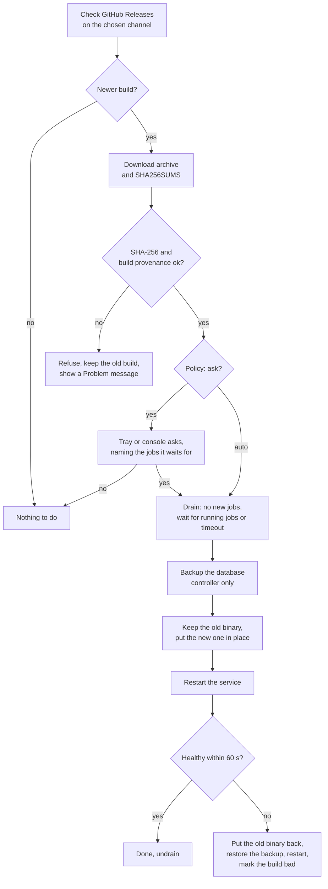
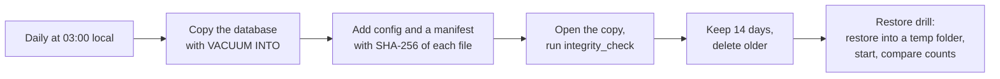
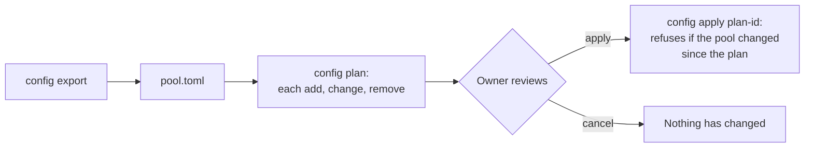
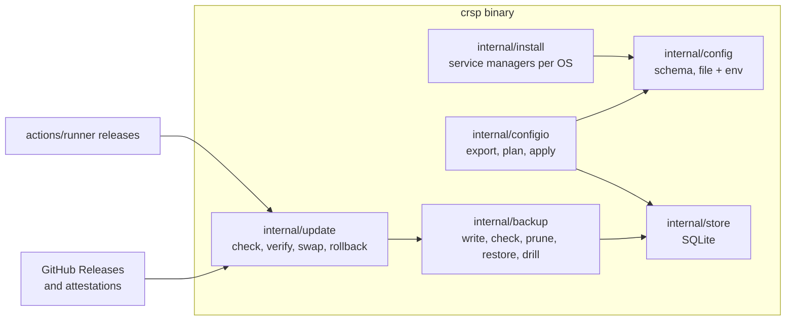

# Operations: install, config, updates, backup, config as code, uninstall

The top half (sections 1 to 4) is for every reader. The bottom half (5 to 12) is for engineers.

**Partly built (CRSP18, OPS1).** Built: the installers for Windows (MSI, R5.35 to R5.41), macOS (pkg) and Linux (deb and rpm) (R5.7), the config file and schema (R5.8, R5.9), the per-OS folders (R5.10), the daily backup, restore and drill (R5.21 to R5.25, R5.27, the secret list of R5.26 as `backup.MissingSecrets`). Everything else below is **NOT YET IMPLEMENTED**: planned, with its milestone.

## 1. In one paragraph

This feature keeps a pool running with little work from its owner. One command per OS installs the binary as a service. One config file, checked against one schema, sets it up. The controller, the agents and the tray update themselves from GitHub Releases after a check of the checksum and the build provenance, and they wait for running jobs first. The GitHub runner version is pinned and moved forward before GitHub stops accepting it. The database and config are backed up every day and kept for 14 days, with a restore command and a restore drill. The whole setup can be exported to a file and imported again, with a plan that shows each change first. Uninstall names what it removes and keeps the data unless asked.

## 2. Why

**Problem.** The pool runs on the owner's own machines, with no hosted service to keep it alive. Without this feature the owner copies files by hand, updates each machine by hand, and loses the setup when a disk dies.

**Users.**

- The owner, who installs the controller and runs the pool.
- Admins, who add machines and approve updates.
- Anyone who restores a controller on a new machine after a failure.

**Goals.**

- Install in one command per OS, with a service the OS restarts.
- Stay current without cutting a running job (product learning 1).
- Lose at most 24 hours of data (RPO) and be back within 1 hour (RTO), as the stack profile section 9 says.
- Keep the setup in a file that can be reviewed, diffed and applied.

**Non-goals.**

- Signed installers (MSI, pkg, deb, rpm) and code signing. Those come in milestone 8; this spec only names the seam.
- Backing up secrets. The GitHub App private key, the webhook secret, the TLS key and agent keys stay in the OS secret store (decision 0002).
- Point-in-time recovery. SQLite has none (stack profile section 14).
- Updating GitHub-hosted runners or anything the product does not manage (decision 0005).
- Backups of runner images, caches or job logs. They are rebuilt.

## 3. How it works

### Self-update

1. Every 6 hours the controller asks GitHub Releases for the newest build on its channel: `edge` (built from every merge to `main`) or stable (`v*` tags).
2. A newer build is downloaded. Its SHA-256 must match `SHA256SUMS`, and its build provenance attestation must name this repository's release workflow. Any mismatch stops the update.
3. With the policy `ask` (the default), the tray or the console asks first. The question names the jobs the update waits for.
4. The machine drains: it takes no new jobs and waits for running jobs to end. Past the drain timeout it keeps waiting and warns; only an automatic update postpones instead (R5.33 on CRSP19). The idle check runs right before the restart (learning 1).
5. On the controller, the database is backed up before the new build can migrate it.
6. The old binary is kept. The new one takes its place. The service restarts.
7. If the new build is not healthy within 60 seconds, the old binary and the backup come back, the service restarts, and that build is marked bad. It is never tried again on its own.
8. The controller updates first. Agents follow one machine at a time, to the controller's version.

### Backup and restore

1. Once a day the controller writes one backup archive: the database, the config file and a manifest. Secrets are never in it.
2. The copy is opened and checked before the old ones are pruned. Backups older than 14 days are deleted. The newest good backup is never deleted.
3. `crsp restore <file>` checks the manifest, backs up the current state, puts the backup in place, and starts the controller.
4. `crsp backup drill` restores the newest backup into a temporary folder, starts a controller there on a spare port, checks it, and records the result.

### Config as code

## 4. Screens and states

No mocks yet. They are made with the screens in milestone 8. The web console parts live under Settings (product screen 9). Rules are cited by design-system ID, never written here.

- **Settings > Updates.** Channel (stable or edge), policy per machine (ask or auto in a maintenance window), drain timeout, current and offered version per part. An offered update shows what it waits for and asks in the page (UX-9, UX-62). A running update shows in the activity strip (UX-34) with a progress bar (components 16, UX-29). A refused update shows a Problem message that says why (UX-26, components 18). A blocked update says why beside the disabled action (UX-38).
- **Settings > Console > Network.** The address the controller listens on, with Choose an address (admin). The same dialog opens from the Needs-you box of Settings > Access for CI (web-console R5.91). The dialog shows loading, the three choices as a radio group (each with its address and who can reach it), the wait while the controller restarts (running jobs finish first), Done and a failure with its reason. Set by the environment, it is shown read-only (R5.90; UX-44, UX-38).
- **Settings > Backups.** The list of backups with date, size and check result; Back up now (busy while it runs, UX-13); the last drill and its result. No backup yet is an empty state with the next step (UX-6, components 19).
- **Settings > Config.** Export downloads the file. Import is a wizard (components 4, UX-5) that ends with Review, then the work, then Done (UX-30). Review uses the change review list (components 34). A removal lists what goes and asks for a yes (UX-62).
- **Tray.** "Update to <version>?" with the jobs it waits for, as a dialog (components 9). Restart and update ask first (decision 0005).
- **Terminal.** `install`, `uninstall`, `restore` and `config apply` print what they will do and ask `yes/no` unless `--yes` is given.

States for every screen: empty (no backups, no update), busy (draining, downloading, restoring), error (verify failed, start failed and rolled back, backup check failed).

## 5. Functional requirements

Each requirement names its milestone (M1 to M8, product brief). Those not named as built in the status line at the top are **NOT YET IMPLEMENTED**.

### Install and first run

**R5.1** (M1) — One command per OS installs the binary. Linux and macOS: `curl -fsSL <release>/install.sh | sh`. Windows: `irm <release>/install.ps1 | iex`. The script downloads the archive for the OS and architecture, checks its SHA-256 against `SHA256SUMS`, checks its build provenance, and runs `crsp install`. The script does nothing else. (Owner decision D51, 2026-11-15.) The provenance check comes after the checksum: when the GitHub CLI (`gh`) is on the machine, the script runs `gh attestation verify <file> --repo luis-mc/ci-runners-shared-pool` and stops, installing nothing, when it fails. When `gh` is not there, the script says clearly that only the checksum was checked and prints the command to run by hand, then goes on. This is the first install, before any `crsp` exists to do the sigstore check of R5.34; later updates use R5.34. Built (CRSP77): `scripts/install/install.sh` and `scripts/install/install.ps1`. The release workflow does not publish them as assets yet.

**R5.2** (M1) — `crsp install --mode controller|agent` registers the service with the OS service manager: a Windows service (through `golang.org/x/sys/windows/svc/mgr`, never a cmd-quoted command line, learning 5), a systemd unit on Linux, a LaunchDaemon on macOS. The service starts at boot and restarts after a crash.

**R5.3** (M1) — On a desktop machine, install also adds the tray to start at login: a per-user startup entry on Windows, a LaunchAgent on macOS, an XDG autostart entry on Linux (decision 0005). A headless Linux machine gets no tray.

**R5.4** (M1) — On Linux and macOS install runs the service as a dedicated non-admin account where the OS allows it. On Windows the controller service runs as LocalSystem: it manages the runner services and their accounts and runs the MSI upgrade for auto-update (R5.39), which a non-admin account cannot do. Steps that need admin rights are one step, listed before the user says yes.

**R5.5** (M1) — Agent install takes the one-time join code from the console's install command (`--join <code>`) and stores the machine key in the OS secret store (decision 0004).

**R5.6** (M1) — On first start the controller makes its TLS certificate, opens ports 8460 and 8461 (or the configured ports), and prints a one-time link to the first-run wizard. The tray opens that link. The wizard itself is in the GitHub spec.

**R5.7** (M1 for Windows, M8 for the rest) — Installers per OS (MSI, pkg, deb and rpm) install the same files and services as R5.2 to R5.4. The Windows MSI is built (R5.35 to R5.41; task CRSP18). The macOS `.pkg` and the Linux `.deb` and `.rpm` are built (OPS1). The installers are unsigned (D58, R5.43); the signing step is ready and off (R5.45).
#### macOS and Linux installers (OPS1)

Release assets: `crsp-darwin-<arch>_<version>.pkg`, `crsp-linux-<arch>_<version>.deb` and `crsp-linux-<arch>_<version>.rpm`, with `<arch>` as in the `.tar.gz` names and the version as in R5.119. They are listed in `SHA256SUMS` and carry a build provenance attestation. They are not signed or notarized yet (milestone 8). Edge builds get the version `<next patch after the latest stable tag>~edge.<run>` (deb, rpm) or `<next patch>.<run>` (pkg), so a later edge build sorts above an earlier one and the stable release above both.

| | Linux (`.deb`, `.rpm`) | macOS (`.pkg`) |
|---|---|---|
| Binary | `/usr/bin/crsp` | `/usr/local/bin/crsp` |
| Service | systemd unit `crsp` (`/usr/lib/systemd/system/crsp.service`), `ExecStart=/usr/bin/crsp controller`, enabled and started | LaunchDaemon label `crsp` (`/Library/LaunchDaemons/crsp.plist`), runs `/usr/local/bin/crsp controller` |
| Tray start | `/etc/xdg/autostart/crsp-tray.desktop` | `/Library/LaunchAgents/dev.luismc.crsp.tray.plist` |
| Install marker | `/usr/share/crsp/install-kind` holds `deb` or `rpm` | `/usr/local/share/crsp/install-kind` holds `pkg` |
| Data | `/var/lib/crsp` (0700), `/etc/crsp` (0750), owned by root | `/Library/Application Support/crsp` (0700), owned by root |
| Remove | `apt remove` and `rpm -e` keep the data; `apt purge` deletes `/var/lib/crsp` and `/etc/crsp` (rpm has no purge) | `sudo crsp-uninstall` keeps the data; `--delete-data` also deletes it and the log |

- The controller service runs as root on Linux and macOS (owner decision, 2026-11-14): it manages runner services and accounts and applies package upgrades for auto-update. This is the exception to the non-admin account of R5.4 for these two installers; there is no `crsp` or `_crsp` account. The agent service (`crsp agent install`) runs the same way (D41, machines R5.44).
- Installing over an older version (upgrade) keeps the data, stops the service before the files are replaced and starts it again afterwards.
- The marker tells the updater (R5.11 to R5.18) which package manager owns the files.
- If systemd is not running (a plain container), the files are installed and the service starts at the next boot.

### Config file and data folder

**R5.8** (M1) — The controller and the agent read one config file, `config.toml`, checked against one schema. A `CRSP_*` environment variable overrides the matching key. `crsp config check` prints every problem at once and exits non-zero.

**R5.9** (M1) — The config check refuses: unknown keys, wrong types, values out of range, placeholder values (`<...>`, `${...}`, `changeme`, `todo`, `example` and the like), and any key that holds a secret (a private key, token or password). The service does not start with a refused config.

**R5.10** (M1) — Each OS has one data folder and one config path:

| OS | Data folder | Config file |
|---|---|---|
| Windows | `%ProgramData%\crsp` | `%ProgramData%\crsp\config.toml` |
| Linux | `/var/lib/crsp` | `/etc/crsp/config.toml` |
| macOS | `/Library/Application Support/crsp` | `/Library/Application Support/crsp/config.toml` |

The data folder holds the database, `backups/`, `logs/` and `updates/`. It is readable only by the service account and admins (on Windows, Administrators and SYSTEM).

### Self-update

**R5.11** (M3) — The controller checks GitHub Releases every 6 hours for the newest build on its channel. The channel is `stable` (the newest `v*` release that is not a pre-release) or `edge` (the `edge` pre-release). The default is `stable`.

**R5.12** (M3) — A downloaded archive is used only if its SHA-256 matches `SHA256SUMS` and its build provenance attestation is valid and names `.github/workflows/release.yml` of this repository. Any failure refuses the build, keeps the running one, and shows a Problem message that says which check failed.

**R5.13** (M3) — Before the swap, the new binary runs `self-check`: it starts, prints its version and database schema version, and exits. A build whose schema version is older than the database is refused (no downgrade; migrations go forward only).

**R5.14** (M3) — An update on a machine drains first: no new jobs start there, and the update waits until no job runs. The drain timeout is one per machine (default 60 minutes, machines R5.33): when it passes the update keeps waiting and warns, and never stops a job. An automatic update postpones instead (R5.33). The idle check runs right before the restart. The wait says what it waits for.

**R5.15** (M3) — With the policy `ask` (default), nothing installs until a user says yes: in the tray on that machine, or in the console for a headless machine. The question names the version and the running jobs it waits for. With the policy `auto`, the update runs in the machine's maintenance window.

**R5.16** (M3) — The controller backs up the database before the new build starts (R5.21 format).

**R5.17** (M3) — The old binary is kept as the previous build. If the new build is not healthy within 60 seconds after start, the previous binary (and, on the controller, the pre-update backup) come back, the service restarts, and the build is marked bad. A bad build is not offered again until a newer one appears.

**R5.18** (M3) — The controller updates first. Agents then update one machine at a time to the controller's version. The tray updates with the binary on its machine. A controller accepts agents of its own version and of the previous release.

#### Self-update as built in CRSP19 (owner decisions of 2026-11-14)

These rules narrow R5.11 to R5.18 for the controller's machine, on Windows, macOS and Linux. Code: `internal/update`; API `GET /api/v1/update`, `POST /api/v1/update/check`, `POST /api/v1/update/apply`, `POST /api/v1/service/restart`; setting `auto_update`; CLI `crsp update status|check|apply|auto`, `crsp restart`.

**R5.31** (M1) — Automatic updates is the controller setting `auto_update`, ON by default. With it on, the regular check (R5.32) installs a newer stable release with no question after the drain; a check a person asks for (`POST /api/v1/update/check`, the tray's Look for updates, `crsp update check`) only looks and never installs (R5.87). With it off, `update/apply` needs `confirmed=true` from the console Review step. The pre-release `edge` is never offered, and a development or edge build is never replaced.

**R5.32** (M1) — The controller checks every 6 hours (first check one minute after start) and installs any time the drain allows. Agent-only machines do not check GitHub for the latest release; they follow the controller's version (R5.39 to R5.41).

**R5.33** (M1) — An automatic update drains this machine (no new jobs) and waits up to 60 minutes for running jobs. If a job still runs then, the drain is cancelled, the machine takes jobs again, and the next check retries. Right before the install the manager checks again that no job runs. A running job is never cut.

**R5.34** (M1) — Each download is verified before the drain: its SHA-256 against `SHA256SUMS`, and its build provenance attestation, checked inside `crsp` with sigstore-go (no `gh` needed): the bundle comes from the GitHub attestations API for the file's SHA-256, and must verify against the embedded Sigstore public-good trust root (certificate chain, transparency log entry, signed timestamp), name the file's SHA-256 as its subject, and carry a signing certificate issued to GitHub Actions for the workflow `.github/workflows/release.yml` of this repository (any ref). Any failure, a missing attestation, or no network fails closed and nothing installs. The trust root is `internal/update/sigstoreroot/trusted_root.json`, copied from `sigstore/root-signing`; a build carries the root of its day, so a rotation of Sigstore keys needs a new release. The dependency is pinned in `go.mod` (sigstore-go v1.4.0) and adds about 7.7 MB to the stripped binary. The unpacked binary also runs `version` as a self-check.

**R5.35** (M1) — The service runs as LocalSystem on Windows and as root on Linux and macOS, so the controller applies the update itself. The release asset follows the install kind, read from the marker file `install-kind`: next to the binary first, then `/usr/share/crsp` (deb, rpm), then `/usr/local/share/crsp` (pkg); on Windows next to `crsp.exe` in `Program Files\crsp`; no marker means `tarball` (and `msi` on Windows): `msi` runs `msiexec /i <file> /qn /norestart /l*v %ProgramData%\crsp\logs\msi-update.log`; `pkg` runs `installer -pkg <file> -target /`; `deb` runs `apt-get install -y ./<file>` (fallback `dpkg -i`); `rpm` runs `rpm -U <file>`; `tarball` swaps the binary atomically and keeps the old one as `<binary>.previous`. Assets (R5.119): `crsp-windows-<arch>_<version>.msi`, `crsp-darwin-<arch>_<version>.pkg`, `crsp-linux-<arch>_<version>.deb`, `crsp-linux-<arch>_<version>.rpm`, `crsp-<os>-<arch>_<version>.tar.gz`; a release up to 0.1.14 has the same names without `_<version>`, and the updater falls back to them.

**R5.36** (M1) — On Windows the controller starts `msiexec` itself, detached (the MSI upgrade stops every process that runs from the install folder, `crsp.exe` included), writes `pending-msi.json` and ends that path: no helper waits. After the service restarts it settles the pending install: the running version equal to the target is a success (the result is written, the failure count cleared); the log line `MainEngineThread is returning N` with a bad code is a failure, reported with the code and the log path and counted for the retry rule (R5.37); a log without that line for longer than 45 minutes is a failure too. On Linux and macOS the install runs in a helper process (`crsp update-helper`, a copy of the binary in the update folder) that outlives the service: a transient systemd unit on Linux, its own session on macOS. It holds a machine-wide install lock (stale after 45 minutes or when its process is gone), writes a log, and reports `result.json`. After the install it waits up to 60 s for `/healthz` to report the new version (an agent has no console port: the helper waits for the service manager to say the service is active, and still active 10 s later); a tarball install that is not healthy puts the previous binary back and restarts.

**R5.37** (M1) — A failed install keeps the old version (Windows Installer rolls back; the tarball swap is undone; on Windows the failure is read from the log after the restart), the console and the tray header show `update failed` with the log path, and the automatic path retries at the next check, at most 3 times per version, waiting 1 h, then 4 h. A build that did not become healthy is never tried again on its own.

**R5.38** (M1) — After an automatic update the tray shows one notice `Updated to <version>` and its header shows the version.

**R5.39** (M1) — Agent-only machines follow the controller. After the controller runs a new version, the controller asks each connected agent machine whose version is older to update to the controller's version, over the agent link (message `UpdateAgent`). It asks again every 10 minutes (first 2 minutes after start) until the agent runs the same version, or the agent says an update is in progress. It never asks an agent of the same or a newer version, an agent whose version is not a stable one, or when the controller itself is a development or edge build. The controller's own machine is not an agent here.

**R5.40** (M1) — The agent downloads that release itself from GitHub, with the same checks as R5.34 (SHA-256 and attestation), then drains with the same rule as R5.33: no new jobs, running jobs finish and are never cut, and after 60 minutes the drain is cancelled, the machine takes jobs again, the agent says `postponed`, and the controller's next ask retries. Right before the install it checks once more that no job runs. The apply is the one of R5.35 for the agent's install kind. After the install the helper waits for the service to be active (R5.36) and rolls a tarball install back when it is not. The retry rule of R5.37 (three tries per version, 1 h then 4 h) is kept on the agent.

**R5.41** (M1) — The agent reports its progress to the controller (message `UpdateReport`: `idle`, `waiting_for_jobs` with the jobs it waits for, `downloading`, `installing`, `restarting`, `postponed`, `failed`, `unsupported`). The controller audits `installing`, `failed`, `postponed` and `unsupported`. An agent runs as root or LocalSystem (machines R5.44, D41), so it installs its own update after the drain. Only an agent that does not (installed before D41 under a non-admin account, or started by hand without rights) says `unsupported` and downloads nothing; the text tells the user to run the install command again.

Tests: `internal/update/update_test.go` (decisions, verify, lock, backoff, helper per OS and package kind, drain limit), `internal/update/attest_test.go` (fake Sigstore with a fake attestation bundle; fail closed on another workflow, repository, issuer, file, trust root or no attestation), `internal/update/follower_test.go`, `internal/agent/follow_test.go` (a real controller link with a fake updater: ask, wait, postpone, install, unsupported), `internal/agent/plan_test.go` (the agent service runs as LocalSystem or root), `internal/update/update_test.go` (TestFollowNeedsPrivilegeAndDownloadsNothingWithout and the privileged follow tests), `internal/api/handlers_update_test.go`, `internal/settings/settings_test.go`, `internal/cli/cmd_update_test.go`, `apps/web/src/screens/settings/Updates.test.tsx`. Not yet run: a real install on each OS in CI, which needs the installer assets of CRSP18 and OPS1; a real attestation of a released asset against the embedded trust root (the tests use a fake Sigstore).

### GitHub runner version

**R5.19** (M1) — The GitHub runner version is pinned: one version and one SHA-256 per OS and architecture, in a manifest the controller keeps. A runner download that does not match is refused. Runners are registered with `--disableupdate`, so they never update in the middle of a job.

**R5.20** (M3) — Once a day the controller reads the newest `actions/runner` release. It moves the pin to it within 7 days of its release (default), and always before GitHub's 30-day limit for runners that do not update themselves. Ephemeral runners use the new version for the next job. Persistent runners are replaced with drain (R5.14). The doctor warns when the pinned version is 21 days or more behind the newest one.

### Backup and restore

**R5.21** (M1) — Every day at 03:00 local time (configurable) the controller writes one archive `crsp-backup-<yyyy-mm-dd-hhmm>.tar.gz` in `backups/`. It holds a copy of the database made with `VACUUM INTO`, the config file, and a manifest with the product version, the schema version and the SHA-256 of each file. It never holds a secret.

**R5.22** (M1) — After writing, the backup is opened and `PRAGMA integrity_check` must return `ok`. A failed backup is deleted, logged, and shown by the doctor.

**R5.23** (M1) — Backups older than 14 days are deleted after a good backup is written. The newest good backup is never deleted, however old.

**R5.24** (M1) — `crsp backup` writes a backup now. `crsp backup list` lists them with date, size and check result.

**R5.25** (M1) — `crsp restore <file>` checks the manifest and each SHA-256, refuses a backup from a newer schema, backs up the current state first, stops the controller, puts the database and config in place, starts it, and waits for it to be healthy. It names what it replaces and asks for a yes. Running jobs on other machines keep running.

**R5.26** (M1) — After a restore, the doctor lists the secrets the controller still needs (for example the GitHub App private key on a new machine) and how to add each one.

**R5.27** (M1) — `crsp backup drill` restores the newest backup into a temporary folder, starts a controller there on a free local port with no GitHub traffic, checks its health and the row counts against the manifest, records the date and result, and deletes the folder. The doctor warns when no drill has passed in 90 days. One drill passes before the first release.

### Config as code

**R5.28** (M8) — `crsp config export` writes one file with the whole setup: repositories and their policies, machines and their settings (budget, slots, backends allowed, drain timeout, maintenance windows, update policy), runner definitions, image layers, notifications, users and roles, and update settings. It holds no secret, no job history, no audit log and no machine key.

**R5.29** (M8) — `crsp config plan <file>` checks the file against the schema and lists each change: added, changed (field, old value, new value) or removed, by name. It changes nothing and ends with "Nothing has changed." It gives the plan an ID tied to the current state.

**R5.30** (M8) — `crsp config apply <plan-id>` applies exactly that plan. It refuses if the pool changed since the plan. Removals need an explicit yes that names each one. Changes that restart runners drain first (R5.14). Each change is written to the audit log.

**R5.31** (M8) — The console offers export and import under Settings; import is a wizard that ends with Review, the work, and Done.

### Windows installer (MSI)

**R5.35** (M1) — Windows installs through `crsp-windows-amd64_<version>.msi` or `crsp-windows-arm64_<version>.msi` (R5.119; the build writes `crsp-windows-<arch>.msi` and the publish job adds the version), built with WiX Toolset v5 (pinned to 5.0.2) on `windows-latest` by `release.yml` and published for edge and stable releases. Both are listed in `SHA256SUMS` and covered by the provenance attestation. They are not signed in v0.1.0. The MSI `ProductVersion` is the release version (`1.2.3` becomes `1.2.3.0`); an edge build is the next patch after the latest stable tag with the run number as fourth field.

**R5.36** (M1) — The MSI is per machine and installs to `%ProgramFiles%\crsp`. It installs `crsp.exe`; registers the one service `crsp` (`crsp.exe controller`, automatic start, delayed, restart after a crash, account LocalSystem) and starts it; adds the install folder to the system `PATH`; adds a Start Menu shortcut named "CI Runners Shared Pool" (`crsp tray`); shows "CI Runners Shared Pool" with the CRSP disc icon in the Apps list, as one entry (R5.89); starts the tray at every user's sign-in (`HKLM\...\Run`, value `crsp-tray`); at the end of a successful interactive install or upgrade also starts the tray for the person who installed it, not elevated (never on uninstall, and not when the run is SYSTEM's, such as the service's auto-update); and adds an inbound firewall rule, TCP 8460 and 8461, on the Private profile only, never Public. It makes `%ProgramData%\crsp` readable by Administrators and SYSTEM only (R5.10; the service is LocalSystem). It writes the file `install-kind` next to `crsp.exe`, containing `msi`; the updater reads it to choose the update method.

**R5.37** (M1) — Uninstall removes the program, the service, the `PATH` entry, the shortcut, the autostart value, the firewall rule and `install-kind`. With the dialogs (`msiexec /x crsp-windows-<arch>.msi`) it asks "Also delete my data", unticked by default; CI proves the dialog from the built MSI's tables (the dialog, its checkbox bound to `REMOVEDATA`, default 0, and its place in the UI sequence); a hosted runner cannot show msiexec's windows, so the UI Automation drive in `installer/ui-test.ps1` runs only where a desktop exists. Silent uninstall keeps the data folder; `REMOVEDATA=1` deletes it. Data is the config file, the database, the audit log, backups and the CA.

**R5.38** (M1) — The UpgradeCode is fixed: `C1D62442-6DB4-4FF0-9F28-A1CE3121B332`. A newer MSI replaces the installed one in place and keeps the data folder; the same `a.b.c` replaces itself; a lower version is refused (exit 1603, `A newer version of crsp is already installed.` in the log).

**R5.39** (M1) — The command the self-updater runs, from an elevated process, is exactly `msiexec /i crsp-windows-<arch>_<version>.msi /qn /norestart /l*v <log>`. It stops the tray and the service (and the `crsp-agent` service when it runs from the install folder, which is started again afterwards), replaces the files, and starts the service again. No run needs a reboot. The updater reads the result from the exit code (0 done, 1603 refused or failed) and from `<log>`. The upgrade ends every process that runs from the install folder, `crsp.exe` itself included, so the updater must start `msiexec` detached (a new process outside the service's process and job) and exit at once; it cannot wait for `msiexec` from inside the folder. The updater is task CRSP19.

**R5.40** (M1) — A failed install or upgrade rolls back: Windows Installer puts the old version back and a rollback action starts the old service again. The `/l*v` log records the rollback.

**R5.41** (M1) — `crsp.exe` run by the service manager reports its state through the Windows service protocol: Stop ends the controller as SIGTERM does, a non-zero end makes the service manager restart it, and the log goes to `%ProgramData%\crsp\logs\crsp.log`. `crsp tray` detaches from its console window.

### Uninstall

**R5.32** (M1) — `crsp uninstall` lists what it removes and what it keeps, then asks for a yes. It removes: the services, the tray start entries, the binary, and the runners on that machine (drained first, then deregistered from GitHub with a remove token). It keeps: the data folder (database, config, backups, logs) and the secrets in the OS secret store.

**R5.33** (M1) — `crsp uninstall --purge-data` also removes the data folder and this product's secrets, and lists them by name before asking.

**R5.34** (M3) — Uninstalling an agent revokes its machine key on the controller. Uninstalling a controller that still has machines names them and asks again.

**R5.42** (M3, built in part CRSP88 as github-integration R5.49: modes `observe`, `shadow`, `canary` and `off`, `crsp trial`, `GET` and `PUT /api/v1/repositories/{id}/trial`; NOT YET IMPLEMENTED: the `live` mode name, the console mode on each repository row, the ask-first console action) — **Trial modes before switching a repository.** Each repository has a rollout mode: `observe` (crsp logs what it would do for each queued job and starts nothing), `shadow` (crsp starts runners and takes jobs only for a copy of the workflow the owner marks, while the repository's real jobs stay on GitHub), `canary` (this one repository runs live while the others stay off) and `live`. The mode changes only by a command or a console action that asks first, and the console shows the mode on each repository row. Observe writes one line per job: the labels, the machine it would pick and the reason it could not. A repository never moves two steps at once, and going back is allowed at any time.

**R5.43** (M1, CRSP90) — **Unsigned installers, an SBOM and attestations** (owner decision D58, 2026-11-15: no signing certificate). Each release (edge and stable) publishes two software bills of materials in SPDX 2.3 JSON, with stable names: `crsp-sbom-go.spdx.json` (the Go modules built into the binary, read from the build info of the linux-amd64 binary) and `crsp-sbom-web.spdx.json` (the npm packages of the web console, from `pnpm-lock.yaml`). They are made by syft, pinned by version and SHA-256 in `scripts/delivery/tools.json` and fetched through `scripts/delivery/ci_tool.py`, by `scripts/ci/release-sbom.sh`. `SHA256SUMS` lists every other asset, the two SBOMs included. A build provenance attestation (`actions/attest-build-provenance`, pinned by commit) covers every `crsp-*` asset and `SHA256SUMS` itself. The release job fails when the asset count or the `SHA256SUMS` line count is not what is expected. The MSI, pkg, deb and rpm are not signed while no certificate exists. The updater (R5.34) and the install script (R5.1) keep checking the SHA-256 and the attestation only.

**R5.44** (M3, Built CRSP91; the console part is built, CRSP102, web-console R5.33) — **Recovery for an agent stuck on an old version.** A machine **needs recovery** (API field `recovery` on the machine, `state: needs_recovery`) in two cases: its agent says an agent link protocol below the minimum (2) in Hello, so the controller refuses its normal calls (`FailedPrecondition`, audit `machine.agent_too_old`) and keeps the machine marked until it connects with a current protocol (`reason: old_protocol`); or the controller asked it to update (R5.39) more than one hour ago and it still runs the older stable version (`reason: stuck`; a newer release starts the hour again). The field says the version it has, the version it needs, since when, and whether the owner armed the action.

The agent keeps one **frozen recovery call**: `POST /recovery/v1/poll` on the agent link port, plain JSON (not protobuf), with the machine key and id as the link, and a shape that never changes. It does nothing but hand out a signed update target. The controller answers `none`, unless the machine needs recovery and the owner pressed the one action (`POST /api/v1/machines/{machineId}/recovery`, admin, audit `machine.recovery.armed`; `409` when the machine does not need recovery). Then it answers with the version, the asset for the agent's OS and arch, the SHA-256 from the release's `SHA256SUMS`, and a validity window (10 minutes), signed with the controller's server key. The agent trusts the answer only when the certificate chain leads to the fingerprint it pinned at join, the signature over machine id, its own fresh nonce, version, asset, SHA-256 and window is valid, and the window has not ended. It then installs through its update manager, which downloads and checks the SHA-256 and the attestation as in R5.34 and R5.43, drains and applies as in R5.40. The action is spent when the target is served (audit `machine.recovery.served`). The machine key, the data folder and the runners are kept: only the program is replaced. The agent calls it when the controller refuses a Session as too old (`agent.Config.Recoverer`).

Not built: a copyable reinstall command with a one-time token in the console, and the `crsp agent reinstall` command for an agent too old to have the recovery call, which still needs the install command run again by hand. Source: landscape G22 (RunnerRunner manual update wizard).

**R5.45** (M8, CRSP90) — **Signing is switched off by a repository variable.** `release.yml` has a step that signs the Windows MSI with Authenticode (`signtool`) and one that signs the macOS pkg with a Developer ID Installer identity (`productsign`). Both run only when the repository variable `SIGNING_ENABLED` is `true`; unset or any other value, they are skipped and the release is unsigned (R5.43). The certificates are read only from repository secrets by name: `SIGNING_WINDOWS_CERT_PFX_B64`, `SIGNING_WINDOWS_CERT_PASSWORD`, `SIGNING_MACOS_CERT_P12_B64`, `SIGNING_MACOS_CERT_PASSWORD`, and the variable `SIGNING_MACOS_IDENTITY`. No value is in the repository. With `SIGNING_ENABLED` true and a certificate missing, the job fails. Signing happens before `SHA256SUMS` and the attestations, so both cover the signed file. Notarization of the pkg, and a check of the signature by the updater and the install script, are NOT YET IMPLEMENTED: they come with the first certificate.

**R5.46** (M1, CRSP130) — **A stable release comes only from main.** For a tag `v*`, the first job of `release.yml` (`guard`) fetches `main` and refuses, with a clear error, unless the tagged commit is reachable from `origin/main` (`git merge-base --is-ancestor`, `scripts/ci/release-guard.sh`). Every other job needs `guard`, so a refusal happens before any build or upload; the automatic `edge` build of main is not checked. After the release is created, if GitHub's generated notes have no "What's Changed" list (no merged pull request between the previous stable tag and this one), the `publish` job writes notes from the commit subjects between the two tags (`git log --format='- %s' prev..tag`, `scripts/ci/release-notes-fallback.sh`) with `gh release edit`. Cause: v0.1.1 was tagged on a branch that never merged (OPS10, PR #77).

**Checking a download** (documented in `docs/guides/install.md`): download the asset and `SHA256SUMS` from the same release; `sha256sum --check --ignore-missing SHA256SUMS` (Linux), `shasum -a 256 --check --ignore-missing SHA256SUMS` (macOS) or `Get-FileHash -Algorithm SHA256` compared by eye (Windows); then `gh attestation verify <file> --repo luis-mc/ci-runners-shared-pool`. The attestation of `SHA256SUMS` itself is checked the same way.

### Parity access from a pool container (CRSP134)

**R5.85** (built, CRSP134) — The parity workflow (`.github/workflows/parity.yml`, parity plan section 6) MUST run `crsp parity check` on a pool runner with no `crsp login`: it passes `CRSP_URL` and `CRSP_CA_FINGERPRINT` (repository variables) and `CRSP_ACCESS` (a repository secret) to the check step as environment (cli R5.60). The secret goes only to the steps that need it, never to the whole job. Its first step, before the build, fails with a message that names what is missing and the console action: "open Settings, Access for CI, pick this repository and press 'Set up parity for this repository'" (web-console R5.91, github-integration R5.84). The report and the artifact `parity-report` are still written and uploaded; a run whose access is missing never reports a pass. The final step says the real cause (CRSP141): when the access step failed it says the access is not set up; when the access step did not run (skipped, cancelled, or no outcome, as when the job timed out waiting for a free slot in the self-hosted pool) it says the job did not reach the checks, names the step state and, when the job was cancelled, that the run was cancelled or timed out; it never says the access is missing for a step that did not run. The step reads its values from the environment (`ACCESS_OUTCOME`, `CHECK_OUTCOME`, `SOAK_OUTCOME`, `JOB_STATUS`), so it needs nothing from the checkout. The names end in none of `_KEY`, `_TOKEN`, `_SECRET`, `_PASS`. The workflow keeps `permissions: contents: read` and actions pinned to a commit. The runbook ([move to crsp](../../guides/runbooks/move-to-crsp.md)) has the owner's steps. Source: `.github/workflows/parity.yml`.

**R5.86** (built, CRSP138) — **A Windows upgrade is quick and says what it does.** The MSI closes the per-user tray before InstallValidate, so no file is held when Windows Installer checks for files in use (the 0.1.1 to 0.1.2 upgrade sat at "Validating install" for 3 min 36 s). The immediate action `CloseTray` asks each `crsp.exe tray` under the install folder to quit as a window does (`taskkill` without `/f`, which posts WM_CLOSE), waits up to 5 s, and ends the ones left; it does not call the installed `crsp.exe`, so it works for every older version. The tray handles the request: the systray loop ends, the process exits, the exe is free (`internal/tray.WatchQuit`, also SIGTERM and SIGINT). `crsp tray --quit` does the same from a shell (`tray.QuitAll`: ask every other tray of the same folder, wait 5 s, end the rest). `CloseTray` also stops the `crsp` service (waits at most 20 s) and, when the `crsp-agent` service runs from the install folder, writes `agent-was-running.flag` under the data folder and stops it too (waits at most 20 s, then ends what still runs from the install folder, such as runner processes), so no program is in use when InstallValidate looks; `StartServices2` starts the agent again from the flag, and the rollback action `StartServicesRollback` does the same, so a failed upgrade leaves the agent running as before (OPS50: before this, only `StopServiceEarly`, after `RemoveExistingProducts`, stopped the agent, so InstallValidate waited on its files: the long "Validating install"). No step opens a console window (OPS50): `CloseTray` is a `WixQuietExec` action (immediate, impersonated, the command in the property `WixQuietExecCmdLine`, the form WixQuietExec reads for an immediate action), like every other action that runs `powershell.exe` or `cmd.exe`; `LaunchTray` only opens the Start Menu shortcut through `explorer.exe`. **Not covered:** a major upgrade removes the old product first (`RemoveExistingProducts`) with the old product's own actions. Up to 0.1.17 `CloseTray` started `powershell.exe` through `ExeCommand` and ran on uninstall too (no condition, as `git show v0.1.13:installer/crsp.wxs` shows), so upgrading from such a version still flashes one window from the old product's uninstall; this package cannot change it, and it ends with the first version that has the quiet action.  `ServiceControl Stop=both Wait=yes` and `StopServiceEarly` (same 20 s bound) stay as the later passes, and the service starts after the files are in (R5.39). The install window shows a line for each step (`Closing the crsp tray`, `Stopping the crsp service`, `Closing programs that use crsp files`, `Starting the crsp service`). The new tray starts for the signed-in user after install (OPS6). Target: under 30 s on a normal PC; CI fails over 60 s or on a Files in Use entry in the log.

**R5.87** (built, CRSP147) — **A look for updates only looks.** `update.Manager.Check` (console `POST /api/v1/update/check`, the tray's Look for updates, the CLI) refreshes the known release and starts no download, drain or install, with Automatic updates on or off. Only the regular check (`AutoCheck`, R5.32) installs by itself, and only with Automatic updates on. An install after a person's look needs a yes: `update/apply` with `confirmed=true` (R5.16) or the tray's Install now (tray R5.43). Settings, Updates says which check installs.

**R5.88** (built, CRSP147) — **The tray comes back after an upgrade.** An update the service starts runs as SYSTEM in session 0, where no tray can show, and the MSI ends every tray. At the first start of the new build after a successful MSI update the service starts `crsp tray --updated` in the desktop session of each signed-in user, with that user's own token (the limited half of a split token, never SYSTEM), in the background. The tray says the result once per version (a toast, or the update window; tray R5.48). A tray that already runs leaves at once (tray R5.23). An interactive install keeps the shortcut start of R5.36.

**R5.89** (built, CRSP147) — **One entry in the programs list.** The package authors no entry of its own besides the MSI's: no hand-made `Uninstall\crsp` key and no `ARPSYSTEMCOMPONENT`. The owner saw "CI Runners Shared Pool 0.1.3.0" twice after 0.1.2 to 0.1.3: the MSI's own entry plus the hand-made one, hidden only by a flag. The major upgrade (R5.38) removes the old product with the old hand-made key and registers one new entry. Settings > Apps then uses the MSI's basic uninstall, which keeps the data (R5.37); `msiexec /x <msi> REMOVEDATA=1` removes it. `installer/wxs_test.go` and the `windows-msi-check` workflow check the authoring; `installer/smoke.ps1` and `installer/upgrade-test.ps1` count the entries in both registry views after install, upgrade and rollback.

**R5.92** (built, TRAY5; owner decisions D12, D17) — **The installer wears the crsp art.** The MSI keeps the stock WixUI dialogs. `installer/build.ps1` generates `WixUIBannerBmp` (493x58) and `WixUIDialogBmp` (493x312) at build time from the Phosphor dark tokens of `packages/ui/src/tokens.css` (`go run ./internal/updatewindow/genart -bmp`): the crsp icon and `CI RUNNERS SHARED POOL` in the primary colour on the page colour with faint scanlines. The stock dialogs write black text, so the art sits where no text is: the right 200 px of the banner and the left 164 px of the dialog bitmap; the rest stays light. No bitmap is stored in the repository and no colour is hand-picked.

**R5.93** (built, TRAY5; owner decisions D13, D15) — **The update stage says who started it, and an update can be cancelled before it installs.** `stage.json` carries `started_by` (`auto`, `tray` or `console`), set when the update begins and kept by every later stage and by the install helper, so the new tray after the restart knows whether a window started it (tray R5.48). The controller cancels an update that downloads or waits for jobs (`Manager.Cancel`, the tray channel call `cancel`): it stops the download or ends the drain, releases the update lock, removes the stage file and changes nothing else; from installing on it answers that the update can no longer be cancelled (tray R5.47). The tray's Install answers with the stage reached after 1.5 s instead of holding the channel request open for the whole download.

### The controller address, chosen in the console (OPS14)

**R5.90** (built, OPS14) — **The owner chooses the controller address in the console, never in a terminal.** The address the controller listens on is a stored setting (settings row `listen_address`, audit `listen_address.set`), read with `getListenAddress` (`GET /api/v1/settings/listen-address`) and changed with `putListenAddress` (`PUT`), both `x-auth: admin` and, for the write, with the CSRF check of every console write. The answer lists the address the controller listens on (`running`), the stored choice, and the candidates found on this PC: **(a)** this PC's network address (the first non-loopback, non-link-local IPv4 of an interface that is up and not virtual by name), recommended; **(b)** the host address that Docker and WSL containers on this PC reach (the `vEthernet (WSL)` or `docker` interface), offered only when there is one; **(c)** another address typed as `host:port`, which must be an IP address of this PC (a wildcard is allowed), never loopback, and not on the agent link port. The port is 8460 unless typed. `CRSP_LISTEN_ADDR`, when set, still wins: the answer says `from_env`, the console shows the address read-only, and `PUT` answers 409. A valid choice is kept, audited, and the controller restarts once through the drain path of R5.11 (running jobs finish first; the same `confirmed` restart as `POST /api/v1/service/restart`). At start the controller binds the chosen address over https with the certificate of its own CA and also `127.0.0.1` over plain http, so the local console and the tray keep working. The server certificate lists the chosen address and the host name; a certificate that lacks one is made again from the same CA, so `CRSP_CA_FINGERPRINT` (the CA's) does not change. When the chosen address was chosen in the console and no `CRSP_PUBLIC_HOST` is set, runners and machines are told that address. If the chosen address cannot be bound the controller listens on `127.0.0.1` and says why in `problem` (the console shows it). Source: `internal/listenaddr/`, `internal/settings/listen.go`, `internal/api/handlers_listen.go`, `internal/tlsca/tlsca.go`, `cmd/crsp/main.go`, `cmd/crsp/machines_wiring.go`.

**R5.91** (built, TRAY4) — **A running update leaves a live stage.** The controller and the install helper write `stage.json` in the update work folder, beside `result.json`, and `GET /api/v1/update` shows it as `stage`: `name` (`downloading`, `waiting_for_jobs`, `installing`, `waiting_installer`, `restarting`, `done` or `failed`), `percent` for downloading (bytes of the release asset) and for installing (a rough guess from how far the verbose msiexec log has got through the standard install actions; 100 only when the log has its end line), `version`, `at`, for `waiting_installer` `waiting_for` (the name of the other installer that holds Windows Installer, when known; the update retries every 15 s until it is free, TRAY11), and for a failure `error`, `log_path` and `failed_at` (the stage that failed). `restarting` is written only once the Windows installer has finished; an attempt whose installer ended without replacing the service, or that a service restart left in `installing` or `restarting`, ends as `failed` (tray R5.52, R5.53). The file is replaced whole and survives the service restart that the install causes, so the next start can say `done` with the new version, or `failed` with the log path (Windows: `msi-update.log`; elsewhere `update.log`). While `msiexec` runs the service is stopped part way by the upgrade, so the percent stops there and the page waits for the service to come back. A stage that cannot be written is only logged and never stops an update.

### External addresses (OPS35)

**R5.94** (built, OPS35) — **No address is written into code; the owner sets the GitHub address in the environment.** The controller, the agent and the tray read five optional settings once at start, in one file (`internal/addresses/addresses.go`), and every other package receives the value through its struct. `CRSP_GITHUB_URL` (default `https://github.com`) is GitHub's web address: runner target pages, job links, the App and installation pages of the guided grant, the install page and the sign-in and device flow all follow it. `CRSP_GITHUB_API_URL` (default `https://api.github.com`) is the REST address; when only `CRSP_GITHUB_URL` names another host (GitHub Enterprise Server) it is `<url>/api/v3`. `CRSP_RUNNER_DOWNLOAD_URL` (default `<CRSP_GITHUB_URL>/actions/runner/releases/download`) is where the Actions runner archives are fetched. `CRSP_VM_IMAGE_MIRROR` (no default) is where VM images are fetched from (R5.96). Each is an absolute `https` address (`http` only for `127.0.0.1` and `localhost`), with no trailing slash, query or credentials; a bad value stops the start and the message names the variable. The default behaviour is unchanged. Not settings: the signed Sigstore trust data, the GitHub Actions OIDC issuer and the signer identity of crsp releases (fixed identities, constants in the same file), and the VM image catalogue hosts (`internal/vmcheck/vm-images.json`, catalogue data; a mirror moves them, R5.96). The web console never holds an address of its own: it calls its own origin, and the GitHub pages it opens come from the controller. Source: `internal/addresses/addresses.go`, `internal/config/config.go`, `cmd/crsp/addresses_wiring.go`.

**R5.95** (built, OPS35) — **A guard keeps it so.** `go test ./...` fails when a non-test Go file other than `internal/addresses/addresses.go` (and generated code and the fake GitHub) holds a string literal that starts with `http://` or `https://` and a host, names a host of the VM image catalogue, or is a host with a path to an image or checksum file (`dl.example.org/x.qcow2`); `vm-images.json` may name only the hosts listed in the guard (OPS37). Comments are not scanned. `pnpm exec vitest run --project guard` fails when code in `apps/web/src` or `packages/*/src` (tests and test support excluded) holds an absolute `http(s)` address in a string, a template or JSX text, except `127.0.0.1`, `localhost` and `example.com` in help words. Source: `internal/addresses/guard_test.go`, `guards/no-hardcoded-addresses.guard.test.ts`.

**R5.96** (built, OPS37; owner decision D103) — **VM images can come from a mirror.** `CRSP_VM_IMAGE_MIRROR` is read with the other address settings (R5.94, `internal/addresses/addresses.go`). It has no default: unset, `crsp vm` fetches the checksum files and images from the hosts of the catalogue (`internal/vmcheck/vm-images.json`) exactly as before. Set (an absolute `https` address, `http` only for `127.0.0.1` and `localhost`, no trailing slash, query or credentials), it is the base of every download: a distro's directory becomes `<mirror>/<distro>/` and its checksum file `<mirror>/<distro>/<file name>`; the mirror holds, per distro, the files of the upstream directory. The checksum file is still read first and the image is still checked against it, so a mirror cannot swap an image. The variable crosses into the process that downloads: the controller and agent read it from their environment, and every runner's job environment carries it (container jobs as `-e CRSP_VM_IMAGE_MIRROR=...`, persistent runners in their `.env`), so `crsp vm boot|prepare|run|selinux|doctor` read it with `internal/addresses.VMImageMirrorFrom`. A bad value makes `crsp vm` stop with exit 2 and a message that names the variable. Source: `internal/addresses/addresses.go`, `internal/vmcheck/vmcheck.go` (`Catalogue.Mirrored`), `internal/jobcmd/vm.go`, `internal/backend/container/poolstart.go`, `internal/backend/{linux,windows,macos}`.

| Setting | Default | What it moves |
|---|---|---|
| `CRSP_GITHUB_URL` | `https://github.com` | GitHub's web pages (R5.94) |
| `CRSP_GITHUB_API_URL` | `https://api.github.com`, or `<CRSP_GITHUB_URL>/api/v3` for another host | GitHub's REST address (R5.94) |
| `CRSP_RUNNER_DOWNLOAD_URL` | `<CRSP_GITHUB_URL>/actions/runner/releases/download` | Actions runner archives (R5.94) |
| `CRSP_VM_IMAGE_MIRROR` | none (the catalogue hosts) | VM image checksum files and images (R5.96) |

**R5.119** (built, OPS40) — **Release installers carry the version** (owner decision D108; dev-standards rule DL-96). Every installer and archive of a release is named `<name>_<version>.<ext>`, with the version without the leading `v`: `crsp-windows-amd64_0.1.15.msi`, `crsp-windows-arm64_0.1.15.msi`, `crsp-darwin-<arch>_0.1.15.pkg`, `crsp-linux-<arch>_0.1.15.deb`, `crsp-linux-<arch>_0.1.15.rpm`, `crsp-<os>-<arch>_0.1.15.tar.gz` and `crsp-windows-<arch>_0.1.15.zip`. An edge build carries `edge-<sha>` as its version. `SHA256SUMS` lists these names, and the build provenance attestation names them. The SBOMs and `SHA256SUMS` keep their plain names. Only release assets are renamed: the CI artifacts and the files the build scripts write keep their stable names (artifact-prune, DL-22), and the publish job of `release.yml` adds the version when it fills `dist/` and fails when an installer or archive lacks it. The updater (`internal/update`) looks for the versioned name first and for the plain name second (`PickAsset`), so it still installs a release up to 0.1.14; the downloaded copy keeps the name of the asset, under `<updates folder>/<version>/`. The same pick applies to the recovery target, the SSH join of a Windows machine, the controller package endpoint and the join files (they ask for a plain name and download the name `SHA256SUMS` lists). `install.sh` and `install.ps1` read `SHA256SUMS` (a fixed name) to find the archive for the machine. **Not covered:** a machine on 0.1.14 or older keeps looking for the plain name, which a versioned release does not have, so it cannot update itself to the first versioned release. Install that release by hand once (download the installer from the release page and run it); from then on the updater finds the versioned names. Docs and guides link the release page, never `releases/latest/download/<fixed name>`.

**R5.120** (built, TRAY8) — **The health check after a restart is always on loopback.** The update helper asks `http://127.0.0.1:<listen port>/healthz`, whatever address the console listens on: the controller always keeps `127.0.0.1` open next to a chosen address (R5.90), and the chosen address can change (a new DHCP lease) between the plan and the restart, which marked a good restart `the new build did not report healthy in time`. Source: `cmd/crsp/update_wiring.go` `healthURL`.

**R5.121** (built, TRAY8) — **Old installers do not pile up.** After a successful update, when the service starts on the version the result file names, the update folder keeps only the folders of the running version and the one before it (`updates/<version>/`, the installer and its `SHA256SUMS`) and removes the others. Other files (stage, result, plan, logs) and folders that are not a stable version are never removed. Source: `internal/update/prune.go`.

**R5.122** (built, CRSP205) — **An update or a restart has its own attempt.** The yes starts an attempt with an id, its kind and its start time; the status (`GET /api/v1/update`) carries it as `attempt`, with `service_started_at` (when this service process started), `server_time` and `error_attempt` (the attempt that `error` belongs to). The helper plan, the stage file and `result.json` carry the id, so the next process still knows which attempt it ends. The Update and the Restart the service wizards judge only their own attempt: a restart is done when the service runs as a process that started after the yes, and Done shows the version and how long the restart took; it fails when the status names this attempt's error, or when the service has not come back 5 minutes after it began to restart, and the Problem then names this restart and its start time. A failure of an older update (an `error_attempt` that is not the attempt of the page) is never shown on a restart or on a new update. A failure recorded before attempts had ids has `error_attempt` `earlier` and belongs to no attempt. (CORE-3, UX-6.)

**R5.123** (OPS59) — **An update keeps the owner's data.** The MSI never removes the data folder on an upgrade: it authors no `RemoveFolder` or `RemoveFile`, and the only deletion, `RemoveData`, needs `REMOVEDATA=1` and `NOT UPGRADINGPRODUCTCODE`, which the automatic update never sets. What the owner chose (machines, settings, keys, runners) is in the database in that folder (machines R5.68, runners R5.99), which an upgrade keeps. If the controller's own agent still loses its key, it joins again as the same machine (machines R5.70) and the doctor says so (doctor R5.61).

## 6. Non-functional requirements

**R6.1** (M3) — An update never stops a running job. A controller restart never stops a job on any machine; agents reconnect with backoff.

**R6.2** (M3) — Update checks and downloads send nothing about the pool to GitHub beyond the release requests. No telemetry (stack profile section 8).

**R6.3** (M3) — Verification fails closed. With no network to check provenance, nothing installs.

**R6.4** (M1) — RPO 24 hours: a good backup is never older than 24 hours while the controller runs. The doctor reports a Problem when it is.

**R6.5** (M1) — RTO 1 hour: a drill on a reference database of 1 GB completes restore and health check in under 10 minutes, leaving the rest of the hour for reinstalling.

**R6.6** (M1) — A daily backup of a 1 GB database takes under 2 minutes and never blocks database writes for more than 1 second (WAL mode).

**R6.7** (M1) — Backups take no more than 14 days of archives plus the newest good one. The doctor warns when the backup folder is above 20% of free disk.

**R6.8** (M1) — No secret appears in a backup, an export, a config file, a log line or an update message. A test scans each of them for the known secret values.

**R6.9** (M1) — Install, update, restore and uninstall leave the machine in the old working state if they fail half way. Each step can be run again.

**R6.10** (M8) — Config export, then import into an empty controller, then export again gives the same file (round trip).

## 7. Design

**Packages.**

- `internal/install`: one `ServiceManager` interface (`Install`, `Start`, `Stop`, `Remove`, `Status`) with Windows service, systemd and launchd implementations; tray start entries; data folder and permissions.
- `internal/update`: `Checker` (GitHub Releases per channel, ETag cache), `Verifier` (SHA-256, build provenance through the Sigstore bundle of the attestation), `Swapper` (keep previous, rename into place; on Windows rename the running file aside first), `Health` (controller: `/healthz` and migrations done; agent: link to controller up), runner version manifest.
- `internal/backup`: `Writer` (`VACUUM INTO`, archive, manifest), `Checker`, `Pruner`, `Restorer`, `Drill`.
- `internal/configio`: `Export`, `Plan` (diff of file against store, plan ID = hash of the current state and the file), `Apply` (in one transaction, drain where needed, audit).
- `internal/config` (exists): grows from three env variables to the file schema with env overrides.

**Data (new tables, planned).** `update_state` (part, machine, current, offered, policy, bad builds), `runner_version` (version, OS, arch, SHA-256, pinned at), `backups` (file, time, size, check result), `restore_drills` (time, backup, result), `config_plans` (ID, state hash, created, applied).

**Interfaces (planned).** HTTP API: `GET /api/v1/updates`, `POST /api/v1/updates/{part}/approve`, `GET /api/v1/backups`, `POST /api/v1/backups`, `POST /api/v1/config/plans`, `POST /api/v1/config/plans/{id}/apply`. Agent link: `Drain`, `Update` and `UpdateResult` messages in `agent.proto`. CLI: `install`, `uninstall`, `config check|export|plan|apply`, `backup [list|drill]`, `restore`, `update [check|apply]`, `self-check`.

**Jobs.** Update check every 6 hours; runner version check daily; backup daily; prune after each backup.

## 8. Failure modes

| Dependency | Behaviour | Why |
|---|---|---|
| GitHub Releases down | Fail closed: no update, retry next check | The running build still works |
| Provenance or checksum check fails | Fail closed: refuse, keep the running build, Problem message | A wrong binary would run with the agent's rights |
| New build does not start | Roll back binary and database, mark build bad | Learning 1: the pool must keep working |
| Drain timeout reached | Ask: keep waiting and warn. Auto: postpone to the next check. Never cut the job | Learning 1 |
| Backup write or check fails | Delete the bad file, keep the old ones, doctor Problem | A bad backup is worse than none |
| Disk full | Skip the backup, keep old ones, doctor Problem | Never prune the last good backup |
| OS secret store missing after restore | Controller starts; doctor lists each missing secret | Secrets are never in a backup |
| Config file refused | Service does not start, every problem listed | A wrong config must not half-run |
| Plan stale at apply | Refuse; make a new plan | The user approved a different change |

## 9. How it is proven

All tests are planned; none exists yet. Paths are where each test will live.

| Requirement | Test |
|---|---|
| R5.1 | scripts/install/install_test.sh (fake release in a folder, fake `gh` on PATH: gh present verifies and installs, gh failing stops, gh absent says checksum only and continues, a bad checksum stops before gh). Planned: a PowerShell test of install.ps1 on Windows (no PowerShell on the CRSP77 sandbox, so install.ps1 was not run), and the run in CI on each OS against a release build |
| R5.2 | planned: internal/install/service_windows_test.go, service_linux_test.go, service_darwin_test.go TestInstallRegistersService (CI on each OS) |
| R5.3 | planned: internal/install/tray_test.go TestTrayStartEntryPerOS |
| R5.4 | planned: internal/install/account_test.go TestServiceRunsAsNonAdmin (Linux, macOS); Windows: installer/smoke.ps1 checks the service runs as LocalSystem |
| R5.5 | planned: internal/install/join_test.go TestJoinStoresKeyInSecretStore |
| R5.6 | planned: cmd/crsp first-run e2e TestFirstStartPrintsOneTimeLink |
| R5.7 | Windows: R5.35 to R5.41 below; macOS and Linux: `.github/workflows/installer-unix.yml` smoke jobs for the deb (systemd on the runner), the rpm (Fedora container) and the pkg (macOS runner): install, upgrade, remove, purge or uninstall |
| R5.35 | installer/smoke.ps1 (`.github/workflows/installer.yml`, x64 install; arm64 builds and extracts), .github/workflows/release.yml asset count |
| R5.36 | installer/smoke.ps1: service, account, failure actions, PATH, firewall rule (Private, 8460, 8461), shortcut, autostart, data ACL, `install-kind` |
| R5.37 | installer/smoke.ps1 silent uninstall keeps data and leaves nothing; `REMOVEDATA=1`; installer/ui-test.ps1 drives the dialog |
| R5.38 | installer/smoke.ps1: silent upgrade, refused downgrade |
| R5.39 | installer/smoke.ps1: the exact command, new service process, data kept |
| R5.40 | installer/smoke.ps1: failed upgrade (a test build that fails after the files are in) leaves the old version running |
| R5.41 | installer/smoke.ps1: service runs and listens on 8460; the service log file exists |
| R5.8 | internal/config/config_test.go TestFileThenEnvOverride, TestReportsAllProblems |
| R5.9 | internal/config/config_test.go TestRefusesPlaceholders, TestRefusesUnknownKeysWrongTypesAndSecrets |
| R5.10 | internal/config/config_test.go TestDataFolderPerOS |
| R5.11 | planned: internal/update/checker_test.go TestNewestBuildPerChannel (recorded GitHub responses) |
| R5.12 | planned: internal/update/verify_test.go TestRejectsBadSHA256, TestRejectsWrongWorkflowProvenance |
| R5.13 | planned: internal/update/selfcheck_test.go TestRefusesOlderSchema |
| R5.14 | planned: internal/update/drain_test.go TestIdleCheckRightBeforeRestart, TestDrainTimeout |
| R5.15 | planned: internal/update/policy_test.go TestAskWaitsForYes, TestAutoInWindow; tray e2e |
| R5.16 | planned: internal/update/swap_test.go TestBackupBeforeControllerSwap |
| R5.17 | planned: internal/update/swap_test.go TestRollbackOnFailedStart, TestBadBuildNotOfferedAgain |
| R5.18 | planned: internal/update/rollout_test.go TestControllerFirstThenOneMachineAtATime, TestAcceptsPreviousAgent |
| R5.19 | planned: internal/update/runner_version_test.go TestRunnerSHA256Mismatch, TestDisableUpdateFlag |
| R5.20 | planned: internal/update/runner_version_test.go TestPinMovesWithin7Days, TestDoctorWarnsAt21Days |
| R5.21 | internal/backup/backup_test.go TestArchiveHasDbConfigManifestNoSecret, TestScheduledRunWritesBackup |
| R5.22 | internal/backup/backup_test.go TestCorruptBackupDeleted |
| R5.23 | internal/backup/backup_test.go TestKeep14DaysAndNewestGood |
| R5.24 | internal/backup/backup_test.go TestBackupNowAndList; internal/api/handlers_ops_test.go TestBackupsListRunDrillRestore |
| R5.25 | internal/backup/backup_test.go TestRestoreChecksManifestAndBacksUpFirst, TestRestoreRefusesNewerSchemaAndTamperedArchive |
| R5.26 | internal/backup/backup_test.go TestDoctorListsMissingSecrets (the doctor check itself is the doctor's) |
| R5.27 | internal/backup/backup_test.go TestDrillRecordsResult, TestDoctorWarnsAfter90Days |
| R5.28 | planned: internal/configio/export_test.go TestExportHasNoSecretsOrHistory |
| R5.29 | planned: internal/configio/plan_test.go TestPlanListsEachChangeAndChangesNothing |
| R5.30 | planned: internal/configio/apply_test.go TestRefusesStalePlan, TestRemovalNeedsYes, TestAuditPerChange |
| R5.31 | planned: e2e/config-import.spec.ts (Playwright) |
| R5.32 | planned: internal/install/uninstall_test.go TestListsWhatGoesAndKeepsData, TestDeregistersWithRemoveToken |
| R5.33 | planned: internal/install/uninstall_test.go TestPurgeDataNamesEachItem |
| R5.34 | planned: internal/install/uninstall_test.go TestAgentKeyRevoked, TestControllerWithMachinesAsksAgain |
| R5.42 | planned: internal/repos/rollout_test.go TestObserveStartsNothingAndLogsTheDecision, TestShadowLeavesRealJobsOnGitHub, TestNoSkippingSteps (CRSP88) |
| R5.43 | planned: .github/workflows/release_test.go TestReleaseFailsWithoutSignatures, TestSbomPublishedPerAsset; internal/update/signature_test.go TestRefusesUnsignedInstaller (CRSP90) |
| R5.44 | internal/machines/recovery_test.go TestOldAgentIsRefusedAndNeedsRecovery, TestStuckAfterAnHour, TestRecoveryCallNeedsActionAndValidSignature, TestHealthyMachineCannotBeArmed; internal/recovery/recovery_test.go TestCheckAnswer; internal/api/machines_recovery_test.go TestMachineRecoveryStateAndAction; internal/agent/recover_test.go TestClassifyTooOldIsNeedsRecovery (CRSP91). Planned: `crsp agent reinstall` |
| R5.46 | scripts/ci/test_release_scripts.py: Guard.test_commit_on_unmerged_branch_refused, Guard.test_commit_on_main_passes, Notes.test_writes_subjects_between_tags, Notes.test_keeps_generated_list, Workflow.test_every_job_waits_for_guard |
| R6.1 | planned: internal/update/rollout_test.go TestControllerRestartKeepsJobs (two-machine integration) |
| R6.2 | planned: internal/update/checker_test.go TestOnlyReleaseRequests (HTTP recorder) |
| R6.3 | planned: internal/update/verify_test.go TestNoNetworkFailsClosed |
| R6.4 | planned: internal/backup/doctor_test.go TestProblemWhenBackupOlderThan24h |
| R6.5 | planned: internal/backup/drill_bench_test.go BenchmarkDrill1GB (under 10 minutes) |
| R6.6 | WAL and VACUUM INTO: internal/store/ops_test.go TestInspectAndVacuumInto (benchmark planned) |
| R6.7 | planned: internal/backup/doctor_test.go TestWarnsAbove20PercentFreeDisk |
| R6.8 | planned: internal/backup/secrets_scan_test.go TestNoSecretInBackupExportConfigLogs |
| R6.9 | planned: internal/install/rerun_test.go, internal/update/swap_test.go TestInterruptedStepsRerun |
| R6.10 | planned: internal/configio/roundtrip_test.go TestExportImportExportSame |
| R5.85 | built: internal/parity/workflow_test.go TestParityWorkflowPassesTheAccessToTheCheck, TestParityWorkflowFailsFirstAndNamesTheConsoleAction, TestParityWorkflowNamesAvoidSecretEndings, TestParityWorkflowActionsArePinnedToACommit, TestParityWorkflowHasTheTriggersAndNoWritePermission, TestParityFinalStepEnvironmentComesFromTheStepOutcomes, TestParityFinalStepSaysTheRealCause |
| R5.86 | internal/tray/quit_test.go TestQuitAllLeavesPoliteTraysAlone, TestQuitAllEndsATrayThatIgnoresTheRequest, TestQuitAllWithNoTrayIsQuick, TestIsTrayCmdline, TestWatchQuitStopsWhenContextEnds; internal/tray/quit_unix_test.go TestWatchQuitCallsQuitOnSIGTERM; installer/wxs_test.go TestEveryShellActionRunsQuiet, TestStepBeforeInstallValidateStopsTheAgentAndSetsTheFlag; installer/upgrade-test.ps1 (job `Upgrade with the tray running` in `.github/workflows/installer.yml`: previous release MSI, tray started, quiet upgrade with a log, fails over 60 s or on a Files in Use entry) |
| R5.87 | internal/update/update_test.go TestCheckNeverInstallsEvenWithAutoOn, TestInstallNowInstallsAndLaterDoesNot, TestAutoOnDownloadsVerifiesThenDrainsThenInstallsOnIdle; internal/trayserver/server_unix_test.go TestChannelInstallIsItsOwnCall |
| R5.88 | internal/update/update_test.go TestAfterInstallRunsOnlyAfterASuccessfulMSIUpdate; internal/tray/tray_test.go TestUpdatedNoticeOncePerVersion. The start in the user's session (`internal/tray/launch_windows.go`) is built and compiled for Windows; a Windows install run is not in CI yet |
| R5.89 | installer/wxs_test.go TestMSIHasOneProgramsListEntry, TestMSIUpgradeReplacesTheOldProduct; .github/workflows/windows-msi-check.yml; installer/smoke.ps1 and installer/upgrade-test.ps1 (Windows runner) |
| R5.91 | built (TRAY4): internal/update/stage_test.go, TestStageFileRoundTripAndMissing, TestPercentOfDownload, TestMSIPercentFromTheVerboseLog, TestMSIPercentReadsUTF16Logs, TestManagerWritesTheStagesOfAnUpdate, TestManagerStageFailedCarriesErrorAndLog, TestHelperWritesDoneAndFailedStages, TestRecoverMSIWritesDoneAndFailedStage, TestHTTPFetchReportsProgress; internal/api/handlers_update_test.go, TestUpdateStatusCarriesTheStage |
| R5.92 | installer/wxs_test.go TestMSIUsesTheGeneratedInstallerArt; internal/updatewindow/art_test.go (sizes, light text side, dark art side, the palette is the tokens); .github/workflows/installer.yml builds the MSI with the art |
| R5.93 | internal/update/cancel_test.go (cancel while waiting, while downloading, refused from installing on, started_by survives the restart); internal/trayserver/server_unix_test.go TestChannelCancelIsItsOwnCall |
| R5.94 | internal/addresses/addresses_test.go TestLoadDefaults, TestLoadEnterpriseDerivesAPIAndDownload, TestLoadExplicitValuesWin, TestLoadRejectsBadAddressesNamingTheVariable, TestLoadReportsEveryProblem, TestEnterpriseHostRunnerURLAndGrantPages, TestZeroSetDownloadURLUsesDefaults; packages/ui/src/components/Grant.test.tsx "opens only https pages the controller names" |
| R5.95 | internal/addresses/guard_test.go TestNoLiteralAddressesInGo, TestNoLiteralVMImageHostsInGo, TestCatalogueNamesOnlyKnownVMImageHosts; guards/no-hardcoded-addresses.guard.test.ts |
| R5.96 | internal/addresses/addresses_test.go TestVMImageMirrorDefaultIsEmptyAndUnchanged, TestVMImageMirrorIsReadValidatedAndUsedAsTheBase; internal/vmcheck/boot_test.go TestMirroredCatalogueMovesEveryDownloadAndDefaultIsUnchanged; internal/jobcmd/vm_test.go TestVMPrepareUsesTheMirrorFromTheEnvironment, TestVMRefusesABadMirror; internal/backend/container/poolstart_test.go TestPlanPoolPassesTheVMImageMirrorToTheJob, TestStartExportsTheMirrorFromTheDepsAddresses; internal/backend/linux/linux_test.go TestEnvCarriesTheVMImageMirror |
| R5.119 | internal/update/update_test.go TestVersionedAssetNames, TestPickAssetPrefersTheVersionedName, TestOlderReleaseWithPlainNamesStillInstalls, TestDownloadedCopyKeepsTheVersionedName; internal/joinfile/joinfile_test.go TestVersionedPackagesAreFoundByPlainName; scripts/install/install_test.sh; scripts/ci/test_release_scripts.py |
| R5.120 | built (TRAY8): cmd/crsp/update_wiring_test.go TestHealthURLIsAlwaysLoopback |
| R5.121 | built (TRAY8): internal/update/prune_test.go TestPruneVersionsKeepsCurrentAndPrevious, TestManagerPrunesAfterASuccessfulUpdate |
| R5.122 | built (CRSP205): internal/update/attempt_test.go TestRestartHasItsOwnAttemptApartFromAnOldFailedUpdate, TestFailedRestartCarriesItsAttempt; apps/web/src/screens/settings/Updates.test.tsx (Restart the service judges its own attempt) |
| R5.123 | installer/wxs_test.go TestMSINeverRemovesTheDataFolderOnUpgrade; internal/store/controllerstate_test.go TestMachinesSurviveRestart | built (OPS59) |

## 10. Decisions

Proposed by the spec writer. The owner confirms or changes each one (see the questions in section 11).

| ID | Question | Chosen | Date |
|---|---|---|---|
| OP-1 | Config file format | TOML, one file, env `CRSP_*` overrides (proposed) | 2026-11-14 |
| OP-2 | Default update channel and policy | `stable`; policy `ask` on every machine | 2026-11-14 |
| OP-3 | Where agents get builds | From GitHub Releases, same checks; version set by the controller | 2026-11-14 |
| OP-4 | Downgrade on channel switch | Never; wait for a stable build with a schema at least as new | 2026-11-14 |
| OP-5 | Backup method | `VACUUM INTO` plus archive and manifest; no secrets | 2026-11-14 |
| OP-6 | Backup milestone | Backup, restore and drill in M1 (stack profile section 9 needs a drill before the first release); console screens in M8 | 2026-11-14 |
| OP-7 | Runner version policy | Pin with SHA-256, `--disableupdate`, move within 7 days | 2026-11-14 |
| OP-8 | Uninstall default | Keep data and secrets; `--purge-data` removes them | 2026-11-14 |

## 11. Not built yet

Built in CRSP18: see the status line at the top. The seams:

- `internal/config/config.go` reads `config.toml` and the `CRSP_*` variables (R5.8 to R5.10). `crsp config check` (the command) is the CLI's.
- `.github/workflows/release.yml` publishes archives, `SHA256SUMS` and provenance today. The updater reads exactly these. It will also need `install.sh` and `install.ps1` as release assets (R5.1), and the `edge` release keeps its tag name so the checker can find it.
- Code signing and notarization come in milestone 8. The installers for Windows (MSI), macOS (pkg) and Linux (deb, rpm) are built.

**Open owner questions.**

1. Config file format: TOML (proposed), YAML or JSON?
2. Backups sit on the same disk as the database. Add an optional second folder (for example a network share) for copies?
3. Secrets are not backed up. On a new machine the owner re-enters the GitHub App key, and agents must re-join if the TLS key is lost. Accept, or add a passphrase-encrypted secrets export?
4. Default update policy for headless machines: `ask` in the console (proposed) or `auto` in a maintenance window?
5. Decided (CRSP27): backup, restore and the drill are in milestone 1; the brief now says so. Only the console screens stay in milestone 8 (OP-6).
6. The install script checks SHA-256 only; provenance is checked from the first self-update on, and signed installers come in milestone 8. Accept?
7. Move the runner pin within 7 days of a new GitHub runner release (proposed)?
8. Should a controller uninstall with `--purge-data` also offer to delete the repository variables and the GitHub App, or only say how?
9. When a user switches from edge to stable and the newest stable is older, wait for the next stable (proposed)?
10. Decided (D41, 14 Nov): the agent service runs as LocalSystem (Windows) and root (Linux, macOS), like the controller, and installs its own update after the drain (R5.40, R5.41; machines R5.44).

## 12. Code map

Source: internal/config/config.go
Source: internal/addresses/addresses.go
Source: internal/listenaddr/listenaddr.go
Source: internal/settings/listen.go
Source: internal/api/handlers_listen.go
Source: apps/web/src/screens/settings/ListenAddress.tsx
Source: installer/crsp.wxs
Source: cmd/crsp/service_windows.go
Source: internal/backup/service.go
Source: internal/backup/archive.go
Source: internal/backup/start.go
Source: internal/api/handlers_ops.go
Source: .github/workflows/release.yml
Source: cmd/crsp/main.go
