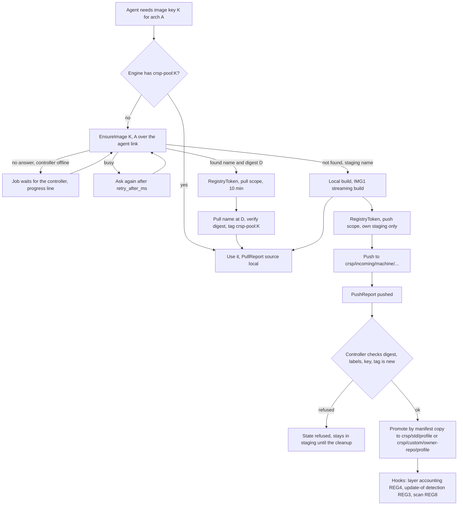

# Image registry

The top half (sections 1 to 4) is for every reader. The bottom half (5 to 12) is for engineers.

**BUILT (REG1 to REG15, IMG1 to IMG3).** The contract of REG10 is filled in: the image key (`internal/registry/key.go`, R5.21, R5.22), the store tables (migration 00019), the agent link messages (protocol version 3), the controller's answers under `/api/v1/registry/*` and the agent side (R5.13 to R5.20). The records, retention, replace and rollback, scan, pull-through mirror, profiles and the registry UI (R5.37 to R5.40) are built; see the change notes. IMG1 (build truth, R5.68 to R5.72) is built, except the link from an agent to the controller's recorder (see IMG1 below). Not built: the mirror re-check interval (R5.66, REG9). Every other requirement not marked built in its own text is planned.

**BUILT (REG1).** R5.1 to R5.12 (registry core) are implemented: Distribution v3 under `/v2/` on the controller's private listener, tokens, staging and promotion, the agent sink and the engine CA step. The staging root is `crsp/incoming/` (REG1 changed it from `crsp/_incoming/`, which is not a valid OCI name).

**BUILT (REG6).** R5.41 to R5.52 (retention) are implemented: budgets and settings, the recommendations engine, safe delete, the weekly cleanup and **Clean up now**.

## 1. In one paragraph

Today every machine builds its own job image, which takes 15 to 36 minutes. The registry keeps every built image once, inside the controller, so the next machine that needs the same image pulls it in a few minutes instead. An image is named by a content key: the same profile, stack files, arch, base and pins give the same key, so a branch with the same stack files reuses the default branch's image. The first machine that needs a key builds it and pushes it; the controller checks it and offers it to the others. The console shows what the registry holds, what it saves, and what may go; crsp deletes alone only what the owner already decided, and asks for everything else.

## 2. Why

**Problem.** A new runner on a machine waits for a full image build with no word (RES19). Two machines with the same stack build the same image twice. There is no record of which image a repository uses, so nothing can be cleaned up safely.

**Users.** The pool owner and admins; indirectly every workflow author whose first job on a machine starts sooner.

**Goals.**

- A machine pulls an image that another machine built, by digest, over the LAN.
- One key rule everywhere (agent, controller, console).
- Records of builds, pulls, layers and pointers, so retention never deletes what is in use.
- Two budgets (standard and custom) the owner edits, never above half the free disk.
- A pull-through mirror of upstream bases (docker.io and others) on the same controller.

**Non-goals.**

- A public registry, `docker login` for people, or images from outside the pool (no import from CI, owner decision).
- Signatures (cosign) in this wave: digest pinning only.
- High availability: when the controller is offline, jobs wait for it.

## 3. How it works

A push never delays the job that started it. People never talk to `/v2/`; the console is the only door.

## 4. Screens and states

The REG-5 screens of the RES20 review build are approved as shown (owner, 19 Nov 2026): `apps/web/src/screens/images-next` on `origin/RES20-image-registry`, words in `registryWords.ts` and in the `next-version` content section "Registry words". REG5 moves them into the real console:

| Screen | Reads | States |
|---|---|---|
| Registry tab: overview cards, budgets, last 7 days, recommendations, images table | `getRegistryOverview`, `listRegistryImages` | empty, loading, normal, over budget, read-only window, controller registry not running |
| Image page: facts, lineage, layers, pulls chart with "Show as table", machines, pointers, scan | `getRegistryImage` | current, variant, superseded (with "Go back to this one"), staged, refused, not scanned yet |
| Delete question card | `deleteRegistryImage` 409 details | in use (refused), pointed to (yes builds again), inside rollback days |
| Budgets and settings page | `getRegistryBudgets`, `getRegistryStoreSettings`, the two puts | normal, too high for the disk |
| Replace wizard (shared Wizard part): Compare, Review, Replacing, Done | `compareRegistryImage`, replace-plans calls | first run, running, stopped, failed, done, done after reload |
| Add runners: pulling step | `listRegistryPulls` | pulling, waiting for the controller, failed with "Build it here instead" |
| Mirror page | `getRegistryMirrorSettings` | on, off |

## 5. Functional requirements

Every group names the task that owns it. "Must" is binding.

### REG1: registry core (R5.1 to R5.12, R5.81) — built

**R5.1** — The controller embeds the Distribution v3 library and serves the OCI Distribution Spec v1.1 (push, pull, delete, referrers) under `/v2/` on its existing HTTPS listener, with filesystem storage in `<data_dir>/registry` (or the folder of R5.42).

**R5.2** — The registry is never public: it listens only where the listener follows the private LAN address rule of `lancache` (`lancache.CheckLANAddr`); never a public or wildcard address.

**R5.3** — Every request to `/v2/` carries a registry token (R5.10); anonymous reads are refused.

**R5.4** — Names: standard images are `crsp/std/<profile>`, custom images `crsp/custom/<owner>-<repo>/<profile>` (lower case), staging `crsp/incoming/<machine id>/<target without crsp/>` (`registry.StdName`, `CustomName`, `IncomingName`). The tag of an image is its key (R5.21).

**R5.5** — A pushed image is not offered to any machine until the controller promotes it. On a `PushReport` with state pushed, the controller checks that the manifest in staging has the digest the agent reported, that the labels of R5.7 are present and agree with the key input, that `ComputeKey(key input)` equals the key, and that the tag does not exist under the target name. Then it promotes by a manifest copy (no data moves) and records the image. A failed check marks it `refused` with the reason.

**R5.6** — Tags are immutable: a second push or promotion to an existing (name, tag) is refused (`ErrTagExists`; the store trigger `registry_image_tags_immutable` refuses an update).

**R5.7** — Every image carries the labels and OCI annotations `org.opencontainers.image.revision`, `.source`, `.base.name`, `.base.digest`, and `io.crsp.profile`, `io.crsp.lineage` (repository + profile + arch), `io.crsp.stack-hash`, `io.crsp.key`.

**R5.8** — Pushes are refused when the disk of the registry folder has less free space than the existing free-floor guard, or when the push would take its kind over budget (`ErrOverBudget`); the machine keeps its local image.

**R5.9** — Machines pull by digest (`name@sha256:…`) as recorded at promotion and refuse a mismatch. No cosign in this wave.

**R5.10** — Tokens are issued by the controller over the agent link (`RegistryTokenRequest`), last 10 minutes, and name their scopes. The token reaches the engine once on standard input or in a temporary `DOCKER_CONFIG` folder that is deleted after the call; it is never logged, stored, or given to a job.

**R5.11** — Scopes: every machine may pull `crsp/std/*` and `crsp/custom/*`; a machine may push only to `crsp/incoming/<its own id>/*`. People get no token.

**R5.12** — The agent installs the controller CA for the engine as a host step (`/etc/docker/certs.d/<host:port>/ca.crt`, `/etc/containers/certs.d/<host:port>/ca.crt` for Podman, the Docker Desktop setting on Windows) through the `regcreds` CA mechanism.

**R5.81** — The registry sends no telemetry, metrics, logs or event notifications to any host; tracing from the Distribution library stays off. The core and the mirror configuration set no notification endpoint, no reporting and no health probe; crsp never imports Distribution's `tracing` or server `registry` package or an OpenTelemetry exporter, and never installs a tracer, meter or logger provider. The mirror's pulls from its upstream are its purpose and are not telemetry.

**Built by REG1:** R5.1 to R5.12, in `internal/registry/core/` (mount, door, tokens, promotion, sink, disk gate), `internal/store/registry_core.go` over `queries/registry_core.sql` (migration 00022 is unused), `internal/regcreds/engineca.go` and `internal/backend/container/engineca.go` (the engine CA step), and `cmd/crsp/registry_wiring.go` (the controller hook).

- **Mount (R5.1 to R5.3).** `core.New` runs `handlers.NewApp` of Distribution v3.1.2 on filesystem storage in the registry folder (the folder of the registry settings, else `<data_dir>/registry`) and a second in-process namespace on the same driver for promotion, delete and GC. The controller mounts it at `/v2/` on its console listener only when `core.CheckListen` (the lancache private LAN rule) accepts the listen address; a wildcard or public address leaves the controller with no registry and agents build locally. Every request must come from a private, loopback or link-local peer and carry a token (Bearer, or the password of a Basic login); anonymous reads get 401. The door checks the scope of the path (`manifests`, `blobs`, `blobs/uploads`, `tags/list`, `referrers`), refuses DELETE and the catalogue to machines, asks a pull scope on the `from` of a blob mount, and answers 503 to a push in the read-only window (`SetReadOnly`, R5.48). v3.1.2 has no referrers route, so `GET /v2/<name>/referrers/<digest>` is served by the door from the manifests of the repository whose `subject` is the digest (`artifactType` filter, `OCI-Filters-Applied`), and a manifest push with a subject answers `OCI-Subject`. Pull and push events carry the machine of the token (`Events()`); the controller logs them, and REG4's `Consume` takes the same channel when joined.
- **Tokens (R5.10, R5.11).** `core.Issuer` signs `crsp1.<claims>.<hmac>` with a 32-byte key kept in the secret store (`crsp/registry/token-key`), 10 minutes, scopes as asked or refused: pull on `crsp/std/*` and `crsp/custom/*` (and the own staging), push (with pull) only on `crsp/incoming/<own machine id>/*`, never delete. The store keeps only the token id, the machine and the names (`registry_token_leases`); a deleted lease revokes. A push token first asks the `DiskGate` (R5.8): the free-disk guard of the runner hooks (`runnercache.Guard`, 10 percent) and, when the wiring gives it, the budget of the kind; `ErrOverBudget` refuses and `Refused` lets REG6 open its recommendation.
- **Promotion (R5.5 to R5.7).** `core.Promoter` takes a `PushReport` with state pushed through `Sink.PushReport` (once per push id). It checks that the staging name is below the own root and follows from the target, that the target follows from the key input (standard or custom name), that `ComputeKey(key input)` equals the key, that the manifest tagged with the key in staging has the reported digest and hashes to it, that the eight labels of R5.7 are present on the image config (for an index, on the child of the arch, ignoring attestations) and agree with the key input, and that the tag is new in the store and in the registry. It then links the blobs into the target by mounts (no data moves), puts the manifest, tags it with the key and writes the tag row and state (`current`, or `variant` for a branch run) in one transaction. Any failed check is recorded as `refused` with the reason and returned as `ErrPromoteRefuse`. Promoted hooks (`OnPromoted`) run after the row is written; their errors are logged.
- **Engine CA (R5.12).** `regcreds.InstallEngineCA` writes the CA into `/etc/docker/certs.d/<host:port>/ca.crt` and `/etc/containers/certs.d/<host:port>/ca.crt` (a folder only where its engine is), and into `~/.docker/certs.d/<host>/ca.crt` for Docker Desktop on macOS and Windows (`host_port` on Windows). The container backend runs it once per registry host before the first pull or push, from `Config.ControllerCA`; `container.FetchControllerCA(pin, client)` downloads `/api/v1/ca.pem` and keeps only the certificate whose SHA-256 is the pinned fingerprint. A failed step is logged and the pull goes on.
- **Wired (REG12).** `wireRegistry` in `cmd/crsp/registry_wiring.go` opens the core (`openCore`) and hands it to the other parts: the agent sink answers tokens and promotion through the core's issuer and promoter, records, retention, replace and scan use its registry, layer source and promoted hook, and the pull-through mirror takes its token guard (`Issuer.MirrorGuard`). The core is closed with the controller. **Not yet:** the agent does not set `Config.ControllerCA` (REG2's backend wiring passes `FetchControllerCA(pin, nil)`); the engine CA step skips the `wsl docker` route; the scan has no referrer store (`Referrers` is nil: the SBOM and report are not kept as referrers yet); the budget callbacks of the `DiskGate` and the promoter are wired (REG15, below).

### REG2: ensure image on the agent (R5.13 to R5.20)

**R5.13** — `PrepareImage` becomes: local engine, then `EnsureImage`, then pull by digest, else build (IMG1) and push. The order is fixed.

**R5.14** — When the controller does not answer (offline, no session), the job **waits** for it and its log shows "Waiting for the controller to say whether the image is in the registry" with the time waited; there is no local build in that case (owner decision). Every job-log word of the registry flow is a row of the "Registry job-log words" table in `docs/design-system/next-version/content.md`, and `internal/backend/container/words_test.go` fails when a Go string and its row differ (REG13).

**R5.15** — A local build happens only on a clear `OUTCOME_NOT_FOUND`. `OUTCOME_BUSY` is asked again after `retry_after_ms`, never built on.

**R5.16** — After a local build, the agent pushes to the staging name the answer gave, in the background; the job that needed the image starts on the local image at once. A push that fails keeps the local image and is retried with back-off; its state shows as `waiting_controller` while the controller is offline.

**R5.17** — Pull progress: the agent sends `PullReport` at start, about every 2 seconds while bytes move, and at the end, and writes progress lines to the job log ("Pulling the job image from the registry, 2.1 of 3.4 GB, about 1 min left").

**R5.18** — A pull that fails verification (digest) or transfer after its retries falls back to a local build and says so; a pull never runs inside a job container.

**R5.19** — The agent says `registry: true` in its MachineReport and protocol version 3 in Hello; it asks only when the controller's HelloAck says version 3 or more.

**R5.20** — Agent link messages (protocol version 3, `packages/contract/proto/agent/v1/agent.proto`): `EnsureImage` / `EnsureImageAnswer` (found with name and digest, not found with staging and target names, busy with retry time), `RegistryTokenRequest` / `RegistryToken`, `PushReport`, `PullReport`. Each answer carries the request id. A controller without a registry answers not found with no staging name, so an agent builds as before and pushes nothing.

### REG3: keys, pointers and update-of detection (R5.21 to R5.28)

**Built (REG3).** R5.21 to R5.28 are built in `internal/registry/keys/` (Keyer, labels, pointer rules, update-of detection, similar) over `internal/store/registry_keys.go`. The call that picks a job's image (REG2, `internal/backend/container/ensure.go`) calls `Keyer.KeyFor`; the controller wires `Detector.OnPromoted` as a Promoted hook and calls `Detector.OnBranchMerged` when a branch merges. Choices where this spec was open: a repository's first default-branch image becomes its pointer (a first use, not a move); `io.crsp.lineage` is `<owner/name>|<profile>|<arch>` (`std` for a standard image); the similar share is shared bytes over the bytes of the larger image.

**R5.21** — The image key is exactly:

`key = first 12 lowercase hex characters of sha256(canonical JSON of {profile, stack_hash, arch, base_digest, pins, toolchains})`

Canonical JSON (`registry.CanonicalJSON`): one object, no whitespace, keys in byte order (`arch`, `base_digest`, `pins`, `profile`, `stack_hash`, `toolchains`); strings trimmed of surrounding spaces; `arch` is the OCI name `amd64` or `arm64` (the agent's `x64` becomes `amd64`); `base_digest` is `sha256:<64 hex>`; `stack_hash` is 64 lowercase hex; `pins` is an object with keys in byte order, `{}` when empty; `toolchains` is an array of `{"tool":…,"version":…}` sorted by tool then version, repeats dropped, `[]` when empty; no HTML escaping, no trailing newline. It equals Python's `json.dumps(obj, sort_keys=True, separators=(",", ":"), ensure_ascii=False)` with toolchains sorted. Lists show the first 6 characters.

**R5.22** — The stack hash is exactly: the lowercase hex sha256 over, for each stack file read at the run's commit, sorted by path in byte order, the bytes `<path> NUL <hex sha256 of the content with every CRLF turned into LF> LF`. Paths are repository-relative with forward slashes and no leading `./` or `/`. Only `\r\n` becomes `\n`; nothing else is normalised. No files gives `e3b0c44298fc1c149afbf4c8996fb92427ae41e4649b934ca495991b7852b855`. The stack files are those IMG2 lists (manifests, lock files, version files, `Dockerfile`, `compose*.yaml`, `devcontainer.json`, `.crsp.yml`).

**R5.23** — The key changes when any input changes; services (sidecars) are not in it. A branch with the same stack files gets the same key, so the same image (D19).

**R5.24** — A pointer `(repository, profile, arch) -> image` says what a repository's default branch uses. A custom pointer moves only with the owner's yes (REG7); a standard pointer moves alone when crsp updates its own pins.

**R5.25** — A newly promoted image N is an update of image O when: same kind (custom), profile and arch; O is the pointer of a repository N was built for; N's stack hash differs from O's and N was built from the default branch or a branch that merged into it; O still has a pointer or was pulled in the last 30 days. Then a `replace` recommendation opens. Detection never moves a pointer.

**R5.26** — A branch run produces a variant (state `variant`), never an update, until it merges; after a merge the key is the same image, so the variant becomes the update with no new build.

**R5.27** — A repository that moves to another image keeps no hold on the old image; any other repository's pointer keeps it (pointer per repository).

**R5.28** — "Similar" (same profile and arch, over 60% shared bytes) is shown on the image page as information and never offered for replace.

### REG4: records, pull metrics, layer accounting, read API (R5.29 to R5.36)

**Built (REG4).** R5.29 to R5.36 are built in `internal/registry/records/` and `internal/api/handlers_registry_reg4.go`. Where the text leaves a choice: a pull counts in `registry_pull_daily` only when it is done and came from the registry (`source` pulled), once per pull id; local use and local builds are rows but no count. A registry event of a pull moves the image's last pull time and counts nothing (the agent's `PullReport` is the one count). Time saved is the agent's figure, or the typical build time of the profile and arch minus the pull time. The images list leaves out staged and refused images unless the `state` filter asks for them.

**R5.29** — Image states: `staged`, `refused`, `current`, `variant`, `superseded`, `deleted` (`registry.State`, `registry_images.state`).

**R5.30** — Every `PullReport` becomes a `registry_pulls` row (by `pull_id`, so a resent report is one row) and, when done, a `registry_pull_daily` count; rows are kept 30 days, daily totals 180 days.

**R5.31** — Layer accounting: each layer is recorded once with its size; it counts against the kind of the oldest image that holds it; `unique_bytes` of an image are the layers no other image holds.

**R5.32** — `EnsureImage` is answered from the records (`Locator`): a promoted image of key K and arch A is found with its name and digest; the read-only window does not stop answers.

**R5.33** — `getRegistryOverview`: where it runs, both budgets, the last 7 days (pulls, builds avoided, time saved, bytes pulled), the recommendations, image counts, in-flight builds, pulls and pushes, the last and next cleanup.

**R5.34** — `listRegistryImages` filters by kind, state, repository, arch and profile; deleted images are not listed.

**R5.35** — `getRegistryImage`: lineage, layers with how many images share each, pulls per day for 14 days with a text form (UX-41), machines that hold it and whether a runner uses it, pointers, scan.

**R5.33a (REG14)** — A recommendation carries `image`, the summary of the image it names, so a screen names it without a second call; an image summary carries `unused_days` while an open `unused` recommendation names the image (whole days since the last pull, since the push when never pulled).

**R5.35a (REG14)** — `getRegistryImage` also says `in_use` (a runner uses the image now), `shared_bytes` (size minus the bytes only this image holds), `variant_gone_days` (variants only: the setting of the days after the branch is gone) and, on each lineage entry, `relation` (`replaces`, `replaced_by` or `same_profile`). `pulls_text` is always sent.

**R5.36** — `listRegistryPulls` shows pulls in progress and waiting for the controller, with time left from the machine's measured pull speed (absent with no history, UX-29).

### REG5: registry UI (R5.37 to R5.40)

**R5.37** (built) — The approved RES20 REG-5 screens move from `origin/RES20-image-registry` `apps/web/src/screens/images-next` into the real console under `apps/web/src/screens/registry/`, reading the real API; review-only hooks and the mock API stay behind.

**R5.38** (built) — The words come from `registryWords.ts` as approved and the "Registry words" section moves from `next-version` into the live content version with a `CHANGES` entry.

**R5.39** (built) — The Add runners wizard shows the pulling step (Review line and Work line of RES20 4.6) through the shared Wizard part.

**R5.40** (built) — Nothing on the registry screens deletes from a list; delete is on the image page behind a question card (UX-62).

### REG6: retention (R5.41 to R5.52)

**R5.41** — Two budgets, standard and custom, default 40 GB and 30 GB (decimal), editable; their sum may never be above half the free disk of the registry folder's volume (`putRegistryBudgets` answers 400 with the most allowed).

**R5.42** — Settings: folder (default `<data_dir>/registry`, editable; a new folder is used after the blobs move), unused days (default 30), keep-old days (default 7), variant days (7 after the branch merged or was deleted, 14 unused), cleanup time (Sunday 03:00 local).

**R5.43** — Recommendations follow RES20 6.1. crsp may act **alone** only on: a replaced image after its rollback days (`superseded`), a branch variant 7 days after its branch merged or was deleted or 14 days unused (`variant`), and unreferenced layers (`dangling`). Every other rule (`replace`, `unused`, `over_budget`, `profile_removed`) waits for the owner's yes.

**R5.44** — The date crsp acts is shown ahead on the recommendation ("crsp on Sat 21 Nov").

**R5.45** — Recommendations cannot be dismissed; one goes away only when its condition ends or it is acted on.

**R5.46** — `deleteRegistryImage` without `confirm=true` answers 409 `needs_confirmation` with the running jobs, the pointers and the rollback days named; an image a running job uses is refused even with confirm (409 `conflict`). Delete removes the manifest; blobs wait for the cleanup.

**R5.47** — Keep wins over delete: an image with a pointer, one a runner uses, one inside `keep_until`, or one a token that has not ended names (`registry_token_leases`) is never deleted alone.

**R5.48** — The weekly cleanup and **Clean up now**: set read-only (pushes and promotions wait; pulls keep working), dry run, mark and sweep, back to read-write, record bytes freed (`registry_cleanups`).

**R5.49** — An over-budget kind names what to delete first: unused, then the oldest superseded, then variants, then least pulled.

**R5.50** — A disk-full push refusal opens an `over_budget` recommendation. Wired (REG15): `cmd/crsp/registry_budget.go` gives the `DiskGate` (`OverBudget`, `Refused`) and the `Promoter` (`Room`) REG6's budgets, read fresh at each call so a changed budget counts at once. A push token for a kind whose used bytes (REG4 layer accounting, shared layers counted once against the oldest image) are at or over its budget is refused with `ErrOverBudget`, the machine keeps its local image, and `PushRefused` opens or keeps the one `over_budget` recommendation naming what to delete first (R5.49). A promotion is refused (`ErrPromoteRefuse` wrapping `ErrOverBudget`, nothing tagged) when the layers the accounting does not count yet would take the kind over budget. Each kind is checked alone: a full standard budget never blocks custom.

**R5.51** — Every delete, move to read-only and cleanup writes an audit entry.

**R5.52** — Staged and refused images older than 1 day are removed at the cleanup.

### REG7: replace and rollback (R5.53 to R5.58) — built

**R5.53** — `compareRegistryImage`: both images, stack files that differ (path, before, after), base changed, shared bytes, bytes freed, repositories whose pointer would move.

**R5.54** — `createRegistryReplacePlan` makes a draft; nothing changes until `start` (Review says "Nothing has changed yet."). `keep_days` is optional: when absent the plan uses `keep_old_days` of the settings (REG14).

**R5.54a (REG14)** — A plan lists its `steps` in order, each with `kind` (`point` for one repository, `warm` for the machines, `supersede` for the old image) and `state` (`waiting`, `running`, `done`, `failed`); the server owns the list and the states, and the Replacing and Done steps only word them. `keep_until` is also sent before the plan ends: the date the old image would be kept until if the plan ended now.

**R5.55** — Start moves the pointer of each named repository, warms the machines that held the old image by asking them to pull the new one, marks the old image `superseded` with `keep_until` = now + keep days. Stop ends after the current step. A job that runs keeps its image; the next job takes the new one.

**R5.56** — Rollback moves the pointers back while `keep_until` has not passed; after it, 409.

**R5.57** — The old image is deleted only when no pointer refers to it (R5.27).

**R5.58** — The plan's state survives a reload and a controller restart (`registry_replace_plans`).

### REG8: SBOM and vulnerability scan (R5.59 to R5.62)

**R5.59** — Each promotion queues a scan work row; an idle Linux machine (the pusher first) runs the pinned Syft and Trivy against the registry reference by digest; nothing in the image runs.

**R5.60** — Results return as counts plus the SBOM and the report stored as OCI referrers of the image (`subject` = image digest).

**R5.61** — A scan never blocks a pull or a promotion; the image page says "not scanned yet" until done.

**R5.62** — Tool binaries come through pinned, sha256-checked downloads (DL-94).

**Built by REG8:** R5.59 to R5.62, in `internal/registry/scan/` and tested with fake scanner binaries. `Scanner` implements `registry.Scanner` over `queries/registry_scan.sql` (no new column, so migration 00027 is unused): `Hook()` is the promoted hook that queues the row, `Claim` offers the pusher's images first and takes a row once, `Record` stores counts, or marks the row `failed` with the reason when the tool failed or a referrer could not be stored; a failed scan never returns an error to a pull or a promotion. `Runner` runs `syft registry:<ref>` and `trivy image <ref>` by digest only (a tag is refused) and counts packages from the SPDX SBOM and vulnerabilities by severity from the Trivy JSON report. `RegistryClient` stores each document as an OCI 1.1 artifact manifest whose `subject` is the image manifest digest. `Fetcher` and `LoadPin` read `scripts/delivery/tools.json` (the file CI uses) and accept a download only when its sha256 equals the pin. **Not yet:** the Trivy pin (`tools_pin.py entry trivy ...` needs the release hashes, which the REG8 sandbox could not reach), the agent side that calls `Claim` over the agent link and runs `Runner`, and the controller wiring of `Hook()`; REG1 and REG2 join them.

### REG9: pull-through mirror (R5.63 to R5.67)

**R5.63** — A second Distribution instance in proxy mode on the same controller listener mirrors upstream bases (default docker.io, ghcr.io, mcr.microsoft.com, quay.io); it builds caches R5.24 to R5.26. Distribution proxies one remote per instance, so there is one proxy per upstream, each under `/mirror/<upstream>/v2/` (`mirror.PathPrefix`), started on its first request so a controller whose upstream is offline still starts. Built (REG9).

**R5.64** — Its folder (default `<data_dir>/registry-mirror`) and budget are separate from R5.41. Each upstream has its own subfolder (`docker.io`, `registry.example.com_5000`). A full mirror (folder over budget) answers 503, and engines then pull from the upstream; it never evicts, the owner wipes it (caches R5.30). Built (REG9).

**R5.65** — Engines on machines are pointed at the mirror (caches R5.25), and the base pull of a build goes through it. The host command `engine-mirror <host:port> on|off <upstreams>` (`internal/registry/mirror/engineconf`, run by the agent while the machine is drained) writes Docker's `registry-mirrors` (Docker Hub only), a containerd `certs.d/<upstream>/hosts.toml` per upstream and a Podman `registries.conf.d/50-crsp-mirror.conf`; it changes only what it owns, writes nothing when the files already hold the settings, and says which engine to restart. Docker Desktop (Windows, macOS) is a setting of the app: no file is written there. Partly built (REG9): the controller does not send this host command yet, and the build's base pull is IMG1's.

**R5.66** — A mirrored tag is re-checked upstream after `tag_recheck_minutes` (default 60); a stale tag is served when upstream is offline. Partly built (REG9): the setting is saved, validated (1 minute to 7 days) and sets the proxy's content lifetime (never under 7 days). Distribution asks the upstream for a tag on every pull and, when it cannot answer, serves the cached tag; a re-check interval and the "stale" mark in the console are not built.

**R5.67** — The mirror follows the same private address and token rules (R5.2, R5.3). Built (REG11, the join): `cmd/crsp/registry_wiring.go` (`wireRegistry`, `openRegistryCore`, the seam REG1 fills; nil-safe, so a build with no registry core runs as before), `internal/registry/sink/` (the controller's answers to the agent registry calls over `Locator`, `TokenIssuer`, `Recorder` and `Promoter`), `internal/registry/records/imagestore.go` (`registry.ImageStore` for REG3, REG7 and REG1; query `SetRegistryImageState`), the `BuildReport` agent message and its two ends (`internal/agent/registry.go`, `internal/agentlink/registry.go`), `container.BuildLink` (the build sink slot of the agent process). The mirror was wired by REG9; the stack scan, the profile resolver and the keyer are built in `wireRegistry`; `machines.Hooks.Registry` is `registryAvailable()`.

Built (REG9): the mirror is served only through a token `Guard` that REG1 passes in; with none it answers 401 to every request, so it is never anonymous. The private address rule is the listener's (REG1).

### IMG1: build truth (R5.68 to R5.72)

**Built (IMG1).** The parser, the build record, the read API, the `image.build` event and the one-build rule are built and tested. Wired by the join (REG11): the agent sends its build progress to the controller's `builds.Recorder` over the agent link (`BuildReport`, protocol version 3, so only while the registry path is on) and `cmd` sets `api.Options.Builds`; on a machine with no registry path the build streams to the agent log only. A machine builds one image at a time, and while a job runs the build gets half the cores (RES19 decision D20, `--cpu-quota`).

**R5.68** — Builds stream (`docker build --progress=plain` or `rawjson`) and are parsed into step, of, name, state (RES19 7).

**R5.69** — Each build is a record (`image_builds`) with its reason, steps, typical seconds from the last 5 builds of the profile and arch, failure class, redacted log tail.

**R5.70** — `listImageBuilds` and `getImageBuild` read the records; the time left is the typical time minus time so far, absent with no history.

**R5.71** — A build with reason `not_in_registry` is the REG2 path; REG2 sets `push_state`.

**R5.72** — Build events reach the console on the existing event stream (`image.build`).

### IMG2: stack scan at the run's commit (R5.73 to R5.76)

**R5.73** (built, IMG2) — The scan reads the stack files of RES19 section 5 **at the run's commit** (not the default branch head) through the contents API; it never clones or runs code. Built: `github.REST.ListBlobsAt` lists the commit's tree with one call (`git/trees/{sha}?recursive=1`; a cut-short tree is `ErrTreeTruncated`, never a partial hash) and `GetFileAt` reads each file at the commit; `stackscan.Classify` names the files: `package.json`, `go.mod`, `go.work`, `Cargo.toml`, `pyproject.toml`, `pom.xml`, `build.gradle(.kts)`, `gradle-wrapper.properties`, `mise.toml`, `requirements*.txt`, the lock files (`pnpm-lock.yaml`, `package-lock.json`, `yarn.lock`, `Cargo.lock`, `uv.lock`), the version files (`.tool-versions`, `.nvmrc`, `.node-version`, `.python-version`, `rust-toolchain(.toml)`), `Dockerfile*`, `*.Dockerfile`, `compose*.y(a)ml`, `docker-compose*.y(a)ml`, `devcontainer.json` under `.devcontainer/`, `.devcontainer.json`, and `.crsp.yml` at the root. Workflows are not stack files. Files sit at most 3 directories deep; `node_modules`, `vendor`, `dist`, `build`, `target` and similar folders are skipped; more than 500 stack files stops the scan. The commit must be a full hex sha.

**R5.74** (built, IMG2) — It returns `[]registry.StackFile` (path, content) to REG3 (`StackSource`) and keeps findings, not file text. Built: `stackscan.Scanner` implements `registry.StackSource`; contents are LF-normalised (CRLF only); a `Finding` is path, kind, size, blob sha and the too-large flag. Results are cached in memory by repository and commit (64 entries, never stored); a failed or delayed scan is not cached, and concurrent asks share one read. No table is needed, so migration 00020 is unused.

**R5.75** (built, IMG2) — It counts against the GitHub rate budget (R6.6 of github-integration); a low budget delays the scan and says so. Built: every call is background work (`github.Background`); past half the hourly limit the scan returns `stackscan.DelayedError` (`errors.Is(err, ErrDelayed)`): "Stack scan delayed until <time>: the GitHub rate budget is low."

**R5.76** (built, IMG2) — A file larger than the cap is hashed by its blob SHA and listed as too large. Built: the cap is 1 MiB; the file is not read, its stack content is `git-blob-sha1:<sha>`, and its finding has `TooLarge`.

**R5.83** (OPS67; built) — **The job size scan reuses this fetch.** The scheduler's job size scan (scheduling R5.80 to R5.88) reads the same commit through the same `stackscan.Reader` (one tree listing, single file reads, never a clone, never code run), and in addition reads the workflow files, test tool configs and test files it needs to count tests and spot services. These files do not enter the stack hash: workflows are still not stack files (R5.73), and the image key is unchanged. `.crsp.yml` is read once, for its `sizes:` map.

### IMG3: image profiles (R5.77 to R5.80)

**R5.77** — A profile is base, layers, toolchains, services and the labels that pick it (RES19 B1). **BUILT (IMG3).** The tables `image_profiles` and `repository_profiles` (migration 00021) hold them; `profiles.Defaults` seeds the standard ones (`node-web`, `rust-cross`, `go`, `python`, `base`) and never overwrites an edit; `profiles.ListViews` is the read side of the console. Stacks map to a profile through `profiles.DetectStacks` and `ProfileForStack`.

**R5.78** — `ProfileSource.ProfileFor` picks the profile of a job by its repository and labels and returns kind, base name and digest, pins and toolchains for the key. **BUILT (IMG3).** `profiles.Resolver` picks, in order: a profile whose label is among the job's labels, the profile the owner chose for the repository, the profile of the repository's stack (a custom profile of that repository before a standard one), the base profile. A base digest that is not resolved is an error (`ErrBaseUnresolved`), never an empty digest.

**R5.79** — Per-arch builds of one profile share the profile id; the arch is in the key. **BUILT (IMG3).** The ref carries no arch.

**R5.80** — Today's `runners.ImageKey` keys are read as an older generation and age out. **BUILT (IMG3).** `profiles.OlderGeneration` lists the local tags the registry does not know.

**R5.82** (OPS60; source: on 21 Nov, adding a Linux runner on a Windows machine built an image around the Windows `crsp.exe`, and `RUN crsp version` failed through WSL interop) — **The Linux image holds a Linux crsp of its own architecture.** The build copies a `crsp` of the image's OS and architecture (`linux/amd64` or `linux/arm64`) into `linux-base`, never the controller's own file when that is not one. On a Linux host of the same architecture it is the agent's own binary. On any other host (Windows, macOS, or Linux of the other architecture) it is the Linux release asset of the same version (`crsp-linux-<arch>_<version>.tar.gz`, the plain name for a release up to 0.1.14), fetched once from GitHub, checked against the `SHA256SUMS` of that release, and kept in `<data folder>/linux-crsp/<version>/<arch>/` with its own checksum, which is checked again before each use. Before docker starts, the file header is read: only an ELF executable of the image's machine type passes, and a Windows or macOS program, a text file or the wrong architecture stops the build with the reason (`no Linux crsp binary for the image: crsp.exe is a Windows program, not Linux amd64`). A build with no release to fetch (a development build, no network, no matching asset, a checksum that does not match) fails the same way, before the image build, naming what to do. The image key is unchanged. Built by OPS60: `internal/backend/container/linuxcrsp.go`, `stage.go`.

## 6. Non-functional requirements

- **R6.1** — No registry credential in a log, the database, an error or a job (token only in memory, leases keep no value).
- **R6.2** — Pulls keep working during the cleanup window.
- **R6.3** — A promotion takes under 2 seconds for a 5 GB image (manifest copy only).
- **R6.4** — The controller answers `EnsureImage` in under 200 ms from the store.
- **R6.5** — Windows controllers work: no Docker needed on the controller.

## 7. Design

### 7.1 Parts

| Part | Package or file | Task |
|---|---|---|
| Key, names, types, interfaces | `internal/registry/key.go`, `types.go`, `interfaces.go` | REG10 (frozen) |
| Distribution mount, token issuer, promote | `internal/registry/core/` | REG1 |
| Agent ensure-image | `internal/backend/container/ensure.go`, `internal/agent/registry.go` | REG2 |
| Controller side of the agent link calls | `internal/agentlink/registry.go` | REG2 |
| Keyer, pointers, update detection | `internal/registry/keys/` | REG3 |
| Store adapter, Locator, Recorder | `internal/registry/records/` | REG4 |
| Retention | `internal/registry/retention/` | REG6 |
| Replace | `internal/registry/replace/` | REG7 |
| Scan | `internal/registry/scan/` | REG8 |
| Mirror | `internal/registry/mirror/` | REG9 |

### 7.2 Key vectors

Computed by `internal/registry/key.go`, checked in `key_test.go` and independently with Python (`json.dumps(sort_keys=True, separators=(",", ":"))`). The stack files of vectors 2 and 3 are `package.json` = `{"name":"docs-site"}` CRLF, `.nvmrc` = `22` LF, `pnpm-lock.yaml` = `lockfileVersion: '9.0'` LF, whose stack hash is `3ce86298410301e478baa185c81f75e9d8e02dcf22633e16d02d5ee627d67eb0`.

| # | Input (as given, before canonical form) | Expected key |
|---|---|---|
| 1 | `{"profile":"base","stack_hash":"e3b0c44298fc1c149afbf4c8996fb92427ae41e4649b934ca495991b7852b855","arch":"amd64","base_digest":"sha256:0000000000000000000000000000000000000000000000000000000000000000","pins":{},"toolchains":[]}` | `37fef5dbb41b` |
| 2 | `{"profile":"node-web","stack_hash":"3ce86298410301e478baa185c81f75e9d8e02dcf22633e16d02d5ee627d67eb0","arch":"x64","base_digest":"sha256:1111111111111111111111111111111111111111111111111111111111111111","pins":{"runner":"2.330.0","gh":"2.62.0"},"toolchains":[{"tool":"pnpm","version":"10.34.5"},{"tool":"node","version":"22.11.0"},{"tool":"node","version":"20.18.0"}]}` | `c57a886d9402` |
| 3 | `{"profile":"rust-cross","stack_hash":"3ce86298410301e478baa185c81f75e9d8e02dcf22633e16d02d5ee627d67eb0","arch":"arm64","base_digest":"sha256:abababababababababababababababababababababababababababababababab","pins":{"llvm":"19.1.0","cargo-xwin":"0.18.4"},"toolchains":[{"tool":"rust","version":"1.84.0"}]}` | `b82203cda3a4` |

Vector 2 shows the normalisation: `x64` becomes `amd64`, pins and toolchains are sorted. A change to any expected key is a change of the key format and needs the owner's yes.

### 7.3 Data model

Migration `00019_registry.sql`: `registry_images` (the key column is `image_tag`: the key is the tag), `registry_image_tags` (immutable), `registry_layers`, `registry_image_layers`, `registry_pointers`, `registry_pulls`, `registry_pull_daily`, `registry_pushes`, `image_builds`, `registry_recommendations` (no dismiss column), `registry_replace_plans`, `registry_scans`, `registry_settings`, `registry_cleanups`, `registry_mirror_settings`, `registry_token_leases`. Queries: one file per owning task (section 12).

### 7.4 API

All under `/api/v1/registry/*` with `x-cli: none` for now. `GET /api/v1/registry`, `/logins` and `/ca-bundle` stay the older registry logins (RES4, RES5); so the pool registry's overview is `/overview` and its settings operation is `getRegistryStoreSettings`.

## 8. Failure modes

| Failure | What happens |
|---|---|
| Controller offline when a machine needs an image | The job waits for the controller (R5.14); machines with the image locally are not hurt. |
| Controller answers busy | The agent asks again; it does not build (R5.15). |
| Pull fails or digest differs | Retry with back-off, then a local build that says so (R5.18). |
| Push refused (check, tag exists, budget) | The machine keeps its local image; the record says why; an over-budget push opens a recommendation. |
| Cleanup window | Pushes and promotions wait; pulls keep working. |
| Registry folder disk full | Pushes refused; existing pulls keep working. |

## 9. How it is proven

Rows for R5.13 to R5.20 (agent ensure-image), R5.21 and R5.22 (key), R5.59 to R5.62 (scan), R5.68 to R5.72 (build truth) and R5.73 to R5.76 (stack scan) are built and run in CI. Rows marked built in the table below also run in CI. A row marked planned has no test yet. Paths are written without code marks until the files exist.

| Requirement | Test |
|---|---|
| R5.1, R5.3 | internal/registry/core/mount_test.go (OCI conformance subset: push, pull, delete, referrers; anonymous refused) |
| R5.2 | internal/registry/core/listen_test.go (public and wildcard refused) |
| R5.4 | internal/registry/key_test.go (names; planned case) |
| R5.5, R5.6, R5.7 | internal/registry/core/promote_test.go (digest, labels, key, tag exists, refused state) |
| R5.8 | internal/registry/core/budget_guard_test.go |
| R5.9 | `internal/backend/container/ensure_test.go` (built: TestEnsurePullDigestMismatchBuildsLocally) |
| R5.10, R5.11 | internal/registry/core/token_test.go (10 min, scopes, other machine's staging refused) |
| R5.81 | `internal/registry/core/notelemetry_test.go` (built: TestNoTelemetryInSource scans every non-test Go file for the forbidden imports and provider calls, TestScannerSeesTelemetry, TestCoreConfigSendsNothing, TestNoTelemetryAtRuntime with every OTEL exporter set to a local collector); `internal/registry/mirror/notelemetry_test.go` (built: TestMirrorConfigSendsNothing) |
| R5.12 | internal/backend/container/cainstall_test.go |
| R5.13 to R5.18 | `internal/backend/container/ensure_test.go` (built: local first, no registry, found and pulled by digest, digest mismatch, transfer failure, token refused, not found and pushed in the background, no staging name, wait for the controller, wait ends with the job, busy, unclear answer, push waits, push fails and is retried, push refused, progress text) |
| R5.19, R5.20 | `internal/agentlink/registry_test.go` (built: stub answers, request ids, capability); `internal/agent/registry_test.go` (built: version 3 only on the ack, no session, round trip, link drop, MachineReport flag); `internal/machines/recovery_test.go` (built: TestHelloAckVersionFollowsRegistry) |
| R5.21, R5.22, R5.23 | `internal/registry/key_test.go` (built: TestKeyVectors, TestStackHashVector, TestStackHashIgnoresOrderAndCRLFOnly, TestKeyChangesWithEveryPart, TestKeyRefusesBadInput) |
| R5.21, R5.23, R5.7 labels | `internal/registry/keys/keys_test.go` (built: TestSameStackFilesSameKey, TestLockFileChangeGivesNewKey, TestLabels) |
| R5.24, R5.27 | `internal/registry/keys/update_test.go` (built: TestStandardPointerMovesAloneCustomNever, TestPointerPerRepository), `internal/store/registry_keys_test.go` (built) |
| R5.25, R5.26 | `internal/registry/keys/update_test.go` (built: TestUpdateOfDetected, TestNoUpdateCases, TestBranchVariantThenMerge) |
| R5.28 | `internal/registry/keys/keys_test.go` (built: TestSimilar) |
| R5.29 to R5.32 | `internal/registry/records/records_test.go` (built: TestLocatorEnsure, TestLayerAccounting, TestLayerAccountingTiesAndBadInput, TestPromotedHookAccountsLayers, TestRecordPull, TestRecordPush, TestRecordEvent, TestPrune) |
| R5.33 to R5.36 | `internal/registry/records/records_test.go` (built: TestOverview, TestOverviewWhereStates, TestImagesFilters, TestImageDetail, TestPullsListAndTimeLeft, TestNextCleanup); `internal/api/handlers_registry_read_test.go` (built: one test per handler, the 501 and error cases) |
| R5.37 to R5.40 | `apps/web/src/screens/registry/Registry.test.tsx`, `apps/web/src/screens/registry/PullingStep.test.tsx` (built); `e2e/tests/web-console/registry.spec.ts` (built: every screen at 360, 393 and 1300 px, delete asks first and refuses a used image, the replace wizard, budgets); `e2e/tests/web-console/ux-routes.spec.ts` (the routes and the Registry tab, dark and light) |
| R5.8, R5.41, R5.50 | cmd/crsp/registry_budget_test.go; internal/registry/core/core_test.go (REG15) |
| R5.41, R5.42 | internal/registry/retention/budget_test.go; internal/api/handlers_registry_retention_test.go (built, REG6) |
| R5.43 to R5.45, R5.49, R5.50 | internal/registry/retention/rules_test.go (built, REG6) |
| R5.46, R5.47 | internal/registry/retention/delete_test.go (built, REG6; the in-use refusal on SQLite in internal/store/registry_retention_test.go) |
| R5.48, R5.52 | internal/registry/retention/cleanup_test.go (built, REG6; the fake registry stands for Distribution, so pulls during the window are proven by REG1's registry test) |
| R5.51 | internal/api/handlers_registry_retention_test.go (built, REG6: audit entries; the store test checks each action is recorded) |
| R5.53 to R5.58 | `internal/registry/replace/replace_test.go` (built: TestPlanLifecycle, TestAnotherRepositoryKeepsTheOldImage, TestRollbackRestoresThePointer, TestRollbackAfterKeepUntilIsRefused, TestStopAfterCurrentStepThenResume, TestRecoverStopsOrphanedRunningPlans, TestCompare); `internal/store/registry_replace_test.go` (built: plan survives a reopen); `internal/api/handlers_registry_reg7_test.go` (built: error mapping) |
| R5.59 to R5.62 | internal/registry/scan/scan_test.go |
| R5.63 to R5.67 | `internal/registry/mirror/mirror_test.go` (proxy config per upstream, folders, routing, no guard refused, budget); `internal/registry/mirror/service_test.go` (settings round trip through the store); `internal/api/handlers_registry_reg9_test.go` (settings API, refusals, admin only); `internal/registry/mirror/engineconf/engineconf_test.go` and `internal/agent/engine_mirror_test.go` (engine files written once, idempotent) |
| R5.68 to R5.72 | `internal/registry/builds/progress_test.go`, `internal/registry/builds/tail_test.go`, `internal/registry/builds/gate_test.go` (built: parser, failure class, redacted tail, one build at a time, half the cores); `internal/backend/container/buildstream_test.go` (built: streamed steps, record, failure, concurrency, cores); `internal/store/imagebuilds_test.go` (built: record life, typical seconds, time left, list order); `internal/api/handlers_builds_test.go` (built: list, get, 404, 501); `internal/backend/sys/stream_test.go` (built: streamed lines) |
| R5.73 to R5.76 | `internal/stackscan/scan_test.go` (built: recorded tree in internal/stackscan/testdata/tree.json); `internal/github/webhook_steps_test.go` (built: TestRESTListBlobsAt, TestRESTListBlobsAtHeldBackOnLowBudget) |
| R5.77 to R5.80 | `internal/profiles/profiles_test.go` (built: defaults, mapping, precedence, ref, views, older generation); `internal/store/profilestore_test.go` (built: tables) |
| R5.82 | `internal/backend/container/linuxcrsp_test.go` (built: TestCheckLinuxBinary, TestLinuxCrspFetchedOnceAndKept, TestLinuxCrspRefusals, TestLinuxCrspOwnBinaryOnSameArchLinuxHost, TestStageRefusesWindowsBinary, TestStageUsesLinuxCrspHook) |
| R5.83 | `internal/jobsize/scan_test.go` TestScanStacks (reads the commit through the stack scan's reader); `internal/stackscan/scan_test.go` (the stack hash does not change) | new |
| R6.1 | internal/store/no_secrets_test.go (registry tables); internal/registry/core/token_test.go (no token in logs) |

## 10. Decisions

| ID | Question | Chosen | Date |
|---|---|---|---|
| D1 | Where the registry runs | Embedded in the controller, Distribution v3, `/v2/` on its HTTPS listener, private LAN rule | 2026-11-19 |
| D2 | Who pushes where | A machine pushes only to `crsp/incoming/<machine id>/`; the controller promotes by manifest copy; tags immutable | 2026-11-19 |
| D3 | Auth | Controller-issued tokens over the agent link, 10 min, pull std and custom, push own staging only | 2026-11-19 |
| D4 | Standard images | The first machine builds and pushes; no import from CI | 2026-11-19 |
| D5 | Budgets | 40 GB standard, 30 GB custom, never above half the free disk; folder `<data_dir>/registry`, editable | 2026-11-19 |
| D6 | What crsp deletes alone | Replaced images after rollback days (7), branch variants 7 days after merge or delete or 14 days unused, unreferenced layers; dates shown ahead; everything else asks; unused after 30 days | 2026-11-19 |
| D7 | Repository that moves | The old image stays for other repositories (pointer per repository) | 2026-11-19 |
| D8 | Dismiss recommendations | Not possible | 2026-11-19 |
| D9 | Integrity | Digest pinning now, no cosign | 2026-11-19 |
| D10 | Mirror of upstream bases | Built now, a second registry instance in proxy mode | 2026-11-19 |
| D11 | Controller offline | The job waits; local build only when the controller answers "not in registry" | 2026-11-19 |
| D12 | Screens | The RES20 REG-5 screens and words, approved as shown | 2026-11-19 |
| D13 | Key format | Section 7.2 and R5.21, R5.22 (REG10) | 2026-11-19 |

## 11. Not built yet

Not built: the registry core (REG1: Distribution under `/v2/`, the token issuer, the promoter, the disk-free implementation of `registry.DiskInfo`), on branch REG1-registry-core. Everything else is built and wired by the join (REG11); until REG1 sets `openRegistryCore` the controller runs with no registry: the registry routes answer 501, agents are not offered protocol version 3, and the build records, the profiles and the key choice are the only parts running. Still open after the join: the agent does not yet receive the profile key (the agent asks with the registry key of the backend, `Config.RegistryRequest`, until a controller message carries `Keyer.KeyFor`); the scan claim and result messages between agent and controller (`Scanner.Claim` and `Record` have no agent message yet); replace does not warm machines (`replace.Warmer` and `Holders` are nil); the overview shows machine ids for names (`records.Config.Machines` is nil); the disk-full push refusal calling `PushRefused`. Known gaps of REG2: the agent sends the registry key of the backend (`runners.ImageKey`) until REG3 gives the profile key through `Config.RegistryRequest`; the pull and push token folder is passed with `docker --config`, which a `wsl docker` route cannot read from a Windows path; `Hooks.Registry` (HelloAck version 3) is set by the REG1 and REG4 wiring. Later, not in this wave: cosign signatures, a registry holder other than the controller, export of the registry.

## 12. Code map

Built (REG2):

- internal/backend/container/ensure.go (`Controller`, `ControllerSlot` `Link`, the wait, the pull by digest, the push in the background, the progress text), `images.go` (`PrepareImage` order), `internal/backend/sys` (`StreamCommands`)
- internal/agent/registry.go (`RegistryClient`, protocol version 3 in Hello, `registry: true` in the MachineReport)
- internal/machines/link.go (`Hooks.Registry`: HelloAck version 3)

Built (REG5): `apps/web/src/screens/registry/` (`RegistryTab.tsx`, `RegistryImagePage.tsx`, `RegistryBudgetsPage.tsx`, `RegistryMirrorPage.tsx`, `RegistryReplacePage.tsx`, `PullingStep.tsx`, `words.ts`), the Registry tab in `screens/images/ImagesAndCaches.tsx`, the routes `/pool/images/registry/budgets`, `/mirror`, `/:id`, `/:id/replace` in `App.tsx`, the pulling lines in `screens/runners/AddRunners.tsx`, and the registry API of the e2e fixtures `e2e/tests/web-console/registry-fixtures.ts`.

Built (REG10):

- internal/registry/ (`key.go` with the key and names, `types.go`, `interfaces.go`, `doc.go`)
- internal/agentlink/registry.go (controller side stub of the protocol version 3 calls)
- internal/profiles/ (IMG3: profiles, defaults, stack mapping, resolver, read side), internal/store/profilestore.go, migration 00021_image_profiles.sql and `image_profiles.sql`
- internal/store/migrations/00019_registry.sql and the query files `registry_core.sql` (REG1), `registry_keys.sql` (REG3), `registry_records.sql` (REG4), `registry_retention.sql` (REG6), `registry_replace.sql` (REG7), `registry_scan.sql` (REG8), `registry_mirror.sql` (REG9), `image_builds.sql` (IMG1)
- internal/registry/keys/ (REG3: Keyer, labels, pointer rules, Detector, similar) and internal/store/registry_keys.go (pointer and lineage store)
- internal/registry/scan/ (REG8: `scanner.go`, `run.go`, `referrers.go`, `fetch.go`)
- internal/api/stubs_registry_reg4.go, `_reg6.go` (501 per owning task); REG9's stub is replaced by `handlers_registry_reg9.go`; IMG1's stub is replaced by `handlers_registry_img1.go`; REG7's stub is replaced by `handlers_registry_reg7.go`, `internal/registry/replace/` and `internal/store/registry_replace.go`

Built (REG1):

- internal/registry/core/ (`registry.go` mount, door, referrers, GC, `names.go`, `guard.go`, `token.go`, `promote.go`, `sink.go`, `gate.go`)
- internal/store/registry_core.go (ledger and token leases over `queries/registry_core.sql`), internal/regcreds/engineca.go, internal/backend/container/engineca.go, cmd/crsp/registry_wiring.go (and its hook in `main.go`)

Built (REG6):

- internal/registry/retention/ (budgets, settings, recommendations, safe delete, cleanup and its weekly `Tick`)
- internal/store/registry_retention.go (the retention data adapter over `queries/registry_retention.sql`); internal/api/handlers_registry_reg6.go replaces `stubs_registry_reg6.go`
- Wired by the join (REG11): `retention.New` in `cmd/crsp/registry_wiring.go`; `Service.Tick` runs every 5 minutes once a registry core is present.

Built (IMG1): internal/registry/builds/ (`progress.go` parser, `tail.go` redacted tail and failure class, `gate.go` one build at a time and the cores, `record.go` records and events, `api.go` the API view), internal/backend/container/buildstream.go (the streamed build), `Runner.RunStream` in internal/backend/sys, internal/store/imagebuilds.go, internal/api/handlers_registry_img1.go (replaces `stubs_registry_img1.go`), the `image.build` event (`events.ImageBuild`; `LiveEvent` of the contract gained `image.build` and `image_build`).

Migration numbers reserved for the wave, so parallel tasks never collide: 00020 IMG2, 00021 IMG3, 00022 REG1, 00023 REG3, 00024 REG4, 00025 REG6, 00026 REG7, 00027 REG8, 00028 REG9, 00029 IMG1. A task that needs no new column uses none.

Built (REG14): the registry API fields the screens used to work out themselves (R5.33a, R5.35a, R5.54, R5.54a): `internal/registry/records/read.go` (`extras`, `UnusedDays`, `RecommendedImages`, `InUse`, `SharedBytes`, `VariantGoneDays`, `LineageEntry.Relation`), `internal/api/handlers_registry_reg4.go`, `internal/api/handlers_registry_reg7.go` (`replaceSteps`), `replace.Service.KeepDaysDefault`, and the screens `RegistryTab.tsx`, `RegistryImagePage.tsx`, `RegistryReplacePage.tsx`, `RegistryBudgetsPage.tsx`. **Not yet:** the ready-made line of Add runners (`ReadyMadeLine`) still maps the machine arch to `amd64` or `arm64` and shows the first current image of that arch, not the image of the machine's profile; it needs the Add runners plan to carry the job image key of the machine.

Built (REG9): internal/registry/mirror/ (`config.go`, `mirror.go`, `service.go`), internal/registry/mirror/engineconf/, internal/store/registry_mirror.go, internal/api/handlers_registry_reg9.go, internal/agent/engine_mirror.go, cmd/crsp/registry_mirror_wiring.go. No new migration: the columns of `registry_mirror_settings` in 00019 are enough (00028 stays unused).

## Design-system proof

A rule this spec cites is proven by a test that exists. A rule whose guard is still `none yet` (ux-rules.md) is held by the follow guard, which fails when the rule table is malformed or a citation does not resolve.

Proof: UX-4, UX-16, UX-49 `e2e/tests/web-console/ux-routes.spec.ts`
Proof: UX-5, UX-19, UX-25, UX-28, UX-29, UX-30, UX-34, UX-41, UX-54, UX-58, UX-62 `scripts/design/design-system-follow.test.ts`
Proof: UX-13, UX-38 `scripts/design/wizard-behaviour.test.ts`
Proof: UX-71 `scripts/design/action-bar.test.ts`
Proof: UX-72 `e2e/tests/web-console/ux-jobs-rows.spec.ts`
Proof: UX-73 `e2e/tests/web-console/registry.spec.ts`
