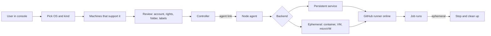
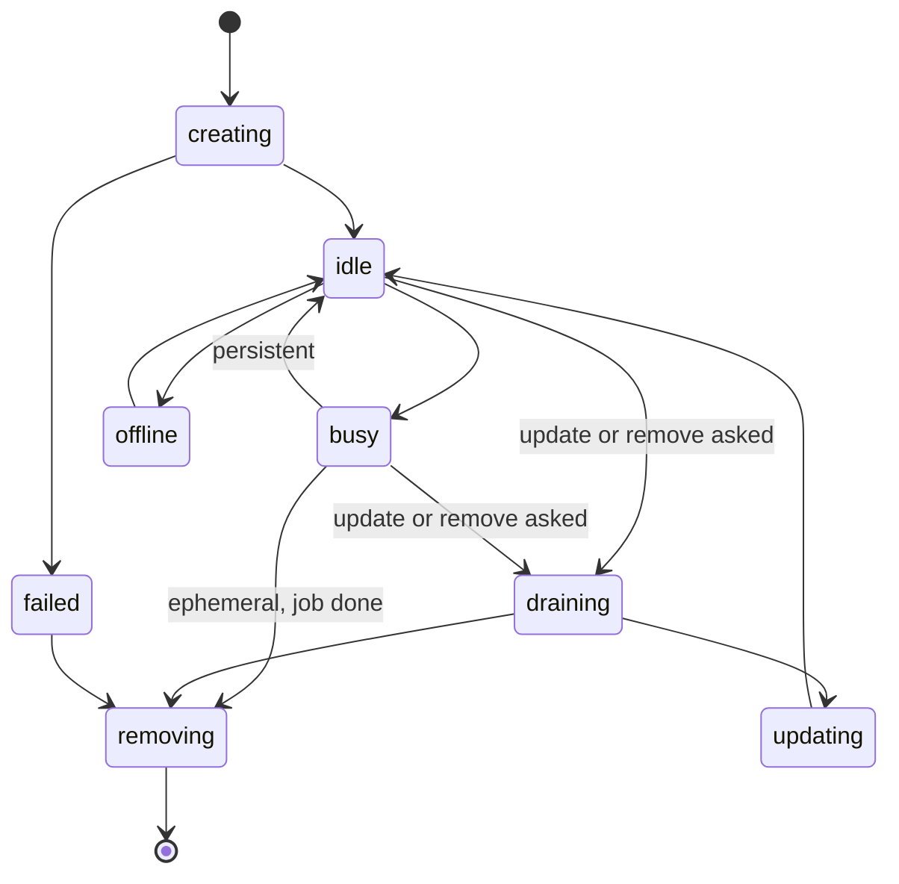
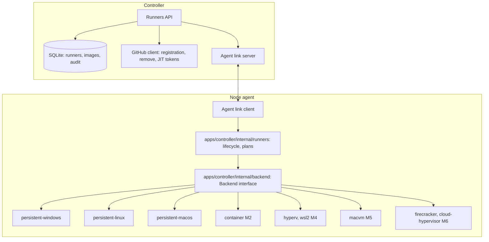

# Runners and isolation backends

**PARTLY BUILT (CRSP22).** The M1 persistent runner backends for Windows, Linux and macOS, the runner rules, the plan and apply flow and the runner API operations are built. Later milestones are built in part: the container backend (R5.27), extra packages, the environment sets, the private CA bundle, job limits and the tool store. A requirement not marked built in its own text is **NOT YET IMPLEMENTED**. Each requirement names the milestone that builds it (M1 to M6, from [the product brief](../../overview/product.md#milestones)).

Related: [product brief](../../overview/product.md), [decision 0003, isolation backends](../../architecture/decisions/0003-isolation-backends.md), [decision 0004, agent link](../../architecture/decisions/0004-agent-link.md), [decision 0005, product boundary](../../architecture/decisions/0005-product-boundary.md).

## 1. In one paragraph

A runner is a GitHub Actions self-hosted runner that the product creates, watches and removes on one of the user's machines. The user creates runners in the web console or the CLI, per OS, and only on machines that support that OS and isolation. Milestone 1 builds persistent runners on Windows, Linux and macOS: each runs as an OS service under its own non-admin account (the agent that makes it runs as LocalSystem or root, machines R5.44). Later milestones add ephemeral runners: one fresh container, VM or microVM per job, started with a just-in-time (JIT) config and thrown away after the job. Every kind of runner sits behind one backend interface.

## 2. Why

**Problem.** Runners made by hand drift. They run as a strong account (NETWORK SERVICE or LocalSystem), carry project labels, keep state between jobs and are hard to remove cleanly. The dev-standards runner pool fixed this for one Windows PC with Docker Desktop, at the cost of many failures (the learnings in the product brief). This feature carries that work into the product, for every OS.

**Users.** One person or a small team that runs CI for many repositories on their own machines.

**Goals.**

- Create, update and remove runners from the console, with no manual steps on the machine after the agent is installed.
- Use the best isolation each machine supports, behind one interface (decision 0003).
- Keep each runner's rights as small as the job allows.
- Never cut a running job.

**Non-goals.**

- GitHub-hosted runners.
- Scheduling and the slot queue (the `scheduling` feature). This spec only says when a runner starts and stops.
- Caches and the registry mirror server (milestone 7, the `caching` feature). This spec only says how runners use them.
- Cloud machines.

## 3. How it works



The steps in words:

1. The user opens Runners and chooses Create. They pick the OS and the kind (persistent or ephemeral).
2. The console lists only machines whose agent reports that OS and an allowed backend for that kind. Other machines are shown with the reason they cannot take it.
3. Review shows what will happen on the machine: the account, its rights, the folder, the service, the labels and the runner version. Nothing has changed yet.
4. The controller sends the plan to the agent over the agent link. The agent runs it through the backend.
5. A persistent runner registers once and stays. Its service runs jobs until the user removes or updates it.
6. An ephemeral runner gets a JIT config for one job. It starts, takes one job, and is stopped and cleaned up when the job ends.
7. The agent streams setup logs and runner logs, and reports usage, to the controller.



## 4. Screens and states

No mocks yet. The Runners screen and the Create runner wizard follow design system v1.

- Runners list: one row per runner with machine, **Type** (persistent or ephemeral), **Isolation** (container or on the machine; R5.151), labels, state, current job and age. Rows compare more than three facts, so it is a table (design system UX-25). Age keeps ageing (UX-53).
- Type and Isolation: every row and detail names both, in two columns: Type says persistent or ephemeral, Isolation says where the runner runs. A persistent runner says it keeps state between jobs (design system UX-61). The Setup Runners tab and the Runners-on-a-machine table of the Pool machine card use the same two columns from the shared table part (CORE-1, CORE-2, CORE-3, CORE-4, CORE-7; UX-25, UX-72). Tests: `apps/controller-console/src/screens/runners/Runners.test.tsx`, `apps/controller-console/src/screens/pool/PoolMachines.test.tsx`.
- State: each state is a word, a glyph and a colour (design system UX-58), read from one source (UX-19).
- Create runner: a wizard (design system UX-5) that ends with Review, Creating, Done (UX-30). A machine that cannot take the runner is shown disabled with its reason (UX-38).
- Remove runner, remove an image, replace an old runner: the question card names each item that goes, and a busy runner names its job and waits for the drain (design system UX-62, UX-9).
- Empty state: no machine supports the chosen OS. It says why and links to Machines (design system UX-6).
- Busy state: buttons that start work stay busy until the server answers (design system UX-13). A drain shows what it waits for and until when (UX-29).

## 5. Functional requirements

**Wired by CRSP41:** the controller passes the runners service to the API (`apps/controller/cmd/crsp/areas_wiring.go`), so the runner operations answer instead of 501. Records and plans are in memory until the SQL store lands. The controller's own machine runs the persistent backend of its OS. Another machine answers with a reason, because the agent does not carry `AddRunner` and `RemoveRunner` of the agent link yet. A test (`apps/controller/cmd/crsp/wiring_test.go`) builds the controller wiring and fails if a built operation answers 501. **Built by CRSP56:** R5.41, R5.42, R5.50 to R5.52, and R5.43 in part. **Built by CRSP49:** R5.47, and R5.48 and R5.49 in part (see each). **Built by CRSP38:** R5.46. **Built by CRSP22:** R5.1 to R5.8, R5.10, R5.13 to R5.24, R5.36, R5.37, R6.1 to R6.4 and R6.8 and R5.40 (R5.39 is built by CRSP21 and CRSP26) (their store and agent link adapters are listed in section 11). **Built in part:** R5.5 (the finders are built; the console list that shows `not managed` is not), R5.9 (`Detect` is built; the allow list belongs to `machines`), R5.11 (`StreamLogs` takes a redactor; the secret list is not wired), R5.12 (`ReportUsage` is built; the 15-second sender is not). **Built in part by CRSP59:** R5.38 (see it). **Not built:** R6.7, R6.9 (CI jobs). Every other requirement is **NOT YET IMPLEMENTED**. "Port" names the dev-standards source (repository `luis-mc/dev-standards`, spec `docs/features/runner-pool/spec.md`, requirement IDs as `DS R5.n`).

### 5.1 Lifecycle from the console

**R5.1** (M1) — **Create per OS, only where supported.** The console and the CLI create a runner from an OS, a runner type (persistent or ephemeral) and a machine. The machine choice lists only machines whose agent reports that OS and a backend that is allowed on that machine and supports the kind. The controller refuses any other request with the reason (for example `machine mac-1: no allowed backend for Windows`). **Built by OPS28 (owner decisions D93 and D94, 2026-11-18): the user picks the kind.** Add runners step 1 has a Type choice (the runner type), **Persistent** (keeps its tools and caches between jobs, starts jobs faster) and **Ephemeral** (a fresh container for every job, nothing carries over; recommended for public repositories). The console offers only the kinds the chosen machine can run for the chosen system: Ephemeral needs the container backend allowed on the machine (a Windows machine takes Linux ephemeral runners through its container engine, R5.47), Persistent needs a persistent backend for that system (on a Windows machine a persistent Linux runner is a long-lived container, R5.93). A kind that is not offered says why, with a link to the machine page where the cause can be changed. The preselected kind follows D94(b): **Ephemeral while any public repository uses the pool, otherwise Persistent**, with one reason line (`Ephemeral is chosen because a public repository uses the pool.`); the user can change it. A refusal for a kind comes back when the plan is made (`POST /runner-plans`) and is shown on step 1, so a plan that cannot run never reaches Review. Reasoning: the owner wanted the choice made when the runners are added, per machine, with the safe kind first where a public repository could send jobs (github-integration R5.60 keeps public repositories on ephemeral runners by default).

**R5.2** (M1) — **One runner record.** Each runner has: id, name, machine, OS, architecture, kind, backend, isolation (`microVM`, `VM`, `container` or `persistent`), labels, scope (repository, or organization runner group), runner version, state and current job. The record lives in the controller's database. A plan request may name no scope: the service takes the first repository with the pool on and adds the pool label, and refuses the plan with a reason when none has the pool on (LOOK31; until OPS23 registers a runner for every pool repository).

**R5.3** (M1) — **States.** A runner is in one state: `creating`, `idle`, `busy`, `draining`, `updating`, `offline`, `failed` or `removing`. The agent reports changes; the controller stores them and pushes them to the console.

**R5.4** (M1) — **Remove with a yes and a drain.** Removing a runner lists what goes (the GitHub registration, the service, the account, the folder) and needs a yes (design system UX-62). A busy runner drains first: it takes no new job and is removed when its job ends, and keeps waiting past the machine's drain timeout (machines R5.33), with a warning. The idle check runs right before the removal. Removal from GitHub uses a remove token, never a registration token, and its result is checked (port DS R5.32, DL315). **Planned (CRSP80, M2):** the order of idle check, deregister and stop, and the `422` rule, are in R5.62. A managed runner that is offline and whose machine cannot run the remove step is deleted at GitHub after a yes by `Service.DeleteOfflineRegistration` (github-integration R5.33, CRSP108). A runner is found by its id, or by its name when one runner has it (OPS19). Every change to a runner record is told to the live stream as `runner.state`, so the console list moves without a reload.

**R5.5** (M1) — **Find runners already on a machine.** The agent lists existing runners from the OS service list, not only from folders: Windows `Win32_Service` entries named `actions.runner.*` (path gives the folder, `StartName` the account), Linux systemd units `actions.runner.*`, macOS launchd jobs `actions.runner.*`. A runner whose folder the agent cannot read is still reported, and the checks that need admin rights say so (port DS R5.38). The console shows a runner it did not create as `not managed`.

**R5.6** (M1) — **Replace a hand-made runner only after the new one is online.** When a repository already has a self-hosted runner for the same OS that the product did not create, the plan can add steps after the new runner: stop and delete the old service, remove the old runner from GitHub, delete its folder. Each step needs its own yes naming it. A step waits while the new runner is not online, the runner list cannot be read, or the old runner has a job (port DS R5.33).

**R5.7** (M1) — **Isolation is named.** The console, the CLI and the API name each runner's isolation. A persistent runner is marked as keeping state between jobs (design system UX-61).

### 5.2 Backend interface

**R5.8** (M1) — **One interface.** Every backend implements: `Detect` (is it present and usable here), `PrepareImage`, `Start` (with a JIT config, or a registration for a persistent runner), `StreamLogs`, `Stop`, `CleanUp` and `ReportUsage` (decision 0003). The agent calls backends only through this interface.

**R5.9** (M1) — **Detect and allow.** At start and every 10 minutes the agent reports which backends work on the machine and why the others do not (for example `firecracker: no /dev/kvm`). The user allows backends per machine. A backend that is present but not allowed is never used.

**R5.10** (M1) — **Clean up always.** After `Stop`, the agent calls `CleanUp`, also after an error or a timeout. `CleanUp` is safe to call twice. An ephemeral runner leaves no container, VM, overlay disk, network or temp folder behind. A persistent runner's `CleanUp` (on removal) removes the service, the account and the folder.

**R5.11** (M1, redactor and private log Built CRSP47; wiring of `StreamLogs` to the controller stays with the agent link) — **Logs.** `StreamLogs` sends the setup log and the runner's own log lines to the controller as they come. Known secrets (tokens, passwords, JIT configs) are replaced by `***` before they leave the agent.

*Built by CRSP47* (`apps/controller/internal/redact`): one redactor holds every one-time value a backend is given (registration, remove and JIT tokens, with their base64 forms) and also matches the shapes `ghp_`, `github_pat_`, private keys, JWTs, `Authorization:` and `Cookie:` lines, `--token` flags and `ACTIONS_RUNNER_INPUT_*` values. The three persistent backends teach it each value in `Start` before any log line is written, and the controller passes it to every backend (`sys.Deps.Redact`, `sys.Deps.Secret`). A *private log* (`redact.PrivateLog`) is the runner's setup log file: written after redaction, mode `0600` in a `0700` folder, so only the account that owns the runner folder reads it.

**R5.12** (M1) — **Usage.** `ReportUsage` gives, per runner and per job: CPU time, peak and median memory, disk used, and wall time. The agent sends it at least every 15 seconds while a job runs, and once at the end.

### 5.3 Persistent runners on Windows (M1)

**R5.13** (M1) — **A service with its own account.** Each Windows persistent runner is a Windows service that runs as its own local account, never NETWORK SERVICE, LocalSystem or an administrator. The account name is `crsp-<short slug>`: at most 20 characters, lower-case letters, digits and hyphens, the same for the same runner on every run; a runner name that already starts with `crsp-` keeps that prefix once (`crsp-light-box` gives `crsp-light-box`, never `crsp-crsp-light-box`); a name that does not fit or is taken gets a 4-character hash (port DS R5.31, `test_dl310_windows_runner.py` slug tests).

**R5.14** (M1) — **Account rights.** The account is a member of the local group `crsp-runners`, has "log on as a service", and is denied interactive and remote desktop logon. It gets "create symbolic links" (`SeCreateSymbolicLinkPrivilege`) only when the runner's settings ask for it (for example a tool layer that needs symlinks, such as cargo-xwin). A rerun adds or removes the right to match the settings (port DS R5.31, changed: dev-standards gives it to every account).

**R5.15** (M1) — **Password never kept.** The account password is random. It is made inside the process that registers the service, set on the account and passed only to the runner's service registration. It is never in the plan, the database, a log, the output or a file. A rerun makes a new one only when the service is registered again (port DS R5.31).

**R5.16** (M1) — **Folder locked to the account.** The runner folder grants Full control to its account, Administrators and SYSTEM only. Inheritance is off.

**R5.17** (M1) — **PowerShell hooks that call the all-users binary.** The runner `.env` sets `ACTIONS_RUNNER_HOOK_JOB_STARTED` and `ACTIONS_RUNNER_HOOK_JOB_COMPLETED` to `.ps1` files, never `.cmd` (the runner refuses `.cmd`). Each hook calls the `crsp` binary installed for all users (under `Program Files`), never a copy in a user profile. The `.env` also sets `PSExecutionPolicyPreference=RemoteSigned` for the runner's processes only; the machine policy is not changed (port DS R5.31, learnings 4).

**R5.18** (M1) — **No cmd quoting.** The agent registers services and scheduled tasks through the Windows service API or PowerShell cmdlets (`New-Service`, `Register-ScheduledTask`) with each argument passed on its own. It never builds a cmd-quoted command line, because PowerShell 5.1 mangles quotes to native programs (port DS R5.32, learning 5).

**R5.19** (M1) — **Remove the old registration before locking the folder.** When a runner is registered again in place (for example with another account), the agent first removes the old registration with a remove token and checks the exit code. On failure it stops and leaves the old runner and folder as they were. Only after a good removal does it lock the folder to the new account (port DS R5.32, DL315, `test_dl315_runner_remove_token.py`).

**R5.20** (M1) — **Reruns are safe.** A runner whose name, folder, labels, account, rights and `.env` all match is reported `already` and not touched. One with another account is registered again in place (R5.19). One with only a stale `.env` has the file rewritten and the service restarted, without a new password (port DS R5.32).

### 5.4 Persistent runners on Linux (M1)

**R5.21** (M1) — **A systemd unit with its own user.** Each Linux persistent runner is a systemd system unit that runs as its own system user `crsp-<short slug>` (same naming as R5.13). The user has no login shell, no password and no sudo rights, and is in the group `crsp-runners`.

**R5.22** (M1) — **Folder and unit hardening.** The runner folder is owned by its user, mode `0700`. The unit sets `NoNewPrivileges=yes`, `PrivateTmp=yes`, `ProtectSystem=strict` with the runner folder in `ReadWritePaths`, and `Restart=on-failure`. The hooks are `.sh` files that call `/usr/local/bin/crsp`.

### 5.5 Persistent runners on macOS (M1)

**R5.23** (M1) — **A launchd daemon with its own user.** Each macOS persistent runner is a launchd daemon in `/Library/LaunchDaemons` with `UserName` set to its own hidden user `crsp-<short slug>` (no login shell, not an admin, not shown at login). The folder is owned by that user, mode `0700`. The hooks are `.sh` files that call `/usr/local/bin/crsp`.

**R5.24** (M1) — **All three OS together.** Milestone 1 ships R5.13 to R5.23 for Windows, Linux and macOS in the same release. Each OS backend is built only into the binary for that OS.

### 5.6 Ephemeral JIT runners

**R5.25** (M2, v0.3.0, Built CRSP52) — **One runner per job with a JIT config.** For an ephemeral runner the controller asks GitHub for a JIT config for one job and hands it to the agent. The runner takes one job and exits. The JIT config is passed in memory and on standard input only (github-integration R5.40, CRSP79); never a file. It is never stored in the database or logged. Built: `apps/controller/internal/runners/jit.go` `StartJobRunner` asks GitHub for the config (`apps/controller/internal/github/jitconfig.go`), passes it to the agent in the same call and drops it; the container backend sends it on the standard input of one `exec -i` call whose script reads one line and starts the runner with it in that one process's environment (CRSP79 replaced the earlier `0700` tmpfs file; the tmpfs is gone from the pool container). It is in no argument, record, event, audit line, log or error text. Plain `generate-jitconfig` is used, except for a job that came from a scale set, which takes the config of that scale set (github-integration R5.40).

**R5.26** (M2, v0.3.0, Built CRSP52) — **Nothing carries over.** After the job, the agent calls `Stop` and `CleanUp` (R5.10). The next job gets a new runner from the image. No state passes between jobs except the shared caches the user turned on. Built: each runner gets its own folder under `/home/runner/jobs`, copied from the image; `CleanUp` removes it and any config file, safe twice and when the container is gone (`apps/controller/internal/backend/container/container.go`). Built by CRSP64: a runner that gets no job keeps its slot only 15 minutes. The demand loop (`apps/controller/internal/demand/demand.go` `SweepIdle`, `DefaultIdleAfter`) asks GitHub that the runner is not busy (`Service.RemoveIdleRunner`, `apps/controller/internal/runners/ephemeral.go`), deletes it at GitHub (GitHub refuses a runner that took a job in the meantime), stops the listener, cleans up the folder and drops the record, which frees the slot. A busy runner is left to its job; a failed removal is tried again after a minute; the job the runner was made for waits again when it is still queued. The runner records and the loop's view are in memory (the store table exists but the controller wires the memory store), so a restart loses them; see open question 44.

**R5.27** (M2, v0.3.0, Built CRSP52) — **Containers on Linux and WSL2.** The container backend uses rootless Podman, or Docker when Podman is not there. The job runs as a non-root user. The container never runs with `--privileged` and never gets the Docker socket. When the machine allows KVM for that runner, `/dev/kvm` is passed with `--device` only. Memory and CPU caps come from the machine's load budget. Built in part: Docker only (rootless Podman is open question 19). One pool container per repository (`PoolName`), `--user 1001:1001`, `--cap-drop ALL` with `no-new-privileges` as the one capability set (open question 18), `--device /dev/kvm` only when the machine allows it, memory and CPU caps from `Config.Limits`. `CheckRunArgs` refuses `--privileged`, `--cap-add`, host PID, network, IPC or user namespace, any other device, any engine socket and root, before every `docker run`. The registry does not list the backend yet (open question 21). Wired by CRSP58: the Linux binary's registry holds the container backend (`apps/controller/internal/backend/registry/registry_linux.go`), listed before the persistent one. A machine uses it only when `docker` is in its allowed backends (machines R5.9), which is off by default: the default allow list is `persistent`. The local agent sends a JIT config to the container backend and a registration token to the persistent one, builds the base image on first use, and cleans up a container handle (`<pool>:<runner>`) with the container backend. `PlanAdd` and its apply start an ephemeral runner only on Linux and only on a machine with the container backend allowed, usable and present (`apps/controller/internal/runners/ephemeral_test.go`). Built by CRSP64: the pool size of the machine (machines R5.58: CPUs and memory) is passed with the runner spec (`PoolCPUs`, `PoolMemoryMB`, set in `StartJobRunner`) and becomes `--cpus` and `--memory` of the repository's pool container (`limitsFor`); `Config.Limits` is the fallback and `DefaultConfig` sets none. `CheckRunArgs` accepts both flags. A machine with no pool size set leaves the container uncapped. The base image files are embedded in the binary (`images/embed.go`) and written with the crsp binary to a build folder under the user cache (`stageBuild`) before a build; the folder is removed after it, and the image key is the same as before. No installer folder is needed. **Planned (CRSP81, M2, NOT YET IMPLEMENTED):** the memory, CPU and process limits, the single job network with no traffic between containers, and the "What a job can reach" page are in R5.63 and R5.64.

**R5.28** (M4) — **Hyper-V and WSL2 VMs on Windows.** The Hyper-V backend starts a VM per job from a prepared disk with a differencing disk on top, and deletes the differencing disk after the job. The WSL2 backend starts a Linux microVM or container per job inside WSL2. **Planned (CRSP86, M4):** a job that needs Docker runs in a copy-on-write clone; see R5.66. Windows containers with Hyper-V isolation (R5.65, CRSP85) are an option beside the VM.

**R5.29** (M5, Built in part CRSP114: `apps/controller/internal/backend/macvm`, tested with fakes; the Virtualization.framework boot bridge, which needs a real Mac, and the registry wiring are NOT YET IMPLEMENTED) — **macOS VMs on Apple's Virtualization.framework, at most two.** (Owner decision D54, 2026-11-15.) crsp uses its own code on Apple's Virtualization.framework, not Tart: Tart moved to OpenAI and is under FSL-1.1-ALv2, a licence the product does not take on. The macOS backend creates a VM per job from a prepared image, with its own image preparation and cloning, and no external VM tool. The agent never runs more than two macOS VMs on one Mac at once, counting VMs it did not start. A third job waits for a free VM and says why. **Built (CRSP114):** the limit of two (a constant, R6.6), the APFS clone per job from the base disk and its removal after the job, the wait with a reason for a third job, the count of VMs the agent did not start, and the refusal on an Intel Mac or macOS older than 13. **Planned (CRSP86, M5):** the macOS clone for Docker in a job follows R5.66.

**R5.30** (M6) — **MicroVMs with snapshots.** On Linux with KVM, the Firecracker or Cloud Hypervisor backend boots an image once, takes a snapshot, and starts each job from that snapshot. The snapshot is keyed by image, kernel, vCPU count and memory; a change of any of them makes a new snapshot. After a restore the guest clock is set from the host and the guest random pool is reseeded (port DS R5.29).

**R5.31** (M2, v0.3.0, Built CRSP52) — **Best backend first.** When the user does not choose, the agent uses the first allowed backend in the order of decision 0003 for that OS (for Linux with `/dev/kvm`: microVM, then container, then persistent). Built: `backend.Order` and `backend.Choose` (`apps/controller/internal/backend/choose.go`). A backend that is absent, not allowed or not usable is skipped; a backend the user chose is the only one tried, and its failure is named. Wired by CRSP58: the demand loop (github-integration R5.37) picks a machine whose allow list names the container backend and starts the runner there; `PlanAdd` accepts an ephemeral runner only on such a machine. Open questions 21 and 32 to 36.

### 5.7 Images

**R5.32** (M2, v0.3.0, Built CRSP52) — **Base images with tool layers.** Each OS has a few base images. The user turns tool layers on per pool: build tools, browsers for Playwright, packaging tools, cross-compilers. The layer list of an image is shown with its size (port DS R5.9, R5.11). Built in part: layer names go into the image as a build argument and a label, and `ListImages` shows each image with its layers and total size. A size per layer is not read (open question 20). The tool lists of the layers are R5.50. Layer words (LOOK12): each optional layer also carries a title, a one-line "pick it when" and the job labels that ask for it (`apps/controller/internal/backend/container/layers.go`); the base tools and their pinned versions are read from the embedded `images/linux-base/Dockerfile` (`container.BaseTools`); the chosen layers are stored per machine and OS, also before the first build. The Images tab that shows them is caches R5.55.

**R5.33** (M2, v0.3.0, Built CRSP52) — **Build once per machine, keep the newest few.** An image is keyed by its base, its layers and its pinned versions. A machine builds each key once and reuses it. It keeps the newest 3 images per OS (a setting) and deletes older ones that no runner uses. Built: `runners.ImageKey` (base, sorted layers, pinned versions), `PrepareImage` builds a key once, `PruneImages` keeps the newest 3 per OS (`DefaultKeepImages`) and never deletes an image a pool container uses. Built by CRSP64: the files of the base image and the layers come from the binary (`images.FS`), see R5.27.

**R5.34** (M2, Built CRSP254: `runners.MirrorPull` in `apps/controller/internal/runners/mirror.go`) — **Pull through the registry mirror.** When the pool has a registry mirror, image pulls go through it. When the mirror cannot be reached, pulls go to the upstream registry and the console says so once (`MirrorPull.Notice`, told the first time a pull falls back). Cross-system: the code is the same for Windows, Linux and macOS behind functions and fakes; it is tested on Linux and Windows builds and compiled and unit-tested for macOS in CI, but not run on a real Mac.

**R5.35** (M2, v0.3.0, Built CRSP52) — **Rebuild with drain.** A rebuild builds the new image while the old one keeps serving jobs. Runners switch to the new image only when idle; the idle check runs right before the switch. When the pool container is not running (Exited, for example after a Docker restart) there is no job and no supervisor to answer, so the pool counts as drained at once and the switch runs without a wait (handover lesson 27; HND2). A build failure keeps the old image and says `the rebuild failed: <reason>` (port DS R5.10, R5.13, R5.15; learning 1). Built: `Backend.Refresh` builds aside, stops new runners (`ErrDraining`), waits with `runners.Drain` (idle check right before the swap, then once more under the lock), swaps, and puts the old image back when the new one does not start. A failed build says `the rebuild failed: <reason>` and changes nothing.

**R5.79** (M1, Built RES10) — **One pins file, images by digest.** The runner version and SHA-256 per OS and architecture, and every container image the product builds on, live in one file, `apps/controller/internal/runners/pins.json`, embedded in the binary. An update of a pin is a reviewed change of that file and nothing else. The file is refused whole when a hash is not a real SHA-256 (R5.37), an OS and architecture is pinned twice, a key is unknown, or an image is not `name@sha256:<64 hex>`: a tag is never a pin, because a tag can move. The base image line of `images/linux-base/Dockerfile` equals the pinned reference, and a test fails when any other `FROM` in `images/` is a bare tag (a layer builds on `${BASE_IMAGE}`). The agent still deletes and refuses a download whose SHA-256 differs from the pin (R5.37); the runner file swap (R5.38) is not changed. Not built: the loader image `alpine:3.20` in `images/layers/compose.kvm.yaml` is still a tag, because its digest could not be read from the build sandbox (open question 56). Source: landscape-2026-11, G21 and the local-ci-pool and Unyoke supply-chain notes.

**R5.80** (M4, Built in part RES12) — **Tool artifacts reach a VM job as an OCI image.** A job in a VM does not download its tools inside the VM. The agent pulls an OCI image of the tools by digest on the host (`name[:tag]@sha256:<64 hex>`; a bare tag is refused), checks that the manifest hashes to the digest and each layer to the digest in the manifest, unpacks the merged layers once into a folder (regular files and folders only; a link, device, `..` or absolute path refuses the image; whiteouts are applied), and attaches the result read-only at VM boot at `/opt/crsp-tools`: as a squashfs disk image (kind `disk`, packed with `mksquashfs`, the unpacked folder then deleted) or as a virtiofs share with the tag `crsp-tools` (kind `virtiofs`). Both outputs are named by the digest and never change, so a second job with the same digest reuses them. A failed pull, digest check, unpack or pack leaves nothing behind. The VM backend hook is `backend.ToolBooter.StartWithTools`; a backend without it answers `toolimage.ErrNoToolMounts` and the job downloads its tools as before. Built: the format, the digest checks, the unpack, the packer and the hook, with fakes (`apps/controller/internal/toolimage`). Not built: the registry client (`Puller`), no VM backend implements `ToolBooter` yet (M4), and the guest unit that mounts the disk or share (open question 57).

### 5.10 Runner caches (M1)

**R5.39** (M1) — **Cache folders, quotas and disk guard.** Each persistent runner has its own tool cache and Rust build cache folders under its folder, exported to its jobs as `CI_TOOLS_DIR` and `CARGO_TARGET_DIR`, with the quotas declared in configuration (default 20 GiB and 40 GiB). The job-completed hook evicts the oldest entries over a quota, between jobs only. The job-started gate holds new jobs while the volume has under 10% free, and the doctor reports it. The rules, the defaults and the tests are caches R5.36 to R5.39. Built (CRSP21, CRSP26). Replaces the milestone 7 plan for the cache cap.

### 5.8 Labels

**R5.36** (M1) — **Generic labels only.** A runner carries only `self-hosted`, its OS, its architecture, `docker`, `kvm`, `gpu` and the pool name. Each capability label is added only when the agent has checked it works (for example `kvm` only when `/dev/kvm` is usable by the runner). The controller refuses any other label with the reason (port DS R5.36, R5.37; learning 7). A size label `cpu=N` or `ram=N` (scheduling R5.67a, CRSP264) is also a generic label; a bad value is refused with the reason, and the job container's CPU and memory caps are lowered to it, never raised.

### 5.9 Runner version

**R5.37** (M1) — **Pinned runner version with SHA-256.** The binary carries one pinned GitHub runner version per OS and architecture, each with its SHA-256. A download whose hash does not match is deleted and refused. A hash that is not 64 hex characters, or is one repeated character, is treated as wrong (port DS R5.14).

**R5.38** (M1, Built in part CRSP59, HND15: `Service.UpdateRunner` and `UpdateAll`, the owner setting, and the agent message that replaces the files, R5.69; the schedule is not built) — **Auto-update with drain.** Persistent runners are registered with the runner's own self-update turned off. When a release of the product pins a newer runner version, or GitHub marks the running version as deprecated, the agent updates each runner: it drains it, replaces the runner files, and starts it again. The idle check runs right before the swap. An ephemeral runner uses the new version from its next job. Built (CRSP59): `UpdateRunner` sets the runner `draining`, waits with `Drain` (idle check right before the swap, R6.4), sets `updating`, calls the agent, then records the new version and sets `idle`. The result is `updated`, `failed` with the reason, or `waiting for the job to end` (the drain ran out; the runner keeps its old version and nothing was stopped). `UpdateAll` skips ephemeral runners and runners already on the pin. The automatic run follows the product's automatic-update setting (operations R5.15, default on); an update the owner asks for runs when it is off. Built (HND15): the agent link message and the file replacement on each OS (R5.69); a machine whose agent does not report `runner_swap` still answers `the agent of this machine cannot update runners yet`. Not built: the schedule that calls `UpdateAll` when a release pins a newer version or GitHub marks the version deprecated.

**R5.40** (M1) — **A missing or broken crsp never hides.** The `.ps1` and `.sh` hooks keep the job going when `crsp` is not installed, cannot start, or cannot be reached (a bad install must not fail CI), but each prints the GitHub Actions annotation `::warning title=crsp::...` on its own line. The text says what failed (`crsp is not installed at <path>` or `crsp at <path> could not run (...)`), that the job ran without the queue and the load gate, and what to do (reinstall crsp for all users on this machine, then run `crsp doctor --check runner.hooks`). The hook also writes the line to `crsp-hook-problem.txt` next to the scripts, which the agent reads into the runner's hook problems for the doctor (doctor R5.14). `CRSP_BIN` overrides the binary path, for tests. The same applies to every OS. Built.

### 5.11 Parity with the old pool (after v0.1.0)

The dev-standards runner pool covered these cases ([handover page](../../architecture/dev-standards-handover.md), section 4). Each requirement below targets a milestone after v0.1.0. A requirement marked built or built in part says so in its own text; the others are **NOT YET IMPLEMENTED**. Until a requirement is built, jobs that need it run on GitHub-hosted runners.

**R5.41** (after v0.1.0, Built by CRSP56: `container.KVMArgs`, `CheckRunArgs`, `DecideKVM`, the `kvm` layer and `images/layers/compose.kvm.yaml`; Built by CRSP68: the pool start passes the device with the host group only when the pool has the `kvm` layer and the probe finds a device the agent can open, after a bounded wait, or when the machine config forces it; otherwise it starts without the device and logs why; open question 51) — **Linux containers with KVM.** A Linux runner in a container (R5.27) on a machine whose `/dev/kvm` the agent has checked as usable by the runner gets the `kvm` label (R5.36) and the device through the cgroup rule `--device-cgroup-rule 'c 10:232 rwm'` (compose: `device_cgroup_rules`), never `--privileged` and never a `--device /dev/kvm` or `devices:` mapping: at daemon boot Docker restarts the pool before the KVM loader, and a mapping to a missing file fails the container start (handover lesson 28; HND1). The pool's `kvm-wait.sh` creates `/dev/kvm` with `mknod` (10:232) once `/proc/misc` lists `kvm`, inside its bounded wait (machines R5.53). A test VM boot job (the `vm_check.py` case of the handover page) runs in it. When `/dev/kvm` is missing or not usable the runner has no `kvm` label and the doctor says why (machines R5.53).

**R5.42** (after v0.1.0, Built by CRSP56: `container.RunnerWinePrefix`, `WineEnv`, `UnsetWineEnv`, the `windows-packaging` layer) — **A Wine prefix per runner.** A Linux runner image that has the `wine` layer gives each runner its own Wine prefix in the runner's own folder, set by `WINEPREFIX`. `TMPDIR` is not set in the runner's job environment, because a set `TMPDIR` breaks Wine's startup. Two runners never share a prefix. A prefix is made on first use and removed with the runner.

**R5.43** (after v0.1.0, Built in part CRSP56: the `llvm` layer with LLVM 20.1.8 for amd64 and its self-check; Built HND19: the same pin for arm64, and the image job of CI builds the layer for both; the symlink right on Windows is R5.68, Built HND20) — **LLVM and clang-cl for cargo-xwin.** A Linux image layer `llvm` holds a pinned LLVM (SHA-256 checked, R5.37 rule) with `clang-cl`, `lld-link` and `llvm-lib` on the `PATH`, so `cargo-xwin` builds Windows targets. The layer has a self-check that runs `clang-cl --version`. The layer pins LLVM 20.1.8 for amd64 (`LLVM-20.1.8-Linux-X64`) and arm64 (`LLVM-20.1.8-Linux-ARM64`), each with its own SHA-256, equal to the `llvm` entry of `scripts/delivery/tools.json` that `ci_tool.py` downloads from (a test keeps them equal); any other architecture fails the build. The CI `image` job is a matrix of `amd64` and `arm64` (`ubuntu-24.04-arm`): both build the base image and the `llvm` layer and run its tools; the other layers carry amd64-only tools and build on amd64 only (HND19, closes the amd64-only part of open question 28). On a Windows runner the symlink right that `cargo-xwin` and Rust tooling need follows R5.14 and R5.68: given only when the machine or label setting asks for it.

**R5.44** (v0.4.0, Built CRSP55: `images/layers/browsers/Dockerfile`, `SelectLayers` and `NeverLower` in `apps/controller/internal/runners/layers.go`, CI job `image`; CRSP68: the pool start sets `PLAYWRIGHT_BROWSERS_PATH` to the image path for a pool with the layer, open question 53) — **Playwright browsers in the image.** An image layer `browsers` (open question 25) holds the Chromium, Firefox and WebKit builds for one pinned Playwright version and their system packages, at a fixed path set by `PLAYWRIGHT_BROWSERS_PATH` (caches R5.41). The layer's self-check launches each browser headless once. A job that finds the browsers there downloads nothing. The layer is built on top of the base image (`FROM ${BASE_IMAGE}`), its Playwright version is pinned (`PlaywrightPin`) and chosen per pool, and **a rebuild never lowers a pool's Playwright version**: when the pool's current version is higher than the wanted one, the current one is kept (`NeverLower`). A version that is not dotted numbers is refused and nothing changes. CI builds the layer with `docker build` only, no push.

**R5.45** (v0.4.0, Built CRSP54: `apps/controller/internal/runners/postgres.go`; starting the server for a real pool is the pool lifecycle, the next wave) — **Postgres roles per runner.** Where a machine offers a Postgres server to jobs, each runner gets its own role and its own database owned by it, with a random password the agent keeps in the OS secret store and puts only in that runner's job environment. A role cannot connect to another runner's database. The role and database go with the runner when it is removed. No secret is written to a log (R6.2).

Section 5.11 continues with the requirements added so that crsp runs every job of the old pool (task CRSP39; the plan document was removed by CRSP227). Each names the release that builds it.

**R5.47** (M2, v0.3.0, Built CRSP49: engine detection and the `Engine` interface, `apps/controller/internal/backend/container/engine.go`; CRSP61: `agent.DetectEngine` in `apps/controller/internal/agent/engine.go` names the engine the agent found, Docker in WSL2 through the Windows CLI, through `wsl docker`, or Docker Desktop (told by the `OperatingSystem` of `docker info`), and the doctor check `machine.engine` shows it; CRSP127: the report also says which OS the engine's containers run (`container_os`, read from `docker info`: Docker Desktop on WSL2 answers `linux`), the agent link carries it in `MachineReport.engine`, the machines service records it, Add runners offers System Linux on a Windows machine whose engine runs Linux containers and the container backend is registered in the Windows binary) — **Containers run in WSL2 through Docker first.** On a Windows machine the container backend (R5.27) uses the Docker engine of WSL2 through the Windows `docker` CLI first, and `wsl docker` only when that CLI cannot run (machines R5.18). The agent detects the engine, its version and the WSL2 state, and reports the reason when the engine is not usable (R5.9). The backend interface hides the engine, so rootless Podman in a crsp-owned WSL2 distro can replace Docker later with no change to runners. The agent never edits the settings of Docker Desktop. Built by CRSP127: a Windows machine whose engine runs Linux containers takes Linux runners in the container backend, as ephemeral container runners with the labels `self-hosted`, `linux`, the architecture and the pool label, started by the agent through the Windows `docker` command with the same `CheckRunArgs` rules as on Linux (no `--privileged`, no engine socket, non-root); the container backend must be allowed on the machine (off by default); a persistent Linux runner on Windows is built by OPS28 as a long-lived container (R5.93; before OPS28 it was refused). A Windows machine whose engine reports no Linux containers (no engine, engine down, or Windows containers mode) is still refused Linux. `CRSP_RUNS_ON_LINUX` is written for a pool-on repository when such a machine is online. The agent's `wsl2` backend is no longer reported as "not ready" when `wsl --status` fails but the docker engine runs on the WSL2 kernel (Docker Desktop's own distro); nothing is changed to find out. Not built: the crsp binary mount (R5.48) on a Windows host, because the agent's own file there is a Windows binary. Built by OPS27: the same runner can be added to the pool (scope pool): the plan accepted a pool-scope ephemeral request for a Linux container runner on a Windows machine and stored it as a pool runner without a registration; OPS28 replaces the refusal of any other ephemeral pool request with the behaviour of R5.92 (ephemeral pool runners on every machine that can run containers). Add runners checks the container backend and the plan before Review and shows a refusal on step 1. The engine is found when it is first needed: `Docker.Command` and `Docker.Run` detect it themselves (guarded by a lock) when no `Detect` has run, and look again each call while none was found, so an engine started later is used and no caller has to prime it. When the engine is not usable, a call fails with its reason (for example "the docker command is installed but the engine does not answer"), not only "no usable container engine", so adding a container runner fails early and says why. Clean-up of a container runner with no engine at all succeeds, because no container can exist; a failed container runner can be removed, and its error says "container", not "service" (OPS46).

**R5.48** (M2, v0.3.0, Built in part CRSP49: the image holds a copy of the linux `crsp`; `container.CrspMountArgs` builds the read-only mount; `crsp vm` is built by CRSP61 (caches R5.46); `crsp db-env` is built (R5.54); CRSP68: the pool start mounts it when the config has the agent's linux binary, which is set by default on a Linux agent; open question 52) — **The `crsp` binary is inside every container job.** The agent mounts its own binary read-only at `/usr/local/bin/crsp` in each runner container, so a job can call `crsp vm` and `crsp db-env` (caches R5.46, runners R5.54). The version is the agent's. No socket is mounted (R6.1).

**R5.49** (M2, v0.3.0, Built CRSP49 and CRSP69: `images/linux-base/Dockerfile` and the CI job `image`; the Actions runner is in `/opt/actions-runner`, see open question 10) — **A base image that is like a GitHub-hosted runner.** The Linux base image is an Ubuntu LTS image. It always holds: `git`, `curl`, `ca-certificates`, `python3`, `jq`, `zip`, `unzip`, `xz-utils`, `build-essential`, `pkg-config`, `libatomic1` (pnpm needs it), `postgresql-client`, `libicu`; the GitHub CLI `gh`; the Actions runner and its dependencies; and Node LTS with `corepack`. Every download is pinned and SHA-256 checked (R5.37 rule); a missing or wrong hash fails the build. Node is installed with its `bin` first on `PATH` for every user and before the build step that runs `corepack enable`. `corepack enable` runs once at build time as root, so the `pnpm` and `yarn` shims exist and an unprivileged job needs no write access; the shims pin no version. The job user is not root and has no `sudo`. A self-check at build time runs each tool (`node --version`, `corepack --version`, `gh --version`, the `pnpm` shim, `ldconfig -p` for `libatomic`) and fails the build when one is missing (port DS R5.26, R5.16 and the pool image of runner-pool). Built by OPS41: apt in the base image and in each layer that uses it retries and times out (`Acquire::Retries`, `Acquire::http::Timeout`), so a slow mirror does not hold a build for tens of minutes. The Dockerfile has two stages: `tools` holds every slow layer and does not depend on the `crsp` binary, and the last stage adds `crsp`, so a plain `docker build` still gives the full base image. The CI job `image` builds with buildx and the GitHub Actions cache (one scope per architecture and image) and builds the tool layers on the `tools` stage, so an unchanged layer is reused. It runs on a release pull request (head branch `*-integration`), on main and on a manual run, and on any other pull request only when `images/**` or the build or ci workflow changed (`scripts/ci/image_scope.py`).

**R5.50** (M2, v0.4.0 to v0.6.0, Built by CRSP56 and finished by CRSP60 (self-checks pin the dotnet and Wine lines, `fakeroot` added, the layers are chosen by name in `SelectLayers`) for `windows-packaging`, `linux-packaging`, `llvm` and `kvm`: `runners.Layers()` and `images/layers/*/Dockerfile`, each built in CI; `playwright` is R5.44 and is not built; turning a layer on for a pool needs the pool settings, the next wave) — **Image layers carry fixed tool lists.** A layer is off until the user turns it on for a pool (R5.32), and a layer turned off in a repository setting is removed from an image only by an explicit drop. The layers and what each adds:
- `windows-packaging` (v0.5.0): `dotnet-sdk-8.0`, `wine`, `wine64`, `xvfb`, `xauth`, `msitools`. It includes the Wine rules of R5.42 and R5.52. About 1 GB.
- `linux-packaging` (v0.5.0): `dpkg-dev`, `fakeroot`, `rpm`, `make`, `checkpolicy`, `selinux-policy-dev`, `policycoreutils`, `gnupg`, `shellcheck`, `systemd`, `createrepo-c`, and `policycoreutils-python-utils` when the base image has it (a missing one is skipped without a failure).
- `llvm` (v0.5.0): R5.43. `playwright` (v0.4.0): R5.44.
- `kvm` (v0.6.0): `qemu-system-x86`, `qemu-utils`, `cloud-image-utils`, `openssh-client`, plus R5.41.
Each layer has a self-check that runs its main tools. The doctor probes the same tools in the running image (doctor R5.31). A layer name stays the same as the dev-standards name, so a project setting maps one to one (port DS R5.9, R5.11).

**R5.51** (M2, v0.5.0, Built by CRSP56, CRSP60 and CRSP70: `runners.ParseExtraPackages`, `MergeExtraPackages`, `LayerSetKey`, `PlanImage` and `images/layers/extra-packages/Dockerfile`, built in CI; the pool setting, its API, CLI and console field are built; the list reaches a remote agent through R5.68) — **Extra packages per pool.** A pool may list extra distribution packages, one per line. A name has only letters, digits and `+ - .` and does not start with `-`; anything else is refused with the line number and nothing changes. The names are part of the image key (R5.33). A name that was added stays until the user drops it. The packages are installed by the last layer of the image (`extra-packages`, `PlanImage`), which checks each name against the same pattern again and runs `dpkg -s` on each as its self-check. An empty list adds no layer. A changed list changes the image key, so the new image builds aside. Built by CRSP70: the list is a field of the repository policy (`Policy.ExtraPackages`, sorted, no repeats), read with `GET /api/v1/repositories/{id}/extra-packages` and replaced as a whole with `PUT` (text, one name per line; admin; the controller checks it with `ParseExtraPackages` and a bad name answers 400 with its line number and changes nothing). The policy view lists it as `extra_packages`. The CLI is `crsp repo packages OWNER/NAME [--set A,B]`. The console shows the list on the repository's page as a text area with the line number of a mistake above its box. The demand loop passes the list with the runner request (`JobRunner.ExtraPackages`, `RunnerSpec.ExtraPackages`); the local agent hands it to `PrepareImage` (`ImageSpec.Extras`), which adds it to the image key (`ImageKeyInput.Extras`; no names leaves the key as before) and passes it as the `EXTRA_PACKAGES` build argument. NOT YET IMPLEMENTED: the SQL column (the repositories store is in memory, as for every policy field), and building the `extra-packages` layer inside the pool image build on the machine.

**R5.52** (M2, v0.5.0, Built by CRSP56: `container.PrepareWinePrefix`; Built in part by CRSP66: `container.EnsureWinePrefix` with the stamp file, `LaneWinePrefix`, `LaneWineJobEnv`; CRSP68: the pool start calls `EnsureWinePrefix` through the engine, in the lane's Wine folder, for a pool with the `windows-packaging` layer, and sets `WINEPREFIX` and `POOL_WINE_PREFIX`; a pool with that layer and no lane is refused; open question 49) — **The Wine prefix is made once and kept.** With the `wine` tools in the image, the agent prepares the prefix of a cache lane (caches R5.43) before the first job that uses the lane: `wineboot --init` under `xvfb-run -a`, as the job user, with `WINEDEBUG=-all`, a 180 second timeout and `wineserver -w` after it. It skips a lane whose prefix already holds `system.reg`. A failure is logged and never stops the job from starting. The prefix lives in the lane's cache folder, so it outlives the container. The agent sets `WINEPREFIX` to it and also `POOL_WINE_PREFIX` to the same path, the name that existing workflows copy from, until the dev-standards scripts drop it. `TMPDIR` is unset for every Wine tool (R5.43). Port of DS R5.17 to R5.19. **Built (CRSP66):** the prefix is made only when the image has the `windows-packaging` layer. A stamp file `.crsp-wine-line` in the prefix holds the Wine line (`major.minor` of `wine --version`, so a patch release keeps the prefix). A prefix whose stamp matches is kept; a different line, or a prefix with no stamp, is removed and made again, and the stamp is written only after a good boot, so a failed rebuild is tried again at the next job. The prefix is the Wine folder of the repository's own lane, so two repositories never share one; inside the container a job sees it as `/wine` under `WINEPREFIX` and `POOL_WINE_PREFIX`.

**R5.53** (M2, v0.3.0, partly built, CRSP50) — **The job environment is a contract.** A container job and a persistent runner job get these values and no others from the pool: `CI_TOOLS_DIR` and `CARGO_TARGET_DIR` (caches R5.39, R5.43), `CI_MAX_PARALLEL` (the runner's CPU count, machines R5.54), `PLAYWRIGHT_BROWSERS_PATH` (R5.44, caches R5.41), `WINEPREFIX` and `POOL_WINE_PREFIX` (R5.51), `RUNNER_TOOL_CACHE` kept in the lane (caches R5.43), and the database settings of R5.53. No project name and no pool path is set. The list is in the runner `.env` or the container environment, and the doctor reports a runner that lacks one that its image layers promise. Built (CRSP50): `CI_MAX_PARALLEL` in the `.env` of a persistent runner on Linux, Windows and macOS, the pool CPUs split over the job slots of the machine (machines R5.54); no pool size set exports none. Built (CRSP68): the container environment: `CI_TOOLS_DIR`, `CARGO_TARGET_DIR`, `RUNNER_TOOL_CACHE` and the lane on the pool container; `PLAYWRIGHT_BROWSERS_PATH`, `WINEPREFIX` and `POOL_WINE_PREFIX` on the pool container by layer; `CI_MAX_PARALLEL`, the cache quotas and `CRSP_DB_ENV_FILE` on each runner's listener. NOT YET IMPLEMENTED: the doctor check.

**R5.54** (M2, v0.4.0, Built CRSP54: `apps/controller/internal/runners/postgres.go` and `apps/controller/internal/jobcmd/dbenv.go`; Built CRSP68: the pool start calls `EnsureServer` and `Provision` for a repository that declares a database, joins the pool container to the Postgres network, writes `db.env` (mode 0600, job user) into the runner folder, sets `CRSP_DB_ENV_FILE`, and removes the login at clean up; open question 50) — **Postgres per runner, in detail.** This adds to R5.45. The Postgres server is a container the agent starts (PostgreSQL 16, its data in a named volume, no published port, reachable only on the pool network). Its admin password is made once and kept in the OS secret store. For each repository's runner lane the agent makes: a login role with a random password and a database it owns; `CREATEDB` for that login only when the repository setting `db_createdb` is on (so a test run can make `<base>_w<K>` databases, one per worker); and the repository's declared `NOLOGIN` roles (names are lowercase letters, digits and underscore, at most 63; `postgres`, `public` and `pg_*` are refused, and so is a role another repository declares, with both repositories named), each created behind an exists check and granted to the login `WITH ADMIN OPTION`. A rerun keeps the password, so a running job is not cut off. The job gets `DATABASE_URL`, `PGHOST`, `PGPORT`, `PGUSER`, `PGPASSWORD` and `PGDATABASE` through the step `crsp db-env`, which masks the secrets and appends the lines to `GITHUB_ENV`; outside a pool job it prints that it does nothing and exits 0 (port of `pool-db-env`, DS R5.27).

**R5.55** (M2, v0.6.0, Built CRSP71: `crsp vm boot`, `run` and `selinux` print the warning; `apps/controller/internal/vmcheck/memory.go`; it warns and boots anyway, caches open question 21) — **A VM counts against the runner's memory.** A job that boots a guest VM (caches R5.46) uses memory of the runner's cap. `crsp vm` prints a warning when the cap has less than the guest memory plus 1 GiB free, and the machine load budget (scheduling R5.40) already counts the guest because it is a process on the machine. A runner with the `kvm` label is sized for its guests (machines R5.54).

**R5.56** (M1, v0.2.0, Built CRSP47) — **A tool home per persistent runner.** The `.env` of each persistent runner sets `RUSTUP_HOME` and `CARGO_HOME` to folders under its own runner folder (`<runner folder>/cache/tools/rustup` and `.../cargo`), so two runner accounts never share a toolchain and a toolchain follows the runner when it is removed. They count in the tool cache quota (caches R5.36). On Windows the account needs no other setting for them. Port of DS R5.31 (`.env`).

**R5.57** (M1) — **Removed (owner decision D110, 19 Nov 2026: "per-repository light runners do not fit the design").** crsp no longer makes light runners. The pool is set up first, repositories opt in, and the user never picks a repository for a runner; pool runners serve every repository through hidden registrations (runners R5.88). One runner per repository and OS breaks that model, and on the owner's PC it made failing rows every 10 minutes. Light jobs run on the pool runners like any job (scheduling R5.24: a job whose name is on the light list takes a light slot of the machine it runs on). There is no `light_runner` policy setting, no label `crsp-light` on a new runner (the label is refused like any unknown label), no `crsp-light-<repository>-<os>` runner and no light step in the reconcile. **Migration on upgrade (OPS49).** The reconcile that runs every 10 minutes first rewrites a `RUNS_ON_LIGHT` variable that still holds `crsp-light` to the pool's normal labels (github-integration R5.100), then, for every runner an older version made as a light runner (route queue `light`, label `crsp-light` or name prefix `crsp-light-`), checks that it is idle (never stops a running job), drains it and removes its GitHub registration with a remove token, its Windows service, its `crsp-light-*` account, its runner folder and its record, as in R5.4. A runner that has a job is left for the next pass and removed after its job. Each runner gets one INFO log line per step. A failed removal puts the runner back with the reason on its record, shows as the doctor finding `runner.light_leftover` and is tried again by the next pass, at most 5 times. A second pass finds nothing to do. An old config that still holds `light_runner` is read without failing and the key is ignored. Built (OPS49).
**R5.58** (M1, Built OPS3) — **An account switch resets the runner folder.** When the service account of a Windows runner changes (for example from NETWORK SERVICE to its own account), the files in its `_work` tool cache keep the old owner and explicit entries, and every job that runs a tool from it fails with "Access is denied" (handover lesson 23). After the account exists and before the folder is locked (R5.16), the backend runs `takeown /F <folder> /R /D Y`, `icacls <folder> /setowner *<SID> /T /C` (the SID of the account that was made, read from the machine after the account exists, in the agent itself with `LookupAccountName` and not through PowerShell (CRSP203: a PowerShell `[Console]::Out` write came back empty with exit 0); never the name, so Windows error 1332 "No mapping between account names and security IDs" cannot happen) and `icacls <folder> /reset /T /C`, as fixed programs through the command runner, with the call's context. Each exit code is checked and each step is logged; a step that fails stops the change with one short line, "Could not prepare the runner folder"; the step, the exit code and the tool's text go to the runner log (step `acl`) and are kept as the error detail. The folder is not locked and the service is not registered. Linux already gives the folder to the account with `chown -R` before registration (R5.21); macOS needs no step. The doctor reports the same fault (doctor R5.35). Built (OPS3); SID owner and short message (OPS18). The short line is followed by the failing step (read SID, take ownership, set owner, reset), the tool's exit code and its message, redacted, so the controller log and the runner's reason (the console's full error) say why (OPS46). The account is made before its SID is read, on every add and every retry (a clean-up deletes it): the account step prints `account-ready <name>`, and a run that exits 0 without that line stops the add with "<name> was not made". An empty answer from the PowerShell fallback is "account not found", never a success (OPS88). The clean-up message names each part once, ends each in one full stop, and lists only what it removed: an account or folder that was already gone is not claimed. A pool runner has no account of its own: each repository that uses the pool gets a registration `<pool runner>-r<repository id>` with its own service, account and folder, so the plan step says "one own account for each repository that uses the pool" and not an account that is never made (OPS88).

**R5.59** (M1, Built OPS9) — **Stop ends the whole listener, and confirms it.** (Handover lesson 26.) A refused refresh drain stopped `run.sh` but `Runner.Listener` lived on under init, and when the drain ended the supervisor started more listeners that looped on "session already exists". The Linux unit now has `KillMode=mixed`, so the service stop ends the listener and its children. After every stop, crsp waits for the runner's listeners (found by runner folder) to end by themselves; a listener still alive gets a terminate for it and its process group, a bounded grace, then a kill of the group (on Windows `taskkill /T /F`, which ends the process tree), a second grace, and a last check. Only when none is left does the stop succeed; otherwise it fails with the process ids and nothing is started.

**R5.60** (M1, Built OPS9) — **Never start beside a listener.** Before crsp starts the service or daemon of a runner (first start on Linux, macOS and Windows; restarts after the stop of R5.59), it looks for a `Runner.Listener` started from the same runner folder. If one runs, nothing is started and the start fails with `a listener of this runner is still running` and its process ids, which the log and the doctor check `runner.listener` (more than one listener, or a listener whose service is stopped) report. Tests use a fake process table; no test signals a real process.

**R5.61** (M2, v0.3.0, Built CRSP63) — **Runner commands go to any machine over the agent link.** The controller asks an agent to add a runner (`AddRunner`: a registration token for a persistent runner, an encoded JIT config for one ephemeral runner), to stop or clean one up (`StopRunner`), to remove one (`RemoveRunner`, with the remove token) and to drain one (`DrainRunner`). Each command carries a command id and is answered by one `RunnerResult` that says what the agent did: `ok`, `outcome` (`done`, `already` or `failed`), the redacted error, and the service ref the backend gave the runner. The controller takes the result as it comes and never assumes success; a command that gets no answer in 15 minutes, or finds no open stream, fails with that reason. The demand loop (github-integration R5.37) starts a JIT runner on any connected Linux machine whose allow list names `docker`, not only the controller's own. The token or JIT config travels in the message once. The agent adds it to its log redactor on receipt, redacts every error text it sends, and never logs a message (R5.11, R6.2); the controller keeps no copy. Draining one runner alone is not built: the agent answers `failed` and says to use the machine drain with the runner's name (open question 41).

### 5.12 Supervising the listener (M1)

**R5.46** (M1) — **Supervise the listener, not its wrapper.** (Lesson 19 of the old pool.) GitHub allows one session per registered runner and refuses a second listener with "a session for this runner already exists". The process that holds the session is `Runner.Listener`, not the service wrapper around it (the systemd unit and `runsvc.sh`, the launchd daemon, the Windows service and `RunnerService.exe`). crsp therefore tracks the listener: after it stops a runner (a stop, a restart for a rewritten `.env`, the stop before a re-registration or a deregistration) it waits until no `Runner.Listener` that runs from the runner folder is alive, and it starts the service again only then. A listener that outlives its service for 30 seconds ends the step with an error that names the process ids, and no second listener is started; an unreadable process list is the same refusal, never a guess. The same rule holds on Linux (`pgrep` against `<folder>/bin/Runner.Listener`), macOS (the same, with `launchctl bootout` and `bootstrap`, not `kickstart -k`, so a restart never leaves two) and Windows (`Get-Process Runner.Listener` by its path). crsp never starts a listener of its own and never kills one, so a running job is never cut. The doctor checks the result (`runner.listener`, doctor R5.30). Built (CRSP38).

**R5.62** (M2, Built CRSP80, `apps/controller/internal/runners/ephemeral.go` `removeSafely`; the 422 maps to `github.ErrRunnerBusy` in `apps/controller/internal/github/client.go`; the removal of a persistent runner keeps its drain, R5.4) — **Remove a runner safely.** Before the agent stops a runner service or container, the controller asks GitHub whether the runner is idle. A busy runner is left alone and drains (R5.4). An idle runner is deregistered from GitHub first (with the remove token, R5.4) and stopped second, so GitHub never lists a runner that has nothing behind it. If GitHub answers `422` because the runner became busy between the check and the delete, crsp takes that as busy: it leaves the runner running and drains it. A runner that GitHub no longer knows counts as already deregistered. Each outcome is logged with the runner name. Offline registrations that nothing removed are swept by github-integration R5.33.

**R5.63** (M2, built in part CRSP81: `--pids-limit`, memory and CPU limits from the pool size, `--read-only`, in `apps/controller/internal/backend/container/pool.go`; CRSP254 built in `apps/controller/internal/runners`: `LimitsFor` (defaults for a machine with no pool size: 4096 MB, 2 CPUs, 4096 processes), `NetworkCreateArgs` (the network `crsp-jobs`, inter-container communication off) and `CheckJobContainerArgs` (refuses no memory, CPU or process limit, another network, and a host folder outside the allowed list; named volumes and tmpfs are not host folders). NOT YET IMPLEMENTED: calling them from `apps/controller/internal/backend/container` (`RunArgs` and `CheckRunArgs`), which the container backend owner wires in) — **Container limits and one job network.** Beyond R5.27, every job container has a memory limit, a CPU limit and a process-count limit (`--pids-limit`), taken from the machine's pool size (machines R5.58) with a default for a machine that sets none, so an uncapped container does not exist. Containers mount no host folder: the only mounts are the job's own work folder, the read-only crsp binary (R5.48) and the cache folders the user turned on. All job containers on a machine join one crsp-made network that has no traffic between containers (inter-container communication off), and reach only the outside. `CheckRunArgs` refuses a container that has no limits, joins another network, or mounts a host folder outside that list. The agent never changes the engine's own settings (R5.47).

**R5.64** (M2, Built CRSP254: the section is in `SECURITY.md`, guarded by tests in `apps/controller/internal/runners/joblimits_test.go`; NOT YET IMPLEMENTED: the doctor link, doctor R5.38) — **"What a job can reach".** The repository holds one page, `SECURITY.md`, with a section `What a job can reach` that lists, in plain words, what a job on a pool runner can still touch after R5.27 and R5.63. It lists at least: services that listen on the host's loopback address, which a container can reach through the host gateway unless the machine's firewall blocks it; setuid programs inside an image, which `no-new-privileges` limits but the user's image choice decides; and the fact that anyone with write access to a repository can edit its `CRSP_RUNS_ON_*` variables or its workflow and so choose which pool runs their code (the same trust boundary as the workflow files, github-integration R5.28). Each item says what to do about it. The doctor links to the section when a repository is served (doctor R5.38), and a test fails when R5.63 changes a limit and the page does not name it.

**R5.65** (M4, Built CRSP85) — **Windows jobs in Hyper-V isolated containers.** A Windows machine may run a job in a Windows container with Hyper-V isolation, as an option next to the Hyper-V VM per job of R5.28. The machine's allowed backends setting names it separately, off by default. The agent uses it only when the host supports it and the base image matches the host's build; otherwise it says why and uses the next backend. The container follows R5.26 (nothing carries over) and R5.63 (limits, no host folders). A job that needs Docker inside the job (R5.66) or a different kernel version does not use this backend. Built (CRSP85): the pool setting `isolation` of the runner definition is `process` (default, no flag) or `hyperv` (`docker run --isolation=hyperv`, `apps/controller/internal/backend/container/isolation.go`). Before a start with `hyperv` the agent reads, and never changes, whether the engine runs Windows containers and whether a hypervisor is present (`Backend.ProbeHyperV`); when not, the start is refused with the reason, and crsp does not enable Windows features. The memory, CPU set and mount arguments of R5.27 are the same in both modes.

**R5.66** (M4, M5 for macOS, Built in part CRSP86: `apps/controller/internal/backend/vmclone`, the `NeedsDocker` field of the runner definition; the base built from the default branch only, the orphan sweep at agent start and the Hyper-V disk and boot seams are NOT YET IMPLEMENTED; CRSP114 built the macOS disk seam (`macvm.Disks`) and the limited booter, the macOS boot itself needs a real Mac) — **Docker inside a job through a cloned VM.** A job that needs Docker itself runs in a VM cloned copy-on-write for that job: a Hyper-V differencing disk on Windows (R5.28), a clone on macOS (R5.29). The base the clone comes from is built only from the repository's default branch, never from a pull request or any other branch, and is rebuilt when that branch moves. The job's VM is deleted when the job ends. At start the agent sweeps orphans: every VM and disk that crsp made and that no runner owns is deleted and logged. A job never gets the host's Docker socket (R5.27). A runner definition asks for this with `NeedsDocker`. The agent refuses the job, with the reason, when the machine has no usable and allowed VM backend (it never falls back to a container) or when the manifest of the base disk (caches R5.46) lists no `docker` package; it does this before any disk is touched.

**R5.67** (M1, Built HND23) — **A stale session after a restart is expected for a while.** (Handover lesson 29.) After a real `wsl --shutdown` the pool came back with KVM, but every listener logged "A session for this runner already exists" for about two minutes, until GitHub dropped the sessions it still held. When a runner's listener reports that message right after a restart (container pool start, VM restart, service restart), the supervisor treats it as expected for a bounded window, the pool setting `session_wait_minutes` (default 6 since OPS52, R5.95; 1 to 30). Inside the window it backs off quietly: one log line says it waits for GitHub to drop the old session and until when, and it never starts a second listener for the runner (R5.59, R5.60; a start goes through the listener guard first). The doctor and the console raise no problem inside the window (doctor R5.41). Past the window it is a real fault: the supervisor returns `ErrSessionStale` and the doctor warns with what to do. A second listener is a fault at any time (R5.46). `persistent.SessionGuard` holds the rule; `settings.GetSessionWait` and `UpdateSessionWait` hold the window. Not built: the setting in the API and the settings screen, and the agent filling `SessionRefused` and `RestartedAt` from the listener log (open question 55).

**R5.68** (M1, Built HND20; task HND20, source: R5.14 and open question 28) — **The symbolic link right goes through one interface.** The Windows backend sets the rights of the runner's own account through `RightsGranter` (`apps/controller/internal/backend/windows/rights.go`): `Grant(account, symlink)` gives "log on as a service" and the two logon denials, and `SeCreateSymbolicLinkPrivilege` exactly when the machine or label setting asks (R5.14), taking it away when the setting no longer asks; `Status(account)` reads whether the account holds the right and whether Windows Developer Mode is on. The default implementation sets the rights of that one account through the Local Security Authority (`LsaAddAccountRights`, `LsaRemoveAccountRights`) and reads each one back; a right that did not stick stops the add and names the right. It never rewrites the policy as a whole (CRSP126; `secedit` rewrote every right and its result was never read). The right is granted at runner creation, after the account is made and before the folder is locked and the service starts; a failed grant stops the start. A rerun that only changes the setting grants again and does nothing else. Developer Mode lets a non-admin account link without the right: the agent only **reads** it and never turns it on, because it is a setting of the host outside the runner account. The agent never changes a right or a setting of any other account or of the host. The doctor reports a runner whose setting asks for the right while it can link neither way (doctor R5.42).

**R5.69** (M1, Built HND15) — **Replace runner files over the agent link.** (Runners R5.38.) Agent link protocol version 2 adds the message `UpdateRunnerFiles` (runner id and name, service name, version, SHA-256 and the runner archive, one runner per message, drain timeout). The agent sets `runner_swap` in its machine report when it can carry it out; the controller sends the message only to a machine whose report says so, so an agent from before version 2 is never sent it and the update answers that it cannot yet. The controller fetches the archive of the pin for the machine's OS and arch and checks its SHA-256 before it sends; the agent checks it again and refuses a mismatch with nothing changed (`ErrChecksum`). The agent finds the runner folder from its own service list, never from the message, and refuses a folder with no CRSP meta file. Then it holds the runner out of new jobs and checks that it is idle in one step (`Gate.HoldRunner`); a runner that still runs a job after the drain timeout answers `waiting` and nothing is stopped, so a running job is never cut (R6.4). With the runner idle it unpacks the archive into `.crsp-stage` in the runner folder, stops the service, moves each entry the archive holds into `.crsp-prev` and renames the staged entry into place, writes the new version into `.crsp.json`, and starts the service. The registration, credentials, `.env`, hooks and work folder are not in the archive and stay. `.crsp-prev` keeps the files of the version before, with its version, until the next swap. Any failure after the service stopped puts the previous files back, restores the meta file and starts the service again; the answer says `failed`, the reason, and `rolled_back`. A rollback that fails too says so. The answer is a `RunnerResult` with outcome `updated`, `current`, `waiting` or `failed`. Limits: the archive goes in one message (at most 512 MiB); the service is stopped and started with `systemctl`, PowerShell or `launchctl`. Source: new (runners R5.38, R6.4). `apps/controller/internal/runnerswap`, `apps/controller/internal/agent/runner_files.go`, `apps/controller/internal/agentlink/update.go`.

**R5.79** (M1, CRSP128) — **A runner shows the state it really has.** (Web-console UX-19.) The list and the runner view take the stored record and check it against GitHub's runner list and the machine's service list. A runner shows `idle` only when GitHub reports it online and not busy and its service runs; `busy` when GitHub reports a job; `stopped` when its service is stopped or missing; `not_registered` when GitHub does not list it; `offline` when GitHub reports it offline; `unknown` when GitHub could not be read. Each of these carries a reason. A failed runner keeps the reason of its failure. A machine whose service list is not available does not claim `stopped`. Removing a failed runner takes away its GitHub registration if any, its service, account, folder and record; it needs no remove token. The API runner carries `machine_name` and `reason`.

**R5.70** (M1, Built HND6) — **The route is a field, never the name.** (Handover lesson 3, rule D2.) The runner record keeps a `Route` (the pool and the queue the runner serves: `ci`; the `light` queue of older versions is gone, R5.57) apart from its name. Routing and scheduling read the route and nothing else; no code parses a runner name to decide a queue, so a second runner for the same repository, a rename or a name that looks like another runner's changes nothing. A new runner always gets the `ci` queue (OPS49: the `crsp-light` label no longer means anything). A runner with no route is on the `ci` queue. The store migration (`00013`) adds the columns and derives the route of existing records once, from the light label or the old light name prefix; after that the name is never read again. The migration goes down and up again without losing a row.

**R5.71** (M1, Built HND12) — **Every runner has a size class.** (Handover lessons 2 and 8, rule D1.) The record keeps a size class: `small`, `medium`, `large` or `xl`. One table in `apps/controller/internal/runners/sizeclass.go` says what each class means (CPUs and GiB of memory: small 2 and 4, medium 4 and 8, large 8 and 16, xl 16 and 32); the numbers are declared, never measured live. A runner with no class is `medium`. Scheduling matches a job's need to a runner by queue, pool and size class: a runner fits when its class is the asked class or larger, and the smallest fitting runner is chosen, so a large runner is not used for a small job while a small one is free. This prepares the size labels of CRSP89; it adds no label.

**R5.72** (M1, Built HND8) — **A runner keeps one uid/gid for life.** (Handover lesson 12, rule D10.) Each runner identity on Linux comes from one reserved range, `64000-64999` by default, set with `CRSP_RUNNER_ID_RANGE` as `low-high` (ids from 1000 to 65533; a bad value is logged and the default is used). The first time a runner or pool container is made, `apps/controller/internal/runnerid` gives it the lowest id that no other runner holds and no host user or group (`/etc/passwd`, `/etc/group`) uses, and records it in the store (settings key `runner_id.<name>`). The same name gets the same id after an agent restart and after the container or account is made again. The container backend runs the pool as `--user <id>:<id>` (the JIT tmpfs is owned by it too) and gives the lane folders to it with `chown -R` before the container starts; the persistent Linux backend makes the account with `useradd --uid <id>`. When all ids are taken the start fails with "no free runner id: the reserved range is full" and no runner is made. A runner that already has an id keeps it when the range is changed, so file owners never move. With no id source (a test, a binary with no store) the container pool keeps the fixed `JobUID` 1001 and `useradd` picks an id.

**R5.73** (M1, Built RES1) — **Never start a runner for a job that already finished or was cancelled.** (Source: [landscape 2026-11](../../architecture/landscape-2026-11.md), RunnerRunner #103 to #105.) Before the demand loop starts an ephemeral runner for a queued job it checks the job state again. The webhook or poll state is trusted while its last event is younger than 5 seconds; when it is older, the loop makes one API read of the job and starts a runner only when GitHub still says `queued`. A job that is completed, cancelled or already taken stops waiting and gets no runner. A read that fails starts nothing and the job is tried again on the next tick.

**R5.74** (M2, PARTLY BUILT RES2) — **The runner base image must exist before jobs are admitted.** (Source: [landscape 2026-11](../../architecture/landscape-2026-11.md), local-ci-pool #31.) The agent checks that the runner base image of each backend (container image digest or tag, VM base disk) exists on the machine. When one is missing, the machine is not accepting with pause reason `base_image_missing`, new jobs are held with that reason, a running job is not cut, and the doctor check `backend.baseimage` fails with the fix (build or pull the image, prepare the base disk). The check runs again with each accepting report, so the machine takes jobs again once the image is back. Built: the gate, the pause reason, the doctor check and the probes. **NOT YET IMPLEMENTED:** the production lists of base images (agent `Config.BaseImages`, doctor `BaseImageSource`) are not wired to the backends yet.

**R5.75** (M2, Built RES4: `apps/controller/internal/envsets/`, `GET /api/v1/runners/{id}/env`, `crsp runner env`; source: [landscape of 15 Nov 2026](../../architecture/landscape-2026-11.md), task RES4) — **Named environment sets.** An owner stores sets of environment variables once, by name (for example `dotnet-8`), and a runner applies them by listing the names. The environment of a runner is merged in a fixed order: the machine's values, then each applied set in the order the runner lists them, then the runner's own values; a later layer wins. A missing set stops the start of the runner; nothing starts with half an environment. Names that begin `GITHUB_`, `ACTIONS_RUNNER_`, `RUNNER_` or `CRSP_` are refused, so a set cannot change the runner itself (R5.53). `crsp runner env <name>` and the API show the merged result with the layer each value came from. NOT YET IMPLEMENTED: the store tables for a runner's own set list and values, and the call that puts the merged result into the runner `.env` and the container environment; the layers of a runner come from a `LayerSource` that the runner record will implement.

**R5.76** (M2, Built RES4; source: [landscape of 15 Nov 2026](../../architecture/landscape-2026-11.md), task RES4) — **Sensitive values are encrypted and never shown.** A variable flagged sensitive is stored only in the OS secret store (decision 0002), never in the set's metadata, the database or a backup of it. Every view (the API, the CLI, the console) shows `***` for it, and the process redactor learns each such value so a log line that carries one is masked (R5.11, R6.2). Saving a sensitive variable with no value keeps the stored one; removing it, or deleting the set, deletes the stored value. When the secret store is down a save fails closed with `unavailable`.

**R5.77** (M2, Built RES5: `apps/controller/internal/regcreds/`, `/api/v1/registry`; source: [landscape of 15 Nov 2026](../../architecture/landscape-2026-11.md), task RES5) — **Private registry logins per backend.** The owner stores a login (registry host, user name, password) for each backend kind: container, VM and persistent. The password is stored only in the OS secret store; the record holds a `CredentialRef`, the name of that entry, and no API answer returns the password or the reference. The login covers the images of a job and of its service containers. The password reaches the engine only on standard input (`--password-stdin`), or for a VM in a one-time `0600` file in the boot seed that the same boot script removes; it is never in a command line, a log line or the job environment (R6.2). A persistent runner logs in to a config folder inside its own runner folder (`DOCKER_CONFIG`), not to the host's engine login.

**R5.78** (M2, Built RES5; source: [landscape of 15 Nov 2026](../../architecture/landscape-2026-11.md), task RES5) — **A private CA bundle that runners trust.** The owner sets one bundle of PEM certificates (a private key or any other block is refused). Container: the agent writes it to a folder it owns, mounts the folder read-only at `/usr/local/share/ca-certificates/crsp`, and runs `update-ca-certificates` in the container before the runner starts. VM: the bundle is a file in the boot seed at the same path, and the boot script runs `update-ca-certificates`. Persistent: the runner's own environment only (`NODE_EXTRA_CA_CERTS` for the bundle, and `SSL_CERT_FILE`, `GIT_SSL_CAINFO`, `REQUESTS_CA_BUNDLE` and `CARGO_HTTP_CAINFO` for a file that holds the host's public roots first, then the bundle); the files live in the runner folder and the host trust store is never changed. NOT YET IMPLEMENTED: calling `PlanContainer`, `PlanVM` and `PlanPersistent` from the three backends' start, and the real VM seed writer.
### 5.13 Security: what a job can reach (CRSP81)

**R5.81** (M2, Built CRSP81; source `docs/architecture/landscape-2026-11.md` G11) — **Job container hardening.** Every pool container is started with exactly these security options, and `CheckRunArgs` refuses a `docker run` that lacks one or breaks one: all capabilities dropped (`--cap-drop ALL`) and none added, because no job step needs one; `--security-opt no-new-privileges`; a read-only root file system (`--read-only`) with `tmpfs` for the only places the job user writes (`/home/runner`, `/tmp`, `/var/tmp`, and `/opt/hostedtoolcache` when no cache lane mounts it; `nosuid`, `nodev`, size capped, and the container's memory limit still bounds them); the engine's default seccomp profile (a `seccomp=` option of any kind is refused, as is `unconfined`); a non-root user; the engine's default bridge network, never the host network and never another container's network; no engine socket; no `--privileged`; no device but the KVM cgroup rule (R5.41). The memory and CPU flags (R5.27, R5.58) and the mounts (R5.48, caches R5.43) are not part of this requirement.

**R5.82** (M2, Built CRSP81) — **What a job can reach is written down.** The list below is exact for a job in a pool container. A change to R5.81 changes this list in the same branch.

| Area | A job can | A job cannot |
|---|---|---|
| Network | open outgoing connections to the internet and to the local network through the engine's default bridge; reach services that listen on the host's loopback or bridge gateway address unless the machine's firewall blocks it | share the host network, join another container's network, or listen on a host port (crsp publishes none) |
| Files | write to its own work dirs (tmpfs, gone with the container); read and write the cache folders the user turned on (caches R5.43); read the crsp binary (R5.48); read everything the image holds | write anywhere else in the image (read-only root); see any host folder other than those; read the JIT config after the runner has started (R5.25) |
| Devices | use `/dev/kvm` only when the machine allows it for this runner and the agent checked it (R5.41) | use any other device, `/dev/mem`, or the GPU |
| Privileges | run as user 1001 and start processes up to the process limit | become root, gain a capability, run a setuid program with extra rights (`no-new-privileges`), turn off seccomp, or touch the engine (no socket, not privileged) |
| Other jobs | share the pool container with other jobs of the same repository (one container per repository, R5.27) | see the container of another repository |

What to do about the open items: a service on the host's loopback address that must stay private needs a firewall rule on the machine; a repository whose jobs must not share a container with other jobs of it needs a pool size of one; anyone with write access to a repository can edit its workflow or its `CRSP_RUNS_ON_*` variables and so choose which pool runs their code, which is the same trust boundary as the workflow files (github-integration R5.28).

### 5.14 Disk floor (CRSP83)

**R5.83** (M2, Built CRSP83; source `docs/architecture/landscape-2026-11.md` G13) — **A free-disk floor before a job or VM starts.** The agent reads the free space of the volume that holds its data folder. Under the floor (default **10 GiB**) the machine pauses: it reports `accepting: false` with the reason `disk_low` (machines R5.62), the gate refuses every new job and VM start on every backend with that reason, and a job that already runs keeps going. It resumes when free space is at least the floor plus 1 GiB, so it does not flap at the limit. The setting is `disk_floor_gib` in `config.toml` for the controller's own machine and `--disk-floor-gib` on `crsp agent run` for any other machine; absent or 0 takes 10, a negative value turns the floor off. The floor is in bytes and sits beside the percentage guard of caches R5.38; either one holds. The doctor check `machine.floor.disk` fails for a machine paused with `disk_low` and names what to clean (doctor R5.9). Since OPS86 the floor is also a machine setting in the console and the API (machines R5.80): the console value, 1 to 2000 GiB, wins over `config.toml` and the flag, which stay the first value, and the controller pushes it to the agent, which applies it live with no restart. A floor that `config.toml` or the flag turned off stays off and the console shows it read-only. The default for a new machine is unchanged (10 GiB). The doctor check `machine.floor.disk` names the floor of that machine.

**R5.84** (M2, Built HND9) — **A job container mounts folders, never single files.** (Handover lesson 14, rule D12.) A file bind mount keeps the old file when the file is replaced and goes stale. The pool container mounts the folder of the agent's linux binary read-only at `/opt/crsp-bin` and sets `CRSP_BIN` to the binary there (`/opt/crsp-bin/<file name>`); the job hooks run it from that path. The other mounts of the backend (the five lane folders, `/lib/modules` in the KVM compose file) are folders already; the image builds copy files and mount none. An engine socket is still refused (R5.27).

**R5.85** (M2, Built HND10) — **Exit 137 is the memory cap.** (Handover lessons 15 and 16, rules C5 and D13.) A job or runner container that exits 137 is reported as `stopped by the memory cap (exit 137)`: in the job log (an error line with the cap, such as `memory cap 8192 MiB`), in the console data (`Usage.StoppedBy`) and in the doctor (check `container.memory-cap`, a failure with the cap value). The OOM-kill event is logged as a structured `oom` log line with the cap value, read from `docker inspect` (`State.OOMKilled`, `HostConfig.Memory`) and the cgroup's `memory.events` (`oom_kill`). The caps themselves are not changed here (R5.27, R5.63).

**R5.86** (M2, Built HND16) — **Extra packages on a remote machine.** A runner definition may name extra OS packages (apt, dnf, brew or winget ids). The controller sends them in the agent's runner spec (`RunnerSpec.extra_packages`, `backend.RunnerSpec.ExtraPackages`); the spec shows the list. The agent checks every name again with the strict pattern of R5.51 and a limit of 128 characters (`runners.ValidatePackageNames`), and a bad name refuses the add before anything runs. The packages go into the runner environment only, never the host OS: a container runner gets them in its image build (`ImageSpec.Extras`, R5.51), a persistent runner or a VM gets them through the agent's `InstallPackages` hook (the persistent prefix or the VM base disk); an agent without the hook refuses a runner that names packages. `runners.PackageInstaller` runs the install commands (`InstallCommands`: one `apt-get install`, `dnf install` or `brew install` per set, one `winget install --id` per name, each name after `--` where the tool allows) through the backend's `PackageExec` and keeps a marker per set hash (`PackageSetHash` of manager, environment and the sorted names), so the same set is a cache hit and runs nothing. A failed set is kept (names, redacted tool output, time) until it installs; it goes in the machine report (`MachineReport.package_failures`) and the doctor check `runner.packages` fails with the names and the error. NOT YET IMPLEMENTED: the backend `PackageExec` for the persistent prefix and the VM base disk (only the hook is built), and the controller reading `package_failures` into `checks.PackageSource` (open question 56).

**R5.87** (M1, Built CRSP126; source: a persistent Windows runner whose service would not start) — **A Windows runner add that fails says why, whole, and cleans up.** Before the service is made, the agent logs the runner's account on as a service with the password the service will get (`LogonUser`, service logon type) and stops the add with the reason in plain words: `the account has no right to log on as a service`, `the password does not match the account`, `the account is disabled`, with the Windows error number and text. Every PowerShell step runs inside one wrapper that writes one plain line on stderr: the message of the exception and of each inner exception, so the cause behind `Service ... cannot be started` is kept and no CLIXML reaches the user. The text is never cut to its first line. A failed add then removes what it made, in this order: the service, the GitHub registration (when the add carries a remove token; otherwise the controller deletes the registration it made, and never an older runner of the same name), the account and the folder. A step that cannot be undone is named in the error as `Left behind: ...`; what was removed is named as `Cleaned up: ...`. The runner record keeps the whole text as `failed_reason`, and the API runner object returns it when the state is `failed` (the Runners list shows it after the state word). The generated account password is letters and digits only with an upper case letter, a lower case letter and a digit (R5.96), so a local password policy never refuses it and no symbol reaches the quoting layers. The wrapper's text ends with a blank line and holds none inside: `powershell -Command -` reads stdin line by line and runs a multi-line statement only after a blank line, so without it every Windows step exited 0 and did nothing (OPS92); the leftovers scan and delete scripts end the same way. Windows registers with `Runner.Listener.exe configure ...`, the verb first (config.cmd is only that call); without it the listener starts in run mode and fails with `Not configured` (OPS93). The agent calls `Runner.Listener.exe` itself, never through PowerShell or `config.cmd`: no standard input (a prompt reads end of input and fails instead of waiting), the runner folder as working directory, the token only in the secret environment, and output read by the agent. A `configure` or `remove` that has not ended after 5 minutes is stopped and the add fails with `Runner.Listener configure did not finish within 5m0s and was stopped; its last output: ...`. A process the listener leaves holding its output can no longer keep the step waiting: the agent stops reading 10 seconds after the listener ends or is stopped (OPS96).

**R5.88** (M1, Built OPS23; owner decisions D30 and D31, 2026-11-18) — **Long-lived runners serve every repository that uses the pool.** The user adds runners per machine: system, number, labels. Never a repository. `POST /runner-plans` without `scope` (or with scope `pool`) adds **pool runners**. A pool runner is a machine slot (machine, system, labels, scope `pool`); it has no GitHub registration of its own. For a persistent backend (Windows and macOS native, and the other persistent backends) the reconcile keeps **one hidden registration for each pool runner and each repository whose pool is on**, with the runner's labels and the repository's scope (a repository of an organization whose pool mode is on shares one organization-group registration, R5.21 of github-integration). A registration is a record with `PoolRunnerID` set; it is listed under its pool runner, not by itself. It is made when a repository turns the pool on, when a pool runner is added and in the reconcile loop (every 10 minutes and on an installation change), and it is removed when the repository turns the pool off or leaves the installation: the registration is drained with the rules of R5.4 (the idle check runs right before the removal, a running job is never stopped, the warning comes at 30 minutes) and then removed with a remove token. A failed registration is cleaned up and tried again by the next reconcile; a registration for a public repository is not made while the setting Public repositories is off. **Slot lock:** a machine slot never runs two repositories' jobs at once. While one registration of a pool runner has a job, the controller pauses the service of the others (idle, not removed) and resumes them when the job ends; an unreadable GitHub list changes nothing. Where the agent cannot pause a service (no `ServicePauser` is wired yet) the lock only watches and audits `pool.slot_conflict` when two registrations of one runner have a job at once. **Container and JIT runners** already serve any pool repository through the demand loop and are unchanged; a pool runner of kind ephemeral is no longer refused (OPS28, R5.92): it is a ceiling for the demand loop, not a standing runner. Which repository may use a persistent runner at all is the per-repository runner kind (github-integration R5.60): a repository that is Ephemeral only never gets its jobs offered to a persistent pool runner. **API:** a runner of scope `pool` carries `registrations` (how many hidden registrations it holds) and, when it has a job, `serving` (the repository of that job). Removing a pool runner names each registration, drains each one and removes the record last. **Migration:** a repository-scoped persistent runner that crsp made becomes a registration of a new pool runner on the same machine (named `<machine>-pool-<n>`); its name, service and GitHub registration are kept, so nothing is registered again and no job is cut. Light runners stay bound to their repository. **Limits:** each registration is a service and a folder on the machine, and GitHub limits the runners of a repository and of an organization, so the Doctor check `runner.registrations` warns when one machine holds more than 20 registrations. **Delete registration of an offline pool runner (CRSP326):** a pool runner has no GitHub registration of its own, so the delete (github-integration R5.33) works on its hidden registrations. Each one is checked at its own repository or organization scope first: crsp made it, GitHub lists it as offline, it is not busy; one that fails a check, or a list GitHub cannot give, refuses the whole delete and nothing changes. The yes lists each registration and the pool runner's record. Then each registration is deleted at GitHub (one GitHub no longer lists is only cleaned from crsp) and the pool runner's record goes last. An unexpected error in a runner request is written to the log at ERROR with its real text; the screen still says `internal error`.
**R5.89** (M1, Built OPS24; source: the owner machine, 18 Nov 06:54 restart, where two runner services, `.\crsp-gameroompc-1` and `.\crsp-crsp-light-25fb`, did not start with "Logon failure: the user has not been granted the requested logon type at this computer" and the runners stayed offline without a word) — **A runner account keeps its right to log on as a service.** The agent gives each crsp runner account `SeServiceLogonRight` and the two deny-logon rights again, through the same `LsaAddAccountRights` call as account creation (R5.14), at three moments: when the agent starts, with every machine report (so after each boot and every 10 minutes, and at once on Redetect), and right before the backend starts or restarts a runner service. It is idempotent, reads each right back, touches only accounts named `crsp-*` of managed runners, and never the symbolic link right. A stopped service is started; a start that fails with the logon failure (Windows error 1069, `ERROR_SERVICE_LOGON_FAILED`) gets the right again and is retried once, and any other failure is not retried. What the pass saw (runner, service, account, whether the right is held, whether the right had to be given again, the reason when the service still does not run) goes to the controller in `MachineReport.runner_services`; the controller keeps only the newest report, so a problem clears when the next report says the service runs. A service the agent could not start is a Problem banner in the console (web-console R5.98), a notification of the tray (tray R5.44) and a `fail` of the doctor check `runner.logon` (doctor R5.45) until it runs. **Likely cause (not proven; the machine's policy was not read):** the right was granted once, at account creation, and a later change replaced it. Two accounts failed together at one restart, which points at a security policy refresh at boot (a local or domain Group Policy or a hardening baseline that defines "Log on as a service" under User Rights Assignment replaces the list of accounts the LSA holds with its own), not at one account; an account made again with a new SID (the right belongs to the SID) would give the same sign for the account that was remade. To tell which, run `secedit /export /cfg rights.inf /areas USER_RIGHTS` on the machine and read the `SeServiceLogonRight` line, and look for the policy that sets it (`gpresult /h gp.html`). The re-assert makes the runners recover either way; it does not stop a policy from taking the right away at the next refresh, so the doctor shows when it had to.

**R5.90** (M1, Built by OPS28; owner decision D95, 2026-11-18) — **A persistent runner can keep its downloaded dependencies.** A persistent runner has the setting **Keep downloaded dependencies** (`keep_dependencies`), **on by default**. On, the dependency caches listed in R5.91 stay between jobs so the next job starts faster; off, they are removed after every job like the temporary files. **Each persistent runner has its own dependency folder** (under the runner's own folder on its machine, or its own volume for a container runner) that is never shared with another runner, so two runners never write to one cache and a poisoned cache stays on one runner. The runner page shows the size of that folder (`dependency_cache_bytes`) and the action **Clear now**: it is safe while the runner is idle and removes the folder at once; while a job runs it waits for the job to end and then clears (the button says so and is disabled while it waits). The setting is a choice on Add runners step 1 (persistent only), is edited on the runner page (`PATCH /runners/{id}/settings`) and in the CLI (`runner create --keep-dependencies/--no-keep-dependencies`, `runner update`, `runner clear-cache`), and its size counts in Images and caches (caches R5.56). It is not part of the shared caches of caches R5.37 and does not apply to ephemeral runners, which keep nothing. Turning the setting off removes the kept dependencies at the next idle moment (never during a job). Reasoning: the owner accepts that downloaded dependencies speed up later runs but wants that to be a choice of the runner, and never at the price of leftovers of the last job (R5.91).

**R5.91** (M1, Built by OPS28; owner decision D95, 2026-11-18) — **Always clean: the temporary files of a job never stay.** This applies to **every persistent runner** (Windows, Linux, macOS, and a Linux runner in a container on a Windows machine, R5.93). It is **not a setting and cannot be turned off.** After every job, and again right before the next job starts on that runner, the pool removes exactly these, whatever the Keep downloaded dependencies setting says:
1. the runner's `_work` workspace (the folder the job checked out into and built in);
2. the temp folder of the runner account (`TMPDIR`, `RUNNER_TEMP`, `%TEMP%`);
3. the entries in `/tmp` that are owned by the runner user (Linux and macOS);
4. any process the job left running (started by the job under the runner account; the runner's own listener and service are not touched).

What the setting **Keep downloaded dependencies** (R5.90) decides, **kept when on and removed after every job when off**, is exactly this list:
1. the tool cache (`RUNNER_TOOL_CACHE`, `CI_TOOLS_DIR`);
2. the package manager caches: the npm and pnpm store;
3. the Go module cache and the Go build cache;
4. the cargo registry;
5. the pip cache;
6. the Playwright browsers;
7. Docker image layers, where they apply (a runner that has a container engine of its own).

A cleanup that fails (a file in use, a permission error, a process that will not end) marks the runner **unclean** (`unclean_reason` on the runner record, the reason in words). An unclean runner **takes no new job** until a cleanup passes: the agent retries at the next idle moment and before every start, and the runner is healthy again as soon as one passes. **Runners** shows the runner as unclean with the reason (web-console R5.101) and **Doctor** shows the check `runner.unclean` (doctor R5.46) until it is clean. Reasoning: a job that leaves files or processes behind can leak a secret, a token or a half-built tree into the next job, and on a shared pool the next job may be another repository's. Cleaning is therefore a rule of the pool, not a choice. Only dependencies are a choice, because they are public downloads that make the next run faster and carry none of a job's own data. A runner that cannot clean takes no job, so a broken cleanup shows as a runner with a reason, never as a silent leak.

**R5.92** (M2, Built by OPS28, tests named CRSP254; owner decisions D93 and D94, 2026-11-18) — **Ephemeral pool runners: a fresh container for every job, for any repository that uses the pool.** The pool makes a new container per job from a JIT config (R5.25, R5.26, R5.27) for any repository that uses the pool, on any machine that can run the container backend. **Add runners with the kind Ephemeral** sets how many ephemeral runners may run at once on that machine: a **ceiling**, not standing runners (nothing is created until a job asks for one; the demand loop starts a container when a job waits, and the machine's pool size and job slots still apply, scheduling R5.1). Every ephemeral runner carries the label **`ephemeral`** (`runners.EphemeralLabel`) next to its other labels, and no persistent runner carries it; the label is how a repository that is Ephemeral only keeps its jobs off persistent runners (github-integration R5.60). The controller **no longer refuses** a pool-scope ephemeral request (the refusal `ephemeral runners are made for each job by the pool ... add a persistent runner instead`, which OPS27 narrowed and OPS28 removes, is replaced by this behaviour); the refusals that remain (no allowed container backend on the machine, no engine, a system the machine cannot run) are given when the plan is made and shown on step 1 of Add runners. Reasoning: the owner chose one pool model where the user adds runners by machine, system and count and never a repository; an ephemeral runner is the safe default for a public repository, so it must be possible for every repository, not only for a Linux machine added as an exception.

**R5.93** (M2, Built by OPS28, tests named CRSP254; owner decision D93; the model of the dev-standards delivery runner pool) — **A persistent Linux runner on a Windows machine is a long-lived container.** On a Windows machine whose engine runs Linux containers (R5.47) the user can add a persistent Linux runner. It follows the dev-standards runner pool model: one **long-lived container per pool** on the machine's container engine, `restart: unless-stopped`, with CPU and memory caps from the pool size (R5.63); a **supervisor inside the container** runs one runner per user and **restarts a dead runner with back-off**; the runners register with `config.sh --unattended --replace` and **never `--ephemeral`**; the **hooks `job-started` and `job-completed` clean** the user's `/tmp`, `TMPDIR` and `_work` before and after each job (R5.91); the **tool cache lives in a volume** that is the runner's own dependency folder (R5.90). The runner carries the pool label (R5.47) and serves every repository that is allowed persistent runners (R5.88; a repository that is Ephemeral only, github-integration R5.60, never gets its jobs offered to it). It **counts against the machine's pool size and job slots** like any other runner. The container keeps the hardening of R5.81 as far as a long-lived runner allows (no `--privileged`, no engine socket, non-root). **Image (CRSP204):** the pool container gets its image the same way as a job pool: a persistent runner with no image goes through the ensure-image path of the registry (local, then registry by digest, then build and push; registry R5.13), never a tag that was never made. Every image reference is checked against the Docker reference grammar before any engine call, and a bad one stops the start with a crsp error that names the value (for example `crsp: bad image reference ""`), not the engine's `invalid reference format`. The same check guards the job pool's `docker run`. The dev-standards repository itself was not reachable when this was specified; the model is written from its description.

**R5.97** (M2, v0.6.0, Built OPS53, OPS54: `apps/controller/internal/runners/postgres.go`; finding of the old pool, 21 Nov 00:50; open question 65) — **Every runner of one repository gets the same Postgres rights.** This adds to R5.45 and R5.54. For each repository that declares a database the agent makes one shared owner role, `crsp_<owner>_<repo>_owner` (lowercase letters, digits and underscore; a name over 63 characters is cut and ends with 8 hex digits of the repository name), `NOLOGIN` and `CREATEROLE`, and `CREATEDB` only when `db_createdb` is on. Every runner login of the repository is a member of it `WITH INHERIT TRUE, SET TRUE`. The database of a runner is owned by the shared role (an older database owned by the login is changed to it on the next provision), and the repository's declared roles are granted to the shared role `WITH ADMIN OPTION` as well as to the login. The job runs as its own login, but `db.env` adds `PGOPTIONS=-c role=<shared role>`, so each connection runs `SET ROLE` first: the roles and databases the job creates (app roles, `<base>_w<K>`) are owned by the shared role and every runner of the repository can use and change them. A second runner of a repository gets what the first had; roles one runner made are not private to its login. A login of another repository is not a member and cannot connect. Adding a runner joins its login to the role; removing a runner drops its login and database, and removing the last login of a repository drops the shared role, the databases it still owns and the grants it made. Roles the jobs made stay, like the declared ones (open question 14). A job that connects without `PGOPTIONS` (a client that ignores it) runs as the bare login and cannot create roles. No password is in a log (R6.2). **Login settings (OPS54).** Every login gets `ALTER ROLE <login> SET createrole_self_grant = 'set, inherit'` for all databases, on each provision (a rerun sets the same value). PostgreSQL 16 gives a `CREATEROLE` role only ADMIN on the roles it creates; this setting makes it a member WITH SET and INHERIT, so `SET LOCAL ROLE <new role>` works (without it the second runner failed with SQLSTATE 42501). `ALTER ROLE ... SET` applies at login and the shared role is `NOLOGIN`, so it sits on every login, and it stays in force after `SET ROLE`. A new login of a repository that already has one copies that login's role attributes, role settings (`pg_db_role_setting`) and role memberships; `SUPERUSER`, `REPLICATION` and `BYPASSRLS` are never copied, and a login never becomes a member of another login (Postgres forbids a cycle; the shared owner role is the only shared membership). On provision, every database owned by a login of the repository is changed to be owned by the shared role, so any runner can drop it. **A job's test helper that creates databases must run as the shared role (the `PGOPTIONS` role from `db.env`) or use `CREATE DATABASE ... OWNER <role>`**; a database created as the bare login is changed to the shared role on the next provision.

**R5.94** (M1, Built OPS52; source: the dev-standards pool of 20 Nov, which registered a runner on GitHub and then failed to write its local agents record, so a GitHub runner had no local record) — **The local record first, then GitHub, and a rollback after.** `addRunner` writes the runner record before anything reaches GitHub. Every failure after the registration (the service record, the state, a service that does not start) removes what the add made, in this order: the service, account and folder on the machine (through the agent) and the GitHub registration (a remove token, used once). The error says `Cleaned up: GitHub registration <name>` or, when a step could not be undone, `Left behind: GitHub registration <name> (<why>); remove it in the Doctor`, and the record is `failed` with that text. A runner GitHub already knew under that name before the add is never touched. The Doctor finds the two halves that remain after any other cause (doctor R5.50): a GitHub runner no record owns, and a record GitHub does not list; each is removed only after a yes. `Service.RemoveStrayRegistration` and `Service.RemoveRecordWithoutRegistration` read GitHub and the records again right before they remove, refuse a runner with a job, refuse a name without the pool's prefix and fail closed when GitHub cannot be read. The console button is `POST /api/v1/doctor/registration-fixes` (admin, needs `confirm=true`).

**R5.95** (M1, Built OPS52; source: after a hard Docker restart on 20 Nov every listener logged "A session for this runner already exists" for about 4 minutes) — **A session GitHub still holds is a wait with a reason, never an error.** (Extends R5.67 and R5.46.) The listener refusal is read from the newest `_diag/Runner_*.log` of the runner folder; the wait window starts at the first of the newest unbroken run of refusing logs and lasts `session_wait_minutes` (default now 6, 1 to 30; 3 was too short for the 4 minutes seen). Inside the window the runner shows state `offline` with the reason `Waiting for GitHub to release the old session, until <time>`; nothing is restarted and no second listener is started (R5.46). The supervisor looks again after a backoff of 5 seconds, doubled each time up to one minute (`persistent.Backoff`, `SessionGuard.NextWait`), and the backoff starts over after a clear look. Past the window the reason says GitHub still holds the session and what to look for (a second listener or another machine with the same runner name), and the doctor warns (doctor R5.41). The agent fills `backend.Found.SessionRefused` and `SessionWaitUntil` on Linux and Windows from the logs, so the controller needs no state. Words: design-system next-version content.md (Runner state words).

**R5.96** (M1, Built OPS52; source: a Windows service setup that failed with `Credential ... is invalid` when the account password had special characters) — **The runner service password is letters and digits only.** (Extends R5.15 and R5.87.) crsp's runner service runs as the runner's own local account (R5.13), never with a typed password. The password it sets on that account is made inside the process, is 32 characters from the 57 letters and digits that are not easily confused, always holds an upper case letter, a lower case letter and a digit (three of the five classes Windows asks for), has no symbol, and is never shown, logged or kept (R5.15). Before this change it had symbols from `!#%+-=?@`. A virtual service account was considered; it is not used, because the runner folder is locked to a named account (R5.16) and the logon check of R5.87 needs one.
**R5.98** (OPS55; scheduling R5.73) — **A plan never adds more runners for a repository than the machine has job slots.** `POST /runner-plans` counts the machine's runners that can take a job (pool runners, runners of the repository, ephemeral ceiling slots; not hidden registrations and not failed runners), adds the new ones and refuses when the most one repository can use exceeds the machine's job slots. The refusal says how many slots the machine has, why extra runners do not help (a runner without a free slot takes a job and holds it, and the hold counts against the job's timeout) and what to change: add fewer runners, or raise Job slots on the machine page. A machine whose slots are not known is not checked.

**R5.99** (OPS59) — **Runner records survive an update and a restart.** Runner records and plans are rows of the controller database (`ctl_runners`, `ctl_runner_plans`), written before each change returns and read at start. Before OPS59 they were held in memory only, so every restart of the controller (an automatic update included) emptied the runner list. A record is kept whether or not its machine is known yet at start: there is no foreign key to the machine, and no code removes a record because its machine is missing. A runner is removed only by an action that is audited with its reason (`runner.swept`, `runner.idle_removed`, `runner.pool_remove`, `runner.pool_failed_removed` and the others), and those audit entries are in the console log. A machine that joins again keeps its id (machines R5.70), so its runners stay with it.
**R5.100** (OPS60; UX-30, UX-38; source: the wizard said "1 step done. The runners are added." for a runner that was failed) — **Add runners never shows success while a runner failed.** The step that adds a pool runner ends with the real outcome of that runner's registrations: when one is failed, the step is failed with the reason and the plan ends failed, never done. Step 4 (Done) of the wizard then says how many failed and how many are done as two numbers (`1 failed, 0 done.`), shows the reason of each failed step, and names the next step: the failed runner stays in Runners with its reason; open Runners, remove it, fix the cause, then add it again. The success line `The runners are added.` shows only when no step failed. The Linux image build that failed in the evidence is fixed by registry R5.82.

**R5.101** (OPS60) — **A pool runner that fails to build or register stays visible as Failed.** The pool reconcile (`SyncPoolRegistrations`) no longer removes a failed registration and adds it again; before this a failed image build was repeated at each reconcile (three tries in about two minutes on 21 Nov), each removal was audited as `runner.pool_failed_removed`, and the Runners page then showed "No runners yet" with no reason. Now the failed registration stays, the pool runner shows state Failed with its reason, and Remove is the action (it removes the registrations first, R5.4). The reconcile never retries it. A new release sets a failed hidden registration up once more by itself (R5.155); after that the button Register again is the action.
**R5.102** (OPS57; doctor R5.63) — **The agent reports the common tools on a runner's PATH.** `agent.ProbeRunnerTools` reads the runner folder's `.path` file (the PATH the runner service starts with), looks for git, node, npm, pnpm, go, cargo, rustc, python (or python3) and docker in it (with `.exe`, `.cmd`, `.bat` on Windows), and runs `<tool> --version` for each found one. It reports found or not found and the first version line per tool, and never the value of an environment variable. It reads and runs nothing else. A runner whose `.path` cannot be read gives an error, not a "not found". NOT YET IMPLEMENTED: sending the report over the agent link to the controller.

**R5.103** (OPS62; R5.72, R5.93; source: the owner's Windows PC on v0.1.20, where Add runners with 1 persistent Linux runner failed with `pool files failed (exit 1): mkdir: cannot create directory /state/bin: Permission denied`) — **Every exec into a pool runs as the uid the pool was made with.** The container backend makes a pool with `--user <id>:<id>` (R5.72) and gives its volumes to that id. Every `docker exec` into a pool container, persistent (pool files, register, stop, deregister, clean up, hygiene, report) or job pool (prepare, start, database file, Wine), leaves out `-u`, so the engine runs it as the container's `Config.User`, the id the pool was made with, never as the image's `runner` user (uid 1001). When a persistent pool already exists, the backend reads its `Config.User` and image and gives the two volumes to that uid again before it writes the scripts, so a volume left with another owner is repaired, never left broken.

**R5.124** (OPS70; R5.88, R5.93, R5.100; source: the owner's Windows PC on v0.1.21, 21 Nov 19:09 UTC, where Add runners for Linux, Persistent, 1 runner said Done and the row showed `stopped: its service is not on the machine`) — **A persistent container runner is found by its record, and one name is one listener.** (a) The agent lists the runners of the pool container as services (`Backend.FindPersistent`, `images/persistent/list.sh`, merged by `LocalAgent.Services`). A listed runner has the `ServiceName` the record stores (`crsp-persistent-pool:<name>`) and `Running` true while the supervisor has it up and it is not held. The view matches a record by that ref first and by the runner name second, so a folder name with a `-r<repository id>` suffix is found by what the record stores. Only a runner the list does not name shows `its service is not on the machine`. (b) `add-runner.sh` is idempotent per runner name: it removes the entry first and waits for the supervisor to end a running listener of that name (it refuses, with the reason, when the listener is still up), so a retry never leaves two listeners with one name; a failed registration removes only a folder that call made, never the folder of a runner already set up. A pool runner has one folder and one entry for each repository registration (R5.88, `<pool runner>-r<repository id>`); two folders with two different ids are two registrations, not a double start. Removing a runner removes its entry, its folder and its dependency folder (R5.10).

### 5.15 The tool store with a private job home on Windows and macOS (tier 1, OPS75)

Owner decision 21 Nov 2026 (job sizing wave 1, T9): a persistent Windows or macOS runner gets its tools from a read-only store per machine and runs each job in a private home. macOS is included although macOS is not an install target yet. Tier 2, the disposable VM, is specified in R5.80 and is not part of this section. Linux keeps the image profiles. Back end only (`apps/controller/internal/toolstore`, `apps/controller/internal/agent/toolstore.go`); the console screens and the agent link message are NOT YET IMPLEMENTED (see "Not built yet").

**R5.110** (M1, Built OPS75) — **The scan gives a tool plan.** The plan is a list of tool and version in the shape the Linux profiles use (`registry.Toolchain`, `apps/controller/internal/profiles/defaults.go`). `toolstore.BuildPlan` makes it from the stack files the scan read, strongest source last: the default versions of the standard profile of each stack `profiles.DetectStacks` shows; then the version files and manifests (`.nvmrc`, `.node-version`, `.python-version`, `.java-version`, `.sdkmanrc`, `rust-toolchain.toml` and `rust-toolchain`, the `toolchain` or `go` line of `go.mod`, `global.json`, `packageManager` of `package.json`, `.tool-versions`); then the optional `tools:` list of `.crsp.yml` (`rust 1.85`, `rust@1.85` or `{tool, version}`), which replaces the weaker version of a tool and may list several versions of one. A version must look like a folder name (letters, digits, `.`, `_`, `+`, `-`, no `..`); a file that says anything else is ignored, and a bad `tools:` entry fails the job with the entry's number. On Windows and macOS the plan is a lookup in the store.

**R5.111** (M1, Built OPS75) — **A read-only store per machine, filled once.** The store is `<root>/<tool>/<version>/`, versions side by side. The agent installs what the plan lacks, once, as its admin identity: each version is installed into `<root>/.staging/<tool>-<version>`, sealed read-only (Unix: no write bit; Windows: read-only attribute and an ACL with Administrators and SYSTEM full and Users read and execute, inheritance cut), moved into place and only then marked complete (a file `<root>/.installed/<tool>@<version>` with the manager, the time and the downloads that had no checksum, outside the sealed folder because a sealed folder cannot be renamed on macOS), so a failed install leaves nothing a job could use and a folder without the marker is never treated as installed. The download addresses are `toolstore.Sources` (defaults in `apps/controller/internal/addresses`), so a mirror can replace them. Two callers that ask for the same version install it once (one lock across the check and the install); a failed tool is named in the error and the others still install. A job never installs: the job flow installs before the job starts, and the doctor never installs (R5.119).

**R5.112** (M1, Built OPS75, the real install paths compiled and vetted only; owner answers 22 Nov 2026) — **Each tool is installed with its own manager, not mise; Node and Xcode are special.** Every manager home is inside the version folder, so removing the folder removes the version. Windows: rustup (`RUSTUP_HOME`, `CARGO_HOME`), pyenv-win (`PYENV_ROOT`), the official JDK archive, the official Go archive, the official Node archive, the dotnet-install script, the pnpm release binary. macOS: rustup, pyenv (`PYENV_ROOT`), SDKMAN (`SDKMAN_DIR`), the official Go archive, the official Node archive, the dotnet-install script, the pnpm release binary. **Node has no version manager** (no nvm, no nvm-windows, no Volta): the store downloads the official archive of the version for the OS and CPU (`node-v<version>-win-x64.zip`, `-win-arm64.zip`, `-darwin-x64.tar.gz`, `-darwin-arm64.tar.gz`) from `<base>/v<version>/` and unpacks it into the read-only store like the other tools; the base is `toolstore.Sources.NodeDist` (default `addresses.DefaultNodeDistURL`, `https://nodejs.org/dist`), never a literal in a recipe. The job's `PATH` gets the version folder on Windows and its `bin` on macOS. **Xcode is installed by the owner, never by the store.** The store never downloads Xcode and never asks for an Apple ID; there is no `xcodes` path and `RecipeFor` has no Xcode recipe. `toolstore.XcodeFinder` lists the apps matching `/Applications/Xcode*.app` (the version is what that app's `xcodebuild -version` says), and the job selects the Xcode it needs with `DEVELOPER_DIR=<app>/Contents/Developer` in its own private environment, never with a global `xcode-select`. A plan version `16.2` matches 16.2 (also `16.2.0`); `16` matches the newest 16.x. When the Xcode is missing, `Prepare` fails the job before it starts with `ErrXcodeMissing` and the words "Xcode 16.2 is not installed on this Mac. Install Xcode 16.2 in /Applications (Xcode-16.2.app); the runner never downloads Xcode", naming the versions that are installed, and the doctor says the same (R5.119). `toolstore.RecipeFor` is a pure table of steps; `ExecInstaller` carries them out through two seams (`Fetcher`, `Runner`) that tests replace with fakes.

**R5.113** (M1, Built OPS75; owner answers 22 Nov 2026) — **Where there is no manager, the official archive, checked.** A download is refused unless its SHA-256 equals the one the project publishes (Go: `<archive>.sha256`; rustup-init: `.sha256`; Adoptium JDK: `.sha256.txt`; **Node: the line of the archive's file name in `SHASUMS256.txt` of the same version folder**, and an archive that has no line in that list is refused). A download the project publishes no checksum for (the dotnet-install script, the pnpm binary) is allowed and listed as `unchecked` in the version's marker, so the owner can see it. Archives unpack regular files and folders only; a link, device, absolute path, drive letter or `..` refuses the archive, and an unpacked size over 4 GiB refuses it.

**R5.114** (M1, Built OPS75) — **A private job home, wiped after the job.** From the plan the agent builds a folder per job with its own `HOME` (`USERPROFILE`, `APPDATA`, `LOCALAPPDATA`, `TEMP`, `TMP` on Windows; `TMPDIR` on macOS), `CARGO_HOME`, and a caches folder (`XDG_CACHE_HOME`), mode `0700`, and the job's `PATH`: the tool folders of the plan, then the runner's own. Only that home is writable. After the job the agent kills the whole process tree first (Windows `taskkill /T /F`; macOS the process group), removes the home files and temp, and wipes the job user's registry keys (Windows) or keychain (macOS); every step runs even when an earlier one fails. Each runner uses its own OS user (R5.23 on macOS); where creating a Windows profile per job is too slow, a reusable job user is reset between jobs with the same wipe. Version usage is recorded outside the sealed folders.

**R5.115** (M1, Built OPS75) — **Caches are restored by hash and saved only by a trusted green run.** The key is the SHA-256 of the OS, the tool versions of the plan and the lockfile hash (order and repeats do not matter). Restore puts the saved entry into the job home: on Windows **by hard link, file by file, and a file whose link fails (another volume, a file system that is not NTFS) is copied instead** (owner answer 22 Nov 2026; there is no ReFS block clone); the fallback is logged once per cache, with the cache folder and the link error, not once per file or per restore; on macOS by APFS `clonefile`. The saved entry is read-only, so a job cannot change the source through a link. Save happens only when the job ran on the default branch of the same repository (a fork or a pull request head never writes) and passed, and only under a key that does not exist: an existing key is never overwritten, and a concurrent save of the same key keeps the first. A save copies bytes (never links) into a temporary folder and renames it into place, so a reader never sees half an entry. A failed restore is a miss, never a failed job.

**R5.116** (M1, Built OPS75 in the agent; the call from the runner hook is NOT YET IMPLEMENTED) — **The job flow.** `agent.JobToolFlow.Prepare` runs: 1 the scan gives the plan; 2 the store is checked and, when every version is there, step 3 is skipped; 3 what is missing is installed once; 4 the job home and `PATH` are built; 5 the cache is restored. `PreparedJob.Finish` runs 6 to 8: kill the tree, save the cache when trusted and green, wipe. Prepare returns an error, and builds no home, when an install fails: a job never starts without its tools. `agent.ToolStoreServes` is true for Windows and macOS only.

**R5.117** (M1, Built OPS75) — **A job never runs a manager against the store.** The job's environment gets the folders and variables of the tools (`JAVA_HOME`, `GOROOT`, `DOTNET_ROOT`, `RUSTUP_HOME` with `RUSTUP_TOOLCHAIN`, `DEVELOPER_DIR`) and none of a manager's home (`NVM_DIR`, `NVM_HOME`, `PYENV_ROOT`, `SDKMAN_DIR`, `VOLTA_HOME`), which are also removed from the environment the runner passes in. The job's `CARGO_HOME` is its own folder; this replaces the per-runner `CARGO_HOME` of R5.56 on a store OS (the toolchain itself is read from the store).

**R5.118** (M1, Built OPS75) — **Housekeeping.** A version unused for 30 days is removed (`DefaultUnusedDays`; a setting). A version a plan in use needs stays. Xcode is not in the store (the owner installs it, R5.112), so housekeeping never removes an Xcode. The marker is removed first, so a crash halfway leaves a folder no job treats as installed.

**R5.119** (M1, Built OPS75; the agent link carrying the report into `doctor.Runner.ToolPlan` is NOT YET IMPLEMENTED) — **The doctor tool probe.** `agent.JobToolFlow.ProbeToolPlan` compares the plan of a commit with the store and installs nothing. The doctor check `runner.tools.plan` (doctor R5.65) warns "r1 lacks rust 1.85, which the workflow uses" before a job fails on it. For a missing Xcode (`ToolPlanItem.Hint`, set from `toolstore.XcodeInstallHint`) the warning says which Xcode to install and that a job needing it fails until then, instead of saying the next job installs it.


**R5.125** (OPS80; scheduling R5.90 to R5.94; owner decision 22 Nov: crsp decides where a job runs, GitHub must not choose) — **A runner is made only when there is room, so a job waits queued on GitHub.** The `workflow_job` event `queued` (job id, run id, repository, the resolved `runs-on` labels) starts one check in `scheduler.CheckRoom`: the pool as a whole, the class ceiling, the load budget, the free pool CPU and memory, then the reservation and backfill of R5.93 and R5.94. With room, the controller makes one JIT runner on that machine (R5.127). Without room nothing happens and the job stays queued on GitHub, where no job clock runs. The reason is stored on the job's lease and shown in the console: `waiting for room on M1: needs 6 CPU, 5 free` (memory: `needs 12 GiB, 8 free`; load: the load text; a reserved job: its reservation line). A job that needs more than the pool, or more than the largest runner class, never waits for room: see R5.132. The walk is in the order of service (queued time); a job that starts passes the blocked jobs ahead of it that could run on that machine, and a blocked job passed 3 times or waiting 10 minutes becomes the machine's reserved job (the limits of R5.93). `apps/controller/internal/assign`, `apps/controller/internal/scheduler/room.go`.

**R5.126** (OPS80) — **One lease per job, so there is never a second runner.** One central controller (`assign.Controller`, one lock) keeps one lease per GitHub job id in the table `assign_leases` (migration 00038). The states are `waiting`, `starting`, `running`, `done` and `gone`. Making a lease is `INSERT OR IGNORE` on the job id and moving it to `starting` is one `UPDATE ... WHERE state = 'waiting'`, so a repeated webhook, the poller seeing the same job, and a restart of crsp each find the lease already there and make no runner; of two callers only one wins `Begin`. A start that fails puts the lease back to `waiting` with `start_failed`, doubling the wait from 30 s to 10 minutes. `assign.Store`, `store.AssignStore`.

**R5.127** (OPS80; R5.25, R5.36, R5.92, github-integration R5.101) — **The JIT runner gets the job's labels, including its job-name label.** `POST .../actions/runners/generate-jitconfig` names the runner (`crsp-job-<job id>-<n>`) and gives it the labels of the job: the generic ones and the job-name label `crsp-<job>-<hash>` of T2. These labels are read-only afterwards. `ValidateLabels` accepts a routing label and refuses a 101st label (`MaxLabels`). The config is used once and never stored, as `StartJobRunner` does today (R5.25). The agent of the machine starts the process or container: Linux a container, Windows a one-job process, macOS a one-job VM (`runners.IsolationFor`; `JobRunner.OS`). The plan counts the start-up of the OS: 20 s on Linux, 30 s on Windows, 60 s on macOS (a VM boots in 45 to 60 s), `runners.StartupAllowance`, and the console says `ready in about 60 s`.

**R5.128** (OPS80) — **The in_progress event moves the lease to the real job.** The event names the job and the runner. Concurrent runs of one job name are interchangeable (same label, same size), so a runner made for job A may take job B. The lease of B then holds that runner and is counted by what B really needs; A holds the runner B had made (a swap, so none is lost) or, if B had none, waits again. A runner that is not ours took the job: the lease is `gone` and holds no room. A warm runner that took a job becomes that job's lease (R5.131).

**R5.129** (OPS80) — **completed frees the room and plans the queue.** The JIT runner exits by itself; the controller asks the agent to clean up (`FinishJobRunner`, R5.26), sets the lease `done` and plans the queue again, so the next waiting job starts at once. A job that ends before it ran here (cancelled, taken elsewhere) is `gone`. The job-completed hook stays as the safety net (scheduling R5.20 to R5.37, its 2-minute cap is OPS81).

**R5.130** (OPS80) — **A runner nobody used is deleted.** A runner that was started for a job that was cancelled, re-run or taken elsewhere is deleted through GitHub and the agent after its start-up time plus 2 minutes (`UnusedGrace`; macOS 60 s + 2 min). A runner that GitHub says is busy is left alone and its `in_progress` event follows. The lease of a job that is still queued waits again for a new runner. A start that crashed between the JIT call and its record is deleted by name.

**R5.131** (OPS80; scheduling R5.66) — **One warm runner for each busy label set.** A label set (repository, OS and labels) is busy while one of its jobs was seen in the last hour. For each busy set crsp keeps one ready runner on a machine that serves it. It counts against the machine's slots and budget, is used by the next job of its set and replaced after, and is released first when a real job needs the room (`CheckRoom` returns the warm runners to release). A warm runner is made only while no job waits for room anywhere, and never by releasing another. It is replaced after 15 minutes so it never runs from a stale image, and released when its set has been idle for an hour.

**R5.132** (OPS80; github-integration R5.109 to R5.112) — **Limits and findings.** GitHub cancels a job queued for 24 hours: the owner is told at 12 hours, and the lease ends at 24 hours. When no machine can ever serve a job (no online machine with its OS and labels, a job above the pool, or above the largest class) the owner is told at once and the Doctor shows `assign.unserved` as a failure; `assign.waiting` warns from 12 hours. `CRSP_RUNS_ON_<OS>` must always exist, and be non-empty, for every OS of a routed repository: the Doctor checks it (`repo.runson_always`); crsp deletes a per-job variable and never blanks one (an empty variable is HTTP 422).

**R5.133** (OPS80; github-integration R5.103) — **Persistent runners route by custom labels.** A persistent runner is registered with `self-hosted` and its OS only. Its routing labels are custom labels, added and removed through the runner labels API. `assign.PlanLabels` plans the writes (nothing unless the set changed, removals first, at most 5 changes in a call, never past 100 labels with the read-only ones) and `assign.SyncLabels` writes them through the interface `assign.RunnerLabels`. T7 drives it. A changed label keeps being served until no run created before the change is still running (github-integration R5.105).

**R5.134** (OPS78; scheduling R5.108; owner decision, Option 3 of the listener research, 22 Nov) — **A persistent runner on the machine itself is gated: its listener is on only while a job needs it.** A runner of type persistent that runs on the machine itself (the persistent backend on a Linux, Windows or macOS host, made by crsp, not a pool runner, clean) is registered and kept with its listener off. When admission admits a job for it (`assign.Controller.launch` offers the job to `assign.Gate`), the gate adds the job-name label as a custom label through the labels API and starts the listener; the runner then takes the job and crsp makes no JIT runner. After the job's completed event (or when the job is gone) the gate stops the listener, waits for a clean exit and removes the label. The steps are kept as one lease per GitHub job id (`listenergate.Store`, compare-and-set on the job id, migration 00040), so a repeated webhook or a restart changes nothing twice. Several jobs may hold one runner: the listener stays on until the last of them ends, and a label is removed only when no other open lease of the runner holds the same one (the second-job race; the 2 minute hook of scheduling R5.73 stays as the safety net). A failed stop or label removal keeps the lease `stopping` and the gate's round (every 30 s) tries again. A persistent runner in a WSL2 distro, a Hyper-V VM or a macOS VM is not offered (R5.139); those places use ephemeral runners. **The persistent Linux container runner of a Windows machine (R5.93, OPS87) is not gated:** its listener is always on, the gate never lists it, and it takes jobs as before RELEASE-55. `apps/controller/internal/listenergate`, `apps/controller/internal/assign/gate.go`, `apps/controller/cmd/crsp/listenergate_wiring.go`.

**R5.135** (OPS78) — **The agent starts, stops and reads a runner service on every host OS.** One command, `ListenerControl` (agent protocol, answered by a `RunnerResult` whose `listener` is `offline`, `online` or `busy`), with the actions start, stop and status. `backend.ListenerControl` is implemented by the systemd (Linux), service (Windows) and launchd (macOS) backends over one shared rule set (`persistent.Control`). A **stop never cuts off a job**: it is refused when the controller says a job is assigned and when a `Runner.Worker` of the runner folder runs. A stop **waits for the listener to exit by itself** and never kills it (a kill loses a job that was just assigned): when the listener is still there after the wait it answers that the listener was left running, and the gate tries again. A start does nothing when the listener is already on and never starts a second one (R5.46). The Windows agent runs as LocalSystem, which may start and stop a service of another account (machines R5.44); a logon failure is healed by R5.89.

**R5.136** (OPS78) — **A weekly wake-up keeps every gated runner registered.** GitHub removes a persistent runner that has not connected for more than 14 days. Every gated runner with no job is switched on for about a minute each 7 days, with no job and no job label, and then stopped cleanly (`listenergate.WakeEvery`, `WakeHold`). The wake is also the one maintenance start of R5.137. The next wake is shown in the console (R5.140).

**R5.137** (OPS78) — **No automatic restart after a clean stop; the version is pinned.** systemd keeps `Restart=on-failure` (R5.21), so a clean stop stays stopped. The launchd daemon no longer carries `KeepAlive true`: it restarts only after a failure (`KeepAlive` with `SuccessfulExit` false), so a clean stop stays stopped and a crash is still restarted (R5.23). The runner version stays pinned (R5.37, `--disableupdate`); a runner updates only in a maintenance start, never on a job's start. *Deviation from the brief ("launchd without KeepAlive"): a plain removal would also stop crash recovery; the owner may remove the key.*

**R5.138** (OPS78; owner decision 22 Nov 01:20) — **The gate starts in observe mode.** The setting `enforce` (saved under the key `listener_gate`, API `GET/PUT /api/v1/listener-gate`, default false, also for an install that upgrades) decides whether the gate acts. In observe mode it writes `listener.would_start` when admission admits a job for a gated runner and `listener.would_stop` after the job (once for each job), writes the same pair for the weekly wake-up, changes no label, starts and stops no listener, and the job goes on as before. The Doctor shows `listener.gate` as an info line (doctor R5.66). In enforce mode the audit actions are `listener.start`, `listener.stop`, `listener.wake` and `listener.failed`, and a round also **parks** a listener nobody needs (an idle listener with no lease is stopped; a busy one never).

**R5.139** (OPS78, amended by OPS87; web-console) — **Add runners offers Persistent where it runs on the machine itself, and Linux on a Windows machine as a long-lived container.** For Linux on a Windows machine whose engine runs Linux containers, Persistent is offered when the container backend is ready (R5.93; the listener of that runner is always on, R5.134); when it is not, Persistent is greyed with the reason (`Persistent Linux runners on this Windows machine need the container backend, which is not allowed on this machine.`). For any other system the machine does not run itself (a WSL2 distro, a Hyper-V VM, a macOS VM), Persistent is greyed with the reason and Ephemeral is the way (`apps/controller-console/src/screens/runners/kinds.ts`). **Default names (OPS87):** a new pool runner is named `<machine>-pool-<n>` for Linux, `<machine>-win-<n>` for Windows and `<machine>-mac-<n>` for macOS, so a removed runner's name is never reused for another system; runners that exist keep their names. The Runners list has a System column.

**R5.140** (OPS78) — **The console says what the gate does.** The runner page of a gated persistent runner has a *Listener* section: *gated: offline by design* (so nobody reads it as a fault), the day of the weekly wake-up, and why jobs wait for the runner (the scheduler's queue reason). In observe mode a note says so. The words are in `content.md` (Listener gate words), the parts are the shared Section, Facts, Message and Text. The settings screen does not exist yet (LOOK56); the Doctor fix links to `/settings`.

**R5.141** (OPS78) — **Open checks for the owner.** The listener tests of the research (session create and delete, the second-job race, stop during a job, a label change on a connected listener, Windows service control 50 times, update at start) need a real runner and are not run by crsp's tests; the owner runs them by hand on a real runner. Every rule above is tested on fakes (the labels client, the service manager of each OS, the injected clock).

**R5.151** (CRSP297; R5.2, R5.7, R5.93; design system UX-61) — **Type and Isolation are two columns.** The old Type column showed the isolation word (`persistent`, `container`, `VM`, `microVM`), so a persistent Linux runner in a container on a Windows machine read as `container` and its type was lost, and `persistent` stood for both a type and a place. Now **Type** is the runner's `kind` (`persistent` or `ephemeral`) and **Isolation** is where it runs: `container`, `VM` or `microVM` as the API says, and `on the machine` for the API value `persistent` (the runner runs as a service on the host itself). Both columns sit in the Setup Runners tab and in the table Runners on <machine> of the Pool machine card, and both sort. The API runner object already carries `kind` and `isolation` (R5.2); no API field is added, and a test pins that a persistent runner in a container returns `kind: persistent` with `isolation: container`. The words are in the design system `next-version` content (Runner table words). Tests: `apps/controller-console/src/screens/runners/Runners.test.tsx`, `apps/controller-console/src/screens/pool/PoolMachines.test.tsx`, DOM layout at 360, 393 and 1300 px.

**R5.152** (CRSP382; R5.19, R5.93, R5.95; owner decisions 28 Nov; source: the owner's PC GameRoomPC, crsp 0.1.29, runners `gameroompc-pool-1-r...` and `gameroompc-pool-4-r...` with the listener log saying *Registration was not found or is not medium trust* and *The runner registration has been deleted from the server, please re-configure*) — **A runner whose registration GitHub deleted registers again once, by itself, and never loops.** GitHub deletes the registration of a self-hosted runner that has not connected for a while; the runner then starts, fails to create a session and ends, and a service manager or the pool supervisor starts it again for ever. (a) **Detection.** The agent reads the newest listener log (`_diag/Runner_*.log`) of each persistent runner: a log that says *registration has been deleted* or *registration was not found* (and, in the container, is newer than the folder's `.runner` file) makes the runner `RegistrationLost` in the service list (`Found`). The pool container's `list.sh` reports it as a third field, so an older supervisor is read the same way. The controller counts it only when GitHub's own runner list is readable and does not list the runner by name or id; an unreadable list changes nothing. This covers the container pool on Linux, the Windows service, the Linux unit and the macOS daemon (macOS has no service list yet; its backend registers again when asked). (b) **Register again once.** The reconcile loop (each minute, `RecoverLostRegistrations`) asks GitHub for a fresh registration token and starts the runner again through the same add path with that token and no remove token. The backend decides `register-lost` for a runner whose config is unchanged but whose registration is lost: it stops the service or unit and waits for the listener to end (R5.46), removes the stale `.runner`, `.credentials` and `.credentials_rsaparams`, runs `config.sh --unattended --replace` (Windows: `Runner.Listener configure`, R5.18) with the token in the environment of that one process (R6.2), keeps the account, service, hooks and `.env`, and starts the service. In the pool container `add-runner.sh` does the same inside the container and removes the supervisor's `.lost` marker. The record goes to `idle` with the reason *registration lost, registered again*, and the audit log writes `runner.reregistered`. A runner with a job, one GitHub lists, or one that was already registered again and lost again is not registered a second time. (c) **Give up with the reason.** When the registration fails, or the runner is lost again at once, the record goes to `failed` with *registration lost, could not register again: {reason}* and the audit log writes `runner.reregister_failed`; the pass never touches a failed runner again, so nothing loops. The button **Register again** (`POST /api/v1/runners/{id}/reregister`, `crsp runner reregister NAME`, admin only) tries once more on the owner's request for a runner GitHub does not list; for a pool runner it registers each of its registrations that GitHub does not list. (d) **The supervisor stops the loop.** When a runner ends and its newest log says the registration is deleted, `pool-supervisor.sh` writes `runners.d/<name>.lost` with the reason and does not start it again; an ordinary failure keeps the back-off of 2, 4 ... 60 seconds. A supervisor already running keeps its old loop until the pool container restarts, and the controller's recovery works with it all the same. UX: the words are in `content.md` (Registration lost words); the button is the shared Button in the Managed column and on the runner page, with the busy word *Registering*, and a failed press says why (design system UX-4, UX-19, UX-58; CORE-1, CORE-3, CORE-5).

**R5.153** (CRSP382; R5.3, R5.5, R5.93; design system UX-19) — **The Runners page shows what is true, and nothing stays in `creating`.** (a) A runner whose listener says the registration is deleted and that GitHub does not list shows `not registered` with *GitHub deleted the registration of this runner*, ahead of `stopped`: the service state never hides the cause. A runner crsp registered again shows `idle` with *registration lost, registered again*. A pool runner shows the state of its best registration but offers Register again when any of its registrations can. The runner JSON carries `can_reregister`. (b) A record that stays in `creating` for 45 minutes with no plan running in this controller is settled by the reconcile loop (`SettleStuckCreating`): `idle` when its service runs and GitHub lists it online, else `failed` with *its set-up did not finish; remove it and add it again*. (c) The Windows listener list (`scriptListeners`, `scriptWorkers`) built the listener path with `Join-Path`, which throws for a folder on a drive that is not there and for an empty folder, so the list exited 1 and every stop, restart and start of the runner failed with *failed list listeners*. The path is now text, a process whose path cannot be read is asked of Windows by its id and then skipped, and no listener is no error: the script prints nothing and exits 0.

**R5.154** (CRSP382; R5.93) — **The pool container always runs the scripts of this release, without cutting a job.** The first time the controller looks at the persistent pool after it starts (the runner list reads the pool, so this is within a minute of start), and every minute while a restart waits, it compares the sha256 of every script in the container's `/state/bin` with the scripts this release ships and rewrites the ones that differ (`SyncPersistentFiles`); a pool that is not there or not running is left to the next start, which writes them. The running supervisor then loads its new copy: `pool-supervisor.sh` keeps the checksum of the copy it runs in `/tmp/crsp-supervisor/supervisor.sum` and, between two ticks and only while no runner of the container has a job (no file in `/state/busy`), runs `exec sh` on its own file, so it stays the same process and the runners it started stay its children. A supervisor older than this release writes no checksum and cannot reload, so the controller restarts the container for it, only while no runner has a job; a runner with a job is never cut, and the restart is tried again each minute until none has one.

**R5.155** (CRSP385; R5.101, R5.152, R5.153, R5.154; source: the owner's PC GameRoomPC after the update to crsp 0.1.31 on 28 Nov 04:04 UTC: six pool registrations `gameroompc-pool-1-r...` and `gameroompc-pool-4-r...` failed with *registration lost, could not register again* and the log line had no reason, their `runners.d/<name>.env` files were gone, `gameroompc-pool-1-r1298239042` stayed in creating since the 0.1.28 update restart of 27 Nov 09:52, and the seven registrations of `gameroompc-win-1` stayed failed with *list listeners: powershell exited 1* from 0.1.28) — **A runner that a release could not set up is set up again by the next release, once, and every failure says why.** (a) **The migrated copy.** The runner keeps a second copy of its settings and credentials in `.runner_migrated` and `.credentials_migrated`, and `config.sh` refuses with *Cannot configure the runner because it is already configured* while either is there. A register again in place (the pool container's `add-runner.sh`, and `persistent.StaleRegistrationFiles` for the Linux unit, the Windows service and the macOS daemon) removes both copies with `.runner`, `.credentials` and `.credentials_rsaparams`. (b) **A failed add stays in view.** When `config.sh` fails for a runner folder that was set up, `add-runner.sh` has already removed the entry file; it now writes the `.lost` marker (*registering this runner again failed*) unless one is there, and `list.sh` lists a runner that has only its `.lost` marker as not running with that reason, so the controller sees it and the supervisor does not start it. A runner folder that has listener logs but neither `.runner` nor `.runner_migrated` reads as not registered on every backend. (c) **Once per release.** The recovery pass (R5.152) also takes a failed persistent runner CRSP made whose reason starts with *registration lost, could not register again:* or *could not be set up again:*, one failed with *its set-up did not finish; remove it and add it again*, and a failed hidden registration of a pool runner, and sets it up again through the same add path with a fresh token. Each reason the recovery writes ends with the release that tried, *(crsp {version})*; a reason with this release's mark is not tried again by itself, so one release tries once and a newer release tries once more, and the button Register again is offered on all of them. A runner GitHub lists, one GitHub cannot be read for, one the scope gate refuses (github-integration R5.55), one with a job, and a hidden registration whose pool runner is failed, draining or being removed are left alone. A hidden registration that its machine does not list at all, in a list that was read, is set up again like a lost one. A runner whose files are gone from its machine is set up whole by the same call, its service name is stored, and a GitHub registration the try made but could not finish is removed again, as for any add. (d) **The reason everywhere.** The WARN line *registration lost, could not register again* carries the field `reason`, and the Windows list scripts (services, listeners, processes) put PowerShell's own words in the error instead of only the exit code. (e) **win-1.** The listener list of 0.1.28 ended on a `Get-Process` that matched nothing, and `powershell -Command -` exits 1 when its last command left `$?` false, so every add on a machine with no listener at all failed; the script of R5.153 (c) exits 0 there, and the failed registrations of that time are set up again by (c). On the owner's PC the first recovery pass after the update (about a minute after start) registers the six lost pool registrations again in place, sets up `gameroompc-pool-1-r1298239042` and the failed registrations of `gameroompc-win-1`, and logs the reason of any that still fails. No UX rule changes; the new reason words are in `content.md` (Registration lost words).

**R5.156** (CRSP387; R5.15, R5.89, R5.152; source: the owner's PC GameRoomPC after the update to crsp 0.1.32 on 28 Nov 05:21 UTC: the seven Windows registrations of `gameroompc-win-1` were registered again at 05:24 to 05:26 and their services stayed stopped; the Windows Application log, source ActionsRunnerService, said for each *Permission to read the directory contents is required for 'C:\ProgramData\crsp\runners\gameroompc-win-1-r...' and each directory up the hierarchy. Access to the path 'C:\ProgramData\crsp\runners' is denied.*, then *Runner listener exit with terminated error, stop the service*, and the Service Control Manager said event 7023 *Incorrect function*) — **A Windows runner service can read the folders above its own, and a start that does not stay up says why.** (a) The Windows runner listener reads the contents of every folder above its own, up to the drive, and ends when one is denied. The data folder of crsp (`C:\ProgramData\crsp`) belongs to SYSTEM and Administrators only (machines R5.44) and the runners folder inherits that, so a runner account that is not an administrator could not list either of them: the service started, the listener ended in the same second and the service stopped. The backend gives the group `crsp-runners` the right *Read and execute* on the runners folder and on the folder that holds it, **on those two folders only** (`icacls <folder> /grant crsp-runners:(RX) /C`, no inheritance, so a runner reaches no file of another runner and none of the controller). It does so on every add, every register again, every rewrite of the `.env`, and before the agent starts a stopped service in its 10-minute pass (R5.89). (b) After `Start-Service` the script waits up to three seconds and reads the service again; a service that is not running fails the step with *the service started and stopped again at once* and the newest message of the runner service from the Application log for that runner folder. A register again or an add that ends this way is a failed one that says why (R5.153), never *registered again* over a runner that does not run. (c) There is no stopped-on-purpose marker: a service the owner stopped by hand is started again by the pass of R5.89, and a runner is stopped only by crsp itself (a drain, a removal, the listener gate R5.134). The next release therefore brings a stopped Windows runner back by itself.

**R5.157** (CRSP387; R5.135, R5.153, R5.156) — **A stopped runner has a Start action in the console and the CLI.** `POST /api/v1/runners/{runnerId}/start` (`startRunner`, admin) asks the machine to start the service of a persistent runner CRSP made, or of each registration of a pool runner, through the listener command of R5.135; a listener that already runs is left alone. It answers the runner as it is now, or 409 with the reason of R5.156 when a service starts and stops again. A runner CRSP did not make, an ephemeral runner and a container runner are refused with 409. The runner carries `can_start`, true when its shown state is stopped. The Runners page shows the button *Start* (busy word *Starting*) in the Managed column of such a runner, the runner page shows it beside the reason, and a failure reads *Could not start. {why}*. `crsp runner start NAME` does the same and prints *Runner NAME is started.* (words in design-system `next-version/content.md`, Register again and Start).

**R5.150** (OPS89; R5.25, R5.72, R5.93, R5.127; source: the owner's Windows PC GameRoomPC on v0.1.24, 24 Nov 01:20 UTC, job 138144007503 of luis-mc/lan-link) — **An ephemeral Linux runner starts on a Windows host, and a failed start leaves nothing behind.** (a) The container backend never runs `chown` on a Windows host: NTFS has no uid and the folder is owned as the engine (Docker Desktop, WSL2) decides; on a Linux host it still gives the lane folders to the pool uid (R5.72). (b) Each try for a job has its own runner name, `crsp-job-<job id>-<try>`, and a start that fails after GitHub made the JIT registration deletes that registration, so the next try never meets `409 Already exists`. (c) A job gets at most 5 tries; a later `queued` event does not start the loop again for it. (d) The tries of a job share one key and leave one failed row, which the next try replaces and the end of the job removes (`Service.ClearFailedStarts`). (e) An idle ephemeral pool runner says `a container starts for each job of the pool`; `no repository uses the pool yet` shows only for a persistent pool runner with no registration.

## 6. Non-functional requirements

R6.1 to R6.4 and R6.8 are built (CRSP22). Each requirement below says if it is built; the others are **NOT YET IMPLEMENTED**.

**R6.1** (M1) — **No privileged containers, KVM as a device.** No backend ever starts a container with `--privileged`, a host PID or network namespace, or the Docker or Podman socket mounted. KVM is passed only as `--device /dev/kvm`.

**R6.2** (M1) — **No secret is kept.** Registration tokens, remove tokens, JIT configs and account passwords are fetched or made when needed and dropped after use. None is written to the database, a log, a plan, the API output or the console.

**R6.3** (M1) — **Least rights.** The agent's admin work (making accounts, services, groups) runs in one install-time helper the user approves. Runner accounts are never administrators. A persistent runner's account can write only its own folder and the shared tool cache.

**R6.4** (M1) — **Never cut a running job.** Any change that stops a runner (remove, update, image switch, backend change) drains first and checks for an idle runner right before it acts, not earlier. The drain timeout is one setting per machine (default 60 minutes, machines R5.33). When it passes the change keeps waiting and warns "still draining, N jobs running, waited X"; it never stops the job.

**R6.5** (M2, budget check built CRSP254: `runners.StartMedian`, `WithinStartBudget`, `ContainerStartBudget` 15 s over `StartSamples` 20; the measured run on a real engine is not done; the microVM budget is M6) — **Start times.** With a warm image, an ephemeral container runner is online in GitHub within 15 s of the job being assigned (median over 20 starts). A microVM from a snapshot is online within 5 s (M6).

**R6.6** (M5) — **Hard limit of two macOS VMs.** The two-VM limit per Mac (R5.29) cannot be raised by a setting.

**R6.7** (M1) — **Logs kept for a while.** Runner setup logs are kept for 14 days or 200 MB per machine, whichever comes first. Usage figures are kept for 90 days.

**R6.8** (M1) — **Audit.** Every create, update, remove and adopt of a runner writes an audit entry: who, what, when, which machine.

**R6.9** (M1) — **Tested on the real OS.** Each OS backend has build-tagged tests that run on that OS in CI. A Windows hook is tested as the service account runs it (product brief rule "Test as the real caller").

## 7. Design



**Packages (planned).**

- `apps/controller/internal/runners`: the runner record, states, plans (each step with its yes, deletions named), drain and the idle check, label rules, runner version pins.
- `apps/controller/internal/backend`: the `Backend` interface and one sub-package per backend. Windows, Linux and macOS code sits behind build tags.

**Interface (sketch, Go).**

```go
type Backend interface {
    Name() string
    Detect(ctx context.Context) (Support, error)
    PrepareImage(ctx context.Context, spec ImageSpec) (ImageRef, error)
    Start(ctx context.Context, r RunnerSpec, cfg StartConfig) (Handle, error) // JIT config or registration
    StreamLogs(ctx context.Context, h Handle, out chan<- LogLine) error
    Stop(ctx context.Context, h Handle) error
    CleanUp(ctx context.Context, h Handle) error // idempotent
    ReportUsage(ctx context.Context, h Handle) (Usage, error)
}
```

**Data (planned tables).** `runners` (the R5.2 record), `runner_events` (state changes), `images` (key, OS, layers, size, machine, last used), `runner_usage` (per job). Tokens and passwords have no column.

**Agent link.** The controller sends plans and tokens to the agent over the agent link (decision 0004). A token travels once, for one step.

## 8. Failure modes

| Dependency or failure | Behaviour | Why |
|---|---|---|
| GitHub API cannot be reached | Fail closed: no create, no remove; running runners keep running | A half-made registration is worse than a wait. |
| Remove token step fails | Fail closed: stop, keep the old runner and folder (R5.19) | A failed removal must leave a working runner. |
| Runner list cannot be read | Fail closed: no replace, no drain-based change (R5.6, R6.4) | Without the list the agent cannot know a job is running. |
| Image build fails | Keep the old image; runners keep working (R5.35) | Never break the working path. |
| Registry mirror down | Fail open: pull from upstream, say so once (R5.34) | The mirror is a speed-up, not a dependency. |
| Agent loses the controller | Persistent runners keep running jobs; no new ephemeral runner starts | GitHub assigns jobs to persistent runners directly. |
| Backend `CleanUp` fails | Retry at the next agent start; report the leftover in the doctor | Leftovers fill the disk. |
| Third macOS VM asked | Wait (R5.29) | Apple's licence. |
| Runner download hash differs | Fail closed: delete the file, refuse (R5.37) | A wrong binary runs with the runner's rights. |

## 9. How it is proven

Rows that name a test file are built and run in CI; rows that say `planned:` are not built yet. Ported tests name their dev-standards source.

| Requirement | Test |
|---|---|
| R5.1 | apps/controller/internal/runners/service_test.go TestCreateOnlyOnSupportingMachine; apps/controller/internal/api/handlers_runners_test.go TestPlanRefusalCarriesReason |
| R5.2 | apps/controller/internal/runners/service_test.go TestRunnerRecordFields |
| R5.3 | apps/controller/internal/runners/runners_test.go TestStateTransitions |
| R5.4 | apps/controller/internal/runners/service_test.go TestRemoveDrainsAndUsesRemoveToken, TestRemoveFailureKeepsRunner; apps/controller/internal/api/handlers_runners_test.go TestDeleteNeedsConfirmation |
| R5.5 | apps/controller/internal/backend/windows/windows_test.go TestFindFromServiceList, TestFindReportsUnreadableFolder (port of test_dl318_doctor_locked_runner.py); apps/controller/internal/backend/linux/linux_test.go TestFindFromUnitList; apps/controller/internal/backend/macos/macos_test.go TestFindFromLaunchd; apps/controller/internal/runners/service_test.go TestReportFoundStoresNotManaged |
| R5.6 | apps/controller/internal/runners/service_test.go TestReplaceOnlyAfterNewOnline, TestReplaceWithoutYesChangesNothing, TestReplaceRemovalFailureStops |
| R5.7 | apps/controller/internal/api/handlers_runners_test.go TestIsolationInResponse |
| R5.8 | apps/controller/internal/backend/registry/registry_test.go TestEveryBackendImplementsInterface |
| R5.9 | planned: apps/controller/internal/backend/detect_test.go TestDetectReportsReasons; TestNotAllowedNeverUsed |
| R5.10 | apps/controller/internal/backend/windows/windows_test.go TestCleanUpTwice; apps/controller/internal/backend/linux/linux_test.go TestCleanUpTwice; apps/controller/internal/backend/macos/macos_test.go TestCleanUpTwice; apps/controller/internal/runners/localagent_test.go TestLocalAgentRemoveOrder |
| R5.11 | apps/controller/internal/redact/redact_test.go TestSecretsRedacted, TestPrivateLogOwnerOnlyAndRedacted; apps/controller/internal/backend/linux/linux_test.go TestSecretsRedacted (CRSP47) |
| R5.12 | planned: apps/controller/internal/backend/usage_test.go TestUsageInterval |
| R5.13 | apps/controller/internal/runners/runners_test.go TestAccountName, TestAccountNameSinglePrefix (port of the slug tests of test_dl310_windows_runner.py) |
| R5.14 | apps/controller/internal/backend/windows/windows_test.go TestAccountRights, TestSymlinkRightOnlyWhenAsked, TestSymlinkChangeUpdatesRightOnly |
| R5.15 | apps/controller/internal/backend/windows/windows_test.go TestNoPasswordInPlanOrLog (port of test_plan_holds_no_password_and_no_token) |
| R5.16 | apps/controller/internal/backend/windows/windows_test.go TestFolderAcl (port of test_folder_rights) |
| R5.17 | apps/controller/internal/backend/windows/windows_test.go TestPs1HooksCallAllUsersBinary (port of test_no_cmd_hook_and_no_second_machine_folder) |
| R5.18 | apps/controller/internal/backend/windows/windows_test.go TestNoCmdQuotedCommandLine |
| R5.19 | apps/controller/internal/backend/windows/windows_test.go TestRemoveBeforeLock, TestRemoveFailureStops (port of test_dl315_runner_remove_token.py); apps/controller/internal/backend/linux/linux_test.go and apps/controller/internal/backend/macos/macos_test.go TestReregisterRemovesFirstAndStopsOnFailure |
| R5.20 | apps/controller/internal/backend/persistent/persistent_test.go TestDecide; apps/controller/internal/backend/windows/windows_test.go TestRerunAlready, TestStaleEnvOnlyRewrites (port of the test_dl310 rerun tests) |
| R5.21 | apps/controller/internal/backend/linux/linux_test.go TestUnitUserAndGroup |
| R5.22 | apps/controller/internal/backend/linux/linux_test.go TestUnitHardeningAndFolderMode |
| R5.23 | apps/controller/internal/backend/macos/macos_test.go TestDaemonPlistUserAndFolder, TestHiddenUser |
| R5.24 | apps/controller/internal/backend/registry/registry_test.go TestRegistryHoldsOnlyThisOS; build-tagged files apps/controller/internal/backend/registry/registry_{windows,linux,darwin}.go (the CI matrix job is not added) |
| R5.25 | apps/controller/internal/runners/jit_test.go TestJitConfigNotStored, TestJitFailureIsNamedAndLeavesNoSecret, TestJitRunnerRefusesProjectLabels; apps/controller/internal/backend/container/container_test.go TestJitConfigOnlyOnStdin, TestJitConfigRedactedAndNotInLogs; apps/controller/internal/github/jitconfig_test.go TestJitConfigNeverStoredOrLogged |
| R5.26 | apps/controller/internal/backend/container/container_test.go TestNothingCarriesOver; apps/controller/internal/demand/demand_test.go TestIdleRunnerRemovedAfterFifteenMinutes, TestRunnerWithAJobIsNotIdle, TestBusyRunnerIsLeftAlone, TestFailedIdleRemovalRetriesLater; apps/controller/internal/runners/ephemeral_test.go TestRemoveIdleRunnerFreesSlot, TestRemoveIdleRunnerLeavesBusyRunner, TestRemoveIdleRunnerFailsClosed, TestRemoveIdleRunnerNotListedStillCleansUp |
| R5.27 | apps/controller/internal/backend/container/container_test.go TestNoPrivilegedNoSocketKvmDevice, TestOnePoolContainerPerRepository, TestStartRefusals, TestDetectReportsTheEngine |; apps/controller/internal/backend/registry/registry_test.go TestRegistryHoldsOnlyThisOS; apps/controller/internal/runners/ephemeral_test.go TestEphemeralOnlyOnAllowListedMachine, TestEphemeralCountAndFinish; apps/controller/internal/runners/localagent_test.go TestLocalAgentRoutesByKind; apps/controller/cmd/crsp/demand_wiring_test.go TestHostsFollowTheAllowList; apps/controller/internal/backend/container/stage_test.go TestPoolSizeBecomesPoolLimits, TestLimitsFallBackToConfig, TestRunArgsGuardPassesLimits, TestDefaultConfigEmbedsImagesAndNeedsNoInstalledFolder; apps/controller/internal/runners/jit_test.go TestJitRunnerCarriesPoolSize, TestJitRunnerWithNoPoolSizeSetsNoLimit
| R5.28 | planned: apps/controller/internal/backend/hyperv/hyperv_test.go TestDifferencingDiskDeleted; apps/controller/internal/backend/wsl2/wsl2_test.go |
| R5.29 | built in part: apps/controller/internal/backend/macvm/macvm_test.go TestAtMostTwoVms, TestForeignVmsCount, TestThirdJobWaitsAndSaysWhy, TestCheckRefusesIntelAndOldMacOS (CRSP114); planned: real-Mac boot |
| R5.30 | planned: apps/controller/internal/backend/microvm/snapshot_test.go TestSnapshotKeyAndRestore (port of test_dl281_vm_check.py) |
| R5.31 | apps/controller/internal/backend/choose_test.go TestBestBackendFirst |; apps/controller/internal/demand/demand_test.go TestQueuedJobStartsOneRunner (the demand loop takes the machine from the allow list)
| R5.32 | apps/controller/internal/backend/container/container_test.go TestBuildOnceReusesTheImage (layers and size listed) |
| R5.33 | apps/controller/internal/runners/images_keys_test.go TestBuildOnceKeepNewest; apps/controller/internal/backend/container/container_test.go TestBuildOnceReusesTheImage, TestPruneKeepsNewestAndWhatPoolsUse; images/embed_test.go TestEmbeddedTreeMatchesFolder, TestEmbeddedFilesAreSmallText; apps/controller/internal/backend/container/stage_test.go TestBuildUsesEmbeddedFiles, TestStageWritesTreeAndBinary, TestStageRefusesBadKey, TestKeyUnchangedByAssetSource |
| R5.34 | apps/controller/internal/runners/images_test.go TestMirrorFallback, TestMirrorUsedWhenUp |
| R5.35 | apps/controller/internal/backend/container/container_test.go TestRebuildDrainsAndKeepsOldOnFailure, TestRefreshNeverCutsARunningJob, TestSwapFailureRestoresTheOldImage |
| R5.36 | apps/controller/internal/runners/runners_test.go TestGenericLabelsOnly (port of test_dl316_windows_only_generic.py); apps/controller/internal/runners/service_test.go TestPlanRefusesProjectLabels |
| R5.37 | apps/controller/internal/backend/persistent/persistent_test.go TestDownloadFixesAWrongHashByRedownload; apps/controller/internal/runners/runners_test.go TestPinnedHash, TestValidSHA256 (port of the test_dl310 pin tests and test_dl165_pool_refresh_hash_result.py); apps/controller/internal/backend/windows/windows_test.go TestWrongHashRefused; linux and macos TestWrongHashRefused |
| R5.38 | apps/controller/internal/runners/update_test.go TestUpdateDrainsThenSwaps, TestUpdateWaitsForTheJob, TestUpdateFailureIsTruthful, TestUpdateAllFollowsTheSetting; apps/controller/internal/agent/runner_files_test.go (R5.69) |
| R5.39 | apps/controller/internal/runners/service_test.go TestAddPassesCacheQuotaToTheAgent; apps/controller/internal/backend/linux/linux_test.go and apps/controller/internal/backend/windows/windows_test.go (the runner env file holds CI_TOOLS_DIR); apps/controller/internal/runnercache/runnercache_test.go and apps/controller/internal/hooks/hooks_test.go (quota, eviction, disk guard: caches R5.36 to R5.38) |
| R5.40 | packaging/hooks/hooks_test.go TestShHookWarnsWhenCrspIsMissing, TestShHookWarnsWhenCrspCannotRun, TestShHookPassesCrspExitCodeAndStaysQuiet, TestPs1HookWarnsWhenCrspIsMissing |
| R5.41 | apps/controller/internal/backend/container/kvm_test.go TestKVMDeviceOnlyAndLabelNeedsUsable, TestKVMWaitIsBoundedAndStartsWithoutKVM, TestComposeKVMLoaderOnlyPrivileged, TestKVMWaitScriptBounded; CI job `image` builds the `kvm` layer (port of test_dl343_kvm_autoload.py); CRSP68: apps/controller/internal/backend/container/poolstart_test.go TestPoolStartKVMConditions |
| R5.42 | apps/controller/internal/backend/container/wine_test.go TestPrefixPerRunnerAndTmpdirUnset; apps/controller/internal/runners/layers_test.go TestLayerSelfChecks |
| R5.43 | apps/controller/internal/runners/layers_test.go TestLayerSelfChecks (pinned hash per architecture equal to the tools pin file, `clang-cl --version`), TestImageBuildMatrixListsArm64; CI job `image` builds the `llvm` layer for amd64 and arm64 |
| R5.44 | Built: apps/controller/internal/runners/layers_test.go TestPlaywrightLayerSelfCheck, TestSelectLayersOffUntilTurnedOn, TestSelectLayersRefusesUnknown, TestNeverLowerPlaywright, TestRebuildKeepsHigherPlaywright (fakes, no Docker); CI job `image` builds the layer; CRSP68: apps/controller/internal/backend/container/poolstart_test.go TestPoolStartSetsBrowsersPathForTheLayer |
| R5.45 | apps/controller/internal/runners/postgres_test.go TestRolePerRunnerIsolatedAndRemoved (fakes; nothing starts a database) |
| R5.46 | `apps/controller/internal/backend/persistent/listener_test.go` TestWaitNoListenerReturnsWhenTheListenerEnds, TestWaitNoListenerRefusesWhileAListenerLives, TestWaitNoListenerDoesNotGuess; `apps/controller/internal/backend/linux/linux_test.go` TestRestartNeverStartsASecondListener, TestStopWaitsForTheListenerNotTheUnit; `apps/controller/internal/backend/macos/macos_test.go` TestRestartNeverStartsASecondListener; `apps/controller/internal/backend/windows/windows_test.go` TestRestartNeverStartsASecondListener | new, from the 14 Nov runs of the old pool |
| R5.47 | apps/controller/internal/agent/engine_test.go TestEngineDockerInWSL2ThroughTheWindowsCLI, TestEngineDockerDesktop, TestEngineFallsBackToWslDockerOnlyWhenTheCLICannotRun, TestEngineNotUsableSaysWhy, TestEngineOnLinuxNeverCallsWsl, TestEngineReportsContainerOS, TestMachineReportCarriesContainerOS; apps/controller/internal/agent/backends_test.go TestBackendsWSL2NotReadyFalseReportWhenDockerDesktopRunsOnWSL2; apps/controller/internal/machines/engine_test.go TestMachineReportRecordsTheEngine, TestEngineReportOverTheLinkReachesTheView; apps/controller/internal/runners/linux_on_windows_test.go TestLinuxOfferedOnWindowsWithLinuxContainers, TestPoolLinuxContainerRunnerOnWindowsPlansAndApplies; apps/controller/internal/backend/container/windows_host_test.go TestWindowsHostKeepsTheRunArgsRules, TestWindowsEngineRunsDockerThroughTheWindowsCLI; apps/controller/cmd/crsp/demand_wiring_test.go TestHostsTakeAWindowsMachineWithLinuxContainers, TestLinuxVariableServedByWindowsWithLinuxContainers; apps/controller/internal/api/machines_api_test.go TestMachineShowsContainerOS; apps/controller-console/src/screens/runners/Runners.test.tsx; apps/controller/internal/backend/container/engine_test.go TestWindowsCLIFirstThenWsl, TestWindowsCLIInstalledButEngineDownFallsBackToWsl, TestWindowsNothingUsableSaysWhy, TestWindowsWslWithoutDocker, TestLinuxNeverCallsWsl, TestDetectNeverEditsEngineSettings |
| R5.48 | apps/controller/internal/backend/container/mounts_test.go TestCrspMountedReadOnlyNoSocket; apps/controller/internal/jobcmd/jobcmd_test.go TestVMAndDBEnvAreHandledAndOthersAreNot (`crsp vm` is built by CRSP61, see caches R5.46); apps/controller/internal/runners/images_test.go TestBaseImageToolListAndSelfCheck (the copy); CI job `image` runs `crsp version` in the built image; CRSP68: apps/controller/internal/backend/container/poolstart_test.go TestPoolStartMountsCrspOnlyWhenSet |
| R5.49 | apps/controller/internal/runners/images_test.go TestBaseImageRunnerPinMatchesPins; apps/controller/internal/backend/container/stage_test.go TestDefaultConfigPinsActionsRunnerInKey; apps/controller/internal/runners/images_test.go TestBaseImageToolListAndSelfCheck (port of test_dl215_pool_node.py, test_dl223_pool_path_order.py); CI job `image` of `.github/workflows/ci.yml` (docker build, no push, then a run of the tools) |
| R5.50 | apps/controller/internal/runners/layers_test.go TestPackagingLayersSelectable, TestLayerToolLists, TestLayerSelfChecks, TestLayerNamesAndReleases; CI job `image` builds each layer, no push (port of test_dl149_pool_layers.py, test_dl274_kvm_layers.py); planned for `playwright`: R5.44 |
| R5.51 | apps/controller/internal/runners/layers_test.go TestExtraPackageNamesChecked, TestLayerSetKeyCoversLayersAndExtras, TestPlanImageExtrasLastAndKeyed, TestExtraPackagesDockerfile; `apps/controller/internal/runners/images_keys_test.go` TestBuildOnceKeepNewest (extras in the key); `apps/controller/internal/repos/policy_test.go` TestPolicyExtraPackages; `apps/controller/internal/api/handlers_github_test.go` TestRepositoriesFlowOverHTTP (read, set, refuse with the line, clear); `apps/controller/internal/cli/resources_test.go` TestRepoPackages; `apps/controller-console/src/screens/repositories/Repositories.test.tsx`; CI job `image` builds the layer and refuses a bad name |
| R5.52 | apps/controller/internal/backend/container/wine_test.go TestPrefixOnceAndKept, TestPrefixFailureNeverStopsTheJob (port of test_dl179_wine_prefix.py); TestWineLineFromVersion, TestWineCommandBuilding, TestWinePrefixOnlyWithTheLayer, TestWineStampRebuildsOnlyWhenTheLineChanges, TestWineStampMissingAndFailures, TestLanePrefixNeverSharedAndEnv (CRSP66); CRSP68: apps/controller/internal/backend/container/poolstart_test.go TestPoolStartMakesWinePrefixForTheLayer, TestPoolStartNoWineWithoutTheLayer, TestPoolStartWineProblemDoesNotStopTheJob, TestPoolStartWineNeedsALane |
| R5.53 | `apps/controller/internal/backend/linux/linux_test.go` TestEnvCarriesCIMaxParallel, TestEnvHasNoCIMaxParallelWithoutAPoolSize; `apps/controller/internal/backend/windows/windows_test.go` TestEnvCarriesCIMaxParallel; `apps/controller/internal/runners/service_test.go` TestAddedRunnerGetsItsCPUCount; planned: apps/controller/internal/backend/container/env_test.go TestJobEnvironmentContract (v0.3.0); CRSP68: apps/controller/internal/backend/container/poolstart_test.go TestPoolStartMountsLaneAndSetsJobEnvironment, TestPoolStartWithoutLaneConditions, TestPoolStartAllPiecesTogether, TestPlanPoolIsDeterministic; apps/controller/internal/runners/jit_test.go TestJitRunnerCarriesPoolSetupAndCPUCount, apps/controller/internal/runners/localagent_test.go TestLocalAgentBuildsTheImageWithThePoolLayers |
| R5.54 | apps/controller/internal/runners/postgres_test.go TestCreatedbOptInAndDeclaredRoles, TestRerunKeepsPassword, TestDbEnvMasksSecrets; apps/controller/internal/jobcmd/dbenv_test.go TestDbEnvMasksSecretsAndAppends, TestDbEnvOutsidePoolJobDoesNothing, TestDbEnvFailsWithoutGithubEnvOrFile (port of the roles part of test_runner_pool.py and pool-db-env); CRSP68: apps/controller/internal/backend/container/poolstart_test.go TestPoolStartWithDatabase, TestPoolStartWithoutDatabaseTouchesNoPostgres, TestPoolStartDatabaseWithoutSecretStoreFails, TestPoolStartFailuresLeaveNoRunner, TestCleanUpRemovesTheLogin |
| R5.55 | apps/controller/internal/vmcheck/memory_test.go TestWarnsWhenCapIsShort, TestFreeMemoryParsers; apps/controller/internal/jobcmd/vmprune_test.go TestWarnMemoryPrintsOnlyWhenShort |
| R5.56 | apps/controller/internal/backend/windows/windows_test.go TestToolHomesPerRunner; apps/controller/internal/backend/linux/linux_test.go TestToolHomesPerRunner (CRSP47) |
| R5.57 | `apps/controller/internal/runners/legacy_light_test.go` TestRemoveLegacyLightNothingToDo, TestRemoveLegacyLightRemovesIdleRunners, TestRemoveLegacyLightBusyRunnerWaits, TestRemoveLegacyLightRetriesFiveTimes, TestRemoveLegacyLightListErrorRemovesNothing, TestNewRunnersNeverCarryTheLightLabel; `apps/controller/internal/doctor/checks/lightleftover_test.go` TestRunnerLightLeftover |
| R5.58 | apps/controller/internal/backend/windows/windows_test.go TestSIDReadAfterAccountBeforeICACLS, TestNoSIDStopsBeforeICACLS, TestAccountSIDEmptyOutputNamesCause, TestAccountSIDGoodAndNative, sid_windows_test.go TestNativeLookupSIDCurrentUser, TestAccountSwitchResetsFolderACL, TestACLResetFailureStopsBeforeLock |
| R5.59 | `apps/controller/internal/backend/persistent/listener_test.go` TestEndListenersEscalatesTermThenKill, TestEndListenersReportsALeftoverListener; `apps/controller/internal/backend/linux/linux_test.go` TestStopEndsASurvivingListenerGroup, TestStopSkipsKillWhenTerminateWorks, TestStopReportsAListenerThatWillNotDie, TestUnitKillsTheGroupOnStop |
| R5.60 | `apps/controller/internal/backend/persistent/listener_test.go` TestCheckNoListener; `apps/controller/internal/backend/linux/linux_test.go` TestFreshStartRefusedWhileAListenerRuns |
| R5.61 | `apps/controller/internal/agent/runner_link_test.go` TestAddJITRunnerOverTheLink, TestFailedAddIsTruthfulAndRedacted, TestStopCleanUpRemoveOverTheLink, TestCommandToOfflineMachineFails; `apps/controller/internal/agentlink/agentlink_test.go` TestOfflineErrorHoldsNoConfig, TestNoAnswerTimesOut, TestContextEndsTheWait, TestResultWithoutOkIsAFailure; `apps/controller/cmd/crsp/demand_wiring_test.go` TestHostsFollowTheAllowList |
| R5.62 | apps/controller/internal/runners/remove_test.go TestIdleCheckThenDeregisterThenStop, TestBusy422LeavesTheRunner, TestUnknownRunnerCountsAsGone, TestBusyRunnerNeverDeregistered; apps/controller/internal/github/client_test.go TestDeleteRunner (CRSP80) |
| R5.63 | apps/controller/internal/runners/joblimits_test.go TestMemoryCPUAndPidsLimitsAlwaysSet, TestNoHostFolderMounts, TestOneJobNetworkNoContainerToContainerTraffic, TestCheckRunArgsRefusesOtherNetworks (CRSP254); planned: the same checks inside apps/controller/internal/backend/container |
| R5.81 | `apps/controller/internal/backend/container/container_test.go` TestReadOnlyRootWorkTmpfs, TestNoPrivilegedNoSocketKvmDevice (CRSP81) |
| R5.83 | `apps/controller/internal/runnercache/floor_test.go` TestFloorHoldsAndResumesWithMargin, TestFloorOffAndUnreadable; `apps/controller/internal/agent/policy_test.go` TestDiskFloorPausesNewJobs; `apps/controller/internal/config/config_test.go` TestDiskFloorGiB; `apps/controller/internal/doctor/checks/checks_test.go` TestDiskFloorNamesWhatToClean, TestDiskFloorUsesTheMachineValue (CRSP83, OPS86); `apps/controller/internal/agent/disk_floor_test.go` TestConsoleFloorAppliesLive, TestConsoleFloorCannotTurnOnAFloorThatIsOffInConfig (OPS86) |
| R5.82 | `apps/controller/internal/backend/container/container_test.go` TestJobReachListMatchesFlags (CRSP81) |
| R5.64 | apps/controller/internal/runners/joblimits_test.go TestSecurityPageListsResidualRisks, TestPageNamesEveryLimit (CRSP254) |
| R5.65 | apps/controller/internal/backend/container/isolation_test.go TestHyperVFlagBuilt, TestProcessIsolationStaysTheDefault, TestHyperVProbeRefusalMessages, TestProbeOnlyReads, TestLimitsStillAppliedWithHyperV (CRSP85) |
| R5.66 | apps/controller/internal/backend/vmclone/vmclone_test.go TestCloneMadePerJobAndRemovedAfter, TestHostSocketNeverMounted, TestRefusedWithoutVMBackend, TestBaseWithoutDockerRefused, TestSweepDeletesOrphansOnly (CRSP86); macOS: apps/controller/internal/backend/macvm/macvm_test.go TestCloneMadePerJobAndRemovedAfter, TestSweepDeletesOnlyOrphanClones (CRSP114); planned: TestBaseOnlyFromDefaultBranch |
| R5.69 | `apps/controller/internal/runnerswap/swap_test.go` TestSwapOK, TestChecksumMismatchRefused, TestFailureMidSwapRollsBack, TestStartFailureRollsBack, TestRollbackThatFailsSaysSo, TestNotManagedRefused, TestUnpackRefusesPathsOutside; `apps/controller/internal/agent/runner_files_test.go` TestRunnerFilesSwapOverTheLink, TestRunnerFilesChecksumMismatchRefused, TestRunnerFilesFailureMidSwapRollsBack, TestRunnerFilesNeverCutARunningJob, TestRunnerFilesHoldKeepsNewJobsOut, TestRunnerFilesOlderAgentIsNotSentTheMessage |

| R5.79 | `apps/controller/internal/runners/pins_test.go` TestValidDigestRef, TestShippedPinsFile, TestLoadPinsRefuses, TestDockerfileBaseIsThePinnedDigest; `apps/controller/internal/backend/persistent/persistent_test.go` TestDownloadChecksTheRealHashAgainstThePin |
| R5.80 | `apps/controller/internal/toolimage/toolimage_test.go` TestParseRefDigestOnly, TestUnpackToDisk, TestPullRefusesWrongDigests, TestUnpackRefusesUnsafeEntries, TestPrepareDiskAndVirtiofs, TestPrepareDiskPackFailureLeavesNothing, TestSquashPackerCommand, TestStartAttachesAtBoot |
| R5.67 | `apps/controller/internal/backend/persistent/session_test.go` TestStaleSessionInsideWindowIsQuiet, TestStaleSessionStartsNoSecondListener, TestStaleSessionPastWindowIsAFault, TestOtherOutputIsClear, TestUnknownRestartIsNeverInWindow; `apps/controller/internal/settings/session_test.go` TestSessionWaitDefaultsSavesAndRefuses |
| R5.68 | apps/controller/internal/backend/windows/rights_test.go TestStartGrantsRightsThroughInterface, TestRerunChangesRightThroughInterface, TestStartFailsWhenRightsFail, TestSymlinkStatusUsesGranter, TestPSStatusReadsOnly; windows_test.go TestSymlinkRightOnlyWhenAsked, TestSymlinkChangeUpdatesRightOnly |
| R5.70 | apps/controller/internal/runners/route_size_test.go TestRoutingIgnoresNames, TestRouteValidate; apps/controller/internal/scheduler/gate_test.go TestGateIgnoresTheRunnerName; apps/controller/internal/store/migrations_test.go TestIntegrationRunnerRouteMigration | new, handover lesson 3 |
| R5.79 | apps/controller/internal/runners/view_test.go TestTruthMapsGitHubAndServiceToState, TestListViewReconcilesAgainstGitHubAndAgent; apps/controller/internal/api/handlers_runners_test.go TestRunnerCarriesMachineNameAndReason | new, CRSP128 |
| R5.71 | apps/controller/internal/runners/route_size_test.go TestSizeClassTableAndParse, TestSizeClassMatching; apps/controller/internal/store/migrations_test.go TestIntegrationRunnerRouteMigration | new, handover lessons 2 and 8 |
| R5.72 | `apps/controller/internal/runnerid/runnerid_test.go` TestStableAllocation, TestNoOverlapBetweenRunners, TestNoOverlapWithHostUsers, TestExhaustion, TestConcurrentAllocationIsUnique, TestParseAndValidate; `apps/controller/internal/store/store_test.go` TestIntegrationRunnerIDsSurviveReopen; `apps/controller/internal/backend/container/pool_test.go` TestRunArgsUsesPersistentUID, TestOwnLaneChownsToUID; `apps/controller/internal/backend/linux/linux_test.go` TestUserGetsPersistentUID |
| R5.73 | apps/controller/internal/demand/demand_test.go TestFinishedOrCancelledJobStartsNoRunner, TestRecheckOnlyForOldEventsAndFailsClosed (RES1) |
| R5.74 | apps/controller/internal/agent/baseimage_test.go TestMissingBaseImageStopsAccepting, TestVMBaseDiskProbe; apps/controller/internal/doctor/checks/baseimage_test.go TestBaseImageCheck (RES2) |
| R5.75 | apps/controller/internal/envsets/envsets_test.go TestMergeOrderMachineSetsRunner, TestMergeSetOrderMatters, TestMissingSetFailsTheMerge, TestValidation; apps/controller/internal/api/handlers_envsets_test.go TestEnvSetRoutesMaskSensitiveAndMergeForARunner, TestEnvSetWriteNeedsAdmin; apps/controller/internal/cli/resources_test.go TestRunnerEnvShowsMaskedMergedValues (RES4) |
| R5.76 | apps/controller/internal/envsets/envsets_test.go TestSensitiveValueNeverInMetaAndMaskedInViews, TestSensitiveEditKeepsValueAndDropsRemoved, TestSecretStoreDownFailsClosed (RES4) |
| R5.77 | apps/controller/internal/regcreds/regcreds_test.go TestLoginPasswordOnlyInSecretStore, TestLoginRules, TestContainerCAMountUpdateAndLoginOnStdin, TestVMBootInjection; apps/controller/internal/api/handlers_envsets_test.go TestRegistryRoutesNeverReturnThePassword (RES5) |
| R5.78 | apps/controller/internal/regcreds/regcreds_test.go TestBundleValidation, TestContainerCAMountUpdateAndLoginOnStdin, TestVMBootInjection, TestPersistentRunnerEnvOnlyNeverHostTrustStore, TestNothingSetMeansNothingInjected (RES5) |
| R5.84 | `apps/controller/internal/backend/container/mounts_test.go` TestCrspMountedReadOnlyNoSocket; `apps/controller/internal/backend/container/poolstart_test.go` TestPoolStartMountsCrspOnlyWhenSet |
| R5.85 | `apps/controller/internal/backend/container/oom_test.go` TestExitTextNames137, TestStreamLogsReportsMemoryCapWithCap, TestReportUsageStoppedByMemoryCap; `apps/controller/internal/doctor/checks/container_test.go` TestMemoryCapCheck |
| R5.86 | `apps/controller/internal/runners/packages_test.go` TestPackageNamesAllowedAndRefused, TestPackageSetHashIgnoresOrderKeysEnvAndManager, TestInstallCommandsPerManager, TestPackageInstallCacheHit, TestPackageInstallFailureReportedThenCleared, TestPackageInstallRefusesBadNameBeforeExec; `apps/controller/internal/agent/packages_test.go` TestSpecFromProtoCarriesPackages, TestPreparePackages, TestMachineReportCarriesPackageFailures; `apps/controller/internal/doctor/checks/packages_test.go` TestPackagesCheckReportsFailure |
| R5.87 | `apps/controller/internal/backend/windows/listener_test.go` TestListenerCalledDirectlyWithNoStdin, TestConfigureHangFailsWithReason, TestRunnerParentCancelIsNotTimeout; `apps/controller/internal/backend/sys/waitdelay_test.go` TestRunReturnsWhenChildKeepsPipes, TestRunReturnsOnCancelWhenChildKeepsPipes; `apps/controller/internal/backend/windows/failure_test.go` TestRightBeforeServiceAndPasswordPassed, TestLogonCheckFailureIsWhole, TestServiceFailureTextWhole, TestFailedAddCleansUp, TestFailedAddNamesWhatIsLeft; `apps/controller/internal/backend/windows/hostcheck/lsa_windows_test.go` (Windows only); `apps/controller/internal/runners/service_test.go` TestRegistrationCleanupAfterFailedAdd, TestMemStoreKeepsFailedReason; `apps/controller/internal/api/handlers_runners_test.go` TestFailedReasonInResponse |
| R5.88 | `apps/controller/internal/runners/pool_test.go` TestPoolRunnerHasNoRepositoryAndNoRegistration, TestPoolOnAddsOneRegistrationPerRepository, TestPoolOffDrainsAndRemovesTheRegistration, TestPoolOffNeverStopsAJob, TestSlotLockPausesTheOtherRegistrationsWhileOneRuns, TestSlotLockWithoutPauserReportsAConflict, TestSlotLockFailsClosedWhenGitHubCannotBeRead, TestMigrationKeepsTheRepositoryRegistration, TestListShowsPoolRunnerWithServingAndRegistrationCount, TestRemovingAPoolRunnerRemovesItsRegistrations, TestPoolScopeRefusesEphemeralAndSkipsTheGate; `apps/controller/internal/runners/offline_test.go` TestOfflinePoolRunnerDeletesItsRegistrations, TestOfflinePoolRunnerRefusesOnlineOrBusy; `apps/controller/internal/api/runner_fail_log_test.go` TestRunnerFailLogsTheRealError; `apps/controller/internal/repos/registrations_test.go` TestPoolSwitchSyncsRegistrationsAfterTheSwitchIsStored, TestRegistrationFailureDoesNotUndoThePoolSwitch, TestReconcileInstallationsSyncsRegistrations; `apps/controller/internal/api/handlers_pool_runners_test.go` TestPlanRunnersWithoutScopeAddsPoolRunners, TestPlanRunnersWithPoolScopeAndRepositoryScope, TestRunnerListReturnsServingAndRegistrations; `apps/controller/internal/doctor/checks/registrations_test.go` TestRunnerRegistrationsLimit |
| R5.89 | `apps/controller/internal/backend/windows/logon_test.go` TestHealGivesRightBeforeStart, TestStartRetriesOnceOnLogonFailure, TestStartGivesUpAfterOneRetry, TestOtherStartFailureIsNotRetried, TestHealLeavesRunningServiceAlone, TestHealSkipsForeignRunners, TestEnsureRefusesForeignAccount; `apps/controller/internal/agent/services_test.go` TestAgentHealsAtStartAndReportsTheProblem, TestProblemClearsWhenTheServiceRuns; `apps/controller/internal/machines/runnerservices_test.go` TestRunnerServiceProblemShowsAndClears |
| R5.90 | planned in the OPS28 code branches (test names are reconciled when they land): `apps/controller/internal/runners` settings and clear-cache tests; `apps/controller/internal/api/handlers_runner_settings_test.go` |
| R5.91 | `apps/controller/internal/hooks/clean_test.go` (the clean-up of files and the choice of left-over processes); `apps/controller/internal/runnerprocs/procs_test.go` (the package that lists and ends them, the one place that does: the hook and scheduler packages never end a process, hooks R5.62 and scheduling R5.27 guards); planned in the OPS28 code branches: agent-side cleaning tests (workspace, temp folder, `/tmp` of the runner user, left-over processes; dependency caches kept or removed by `keep_dependencies`; an unclean runner takes no job) |
| R5.92 | apps/controller/internal/runners/ephemeral_test.go TestEphemeralOnlyOnAllowListedMachine, TestEphemeralCountAndFinish; apps/controller/internal/runners/service_test.go (the `ephemeral` label rules) |
| R5.93 | apps/controller/internal/runners/linux_container_on_win_test.go TestLinuxOfferedOnWindowsWithLinuxContainers, TestPoolLinuxContainerRunnerOnWindowsPlansAndApplies, TestPersistentLinuxOnWindowsCountsAgainstTheJobSlots |
| R5.97 | apps/controller/internal/runners/postgres_test.go TestEveryLoginGetsSelfGrantSetting, TestNewLoginCopiesSiblingNotSuperuser, TestLeftoverDatabasesGoToSharedRole, TestOwnerRoleName, TestRunnersOfOneRepoShareOwnerRole, TestRemovingLastRunnerDropsOwnerRole (fakes; nothing starts a database) |
| R5.94 | `apps/controller/internal/runners/service_test.go` TestLocalRecordFailureAfterRegistrationRollsBack, TestRollbackThatFailsNamesWhatIsLeft; `apps/controller/internal/runners/strays_test.go` TestStrayRegistrationNeedsAYesAndNoRecord, TestStrayRegistrationRefusals, TestRecordWithoutRegistrationIsRemovedAfterAYes, TestRecordStaysWhenGitHubListsTheRunner; `apps/controller/internal/api/handlers_runners_test.go` TestRemoveRegistrationFixes |
| R5.95 | `apps/controller/internal/backend/persistent/session_test.go` TestBackoffDoublesToAMinute, TestRefusalWaitsWithTheReasonAndBackoffAndResets, TestFourMinutesOfRefusalIsStillAWaitByDefault; `apps/controller/internal/backend/persistent/sessionlog_test.go`; `apps/controller/internal/runners/view_test.go` TestTruthShowsTheSessionWaitAsAWait |
| R5.96 | `apps/controller/internal/backend/windows/failure_test.go` TestRandomPasswordLettersAndDigitsOnly |
| R5.98 | `apps/controller/internal/runners/slotcap_test.go` TestPlanAddRefusesMoreRunnersThanSlots, TestPeakCountsPoolPlusBusiestRepositoryAndSkipsRegistrationsAndFailed |
| R5.99 | apps/controller/internal/store/controllerstate_test.go TestRunnersSurviveRestart | built (OPS59) |
| R5.100, R5.101 | `apps/controller/internal/runners/pool_test.go` TestFailedPoolRegistrationStaysVisibleAndIsNotRetried (built); `apps/controller-console/src/screens/runners/Runners.test.tsx` (built: a failed step shows its counts and next step); `e2e/tests/web-console/exports-stop.spec.ts` "Add runners: a failed runner ends at Done with its reason and a next step" (built) |
| R5.103 | `apps/controller/internal/backend/container/persistent_test.go` TestPersistentFilesAreWrittenAsThePoolUID (a pool made with uid 64000 has its files written as 64000), TestPersistentExecsNeverNameTheUser, TestExistingPersistentPoolVolumesAreRepaired, TestJobPoolExecsNeverNameTheUser | built (OPS62) |
| R5.124 | `apps/controller/internal/backend/container/persistent_test.go` TestParsePersistentFoundNamesTheRecordsRef, TestFindPersistentReadsTheContainerAndToleratesNoContainer; `apps/controller/internal/runners/view_test.go` TestContainerRunnerIsFoundByRecordOrName; `images/persistent_test.go` TestAddRunnerTwiceLeavesOneFolderAndOneEntry, TestAddRunnerRetryAfterFailureKeepsTheSetUpFolder, TestAddRunnerRefusesWhileTheListenerStillRuns, TestListScriptNamesEntriesAndWhetherTheyRun |
| R5.125 | `apps/controller/internal/assign/controller_test.go` TestRoomMakesOneRunnerWithTheJobLabel, TestNoRoomNothingHappensAndReasonSaysWhy, TestLoadOverBudgetWaits, TestRepositoryWithPoolOffIsIgnored; `apps/controller/internal/assign/sweep_test.go` TestReservationAfterThreePasses, TestReservedJobHoldsBackLaterJobs; `apps/controller/internal/scheduler/room_test.go` TestCheckRoomFitsAndSaysWhyNot, TestCheckRoomNeverCeilingAndLoad, TestCheckRoomReservationAndBackfill |
| R5.126 | `apps/controller/internal/assign/controller_test.go` TestRepeatedWebhookAndRestartMakeNoSecondRunner, TestBeginIsTheOnlyWayToStart, TestStartFailureBacksOff; `apps/controller/internal/store/assign_test.go` TestIntegrationAssignLeaseCompareAndSet |
| R5.127 | `apps/controller/internal/runners/jit_test.go` TestRoutingLabelPassesValidation; `apps/controller/internal/assign/controller_test.go` TestEachOSStartsItsOwnRunner, TestIsolationAndStartupPerOS, TestNoLabelAskedSetsNoRoutingLabel |
| R5.128 | `apps/controller/internal/assign/controller_test.go` TestInProgressMovesLeaseToTheRealJob, TestInProgressOnItsOwnRunner, TestTakenElsewhereHoldsNoRoom; `apps/controller/internal/assign/sweep_test.go` TestWarmRunnerThatTookAJobBecomesItsLease |
| R5.129 | `apps/controller/internal/assign/controller_test.go` TestCompletedFreesRoomAndPlansTheQueue |
| R5.130 | `apps/controller/internal/assign/sweep_test.go` TestUnusedRunnerDeletedAfterStartupPlusTwoMinutes, TestMacRunnerCountsItsVMBoot, TestCancelledJobsRunnerIsDeleted, TestBusyUnusedRunnerIsLeftAlone |
| R5.131 | `apps/controller/internal/assign/sweep_test.go` TestWarmRunnerLifecycle, TestWarmRunnerReleasedFirstForARealJob, TestWarmRunnerNeverMadeWhileAJobWaits, TestIdleSetLosesItsWarmRunnerAfterAnHour; `apps/controller/internal/scheduler/room_test.go` TestCheckRoomReleasesWarmRunnersFirst; `apps/controller/internal/store/assign_test.go` TestIntegrationAssignWarmAndSets |
| R5.132 | `apps/controller/internal/assign/sweep_test.go` TestAlertAt12HoursAndCancelAt24, TestNoMachineCanEverServeWarnsAtOnce; `apps/controller/internal/doctor/checks/checks_test.go` TestAssignQueueChecks, TestRunsOnAlwaysExistsForARoutedRepository |
| R5.133 | `apps/controller/internal/assign/controller_test.go` TestPersistentLabelsWriteOnChangeAFewAtATimeUnderTheCap |
| R5.134 | `apps/controller/internal/listenergate/gate_test.go` TestEnforceAdmitLabelsThenStarts, TestAdmitTwiceForOneJobChangesNothingMore, TestCompletedStopsThenRemovesLabel, TestSecondJobKeepsTheListenerOn, TestSameLabelStaysUntilLastJob, TestLabelFailureStartsNothing, TestStartFailureRemovesTheLabel, TestFailedStopIsRetriedBySweep, TestPickPrefersTheRunnerWithoutAJobAndChecksLabels; `apps/controller/internal/assign/gate_test.go` TestGatedRunnerTakesTheJobAndNoJITRunnerIsMade, TestCompletedTellsTheGateAndNeverFinishesAPersistentRunner, TestGateFailureKeepsTheJobWaitingWithABackoff, TestUnusedGatedRunnerIsStoppedNotDeleted; `apps/controller/cmd/crsp/listenergate_wiring_test.go` TestOnlyAPersistentRunnerOnTheMachineItselfIsGated, TestPersistentLinuxContainerRunnerOnWindowsIsNeverGated |
| R5.135 | `apps/controller/internal/backend/persistent/control_test.go` TestListenerStateOfflineOnlineBusy, TestStartListenerIsIdempotentAndPassesMaintenance, TestStopWaitsForCleanExit, TestStopNeverKillsAHungListener, TestStopRefusedWhileAJobIsAssigned; `apps/controller/internal/backend/linux/listener_test.go`, `apps/controller/internal/backend/macos/listener_test.go` (the service manager of each OS on fakes) |
| R5.136 | `apps/controller/internal/listenergate/sweep_test.go` TestWeeklyWakeStartsThenStopsAfterAMinute, TestNextWakeIsAWeekAfterTheLast, TestNoWakeWhileAJobHoldsTheListener, TestFailedWakeDoesNotStopOtherRunners |
| R5.137 | `apps/controller/internal/backend/macos/macos_test.go` (plist restarts on failure only), `apps/controller/internal/backend/linux/linux_test.go` (`Restart=on-failure`) |
| R5.138 | `apps/controller/internal/listenergate/gate_test.go` TestObserveWritesWouldRowsAndChangesNothing; `apps/controller/internal/listenergate/sweep_test.go` TestObserveSweepLeavesListenersAlone, TestSweepParksAnIdleListenerButNeverABusyOne; `apps/controller/internal/listenergate/service_test.go` TestServiceStartsInObserveModeAndSavesEnforce; `apps/controller/internal/api/handlers_listenergate_test.go` TestListenerGateRoutes |
| R5.139 | `apps/controller-console/src/screens/runners/Kinds.test.tsx` (Persistent Linux on Windows with the container backend ready, and the reason without it; other places not offered); `apps/controller/internal/runners/linux_container_on_win_test.go` TestDefaultPoolNameCarriesTheSystem |
| R5.140 | `apps/controller/internal/listenergate/gate_test.go` TestStatusSaysOfflineByDesign; `apps/controller-console/src/screens/runners/Kinds.test.tsx` (gated: offline by design) |
| R5.151 | `apps/controller/internal/api/handlers_runners_test.go` TestTypeAndIsolationAreSeparate; `apps/controller-console/src/screens/runners/Runners.test.tsx`; `apps/controller-console/src/screens/pool/PoolMachines.test.tsx`; `e2e/tests/web-console/ux-table-cells.spec.ts` | planned |
| R5.152 | `apps/controller/internal/backend/persistent/reglost_test.go` TestIsRegistrationLost, TestRegistrationLostReadsTheNewestLogWithContent, TestWithLost; `apps/controller/internal/backend/linux/linux_test.go` TestLostRegistrationRegistersAgainInPlace; `apps/controller/internal/backend/windows/windows_test.go` TestLostRegistrationRegistersAgainInPlace; `apps/controller/internal/backend/container/persistent_test.go` TestParsePersistentFoundReadsALostRegistration; `apps/controller/internal/runners/reregister_test.go` TestRecoverRegistersAgainOnce, TestRecoverGivesUpWithTheReasonThenTheButtonWorks, TestRecoverLeavesWhatIsNotLost; `images/persistent_test.go` TestSupervisorStopsAtADeletedRegistrationInsteadOfLooping, TestSupervisorKeepsTheBackOffForAnOrdinaryFailure, TestSupervisorIgnoresALogFromBeforeTheLatestRegistration, TestListReportsALostRegistrationAndAddRunnerRepairsIt; `apps/controller/internal/api/handlers_runner_settings_test.go` TestReregisterRunner; `apps/controller/internal/cli/runnerkind_test.go` TestRunnerReregister; `apps/controller-console/src/screens/runners/Runners.test.tsx` (Register again) |
| R5.153 | `apps/controller/internal/runners/reregister_test.go` TestTruthRegistrationLostIsNotIdle, TestSettleStuckCreating, TestCanRegisterAgainOnlyWhereItHelps; `apps/controller/internal/backend/windows/ps_windows_test.go` TestRealListenersScriptFindsOnlyTheFoldersListener, TestRealListenersScriptSurvivesAProcessPathThatThrows, TestRealListenersScriptNoListenerIsNotAnError; `apps/controller/internal/api/handlers_runner_settings_test.go` TestRunnerCanReregisterIsInTheAnswer |
| R5.154 | `apps/controller/internal/backend/container/persistent_test.go` TestSyncRewritesStaleScriptsAndRestartsAnOldIdleSupervisor, TestSyncNeverRestartsWhileARunnerHasAJob, TestSyncLeavesACurrentPoolAndAReloadingSupervisorAlone, TestFindPersistentSyncsTheScriptsOnceAfterStart; `images/persistent_test.go` TestSupervisorLoadsItsNewCopyOnlyWhileNoRunnerHasAJob |
| R5.155 | `apps/controller/internal/runners/reregister_test.go` TestRecoverTriesAFailureOfAnOlderReleaseOnce, TestStuckPoolRegistrationIsSetUpAgain, TestFailedPoolRegistrationOfAnOldReleaseIsSetUpAgainOnce, TestRetryLeavesWhatItMustNot, TestPoolRegistrationMissingOnItsMachineIsSetUpAgain; `apps/controller/internal/backend/persistent/reglost_test.go` TestRegistrationLostWhenTheFolderHoldsNoRegistration; `images/persistent_test.go` TestLostRunnerWithAMigratedCopyAndNoEntryIsListedAndRegistered, TestAddRunnerThatFailsOnASetUpFolderLeavesItListedAsLost; `apps/controller/internal/backend/windows/ps_windows_test.go` TestRealListenersScriptExitsZeroWhenNoProcessHasTheName |
| R5.156 | `apps/controller/internal/backend/windows/windows_test.go` TestRunnerGroupListsTheFoldersAboveTheRunner, TestStartScriptsCheckTheServiceStaysUp, TestStaleEnvOnlyRewrites; `apps/controller/internal/backend/windows/logon_test.go` TestHealGivesTheListRightBeforeStart |
| R5.157 | `apps/controller/internal/runners/start_test.go` TestStartRunnerStartsTheService, TestStartRunnerAnswersWithTheReason, TestStartRunnerRefusesWhatItCannotStart, TestCanStartOnlyForAStoppedPersistentRunner; `apps/controller/internal/api/handlers_runner_settings_test.go` TestStartRunner; `apps/controller-console/src/screens/runners/Runners.test.tsx` offers Start on a stopped runner |
| R5.141 | Open checks: none run by tests; the owner runs the listed checks by hand on a real runner |
| R5.102 | `apps/controller/internal/agent/runnertools_test.go` TestProbeRunnerToolsFindsOnRunnerPath, TestProbeRunnerToolsWindowsExtensionsAndMissingPathFile |
| R5.110 | `apps/controller/internal/toolstore/plan_test.go` TestBuildPlan, TestParseToolsErrors |
| R5.111 | `apps/controller/internal/toolstore/store_test.go` TestEnsureInstalledOnce, TestEnsureInstalledConcurrentOnce, TestEnsureInstalledFailureLeavesNothing, TestSideBySideAndMarker |
| R5.112 | `apps/controller/internal/toolstore/recipe_test.go` TestRecipeFor, TestRecipeForRefuses, TestNodeRecipe; `apps/controller/internal/toolstore/xcode_test.go` TestXcodeFinderListsAndSelects, TestXcodeMissingFailsWithReasonAndDoctorHint, TestXcodeSelectedThroughJobEnvironment; `apps/controller/internal/agent/toolstore_test.go` TestToolFlowMissingXcodeFailsWithReason; `apps/controller/internal/toolstore/job_test.go` TestExecInstallerRunsManagerAndFlagsUnchecked (fakes; nothing downloads or runs a manager; the real paths are only compiled and vetted: `GOOS=windows go vet`, `GOOS=darwin go vet`) |
| R5.113 | `apps/controller/internal/toolstore/recipe_test.go` TestRecipeChecksums, TestNodeRecipe; `apps/controller/internal/toolstore/job_test.go` TestNodeArchiveChecksAgainstShasums, TestExecInstallerArchive, TestExecInstallerRunsManagerAndFlagsUnchecked, TestUnpackRefusesUnsafe |
| R5.114 | `apps/controller/internal/toolstore/job_test.go` TestBuildJobHome, TestBuildJobHomeWindowsNames, TestFinishWipes |
| R5.115 | `apps/controller/internal/toolstore/job_test.go` TestCacheKeyAndTrust, TestCacheSaveRestore, TestLinkClonerSharesFiles, TestLinkClonerHardLinkThenCopyFallback (a fake linker: the link path and the copy path, one log per cache); `apps/controller/internal/agent/toolstore_test.go` TestToolFlowRedAndForkNeverSave |
| R5.116 | `apps/controller/internal/agent/toolstore_test.go` TestToolFlowEndToEnd, TestToolFlowFailures |
| R5.117 | `apps/controller/internal/toolstore/recipe_test.go` TestLayoutFor; `apps/controller/internal/toolstore/job_test.go` TestBuildJobHome |
| R5.118 | `apps/controller/internal/toolstore/store_test.go` TestPrune (no Xcode in the store); `apps/controller/internal/agent/toolstore_test.go` TestToolFlowProbeAndHousekeep |
| R5.119 | `apps/controller/internal/toolstore/store_test.go` TestProbeLacks; `apps/controller/internal/agent/toolstore_test.go` TestToolFlowProbeAndHousekeep; `apps/controller/internal/doctor/checks/runnertools_test.go` TestRunnerToolsPlan, TestRunnerToolsPlanSaysWhichXcodeToInstall |
| R6.1 | apps/controller/internal/backend/container/container_test.go TestNoPrivilegedNoSocketKvmDevice (CRSP52) |
| R6.2 | apps/controller/internal/runners/service_test.go TestNoTokenOrPasswordStoredOrLogged; apps/controller/internal/backend/linux/linux_test.go TestTokenOnlyInEnvAndUpdateOff |
| R6.3 | apps/controller/internal/backend/windows/windows_test.go TestAccountRights (never in Administrators); apps/controller/internal/backend/linux/linux_test.go TestUnitUserAndGroup; apps/controller/internal/backend/macos/macos_test.go TestHiddenUser |
| R6.4 | apps/controller/internal/runners/runners_test.go TestIdleCheckRightBeforeAct, TestTimeoutWarnsNeverKills, TestDrainFailsClosed; apps/controller/internal/runners/service_test.go TestRemoveFailsClosedAndTimeoutAsks |
| R6.5 | apps/controller/internal/runners/joblimits_test.go TestStartTime (CRSP254, the budget check); planned: a measured start on a real engine (M2); microvm perf_test.go (M6) |
| R6.6 | planned: apps/controller/internal/backend/macvm/macvm_test.go TestLimitNotConfigurable |
| R6.7 | planned: apps/controller/internal/runners/retention_test.go TestLogAndUsageRetention |
| R6.8 | apps/controller/internal/runners/service_test.go TestAuditEntries |
| R6.9 | planned: CI job runners-windows-service runs hooks as the service account; build tags checked in apps/controller/internal/backend |

## 10. Decisions

| ID | Question | Chosen | Date |
|---|---|---|---|
| RN-1 | Isolation model | Backend plugins behind one interface, chosen per machine and label (decision 0003) | 2026-11-13 |
| RN-2 | What milestone 1 builds | Persistent runners on Windows, Linux and macOS together | 2026-11-14 |
| RN-3 | Where runners are created | From the web console (and CLI), per OS, only on machines that support it | 2026-11-14 |
| RN-4 | Windows runner account | Own local non-admin account; log on as a service; interactive logon denied; folder locked to it | 2026-11-13 |
| RN-5 | Labels | Generic only; workflows target runners by `CRSP_RUNS_ON_*` repository variables (named `RUNS_ON_*` before CRSP229) and the per-job `CRSP_<JOB>` | 2026-11-22 |
| RN-6 | Containers | Never privileged; KVM as a device | 2026-11-13 |
| RN-7 | macOS VM limit | At most two macOS VMs per Mac, enforced | 2026-11-13 |
| RN-8 | macOS VM backend | crsp's own code on Apple's Virtualization.framework, not Tart (D54) | 2026-11-15 |

Open questions for the owner (proposed answers are in the requirements until decided):

0. R5.11 (CRSP47): the spec does not define "private logs" beyond redaction. The conservative reading is built: setup logs are owner-only files (`0600`), redacted first. Alternatives: (a) also keep logs in memory only and send them to the controller, never to disk; (b) let the console show a runner's log to admins only, even after redaction (observability R6.4 already limits logs to admins). Which one?
0b. R5.11: the mask is `***` here and `[redacted:<kind>]` in observability R6.5. `***` is built, as this spec says. Confirm one form for both.
0c. R5.56 (CRSP47): the tool homes are set for every persistent runner (Windows, Linux, macOS), not Windows only, because the spec says "each persistent runner". They sit inside `cache/tools`, so the tool cache quota counts them. Alternative: a separate folder with its own quota.
1. R5.14: the symlink right only when asked (brief), while dev-standards gives it to every account (DL319). Confirm "only when asked".
2. R5.13, R5.21, R5.23: account prefix `crsp-` and group `crsp-runners` are built (`apps/controller/internal/runners/account.go`). Confirm names.
3. R5.33: keep the newest 3 images per OS. Confirm the default.
4. R6.4: drain timeout default 60 minutes, one per machine. Decided by the owner (2026-11-14).
5. R6.7: log retention 14 days or 200 MB per machine; usage 90 days. Confirm.
6. R5.5: should the product offer to adopt a hand-made runner, or only replace it (R5.6)?
7. R5.21: Linux runners as systemd system units (admin needed at install). Confirm against user units.
8. R5.25: JIT configs per job through the runner scale set client (`actions/scaleset`), or the plain `generate-jitconfig` API? The proposal is scale sets. CRSP52 built the plain `generate-jitconfig` call (github-integration R5.34), the conservative option: no new dependency and the same encoded config. Alternative: scale sets, which also give the demand signal.
9. R6.5: start-time budgets (15 s container, 5 s microVM). Confirm.
10. R5.49 (CRSP49), built by CRSP69: the Actions runner is baked into the base Dockerfile (the alternative named then), not a second layer. It is installed at the version and SHA-256 of the pin of R5.37 for amd64 and arm64 (`RUNNER_VERSION`, `RUNNER_SHA256_AMD64`, `RUNNER_SHA256_ARM64`), with `installdependencies.sh`, in `/opt/actions-runner` owned by the job user. `DISABLE_RUNNER_UPDATE=1` is in its `.env`, so it never updates itself (R5.38: the agent updates images). The pin table in `apps/controller/internal/runners/version.go` is the one place: a test fails when the Dockerfile differs, the update check reads it, and `DefaultConfig` puts it in the image key, so a new pin builds the image aside. Build self-check and the CI job `image` run `run.sh --version` as the job user. Confirm, or ask for a second layer.
11. R5.49 (CRSP49): Node. The newest LTS on nodejs.org (v26.13.1) has no `corepack` in its tarball, so the image installs `corepack` 0.36.0 from a SHA-256 checked npm tarball and runs `corepack enable`. Alternative: pin an older LTS that still ships corepack.
12. R5.49 (CRSP49): `gh` is pinned at 2.103.3 (the version whose checksums could be read when the image was written). Confirm, or name a newer version and hash.
13. R5.49 (CRSP49): the job user is `runner`, uid 1001. Confirm the name and id.
14. R5.54 (CRSP54): the declared `NOLOGIN` roles stay when a runner is removed, because they belong to the repository and other lanes of it may use them; only the login, its database and its password go. Alternative: drop a role when its last lane goes.
15. R5.54 (CRSP54): the owner of a declared role is kept per pool by `RoleOwners` (in memory in this build; the store table comes with the pool lifecycle). Until then the conflict check holds only while the agent runs. Confirm a table in the store.
16. R5.54 (CRSP54): a rerun sets the login's password to the stored one again and keeps it; the password is rotated only when the runner is removed and added again. Alternative: rotate on a schedule.
17. R5.54 (CRSP54): `crsp db-env` finds the settings by `CRSP_DB_ENV_FILE` (a path) in the job environment, and masks `PGPASSWORD` and `DATABASE_URL`. Outside a pool job it exits 0; inside one without `GITHUB_ENV` it exits 1. Confirm the variable name.
18. R5.27 (CRSP52): "one capability set". Built as `--cap-drop ALL` with `no-new-privileges` and nothing added. Alternatives: add a short fixed list (for example `SYS_CHROOT`, `SETUID`, `SETGID`) when a layer needs it; or allow the Chromium sandbox of the Playwright layer through its own seccomp profile. Nothing is added until a layer proves it needs it.
19. R5.27 (CRSP52): the engine is Docker (the interface of CRSP49 hides it). Rootless Podman is not built. Alternative: a Podman `Engine` with the same flags, tried first on Linux as the requirement says.
20. R5.32 (CRSP52): the list shows each image with its layer names and its total size, not a size per layer. Alternative: build each layer as its own image stage and read `docker history`.
21. R5.27, R5.31 (CRSP52): the container backend is built and tested but not added to the registry of a binary, and `PlanAdd` does not call `Choose` or `StartJobRunner` yet, because the registry test and the M1 plan refuse ephemeral runners. Wiring needs the demand loop (github-integration R5.37). Alternative: register it now behind the per-machine allow list.
22. R5.25 (CRSP52): the runner folder of each job is a copy of `/opt/actions-runner` (`cp -a`), so concurrent runners never share state. Alternative: hard links (`cp -al`), faster but the runner may write into linked files. The Actions runner is in the image since CRSP69 (open question 10).
23. R5.35 (CRSP52): a job that GitHub gives to a runner in the few milliseconds between the last idle check and the swap is not seen, because the Worker process has not started. The check runs twice, the second under the same lock that stops new runners. Alternative: ask GitHub for the runner's busy flag as a third check (runners R6.4 already does for persistent runners). A waiting runner with no job is stopped by the swap and the controller asks for a new JIT config.
24. R5.53 (CRSP50): a runner's `CI_MAX_PARALLEL` is the pool CPUs divided by the job slots of the machine (floor, at least 1). Built so. Alternative: divide by the number of runners placed on the machine.
25. R5.44 (CRSP55): the layer is named `browsers` (the task brief and the cache folder of caches R5.43) while R5.50 and dev-standards name it `playwright`. `browsers` is built; renaming is one constant. Confirm the name.
26. R5.44 (CRSP55): the pinned Playwright version is 1.65.1, the latest stable release when built (1.56.1 hung extracting Chromium under the base image's Node 26); the build installs it from npm without a hash because `playwright-core` fetches its browsers itself. Alternative: pin a hash per browser download. Confirm the version and whether a hash is wanted.
27. R5.44 (CRSP55): the plan of the move said a per-repository pool needs no merge of layers across repositories. The never-lower rule is built for a rebuild of one pool only. Confirm that is enough.
28. ~~R5.43 (CRSP56): LLVM amd64 only, and the Windows symlink right left out.~~ **Closed by HND19 and HND20.** The `llvm` layer pins LLVM 20.1.8 for arm64 (`LLVM-20.1.8-Linux-ARM64`, hash from `tools.json`) beside amd64, and the right is granted to the runner's own account when its setting asks (R5.14, R5.68), with Developer Mode read, never set.
29. R5.41 (CRSP56): the pool's `/dev/kvm` is passed as a compose `devices` entry. If Docker refuses to start the pool container while the device is missing after a restart, the in-container wait never runs. Conservative choice: the compose file makes the pool depend on the loader and waits inside the container; confirm on a real Docker Desktop after `wsl --shutdown`. The loader image is `alpine:3.20` by tag (not a digest); confirm or pin.
30. R5.42 (CRSP56): the Wine prefix is `<runner folder>/wine-prefix`; R5.52 puts it in the cache lane. The two names exist side by side until the pool lifecycle chooses; conservative choice: the lane wins when a lane is set.
31. R5.50 (CRSP56): the windows-packaging layer installs `wine` and `wine64` from Ubuntu 24.04 (Wine 9.0), not WineHQ. Confirm, or name a pinned Wine.
32. R5.27 (CRSP58, answered by CRSP63: the loop now starts the runner through the agent link on a remote machine, R5.61): the demand loop started a container runner for a job only on the controller's own machine, because the runner messages of the agent link are not built (the same limit as the light runner). Alternative: start the runner through the agent link when it carries `AddRunner`.
33. R5.25 (CRSP58): the slot budget is the machine's job slots (scheduling R5.1): at most that many ephemeral runners exist on a machine at once; a job waits for a free one. The pool size (CPUs, memory) is not yet turned into the caps of the pool container, because `container.DefaultConfig` carries no limits. Alternative: derive `Limits` from the pool size per repository when the pool container is made. Built (CRSP64): the pool size of the machine is the limit of each repository pool container (`--cpus`, `--memory`). The alternative of dividing it among repositories is open question 45.
34. R5.25 (CRSP58): a job a persistent runner could take still gets a container runner when a machine can start one, because the loop has no view of idle persistent runners. Alternative: wait a grace time (for example 30 seconds) for a persistent runner first.
35. R5.26 (CRSP58): a runner whose job was cancelled while it was queued, or that took another job, is cleaned up when the job it ran ends. A runner that never gets any job keeps its slot until the controller restarts, because the runner records are in memory. Alternative: remove a runner that has had no job for 15 minutes after asking GitHub that it is not busy. Built (CRSP64): a runner with no job for 15 minutes is removed after the busy check. The runner records are in memory, so a restart still loses them; see open question 44.
36. R5.27 (CRSP58): the base image is built from `/usr/share/crsp/images/linux-base` on the first job. The installer does not put that folder there yet, so the first runner fails with "no Dockerfile" or a build error until it does. Alternative: embed the image files in the binary. Built (CRSP64): the image files are embedded in the binary and written to a build folder before a build.
37. R5.38 (CRSP59): a drain that runs out leaves the runner on its old version and says `waiting for the job to end`; the update is tried again at the next check. Conservative choice: never stop a job. Alternative: keep the runner `draining` so it takes no new job until the old job ends.
38. R5.50 (CRSP60): dotnet 8 and Wine 9 come from the Ubuntu 24.04 archive and are pinned by line (`DOTNET_SDK_LINE=8.0`, `WINE_LINE=9.0`) that the self-check enforces; apt verifies the signed archive, but no exact version and no own sha256 is pinned, because the build had no route to the Microsoft download host to read a hash. Alternative: the Microsoft tarball with a pinned version and sha256 (as the llvm layer does), and a pinned WineHQ build. Confirm, or send the version and hash.
39. R5.50 (CRSP60): `linux-packaging` has no AppImage tool (`appimagetool`) because the plan of the move named none and no pinned hash was reachable. `fakeroot` was added, since `dpkg-buildpackage` needs it and the layer installs without recommended packages. Alternative: add a pinned, hash-checked `appimagetool`. Confirm whether the old pool's J10 builds an AppImage.
40. R5.51 (CRSP60): the extra packages layer installs the names from the distribution archive with the newest version at build time; versions of extra packages are not pinned. Conservative choice: the pool owner lists names only. Alternative: allow `name=version`.
41. R5.61 (CRSP63): `DrainRunner` is in the protocol but the agent answers `failed` for it: a runner cannot be drained alone yet, only the machine or a named set (machines R5.57). An ephemeral runner takes one job and exits, so a drain of it adds little. Alternative: map the runner id to its name and run the scoped drain.
42. R5.61 (CRSP63): a command waits 15 minutes for its answer and then fails; if the stream drops while it waits, the wait runs to that limit. The runner the agent may still have started is found by the next `RunnerStates` list and the doctor, not by the failed call. Alternative: fail the call when the session closes, and ask the agent for its runner list before trying again.
43. R5.61 (CRSP63): the controller sends the JIT config to the agent in the `AddRunner` message over the TLS 1.3 link. A remote agent must run a binary that holds the backend of its own OS (`agentRunners`); an older agent that does not know the message ignores it and the add times out. Alternative: check the agent version first and refuse an add to an older agent at once.
44. R5.26 (CRSP64): a restart of the controller loses the runner records and the loop's idle timers, because the controller wires the memory store though a runners table exists. A container runner left over then stays at GitHub until it takes a job. Alternative: wire the Postgres/SQLite store for runners and read the records back at start.
45. R5.27 (CRSP64): each repository pool container gets the whole pool size of the machine as its cap, so with several repositories the sum can pass the pool size; the job slots still limit how many runners run at once. Alternative: divide the pool size among the pools in use. A pool container that already exists keeps its old limits until it is made again.
46. R5.33 (CRSP64): the build folder is made per image key under the user cache folder (not per pool) and removed after the build, and the crsp binary in the image is the running agent's own. Alternative: keep the folder between builds.
47. R5.52 (CRSP66): the stamp holds the Wine line (`9.0`), not the exact version, so a patch update of Wine keeps the prefix, and a prefix with no stamp is rebuilt once. Conservative choice: rebuild on a line change only. Alternative: stamp the full version string and rebuild on every Wine update, or keep an unstamped prefix. Also open: with the lane as the prefix (open question 30) a lane shared by two jobs at once is not possible (one lane, one runner), so no lock is taken around the rebuild.
48. R5.27, R5.43 (CRSP68): a pool container takes lane 1 of its repository when it is made and keeps it as long as the container lives (the lock holder is the pool name, so a remade container takes it over). The lane folders are made by the agent with mode 0755, and the job user is uid 1001: unless the agent runs as that uid the job cannot write to them. Conservative choice: no chown. Alternative: make the folders for uid 1001, or use named volumes.
49. R5.52 (CRSP68): a Wine prefix that cannot be made is logged and the runner starts anyway, as the requirement says; a pool with the `windows-packaging` layer and no lane is refused. Alternative: fail the start on a prefix problem.
50. R5.54 (CRSP68): no store holds a repository's layers, database flag, `db_createdb` or roles yet, so `Service.PoolSettings` is nil in the product and every pool starts as the base image with no database. The Postgres passwords use `secrets.Open` (the Secret Service, else the file store). The memory of which runner got which login is in the agent process: after an agent restart a clean up does not drop that login. Alternative: look the login up from `db.env`, or list the logins of the pool.
51. R5.41 (CRSP68): a pool with the `kvm` layer and no usable device starts without the device and logs why, and the runner still takes jobs whose labels match; dropping the `kvm` label for it is not wired. Alternative: fail the start.
52. R5.48 (CRSP68): the `crsp` mount is made only when the agent is a Linux binary (its own file). On Windows with WSL2 the pool has only the copy in the image, which can differ in version from the agent. Alternative: stage a linux binary into the engine.
53. R5.44 (CRSP68): `PLAYWRIGHT_BROWSERS_PATH` is set only for a pool with the `browsers` layer. A pool without it gets no value, though the lane has a `browsers` folder. Alternative: point it at the lane folder (caches R5.41).
54. R5.51 (CRSP70): the pool setting is replaced as a whole list; there is no add and drop. Conservative choice: the owner edits the full list, and `MergeExtraPackages` stays for a later add and drop. Alternative: `--add` and `--drop` on the CLI and two buttons in the console. Also: a remote machine does not get the list yet, because the agent link has no field for it; adding one is a proto change.
55. R5.67 (HND23): the agent does not yet read the listener log, so nothing sets `SessionRefused` and `RestartedAt` of the doctor runner; the setting has no API field or screen yet. Owner: say whether the setting joins `PoolSettings` (API change) or stays its own key.
56. R5.75 (RES4): a runner's set list and own values need store tables and fields on the runner record; until then `LayerSource` is the seam and no runner has sets. Alternative: keep them in the runner's settings JSON. Confirm the table.
57. R5.75 (RES4): a set name that a runner lists is looked up when the runner starts, so a deleted set stops the next start. Alternative: refuse to delete a set a runner lists. Conservative choice: the start fails and says which set is missing.
58. R5.77 (RES5): logins are per backend kind and per registry host, not per repository. Alternative: a login per repository pool. Confirm.
59. R5.78 (RES5): the `SSL_CERT_FILE` family of variables replaces a tool's trust list, so the persistent plan writes a combined file with the host's public roots first. The caller must pass the host bundle; the agent does not yet find it on each OS. Alternative: only `NODE_EXTRA_CA_CERTS`, which adds.
60. RES4 and RES5: the source document names neither task; the scope is the task brief. The TypeScript contract types (`packages/contract/ts/generated/schema.d.ts`) were not regenerated here (no `node_modules`); run `pnpm --filter @crsp/contract run codegen`. `golangci-lint` here was built with Go 1.25 and refuses the repository's Go version, so it was not run.
61. R5.79 (RES10): owner: give the digest of the loader image `alpine:3.20` (`images/layers/compose.kvm.yaml`), or approve a pull that reads it, so the last tag becomes a digest.
62. R5.80 (RES12): owner: which VM backend gets `ToolBooter` first (Hyper-V differencing disk M4, or macOS M5), and whether the tool images come from the pool's registry mirror (R5.34) or a registry of the owner.
63. R5.86 (HND16): the agent has the install hook but no `PackageExec` for the persistent prefix or the VM base disk yet, and the controller does not feed `package_failures` to the doctor. Conservative choice: the agent refuses a persistent runner that names packages until a backend supplies the exec. Alternative: install on the host OS (refused by owner rule: never the host).
64. R5.88 (OPS23): the agent link has no start-service message, so the slot lock cannot pause a registration yet; it watches and audits `pool.slot_conflict`. Alternative: add `PauseService` and `ResumeService` to the agent protocol and wire `runners.ServicePauser`. The runner store is still in memory, so the `pool` scope needs no migration now; the SQLite adapter must allow scope `pool` and keep `pool_runner_id` when it lands.
65. R5.97 (OPS53): the shared role is `CREATEROLE` always and the job takes it with `PGOPTIONS` (a connection string option is not added, because some drivers reject it); the alternative is `CREATEROLE` on every login too, which works for clients that ignore `PGOPTIONS` but gives roles that only one login administers. Roles the jobs made stay when the last runner goes. Confirm both. The `GRANT ... WITH INHERIT TRUE, SET TRUE` syntax is PostgreSQL 16 and was not run against a real server (the tests use fakes).

## 11. Not built yet

Not built for the tool store (OPS75, R5.110 to R5.119): the console screens; the call of `JobToolFlow.Prepare` and `Finish` from the runner hooks and the Windows and macOS backends; the agent link message that carries the scan input (stack files and `.crsp.yml` text) to the agent and the `ToolPlanReport` back to `doctor.Runner.ToolPlan`; the API endpoint for the housekeeping setting; the real install paths have never run on a Windows or macOS machine (compiled and vetted only).

Built by CRSP22: the three persistent backends, the runner rules, plan and apply, and the runner API operations. Still to do in M1: the store adapter for `runners.Store` (the tables exist; CRSP18 owns `apps/controller/internal/store`), the agent link adapter for `runners.Agent` (CRSP20; `runners.LocalAgent` already runs each call on a machine), the GitHub adapter and scope resolver (CRSP19), the secret redactor for logs (R5.11), the 15-second usage sender (R5.12), auto-update (R5.38), log and usage retention (R6.7), the `crsp hook` command the hooks call (CLI), the CI matrix jobs (R5.24, R6.9) and the Runners screen. The scripts that create accounts, folders ACLs and services were written without a Windows, Linux or macOS machine to run them on; the first real run is the CI matrix job. The seams that change:

- M1: `apps/controller/internal/runners` and `apps/controller/internal/backend` with the three persistent backends; Runners screen; runner API in `packages/contract/openapi.yaml`; agent link messages in `packages/contract/proto`.
- M2: container backend, JIT flow, images and layers.
- M4: Hyper-V and WSL2 VM backends.
- M5: macOS VM backend on Apple's Virtualization.framework (D54).
- M6: Firecracker and Cloud Hypervisor backends with snapshots.
- M7: the registry mirror server that R5.34 uses.
- After v0.1.0: the parity requirements R5.41 to R5.56 (Linux containers with KVM, Wine prefix, LLVM, Playwright browsers, Postgres roles, the WSL2 engine, the base image, layers, the job environment). The parity plan that gave the release order was removed by CRSP227.

## 12. Code map

- `apps/controller/internal/runners/`: labels (`labels.go`), pinned versions and SHA-256 (`version.go`), account names (`account.go`), states (`state.go`), drain and idle check (`drain.go`), plans, apply, replace, remove and found runners (`service.go`, `types.go`), the agent-side executor (`localagent.go`).
- `apps/controller/internal/backend/`: the `Backend` interface (`backend.go`), the optional `Finder` and `Deregisterer` (`ext.go`).
- `apps/controller/internal/backend/sys/`: the command, file and download seams, with fakes in `sys/sysfake`.
- `apps/controller/internal/backend/persistent/`: shared .env, meta file, rerun decision, pinned download.
- `apps/controller/internal/runnercache/`: the per-runner cache quota, eviction, disk guard and cache environment (R5.39).
- `apps/controller/internal/backend/windows/`, `linux/`, `macos/`: one persistent backend each. `registry/` holds the build-tagged files that put one of them in each binary.
- `apps/controller/internal/runners/pool.go`: pool runners, the hidden registrations, the slot lock and the migration (R5.88); `apps/controller/internal/repos/registrations.go`: the pool switch and the reconcile call it.
- `apps/controller/internal/api/handlers_runners.go`: the runner operations of `packages/contract/openapi.yaml`.
- `apps/controller/internal/backend/container/`: the `Engine` interface and the Docker engine (R5.47), the crsp mount (R5.48).
- `apps/controller/internal/jobcmd/`: the `crsp vm` stub (R5.48) and `crsp db-env` (R5.54).
- `images/linux-base/Dockerfile`: the Linux base job image (R5.49).
- `images/layers/<layer>/Dockerfile`, `images/layers/compose.kvm.yaml`, `images/layers/kvm/kvm-wait.sh`: the image layers (R5.50) and the KVM loader (R5.41).
- `apps/controller/internal/runners/layers.go`: the layer table, extra package names and the layer set key (R5.50, R5.51).
- `apps/controller/internal/backend/container/kvm.go`, `wine.go`: the KVM device, label decision and bounded wait; the Wine prefix (R5.41, R5.42, R5.52).
- `apps/controller/internal/runners/pins.json`, `version.go`: the pins file and its checks (R5.37, R5.79).
- `apps/controller/internal/toolstore/`, `apps/controller/internal/agent/toolstore.go`: the tool plan, the read-only tool store, the install recipes, the private job home, the cache by hash and housekeeping (R5.110 to R5.119); `*_windows.go`, `*_darwin.go` and `*_unix.go`/`*_other.go` hold the real seal, clone, identity wipe and process-tree kill, `fake.go` the fakes.
- `apps/controller/internal/toolimage/`, `apps/controller/internal/backend/ext.go` (`ToolMount`, `ToolBooter`): tool images for VM jobs (R5.80).
- `packaging/hooks/`: the .ps1 and .sh hook scripts.
- `apps/controller/internal/agentlink/`: the controller's runner commands over the agent link and the machine reports it keeps (R5.61); `apps/controller/internal/agent/runner_cmds.go` and `machine_report.go` are the agent's side.
- `apps/controller/internal/envsets/`: named environment sets, the merge order and sensitive values (R5.75, R5.76); `apps/controller/internal/regcreds/`: registry logins, the CA bundle and the injection plan per backend (R5.77, R5.78); `apps/controller/internal/api/handlers_envsets.go`: their routes.
- `apps/controller/internal/listenergate/`, `apps/controller/internal/backend/persistent/control.go`, `apps/controller/internal/agent/listener_cmd.go`: the listener gate, its store and the listener control of each host OS (R5.134 to R5.141).
- `apps/controller/internal/assign/`: the controller, leases, poller, warm runner and the label plan (R5.125 to R5.133); `apps/controller/internal/scheduler/room.go`: `CheckRoom`; `apps/controller/internal/store/assign.go`: the lease store (migration 00038); `apps/controller/internal/doctor/checks/assign.go`: the queue and `CRSP_RUNS_ON_<OS>` checks.

Source: apps/controller/internal/runners/service.go, apps/controller/internal/backend/windows/windows.go, apps/controller/internal/backend/linux/linux.go, apps/controller/internal/backend/macos/macos.go, apps/controller/internal/api/handlers_runners.go

## Versions

## Design-system proof

A rule this spec cites is proven by a test that exists. A rule whose guard is still `none yet` (ux-rules.md) is held by the follow guard, which fails when the rule table is malformed or a citation does not resolve.

Proof: CORE-1, CORE-3 `scripts/design/design-system-follow.test.ts`
Proof: CORE-5 `e2e/tests/web-console/ux-routes.spec.ts`
Proof: UX-4 `e2e/tests/web-console/ux-routes.spec.ts`
Proof: UX-5, UX-6, UX-19, UX-25, UX-29, UX-30, UX-53, UX-58, UX-61, UX-62 `scripts/design/design-system-follow.test.ts`
Proof: UX-9 `e2e/tests/web-console/ux-static.spec.ts`
Proof: UX-13, UX-38 `scripts/design/wizard-behaviour.test.ts`
