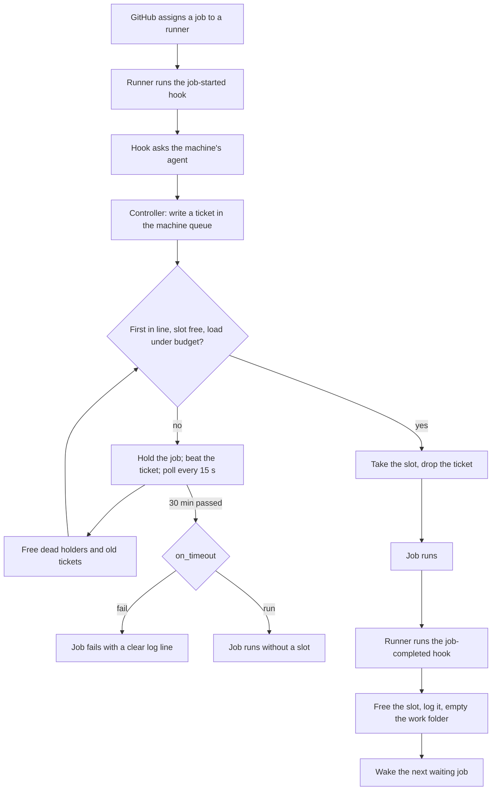
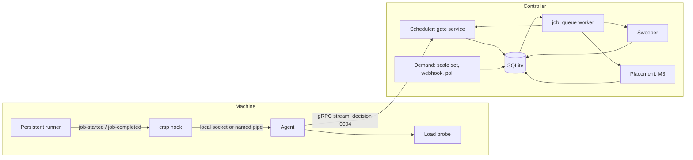

# Scheduling, slots and load budget

The top half (sections 1 to 4) is for every reader. The bottom half (5 to 12) is for engineers.

The M1 slot queue, load gate and job hooks are built (CRSP21); a requirement marked Built has a test in section 9. Everything else is NOT YET IMPLEMENTED. Each requirement names its milestone (M1, M2 or M3) and the dev-standards file it is ported from.

## 1. In one paragraph

Each machine in the pool has one queue for every job that wants to run there, whatever runner or repository it comes from. The machine has a fixed number of job slots and a load budget (by default at or below 85% memory and 60% CPU in total). When a job starts, a hook holds it until three things are true: it is first in line, a slot is free, and the machine is under its budget. When the job ends, a second hook frees the slot. Slots and queue tickets left behind by dead jobs, lost machines or cancelled runs are found and freed. With more machines, the controller places each job on a machine by label, then free capacity, then warm caches. Repositories share the pool fairly, with a priority and a parallel limit each.

## 2. Why

**Problem.** Several runners on one computer, from several repositories, start jobs at the same time. Without one queue they overload the machine: memory runs out, builds fail, and the owner's own work freezes. The dev-standards pool solved this on one Windows PC with lock files, queue tickets and two runner hooks. This product ports that logic to its controller and agents, and extends it to many machines.

**Users.**

- The owner of the machines: wants CI to use the machines without taking them over.
- Repository admins: want their jobs to start soon and in a fair order.
- Viewers: want to see why a job waits.

**Goals.**

- One queue and one slot count per machine, across all runners and repositories.
- A job never starts while the machine is over its budget, unless the wait times out and the machine is set to let it run.
- A slot is never lost: every slot held by a job that is gone is freed and logged.
- The order of service is clear and can be shown.
- Measurement never blocks CI: when the machine cannot be measured, the job goes.

**Non-goals.**

- Killing, suspending or slowing any process. The scheduler only holds new jobs (learning 13).
- Managing GitHub-hosted runners.
- Sizing container or VM caps. That is the machines and runners specs; this spec only reads the same measurements.
- The dev-standards ci-wait marker and its cloud fallback (exit 3, "claim lost"). This product has no cloud fallback. See D5.
- The dev-standards load guard for Claude Code tool calls (`load_guard.py` `classify`, the local heavy limit). Only its rules are ported. See D6.

## 3. How it works

The steps in words:

1. GitHub gives a job to a persistent runner on a machine.
2. The runner runs its job-started hook. The hook is the product's own binary, called through a small `.ps1` or `.sh` wrapper.
3. The hook asks the agent on the same machine for a slot. The agent asks the controller.
4. The controller writes a queue ticket for the job in that machine's queue.
5. The hook waits until the ticket is first in line, a slot is free and the machine is under its budget. While it waits, it beats the ticket every poll, and the controller frees slots and tickets whose owners are gone.
6. When all three are true, the controller gives the job a slot and removes its ticket. The job runs.
7. If the wait reaches 30 minutes, the job fails with a log line that says what it waited for (or, if the machine is set to `run`, it runs without a slot).
8. When the job ends, the job-completed hook frees the slot, logs the result and empties the job's work folder.
9. Freeing the slot wakes the next waiting job.

Short jobs (smoke tests, cleanup) can use a separate light slot, so they do not wait behind long builds. Heavy jobs (integration or end-to-end tests) can be limited to one at a time with a heavy slot.

With more machines (M3), the controller picks the machine before a runner starts: first the machines whose labels match, then the one with the most free capacity, then the one that ran this repository last.

## 4. Screens and states

This feature has no screen of its own. It feeds the Overview, Machines and Jobs screens (product brief, screens 2, 4 and 6). The screens follow design system v1; rules are cited, not repeated here.

- **Overview.** Per machine: slots in use out of the total, a load bar for memory and one for CPU against the budget, and the number of jobs waiting. The overview only shows and links (UX-52). Bars have a text equivalent (UX-17, UX-41; components 16).
- **Machines, detail.** A slots list: each slot with its state, the repository, run, job, runner and age (components 15). A stale slot is marked in words, not only by colour (UX-58; components 17). The queue below it lists each ticket with its repository, job, priority and wait time. Ages keep ageing while the page is open (UX-53).
- **Jobs, queue tab.** Every waiting job, with the reason it waits in one line ("2 ahead in the queue; memory 91% > 85%"). A wait names what it waits for (UX-29, UX-38). Waiting shows as `◷ waiting` (UX-58).
- **Free a slot by hand** (admin). The question card names the job that holds the slot and asks for a yes (UX-62).

States:

| State | What the user sees |
|---|---|
| Empty | "No jobs wait. 2 of 2 slots free." with a link to the machine (UX-6; components 19) |
| Busy | Slots in use, waiting jobs with their reasons, load bars |
| Over budget | The load bar over the budget line, with the figures in words ("memory 91%, budget 85%") |
| Not measured | "Load not measured: jobs start without a load check." as a Note (UX-26) |
| Agent offline | The machine shows offline; its slots show the holders as last known, with "agent offline since 14:05" |
| Error | Could not load names what, why and what next (UX-28) |

Running state comes from one source, the controller's slot and queue tables, streamed to the console (UX-19, UX-34).

## 5. Functional requirements

Milestones: **M1** is one machine with persistent runners (slot queue and load gate). **M2** is ephemeral JIT runners. **M3** is many machines (placement). A requirement marked Built is built; one without that mark is NOT YET IMPLEMENTED.

Source paths are in github.com/luis-mc/dev-standards, under `claude/plugins/delivery/scripts/` unless a longer path is given.

### 5.1 Machine settings

**R5.1** — Each machine has one scheduling setting set, with these defaults: load budget memory 85% and CPU 60%; job slots 2; light slots 1; heavy slots 1 (0 means no heavy limit); slot maximum age 120 minutes; gate maximum wait 10 minutes (never more than a third of the 30-minute job timeout, R5.75); gate poll 15 seconds; on timeout `fail`; light jobs `smoke`, `prune`, `prune-*`, `cleanup`, `remove-train`, `decide`, `delete-*`, `runners`; heavy jobs none. M1. Built. Source: `machine_slots.py` `DEFAULT_CONFIG`.

**R5.2** — A bad setting value is dropped and the default stays. A budget percent must be above 0 and at most 100. Slot counts must be whole numbers: job slots at least 1, light and heavy slots at least 0, slot maximum age at least 1. Maximum wait and poll must be 0 or more. On timeout must be `fail` or `run`. A true or false value is never a number. M1. Built. Source: `machine_slots.py` `normalise_config`, `_num`.

**R5.3** — Writing the settings refuses an unknown key and names it. M1. Built as the key check; the settings feature calls it when it writes. Source: `machine_slots.py` `write_machine_config`.

**R5.4** — A repository may lower the load budget for its own jobs, never raise it above the machine's. A value outside 1 to 100 is ignored. M1. Built. Source: `load.py` `limits`.

**R5.5** — Gate settings resolve in this order, first found wins: a hook command-line flag, then the runner's environment (`CRSP_GATE_MAX_WAIT_MIN`, `CRSP_GATE_POLL_SEC`, `CRSP_GATE_ON_TIMEOUT`), then the machine settings, then the defaults. A poll below 0 counts as 0. An unknown on-timeout value counts as `fail`. M1. Built. Source: `runner_load_gate.py` `settings`.

### 5.2 The queue and the order of service

**R5.6** — Each machine has one queue for every job that waits for a slot there, from every runner and every repository. A waiting job holds exactly one ticket. M1. Built. Source: `machine_slots.py` `enqueue`, `queue_list`.

**R5.7** — A job's event class is 0 for a ready (not draft) pull request or a run on the repository's default branch, and 1 for anything else. A draft pull request is class 1. The class is read from the job's event payload. M1. Built. Source: `machine_slots.py` `priority_from_event`.

**R5.8** — The order of service is: higher repository priority first, then lower event class, then fair share (R5.9), then the earlier queued time. Ties on the same nanosecond break by a random suffix fixed at enqueue. The dev-standards order is event class then queued time; the repository priority and fair share are new (see D3). M1. Built. Source: `machine_slots.py` `enqueue` (ticket name `<priority>-<ns>-<random>`).

**R5.9** — Fair share: among tickets with the same repository priority and event class, the ticket whose repository has the fewest jobs running in the pool goes first. M1. Built. Source: none (new; product brief, scheduling).

**R5.10** — Per-repository parallel limit: a ticket whose repository already runs its maximum parallel jobs in the pool is passed over. Tickets of other repositories behind it may take a free slot. The passed ticket keeps its place. M1. Built. Source: none (new; product brief, repositories and policies).

**R5.10a** — The order of service is a setting (owner decision for M1). An admin sets the order of the four keys (repository priority, event class, fair share, time queued; each once, first decides first), switches fair share on or off, and sets the minutes a job waits before "no runner with the labels" is raised (1 to 60, default 2; observability R5.5), in Settings, Budgets (`getQueueSettings`, `updateQueueSettings`). The default is the order of R5.8. A list that is not each key exactly once is refused with the reason and nothing changes. Each change writes one audit row. M1. Built for the setting and its API (CRSP37). NOT YET IMPLEMENTED: the slot queue and the wait-reason code still use the fixed order of R5.8 and the 2 minutes; they have to read the setting.

**R5.11** — "First in line" means first in the order of service among tickets that are not passed over by R5.10. M1. Built. Source: `runner_load_gate.py` `_ci_wait`.

### 5.3 The job-started gate

**R5.12** — Each persistent runner has a job-started hook (`ACTIONS_RUNNER_HOOK_JOB_STARTED`). The hook takes a ticket and holds the job until the ticket is first in line, a job slot is free, and the machine is under its load budget. It then takes the slot, removes the ticket and exits 0, so the job runs. M1. Built. Source: `runner_load_gate.py` `_ci_wait`, `main`.

**R5.13** — The gate checks in this order: first in line, then a free slot, and measures the load only when both hold. M1. Built. Source: `runner_load_gate.py` `_ci_wait`.

**R5.14** — Taking a slot is atomic. Two jobs never hold the same slot. A job that loses the race for a slot keeps waiting with the reason "lost the race for the slot". M1. Built. Source: `machine_slots.py` `take_slot`, `_create_new`.

**R5.15** — Each slot that is taken gets a new random token. A slot is freed only by a caller that shows the token it holds. A slot that was freed and taken again in between is left with its new holder. M1. Built. Source: `machine_slots.py` `take_slot`, `_remove_if_token`, `free_slot`.

**R5.16** — On every poll, before it checks its own ticket, the gate frees stale slots (R5.31 to R5.33) and logs each one it freed with the slot, the reason and the job that held it. M1. Built. Source: `runner_load_gate.py` `_ci_wait` (`free_stale` loop).

**R5.17** — The gate polls every poll interval (default 15 s). It also wakes at once when a slot on its machine is freed. M1. Built. Source: `runner_load_gate.py` `_ci_wait` (poll); the wake is new.

**R5.18** — While it waits, the gate beats its ticket on every poll. A beat changes only the beat time, never the ticket's place. A beat never makes a ticket that is gone. M1. Built. Source: `machine_slots.py` `beat`.

**R5.19** — If the gate finds its own ticket gone, it writes the ticket again. It keeps the first queued time when that is younger than the slot maximum age, so the job keeps its place; otherwise it queues as new. The log says the ticket was gone and why. M1. Built. Source: `runner_load_gate.py` `_ci_wait`, `_ticket_state`.

**R5.20** — The gate times out when the next poll would pass the maximum wait (default 10 min, never above 10: R5.75). With `fail` it exits 1, so the job fails and can be re-run. With `run` it exits 0 and the job runs without a slot, except a job that waited on a load that cannot be measured: that one always fails, the rule `run` never runs a job unmeasured (R5.22, decision D53). Either way the ticket is removed and the log line names the reasons it waited for and the top processes. M1. Built. Source: `runner_load_gate.py` `_timed_out`, `wait`.

**R5.21** — The gate logs one line when it starts holding, with the reasons and the poll and wait settings. It logs "still holding" only when the reasons change. It logs "slot N taken after S s" when it gets a slot. The reasons are "N ahead in the queue", "no free slot (all N busy)", "memory X% > Y%", "CPU X% > Y%" and "lost the race for the slot". Lines go to the job's "Set up job" step and to the agent log. M1. Built. Source: `runner_load_gate.py` `_ci_wait`, `_got`.

**R5.22** — **When the load cannot be measured, the gate holds the job (fail closed).** A load that cannot be read never counts as under budget. The job waits with the reason `load_not_measured` ("load not measured yet") and keeps its place in the queue; a light job waits the same way. It goes as soon as one figure (memory or CPU) is read. The hook prints one `::warning title=crsp::` line with the reason and what to do (run `crsp doctor`; the check `machine.load.measured` names the machine), and the doctor fails that check (doctor R5.9). On timeout the job never runs unmeasured: the on-timeout rule `run` becomes `fail` for a job that waited on an unmeasured load, and the log line says so (R5.20). Owner decision D53 (2026-11-15): this differs from the old pool on purpose, which took a slot without a load check. M1. Built (CRSP76). Source: `runner_load_gate.py` `_ci_wait`, `wait` (old, changed).

**R5.23** — When the hook cannot reach its agent, or the agent cannot reach the controller, the gate falls back to a load-only wait on this machine: it polls the load until under budget, with the same maximum wait and on-timeout rule. When it cannot measure either, it still waits and polls (R5.22); it does not exit 0. The on-timeout action is never "run unmeasured": a job that waited on an unmeasured load fails with the reason and can be re-run, even when the rule is `run`. Decision D53 (2026-11-15), different from the old pool on purpose. M1. Built (CRSP76). Source: `runner_load_gate.py` `main` (`OSError` path), `wait` (old, changed). The hook also refuses a fork pull request job on a public repository before the gate runs, unless the policy allows it (github-integration R5.26, CRSP108).

**R5.24** — A light job is a job whose job key or shard matches a light-jobs entry, exactly or as a glob, while light slots are above 0. A light job takes a free light slot at once, with no ticket, when the load is under budget. It never takes a job slot while a light slot is free. When every light slot is busy, it takes a ticket and waits in the normal queue for a job slot. Logs name a light slot `light-N`. Light slots serve the pool runners; there is no runner that takes light jobs only (R5.65, removed). M1. Built. Source: `machine_slots.py` `is_light_job`, `slot_label`; `runner_load_gate.py` `_ci_wait`.

**R5.25** — A heavy job is a job whose job key or shard matches a heavy-jobs entry, exactly or as a glob, while heavy slots are above 0. An entry `owner/repo:pattern` applies to that repository only. Heavy wins over light. M1. Built. Source: `machine_slots.py` `is_heavy_job`.

**R5.26** — A heavy job first takes a heavy slot, holding no job slot and no ticket while it waits. It then goes through the normal queue with the rest of its maximum wait. If it gets no job slot, its heavy slot is freed (outcome `no-ci-slot`); on an error it is freed too (outcome `error`). Normal jobs keep flowing while a heavy job waits. M1. Built. Source: `runner_load_gate.py` `queue_wait`, `_heavy_wait`.

**R5.27** — The scheduler only holds new jobs. It never kills, suspends, signals or lowers the priority of any process. M1. Built. Source: `machine_slots.py` (module doc), `load.py` (module doc), `load_guard.py` (module doc).

### 5.4 The job-completed hook

**R5.28** — Each persistent runner has a job-completed hook (`ACTIONS_RUNNER_HOOK_JOB_COMPLETED`). It finds every slot of every kind held by this job, matched on repository, run id, run attempt (1 when missing) and job key, and frees each with the outcome `ran`. A job that held no slot logs "this job held no slot". M1. Built. Source: `runner_job_done.py` `done`; `machine_slots.py` `find_held`.

**R5.29** — The hook empties the job's work folder (`GITHUB_WORKSPACE`) only when the path lies inside a `_work` folder and is not `_work` itself. The folder itself stays. Entries it cannot remove are counted in the log. A `--keep-work` flag skips this. M1. Built. Source: `runner_job_done.py` `work_folder`, `empty_folder`.

**R5.30** — The job-completed hook always exits 0, even on an error, and logs the error. A hook that fails here would fail a job that already finished. M1. Built. Source: `runner_job_done.py` `main`.

### 5.5 Dead holders, expiry and leftovers

**R5.31** — Every slot and ticket records its holder: the machine, the holder process, and the gate process. The holder process is the runner worker: the hook's parent, skipping a `cmd`, `powershell` or `pwsh` shell between them on Windows. An override environment value may name it. M1. Built. Source: `machine_slots.py` `holder_pid`, `_windows_parent`.

**R5.32** — Superseded by R5.70 (HND11): liveness is no longer judged by process id. Before: a slot whose holder process is gone is freed at once, logged as `stale-freed` with the reason "holder process gone". Liveness is judged by the agent of the holder's machine, not by the machine that runs the sweep. An unknown process id counts as alive. "Access denied" counts as alive. Nothing is freed on a guess. M1 (one machine), M3 (across machines). Built for M1; the M3 part is NOT YET IMPLEMENTED. Source: `machine_slots.py` `pid_alive`, `_holder_gone`, `free_stale`; learning 2.

**R5.33** — Any slot older than the slot maximum age (default 120 min) is freed, logged with the reason "older than N min". A slot whose holder record cannot be read is freed only by age. M1. Built. Source: `machine_slots.py` `free_stale`.

**R5.34** — A ticket is dropped when its gate process is gone, when it is older than the slot maximum age, or when its last beat (or its queued time, if it never beat) is older than the larger of 4 poll intervals and 120 s. The last rule applies to a ticket from any machine and is logged as `ticket-dropped` with the reason "no heartbeat". M1. Built. Source: `machine_slots.py` `queue_list`, `beat_limit_sec`; learning 2.

**R5.35** — The agent reports the jobs that run on its machine on connect and every load interval. The controller renews the lease of the slots of those jobs (R5.70) and frees nothing on a report; a slot of a job that is not listed is freed when its lease ends. M1. Built. Source: none (new; decision 0004 consequences; learning 2).

**R5.36** — Cancelled-job leftovers: when GitHub reports a job as completed (including cancelled), any slot or ticket still held for that job (repository, run id, run attempt, job) is freed with the outcome `completed-on-github` and logged. M1. Built. Source: none (new; learning 2).

**R5.37** — An admin can free stale slots on demand (CLI `crsp slots free-stale`, and the API). The answer lists each freed slot and its reason. Freeing a live slot by hand names the job and asks for a yes first. M1. Built: the handler and the scheduler call. The `crsp slots free-stale` command is the CLI feature's. Source: `machine_slots.py` `main` (`free-stale`).

### 5.6 The slot log

**R5.38** — The controller writes one slot-log row for every slot taken, every slot freed and every ticket dropped. A row holds repository, run id, run attempt, job, shard, runner, queued at, slot at, released at, slot number, slot kind (none for a job slot), and outcome (`ran`, `stale-freed`, `no-ci-slot`, `error`, `ticket-dropped`, `completed-on-github`). M1. Built. Source: `machine_slots.py` `_log_entry`, `take_slot`, `free_slot`, `queue_list`.

**R5.39** — The slot log keeps the last 5000 rows per machine; tests can set a lower keep size, production always keeps 5000. A slot-log write that fails never holds or fails a job. M1. Built. Source: `machine_slots.py` `write_log`, `LOG_MAX_LINES`.

### 5.7 Load measurement

**R5.40** — Memory use is (total − available) / total, in percent. Linux reads `/proc/meminfo` (`MemAvailable`, else `MemFree` + `Buffers` + `Cached`). Windows reads `GlobalMemoryStatusEx`. macOS reads `vm_stat` (free, inactive and speculative pages count as available) and `hw.memsize`. M1. Built. Source: `load.py` `parse_meminfo`, `_windows_memory`, `parse_vm_stat`.

**R5.41** — CPU use is the change in raw busy and total counters since the previous sample. Linux reads the first `cpu` line of `/proc/stat` (idle and iowait count as idle). Windows reads `GetSystemTimes` (kernel time includes idle). macOS reads the last line of `top -l 2`. A measurement never sleeps. With no previous sample younger than 10 minutes, CPU is the 1-minute load average per core, capped at 100%. With neither, CPU is unknown and memory decides. M1. Built. Source: `load.py` `parse_proc_stat`, `cpu_between`, `_windows_times`, `parse_top_cpu`, `measure_now`, `_loadavg_cpu`.

**R5.42** — A sample younger than 10 s is reused, so a burst of hooks costs one measurement. The CPU figure is the mean of the known CPU values of up to 3 samples from the last 30 s; unknown CPU counts as 0. Memory is the latest sample. A cache that cannot be read or written is ignored. M1. Built. Source: `load.py` `sample`, `_own_sample`, `_smooth`, `CACHE_TTL`, `HISTORY_WINDOW`, `HISTORY_MAX`.

**R5.43** — The agent publishes its machine's load every 15 s. A reader inside a VM or container uses the published figure when it is at most 60 s old, and its own figure otherwise, marking the source as `file`, `own` or `stale`. M1. Built. Source: `load.py` `write_host_load`, `read_host_load`, `_combine`; `machine_slots.py` `HOST_LOAD_MAX_AGE`.

**R5.44** — Inside a container, the sampler also reads cgroup v2 (the same read as machines R5.19, built in `internal/load`; a one-shot hook reader in a container uses the agent's published figure, R5.43): memory is `memory.current` over `memory.max` (none when uncapped), CPU is the `usage_usec` change over the CPUs in `cpu.max` (or all CPUs), capped at 100%. The gate decides on the worse of the host and the container. M1. Built in the agent's sampler (`internal/load`); the one-shot hook reader in `internal/scheduler/load` has no cgroup read of its own. Source: `load.py` `measure_container`, `parse_cpu_stat`, `parse_cpu_max`, `_combine`.

**R5.45** — A machine is over budget when memory is strictly above the memory budget or CPU is strictly above the CPU budget. Each exceeded budget is named with its figures, for example "memory 91% > 85%". M1. Built. Source: `load.py` `over`, `_n`.

**R5.46** — Hold and timeout lines name the top 5 processes by CPU and by memory, names only. A failure to list processes never fails anything. M1. Built. Source: `load.py` `top_processes`, `parse_ps`, `parse_powershell_csv`; `load_guard.py` `running_heavy_text`.

**R5.47** — On Windows with WSL2, the memory held by the WSL VM is the larger of its working set and its private bytes, and never less than what its containers use. Docker is read through the Windows `docker` CLI first, then `wsl docker`. Memory used for sizing is the median of 5 samples taken 1 s apart; a fresh published load figure wins when it is larger. This read is shared with the machines spec. M2. Built (CRSP50): the VM and Docker read live in `internal/load` (machines R5.17, R5.18: `WSLVMParts`, `WSLVM`, `DockerRun`, `ContainerUse`), and `load.SizingRead` takes the median of 5 samples 1 s apart, takes the VM out of the host figure, and lets a published figure no older than 60 s win when it is larger. The scheduler gate keeps its own reader (R5.42). Source: `delivery_runner_pool.py` `wsl_vm_parts`, `wsl_vm_gib`, `docker_run`, `container_gib`, `detect_host`, `median`.

### 5.8 Placement across machines

**R5.48** — A job can run only on a machine that is active (not drained), online, outside a maintenance window, has a backend allowed for the job's OS, and carries every label the job asks for. When no machine fits, the job waits and the console says which label or rule no machine meets. M3. NOT YET IMPLEMENTED for the fit rules. Source: none (new; product brief, scheduling; decision 0003).

*Built early by CRSP76 (decision D51): why a job waits.* The console shows every queued or held job with the first blocking reason, in words. The reasons are the gate's own `WaitReason` values, mapped by `scheduler.WaitWords`: no machine for this OS or labels (`no_runner_with_labels`); machine drained (`machine_drained`); over the memory or CPU budget, with the numbers (`load_over_budget`, "memory 91% > 85%"); no free slot, with how many are ahead (`free_slot`, "2 ahead in the queue"); the repository's parallel limit; and load not measured yet (`load_not_measured`, R5.22). The reasons "machine paused" and "on battery" join when machine status carries `PauseReason` (CRSP75); until then they are not listed. The words come from one place: `getOverview` returns `waiting`, one row per queued job with `reason` and `words`, and the web console reads that list (web-console R5.20, UX-34, UX-19).

**R5.49** — Among fitting machines, the controller picks the one with the most free job slots; on a tie, the one with the most room under its budget (the smaller of memory room and CPU room); on a tie, the one that ran a job of this repository most recently (warm caches). M3. NOT YET IMPLEMENTED. Source: none (new; product brief, scheduling).

**R5.50** — For an ephemeral runner, the controller takes the slot on the chosen machine when it places the job, in the same transaction that records the placement and enqueues the start-runner work for that machine's agent. The slot is freed when GitHub reports the job completed or the runner is gone. M2 (one machine), M3 (many). Built for one machine (CRSP50): `Engine.Place` takes a ci slot, writes its slot-log row and the `start_runner` row of `job_queue` in one transaction (no free slot: nothing is recorded; the same job twice is one placement), and a slot is freed by `CompletedOnGitHub` or `RunnerGone` (a `wake_gates` row in the same transaction). NOT YET IMPLEMENTED: the caller that picks the machine (R5.48, R5.49, M3) and the agent handling the `start_runner` work. Source: none (new; decision 0002).

### 5.9 Demand and the job queue table

**R5.51** — The first demand signal is the runner scale-set API: per scale set, `TotalAssignedJobs` from the long-poll message session, read through `github.com/actions/scaleset`, as the github-integration spec sets out. The controller wants that many runners for the scale set, minus the runners already busy or starting. M2. NOT YET IMPLEMENTED. Source: none (decision 0002).

**R5.52** — Fallbacks, in order: the `workflow_job` webhook (`queued`, `in_progress`, `completed`), then polling the REST API. In M1 they feed the queue view and the leftover sweep (R5.36). M1 (webhook and poll), M2 (as demand for JIT runners). NOT YET IMPLEMENTED. Source: none (decision 0002).

**R5.53** — The same job reported twice (webhook and poll, or a retried webhook) makes one job record, keyed by GitHub's job id. M1. NOT YET IMPLEMENTED. Source: none (new).

**R5.54** — Every state change that needs follow-up work inserts its row in the `job_queue` table in the same SQLite transaction as the change. This covers: a job queued (place it), a slot freed (wake waiting gates), a job completed (sweep its leftovers), an agent reconnected (reconcile holders). No outbox is used. M1. Built for a slot freed (a `wake_gates` row in the same transaction); the other follow-up rows belong to the intake and agent-link features and are NOT YET IMPLEMENTED. Source: none (stack profile, section 11; decision 0001).

### 5.10 Maintenance windows

**R5.55** — A machine can have maintenance windows: days and a start and end time in the machine's time zone. In a window, the machine takes no new job. Running jobs finish. M3. NOT YET IMPLEMENTED. Source: none (new; product brief, machines).

**R5.56** — DROPPED (OPS51, owner decision 20 Nov: "Drop the concept"). A machine has no quiet hours. The number stays so that no other requirement moves. The wait reason `quiet_hours` and the hold word "this machine is in quiet hours" are gone.

**R5.57** — When a window starts, no running job is stopped. If slots in use exceed the new count, no new job starts until the count drops below it. M3. NOT YET IMPLEMENTED. Source: none (learning 1).

### 5.11 Status and hook install

**R5.58** — Status per machine: each slot of each kind with free or held, and for a held slot the repository, run id, job, shard, runner, holder process, age in seconds and a stale flag; and each ticket with repository, run id, job, shard, priority and wait in seconds. Light and heavy slots are listed after job slots. With no light slots, no light line is shown. The API, the CLI (`crsp slots`, also `--json`) and the console read the same status. M1. Built: the scheduler status and the API. The CLI and console read it in their own features. Source: `machine_slots.py` `status`, `_status_kind`.

**R5.59** — The hooks are set in each persistent runner's `.env` file as its first lines. On Windows the hooks are `.ps1` files, never `.cmd`. A hook calls the product binary by its full path, installed for all users, never one in a user profile. The wrapper passes its arguments through and returns the binary's exit code. M1. Built: the wrappers and the `.env` lines. The runners feature writes them at install. Source: `runner_load_gate.ps1`, `runner_load_gate.sh`, `runner_job_done.ps1`, `runner_job_done.sh`; learning 4.

**R5.60** — **Disk guard.** Before the gate asks for a slot, it reads the free space of the volume of the runner's tool cache (`CI_TOOLS_DIR`, else the job's workspace). Under 10% free (`CRSP_DISK_MIN_FREE_PCT`, default 10) it holds the job without a ticket or slot, logs `disk guard: holding the job` with the free share, and polls like the gate. It goes on to the queue when 12% is free. The hold counts against the maximum wait; at the limit the job fails and can be re-run, whatever the on-timeout rule says. A disk that cannot be read never holds a job (R6.6). M1. Built (CRSP21). Source: new (caches R5.38, dev-standards lesson 1).

**R5.61** — **A hook that does not reach crsp is shown, not silent.** When the hook cannot find crsp, cannot start it, or crsp cannot reach its agent, the gate does not exit 0 on its own: it waits on this machine's load, and when the load cannot be measured either it holds (R5.22, R5.23, decision D53; a broken install must not run jobs unchecked). The job that waits gets the warning, and three things say so. (1) The job gets `::warning title=crsp::...` on a line of its own, in the `.ps1` hook, the `.sh` hook and `crsp hook` alike (runners R5.39); a line after the log time stamp would not count, so the annotation is never stamped. (2) `crsp hook` records the problem in `crsp-hook-problem.txt` in the hook folder (`CRSP_HOOK_DIR`) and clears it when the agent answers again. (3) When a job-completed hook arrives for a job that holds no slot or ticket on that machine, the job-started hook did not reach the gate (or the gate let the job go on its on-timeout rule), and the engine raises the alert `hook.job_started_missing` with the machine, repository, run, job and runner, and logs a warning. The job-completed hook still returns 0 (R5.30). Built.

**R5.62** — **A hook never asks for a login and never waits on the agent without a limit.** (Lesson 17 of the old pool.) A hook does only local work: it reads the environment, the load, the disk and its own folder, and it talks to the local agent over its socket. It makes no network call of its own and starts no `git`. Anything remote is optional, non-interactive, limited in seconds, and fails open with a log line. Every hook entry point (the `.sh` and `.ps1` wrappers and `crsp hook`, including the probe and a bad flag) sets `GIT_TERMINAL_PROMPT=0` and `GCM_INTERACTIVE=never` before anything else, so nothing it starts can stop for a login. The one call a hook makes, to the agent, has an explicit limit of 5 seconds per call (`hooks.CallTimeout`); the agent forwards to the controller with a shorter limit of 4 seconds (`hooks.AgentForwardTimeout`), so the hook gets the agent's "not reachable" answer rather than its own timeout. The answer of `hello` is asked once per hook run, so a slow agent costs one limit, not one per step. When the agent or controller is slow or gone, the job does not stop at once (R5.23): a `::warning` annotation on the job, a problem record in the hook folder, the load-only wait with its own limit (a load that cannot be measured holds the job, R5.22), and, for a job that already holds a place in the queue, a cancel of that ticket with the same short limit, so the job does not also hold a slot. The agent then raises `hook.job_started_missing` when the job ends (R5.61). In probe mode the hook prints `crsp hook non-interactive` after `crsp hook ok`, and the doctor warns when it is missing (doctor R5.30). Built (CRSP38).

**R5.63** — **The decision is logged before the slow step.** (Lesson 18.) Every hook and drain step writes what it is about to do before any call that may be slow, so a hang is never silence. The job-started hook logs "checking disk space, then asking the agent (limit 5 s per call)", "asking the agent who this machine is" and "asking the agent for a slot" before each call; the job-completed hook logs "freeing this job's slots" before the release, "emptying <folder>" before the work folder is emptied and "<cache>: checking the quota" before each eviction. A runner drain logs "asking whether the runner is idle", then "waiting for job <job> (<time> so far); nothing is stopped", then "the runner is idle; acting now" before the action, and "the drain timeout passed with job <job> still running; nothing was stopped" at the timeout (`Drain.OnStep`, `Service.OnDrainStep`). Built (CRSP38).

**R5.64** — **An operation waits only for the runners it touches.** (Lesson 21.) A drain, restart or image swap for runner set X counts only the jobs on X. A busy runner of the same repository outside X never holds it. A runner removal asks about its own runner only (runners R5.4); a machine change for a runner set is a drain scoped to its runner names (machines R5.57). A change without runner names is a change of the whole machine. Built (CRSP38).

**R5.65** — **Removed (owner decision D110, 19 Nov 2026: "per-repository light runners do not fit the design").** Light runners, the label `crsp-light`, the policy setting `light_runner` and the job gate's light slot for runners named `crsp-light-` are gone (runners R5.57). The pool is set up first, repositories opt in, and the user never picks a repository for a runner; pool runners serve every repository through hidden registrations (runners R5.88). One runner per repository and OS breaks that model, and on the owner's PC it made failing rows every 10 minutes. **Light slots stay.** They never belonged to the runner: R5.24 gives a light slot to any job whose job key or shard is on the light-jobs list, whatever runner takes it, so a job of a few seconds still does not wait behind a long build. The gate reads no runner name and no runner route. A job on a runner that was once a light runner takes a job slot unless its name is on the light list. The repository variable `RUNS_ON_LIGHT` is migrated, not deleted (github-integration R5.100): workflows that read it keep a valid `runs-on`. Built (OPS49).

**R5.66** (M4, Built CRSP84; the agent side that starts and drains the runners and the stored `warm_runners` field in the API are not built) — **Warm pool.** A machine with spare budget may keep N ready runners per OS (`warm_runners`, default 0, so nothing changes until it is set) or, with a VM backend, N pre-booted VMs. A warm runner is registered, idle and counts against the machine's slots and budget like a running one, so the gate never over-commits. It is used by the next matching job and replaced afterwards. It is released first when a real job needs the slot, when the machine is paused or the free-disk floor holds (machines R5.60). A warm runner older than 15 minutes is replaced so it never runs from a stale image. The console shows warm runners as their own state. Built: `scheduler.PlanWarm` decides what to release and start from the machine's settings, held slots, warm runners, load and hold; a warm runner weighs one slot (as a job of an unknown class, R5.69), is started only when the held weight plus the warm weight plus one fits in both kinds and the load is measured and under budget (hold until measured stays), and is released oldest first when it is stale, when the count drops, when real jobs took its budget, or on a hold. The gate never makes a real job wait for a warm runner: `WithWarm` gives it the warm list and a release call, and it releases the oldest runners the job needs before the slot is taken; the runner a job runs on is that job's own and is not released. `warm_runners` is a key of the scheduling settings (`slots.Normalise`, default 0). Not built: the agent starting and draining the runners, the pre-booted VM variant, the stored setting in the machine API, and the console state.

**R5.67** (M3, Built CRSP89) — **Size labels.** A repository may use a size variable beside the plain `RUNS_ON_<OS>` one, for example `RUNS_ON_LINUX_LARGE`. The owner maps each size name to a floor of CPUs and memory in Settings. The controller writes the variable with the labels of the machines that have that much room in their pool size (machines R5.58); a machine too small is left out of the value. A size that no machine can serve is not written and the doctor says so. The sizes follow the generic label rule of runners R5.36. Built: the size names are the size classes of runners R5.71 (small 2/4, medium 4/8, large 8/16, xl 16/32) read from that one table; a Service setting may replace them with the owner's floors (`repos.CheckSizeFloors` refuses a bad name or floor). The variable is `RUNS_ON_<OS>_<SIZE>`, written and reconciled like the plain one, and listed in the doctor's runs-on check; a plain `RUNS_ON_<OS>` is unchanged and `RUNS_ON_*` variables keep working. A machine's room is its pool size, or the CPUs and memory it reported when none is set. A size variable is deleted only when the store lists it as written by the controller, so a variable of the owner's own stays. A workflow that reads a size variable that is not set gets a finding that names the reason: an unknown size lists the known ones ("size \"huge\" is not one of small, medium, large, xl"), a size no machine can serve says no machine has that much room (`UnservedSizes` lists them with the floor). The labels of a size are those of the machines with room, as written; a label that a small machine shares with a big one stays in the list. Not built: the owner's floor map in Settings (a hook, `Config.SizeFloors`) and a size label on the runner itself.

### 5.12 A machine that does not accept (CRSP75)

**R5.68** — **A machine that does not accept holds every new job, with the reason.** The gate asks the machine's acceptance (machines R5.62) before the queue. While the machine is not accepting because it is `paused` or `on_battery` a new job gets the wait reason of the same name, `paused` or `on_battery`, with the line "this machine is paused" or "this machine is on battery". No ticket and no slot is taken, so the job keeps no place in the queue and goes at once when the machine accepts again. A job that already holds its slot is never cut: a retried request for it answers go again. The gate holds, on its own timer and on-timeout rule (R5.20), like any other wait. The reason `budget` is shown on the machine but is not held here: the gate checks the live load itself (R5.13), so a report that is a few seconds old cannot hold a job that fits now. The jobs table names the reason (web-console). A machine the controller has no report for accepts. (M1, built CRSP75)

**R5.69** — **Jobs are admitted by weight, not by count.** (Lesson 5, rule D4.) Every job class carries a declared weight in CPU units and memory units, in one table (`slots.DefaultClasses`: `lint` 1/1, `unit` 1/1, `build` 1/1, `e2e` 2/2, `vm` 2/4). A job belongs to the first class whose names match its job key or shard (exact or glob, as R5.24). The machine's budget is `job_slots` units of each kind. The gate admits a `ci` job only when the weights of the held `ci` slots plus its own fit the budget in both kinds; a free slot number alone is not enough. Light and heavy slots keep their own limits and carry no weight. A job that matches no class weighs one slot (1 CPU, 1 memory), so a pool without classes behaves as before. A weight is never below 1 and never above the whole budget, so a heavy class can still run alone. When the weight is the cause, the wait reason is `free_slot` and its line names the class, its weight and what is free: "job class e2e weighs 2 CPU and 2 memory units; 1 of 3 CPU and 1 of 3 memory units free" (R5.48). The load check follows and is unchanged: a load that cannot be measured still holds the job (R5.22, decision D53, hold until measured stays). The table is built in, not a stored setting; the class of a held slot is found again from its job key and shard, so nothing is added to the slot tables or the agent protocol. M1. Built (HND7). Source: dev-standards-handover lesson 5, rule D4 (new).

**R5.70** — **A slot is held by a lease, not by a process id.** Every slot records its holder id (the gate id that took it) and the end of its lease. A lease lasts the larger of 4 poll intervals and 120 s (the beat limit of R5.34) and is renewed by a heartbeat: a retried gate request or beat from the holder, a renewal naming the holder id and the claim, or the agent's holder report listing the job as running (the report is sent every load interval, 15 s). A renewal changes only a slot that still holds that holder id and claim, so a slot taken again by another job is never extended, and a lease that already ended is reclaimed, not revived. A slot whose lease ended is freed by the sweeper or by the next gate poll and logged as `stale-freed` with the reason "lease expired". No process id is looked at to decide that a holder is gone: the holder process and gate process of R5.31 are recorded for display only, so a reused process id cannot keep or steal a slot, and a holder that crashed on any host frees its slot when its lease ends. A slot row from before leases takes its age limit (R5.33) as its lease end, so the upgrade frees nothing early. M1. Built (HND11). Source: dev-standards handover lesson 4, rule D3.

**R5.71** (built, OPS28; runners R5.91) — **A runner that is not clean takes no new job.** When the last clean-up of a persistent runner failed, the gate holds a job for that runner with the wait reason paused and the text "this runner is not clean yet: <reason>", until the runner is clean again.

**R5.72** (OPS34, owner decision 8) — **Start range of a queued job.** For every queued job the controller computes a start range and shows it with the queue order and the wait reason. The model: each running job frees its slot at its forecast end (observability R5.40); a queued job takes the first free slot in the order of service (R5.8) and holds it for one median run time. The range runs from the lows to the highs of the jobs ahead. A job passed over by R5.10 or held by R5.68 shows the reason and no start range. With no forecast for the jobs ahead the range is "not enough history yet". The range is informative: it never changes the order of service.

**R5.73** (OPS55; runners R5.98; source: the old pool, 21 Nov 02:40, where a machine with 2 slots and 4 runners held a job 767 s in the job-started hook) — **Runners for one repository on a machine never exceed the machine's job slots.** The pool runners of a machine serve every repository, and a repository can also have runners of its own; the most one repository can use on a machine is the pool runners plus its own. That number MUST NOT exceed the machine's job slots: more runners add no parallel jobs, because GitHub offers a job to any idle runner and the extra runner takes it and then holds it in the job-started hook for a slot. Runners R5.94 refuses the plan that would go over; the doctor check `runner.slots` (doctor R5.50) warns about a machine already over. A machine whose slots are not known is not checked.

**R5.74** (OPS55) — **The slot wait is its own phase of the job.** The time from the job's first gate request to the slot it takes is recorded apart from the run time: `queued_at` and `slot_at` of the job record (`job_history.slot_wait_ms`), shown as `slot_wait_seconds` next to `run_seconds` in the Jobs API and the export. It is filled from the gate's grant (`Decision.SlotWait`), so a job that held in the hook shows its hold there and not in the run. No new field was needed. The Jobs page and Insights read it later.

**R5.75** (OPS55) — **A hold never reaches the job timeout.** Time a job spends in the job-started hook counts against its `timeout-minutes`. The hook's maximum wait is therefore at most `slots.MaxHoldMin` (10 minutes, a third of the 30-minute guideline `slots.JobTimeoutMin`, doctor `workflow.timeout`): a longer setting, flag or environment value is cut to it when the hook reads it, and the default is 10. When the wait ends the rule of R5.20 decides: `fail` exits 1 with the log line that names what the job waited for, so the job fails early and can be re-run, and `run` lets it go on without a slot. A job is never left to time out inside the hook. With R5.73 the hold is a safety net for a slot taken by something else (light or heavy jobs, a warm runner), not the normal path.

**R5.76** (OPS58, owner decision 21 Nov: "Watch, hold, warn"; source: 21 Nov 04:30, a PC at 96% memory with jobs already running, over its 85% budget) — **Load is watched while jobs run, and a start is held while it is over budget.** The agent's sampler (machines R5.16) keeps its own poll while any job holds a slot; no second thread. While memory or CPU is over the machine's budget (R5.45), no new job starts, even when a slot number is free: the agent gate holds with the pause reason `budget` and the controller gate holds with the wait reason `load_over_budget`, whose line names the exceeded figures (R5.45) and, in the hook's own line, the top processes (R5.46). A job that already holds a slot is **never stopped, paused or killed**, and asking again under the same load still answers go (R5.12). Built (OPS58: the hold itself was built in R5.13, R5.22 and machines R5.62; this requirement pins it with a test while a job runs).

**R5.77** (OPS58) — **A machine over its budget with jobs running shows a warning.** The controller's load watch (`machines.Service.watchLoad`, fed by every load report) raises a load warning at the first report that is over budget while at least one job holds a slot. The warning shows in the existing channel for machine state, the doctor check `machine.load.budget` (doctor R5.61): the finding names the machine, the measured memory and CPU, the budget and the running jobs, and says that running jobs are not stopped. The warning is also on the machine view (`View.LoadWarning`). A machine over budget with no job running holds new starts (R5.76) but raises no warning; the 10-minute rule of the check still covers it. Built (OPS58).

**R5.78** (OPS58) — **A load warning clears only after a steady period under budget.** The warning clears when every load report for `machines.LoadClearAfter` (60 s, about four reports at the 15 s step of R5.43) is at or under the budget; one report over the budget restarts the period. The hold of R5.76 is not delayed by this: starts resume at the first poll under budget, only the warning waits. Built (OPS58). Tests use a fake clock and no sleeps.

**R5.79** (OPS66, owner decisions of 21 Nov 2026 on job sizing; **NOT BUILT YET, specification of a later task**) — **Measured size replaces the scan's guess.** Today a job is admitted by the declared weight of its class (R5.69, `slots.DefaultClasses`) or the size the stack scan guessed. Observability R5.60 to R5.65 now measure the peak CPU and peak memory of every job run and keep a summary per job key (repository, workflow, job key): the p90 of the peaks of its last 30 good runs, `measured` from 5 good runs on, the same 5-run rule as the time forecast (observability R5.41). When this requirement is built, a job key that is `measured` is admitted with its measured size (p90 peak CPU in cores, p90 peak memory in bytes, rounded up to the weight units of R5.69), and a job key that is not measured keeps the class weight or the scan's guess, as today. A run killed for memory or cut short never lowers the size. Nothing in the scheduler reads the measured peaks yet: the gate, the placement and the slot queue are unchanged by OPS66. Source (planned): `internal/jobsize` `Summarise`, read through `store.ResourcesStore.Peaks`.

## 6. Non-functional requirements

**R6.1** — With a free slot and a machine under budget, the job-started hook returns within 2 s. No measurement sleeps. M1. Built. Source: `load.py` `measure_now`.

**R6.2** — Two concurrent takers that each take and free one slot 500 times never hold it at the same time. M1. Built. Source: `test_machine.py` `test_race_two_processes_never_share_one_slot`.

**R6.3** — Every scheduler query runs under a context deadline (10 s when the caller sets none), and the database uses a 5 s busy timeout and WAL mode. M1. Built. Source: none (stack profile, section 14).

**R6.4** — Ticket and beat ages are measured on the controller's clock, so clock skew between machines cannot expire a live ticket. M1. Built. Source: none (new; learning 2).

**R6.5** — Scheduler logs and the slot log hold no token, key or secret. They hold repository, run id, job, runner and machine names only. M1. Built. Source: none (product rules).

**R6.6** — Fail open: an unmeasurable load, an unwritable log or an unreadable cache never holds or fails a job. The job-completed hook never fails a job. M1. Built. Source: `runner_load_gate.py` `wait`; `machine_slots.py` `write_log`; `runner_job_done.py` `main`.

**R6.7** — Measurement works on Windows, Linux and macOS, amd64 and arm64, with `CGO_ENABLED=0`. M1. NOT YET IMPLEMENTED. Source: none (decision 0001).

**R6.8** — Limits, default and ceiling:

| Setting | Default | Allowed |
|---|---|---|
| Memory budget | 85% | above 0, at most 100 |
| CPU budget | 60% | above 0, at most 100 |
| Job slots | 2 | 1 or more |
| Light slots | 1 | 0 or more |
| Heavy slots | 1 | 0 or more (0 = no limit) |
| Slot maximum age | 120 min | 1 or more |
| Gate maximum wait | 30 min | 0 or more |
| Gate poll | 15 s | 0 or more |
| Ticket beat limit | max(4 × poll, 120 s) | derived |
| Slot log | 5000 rows per machine | fixed |
| Published load age | 60 s | fixed |
| Sample reuse | 10 s | fixed |

M1. Built. Source: `machine_slots.py` `DEFAULT_CONFIG`, `normalise_config`, `beat_limit_sec`, `LOG_MAX_LINES`, `HOST_LOAD_MAX_AGE`; `load.py` `CACHE_TTL`.

## 7. Design

**Go packages.**

- `internal/slots`: the pure slot and ticket logic. Settings and validation, the order of service, take and free with tokens, the stale rules, the slot log. No network.
- `internal/scheduler`: the gate service, the hook command, the sweeper, placement, demand intake, status.
- `internal/scheduler/load`: the load probe per OS, the sample cache, cgroup v2 and the WSL VM read.

**Tables** (SQLite, goose migrations). Free means no row.

| Table | Key | Holds |
|---|---|---|
| `machine_sched` | machine id | the settings of R5.1 |
| `repo_policy` | repository | priority, maximum parallel jobs, lowered budget |
| `slots` | machine id, kind (`ci`, `light`, `heavy`), slot number | token, repository, run id, run attempt, job, shard, runner, holder machine, holder process, gate process, taken at, holder id, lease end |
| `slot_tickets` | id | machine id, repository, run id, run attempt, job, shard, runner, repository priority, event class, queued at (ns), random suffix, beat at, holder machine, holder process, gate process |
| `slot_log` | id | the row of R5.38 |
| `machine_windows` | id | machine id, kind (`maintenance`, `quiet`), days, start, end, time zone, slots, budget |
| `gh_jobs` | GitHub job id | repository, run id, attempt, job, labels, status, placed machine |
| `job_queue` | id | kind (`place_job`, `wake_gates`, `sweep_job`, `reconcile_machine`), payload, run after |

A take is one transaction: check the ticket is first, count free slots, insert the slot row (the key makes a second insert fail), delete the ticket, insert the log row, all or nothing.

**Hook protocol.** The hook sends the job's identity (from the runner's environment), its event class, and its holder and gate process ids to the agent. The agent keeps one stream per waiting hook to the controller. The controller answers `go` (with the slot), `wait` (with the reasons) or `timeout`. A closed stream removes the ticket at once; the beat limit is the backstop.

**Interfaces with other specs.** Machines (budget, drain, windows, agent online state), runners (hook install, persistent and JIT runners), github-integration (scale set, `workflow_job`, job ids), observability (live views), doctor (hook and machine checks).

## 8. Failure modes

| Dependency | Fails | Why |
|---|---|---|
| Load probe | Open: the job goes without a load check, logged | A broken probe must not stop CI. The budget protects the owner, and memory alone still decides when only CPU is unknown. |
| Agent, from the hook | Open to a load-only wait, then the on-timeout rule | Same as dev-standards when the machine folder is unusable. The machine is still protected by its load. |
| Controller, from the agent | Open to a load-only wait (M1). In M3 the machine takes no new placement while offline | The slot count cannot be kept without the controller; the load budget still can. |
| SQLite busy | Retry within the query deadline, then as "controller unreachable" | One writer at a time (decision 0001). |
| Slot-log write | Open: ignored | A log must not hold a job. |
| Job-completed hook | Open: exit 0; the slot is freed later by R5.32 to R5.36 | A finished job must not fail. |
| GitHub (demand, completed events) | Closed for new JIT runners (none start without demand); leftovers wait for the slot maximum age | No demand means no work to place. Age still frees every slot. |
| Clock skew between machines | Ages are measured on the controller clock | A skewed agent clock cannot expire a live ticket (R6.4). |

## 9. How it is proven

A test with a path in backticks exists; one marked planned is NOT YET IMPLEMENTED (M2 and M3 requirements, R5.48, R5.49, R5.51 to R5.53, R5.55 to R5.57, R6.7). "Ported from" names the dev-standards test under `claude/plugins/delivery/tests/`.

| Requirement | Test | Ported from |
|---|---|---|
| R5.1 | `internal/scheduler/slots/slots_test.go` TestDefaults | `test_machine.py` Config `test_defaults_roundtrip_and_bad_values`; `test_dl310_windows_runner.py` `test_limits_are_the_pool_defaults` |
| R5.2 | `internal/scheduler/slots/slots_test.go` TestBadValuesKeepDefaults | `test_machine.py` Config `test_defaults_roundtrip_and_bad_values`; `test_dl267_light_slot.py` `test_config_validation` |
| R5.3 | `internal/scheduler/slots/slots_test.go` TestWriteRefusesUnknownKeys | `test_machine.py` Config `test_write_refuses_unknown_keys`; `test_dl327_heavy_slots.py` `test_config_round_trip` |
| R5.4 | `internal/scheduler/slots/slots_test.go` TestRepoCanLowerNeverRaise; `internal/scheduler/gate_test.go` TestRepositoryBudgetLowersNeverRaises | `test_machine.py` Limits `test_project_can_lower_never_raise`; `test_load.py` Limits `test_precedence_project_over_machine_over_default` |
| R5.5 | `internal/scheduler/slots/slots_test.go` TestSettingsPrecedence | `test_load.py` Gate `test_settings_precedence`; `test_machine.py` Gate `test_settings_read_machine_json_over_the_old_file` |
| R5.6 | `internal/scheduler/gate_test.go` TestStatus | `test_machine.py` Queue `test_order_ready_pr_and_default_branch_first_then_first_come` |
| R5.7 | `internal/scheduler/slots/slots_test.go` TestEventClass | `test_machine.py` Queue `test_priority_from_the_event_file` |
| R5.8 | `internal/scheduler/slots/slots_test.go` TestOrderOfService; `internal/scheduler/gate_test.go` TestPriorityAndFairShareThroughTheGate | `test_machine.py` Queue `test_order_ready_pr_and_default_branch_first_then_first_come` |
| R5.9 | `internal/scheduler/slots/slots_test.go` TestFairShare | new |
| R5.10 | `internal/scheduler/slots/slots_test.go` TestParallelLimitPassesOver; `internal/scheduler/gate_test.go` TestParallelLimitPassesOverInTheGate | new |
| R5.10a | `internal/settings/pool_test.go` TestQueueOrderMustBeAPermutation; `internal/api/handlers_pool_test.go` TestQueueSettingsGetPutAndRefuse | new |
| R5.11 | `internal/scheduler/slots/slots_test.go` TestFirstInLineSkipsPassedTickets | new |
| R5.12 | `internal/scheduler/gate_test.go` TestFreeSlotQuietMachineGoesAtOnce; `internal/hooks/hooks_test.go` TestFreeSlotQuietMachineGoesAtOnce | `test_machine.py` Gate `test_free_slot_and_quiet_machine_goes_at_once`, `test_main_with_the_layer_takes_a_slot_and_job_done_frees_it` |
| R5.13 | `internal/scheduler/gate_test.go` TestTicketAheadHoldsEvenWithFreeSlot | `test_machine.py` Gate `test_a_ticket_ahead_holds_this_job_even_with_a_free_slot`, `test_waits_for_load_then_goes_and_keeps_the_wait_marker_while_waiting` |
| R5.14 | `internal/scheduler/gate_test.go` TestTakeUntilFullFreeAndTakeAgain | `test_machine.py` Slots `test_take_until_full_free_and_take_again` |
| R5.15 | `internal/scheduler/gate_test.go` TestFreeWithWrongClaimKeepsTheSlot | `test_machine.py` Slots `test_free_with_a_wrong_token_keeps_the_lock` |
| R5.16 | `internal/scheduler/gate_test.go` TestStaleSlotFreedWhileWaiting | `test_machine.py` Gate `test_a_stale_slot_is_freed_while_waiting` |
| R5.17 | `internal/scheduler/gate_test.go` TestFreedSlotWakesWaitingGate | new (poll part: `test_dl292_ticket_heartbeat.py` `test_poll_loop_beats_each_poll_without_renaming`) |
| R5.18 | `internal/scheduler/gate_test.go` TestBeatKeepsPlaceNeverRecreates | `test_dl292_ticket_heartbeat.py` `test_enqueue_sets_beat_ts`, `test_beat_keeps_the_file_name`, `test_beat_does_not_recreate_a_missing_ticket`, `test_poll_loop_beats_each_poll_without_renaming` |
| R5.19 | `internal/scheduler/gate_test.go` TestDroppedTicketQueuedAgainKeepsPlace; `internal/hooks/hooks_test.go` TestVanishedTicketQueuesAgain | `test_dl200_gate_vanished_ticket.py` `test_dropped_ticket_is_queued_again_and_the_job_gets_a_slot`, `test_a_leaked_getpid_patch_does_not_hide_the_gate_ticket`; `test_dl292_ticket_heartbeat.py` `test_dropped_ticket_is_queued_again_with_its_old_queued_ts` |
| R5.20 | `internal/hooks/hooks_test.go` TestTimeout | `test_machine.py` Gate `test_all_slots_busy_times_out_with_exit_1_and_removes_ticket_and_marker`, `test_on_timeout_run_goes_without_a_slot`, `test_main_over_the_load_limit_times_out_with_exit_1`; `test_load.py` Gate `test_times_out_with_clear_log`, `test_timeout_run_mode_lets_job_go` |
| R5.21 | `internal/hooks/hooks_test.go` TestLogLines | `test_load.py` Gate `test_waits_then_passes_and_logs_what_it_waited_for`, `test_passes_at_once_when_under` |
| R5.22 | `internal/scheduler/gate_test.go` TestUnmeasurableLoadHolds; `internal/hooks/hooks_test.go` TestNoAgentFallsBackToLoadOnlyWait, TestUnmeasuredTimeoutNeverRuns; `internal/doctor/checks/checks_test.go` TestLoadMeasured | Differs on purpose (decision D53): the old tests `test_machine.py` Gate `test_unmeasurable_load_does_not_hold_the_job` and `test_load.py` Gate `test_unmeasurable_fails_open` say the gate fails open; this product holds the job |
| R5.23 | `internal/hooks/hooks_test.go` TestNoAgentFallsBackToLoadOnlyWait, TestUnmeasuredTimeoutNeverRuns (the unmeasured case differs from the old pool on purpose, decision D53) | `test_machine.py` Gate `test_main_without_the_layer_is_the_old_load_gate`; `test_load.py` Gate `test_script_end_to_end` |
| R5.24 | `internal/scheduler/gate_test.go` TestLightSlots, TestLightOffMeansNormalQueue | `test_dl267_light_slot.py` `test_light_job_takes_light_1_while_both_ci_slots_are_held`, `test_second_light_job_takes_a_free_ci_slot`, `test_second_light_job_waits_when_no_slot_is_free`, `test_light_slots_zero_is_todays_behaviour`, `test_load_over_the_limit_holds_a_light_job`, `test_glob_match_on_delivery_shard` |
| R5.25 | `internal/scheduler/slots/slots_test.go` TestHeavyMatch | `test_dl327_heavy_slots.py` `test_exact_glob_and_repo_prefix`, `test_zero_heavy_slots_means_no_limit`, `test_heavy_beats_light`; `test_dl267_light_slot.py` `test_heavy_job_never_takes_a_light_slot` |
| R5.26 | `internal/scheduler/gate_test.go` TestHeavySlots, TestHeavyFreedWhenNoCISlot | `test_dl327_heavy_slots.py` `test_heavy_takes_both_slots_and_release_frees_both`, `test_second_heavy_waits_and_holds_no_ci_slot`, `test_normal_job_flows_while_heavy_waits`, `test_waiting_heavy_runs_after_release`, `test_heavy_slot_freed_when_ci_wait_times_out` |
| R5.27 | `internal/scheduler/guard_test.go` TestNoProcessSignalled | new (guard: no call to process kill or signal APIs in the scheduler packages) |
| R5.28 | `internal/scheduler/gate_test.go` TestFreesEveryKindHeldByTheJob; `internal/hooks/hooks_test.go` TestJobDoneHeldNoSlot | `test_machine.py` Slots `test_find_held_matches_the_job`; `test_dl267_light_slot.py` `test_job_completed_frees_light_1` |
| R5.29 | `internal/hooks/hooks_test.go` TestWorkFolder | `test_machine.py` JobDone `test_work_folder_only_inside__work`, `test_empties_the_workspace_and_keeps_the_folder` |
| R5.30 | `internal/hooks/hooks_test.go` TestFailOpen | `test_machine.py` JobDone `test_main_never_fails` |
| R5.31 | `internal/scheduler/slots/slots_test.go` TestHolderSkipsShell | new (from `machine_slots.py` `holder_pid`) |
| R5.32 | Superseded by R5.70 (the three reconcile tests are replaced by the lease tests) | `test_machine.py` Slots `test_dead_holder_is_freed_at_once_and_logged`, `test_live_holder_and_other_host_stay_old_slot_is_freed`; `test_dl327_heavy_slots.py` `test_dead_holder_is_freed` |
| R5.33 | `internal/scheduler/gate_test.go` TestOldSlotFreedByAge | `test_machine.py` Slots `test_live_holder_and_other_host_stay_old_slot_is_freed`, `test_unreadable_lock_is_only_freed_by_age`; `test_dl267_light_slot.py` `test_stale_light_lock_is_freed_like_a_ci_lock` |
| R5.34 | `internal/scheduler/gate_test.go` TestTicketExpiry; `internal/scheduler/slots/slots_test.go` TestTicketExpiryRule | `test_machine.py` Queue `test_dead_gate_and_old_tickets_are_dropped`; `test_dl292_ticket_heartbeat.py` `test_other_host_fresh_beat_stays`, `test_other_host_old_beat_dropped_and_logged`, `test_limit_follows_poll_sec`, `test_old_ticket_without_beat_ts_uses_queued_ts`, `test_same_host_dead_pid_still_dropped` |
| R5.35 | `internal/scheduler/gate_test.go` TestReconcileOnAgentReconnect | new |
| R5.36 | `internal/scheduler/gate_test.go` TestCompletedOnGitHubFreesLeftovers | new |
| R5.37 | `internal/scheduler/gate_test.go` TestFreeStaleCommand; `internal/scheduler/api_jobs_test.go` TestAPIFreeStaleCommand | new (from `machine_slots.py` `main`) |
| R5.38 | `internal/scheduler/gate_test.go` TestLogRowsAndTrim | `test_machine.py` SlotLog `test_log_lines_and_trim` |
| R5.39 | `internal/scheduler/gate_test.go` TestLogRowsAndTrim | `test_machine.py` SlotLog `test_log_lines_and_trim` |
| R5.40 | `internal/scheduler/load/load_test.go` TestMemoryParsers | `test_load.py` Parsers `test_linux`, `test_macos`; `test_machine.py` HostLoad `test_parsers` |
| R5.41 | `internal/scheduler/load/load_test.go` TestCPUParsersAndDelta, TestCPUDeltaAndFallbacks | `test_load.py` Parsers `test_windows_cpu_from_times`; Cache `test_no_sleep_and_delta_from_saved_raw`, `test_delta_and_fallbacks`, `test_unmeasurable_raises` |
| R5.42 | `internal/scheduler/load/load_test.go` TestReuseAndSmoothing | `test_load.py` Cache `test_reuse_within_ttl_and_smoothing`, `test_unwritable_cache_still_works`, `test_default_cache_is_per_user_not_shared_temp`, `test_write_leaves_no_temp_file_and_makes_folder`, `test_corrupt_cache_is_ignored` |
| R5.43 | `internal/scheduler/load/load_test.go` TestPublishedLoad | `test_machine.py` HostLoad `test_fresh_host_file_wins_over_own_figures`, `test_stale_host_file_falls_back_to_own_figures`, `test_no_host_file_is_own`, `test_write_mode_writes_host_load_json` |
| R5.44 | `internal/load/cgroup_test.go` | `test_machine.py` HostLoad `test_container_figures_from_cgroup_v2`, `test_the_worse_of_host_and_container_decides` |
| R5.45 | `internal/scheduler/load/load_test.go` TestOverNamesTheNumbers; `internal/scheduler/gate_test.go` TestOverNamesTheNumbers | `test_load.py` Limits `test_over_names_the_numbers` |
| R5.46 | `internal/scheduler/load/load_test.go` TestTopProcesses | `test_load.py` Parsers `test_process_names` |
| R5.47 | `internal/load/wslvm_test.go` (the VM read), `internal/load/docker_test.go` (Docker CLI first, then WSL), `internal/load/sizing_test.go` TestSizingReadIsMedianOfFiveSamplesOneSecondApart, TestFreshPublishedFigureWinsWhenLarger | `test_dl177_pool_measure.py` VmReadTests (4), DockerReadTests (5), HostTests (6); `test_dl176_pool_resize.py` MedianTests `test_a_spike_does_not_cut_the_cap`, `test_sampling_sleeps_between_reads_through_the_probe`, `test_even_count_uses_the_middle_pair`, `test_three_resize_plans_with_different_spikes_agree` |
| R5.48 | planned (fit rules): internal/scheduler/placement_test.go TestFittingMachines. Built (why a job waits, CRSP76): `internal/scheduler/gate_test.go` TestWaitWordsForEveryReason; `internal/overview/overview_test.go` TestWaitingListHasWords; `internal/api/handlers_live_test.go` TestGetOverview; `apps/web/src/screens/overview/Overview.test.tsx` | new |
| R5.49 | planned: internal/scheduler/placement_test.go TestRankCapacityThenRoomThenWarmth | new |
| R5.50 | `internal/scheduler/placement_test.go` TestPlacementTakesSlotInOneTransaction, TestPlacementWithNoFreeSlotRecordsNothing, TestPlacingTheSameJobTwiceIsOnePlacement, TestPlacedSlotFreedWhenGitHubReportsCompleted, TestPlacedSlotFreedWhenTheRunnerIsGone | new |
| R5.51 | planned: internal/scheduler/demand_test.go TestScaleSetDemand | new |
| R5.52 | planned: internal/scheduler/demand_test.go TestWebhookThenPollFallback | new |
| R5.53 | planned: internal/scheduler/demand_test.go TestSameJobTwiceIsOneRecord | new |
| R5.54 | `internal/scheduler/guard_test.go` TestEnqueueInSameTransaction | new |
| R5.55 | planned: internal/scheduler/windows_test.go TestMaintenanceWindowTakesNoNewJob | new |
| R5.56 | dropped (OPS51) | none |
| R5.57 | planned: internal/scheduler/windows_test.go TestWindowStartStopsNoJob | new |
| R5.58 | `internal/scheduler/gate_test.go` TestStatus; `internal/scheduler/api_jobs_test.go` TestAPIListSlots | `test_machine.py` SlotsCommand `test_slots_command_prints_holders_queue_and_waits`; `test_dl270_light_slot_listing.py` `test_free_and_held_light_slot`, `test_light_slots_after_ci_slots`, `test_zero_light_slots_prints_no_light_line`, `test_json_keeps_light_slots`, `test_stale_light_lock_is_flagged_and_ok_line_counts_both` |
| R5.61 | `internal/hooks/visibility_test.go` TestUnreachableAgentIsAnnotatedAndRecorded, TestHealthyHookClearsTheRecord, TestAnnotationEscapesLines; `internal/scheduler/alert_test.go` TestJobEndedWithoutJobStartedRaisesAnAlert; `internal/hooks/hooks_test.go` TestNoAgentFallsBackToLoadOnlyWait (unmeasured load holds, decision D53); `packaging/hooks/hooks_test.go` | new |
| R5.59 | `internal/hooks/hooks_test.go` TestHookWrappers | `test_machine.py` ShardAndMarker `test_no_cmd_wrappers_ship`; `test_dl324_runner_policy.py` `test_env_keeps_hooks_first`; `test_dl289_refresh_drain.py` `test_hooks_still_exec_their_python`; `test_runner_pool.py` `test_hook_files_are_copied_with_the_full_python_path` |
| R5.60 | `internal/hooks/hooks_test.go` TestDiskGuardHoldsAndResumes, TestDiskGuardTimeoutFailsWithoutSlotEvenOnTimeoutRun, TestDiskGuardFailsOpenOnReadError | new, none in dev-standards |
| R5.62 | `internal/hooks/lessons_test.go` TestEveryHookTurnsPromptsOff, TestHookPackageHasNoNetworkOrGitPath, TestCallLimitsAreShortAndExplicit, TestSlowAgentFailsOpenWithAWarningAndOneLimit, TestUnreachableMidQueueCancelsTheTicket; `packaging/hooks/hooks_test.go` TestScriptsTurnPromptsOffBeforeCallingCrsp, TestShHookExportsNonInteractiveEnvToCrsp; `internal/hooks/visibility_test.go` TestProbeAnswersWithoutTheGate | new, from the 14 Nov runs of the old pool |
| R5.63 | `internal/hooks/lessons_test.go` TestDecisionIsLoggedBeforeTheSlowCall; `internal/runners/service_test.go` TestDrainLogsItsDecisionsBeforeTheSlowSteps | new |
| R5.64 | `internal/runners/service_test.go` TestRemoveWaitsOnlyForItsOwnRunner; `internal/agent/drain_idle_test.go` TestScopedHoldCountsOnlyItsOwnRunners; `internal/machines/holder_test.go` TestScopedDrainCountsOnlyItsOwnRunners, TestJobsOnKeepsTheWholeMachineWithoutNames | new |
| R5.65 | `internal/scheduler/gate_test.go` TestGateIgnoresTheRunnerName, TestLightSlots, TestLightOffMeansNormalQueue; `internal/repos/lightvar_test.go` TestLightVariableRewrittenToNormalLabels | new |
| R5.66 | internal/scheduler/warm_test.go TestWarmCountsAgainstSlotsAndBudget, TestWarmNeverOverLimits, TestWarmReleasedForARealJob, TestWarmRunnerOfTheJobIsNotDrained, TestWarmReplacedWhenStale, TestWarmRunnersSettingNormalises (CRSP84) | |
| R5.67 | internal/repos/sizelabels_test.go TestSizeVariableListsOnlyMachinesWithRoom, TestUnservableSizeIsNotWritten, TestSizeLabelMapsToClass, TestUnknownSizeLabelIsRefusedClearly, TestSizeVariablesSyncAndOwnerVariableIsKept (CRSP89) | |
| R5.68 | `internal/scheduler/accepting_test.go` TestGateHoldsNewJobsWithTheReasonWhileNotAccepting, TestGateHoldsLightJobsWhilePaused, TestGateDoesNotHoldOnTheBudgetReason, TestPauseNeverCutsAJobThatHoldsASlot; `internal/agent/policy_test.go` TestAutomaticPausesOnBatteryAndNeverCutsARunningJob | built (CRSP75) |
| R5.69 | `internal/scheduler/weights_test.go` TestAdmissionByWeight, TestHeavyWeightBlocksWhileSlotNumberFree, TestUnknownClassDefaultWeight, TestWeightAboveBudgetRunsAlone, TestWeightFitsButLoadNotMeasured, TestWaitWordsNameTheWeight; `internal/scheduler/slots/weights_test.go` | new |
| R5.70 | `internal/scheduler/gate_test.go` TestRenewKeepsTheSlot, TestRenewJobsKeepsListedJobsOnly, TestExpiredLeaseReclaimsTheSlot, TestRenewAfterExpiryIsLost, TestReusedPidCannotStealASlot, TestCrashedHolderSlotIsReclaimedForTheQueue, TestRetriedGateRenewsTheLease; `internal/store/slot_lease_migration_test.go` TestIntegrationSlotLeaseMigrationKeepsHeldSlots | new (dev-standards lesson 4, rule D3) |
| R5.71 | `internal/scheduler/unclean_test.go` TestGateHoldsJobsOfAnUncleanRunner |
| R5.72 | `internal/forecast/forecast_test.go` TestQueueStartRange, TestPassedOverJobHasNoRange, TestRangeDoesNotChangeOrder |
| R5.73 | `internal/runners/slotcap_test.go` TestPlanAddRefusesMoreRunnersThanSlots, TestPeakCountsPoolPlusBusiestRepositoryAndSkipsRegistrationsAndFailed; `internal/doctor/checks/runnerslots_test.go` TestRunnerSlotsWarns |
| R5.74 | `internal/scheduler/facts_test.go` (the go fact carries `queued_at` and `slot_at`) |
| R5.75 | `internal/scheduler/slots/slots_test.go` TestHoldIsCutBelowTheJobTimeout |
| R5.76 | `internal/scheduler/gate_test.go` TestOverBudgetHoldsNewStartWhileAJobRuns; `internal/agent/gate_test.go` (budget reason) | new |
| R5.77 | `internal/doctor/checks/checks_test.go` TestLoadBudgetWarnsWhileJobsRun | new |
| R5.78 | `internal/machines/loadwatch_test.go` TestLoadWatchRaisesAndClearsWithoutFlapping, TestOverBudgetIsStrictAndIgnoresUnknown | new |
| R5.79 | planned, not built: no test yet (OPS66 only measures; `internal/store/insights_peaks_test.go` TestPeaksStoreRunAndKeySummary proves the summary it will read) |
| R6.1 | `internal/hooks/hooks_test.go` TestQuietGateUnderTwoSeconds | `test_load.py` Cache `test_no_sleep_and_delta_from_saved_raw` |
| R6.2 | `internal/scheduler/gate_test.go` TestTwoTakersNeverShareASlot | `test_machine.py` Slots `test_race_two_processes_never_share_one_slot` |
| R6.3 | `internal/scheduler/guard_test.go` TestQueriesHaveDeadline | new |
| R6.4 | `internal/scheduler/gate_test.go` TestSkewedAgentClockKeepsTicket | new |
| R6.5 | `internal/hooks/hooks_test.go` TestHookOverTheAgentSocket | new |
| R6.6 | `internal/hooks/hooks_test.go` TestFailOpen | `test_machine.py` Gate `test_unmeasurable_load_does_not_hold_the_job`; JobDone `test_main_never_fails`; `test_load.py` Cache `test_unwritable_cache_still_works` |
| R6.7 | planned: internal/scheduler/load/platform_test.go TestBuildsWithoutCgo (CI matrix) | new |
| R6.8 | `internal/scheduler/slots/slots_test.go` TestBadValuesKeepDefaults | `test_machine.py` Config `test_defaults_roundtrip_and_bad_values` |

### Ported tests not in the table above

These dev-standards tests touch the same modules but are not ported here, or go to another spec.

| dev-standards test | Where it goes |
|---|---|
| `test_machine.py` Config `test_machine_dir_env_programdata_and_posix` | Not ported: the machine folder is replaced by SQLite (D1). |
| `test_machine.py` Gate `test_claim_lost_exits_3_and_frees_the_slot`; ShardAndMarker (all but `test_no_cmd_wrappers_ship`); Templates `test_every_ci_job_sets_delivery_shard` | Not ported: the ci-wait marker (D5). The shard name itself is kept in R5.24 and R5.25. |
| `test_machine.py` LocalHeavy (7 tests); `test_load.py` Classify, Refusal, Hooks, Schema, Dl54HeavyHolderTests, Dl54HooksJsonTests; `test_dl253_heavy_release.py` | Not ported: Claude Code tool-call guard (D6). |
| `test_machine.py` DoctorMachine (6), DoctorHookAndPush (6); `test_load.py` DoctorRunner (4); `test_doctor.py` `test_not_windows_or_not_ps1_skips`; `test_dl310_windows_runner.py` `test_another_machine_folder_warns` | Doctor spec: hook, machine and slot checks. |
| `test_dl310_windows_runner.py` `test_content`, `test_the_script_rewrites_the_env_every_run_even_without_registering` | Runners spec: Windows service setup. |
| `test_dl118_rearm_unstoppable.py`; `test_dl289_refresh_drain.py` (except `test_hooks_still_exec_their_python`) | Runners and operations specs: watchers and drain. |
| Other `test_*pool*.py` (images, layers, tool cache, browsers, sizing caps, routes) | Machines, runners and caching specs. |

## 10. Decisions

| ID | Question | Chosen | Date |
|---|---|---|---|
| D1 | Where do slots, tickets and the slot log live? | In the controller's SQLite tables, not lock files in a shared folder. A take is one transaction (decision 0001). | 2026-11-14 |
| D2 | Who judges whether a holder is dead? | The agent of the holder's machine judges the process; the controller judges ages on its own clock. This replaces "same host only" (learning 2). | 2026-11-14 |
| D3 | The order of service | Repository priority, then event class, then fair share, then queued time. Proposed; the owner confirms (section 11). | 2026-11-14 |
| D4 | A repository at its parallel limit | Its ticket is passed over, not the whole queue held. | 2026-11-14 |
| D5 | The ci-wait marker and claim-lost exit 3 | Not ported. They serve the dev-standards cloud fallback, which this product does not have. | 2026-11-14 |
| D6 | `load_guard.py` | Only its rules are ported: hold new work, never kill, fail open, a project may lower but never raise. The tool-call classifier is not. | 2026-11-14 |
| D7 | CPU smoothing | Two readers, two rules, both built. The one-shot hook reader (this spec, R5.42) takes the mean of up to 3 samples in 30 s. The agent's sampler (machines R5.16) samples every 5 s and decides on the median of the last 5. The median of 5 samples 1 s apart is for sizing (R5.47). | 2026-11-14 |
| D8 | Gate when the load cannot be measured | Fail open, as in the source. | 2026-11-14 |

## 11. Not built yet

Built in CRSP21 (M1): the slot queue, the gate, the job hooks, the dead-holder and age rules, the slot log, the load probe and the status and free-stale handlers. Still open:

- M2: the scale-set demand signal (R5.51). Built in CRSP50: the sizing read (R5.47) and the slot for an ephemeral runner on one machine (R5.50); the cgroup v2 read (R5.44) is M1 in the agent's sampler.
- M3: placement across machines (R5.48, R5.49), the liveness judge for holders on other machines (R5.32), maintenance windows (R5.55, R5.57).
- The webhook and poll intake of GitHub jobs (R5.52, R5.53) and the other `job_queue` follow-ups (R5.54) belong to github-integration and the agent link.
- The agent side of the hook socket (`hooks.Serve` is the protocol; the agent wires it to its controller stream), the `crsp slots` commands and the console views belong to the agent, CLI and web-console features.
- The order setting (R5.10a): the queue (`slots`) and the wait-reason code do not read `getQueueSettings` yet; the order, fair share and the no-runner wait are stored and shown, not applied.
- A hook-side wake on a freed slot: the engine's `Wake` is built; the agent stream that forwards it is not.

Open owner questions:

1. Order of service: should repository priority come before the event class (ready pull request or default branch first), as D3 proposes, or after it? Built as D3 proposes.
2. Placement: should cache warmth only break ties (R5.49), or win when free capacity differs by less than one slot?
3. R5.50 (CRSP50): an ephemeral runner's slot is a `ci` job slot, so it counts against the same limit as a gate. Built so. Alternative: a separate ephemeral slot kind.
4. Quiet hours: dropped (OPS51, R5.56).

## 12. Code map

Source: `internal/scheduler/slots/config.go`, `internal/scheduler/slots/order.go`, `internal/scheduler/slots/kinds.go`, `internal/scheduler/slots/holder.go`, `internal/scheduler/slots/event.go`, `internal/scheduler/slots/types.go`, `internal/scheduler/slots/jobs.go`, `internal/scheduler/engine.go`, `internal/scheduler/gate.go`, `internal/scheduler/release.go`, `internal/scheduler/status.go`, `internal/scheduler/placement.go`, `internal/load/sizing.go`, `internal/scheduler/load/parse.go`, `internal/scheduler/load/sample.go`, `internal/scheduler/load/top.go`, `internal/hooks/client.go`, `internal/hooks/gate.go`, `internal/hooks/jobdone.go`, `internal/hooks/command.go`, `internal/hooks/wrappers.go`, `internal/store/schedstore.go`, `internal/api/handlers_jobs.go`

- `internal/scheduler/slots`: settings, order of service, light and heavy match, holder rule, event class, row types and the `Store` seam.
- `internal/scheduler`: the engine: gate, beat, cancel, release, reconcile, sweep, free stale, status, and the sweeper loop.
- `internal/scheduler/load`: parsers, the sample cache, published load and the probes per OS.
- `internal/hooks`: the `crsp hook` commands, the gate loop, the job-completed hook, the agent socket protocol and the wrappers.
- `internal/store/schedstore.go`: the SQLite side of `Store`, and the jobs reads.
- `internal/api/handlers_jobs.go`: listJobs, getJob, listSlots, freeStaleSlots.

Planned, not built: `demand.go`, `windows.go` (M2 and M3); placement across machines (R5.48, R5.49). Built in CRSP50: `placement.go` (one machine). The tables are those of `internal/store/migrations/00006_scheduling.sql`.
