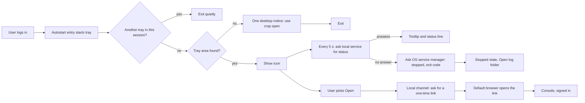
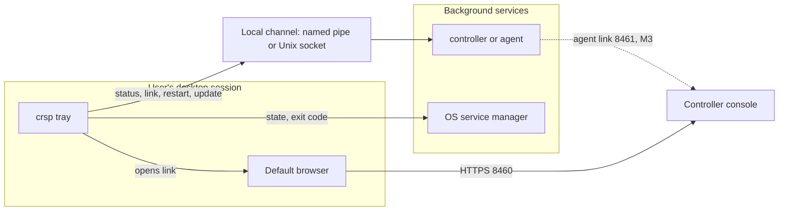

# Tray

PARTLY BUILT (CRSP26, CRSP19). The tray side of M1 is built: menu, status, Open, stopped state, log folder, autostart, single instance, Linux tray-host probe, `crsp tray --smoke`, CI smoke. CRSP19 added the full menu (version header, Look for updates, Restart the service, Open on GitHub, Quit tray), the update item, and self-update on all OSes with drain (Restart and Update moved from M3 into this milestone). The service side of the local channel is built (CRSP19: `internal/trayserver`; R5.8, R6.8, `status` with the update fields, `check`, `link` with a target). TRAY1 built the one-time sign-in link end to end: the controller now builds the auth service on its database, `link` makes a real one-time link for the bound OS user, and `/auth/link` signs in (R5.7, R5.9 sign-in and binding, R6.1). NOT YET IMPLEMENTED: the console list of bindings with Remove (second half of R5.9), the installer rule (R5.22), the idle-resource check (R6.4) and the content-words guard (R6.7). Everything marked (M8) is planned.

## 1. In one paragraph

The tray is a small icon on each desktop machine in the pool. It shows whether the local service is fine, how many jobs run and wait, and why the service stopped if it did. **Open** starts the web console in the browser, already signed in, through a one-time link. The tray also shows the version and whether it is up to date, looks for updates, and restarts the service: a restart, or an update with Automatic updates off, opens the console at a Review step that names the running jobs and asks the yes. With Automatic updates on (the default) a newer stable release installs by itself after the machine has drained. Later, it shows notices such as "machine offline". The tray is the `tray` mode of the one `crsp` binary (decision [0001](../../architecture/decisions/0001-stack.md)). Headless Linux has no tray; `crsp open` prints the same one-time link (decision [0005](../../architecture/decisions/0005-product-boundary.md)).

## 2. Why

**Problem.** The controller and the agent run as background services. A service cannot draw anything on the desktop. The user still needs a quick way to see if the pool on this machine works, and to reach the console without typing a URL and signing in again.

**Users.** The person who sits at a machine in the pool: the owner, or an admin on their own computer.

**Goals.**

- One click from the desktop to the signed-in console.
- The state of the local service at a glance, in words, not only a colour.
- When the service has stopped, say so, say why (exit code), and open the log folder.
- Restart and update never cut a running job without a yes.
- Works the same way on Windows, macOS and Linux desktops.

**Non-goals.**

- The tray is not a second console. Settings, machines, runners and jobs live in the web console only. The one exception is the local machine's mode and pause (R5.42): the person who sits at the machine can hold it from taking jobs without opening the console.
- The tray never runs runners or jobs, and holds no secret.
- No tray on headless machines; the CLI covers them.

### Milestones

| Milestone | What the tray does |
|---|---|
| M1 (one machine, persistent runners) | Open, status in the tooltip and the menu, service-stopped state with exit code, Open log folder, Quit, autostart, single instance, GNOME fallback, CI smoke on Windows, Linux and macOS. Runs on the controller's machine. `crsp open` on headless Linux. |
| M1, CRSP19 | Version header, Look for updates, Restart the service, Open on GitHub, Quit tray. Update with drain on Windows, macOS and Linux (Automatic updates on by default). The service side is the controller's machine. |
| M3 (more machines, agent auto-update) | Open and status on agent-only machines; agents update to the controller's version. |
| M8 (product polish) | Notices. |

## 3. How it works

The steps in words:

1. The user logs in to the desktop. The per-user autostart entry starts `crsp tray`.
2. If a tray already runs in this logon session, the new one exits at once.
3. On Linux, if the desktop has no tray area (stock GNOME without the AppIndicator extension), the tray shows one desktop notice that points to `crsp open`, then exits.
4. The tray shows its icon. Every 5 seconds it asks the local service for its status over a local channel that only this machine can reach.
5. If the service answers, the tooltip and the first menu line show the state and the job counts.
6. If the service does not answer, the tray asks the OS service manager. It shows that the service stopped, when, and its exit code, and offers Open log folder.
7. When the user picks **Open**, the tray asks the service for a one-time sign-in link over the local channel. It opens that link in the default browser. The console signs the user in and drops the link.
8. Later milestones: **Restart** and **Update** open the console at a Review step that names the running jobs; nothing happens without a yes. Notices pop up once per change; a click opens the console at that notice.

## 4. Screens and states

The tray has an icon, a tooltip and one menu. It has no window of its own. Status words follow UX-58; the state is always a word and a glyph, never a colour alone (UX-17, UX-26). Times follow UX-18. Words not yet in `docs/design-system/v1/content.md` are listed in section 11 for the owner to add.

**Menu (the same on Windows, macOS and Linux).**

| Item | Kind | Notes |
|---|---|---|
| `CI Runners Shared Pool <version> - up to date` | Text, grey, not pressable | When a newer stable release exists it reads `CI Runners Shared Pool <version>` and the Update to line follows. It reads `- updating…` while an update drains, downloads or installs, `- update failed` after a failed one, and ends with ` · auto-update off` when Automatic updates is off. With no answer from the service it shows only the name and version. |
| `↑ Update to <version>` | Action | Shown only when a newer release exists and no update runs. Runs the same ask-first flow as Look for updates: the update dialog (TRAY2); nothing installs before the yes. |
| `Running - N jobs - M runners` | Action | The state is a word: Running, Waiting, Failed, Stopped or Starting. No runner yet reads `Running - no runners yet`. Stopped reads `Stopped at 14:30 - exit code 3`. Opens the console Jobs page. The tooltip keeps the glyph form (R5.2). |
| (separator) | | |
| Open console, Open on GitHub, Look for updates | Action | Open console signs in through a one-time link. Open on GitHub opens the repository page. Look for updates only looks (R5.43). Up to date: one notice, `CI Runners Shared Pool <version> is the newest stable release.` A newer release: the update dialog. |
| (separator) | | |
| Pause | Submenu: `for 1 hour`, `until I resume` | Pauses new jobs on this machine; the running jobs finish. Hidden while a pause or the Paused mode holds, and when the service reports no machine policy. |
| `Paused until HH:MM - Resume now` | Action | Takes the place of Pause while a timed pause holds; `Paused - Resume now` for a pause with no end or the Paused mode. Ends the pause and returns the Paused mode to Automatic. |
| `Mode: <current>` | Submenu with two radio items: Automatic, Always (R5.42) | The mode in force is ticked. Paused is not a mode here: a machine paused from the console shows the plain label `Mode` and ticks neither. Hidden when the service does not report a machine policy. |
| (separator) | | |
| Restart the service, Open log folder, Open Doctor | Action | Restart opens the console Review step and never restarts without that yes. Open log folder opens the service's log folder in the file manager. Open Doctor opens the console Doctor page. |
| (separator) | | |
| ✓ Start at login | Switch with a tick | Turns the autostart entry on or off. On by default. |
| Quit tray | Action | Closes the tray only. The service keeps running. |

**Menu (later).** A Notices item with a count (M8).

**States.**

| State | Disc colour | Tooltip text (example) |
|---|---|---|
| Healthy | green `#1a7f37` | `crsp: ✓ ok · 2 running · 1 waiting` |
| Waiting (jobs wait over the limit, or load is over budget) | amber `#9a6700` | `crsp: ◷ waiting · 0 running · 4 waiting` |
| Failed (service runs and reports a fault) | red `#c62828` | `crsp: ✕ failed · GitHub not reachable` |
| Stopped | slate grey `#4b5563` | `crsp: ✕ stopped at 14:30 · exit code 3` |
| Starting (no answer yet) | blue `#0b5cc2` | `crsp: ▶ starting` |

- Empty: no runners yet reads `✓ ok · no runners yet`, and Open leads to the console's first-run wizard (UX-6).
- Waiting: the tray never blocks on the service; a slow answer keeps the last state for up to 15 s, then shows Starting or Stopped.
- Error: Open that fails shows one desktop notice in the Problem tone: what failed, why, what next (UX-26).

**The update window (Windows, R5.46 to R5.49).** One window for the whole update. The states, with the buttons left to right (the filled one is the primary):

| State | Heading | Body | Bar | Buttons |
|---|---|---|---|---|
| Review | `Update to <version>` | `Version <v> is ready. You run <old>.` and `Running jobs finish first, then the service restarts (about 1 min). No job is stopped.` | none | `Not now`, `Update now` (default) |
| Downloading | `Downloading <v>` | `The update is checked against its checksum and signature before it installs.` | percent | `Hide` (default), `Cancel update` |
| Waiting for jobs | `Waiting for jobs` | the number of jobs running, `This machine takes no new jobs meanwhile. No job is stopped.` | none | `Hide` (default), `Cancel update` |
| Installing | `Installing <v>` | `This cannot be cancelled. You can hide this window; the update goes on.` | percent | `Hide` |
| Restarting | `Restarting the service` | `The service is replaced and starts again. This window waits for it.` | moving | `Hide` |
| Done | `Updated` | `Now running <v>.` | none | `Close` |
| Failed | `The update failed` | the reason, `Still on <old>.`, `Log: <path>` | none | `Close` |
| Cancelled | `Update cancelled` | `Nothing changed. Still on <old>.` | none | `Close` |

The band, the buttons and the focus ring follow the design system, component 49 of the next version; the rules it cites are CORE-1 to CORE-7, UX-30 (steps) and UX-71 (the buttons sit on one bar at the foot).

**Confirmation for Restart and Update.** The tray does not draw its own question. It opens the console at a Review step (`/settings/updates/review?kind=restart` or `kind=update`) through a one-time link. The Review step names each running job on this machine and says "Nothing has changed yet." (UX-30, UX-62). The question card follows UX-9. With Automatic updates on, an update needs no yes: it downloads, verifies, drains and installs by itself, and the header reads `- updating…`.

## 5. Functional requirements

### Menu and status

**R5.1** — The tray menu MUST hold, in this order, on Windows, macOS and Linux: the version line (grey text), `↑ Update to <version>` (only when a newer release exists), the status line, a separator, Open console, Open on GitHub, Look for updates, a separator, Pause (a submenu; `Paused until HH:MM - Resume now` takes its place while a pause holds), Mode: `<current>` (a submenu), a separator, Restart the service, Open log folder, Open Doctor, a separator, Start at login, Quit tray. No entry is bold. (M1, CRSP19, TRAY3)

**R5.2** — The status line MUST read `<word> - N jobs - M runners` with the state as a word (UX-58), and opens the console Jobs page. The tooltip MUST show the same facts with the UX-58 glyph: product name, glyph and state word, running job count and waiting job count. A stopped service shows the stop time and exit code instead of counts, in both. (M1, CRSP19)

**R5.3** — The tray MUST ask the local service for status every 5 seconds and update the icon, tooltip and status line within 10 seconds of a change. (M1)

**R5.4** — The icon MUST always be the same round disc with the letters CRSP in it, the same as the app icon (decision tray D8). Only the disc colour changes with the state. The tooltip and the menu header MUST name the state in words (R5.2), so the state is never shown by colour alone (UX-26). The program icon (`crsp.exe`, the Start Menu entry, the Apps list) is the healthy disc, 16 to 256 px. (M1)

**R5.5** — Quit MUST close only the tray. It MUST NOT stop the service or any job. (M1)

### Mode and pause (CRSP75)

**R5.42** — The tray MUST show this machine's mode and let the person change it (machines R5.61): a Mode submenu with Automatic and Always as radio items (the one in force ticked), a Pause submenu with `for 1 hour` and `until I resume`, and `Paused until HH:MM - Resume now`. The Pause submenu hides while a pause or the Paused mode holds; the Resume entry shows then and ends the pause and the Paused mode. The menu header ends with ` · Paused` or ` · On battery` while the machine takes no new job, and the tooltip says it in lower case. A machine over its load budget is working, so the header does not say Busy. A change goes to the controller as a machine setting through the local channel calls `mode`, `pause` and `resume`, and the status answer carries the policy back (`policy`: mode, accepting, pause_reason, on_battery, pause_until_ms, until_resumed). The console shows the change at once, a change in the console reaches the menu on the next 5-second poll (R5.3), and each change is in the audit log as `tray:<os user>`. A failed change shows one notice and changes nothing. The running jobs always finish. (M1)

### Open and the one-time sign-in link

**R5.6** — Open MUST ask the local service, over the local channel (R5.8), for a one-time sign-in link and open it in the default browser. (M1)

**R5.7** — The console MUST sign the user in from a one-time link, then redirect to a URL without the link's code. A used, expired or unknown code MUST show the normal sign-in page with a Problem message that says the link expired and offers sign-in with GitHub (UX-6). (M1)

**R5.8** — The local channel MUST be a named pipe on Windows and a Unix socket on Linux and macOS. It MUST refuse callers from other machines, and MUST read the calling OS user from the OS (pipe client identity or peer credentials), never from the request. (M1)

**R5.9** — A one-time link MUST sign in as the GitHub user bound to the calling OS user on this machine. When the OS user is not bound yet, Open MUST open the console's sign-in with GitHub and, after sign-in, bind that GitHub user to this machine and OS user. The console MUST list these bindings and let the owner remove one. (M1; see open question 1)

**R5.10** — `crsp open` MUST print a one-time sign-in link to standard output, made the same way as R5.6, and open it in a browser when one is available. On headless Linux it only prints. (M1)

**R5.11** — On a machine that runs only the agent, the agent MUST ask the controller for the one-time link over the agent link, and the link MUST point to the controller's console URL. (M3)

### Service stopped

**R5.12** — When the service does not answer, the tray MUST read the service state from the OS service manager (Windows service control manager, macOS launchd, Linux systemd) and show Stopped with the stop time and exit code. (M1)

**R5.13** — Open log folder MUST open the folder that holds the service's logs, in the OS file manager, whether the service runs or not. (M1)

**R5.14** — While the service is stopped, Open MUST show a Problem notice that says the service stopped, its exit code, and that the log folder has the reason; it MUST NOT open a dead link. (M1)

### Restart and update with drain

**R5.15** — Restart the service MUST open the console at the restart Review step through a one-time link. The Review step MUST name each job running on this machine (repository, workflow, run number) and say how long the drain may wait. (M1, CRSP19)

**R5.16** — The service's restart and update endpoints (`POST /api/v1/service/restart`, `POST /api/v1/update/apply`) MUST refuse a request without `confirmed=true`, change nothing, and answer 409 `needs_confirmation` with one detail per running job. (M1, CRSP19)

**R5.17** — After a yes (or, for an update, with Automatic updates on), the service MUST drain: start no new job here, wait for running jobs to end or for the drain timeout, then restart or install. It MUST check once more that no job runs right before the install, and MUST never stop a running job before the timeout (product learning 1). (M1, CRSP19)

**R5.18** — The tray MUST show Update to `<version>` only when the controller reports a newer stable release and Automatic updates is off. With it off, the update MUST install only after a yes on the Review step. With it on, the regular check installs by itself after the drain; the owner's own look never does (R5.43). After the install the tray MUST come back on the new version within 30 seconds: when the service reports a newer version than the tray's own, the tray starts the new binary and quits. (M1, CRSP19)

**R5.28** — Automatic updates MUST be on by default on every OS, and the user MUST be able to turn it off and on in the console (Settings, Updates) and with `crsp update auto on|off`. The choice is the controller setting `auto_update`, and the version line of the menu MUST say `· auto-update off` when it is off. (M1, CRSP19)

**R5.43** (built, CRSP147, changed by TRAY4) — **Look for updates asks first, in the console theme.** On Windows the native update window opens instead (R5.45); elsewhere a newer stable release MUST open the console page `/update` through a one-time link, in a small app-style window. The page asks: `Version X is ready. Running jobs finish first; the service restarts (about 1 min).` with `Not now` on the left and `Update now` (the main button) on the right; it says `Running jobs are safe.` while it works. The tray finds the browser per OS (Edge, then Chrome or Chromium; Windows: Program Files and Local AppData; macOS: /Applications and ~/Applications; Linux: the names on the PATH) and starts it with `--app=<url> --window-size=520,420`; with none it opens the default browser. Update now sends the console call `POST /api/v1/update/apply?confirmed=true` (the service drains, then installs); Not now closes the window and changes nothing, and the menu keeps `Update to X`. When no browser can be opened at all, the tray falls back to a native two-button box (Windows form, zenity, kdialog, osascript) with the same words, `Update now` and `Not now`; without a dialog program it shows a notice that points to Settings, Updates, and installs nothing. A look while an update already runs opens the same page on its progress. The tray MUST NOT install anything on a look alone, whatever Automatic updates says. With Automatic updates off, a newer release found by the regular check opens the same page once per version. After a successful update the tray says the result once, never in a modal box (R5.47). The page and its stages are in web-console R5.96 and operations R5.91.

**R5.44** (built, OPS24; runners R5.89) — **A runner that did not start is a notification.** The service's status answer carries `runner_problems`: the runner services of this machine that its agent could not start after it gave their account the right to log on as a service again and tried once more. For each one the tray shows one desktop notification, "A runner did not start", whose text names the runner and the reason and says to open the console and press Start. A problem notifies once, not at every poll; it is forgotten when the service runs, so it notifies again if it comes back. A service without the field (an older service) raises nothing. The words are in content.md, "Runner service words".

**R5.45** (built, TRAY6) — **The menu stays open while the user is in it.** The tray never rebuilds or replaces the menu after it is built. A status from the poll changes an item, the tooltip or the icon only when its text, visibility, tick or state differs from what is shown, and only in place. While the menu is open the tray changes nothing: it keeps the newest status and applies it within 250 ms of the menu closing. On Windows the menu counts as open while the foreground thread is in a menu loop (`GetGUIThreadInfo`), because `TrackPopupMenu` closes when an item is hidden or shown or the tray icon is modified under it. On Linux and macOS the desktop host draws the menu and takes in-place item changes without closing it, so changes apply at once there and the queue stays empty.

**R5.46** (built, TRAY5; owner decisions D12, D14) — **On Windows the update is one native window.** The tray copies its signed `crsp.exe` to `%TEMP%\crsp-update-window\` and starts the copy as the hidden command `crsp update-window`, so the window keeps running while the update replaces the program folder and restarts the service. The window is drawn in Go with Win32 calls (no cgo, no GUI framework). It is the only window of the whole update: Review (`Not now`, `Update now`), Downloading (percent), Waiting for jobs, Installing, Restarting, Done (`Now running 0.1.13.`) and Failed (the reason, `Still on 0.1.12.`, the log path); after a Cancel it says `Update cancelled`. It reads the live stage over the local channel (`status` carries `stage`, with `started_by`) every second, and the channel failing during the restart is the Restarting step, not an error; when the service is back on the new version the same window says Done. Title `Update - CI Runners Shared Pool`, the crsp icon in the title bar and the taskbar, the close button only (no minimise, no maximise, no resize), centred on the screen of the tray icon, brought to the front once, not always on top. One window only: a second start (the menu item again, a toast click) focuses the first (named mutex `Local\crsp-update-window`). The window is per-monitor DPI aware (v2); it is laid out in units of the font height, so nothing is cut off at 100, 125, 150 or 200 % (R5.49). Enter presses the default button (Update now on Review, Hide while it works, Close at the end); Escape and the close button of the title bar press `Not now`, `Hide` or `Close` and never stop an update; Tab goes left to right on the button bar. A done or failed stage left by an earlier update is not this update: when a newer release than the stage's version is known, the window opens on Review of the newer release, never on Done of the old one. macOS and Linux keep the console page of R5.43 until task TRAY7.

**R5.47** (built, TRAY5; owner decision D15) — **Cancel stops an update only before the install.** While the update downloads or waits for jobs the window shows `Cancel update` next to `Hide`. Cancel sends the local channel call `cancel`; the service ends the download or the drain, lets the machine take jobs again, releases the update lock and removes the stage, so nothing has changed, and the window says `Update cancelled`. From Installing on there is no Cancel: the only button is `Hide`, which closes the window while the update goes on, and the menu item reopens the window on the live step. The service refuses `cancel` from Installing on.

**R5.48** (built, TRAY5; owner decision D13) — **An update ends with one toast or the window, never a modal box.** The stage records `started_by`: `auto` (nobody clicked), `tray` (the update window) or `console` (the console page or the command line). After the restart the new tray (`--updated`) waits for the done stage and then: for `auto`, for a stage without the field, and where no native window exists, it shows one desktop toast with the crsp icon, `Now running 0.1.13.`; a click on the toast opens the update window on Done. For `tray` it opens the window on Done (the one window; it only appears again when the person closed it). For `console` it says nothing: the console showed the end. A failed update says nothing here. The result is said once per version and user. No `MessageBox` is shown after an update.

**R5.49** (built, TRAY5; owner decisions D14, D16, D17) — **The window is the console's look, laid out from its content.** Colours come from the Phosphor dark tokens (`packages/ui/src/tokens.css`) through the generator `internal/updatewindow/genart`, which writes `tokens_gen.go`; no colour is typed in the window code. Background, text, progress bar and buttons use the tokens; the primary button is filled and the others are outlined, like the console. The band at the top is the crsp icon and `CI RUNNERS SHARED POOL` in the primary colour on the page colour with faint scanlines, drawn from the tokens. The layout is computed in units of the font height (`internal/updatewindow/layout.go`); the window height follows the content. The hidden flag `crsp update-window --layout-check` builds the window off screen for every state at 100, 125, 150 and 200 % with the real fonts and exits 1 when any text, button or bar is clipped or overlaps; with `--screenshots <dir>` it also writes a PNG of every state. The Windows job of `tray-smoke` runs it and keeps the PNG files as the artifact `update-window-screenshots`.

**R5.50** (built, TRAY8) — **The menu shows what the last status says, and no version that is not newer.** The tray repeats the visibility of every menu item with each status, so a hide or show the desktop dropped (the `Update to X` line left on view while the header says `up to date`) is put right by the next status; it changes a title, a tick, the tooltip and the icon only when they differ. A release is a found update only when the service says so and it is newer than the version the service runs (`Status.NewerFound`): the header, the `Update to X` line, the once-per-version offer, `Look for updates` and the update window (R5.46) all use that one rule, so a version equal to or older than the running one is never offered and the header and the line never disagree.

**R5.51** (built, TRAY8) — **Already the newest is an answer, not a failure.** When the service answers `install` with `this is already the newest stable release`, the tray client returns that plain error without the `local channel:` prefix. The update window then shows `Up to date` with `Now running {version}. This is the newest stable release.` and one `Close` button, never `The update failed`; a Review of a version that is not newer than the one that runs opens on the same step, with no `Update now`. The notice and the native box say `Up to date`. The window wraps its text a little narrower than its box, so a long line such as the Review note wraps and is never cut.

**R5.52** (built, TRAY10) — **The window measures text with a device context it owns.** The native update window and `--layout-check` build their fonts the same way (`newFonts(dpi)`): the fonts create their own measuring DC and delete it in `free()`, and never keep a DC that was released (a released DC made `GetTextExtentPoint32` fail, so every width was 0, the body line never wrapped and the `0%` label and the bar ran past the margin). `Measure` never answers 0 for non-empty text: when the call fails it estimates from the rune count and the average character width. `Clipped` flags a line that measures 0, a line wider than its box, and any item that runs past the right margin (`pad + textW`).
**R5.53** (built, TRAY11) — **An update waits for another installer.** Windows installs one program at a time. Before it starts `msiexec`, the service checks whether another install runs (the `Global\_MSIExecute` mutex can be opened). It also reads exit code 1618 from `msiexec`, or `another installation is in progress` in the MSI log, as busy: never as a failure and never as success. While busy it writes the stage `waiting_installer` (with `waiting_for`, the name of the other installer from the command line of its `msiexec`, when it can be found), looks again every 15 s with no limit, and starts `msiexec` when the installer is free. The service keeps running the old version meanwhile. The update window shows `Waiting for another installer` with `<name> is installing. Windows installs one program at a time; this update starts when it finishes.` (`Another program` when the name is unknown), an indeterminate bar and `Hide`. Only a real MSI failure ends in `failed`, with its log path.

**R5.54** (built, TRAY11) — **No stage claims progress that has not happened, and no attempt stays stuck.** `restarting` is written only once `msiexec` has finished with a success code; the window shows `Restarting the service` only then. A service that is down while the stage is still `installing` shows `Installing`. If `msiexec` has ended without replacing the service, the service notices (the log has an exit code, or the process is gone and the log has no end line after 10 s; a success code with the old version still running after 2 min): 1618 goes back to waiting, any other result marks the attempt `failed` with the reason and the log path, so `Update to <version>` can start again. At start, an attempt left in `installing`, `waiting_installer` or `restarting` for a version that is not the one that runs, with no install pending and no live helper, is marked `failed` the same way, and so is a pending install whose log never appeared within 10 s of the start or has not been written for 2 min. After a failure the next `Update to <version>` is a new attempt: the console never reattaches to the dead one. A restart after a busy installer ends the attempt as failed (`another installer was running, so the update did not start`) and is not counted as a failed try; the drain is over, so the update is not started again by itself.

**R5.29** — The tray MUST ask the service to look for updates only through the local channel calls `check` and `install`; it never talks to GitHub itself. Update, restart and Look for updates MUST NOT need a network port in the tray (R6.3). (M1, CRSP19)

**R5.30** — Open on GitHub MUST open `https://github.com/luis-mc/ci-runners-shared-pool` in the default browser. (M1, CRSP19)

### Notices

**R5.19** — The tray MUST show each notice from the service (machine offline, job waiting longer than N minutes, disk nearly full, runner version outdated, update ready) as one OS notification, once per change of that notice. A notice that has not changed MUST NOT be shown again, also after the tray restarts. (M8)

**R5.20** — Clicking a notice MUST open the console at that notice through a one-time link. (M8)

### Autostart

**R5.21** — Install and Start at login MUST write a per-user autostart entry: Windows, a value under `HKCU\Software\Microsoft\Windows\CurrentVersion\Run`; macOS, a LaunchAgent plist in `~/Library/LaunchAgents` with `RunAtLoad`; Linux desktop, a `.desktop` file in `$XDG_CONFIG_HOME/autostart` (default `~/.config/autostart`). Turning Start at login off MUST remove that entry. (M1)

**R5.22** — On headless Linux the installer MUST NOT write an autostart entry, and MUST print how to use `crsp open`. (M1)

### Single instance

**R5.23** — Only one tray MUST run per logon session. Windows uses a named mutex in the `Local\` namespace; macOS and Linux use a lock file in the user's runtime folder. A second tray in the same session MUST exit with code 0 and no window. A tray in another session (fast user switching, remote desktop) MUST still start. (M1)

### Linux desktops without a tray area

**R5.24** — On Linux the tray MUST look for a StatusNotifierItem host on the session D-Bus before it shows the icon. With none (stock GNOME without the AppIndicator extension), it MUST show one desktop notice that names `crsp open` and the AppIndicator extension, then exit with code 2. It MUST show this notice once per version, not at every login. (M1)

**R5.25** — With no graphical session at all (no display and no session D-Bus), `crsp tray` MUST print one line that names `crsp open` and exit with code 3. (M1)

### CI smoke of the built binary

**R5.26** — CI MUST build the release binary on Windows, Linux and macOS (macOS on a macOS runner with cgo, decision 0001), then start `crsp tray --smoke`. The smoke MUST start the real tray loop, wait until the icon is ready, and exit 0 within 20 seconds. A crash, hang or non-zero exit MUST fail the build. (M1)

**R5.27** — The CI smoke MUST also start a second tray while the first runs and check that the second exits 0 at once (R5.23). (M1)

## 6. Non-functional requirements

**R6.1** — A one-time link code MUST be at least 128 random bits, valid for 60 seconds, usable once, stored only as a hash, and never written to a log. (M1)

**R6.2** — The tray MUST hold no secret and no GitHub token. It MUST keep only its own small state (shown notices, the GNOME notice flag) in the user's config folder. (M1)

**R6.3** — The tray MUST run as the logged-in user, never as admin or root, and MUST NOT open a network port. (M1)

**R6.4** — At rest the tray MUST use at most 50 MB of memory and under 1% of one CPU core, measured over 5 minutes. (M1)

**R6.5** — The tooltip text MUST fit 127 characters (the Windows limit) and cut the end with `…` when longer. (M1)

**R6.6** — The tray MUST stay responsive when the service is slow: a status call times out after 3 seconds and never blocks the menu. (M1)

**R6.7** — Every word the tray shows MUST come from `docs/design-system/v1/content.md` (UX-1). (M1)

**R6.8** — The local channel MUST be reachable only by local users: on Windows the pipe rejects remote clients; on Linux and macOS the socket file is mode 0660, owned by the service user and the `crsp` group. (M1)

## 7. Design

- **Package.** `internal/tray` holds the menu, the status poller, the autostart writers per OS (build tags), the single-instance lock, and the Linux tray-host probe. `fyne.io/systray` draws the icon and menu.
- **Local channel.** One small request-response protocol (JSON lines) on the named pipe `\\.\pipe\crsp-tray` or the socket `/run/crsp/tray.sock` (Linux) or `/var/run/crsp/tray.sock` (macOS). Calls: `status` (also carries `version`, `auto_update`, `latest_version`, `update_available`, `update_state`), `link` (returns a one-time URL; an optional `target` is the console path to land on, for the Review steps), `check` (look for a newer stable release, answers like `status`), `mode` (`mode`: automatic, always or paused), `pause` (`pause`: one_hour or until_resumed) and `resume`, which answer like `status` (CRSP75, R5.42), `notices` (M8). Restart and update are not channel calls: the tray opens the console Review step with `link`, and the console calls the HTTP API (`POST /api/v1/update/apply?confirmed=true`, `POST /api/v1/service/restart?confirmed=true`). The service reads the caller's OS user from the pipe or the socket.
- **One-time link.** The controller stores `link_codes(hash, github_user_id, purpose, target_path, expires_at, used_at)`. The URL is `<scheme>://<host>:8460/auth/link?code=<code>`, `http` for 127.0.0.1 and ::1, `https` for any other address (web-console R5.1). The console marks the code used in the same transaction that makes the session, then redirects to `target_path`.
- **Bindings.** The controller stores `tray_bindings(machine_id, os_user_id, github_user_id, created_at)`. `os_user_id` is the Windows SID or the Unix uid.
- **Service state.** Windows: `QueryServiceStatusEx` (exit code from `dwWin32ExitCode` or `dwServiceSpecificExitCode`). macOS: `launchctl print` (last exit code). Linux: `systemctl show -p ActiveState,ExecMainStatus,ExecMainExitTimestamp`. None of these needs admin.
- **Exit codes of `tray`.** 0 normal, also when another tray runs; 2 no tray area on Linux; 3 no graphical session.

## 8. Failure modes

| Dependency | When it fails | Fail open or closed | Why |
|---|---|---|---|
| Local service | No answer to `status` | Open: show Stopped from the service manager | The user must see the state; the tray never guesses "ok". |
| Local channel | Caller identity cannot be read | Closed: no link | A link without a known OS user could sign in the wrong person. |
| One-time link | Expired or used | Closed: normal GitHub sign-in | A code is never reused. |
| Binding | OS user not bound | Closed: normal GitHub sign-in, then bind | Never sign in as a guessed user. |
| Restart or update | No `confirmed=true` | Closed: refuse, list jobs | Never cut a running job (product learning 1). |
| Drain | Timeout reached | The service restarts and names the jobs it stopped | The user set the timeout and said yes. |
| Tray area (Linux) | No StatusNotifierItem host | Exit after one notice | The console and `crsp open` still work. |
| Notification service | OS refuses a notice | Open: the notice stays in the menu count | A missing toast must not hide the notice. |
| Browser | No default browser | Show the link in a notice and copy it to the clipboard | The user can still paste it. |

## 9. How it is proven

Rows marked built have tests that exist and run in CI. Rows marked planned are not built yet.

| Requirement | Test |
|---|---|
| R5.1 | built: internal/tray/menu_test.go, TestMenuOrder, TestUpdateItemOnlyWhenNewerAndAutoOff |
| R5.42 | built (CRSP75): internal/tray/policy_test.go, TestModeSubmenuIsTwoRadioItemsWithOneTick, TestPauseAndResumeItems, TestNoPolicyHidesTheModeItems, TestHeaderNamesWhyTheMachineTakesNoJobs, TestClientSetsModePauseAndResume, TestOpenerChangesPolicyAndNoticesAFailure; internal/trayserver/server_unix_test.go, TestChannelModePauseAndResume; internal/machines/policy_test.go, TestPauseFromTheTray |
| R5.43 | built (CRSP147): internal/tray/update_prompt_test.go, TestLookForUpdatesAsksAndNeverInstallsByItself, TestLookForUpdatesWithoutDialogNeverInstalls, TestInstallNowFailureIsSaid, TestUpToDateAndAlreadyUpdatingAskNothing, TestPromptBodyAndChoicesAreTheOwnersWords, TestOfferedOncePerVersion. The OS dialogs (PowerShell form, zenity, kdialog, osascript) are not driven in CI; TRAY4: internal/tray/appwindow_test.go, TestLookupWindowsPrefersEdgeThenChrome, TestLookupDarwinLooksInApplicationsAndHome, TestLookupLinuxTriesNamesInOrder, TestAppWindowArgsAreAppModeAt520By420, TestAppWindowOpensTheBrowserElseTheDefault, TestOfferOpensTheUpdatePageAndAsksNothingNatively, TestOfferFallsBackToTheNativeBox, TestLookWhileUpdatingOpensTheProgressWindow |
| R5.44 | built (OPS24): internal/tray/runner_problems_test.go |
| R5.45 | built (TRAY6): internal/tray/apply_test.go, TestStatusWhileMenuOpenIsQueuedAndAppliedAfterClose, TestOnlyChangedItemsAreTouched, TestUpdateItemShownInPlace (fake tray surface). The Windows menu-open check is built, compiled in CI only |
| R5.46 | built (TRAY5): internal/updatewindow/model_test.go (every stage maps to its view, Enter and Escape are buttons of the view, Done after the restart, a leftover stage is not shown on Review), internal/tray/update_native_test.go (the menu item and the offer open the native window), .github/workflows/tray-smoke.yml (Windows: one window only) |
| R5.47 | built (TRAY5): internal/updatewindow/model_test.go TestCancelOnlyBeforeInstalling, TestCancelEndsWithNothingChanged; internal/update/cancel_test.go; internal/trayserver/server_unix_test.go TestChannelCancelIsItsOwnCall |
| R5.48 | built (TRAY5): internal/tray/update_after_test.go (the toast or the window decision, one toast, a click opens the window, console and failed say nothing), internal/update/cancel_test.go TestStartedByFollowsTheActorAndSurvivesTheRestart |
| R5.49 | built (TRAY5): internal/updatewindow/layout_test.go (nothing clipped at every DPI, no fixed pixel heights), art_test.go (the palette is the generated tokens, faint scanlines), tray-smoke Windows layout check and screenshots |
| R5.50 | built (TRAY8): internal/tray/apply_test.go TestMissedHideOfTheUpdateLineIsReasserted, TestOnlyChangedItemsAreTouched; internal/tray/update_prompt_test.go TestOfferNeverOffersAVersionThatIsNotNewer |
| R5.51 | built (TRAY8): internal/updatewindow/model_test.go TestNoUpdateAnswerShowsUpToDate, TestReviewNeverOffersAVersionThatIsNotNewer, TestReviewBodyWrapsWithoutCutting; internal/tray/update_prompt_test.go TestInstallAnsweredNoUpdateSaysUpToDate; apps/web Updates.test.tsx (no Update to line for a version that is not newer) |
| R5.52 | built (TRAY10): internal/updatewindow/paint_windows_test.go TestFontsMeasureAfterTheScreenDCIsReleased (Windows), layout_test.go TestClippedFlagsALineWiderThanItsBoxAndAFailedMeasure, TestInstallingBodyWrapsAtEveryDPI |
| R5.53 | built (TRAY11): internal/update/msi_busy_test.go (TestBusyInstallerWaitsEvery15SecondsThenInstalls, TestBusyWaitHasNoLimit, TestExit1618GoesBackToWaiting, TestLogSayingAnotherInstallationEndedMsiexecIsBusy, TestBusyDetectionHelpers, fake clock, no sleeps); internal/updatewindow/model_test.go TestWaitingForAnotherInstaller; internal/updatewindow/layout_test.go (`SampleViews` holds the new state, so `update-window --layout-check` covers it) |
| R5.54 | built (TRAY11): internal/updatewindow/model_test.go TestRestartingOnlyAfterTheInstallerFinished; internal/update/msi_busy_test.go TestRealMSIFailureEndsFailedWithTheLog, TestMsiexecGoneWithoutAResultIsAFailure, TestStaleRestartingAttemptIsFailedAtStart, TestStageOfTheRunningVersionIsLeftAlone, TestRecoverMSIWithBusyLogDoesNotCountAsAFailure, TestRecoverMSISettlesAnInstallThatNeverRanOrWentQuiet, TestAfterAFailureANewAttemptStarts |
| R5.2 | built: internal/tray/menu_test.go, TestServiceLinePerState, TestHeaderPerUpdateState; internal/tray/tray_test.go, TestStatusTextPerState (tooltip) |
| R5.3 | built: internal/tray/tray_test.go, TestPollerUpdatesWithin10s (injected clock) |
| R5.4 | built: internal/tray/tray_test.go, TestIconIsAlwaysTheDiscDifferingOnlyInColour, TestCommittedAppIconMatches |
| R5.5 | built: internal/tray/tray_test.go, TestQuitLeavesServiceRunning (the client has no stop call) |
| R5.6 | built: internal/tray/tray_test.go, TestOpenAsksLinkAndLaunchesBrowser, TestClientStatusAndLink (fake channel and browser) |
| R5.7 | built (TRAY1): cmd/crsp/auth_wiring_unix_test.go, TestOpenSignsInOnceFromTheBoundOSUser (redirect without the code, working session, replay refused), TestOpenLinkExpiresAfterSixtySeconds; apps/web/src/shell/Shell.test.tsx, says the tray link expired and offers GitHub sign-in |
| R5.8 | built: internal/trayserver/server_unix_test.go, TestChannelReadsPeerUserFromTheOS (Linux; the caller's uid comes from SO_PEERCRED, a spoofed field in the request is ignored), TestChannelClosedWhenCallerUnknownAndBadCalls; Windows (client process SID, PIPE_REJECT_REMOTE_CLIENTS) and macOS (LOCAL_PEERCRED) built, compiled in CI only |
| R5.9 | built in part (TRAY1): cmd/crsp/auth_wiring_unix_test.go, TestOpenFromAnUnboundOSUserGetsGitHubSignInNotASession, TestOpenAfterTheBoundUserWasRemovedAsksForGitHubAgain, TestOpenBeforeSetupGivesThePlainConsole; internal/auth/tray_test.go, TestTrayBindingByGitHubSignIn; internal/store/authstore_test.go, TestTrayBindingIsPerOSUserAndGoesWithTheUser. NOT YET IMPLEMENTED: the console list of bindings and Remove (internal/api/binding_test.go, TestOwnerRemovesBinding) |
| R5.10 | built: internal/tray/tray_test.go, TestOpenCommandPrintsLink; the service side of `link` is built in TRAY1 (cmd/crsp/auth_wiring_unix_test.go) |
| R5.11 | planned: internal/agent/link_test.go, TestAgentAsksControllerForLink |
| R5.12 | built: internal/tray/tray_test.go, TestStoppedStateWithExitCode, TestPollerKeepsLastThenAsksOS (Linux parser tested; Windows and macOS readers built, run only in CI smoke) |
| R5.13 | built: internal/tray/tray_test.go, TestLogFolderPathPerOS |
| R5.14 | built: internal/tray/tray_test.go, TestOpenWhileStoppedShowsProblem |
| R5.15 | built: internal/tray/menu_test.go, TestRestartAndUpdateOpenTheReviewStep; apps/web/src/screens/settings/Updates.test.tsx, Review step names the running jobs; apps/web/src/screens/wizards.test.tsx, update wizard in the ten states |
| R5.16 | built: internal/api/handlers_update_test.go, TestRestartAndUpdateRefusedWithoutConfirmed, TestRestartAndUpdateWithConfirmed |
| R5.17 | built: internal/update/update_test.go, TestAutoOnDownloadsVerifiesThenDrainsThenInstallsOnIdle (a running job stops the install), TestApplyRefusedWithoutConfirmedListsJobs |
| R5.18 | built: internal/tray/menu_test.go, TestUpdateItemOnlyWhenNewerAndAutoOff, TestTrayRelaunchesWhenServiceIsNewer; internal/update/update_test.go (helper per OS). The real install on each OS is not run in CI yet (needs CRSP18's MSI) |
| R5.28 | built: internal/settings/settings_test.go, TestAutoUpdateDefaultsOnAndToggles; internal/api/handlers_update_test.go, TestSettingsAutoUpdateDefaultOnAndToggle; internal/cli/cmd_update_test.go, TestUpdateAutoTogglesTheSetting; apps/web/src/screens/settings/Updates.test.tsx |
| R5.29 | built: internal/tray/menu_test.go, TestClientCarriesUpdateFieldsAndTarget, TestLookForUpdatesSaysTheResult |
| R5.30 | built: internal/tray/menu_test.go, TestOpenOnGitHubOpensTheRepository |
| R5.19 | planned: internal/tray/notices_test.go, TestNoticeShownOncePerChangeAcrossRestart |
| R5.20 | planned: internal/tray/notices_test.go, TestNoticeClickOpensLink |
| R5.21 | built: internal/tray/tray_test.go, TestAutostartOnOff (XDG and LaunchAgent writers; the Windows Run-key writer is built, not unit tested) |
| R5.22 | planned: internal/install/headless_test.go, TestHeadlessWritesNoAutostart |
| R5.23 | built: internal/tray/single_unix_test.go, TestSecondInstanceExits0; CI smoke second-instance step. Windows mutex built, proven by CI smoke only |
| R5.24 | built: internal/tray/sni_linux_test.go (probe); CI smoke "no tray area exits 2" under a private session D-Bus. The notice-once-per-version flag: internal/tray/tray_test.go, TestNoticeOncePerVersion |
| R5.25 | built: internal/tray/sni_linux_test.go, TestNoSessionExit3 |
| R5.26 | built: .github/workflows/tray-smoke.yml, job smoke on ubuntu-latest (xvfb, SNI host), windows-latest and macos-latest |
| R5.27 | built: .github/workflows/tray-smoke.yml, second-instance step |
| R6.1 | built (TRAY1): internal/auth/tray_test.go, TestTrayLinkTargetSafe (128 bits), TestTrayLinkExpiresAfter60Seconds, TestTrayLinkOnceLoopbackOnly; internal/store/authstore_test.go, TestLinkCodeUsedOnceUnderRace (8 racing uses, one wins), TestLinkCodeExpiredAndUnknownAreRefused, TestLinkCodeStoredAsHashOnly (hash in the table, code absent from the audit rows); cmd/crsp/auth_wiring_unix_test.go, TestOpenLinkFromAnotherMachineIsRefused. The audit rows are checked in the same tests (an issue, a use and a refused use each write one) |
| R6.2 | built: internal/tray/tray_test.go, TestTrayStateHoldsNoSecret |
| R6.3 | planned: internal/tray/privilege_test.go, TestTrayOpensNoPort; CI tray-smoke checks no listening port |
| R6.4 | planned: CI job tray-smoke, idle memory and CPU sample over 5 minutes (nightly) |
| R6.5 | built: internal/tray/tray_test.go, TestTooltipCutAt127 |
| R6.6 | built: internal/tray/tray_test.go, TestSlowServiceTimesOutIn3s |
| R6.7 | planned: guards/content-words test over internal/tray strings |
| R6.8 | built (Unix): internal/trayserver/server_unix_test.go, TestSocketMode0660; the Windows pipe refuses remote clients with PIPE_REJECT_REMOTE_CLIENTS and is open to local signed-in users only (SDDL), not run in CI yet |

## 10. Decisions

| ID | Question | Chosen | Date |
|---|---|---|---|
| T1 | How does the tray reach the service? | A named pipe or Unix socket, not a TCP loopback port: the OS tells the service who calls, and no port opens. Proposed. | 2026-11-14 |
| T2 | Where does the user say yes to Restart and Update? | In the console's Review step, opened by a one-time link, so the question follows UX-9 and UX-30 on every OS. Proposed; open question 2. | 2026-11-14 |
| T3 | Scope of single instance | Per logon session (`Local\` on Windows), so fast user switching and remote desktop each get a tray. From the comics-organizer tray. | 2026-11-14 |
| T4 | Linux desktop with no tray area | One notice, then exit 2; no fallback window. Proposed; open question 4. | 2026-11-14 |
| T5 | Who does a one-time link sign in? | The GitHub user bound once to this machine and OS user. Proposed; open question 1. | 2026-11-14 |
| T7 | Where is the yes for Restart and Update asked, and when is it not needed? | On the console Review step, never in the tray (owner, 2026-11-14). With Automatic updates on (default, all OSes) an update needs no yes: it drains and installs by itself. Restart always needs the Review step. | 2026-11-14 |
| D8 | What does the tray icon look like? | Always the app icon: a round disc with the letters CRSP. Only the disc colour changes with the state; the words in the tooltip and menu header name it. Replaces the shape-per-state rule. (owner, v0.1.0 test) | 2026-11-15 |
| T6 | How is the tray proven? | CI starts the built binary on each OS (smoke), because two trays once passed every test and crashed at start (comics-organizer). | 2026-11-14 |

## 11. Not built yet

Built in CRSP26: the tray process and everything it runs in the user's session. Built in CRSP19: the service side of the local channel (`internal/trayserver`, wired in `cmd/crsp/tray_wiring.go`): `status` (with version, auto_update, latest, update state, running jobs of the controller's machine), `check`, and `link`. The socket is `/run/crsp/tray.sock` or `/var/run/crsp/tray.sock` (mode 0660, group `crsp` when it exists; `CRSP_TRAY_SOCKET` overrides), the pipe is `\\.\pipe\crsp-tray`. Built in TRAY1: the controller builds the auth service on its database (`internal/store/authstore.go`, `cmd/crsp/auth_wiring.go`) and `trayBackend.Links` makes the link. A bound OS user gets `/auth/link?code=...` (60 seconds, once, stored as a hash, loopback only). An OS user with no binding, or whose bound user was removed, gets `/auth/github/login?bind_tray=...`: GitHub sign-in, then the binding. A GitHub account that the owner has not allowed ends at "No access", so no OS user gets a session for a person who is not a console user. A console with no owner yet gets the plain address (the setup wizard). A used, expired, unknown or non-loopback code lands on `/sign-in?error=link_expired` or `link_local_only`. The bindings are keyed by the machine name `controller` and the OS user (Unix uid or Windows SID). Not built: the console list of bindings with Remove (R5.9, second half), and the first-run shortcut that binds the owner at setup. Sign-in now applies to the whole console, because the controller passes the GitHub area to the API; the repository routes of that area wait for their store (github-integration spec). `status` fills `State` with `ok` and does not yet count waiting jobs or runners.

Seams that will change:

- M3 adds the agent-only path (R5.11). Restart and Update (R5.15 to R5.18) are built in CRSP19 for the controller's machine; an agent-only machine updates to the controller's version over the agent link (operations R5.39 to R5.41, CRSP19).
- The Windows install of an update needs the MSI assets of CRSP18 (`crsp-windows-<arch>_<version>.msi`, in SHA256SUMS and attested). The MSI must also bring the tray back after an upgrade; until it does, the tray relaunches itself only when it survives the install.
- M8 adds notices (R5.19, R5.20); the channel gains `notices`.

Open owner questions:

1. **Who may get a one-time link?** Proposed: each OS user binds once to a GitHub user by signing in from the tray; the owner can remove a binding. Alternative: any member of a local `crsp` group signs in as the owner.
2. **Restart and Update confirmation:** in the console (proposed), or a native yes/no dialog in the tray (needs a dialog helper per OS, for example zenity on Linux)?
3. **New words for content.md:** Restart, Update, Quit, Open log folder, Start at login. Quit is new because Stop means ending running work.
4. **GNOME without AppIndicator:** one notice then exit (proposed), or a small fallback window?
5. **Milestones:** Restart and Update in M3 with agent auto-update, notices in M8 (proposed)?
6. **Start service from the tray** when stopped: needs an admin prompt. Proposed: not in M1; the tray shows the exit code and the log folder only.

## 12. Code map

Source: internal/tray/status.go
Source: internal/tray/poller.go
Source: internal/tray/channel.go
Source: internal/tray/channel_unix.go
Source: internal/tray/channel_windows.go
Source: internal/trayserver/server.go
Source: cmd/crsp/tray_wiring.go
Source: internal/tray/open.go
Source: internal/tray/open_cmd.go
Source: internal/tray/menu.go
Source: internal/tray/apply.go
Source: internal/update/manager.go
Source: apps/web/src/screens/settings/Updates.tsx
Source: internal/tray/icon.go
Source: internal/tray/run.go
Source: internal/tray/update_native.go
Source: internal/tray/update_after.go
Source: internal/updatewindow/model.go
Source: internal/updatewindow/layout.go
Source: internal/updatewindow/art.go
Source: internal/updatewindow/window_windows.go
Source: internal/tray/autostart.go
Source: internal/tray/single_unix.go
Source: internal/tray/single_windows.go
Source: internal/tray/svcstate_linux.go
Source: internal/tray/sni_linux.go
Source: internal/tray/state.go
Source: internal/tray/logfolder.go
Source: cmd/crsp/main.go
Source: .github/workflows/tray-smoke.yml
Source: packaging/autostart/README.md

Also: menu_open_windows.go and menu_open_other.go (is the menu open), autostart_windows.go, autostart_other.go, svcstate_darwin.go, svcstate_windows.go, notify_*.go and sni_other.go are the per-OS parts; internal/tray/testdata/snihost is the StatusNotifierWatcher stand-in for the Linux smoke.
