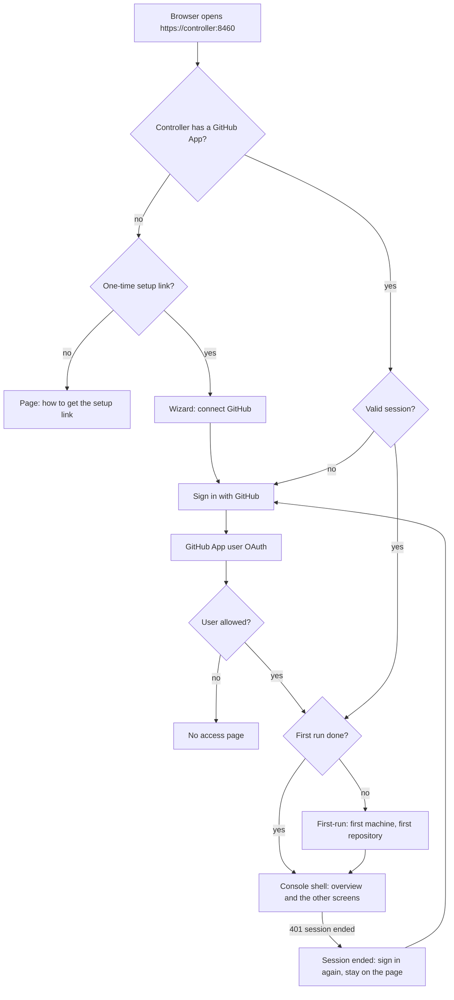
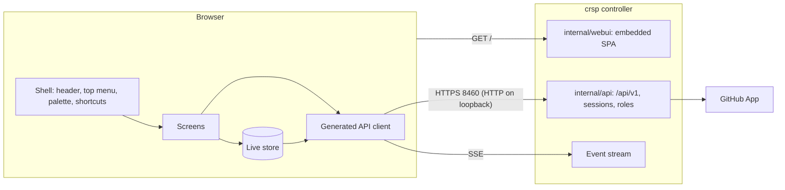

# Web console

The top half (sections 1 to 4) is for every reader: product, design, UX. The bottom half (5 to 12) is for engineers.

The M1 console is built (CRSP24): the shell, the auth states, first run, the overview, repositories, machines, runners and the settings sub-pages Users and roles, Appearance, Retention and Backups. Requirements marked (built, CRSP24) are built. The serving side is built (CRSP33, changed by CRSP42): plain HTTP on 127.0.0.1 and ::1, HTTPS on every other address, the headers, the session cookie, the CSRF and Origin checks and the role check on every operation (R5.1, R6.1 to R6.5). The axe, performance and offline checks are built (CRSP34: R6.6, R6.12, R6.13). The jobs, doctor, images and caches screens and the later settings sub-pages are built (CRSP35 to CRSP37). Everything else in this spec is **NOT YET IMPLEMENTED**, as listed in the last section.

## 1. In one paragraph

The web console is the browser app of CI Runners Shared Pool. The controller serves it on port 8460: plain HTTP on 127.0.0.1 and ::1, HTTPS on every other address. Every user signs in with GitHub. The console has a header, a top menu, a command palette and keyboard shortcuts. It has nine screens: sign-in and first-run, overview, repositories, machines, runners, jobs, images and caches, doctor, and settings. The owner uses it to set the pool up and to change it. Admins change it too. Viewers watch it.

## 2. Why

**Problem.** The pool runs on several machines and serves many repositories. Without one place to look, the user cannot see what runs where, why a job waits, or what to fix.

**Users.**

- The **owner**: the first person to sign in. Sets up the GitHub App, adds machines, allows other users.
- **Admins**: change repositories, machines, runners, images and settings.
- **Viewers**: read everything that holds no secret. Change nothing.

**Goals.**

- One place to set up the pool, from a fresh controller to a first green job.
- A live view of machines, the queue, runners and jobs.
- Every command in one place, reachable by mouse and by keyboard.
- The same look and behaviour on every screen, from design system v1.

**Non-goals.**

- Managing GitHub-hosted runners.
- Being reachable from the internet. The console is for the local network.
- Holding the behaviour of each feature. This spec covers the console: its shell, its auth states and what each screen shows and does. How a feature works is in that feature's spec: `github-integration`, `machines`, `runners`, `scheduling`, `caches`, `doctor`, `observability`, `notifications` and `operations` (folders under `docs/features/`).
- A CLI. The CLI has the same powers, through the same API (decision 0001).

## 3. How it works

The steps in words:

1. The user opens `http://127.0.0.1:8460` on the controller machine or `https://<controller>:8460` from another one. The controller serves the console and its API from one binary (decision 0001).
2. A fresh controller has no GitHub App yet, so nobody can sign in with GitHub. The setup page opens only through a one-time setup link. The tray's Open and the controller's first start each give one.
3. The first wizard creates the controller's own GitHub App with GitHub's manifest flow (decision 0002).
4. The user signs in with GitHub through the App's user OAuth flow. The first person to sign in becomes the owner. Later users get in only when the owner has added their GitHub login.
5. The first-run checklist then leads through two more wizards: add the first machine, and turn the pool on for the first repository.
6. After that, the console opens on the overview. A live event stream keeps every screen current.
7. When the session ends, the console says so over the current page. The user signs in again and comes back to the same page.

## 4. Screens and states

Every screen is built from [design system v1](../../design-system/v1/README.md): its [UX rules](../../design-system/v1/ux-rules.md), [components](../../design-system/v1/components.md), [content](../../design-system/v1/content.md) and [tokens](../../design-system/v1/tokens.md). This section names the parts and cites rules and components by ID. It holds no UX rule of its own. Gaps in the design system are listed as owner questions in section 10.

Each screen lists its milestone: **M1** (milestone 1) or **later** (with the milestone when the product brief names it). The API operations named here do not exist yet. They are added to `packages/contract/openapi.yaml` with the screen that needs them. Section 7 lists them all.

The states named for every list follow the design system: loading (component 16, UX-29), empty and could-not-load (component 19, UX-6, UX-28), and live (UX-19, UX-53). Every action that changes something is busy until the server answers (UX-13) and gives its result in one line (UX-27). Every destructive action asks first in a question card that names each item that goes (UX-9, UX-62).

### 4.0 The shell

- **Purpose:** the frame around every signed-in screen.
- **Header:** the product name, the pool status as a word, glyph and colour (UX-58), the live-update state, a button that opens the command palette (it shows `Ctrl+K`, or `Cmd+K` on macOS), and the user menu (GitHub login, role, the state of the GitHub sign-in, Sign in with GitHub again when it ended, Sign out; R5.95).
- **Top menu (component 2):** seven areas: Overview, Shared Pool, Repositories, Jobs, Doctor, Settings, Help (owner decisions D24, LOOK31, LOOK44). The current area is marked. Shared Pool and Jobs have sub-sections as tabs (component 3). The old addresses `/machines`, `/runners`, `/images` and `/caches` redirect to their place in Shared Pool and keep the query, so bookmarks, the setup banner and a stored plan (`?plan=`) work. Below 601 px the areas are one Menu button that opens the list, so the menu never takes more than one row (UX-15, UX-16; CRSP159). Detail pages show breadcrumbs (component 2).
- **Page header (component 1):** one headline per screen (UX-3), with the screen's one primary action (UX-4).
- **Section gap (UX-10):** the panes of every screen, Jobs, Settings, Help, Machines, Runners, Repositories, Doctor and Overview alike, are 32 px (`--ds-space-6`) apart. A search, filter or step bar above a pane leaves the same gap, so its focus ring never covers the pane's title. The shared page, stack, search table and wizard hold it; a screen passes data only.
- **Banner slot (component 18):** the one app-wide slot (UX-27). It carries "Live updates paused", "First run is not finished" and "A new version is ready".
- **Activity strip (component 27):** running work that the console started, such as a drain, an image rebuild or an update (UX-34).
- **Command palette:** opens with `Ctrl+K` or `Cmd+K` (UX-57). It lists the areas, the detail pages found by name (a machine, a repository, a runner), and the commands the user's role allows. A command opens the one place where it lives (UX-52). It opens with focus in its search box; typing filters, Down and Up (and `j` and `k` outside the box) move through the results, `Enter` opens one and `Escape` closes (UX-57). It is the shared `SearchList` in the overlay of component 9. Its search box, like every single-line text box and search bar of the console, shows the blinking block caret of the Phosphor look (component 21, LOOK33): the shared `CaretInput` draws it at the insertion point, only while the box has focus and nothing is selected, and it is steady under reduced motion. It is not a component of v1 yet (owner question Q1).
- **Shortcut list:** `?` opens the list of every shortcut (UX-57), in the overlay of component 9.
- **Shortcuts:** `/` moves to the page's search bar (UX-31). Down and Up (and `j` and `k`, except in a text box where they type) move focus through every button, link, input and list item of the page in page order; Up from the first list item goes to the previous control and Down from the last to the next. A group of radios is one stop, and in a multi-line text box Up and Down move the cursor. `Enter` opens the row. Left and Right move along every horizontal row (the top menu, the Settings and other tab rows, the filter segments, chips, a toolbar, a group of radios such as the theme cards): they wrap at the ends, Home and End go to the first and last, tabs and radios also choose the item, and Up and Down are unchanged. The movement is the shared `ArrowNavigation`, mounted once in the shell. None fires while typing in a field (UX-57).
- **Theme:** the look is TUI panes. Six colour themes (Phosphor, Tokyo Night, Catppuccin, Gruvbox, Solarized, Nord), Phosphor by default, and a mode (system, dark or light; a new install is dark, owner decision D4, set in the server default and in the first-paint script) are set in Settings, Appearance (UX-60, UX-55). The theme is kept in the browser and applied before the first paint; the mode is saved by the server.
- **States:** loading the session (an unknown-total bar, component 16); live; live updates paused (a Note message in the banner slot, UX-26, while the last data stays on screen with its age, UX-53); not found (component 19, with a link to the overview); page fault ("This page hit a fault.", UX-28).
- **Milestone:** M1.

### 4.1 Sign-in and first run

**Sign-in page** (`/sign-in`)

- **Purpose:** let a user in with their GitHub account.
- **Data:** `getSession`, `startSignIn`, `completeSignIn` (the GitHub callback).
- **States:**
  - signed out: one primary, "Sign in with GitHub", in the action bar (UX-71, UX-4; LOOK27);
  - signing in: the button is busy until GitHub answers (UX-13);
  - sign-in failed: a Problem message that says what failed and offers Try again (UX-26, UX-28);
  - no access: "Signed in as `<login>`. This GitHub account has no access. Ask the owner to add it." with Sign out;
  - session ended: over the current page, a dialog (component 9) says the session ended and offers "Sign in with GitHub". The page and its unsaved input stay under it. After sign-in the user is back on the same page (owner question Q3).
- **Components:** 1, 7, 9, 18, 19.
- **Milestone:** M1.

**Setup page** (`/setup`)

- **Purpose:** take a fresh controller to a working pool.
- **Without a setup link:** a page that says how to get one: choose Open in the tray menu of the controller's machine. It names no terminal command (UX-6). No other action.
- **Every step done:** the page header carries one primary, "Open the overview" (UX-4, UX-6). The first repository counts as done when any repository has the pool on, whatever the setup answer says.
- **With a setup link:** the first-run checklist. It shows three wizards in order. A later one is greyed until the one before it is done (UX-5). Each is a wizard (component 4) whose behaviour comes from the shared wizard (UX-54). Each ends with Review, then its work, then Done (UX-30). The step and state words are those of content.md.
- **Back from GitHub with an error:** the Connect GitHub wizard reads `?error=` and `?app_url=` once, shows the message for the code (content.md, Connect GitHub words) as its failed state, and clears both from the address. For an App GitHub made but crsp could not save, the message says so, an external button opens the App on GitHub (only an https://github.com address), and the person deletes it there (App settings, Advanced, Delete GitHub App) and starts again. The App name field says that GitHub App names are unique across GitHub.

| Wizard | Steps | Work step | Done shows |
|---|---|---|---|
| Connect GitHub | Account (personal account or organization, App name); Review | Creating the App: off to GitHub with the manifest, back with the App's keys | The App's name and account, the permissions it got, and one primary: "Sign in with GitHub" |
| Add the first machine | Machine (OS); Review (the install command, how long the join code lasts) | Joining: waits for the agent to connect, with the code's time left (UX-29) | The machine's name, OS, CPU, memory and the isolation backends found. When this PC (the controller's own machine, machines R5.1) is already in the pool, the step shows "This PC, {host name}, is in the pool." as done, with the optional action Add another machine for the command path |
| Turn on the first repository | Repositories (a one-choice or multi-choice list, component 13, with Select all N and Clear, UX-12); Review (the repositories, the variables to write, the labels) | Turning on: n of N repositories, with the one in hand (UX-30) | Each repository turned on, its variables written, and what failed with its reason |

- **Loading is not a step (LOOK20):** a wizard that reads data before its first step shows that wait as a state of step 1 (one wait line, the primary locked with the reason, Back free). The step row starts at 1 with the first step the user acts on and shows no check while loading. The Add runners, Turn on the pool, Connect GitHub and Update wizards follow it.
- **Harness states:** each of the three wizards has all ten states of the wizard harness (UX-30): loading, first-run, planning, ready-to-review, running, paused, stopped, failed, done, done-after-reload. Stop on "Joining" withdraws the join code. A failed or stopped run still ends at Done and says what is left. Done and Stopped offer Start again (content.md, wizard state words).
- **Review** says "Nothing has changed yet." and counts again after a change to an earlier step (UX-30).
- **Data:** `getSetupState`, `redeemSetupLink`, `startAppManifest`, `completeAppManifest`, `createJoinCode`, `getJoinCode`, `revokeJoinCode`, `listInstallations`, `listRepositories`, `planRepositoryChanges`, `applyRepositoryChanges`.
- **Detail:** the App manifest, permissions and callback are in `github-integration`. Join codes and the install command are in `machines`. Repository variables are in `github-integration`.
- **Components:** 4, 5, 13, 14, 16, 18, 19, 34.
- **Milestone:** M1.

### 4.2 Overview

- **Purpose:** see the pool at a glance and jump to what needs you.
- **Data:** `getOverview`, then `streamEvents`.
- **First run:** a pane "How a job gets run" shows the picture of Help (the job path, component 64) and the buttons *Open Help* and *Hide this* until the pool has a machine, a runner and a repository; it can be hidden and stays hidden in this browser. It replaces the old "How crsp works" note (D33, LOOK31, LOOK44).
- **Shows:** a card per machine (component 8, UX-10) with its state word (UX-58) and three level bars for memory, CPU and slots against its budget (UX-41, owner question Q4); the queue count; the running jobs (component 15); the section "Why jobs wait" (component 15): every queued or held job with the first reason it waits, in words, from `waiting` of `getOverview` (scheduling R5.48, UX-34, UX-19); today's minutes saved as a lettered figure (component 31). Each item links to its screen.
- **Actions:** none. The overview only shows and links (UX-52).
- **States:** loading; empty (no machine yet: "No machines yet. Add a machine to start." links to Machines, content.md); could not load; live; live updates paused. Every section, and the loading and could-not-load states, sit in a pane titled in its top border (UX-10, UX-51); the h1 stays in every state (UX-17).
- **Components:** 1, 8, 15, 17, 19, 27, 31.
- **Milestone:** M1. Minutes saved: later (milestone 8).

### 4.3 Repositories

- **Purpose:** choose which repositories use the pool, and with which limits.
- **Data:** `listInstallations`, `listRepositories`, `getRepository`, `updateRepositoryPolicy`, `getRepositoryExtraPackages`, `setRepositoryExtraPackages`, `planRepositoryChanges`, `applyRepositoryChanges`, `getAppInstallUrl`.
- **List:** a table (component 15) of name, owner, pool on or off, labels, maximum parallel jobs, priority, and repository variable status (`RUNS_ON_LINUX`, `RUNS_ON_WINDOWS`, `RUNS_ON_MACOS`) as a status word (UX-58). Search and filters (components 11, 12, 21, UX-31): on or off (the segmented Pool filter), owner, variable status. The toolbar is the shared list toolbar (R5.67). The toolbar, the table and the pager sit in one pane titled Repositories (component 8); the active types are a chip in the toolbar that opens the setting (R5.69, UX-8); the one primary is Turn on the pool, and the selection buttons are secondary (UX-4); Clear sits beside Select all N and is disabled until a row is ticked (UX-12); the Visibility column and the greyed public rows are in R5.70. Long lists page (component 10, UX-11).
- **Runner type (OPS28, R5.102, LOOK50):** the table has a column **Runner type** (*Ephemeral only* or *Any runner*, with the word *default* beside a value the owner did not choose) and the policy form has the choice, with the warning for a public repository set to *Any runner*; a public repository with no ephemeral capacity shows the state *No ephemeral capacity* with a link to Add runners.
- **Detail:** the policy form (component 14): on or off, runner groups and labels, maximum parallel jobs, priority, jobs from public forks and the runner kind. There is no light runner switch (removed, owner decision D110; runners R5.57). State, Policy, Hosted fallback and Extra packages are panes. The page has one form with one Save, in the action bar (component 48, UX-71): it says "Unsaved changes (N)" and keeps Save disabled, with its reason, until something changes. "Use pool" and "Stop using pool" on the page are default buttons. The form sends the policy and the hosted fallback in one request and the extra packages in another, each only when it changed. Save is the one primary of the page (UX-4); a form ends with Cancel and Save (UX-24). A page that cannot load keeps its h1 (UX-17). Turning fork jobs on shows a Needs-you message with the risk; Save asks once, naming each risk (UX-9). In the Turn on the pool wizard each step is a pane, and when no repository is free the message names the real next action: admin rights in GitHub, the public-repositories setting, or installing the App.
- **Actions and confirmations:**
  - the main action is one button in the action bar at the foot of the window (component 48, UX-71): "Use pool" for the ticked repositories (the "Turn on the pool" wizard, the same as in first run, component 4, UX-30), "Stop using pool" when every ticked repository already uses it (a question card that names each repository and the variables that go, UX-62). The bar says "Nothing selected" or "{n} selected" (UX-7) and keeps the button disabled, with its reason, until something is ticked (UX-4, UX-38);
  - add a repository that is not listed: opens GitHub's App install page (`getAppInstallUrl`);
  - fix a variable that is wrong: shown in the row, applied through the same wizard.
- **States:** loading; empty (the App is installed on no repository: "No repositories yet. Install the App on a repository to start."); could not load (GitHub not answering: the last list stays with its age, UX-53, and a Problem message); live.
- **Role:** turning the pool on also needs admin rights on that repository in GitHub; a row without them shows the action disabled with that reason (UX-38).
- **Detail:** policies are in `github-integration` and `scheduling`.
- **Components:** 1, 4, 10, 11, 13, 14, 15, 17, 19, 20, 21, 22, 34.
- **Milestone:** M1.

### 4.3a Shared Pool

- **Purpose:** set up the one pool: its machines, their runners, images and caches, size and backends (D24, LOOK31).
- **Routes:** `/pool` (Summary), `/pool/machines`, `/pool/machines/add`, `/pool/machines/:id`, `/pool/runners`, `/pool/runners/add`, `/pool/images`, `/pool/images/:imageId`, `/pool/size`. A tab row (component 3) over each list page: Summary, Machines, Runners, Images and caches, Size and backends. Add and detail pages show a breadcrumb back instead.
- **Summary:** the pool (machines online, runners and busy, repositories using the pool, health, capacity as a level bar of job slots in use, UX-41) and Runners per system. Until the pool has a machine, a runner and a repository it opens with the first-run guide: 1 Add a machine, 2 Set runners, 3 Choose repositories; a step that cannot start yet is disabled and says why (UX-6).
- **Size and backends:** one row per machine with its job slots and allowed backends, and a link to the machine page where the pool size section and the policy live.
- **Data:** `listMachines`, `listRunners`, `listRepositories` (pool on).
- **Components:** 1, 3, 8, 15, 17, 19, 41.
- **Milestone:** M1.

### 4.4 Machines

- **Purpose:** add machines and set what each one gives the pool.
- **Data:** `listMachines`, `getMachine`, `updateMachine`, `checkMachinePoolSize`, `drainMachine`, `resumeMachine`, `removeMachine`, `createJoinCode`, `getJoinCode`, `revokeJoinCode`, `getInstallCommand`.
- **List:** a card per machine (component 8) or a table (component 15): name, OS, CPU and architecture, state (online, offline, finishing jobs, not taking jobs; UX-58), backends, load bars, slots used of total, last seen (UX-53).
- **Detail:** the facts list (component 8); backends found and allowed (component 22); the load budget (memory and CPU percent, with the number keypad, component 37, UX-56); job slots; cache size cap; maintenance windows (time picker, component 36); the time to finish running jobs; the agent's log (component 26).
- **When it works (CRSP75):** a section of the machine page, Mode (Automatic, Always, Paused: one-choice rows, component 13), the switch Pause on battery (UX-22, saved at once) and the CPU for runners (25, 50, 75 or 100%: one-choice rows), with the power source and the reason when the machine takes no new job (UX-58). The State fact, the Now line, its note and the header button all read the one `taking` the controller computes (machines R5.62, OPS29); the page never works the state out from `state`, `accepting` and `pause_reason` itself. Under Always the Pause on battery switch is off and disabled with the reason "Always ignores the battery." A pause from the tray shows with its end and a Resume button. On macOS the CPU values are off and say "Not supported on macOS yet." (UX-38). The list has a Takes jobs column (Taking jobs, Paused, On battery, Busy). The words are in `docs/design-system/next-version/content.md` (Machine policy words). A change in the tray and a change here show each other: both write the machine's settings and the screen reloads on the machines live event.
- **Pool size (LOOK22):** a plain section of the page's one form, not a wizard. It shows the size now, the free room and the CPU budget, then a choice of three: "Recommended: half of the free room (X GiB, Y CPUs)", "Recommended: three quarters of the free room (X GiB, Y CPUs)" (each says under its name how it was computed) and "Custom" (the memory with one decimal and the CPUs, on the number keypad). The choice that matches the size now is selected when the page opens: half or three quarters when it equals that recommended size, otherwise Custom with the current values (OPS47). The page's Save bar is the action bar (component 48, UX-42): sticky at the foot of the main content, outside the message wrapper. A check line under the choice runs `POST /machines/{id}/pool-size-check` 250 ms after the last edit (the last answer wins) and says fits (done), fits but leaves under 3 GiB for the PC (needs you), lowers the pool (needs you, with the tick "Yes, lower the pool size", UX-62) or too much (problem, with the room, what others use, and a button that fills in the size that fits). The size has no Save of its own: it counts in "Unsaved changes (N)" and the page's one Save sends it (R5.100). Its words are in the design system content (pool size words).
- **Add a machine:** the page's one primary opens the "Add a machine" wizard, the same as in first run. The install command sits in a monospace block with a Copy button (owner question Q2). The join code shows once, with its time left (UX-29).
- **Actions and confirmations:**
  - Stop new jobs (`drainMachine`): a secondary button, and Resume in its place while `taking.reason` is `stopped`; both sit in the page header's action slot (component 1), right-aligned, with the hint under the button right-aligned too (`PageHeader` `hint`; UX-3, UX-4). The slot has the same shape in both states, so the header keeps its height and the Facts box does not move; a question card titled "Stop new jobs on {machine}?" that names the running jobs it waits for (UX-62); the drain then shows in the activity strip (component 27);
  - resume: no question;
  - change the budget, slots or allowed backends: Save; if runners restart, the question card names the jobs they wait for (UX-62);
  - remove: a question card that names the machine, its runners and its running jobs (UX-62).
- **States:** loading; empty ("No machines yet. Add a machine to start."); could not load; live; an offline machine stays listed with its last-seen time.
- **Detail:** joining, the budget, drain and backends are in `machines`; the load measures are in `scheduling`.
- **Components:** 1, 4, 6, 7, 8, 9, 14, 15, 17, 19, 22, 26, 27, 36, 37.
- **Milestone:** M1 for the list, detail, add, budget, slots, drain and remove (owner question Q13). Maintenance windows and the cache cap: later (milestones 3 and 7).

### 4.5 Runners

- **Purpose:** see every runner and create runners per OS on machines that support it.
- **Data:** `listRunners`, `getRunner`, `planRunners`, `createRunners`, `deleteRunner`, `streamRunnerLog`.
- **List (D32, LOOK31):** the pool totals on top ("2 machines, 6 runners, 2 busy"), then one table per machine (component 15; a pane titled with the machine, with a link to the machine page): name, isolation (UX-61; a second line with the system, architecture and backend), labels (at most two and a count, the full list for a screen reader), state (UX-58; a long reason is its short first clause, wrapped at a word and never cut by the style, with a *Full error* button that opens the whole text in a row under it, LOOK19, D36 and D37, CRSP210). Isolation shows its whole words (*persistent, state kept between jobs*) and wraps at a word, current job with the repository of a busy runner, age (UX-53). Search and filters by OS and isolation (components 11, 21). A runner serves every repository that uses the pool.
- **Add runners (D31, LOOK31):** a wizard (component 4) that asks System, Machine, Number and Labels, and no repository, with the line "Runners serve every repository that uses the pool." Machine: only machines whose backends support the OS; others are greyed with the reason (UX-38; a Windows machine whose container engine runs Linux containers also supports Linux, as an ephemeral container runner with a note, CRSP127). Then Review; Registering (n of N); Done. The step row starts at 1; the wait for the machines is a state of that step, never a step (LOOK20). `planRunners` takes no scope: the server takes the first repository with the pool on and adds the pool label (until OPS23 gives every pool repository its own registration); with no such repository it refuses with a reason. The labels start from that repository's `RUNS_ON_*` variable, else `self-hosted`. **Step 1 also asks the Type (OPS28, runners R5.1, R5.90 to R5.93; R5.101).** Built by OPS27: for Linux on a Windows machine the console checks the container backend and the plan before Review. A backend that is off, a refused plan or a plan with no step stays on step 1 with the reason (and a link to the machine page for the backend), and Review never lists nothing. After a failure the wizard marks the failed step (not ticked), the message ends with a full stop, and Try again goes back to step 1 with the reason.
- **Runner type and keeping dependencies (OPS28, R5.101):** each runner row shows its runner type (Persistent or Ephemeral) in the isolation cell; a persistent runner also shows its Keep downloaded dependencies setting, and an unclean runner shows the word *Unclean* with its reason as a status word (UX-58). The runner page has the setting as a check box saved with the page's one Save (UX-71), the size of the runner's dependency folder, and **Clear now**.
- **Actions and confirmations:** delete a runner, or the selected runners: a question card that names each runner and the job it runs, and waits for the drain (UX-62).
- **States:** loading; empty ("No runners yet. Add runners to start.", or "Add a machine first." when there is none); could not load; live.
- **Detail:** runner life, JIT config and labels are in `runners`.
- **Components:** 1, 4, 9, 11, 15, 17, 19, 20, 21, 26.
- **Milestone:** M1 basic: persistent runners, list, add, delete. Later: ephemeral runners and the live setup log (milestone 2).

### 4.6 Jobs

- **Purpose:** see the queue, the running work and the history as workflow runs and as jobs, why a job waits, how long it will take, and where the time goes (OPS34, owner decisions of 2026-11-18, review RES15). This section replaces the earlier Jobs screens (R5.117).
- **Routes:** `#/jobs` (Overview), `#/jobs/live`, `#/jobs/done`, `#/jobs/elsewhere`, `#/jobs/insights`, `#/jobs/charts`, `#/jobs/run/<id>` (Run page) and `#/jobs/<id>` (Job page). The old Jobs routes redirect to these and keep their filter (R5.117): `#/jobs` with a list filter, and `#/jobs?elsewhere=1`, go to Live (state Queue) and Run elsewhere; `#/jobs/running` to Live with state Running; `#/jobs/repository`, `#/jobs/machine`, `#/jobs/runner`, `#/jobs/runner-type` and `#/jobs/job-type` to Done with *Group by* set; `#/jobs/trends` to Charts (LOOK41).
- **Data:** `listRuns`, `getRun`, `listJobs`, `getJob`, `listJobGroups`, `getJobStats`, `exportJobs` and `exportJobSummaries`, through the generated client; all read-only, viewer role (observability R5.35 to R5.46). The forecast of a job or a step arrives with the job, so the screens never call `getForecast`.
- **Tabs (UX-74, LOOK41):** six, in this order: Overview, Live, Done, Run elsewhere, Run insights, Charts. Jobs opens on the Overview.
- **Overview (`#/jobs`, UX-75):** four stat tiles (component 58), each one link that says its number, its change against the previous 7 days and its trend: *Waiting now* (opens Live on Queue), *Wait slow end (p90)* (Charts), *Jobs that passed* (Done) and *Pool busy* (slots in use of the slots of the online machines; Shared Pool). Under them the *Needs you* strip (component 59) with the top 3 findings of Run insights by minutes saved a week, then cards that only show and link (UX-52): *Where the time goes* (opens Charts), *Busiest repositories* (a bar list, component 60, each row opens the finished jobs of the repository), *Failed jobs* and *Run elsewhere*. The runner timeline card (component 61) is not built yet.
- **The list (Live, Done and Run elsewhere; component 67; owner decision of 20 Nov 2026, option 11 of CRSP211):** one list in place of the separate Queue, Running and Done lists. A **State** choice (*All*, *Queue*, *Running*, *Done*) filters it, a search box finds rows (free words match any text; `repo:`, `state:`, `runner:`, `branch:` and `job:` narrow one field;), and an icon button named *Show details* (*Hide details* when open) opens the panel of the chosen row at the right (a bottom sheet at phone width). Focus starts in the search box; Down, Up, `j` and `k` move through every control and row. Live opens on *All* and Done on *Done*; waiting rows come first, then running, then the latest finished. Run elsewhere is the same list over the jobs another runner runs, naming the runner and its labels. Done adds the range and one *Group by* choice (None, Repository, Machine, Runner, Runner type, Job type) that shows the grouped table in place of the list. Where concept A of the Jobs redesign study split Live and Done, the one list wins. A **Runs | Jobs** switch picks the row kind and keeps the filter; it is stored in the address (R5.104). The filter is in the address too (`repository`, `machine`, `runner`, `runner_kind`, `backend`, `job_type`, `branch`): a group row or a breadcrumb sets it, and a note above the list says what it shows, with the button *Show every job*. The API takes a repository by its id, so the screen reads the repository list once to find it; a filter by a runner, a machine, a runner type or a job type opens the Jobs view, because runs are listed by repository and branch only. Done also has the time range (7, 30 or 90 days).
  - **Runs (default):** one row per workflow run: repository, workflow as its file name (`ci.yml`; the whole path is the hover text and the title of the Run page), the run number in its own *Run* column (`#44723830522`, whole), branch (and task id when the cut hides it), commit and event, and the result in word, glyph and colour (UX-58). Queue rows (made from the queued jobs) show the place in line, jobs queued, the start range and why the run waits (UX-29; a few words, such as *waits for a slot*, with the whole line under the *Why* button); Running rows show jobs done of total, the running jobs, time so far and when the run should end; Done rows show when it finished, jobs done of total, jobs failed and the total time. The row action is *Open run*, and so is Enter on the row: both go straight to the Run page (`#/jobs/run/<id>?attempt=<n>`), as *Open job* goes to the Job page. A run does not open in place, so a row keeps one height and one action wording (UX-72, UX-57; R5.105, R5.106). Forecast against actual is on Charts.
  - **Jobs:** the flat job list: the same facts per job plus runner and machine; Running shows progress against the forecast. The row action is *Open job*. The forecast of a job is on the Job page, not in the table, so the table stays one line a row without scrolling sideways at 1300 px (UX-72). No table cell is cut by the style (CRSP210): a value is shown whole or in a short form made for one line (a file name, a short reason, a branch shortened in the middle with its whole name as hover text), and a value that still does not fit wraps at a word or, for a long path or id, anywhere, so the row grows and a cell never covers the next cell or the action column. The queue's start cell says only when (*in about 4 to 7 min*); the place in line is the Order column.
  - **Queue:** queue order (1, 2, 3), waited so far, why it waits and the start range from slots and jobs ahead (R5.111, scheduling R5.72); a reason longer than one short line is one line with a *Details* button (LOOK19, D37).
  - **Done:** 25 rows; *Show more* adds 25 up to 100 per page; older jobs by the filter and the time range (R5.107). The page never scrolls sideways (UX-49).
- **Group by (Done):** the five *By* tabs are one *Group by* choice on Done. A grouped view is one table (R5.108): running, queued, done, failed, median wait, median run time, slow end (p90) of the run time and a sparkline, from the last 90 days. Its row action is *Open* (UX-72). By runner has one row per runner name; By runner type splits persistent from ephemeral and shows the backend as a column; By job type groups the job name without matrix values with a light or heavy badge (R5.109). A row opens the Done list with the group's filter (a repository opens its runs).
- **Charts (`#/jobs/charts`):** the last 14 days with a switch to 7 or 30: waits and run times over time (median and range), forecast against actual (how many jobs landed inside the range) and busiest hours (weekday by hour). Each chart has a time axis (UX-33), a text alternative and a table view (UX-41), and the daily summaries export (R5.110, R5.116).
- **Run page (`#/jobs/run/<id>`):** the run's facts (repository, branch, task, worktree, commit and event, pull request, start, the forecast end, and an attempt switch), the job graph drawn from the `needs` of the workflow file (jobs of a dynamic matrix or a reusable workflow are marked "expands at run time"; when the file could not be read, the jobs are drawn by timing overlap with a note, R5.112), the jobs as a waterfall (wait lighter, run darker), the run total and the critical path, and the forecast range with its basis. Each job opens its steps (R5.106). Under the timeline the **Jobs** section is one table with one line a row (UX-72): Job, Stage, Needs, Status (word and glyph, UX-58), Runner, Waited, Ran, Forecast and a Critical path mark, with the row action *Open job*. It is the text alternative of both the graph and the timeline (UX-41): they fold no "Show as table" of their own and point to it (components 50, 51, `altTable`). The facts list the pull request only under *Pull request*, show *Commit and event* as the commit and the event word, leave out *Worktree* when it equals the branch, and say "1 job" for a run of one job (OPS42).
- **Job page (`#/jobs/<id>`):** repository, branch and commit, pull request, task id when the branch starts with one, worktree only when the job reported it, else "not reported" (R5.113); runner, machine, backend and runner kind; timings (queued, waited and why, started, ran, clean-up); queue position and start range while queued; the steps as a waterfall with a forecast per step (steps come from GitHub events, R5.114); the job graph with this job and the critical path marked; the history of the job key; links to GitHub. The one primary is "Open the run on GitHub", in the action bar (LOOK27).
- **Forecast words:** a range with its basis on the Run and Job pages ("about 6 to 9 min, median of the last 20"), one number in tables; under 5 runs "not enough history yet" with the workflow's or repository's typical time, labelled (R5.115, observability R5.40 to R5.43).
- **Keyboard:** rows open with Enter and move with the arrow keys (UX-57).
- **Actions:** *Export CSV* on Done writes the filtered list as CSV (the jobs through `exportJobs` with the same filter, the runs as a file made from every page of the filter), and *Export daily summaries (CSV)* on Charts writes the daily summaries of the range (component 29, UX-39). Each of these exports is the one primary of its page, in the action bar (UX-71, UX-4); on Live and Run elsewhere the one primary is *Add runners*. The toolbar of the lists says what a row is (*One row per run* or *One row per job*). The Job and Run pages have one primary, *Open the run on GitHub* (UX-71, UX-4). No command changes a job.
- **States:** every tab has loading, empty and could not load (with Try again). Empty says what is true: "Nothing is waiting. Every job has a slot.", "No run is in progress.", "No finished runs yet...", "No jobs yet. Jobs show here when a workflow runs on the pool." (groups), "No finished jobs in this range, so there is nothing to draw." (Charts). A job or a step with fewer than 5 runs says "not enough history yet" and no number is made up. The Run and Job pages keep their h1 when they could not load (UX-17). A list that holds open work asks again every 5 seconds and keeps the rows on screen while it does (UX-35).
- **Detail:** placement and waits are in `scheduling`; storage, retention, the forecast method and the exports are in `observability`; the ingest is in `github-integration`.
- **Components:** the shared parts Waterfall, Job graph, Trend chart, Sparkline, Heatmap and Forecast chart (design system `next-version`, components 49 to 54), and 1, 3, 11, 12, 15, 17, 19, 21, 24, 29, 48.
- **Milestone:** OPS34. M1 shows the queue and running jobs on the overview.

### 4.7 Images and caches

- **Purpose:** see what each machine keeps, and rebuild or wipe it.
- **Data:** `listImages`, `getImage`, `updateImageLayers`, `rebuildImage`, `listCaches`, `wipeCache`.
- **Tabs (component 3):** Images, Caches.
- **Primary (UX-4):** the page header carries one primary, "Add runners", for an admin; Save, Rebuild and Wipe on the cards are default buttons.
- **Images:** per machine and OS, the base image, its tool layers (check box rows, component 22, saved with Save), size, built at, and the newest kept.
- **Caches:** the Actions cache, git mirrors, the tool cache and the registry mirror, each with its size against its cap (component 31 for sizes over time). **Built by OPS28 (caches R5.56):** each persistent runner's own dependency folder is listed under its machine with its size and **Clear now** (a question card that names the runner and the size, UX-62).
- **Actions and confirmations:**
  - rebuild an image: a question card that names the machine and the runners and jobs it waits for; the rebuild drains first (UX-62) and shows in the activity strip (component 27);
  - wipe a cache: a question card that names the cache and its size (UX-62).
- **States:** loading; empty ("No images yet. Images are built when a runner first needs one."); could not load; live; rebuilding (component 16).
- **Detail:** images are in `runners`; caches are in `caches`.
- **Components:** 1, 3, 7, 9, 15, 16, 19, 22, 27, 31.
- **Milestone:** later (images: milestone 2; caches: milestone 7).

### 4.8 Doctor

- **Purpose:** list every problem the pool has, with its fix.
- **Data:** `listDoctorFindings`, `runDoctor`, `getDoctorRun`.
- **Shows:** findings grouped by area (machines, backends, runners, GitHub registration, repository variables, workflow labels), each with a status word (UX-58), what is wrong, and its fix; a long detail is one line with a *Details* button that opens the whole text in a row under it (LOOK19, D36). A fix that is a command links to the one place that command lives (UX-52). The time of the last run (UX-53).
- **Actions:** "Run checks again" is the page's one primary, in the action bar (component 48, UX-71, UX-4); before the first run it says "Run checks". It is busy while the run lasts and shows its progress (UX-13, UX-29). A fix button in a row (Open) is a normal button (LOOK27, owner decision D27).
- **States:** loading; no findings (a Done message: "No problems found." with the time of the run); could not load; running; live.
- **Detail:** the checks and fixes are in `doctor`.
- **Components:** 1, 6, 7, 16, 17, 18, 19.
- **Milestone:** later (milestone 2).

### 4.9 Settings

Settings hold configuration only (UX-52). Settings has six tabs (CRSP159, owner decision D8; Updates became its own tab after Console in LOOK43): Access (Users and roles, GitHub App, Access for CI), Repositories (Repositories with the public toggle, Budgets), Console (Appearance, Notifications, Network), Updates (the Updates pane, at `/settings/updates`; `/settings/console#updates` goes there), Data (Retention, Backups, Config export) and Audit log. Each old sub-page below is a pane inside its tab, in that order, with an anchor (`#users`, `#github-app`, `#access-for-ci`, `#public-repositories`, `#budgets`, `#appearance`, `#notifications`, `#updates`, `#retention`, `#backups`, `#config-export`). The old addresses (`/settings/users`, `/app`, `/budgets`, `/appearance`, `/notifications`, `/retention`, `/backups`, `/export`) go to the right tab and scroll to the section. Sub-pages sit under one Settings area, each a form that ends with Cancel and Save (UX-24), or switches saved at once (UX-22).

| Sub-page | Purpose | Data | Actions and confirmations | Milestone |
|---|---|---|---|---|
| Users and roles | Who may sign in, as owner, admin or viewer | `listUsers`, `addUser`, `updateUserRole`, `removeUser` | Add a GitHub login with a role; change a role; remove a user (question card naming the login, UX-62) | M1 |
| GitHub App | The owner replaces the App private key | `replaceAppPrivateKey` | Replace key (owner): a file field and one action; the key is sent once and never shown; GitHub's refusal keeps the old key and says so (github-integration R5.7) | M8 (built, CRSP115) |
| Webhooks | Whether real GitHub webhooks are off, on or failing, and the public https address that forwards to the controller | `getAppWebhook`, `setAppWebhook`, `clearAppWebhook` | One check box *Real webhooks* and one field *Public https address*, then Cancel and Save on the form's action bar (UX-22, UX-24; owner). Save tests the address and sets the App's webhook (github-integration R5.51); turning the box off and saving returns to polling. A wrong address is listed before anything is sent (UX-38); the controller's refusal is shown as it is said. One guided step (*Open the App on GitHub*) when the App does not listen for workflow jobs. The words say why: jobs start at once, a public address is needed, LAN addresses and self-signed certificates do not work | built (OPS25) |
| Appearance | The user's theme (six named themes, kept in this browser) and mode (system, dark or light, saved by the server) (UX-60) | `getPreferences`, `updatePreferences` (the mode) | Two one-choice lists saved at once (component 13); the theme list shows a live preview of each theme in dark and in light | M1 |
| Budgets | The pool's default load budget, slots and time to finish running jobs for new machines, and the order of the queue | `getPoolSettings`, `updatePoolSettings`, `getQueueSettings`, `updateQueueSettings` | Save (admin); a change that restarts runners names the jobs it waits for (UX-62). A pool default only reaches machines that join later, so the page says no runner restarts and no job is waited for | M1 (built, CRSP37) |
| Notifications | Channels (email, webhook, desktop) and the events each one gets | `listNotificationChannels`, `createNotificationChannel`, `updateNotificationChannel`, `deleteNotificationChannel`, `testNotificationChannel` | Add, edit, delete (question card), Send test | M1 for channels and Send test (built, CRSP37); event delivery later (milestone 8) |
| Access for CI | Access credentials for automation and the action that sets up parity for a repository (R5.90, R5.91) | `listAccessCredentials`, `createAccessCredential`, `revokeAccessCredential`, `setupRepositoryParity` | Make (admin); Revoke asks first (UX-62); the value is shown once; Set up parity is busy and disabled with its reason while it runs (UX-13, UX-38); a missing App permission shows the guided grant (R5.92, UX-26) | built, CRSP134 |
| Updates | The runner version and the agent version, and when they update | `getUpdateStatus`, `checkForUpdate`, `applyUpdate`, `updateSettings` (auto_update) | Update now: a question card that names the machines and the jobs the drain waits for (UX-62) | later (milestone 3) |
| Repositories | The one switch "Enable for public repositories" (off by default) | `getPublicRepositories`, `setPublicRepositories` | Turning it on or off asks first in a question card (R5.68); the owner changes it | built (CRSP131) |
| Audit log | Who changed what, and when: a table of When, Who, What, On (what it acted on), Details and Result, inside its pane, with the date and time on one line; the signed-in login is the Who of a change made in the console | `listAuditEvents`, `exportAuditEvents` | Export (component 29, UX-39, UX-78) in the list toolbar | built (CRSP37, LOOK49) |
| Config export | The configuration as a file, without secrets | `exportConfig` | Export, named for what it holds then the file stamp (UX-39) | built (CRSP37) |

- **Users and roles:** one intro line, "Who may use this console. Your own GitHub sign-in is in the {login} menu at the top right.", then a table (component 15) of GitHub login, role, added by, added at, last sign-in. There is one owner. The owner's own row has no Remove. The roles are in section 5.
- **One Save per tab (LOOK27, owner decision D26):** the tabs Repositories, Console, Updates and Data are each one form. The action bar (component 48, UX-71) says "Unsaved changes (N)" (N counts the changed fields, and an open channel form counts one) and carries Cancel (puts every section of the tab back) and one Save for the whole tab; Save is disabled, with its reason, while nothing changed or the role may not save. One Save sends each changed section in turn and stops at the first refusal, which the section shows. A switch or one-choice list that saves at once (Appearance, Public repositories, Automatic updates) stays as it is. An action that does not save (Add a user, Add channel, Make, Choose an address, Look for updates, Update to N, Restart the service, Back up now, Replace key) is a normal, not primary, button inside its section. The Access tab holds no setting to save, so it has no bar; the Audit log tab has no bar: its Export is the one primary, the last button of the list toolbar (LOOK49, UX-4, UX-78).
- **States:** each sub-page has loading, could not load and, for lists, empty ("No other users yet. Add a GitHub login to let someone in.").
- **Notifications (built, CRSP37):** a table (component 15) of the channels with name, kind, where it sends, events, lowest severity, on or off and the last test; one form (Add and Edit) whose Save is the tab's one Save, in the action bar (UX-24, UX-71); **Add channel** (a normal button; the form it opens is saved by the tab's one Save, LOOK27), **Send test** per row, busy and disabled while it runs, one result line under the table (UX-13, UX-27, UX-38); **Delete** with a question card that names the channel and the events it stops carrying (UX-62, R5.30). A secret is never shown again. A viewer sees only their own channels and cannot pick a webhook, with the reason beside it. Empty: "No channels yet. Add a channel to be told when a machine, job or disk needs you."
- **Detail:** budgets are in `machines` and `scheduling`; notifications in `notifications`; updates, backup and config export in `operations`; the audit log in `observability`.
- **Components:** 1, 3, 7, 8, 9, 13, 14, 15, 17, 19, 22, 24, 29, 37.

### 4.10 Help

- **Purpose:** explain how a job gets run, in plain words, and what the terms of the console mean (LOOK44; layout G, no wizard, LOOK47, owner decision 21 Nov 2026, D58).
- **Data:** the machine list (`listMachines`), the overview (`getOverview`) and the runner list (`listRunners`), for the live examples in the picture and the numbers in the card pictures (LOOK48); the rest is fixed text. A call that fails is not shown as an error: the part shows its short meaning.
- **Shows:** the page header with the line *One picture, then the questions people ask. Each card names its box.*; a pane *How a job gets run* with the job path (component 64) and the line *1 to 3 happen on GitHub. 4 to 7 happen in your pool.*; each box shows a live example under its name, from real data when there is some (repository name, run number and event, job, queue count, slots in use, runner name, machine name), otherwise its short meaning. Below it a pane *Questions, in the order a job meets them* with every question card (component 68) in one grid, 4 columns at 1300 px, 2 on a tablet and 1 at 360 and 393 px, all visible at once, ordered by the box each explains: 1 *What does shared mean?*; 2 *What are a run and a job?*; 3 *What are labels?*, *What does Run elsewhere mean?*; 4 *Why is my job waiting?*, *What is the queue?*; 5 *What is a slot?*; 6 *What is a runner type?*, *What are images and caches?*; 7 *What is the load budget?*, *What is the tray app?*, *What is the Doctor?* (UX-10, UX-51, UX-41; CORE-1, CORE-5). Every card has a badge *Box N: Name* with the numbered circle, and a small picture: shared (repositories into the Shared Pool), run, labels, Run elsewhere, the queue (the first job takes the free slot), the slots (*N of M slots busy*, from the machine), the load budget (memory and CPU bars against the budget line, from the machine's real numbers), runner type (two boxes), the tray menu row and a Doctor finding with its fix. The slot card says *Pool size makes slots*: you set memory and CPUs on Pool size, and crsp turns that into slots, the number of jobs that run at once. With two or more machines the slot and load budget cards also list each machine with its own numbers, never a fixed 85% or 60%. *Runner type* is the word for persistent or ephemeral. English only.
- **Actions:** pressing a part of the picture scrolls to its first card; pressing a card's badge scrolls to its box and lights it (`aria-pressed`); an address that ends in a card (`/help#q-slot`) brings it into view. No wizard: no Back, Next or Start again, no step bar and no locked part; nothing on the page changes data, so there is no primary button.
- **In the console:** a ? (component 66) beside *Slots*, *Load budget*, *Queue*, *Runner type* and *Run elsewhere* opens a short answer with a link to the same card (`/help#q-slot`, `#q-budget`, `#q-queue`, `#q-runner-type`, `#q-elsewhere`).
- **Keyboard:** Down, Up, `j` and `k` move between the controls, the boxes of the picture included (UX-57).
- **States:** loading and could not load for the machine numbers (the cards still read); no machine (*No machine yet. Add a machine to see its slots.*).
- **Components:** 1, 7, 8, 64, 66, 69.
- **Rules:** CORE-1 to CORE-7, UX-4, UX-10, UX-41, UX-43, UX-51, UX-57, UX-72.

## 5. Functional requirements

Requirements marked (built, CRSP24) or (built, CRSP33) are built. The others are **NOT YET IMPLEMENTED**.

### Serving and the shell

**R5.1** (built, CRSP33, changed by CRSP42, D38) — The controller serves the console and its API on one port, 8460 by default, set in config. On `127.0.0.1` and `::1` (and only there) the port speaks plain HTTP, so the default address works without a certificate warning. On every other address, a name, a LAN address or a wildcard, it speaks HTTPS only, with the certificate the controller's own CA made (`internal/tlsca`, the one the agent link uses), TLS 1.3 only, and a plain-HTTP request gets TLS's refusal, never a page. The R6.3 headers, the CSRF and Origin checks and the role check hold on both. An OAuth callback over HTTP on a non-loopback host is refused (github-integration R5.4, R6.4).

**R5.2** — Any path that is not under `/api/` returns the console, so a deep link opens its screen after sign-in. An unknown console path shows the not-found state with a link to the overview.

**R5.3** (built, CRSP24) — Every signed-in screen sits in the shell of section 4.0: header, top menu with the eight areas, page header, banner slot and activity strip.

**R5.4** (built, CRSP24) — `Ctrl+K` (`Cmd+K` on macOS) opens the command palette from any screen. It finds areas, items by name and commands. It lists only the commands the user's role allows. Choosing an item goes to its page; choosing a command goes to the one place where that command lives.

**R5.5** (built, CRSP24) — The shortcuts `/`, Down, Up, `j`, `k`, `Enter` and `?` work as section 4.0 says, and none fires while focus is in a text field.

**R5.6** (built, CRSP24) — The console opens one live event stream (`streamEvents`) per tab. One store holds what it brings, and every screen reads that store for live state.

**R5.7** (built, CRSP24) — When the live stream drops, the console keeps the last data on screen with its age, shows "Live updates paused" in the banner slot, and reconnects with backoff. On reconnect it loads the shown data again before it trusts new events.

### Signing in and sessions

**R5.8** (built, CRSP24) — With no valid session, every console path except `/sign-in` and `/setup` goes to `/sign-in` and keeps the path it came from.

**R5.9** (built, CRSP24) — After sign-in the console returns to the kept path. It accepts only a path on the same origin; anything else goes to the overview.

**R5.10** (built, CRSP24) — A GitHub user who is not on the user list gets the no-access state, with their login and Sign out. No API data is sent to them.

**R5.11** (built, CRSP24) — When an API call answers that the session ended, the console shows the session-ended dialog over the current page. It keeps the page and unsaved input. After sign-in it returns to that page with the input still there. It does not resend the call that failed.

**R5.12** (built, CRSP24) — Sign out ends the session on the server and goes to `/sign-in`.

**R5.13** (built, CRSP24) — The console shows each user what their role allows:

| Role | Can |
|---|---|
| viewer | read every screen; no command; no join code or install command |
| admin | everything a viewer can, and every command on repositories, machines, runners, images, caches, doctor and the settings Budgets, Notifications and Updates; read the audit log |
| owner | everything an admin can, and Users and roles, config export, and the GitHub App |

A command the role does not allow is shown disabled with its reason. The API refuses it too (R6.5).

### First run

**R5.14** (built, CRSP24) — While the controller has no GitHub App, `/setup` opens only with a valid one-time setup link (`redeemSetupLink`). Without one, it shows how to get one. A link works once and expires.

**R5.15** (built, CRSP24) — The setup page shows the three first-run wizards of section 4.1 in order. A wizard opens only when the one before it is done. The first-run checklist stays reachable from the banner slot until all three are done. The banner reads `getSetupState` again when a machine or repository changes and goes away when all three steps are done. The pool status in the header reads the same machines list as the Machines screen (UX-19). The header, the Overview and the Machines screen read that one list; it reloads on a machine event, on a timer and when the tab is shown, so none says "no machines" while one is up. While the service restarts, or has just come back and no machine is online yet (up to 90 seconds after the list could not be read), the header says `reconnecting` as its own waiting state, never "no machines", and the first-run banner stays away: the machines are not back yet, they are not missing (CRSP205, UX-6, UX-29). The banner names the next open step and its action (Open the setup page). Every wizard page of the first run uses the wide frame, and its step bar is one row from 601 px up (UX-15). A Note or Problem on these screens names its next action (UX-6): when no repository is free, Turn on the pool offers Install the App, which opens GitHub's install page in a new tab and reads the list again on return; GitHub's return with `setup_action` lands on Repositories, says so and cleans the address. A lone repository is chosen. Add runners offers an organization only when the App is installed on one and fills the labels from the repository's `RUNS_ON_*` variable (CRSP124).

**R5.16** (built, CRSP24) — The Connect GitHub wizard creates the App through GitHub's manifest flow and stores what GitHub returns through `completeAppManifest`. Its Done step offers Sign in with GitHub. The first user who then signs in becomes the owner.

**R5.17** (built, CRSP24; join states and SSH, RES3) — The Add a machine wizard has one Copy button with a one-line join command that holds a one-time join code (15 minutes), then shows three live steps from `getJoinCode`: waiting for the agent, agent connected, machine ready (from its first heartbeat; machines R5.4a). For every system the choice *I have SSH* asks for the host, the user, a port and the SSH key file content; the key is used once for that join and never stored, there is no password option, and the owner confirms the host key fingerprint in a question card before crsp signs in (machines R5.3a). On Windows a note says the machine needs the OpenSSH server and the user must be an administrator; the refusal for a user who is not one is shown as the reason of the failed join (CRSP123); a third choice, *Download an installer*, works for every system (R5.66). The wizard waits until the machine is ready, the code expires, or the user stops. Stop withdraws the code (`revokeJoinCode`). Done shows the machine as the agent reported it.

**R5.18** (built, CRSP24) — The Turn on the pool wizard plans the change with `planRepositoryChanges`, shows that plan at Review, applies it with `applyRepositoryChanges`, and shows at Done what was really done and what failed.

**R5.19** (built, CRSP24) — Each wizard (Connect GitHub, Add a machine, Turn on the pool, Add runners) has all ten harness states, and done-after-reload shows the outcome stored on the server, not the plan.

### Screens

**R5.20** (built, CRSP24; why jobs wait, CRSP76) — The overview shows the machines with their load bars, the queue count, the running jobs and today's minutes saved, all live. It has no command; each item links to its screen. The section "Why jobs wait" lists every queued or held job with its first blocking reason in words (scheduling R5.48): no machine for the OS or labels, over the memory or CPU budget with the numbers, no free slot with how many are ahead, load not measured yet. It reads `waiting` of the overview, one source for the console and the gate; when a live event changes a job, the row falls back to the job's own wait reason until the next snapshot.

**R5.21** (built, CRSP24, LOOK29, extra packages CRSP70) — The repositories screen lists the repositories from GitHub with pool state and where jobs go; labels, limits and variable status are edited on the repository's page, and the list shows limits and variable status as a muted summary line under the name (LOOK29). It turns the pool on and off, and edits a repository's policy. A repository's page has a form of its own for the extra packages of its pool image (runners R5.51): a text area, one name per line, saved with Save packages through `setRepositoryExtraPackages`; a bad name shows its line number above the box and in the list at the top before anything is sent. A repository where the user lacks GitHub admin rights shows the turn-on action disabled with that reason. The list has a *Last delivery* column and the repository page shows the last webhook delivery time and result; when deliveries failed and the repository is in polling mode the page says so and has *Switch back to webhooks* (github-integration R5.50, RES14).

**R5.22** (built, CRSP24, pool size CRSP70) — The machines screen lists the machines with state, backends, load and slots. It adds a machine, edits the budget, slots and allowed backends, drains, resumes and removes. A machine's page has the "Pool size" wizard (machines R5.58): Size, Review, Saving, Done. It shows the current size and the room, a Review step with the budget check, the figures behind it and the nearest sizes that fit, an explicit tick for a lower size, and Done with what was saved.

**R5.23** (built, CRSP24; idle and busy, RES7) — The runners screen lists runners live with their isolation word, labels, state, job and age. A line above the table counts the idle and busy runners; the state chip says `idle` or `busy`, and the current job column gives the running job's repository and name with how long it has run. It adds runners only on machines whose backends support the chosen OS, and deletes runners. The Machine column shows the machine's name as a link to the machine page (UX-1). The state word is the true one (UX-19; runners R5.79): `idle` only when GitHub says online and not busy and the service runs, else `not registered`, `stopped`, `offline` or `unknown`; a state that is not idle or busy shows its reason under the word. A failed runner has a Remove button on its row (UX-6). On a managed runner that is offline it also shows *Delete registration* (CRSP108, github-integration R5.33): a question card names the runner and what goes (words: content.md, *Offline runner cleanup words*), then the registration is deleted at GitHub. A failed runner's whole reason (`failed_reason`, runners R5.87, CRSP126) shows when the record has no other reason. A delete lists only real problems: a runner that is already gone is not one. The list updates live while a runner drains and goes, with no reload (OPS19).

**R5.24** (built, CRSP35; replaced by R5.104 to R5.118, OPS34) — The jobs screen shows the queue with each job's wait reason, and the history with filters by repository, machine, result and time range. Each row opens the detail, with a link to the run on GitHub. Export holds every row of the filter, in the order shown.

**R5.25** (built in part, CRSP36: caches; images with milestone 2) — The images and caches screen shows images with layers and sizes, and caches with size and cap. It changes layers, rebuilds an image after a drain, and wipes a cache.

**R5.26** (built, CRSP35) — The doctor screen lists every finding with its status and fix, and runs the doctor on demand.

**R5.27** (built, CRSP24; Budgets built, CRSP37) — The settings area has the seven sub-pages of section 4.9. Budgets is one form with Cancel and Save: the memory and CPU budget, job slots, time to finish running jobs and sizing of slots for new machines, and the four queue keys in order, fair share and the no-runner wait. A repeated key is refused on the page before anything is sent. A viewer sees the form, and Save is off with its reason.

**R5.28** (built, CRSP24) — Users and roles adds a GitHub login with a role, changes a role and removes a user. There is always exactly one owner, and the owner cannot remove themselves or lose the owner role.

**R5.29** (built, CRSP37) — Config export downloads the configuration without any secret, in a file named for what it holds and the file stamp.

**R5.30** (built, CRSP24) — Every destructive action (delete a runner, remove a machine, wipe a cache, turn the pool off, remove a user, a drain, a rebuild, an update) first shows a question card that names each item that goes and each running job it waits for. Nothing changes until the user says yes.

**R5.31** (built, CRSP24) — Every list and detail screen has the loading, empty and could-not-load states of section 4, and the empty state offers the action that fills it when the user's role allows it.

**R5.32** (built, CRSP24) — Every date, time, number, size and percent on screen comes from the one formatter (component 28).

**R5.33** (built, CRSP102; the API part is CRSP91, operations R5.44) — **Agent recovery.** A machine whose agent needs recovery shows *needs recovery* in the State column of the list and in the facts of its page. The page has a *Recovery* section: a message that says why (an agent too old for the controller, or one that did not update within an hour), the version the agent has, the version it needs and since when, and one action, *Recover* (admin only; a viewer sees it off with the reason, UX-38). While the call runs the button reads *Recovering* and is locked (UX-13). Then the section says that recovery is ready, and the button stays locked, also after a reload while the machine is armed. A refused call (409, or any error) shows *Could not start recovery* with the reason. The section uses the shared parts only and follows design-system UX-4. Words: content.md, *Agent recovery words*. The reinstall command with a copy button is not built.

**R5.34** (built, CRSP74) — The Repositories screen says where each repository's jobs go now (*crsp machines*, *GitHub-hosted runners* or *waiting for a machine*) in a column and, with the reason in words, on the repository page, which also has the *Hosted fallback* section: the choice *When no crsp machine can take these jobs*, the monthly cap and the hosted labels. Turning the fallback on asks first in the question card (UX-9) and says GitHub may bill the minutes; a public repository cannot take it. Rules: UX-9, UX-22, UX-38. Words: content.md, *Hosted fallback words*. Contract: github-integration R5.42, R5.44.

**R5.35** (built, CRSP74) — While any repository runs on GitHub-hosted runners the Overview shows one line in the banner slot, with a link to Repositories (design-system UX-14: it never pushes the machines and jobs down).

**R5.65** (built, CRSP75) — The machine page has a When it works section and the list a Takes jobs column (machines R5.61 to R5.64, section 4.4). The mode, the Pause on battery switch and the CPU cap save at once with `updateMachine` and show a busy state while they do (UX-13, UX-22). The page says why a machine takes no new job (Not taking jobs, Paused, On battery, Busy, Needs a base image, Disk low), all from the one `taking` field (OPS29), and names a pause from the tray with its end and a Resume. A viewer sees the values with the controls off and the reason beside them (UX-38). On macOS the CPU cap is off with its reason; a cap the agent could not set shows the agent's reason as a Problem message. No stylesheet or style attribute is added: the section uses the shared parts only.

**R5.66** (CRSP122, owner decision D70; machines R5.65) — **Download an installer in Add a machine.** The join choice has a third entry, *Download an installer*, for every system (Windows too). Pressing Join a machine on it (not earlier) calls `createJoinFile`, saves the file the controller names and waits on the code's progress exactly as for a copied command (R5.17). The Joining step names the saved file and says what to do with it on the machine, per system; the Review step says the file holds the join code, which works once and lasts 15 minutes. The Joining step and the Review step also say to delete the file after use (CRSP133). A controller without packages answers 501 and the wizard says why on the Review step, so the owner can copy the command instead. The option uses shared parts only (UX-54); its words are in `docs/design-system/next-version/content.md` (C32).

**R5.90** (built, CRSP134; components 15, UX-9, UX-22, UX-62) — Settings has a tab **Access for CI** (admin and owner; a viewer sees why it is closed, UX-38). It lists the access credentials in a table (name, what it can do, who made it, when, last used, live or revoked) with Revoke on a live row, which asks first and names what stops (UX-62). A form (name, scope) makes one; the value comes up once in a dialog with a Copy block and the words that it is shown only once, and is gone when the dialog closes (it is held in no store, not in the browser). The list never holds a value (R6.4). The action of R5.91 sends the value from the controller to GitHub only. Built only from `@crsp/ui` parts; the page passes data. Source: `apps/web/src/screens/settings/AccessForCi.tsx`.

**R5.91** (built, CRSP134; components 18, UX-13, UX-26, UX-38) — The same tab has the action **Set up parity**: choose a repository, press the button (busy and disabled with its reason while it runs or when no repository is chosen, UX-13, UX-38). Above the repository list the tab **shows the address that will be written** as `CRSP_URL` (the controller's join address, never the address of the browser) and the result of the controller calling it from the server side: it answers, or it does not and the page says why (CRSP141). When the controller has no address a runner can reach, the page shows a Needs you note that says nothing will be made and names what to fix, and the button is disabled with that reason. For the listen address the box has a primary **Choose an address** that opens the dialog of operations R5.90 (UX-44); after it succeeds the address shows with the ok state and the button enables. For the public host it still names the setting `CRSP_PUBLIC_HOST`; the same note shows when the action answers `needs_address`. It writes through the GitHub App (github-integration R5.84); the owner copies nothing. Done says the workflow can run. When the App lacks a permission, the page makes nothing and shows the guided grant of R5.93, and runs the action by itself once everything is granted. A failure says nothing was left behind. Source: `apps/web/src/screens/settings/AccessForCi.tsx`.

**R5.92** (built, CRSP136) — **The Docker disk section on the Machine page.** For a machine whose agent found a Docker Desktop disk file, or whose compact choice is On or Off, the Machine page shows a Docker disk section after "When it works": the state (the reason of the last look), the disk file, what Docker uses, what can be reclaimed and the last compact; the choice Automatic, On or Off; the threshold and the idle time (shared number fields), and one line that says when it runs: at any hour, once the machine has been idle that long and that much can be reclaimed, at most once a day. Each control saves at once (UX-22). When the policy is on and the agent has no administrator rights, a problem message says so and the action Turn off saves Off. The part is built from shared `@crsp/ui` parts only; the words are in the Docker disk words of content.md (design-system next-version C39).

**R5.93** (built, CRSP139; component 44, UX-15, UX-26, UX-38) — **The GitHub grant.** Every place that needs an App permission or repository access it lacks shows one shared part, `GithubGrant` of `@crsp/ui` (component 44), fed by `getGithubGrant` (github-integration R5.86): Set up parity (Settings > Access for CI), the Turn on the pool wizard (choose step), the Repositories screen, and the pool per organization. The part shows **one step list with the live state of each step** (the step text sits next to its label, UX-15): *Install the App on the account*, *Ask for {permissions} on the App page*, *Accept the new permissions on the installation: {permissions}*, each with the word done or missing, and names the exact missing permissions (Secrets (write), Variables (write)). It has **one primary action**, an external link that opens the GitHub page of the next missing step in a new tab (Install the App on GitHub, Ask for it on GitHub, Accept it on GitHub); a later step is plain text (Do this after the step above) until it is next. Only an address on `https://github.com/` is offered. The part **checks again by itself**: when the tab regains focus, when the page becomes visible, and every 15 seconds while it waits (the installation webhook of github-integration R5.87 has by then refreshed the token). When everything is granted it shows **Ready** and calls the page once: Set up parity runs the setup by itself; the other places read their list again. No second button, no Check again button; a failed check says why and the next check tries again. Only an admin sees the guide on Repositories and Turn on the pool. Source: `packages/ui/src/components/Grant.tsx`, `apps/web/src/screens/GrantGuide.tsx`.

**R5.94** (built, CRSP140; components 3, 8, 15, 41; UX-15, UX-17) — **TUI panes on every screen.** Every titled part of a screen is a pane of `@crsp/ui` (`Pane`; `Section` and `Card` are panes): a box border with the title cut into the top border, optional actions in the border line, and a focus ring on the border while focus is inside. Notes stay notes inside the pane. The row under the cursor (`j` and `k`) is the selected row of a list and is drawn in reverse video. Tabs are one row at every width and scroll sideways inside their frame (Settings at 1232 px). On Settings, Access for CI the list is read again when Set up parity makes an access, and the form Make an access is shown only after the action Make an access (Cancel closes it). The first-run banner counts the first repository when any repository has the pool on. Source: `packages/ui/src/components/Pane.tsx`, `apps/web/src/screens/settings/AccessForCi.tsx`, `apps/web/src/shell/Shell.tsx`.

**R5.95** (built, LOOK15; UX-58) — **The GitHub sign-in in the account menu.** `getSession` returns `github_signin`: `active` with `expires_at` (the memory-only GitHub token ends after 8 hours, github-integration R6.2), or `ended` (the controller restarted, the 8 hours passed, or the person signed out). The account button's menu shows the login and role, then one line: `GitHub sign-in: active until HH:MM` (local time), or `GitHub sign-in: ended` as an amber status (word, glyph and colour, UX-58). When ended, the menu offers `Sign in with GitHub again`, which signs out on the server and then starts GitHub's sign-in, returning to the current page; the button is disabled and says `Opening GitHub` while it runs. When ended, the account button also shows a small amber dot with the accessible label `GitHub sign-in ended`. The web session itself is not affected. Source: `packages/ui/src/components/Shell.tsx` (`UserMenu`), `apps/web/src/shell/Shell.tsx`, `internal/auth/service.go` (`GitHubSignInState`). The account menu, like every popover, closes on a press or touch outside it and on Escape, and Escape puts focus back on the button (shared `usePopoverDismiss`, UX-46; LOOK30).

**R5.67** (built, CRSP132, owner decision D82) — **One-row list toolbar.** Every list screen (Repositories, Machines, Runners, Jobs, Images and caches, Users and roles, Audit log) uses the shared `ListToolbar` of `@crsp/ui` (component 11): search, filters, the selection words and buttons (Select all N, Clear, N selected), the count and the list's own actions sit on one line on a wide screen and wrap only when the screen is narrow (360, 393 and 1300 px; UX-7, UX-11, UX-16). A filter with two states (Pool on, Pool off) is the shared `Segmented` part with an All choice. No screen lays the toolbar out itself.

**R5.122** (OPS46) — **The Runners table keeps its words whole.** The Remove button of a failed runner sits in the table's row action column (component 57, UX-72), as a press with the word *Remove*, so it never wraps; the status word and the reason after it in the State cell are always separated by a space (component 15, UX-72), at 1300, 393 px and between. Guard: `e2e/tests/web-console/ux-runners-table.spec.ts`, `packages/ui/src/components/parts.test.tsx`.

**R5.68** (built, CRSP131, owner decision D79; github-integration R5.54, R5.55) — **Enable for public repositories.** Settings has a Repositories page with the switch *Enable for public repositories* (the shared switch part), off by default, with the product settings. Only the owner changes it; a user who is not the owner sees it locked with the reason. Turning it on opens the shared question card titled *Are you sure?* with the impact in plain words: anyone can open a pull request on a public repository; a self-hosted runner runs that code on your machines; jobs from forks stay refused (github-integration R5.26); secrets, caches and files on the machine could be reached; keeping repositories private is safer. Turning it off opens the same card and names how many repositories (`public_on_pool`) have their runners drained and removed and their pool switched off, with their settings kept. Nothing is sent until the user confirms; Cancel changes nothing. After turning off, a Done message names how many pools were switched off (`stopped`).

**R5.99** (built, OPS25; github-integration R5.51; components 22, 24; UX-22, UX-24, UX-38) — **Webhooks section.** Settings > Access has a *Webhooks* section after the GitHub App key: a plain-words explanation, the state (`off`, `on` or `failing`, as a status word), the address and the time of the newest delivery, the check box *Real webhooks* and, when it is ticked, the field *Public https address*. Save (owner) sends the address once; while the controller tests it the button says *Testing the address* and stays disabled. Turning the box off and saving says *Webhooks are off. crsp finds jobs by polling GitHub again.* The repository page links *Turn on webhooks* from its "no webhook" note and says *Jobs are learned by: webhooks* once they are on. The Access tab already has its one primary action (Add), so Save is a plain button, as *Replace key* is.

**R5.69** (built, CRSP131, owner decision D80) — **Types line.** Repositories shows a line near the title, *Types: Private (default)* or *Types: Private & Public*, and its value is a link to the setting (R5.68).

**R5.70** (built, CRSP131, owner decisions D81 and D82; github-integration R5.55, R5.58) — **Visibility and public rows.** The Repositories table shows visibility as a tag beside the name only when it is not Private (LOOK29; it had a Visibility column). While the setting is off, a public row is greyed, and its Visibility cell says why and links to the setting. *Turn on the pool* is disabled with the reason for a public repository (the repository page, and the selection bar when the selection holds one); the Turn on the pool wizard does not list a public repository and says so with a link; Add runners shows a public repository as not choosable with the reason. A refusal the controller still sends (HTTP 409, `public_repositories_off`) is shown in the screen's own words. A repository whose API `problem` is `public_pool_on_while_off` shows a Problem on its page with the two actions the API names: *Turn on public repositories* (opens the question card of R5.68) and *Turn off the pool* (the question card of the pool off); the list links to it.

**R5.96** (built, TRAY4) — **The update page.** `/update` is a small page without the shell (no header, no menu), in the theme the user chose, that the tray opens in a 520 by 420 px window (tray R5.43). It is the shared wizard (component 4) with the steps Reading the service (not shown), Review, Downloading, Waiting for jobs, Installing, Restarting and Done. Review says `Version X is ready. Running jobs finish first; the service restarts (about 1 min).`, `Not now` on the left, `Update now` (primary) on the right; nothing starts before the yes. While it works the current step has the progress bar with the percent of the service's `stage` (operations R5.91), the line `Running jobs are safe.`, and `Hide`; later steps cannot be pressed and the button that started the work is disabled and says `Updating`. When the service is down for the install the page waits and polls again, then ends with `Updated to X.` A failure names the step, the reason and the log path and says to open the log folder from the tray menu. A page opened while an update runs follows it without asking; one opened after it finished within 45 minutes says `Updated to X.` Code: `apps/web/src/screens/settings/Updates.tsx` (`UpdateCompactPage`), `apps/web/src/App.tsx` (`CompactGate`).

**R5.97** (built, LOOK28; component 18) — **Notes can be dismissed.** The shared Message part gives a Note without an action an x button named `Hide`, reachable by keyboard; Done, Needs you and Problem never get one. A dismissed note stays hidden in that browser (per note, local storage, still shown when storage is blocked) and comes back when its text changes. Short state notes (saving, looking for a newer release, stopped with nothing saved, live updates paused) are not dismissible. The Repositories note about public repositories has only the link List them too (or Hide them); active types are changed from the Types control in the toolbar.
**R5.98** (built, OPS24; runners R5.89) — **A runner service that did not start is a Problem banner.** On every screen of the shell, for each runner service the agent of an online machine could not start (after it gave the account the right to log on as a service again and tried once more), the banner slot shows one Problem message that names the runner and the machine and gives the reason Windows gave, with the action **Start**. Start asks that machine's agent to check again now, which gives the account the right and starts the service; it is busy ("Starting") while it works and is disabled with its reason for a user who is not an admin (UX-38). The banner reads the machine list the header reads (UX-19, `Machine.runner_problems`) and is gone after the machine's next report says the service runs. The words are in the design system's content.md, "Runner service words".
**R5.100** (built, LOOK21, LOOK22, LOOK16; components 14, 48, UX-71) — **Unsaved changes on every edit screen.** The repository page, Settings (every tab, the Access tab included: Add a user and Make an access are part of the tab's one Save), a machine's settings and pool size, and an image's layers draw their bar through the shared `EditBar` and `LeaveGuard` of `@crsp/ui`. The bar says "Unsaved changes (N)" and keeps Cancel and Save disabled, with the reason, until something changed; Cancel puts every field back. Each changed field shows the mark "Changed" (`changed` on the shared field parts). Leaving with unsaved changes asks "Discard changes?" with Keep editing and Discard for an in-app link, a tab change and browser Back (the app runs on a data router, `useBlocker`), and closing or reloading the browser tab shows the browser's own question (`beforeunload`). The machine page sends the pool size first, reading the size once more right before it (a size that changed meanwhile stops the save, nothing sent), then the other settings, in one Save. The sections of a Settings tab are 32 px apart (`Stack gap="section"`, LOOK16). Code: `packages/ui/src/components/EditBar.tsx`, `apps/web/src/main.tsx`, `apps/web/src/screens/machines/PoolSize.tsx`, `apps/web/src/screens/settings/TabForm.tsx`.

**R5.101** (M1, Built by OPS28; owner decisions D93, D94 and D95; runners R5.1, R5.90 to R5.93; components 4, 15, 22; UX-4, UX-38, UX-58, UX-62, UX-71) — **Add runners asks the kind; the runner page keeps its settings.** (a) **Step 1 Type.** After System and Machine the first step has a radio **Type** with two choices: *Persistent* (keeps its tools and caches between jobs, starts jobs faster) and *Ephemeral* (a fresh container for every job, nothing carries over; recommended for public repositories). Only the kinds the chosen machine can run for the chosen system are offered; a kind that is not offered is shown disabled with the reason beside it (UX-38), for example that Ephemeral needs the container backend allowed on the machine, with a link to the machine page. The choice is preselected by D94(b): Ephemeral while a public repository uses the pool, otherwise Persistent, with one reason line under the radio (`Ephemeral is chosen because a public repository uses the pool.`; none when Persistent is the default). (b) **Number** means *how many runners* for Persistent and *at most how many at once* for Ephemeral (a ceiling, runners R5.92); the step says which. (c) **Keep downloaded dependencies:** for Persistent only, a check box (component 22), checked by default, with the line **Temporary files of each job are always removed.** beside it (that line is shown whatever the box says, because it is a rule of the pool, runners R5.91). (d) A refusal of the plan for the chosen kind comes back on step 1 with the reason (the OPS27 behaviour), Next stays disabled, and the Type choice is kept. (e) **Review** names the runner type and, for Persistent, the dependency setting. (f) The wizard part of `@crsp/ui` keeps the step strip, locks, Stop and busy state; the page passes data only. (g) **The runner page** (and the row's detail) shows the runner type, for a persistent runner the Keep downloaded dependencies check box (saved with the page's Save, `PATCH /runners/{id}/settings`), the dependency folder's size and the action **Clear now** (a default button, disabled with its reason while it waits for a job, UX-4, UX-38); a runner that failed its cleanup shows a Problem message with `unclean_reason` and says it takes no job until it is clean (runners R5.91). New words are in the design-system `content` page of next-version with a CHANGES entry; no rule or component was changed.

**R5.102** (M1, Built by OPS28; owner decision D94; github-integration R5.60; components 15, 14; UX-22, UX-9, UX-38, UX-58) — **The Repositories page shows and sets the runner type.** The table has the column **Runner type** with the status word *Ephemeral only* or *Any runner* (UX-58); a value that follows the visibility reads *default* beside it. The repository's policy form has the same choice, saved with the page's one Save (UX-71). Setting a public repository to *Any runner* asks first with a question card that says in plain words what changes (jobs of a public repository, a fork's pull request included, would run on runners that keep their state between jobs; UX-9, UX-62). A repository that is Ephemeral only and has no ephemeral capacity shows the state *No ephemeral capacity* in its row, a Problem message on its page and a link to Add runners (`ephemeral_capacity` is false); the Doctor shows the same (doctor R5.47). A viewer sees the column and not the choice (UX-38).

**R5.103** (built, TRAY5; owner decision D18) — **The tab shows the crsp icon.** `apps/web/index.html` links `/crsp-icon.png` (the round CRSP disc, written by `go generate ./cmd/crsp` from the tray's drawing code), so console tabs, the web update page and a browser app window show the icon, not the browser's globe. On Windows the update itself opens in the native window (tray R5.45); the page stays for macOS, Linux and the console.

**R5.104** (OPS34, owner decision A) — **Runs and Jobs.** The Jobs home lists the queued, running and done work as one row per workflow run (jobs done of total, total time, result), with a Runs | Jobs switch that keeps the flat job list and the filter. The switch is in the address.

**R5.105** (OPS34) — **Queue, Running and Done.** Each of the three panes is a table with the columns of section 4.6 and the wait reason of the queue (UX-29). The result is a word with a glyph and a colour (UX-58).

**R5.106** (OPS34) — **Run to jobs to steps.** A run row opens the Run page (jobs as a waterfall, the graph, total, critical path); a job opens the Job page with its steps as a waterfall. A step name is shown as text, never as markup.

**R5.107** (OPS34, decision 1) — **Done list paging.** Done shows 25 rows, *Show more* adds 25 up to 100 per page; older rows are reached by the filter and the time range (kept 90 days, observability R5.37).

**R5.108** (OPS34, decision 9) — **The five groupings.** By repository, machine, runner, runner type and job type are one table each with running, queued, done, failed, median wait, median run time, p90 run time and a sparkline. A row applies its value as a filter on the home list.

**R5.109** (OPS34, decisions 9, 10) — **What the groupings mean.** By runner is the runner name. By runner type is persistent against ephemeral, with the backend as a column. Job type is the job name without matrix values, with a light or heavy badge.

**R5.110** (OPS34, decision 11; UX-33, UX-41) — **Charts.** Charts show the last 14 days and switch to 7 or 30: waits and run times, forecast against actual, busiest hours. Each has a text alternative and a table view.

**R5.111** (OPS34, decision 8) — **Queue start range.** A queued job shows its queue order, why it waits (UX-29), how long it has waited and a start range (scheduling R5.72).

**R5.112** (OPS34, decision 3) — **The job graph.** The Run and Job pages draw the `needs` edges read from the workflow file of the head commit. A dynamic matrix or a reusable workflow is marked "expands at run time". When the file could not be read, the jobs are drawn by timing overlap, with a note that says so.

**R5.113** (OPS34, decision 6) — **Branch, task and worktree.** The branch is always shown. The task id is shown when the branch starts with one. The worktree is shown only when the job reported it, else "not reported". A worktree path is never guessed.

**R5.114** (OPS34, decision 5) — **Steps.** Step names and times come from GitHub workflow job events (github-integration R5.96). A job with no stored steps (older than 30 days or not reported) says "steps are no longer kept" or "not reported".

**R5.115** (OPS34, decisions 4, 7) — **Forecast words.** The Run and Job pages show a range and its basis; tables show one number; with fewer than 5 runs the screens say "not enough history yet" and show the typical time of the workflow or repository, labelled as such.

**R5.116** (OPS34, decision 12) — **Exports.** *Export* writes the filtered list as CSV in the order shown; a second action writes the daily summaries as CSV (observability R5.45).

**R5.117** (OPS34, decision 13) — **Replaces the old Jobs.** The old Jobs routes (`#/jobs` list tabs, All, Wait and duration, By runner type, By job type, and the old detail address) redirect to the new routes; no old screen remains.

**R5.118** (OPS34; UX-49) — **Layout.** Every Jobs route fits at 360, 393 and 1300 px with no sideways scroll, and passes the no-app-CSS scan and the keyboard rule (UX-57).

## 6. Non-functional requirements

Requirements marked (built, CRSP24) or (built, CRSP33) are built. The others are **NOT YET IMPLEMENTED**.

**R6.1** (built, CRSP33, changed by CRSP42, D38, D39) — The session lives in a cookie that is `HttpOnly`, `SameSite=Lax` and host-only, and `Secure` on every address except `127.0.0.1` and `::1` (on loopback the console is plain HTTP, where a `Secure` cookie would never come back). Its value is a random 256-bit id. The controller stores only its hash. The session never expires by time, idle or absolute (D39, 14 Nov); it ends at sign-out, when the user is removed, or when their role changes (github-integration R5.13). The cookie carries a long `Max-Age`, so a browser restart does not sign anyone out.

**R6.2** (built, CRSP33) — Every request that changes something carries a per-session CSRF token, and the controller refuses a request whose `Origin` is not the console's own. Section 7 says how.

**R6.3** (built, CRSP33) — The console loads nothing from outside the controller: no CDN, font host, analytics or avatar image. The controller sends a Content Security Policy with `default-src 'self'`, no inline script, and `frame-ancestors 'none'`. The browser half (no outside request while the console runs) is the Playwright check in section 9, not built.

**R6.4** (built, CRSP33) — No secret reaches the browser: not the App private key, the webhook secret, a GitHub token or an agent key. A join code shows only in its wizard, once, and never in a URL, log or audit entry. An access credential for CI (R5.90) shows the same way: once, in the dialog that makes it, never in a list, URL, log or audit entry; the action of R5.91 never sends it to the browser at all.

**R6.5** (built, CRSP33) — The API checks the role on every operation (its `x-auth`), whatever the console shows. A viewer's change request gets 403. An operation with no role rule is refused, not opened.

**R6.6** (built, CRSP34) — Every screen, in the dark and the light theme, has no serious or critical accessibility violation (axe), one `h1`, landmarks, and a visible focus (UX-17, UX-59).

**R6.7** (built, CRSP24) — Every screen works from 360 px wide to desktop with no horizontal scroll bar anywhere, page or table, and 44 px touch targets (UX-16, UX-49; checked at 360, 393, 1300 and 1800 px, LOOK29).

**R6.8** (built, CRSP24) — App code uses only the shared components: no raw buttons or inputs, no app stylesheet, no native date, time or number input (UX-2, UX-56).

**R6.9** (built, CRSP24) — Every text-on-fill token pair meets WCAG 2.2 AA in both themes (UX-17).

**R6.10** (built, CRSP24) — No retired word of content.md is drawn as a label, button or message.

**R6.11** (built, CRSP24) — Under `prefers-reduced-motion` nothing in the console moves (UX-36, UX-59).

**R6.12** (built, CRSP34, decided D40, 14 Nov) — Budgets, confirmed by the owner (D40): the first screen is usable within 2 s on the local network; the console's first JavaScript is at most 300 KB gzipped; a live event shows on screen within 2 s of the controller sending it. The numbers live in one file, `apps/web/perf-budgets.json`; the checks read it, so the owner changes a budget there. Measured at CRSP34 (Linux CI-like run): first screen usable in about 0.25 s, first JavaScript about 113 KB gzipped, live event on screen in about 20 ms.

**R6.13** (built, CRSP34) — The console keeps working when the internet is down: local screens load, and screens that need GitHub say so (UX-28).

## 7. Design

**Parts.**

- `apps/web/src/shell/`: header, top menu, command palette, shortcut list, banner slot, activity strip host.
- `apps/web/src/auth/`: session state, sign-in page, session-ended dialog, the kept return path.
- `apps/web/src/live/`: the one event stream and the store (UX-19), and the shared clock (UX-53).
- `apps/web/src/screens/<area>/`: one folder per screen.
- `packages/ui/src/`: the shared components of design system v1. A screen extends a component there and never copies it (UX-2).
- `packages/contract/`: the OpenAPI contract and the generated client (decision 0001).
- `internal/webui/`: serves the built console with `go:embed`, with the SPA fallback of R5.2 (`webui.go`), the headers of R6.3 (`security.go`) and the listener of R5.1 (`serve.go`: plain HTTP on a loopback listener, TLS on any other).
- `internal/api/authz.go`: the one gate in front of every operation: who is signed in, the role of its `x-auth`, the Origin and the CSRF token (R6.2, R6.5).

**Routes.**

| Path | Screen |
|---|---|
| `/sign-in` | Sign-in |
| `/setup` | First run |
| `/` | Overview |
| `/repositories`, `/repositories/:owner/:name` | Repositories |
| `/machines`, `/machines/add`, `/machines/:id` | Machines |
| `/runners`, `/runners/add`, `/runners/:id` | Runners |
| `/jobs`, `/jobs/live`, `/jobs/done`, `/jobs/elsewhere`, `/jobs/insights`, `/jobs/charts`, `/jobs/run/:id`, `/jobs/:id` (and the old `/jobs/running`, `/jobs/repository`, `/jobs/machine`, `/jobs/runner`, `/jobs/runner-type`, `/jobs/job-type`, `/jobs/trends`, which redirect) | Jobs |
| `/images`, `/caches` | Images and caches |
| `/doctor` | Doctor |
| `/help` | Help |
| `/settings/access`, `/settings/repositories`, `/settings/console`, `/settings/data`, `/settings/audit` (and the old one-page addresses, which redirect) | Settings |

**API operations to add** (all under `/api/v1`, each with `x-auth` and `x-rate-limit`). The owning spec fixes each one's shape.

| Area | Operations | Owning spec |
|---|---|---|
| Session | `getSession`, `startSignIn`, `completeSignIn`, `signOut`, `redeemSetupLink` | `github-integration` |
| First run | `getSetupState`, `startAppManifest`, `completeAppManifest` | `github-integration` |
| Live | `streamEvents` | `observability` |
| Overview | `getOverview` | `observability` |
| Repositories | `listInstallations`, `listRepositories`, `getRepository`, `updateRepositoryPolicy`, `planRepositoryChanges`, `applyRepositoryChanges`, `getAppInstallUrl` | `github-integration` |
| Machines | `listMachines`, `getMachine`, `updateMachine`, `drainMachine`, `resumeMachine`, `removeMachine`, `createJoinCode`, `getJoinCode`, `revokeJoinCode`, `getInstallCommand` | `machines` |
| Runners | `listRunners`, `getRunner`, `planRunners`, `createRunners`, `deleteRunner`, `streamRunnerLog` | `runners` |
| Jobs | `listJobs`, `getJob`, `getRun`, `getJobStats`, `getForecast`, `exportJobs` | `scheduling`, `observability` |
| Images and caches | `listImages`, `getImage`, `updateImageLayers`, `rebuildImage`, `listCaches`, `wipeCache` | `runners`, `caches` |
| Doctor | `listDoctorFindings`, `runDoctor`, `getDoctorRun` | `doctor` |
| Users | `listUsers`, `addUser`, `updateUserRole`, `removeUser`, `getPreferences`, `updatePreferences` | `web-console` (this spec) |
| Settings | `getPoolSettings`, `updatePoolSettings` | `machines` |
| Notifications | `listNotificationChannels`, `createNotificationChannel`, `updateNotificationChannel`, `deleteNotificationChannel`, `testNotificationChannel` | `notifications` |
| Updates and export | `getUpdateStatus`, `checkForUpdate`, `applyUpdate`, `restartService`, `exportConfig` | `operations` |
| Audit | `listAuditEvents`, `exportAuditEvents` | `observability` |
| Stop a plan | `stopRepositoryPlan`, `stopRunnerPlan` | `github-integration`, `runners` |

**Serving and request checks (CRSP33).**

- **Transport (R5.1, D38).** `webui.Serve` looks at the address the listener is bound to (`webui.IsLoopback`: exactly `127.0.0.1` or `::1`). A loopback listener serves plain HTTP. Any other listener (a name, a LAN address, `0.0.0.0`, `::`) serves with `tlsca.Authority.ServerTLS()`: TLS 1.3 only, the certificate of the controller's own CA, and refuses to start without a certificate. A client that speaks plain HTTP to such a port gets TLS's refusal, never a page. The tray's console address and the update health probe use `http` on loopback and `https` elsewhere. The only plain-HTTP listeners left are not the console: the backup restore drill's throwaway listener on a loopback port (`internal/backup`) and the tests' `httptest` servers.
- **Headers (R6.3).** `webui.Secure` wraps the whole mux, so the console, the API and every error carry: `Content-Security-Policy` (`default-src 'self'`, `script-src 'self'`, `style-src 'self'`, `img-src 'self' data:`, `connect-src 'self'`, `object-src 'none'`, `base-uri 'none'`, `frame-ancestors 'none'`), `Strict-Transport-Security`, `X-Content-Type-Options: nosniff`, `X-Frame-Options: DENY`, `Referrer-Policy: no-referrer`, `Cross-Origin-Opener-Policy` and `Cross-Origin-Resource-Policy: same-origin`, and a `Permissions-Policy` that turns the camera, microphone, location and payment off. There is no `form-action`: the App manifest form posts to GitHub.
- **Session cookie (R6.1).** `crsp_session`: `HttpOnly`, `Secure` unless the request came to `127.0.0.1` or `::1` (`auth.CookieSecure`: TLS, or a host that is not loopback), `SameSite=Lax`, `Path=/`, no `Domain`, `Max-Age` 400 days. The value is 32 random bytes, URL-safe; the database holds its SHA-256. The setup cookie has the same flags. There is no idle or absolute expiry in the code (D39); `last_seen_at` is informational.
- **CSRF token (R6.2).** The token of a session is `hex(HMAC-SHA256(key = session id, "crsp-csrf"))`. The controller keeps no copy: it computes the token from the cookie it receives. `getSession` (`GET /api/v1/me`) returns it as `csrf`; the console holds it in memory only (`apps/web/src/api/api.tsx`) and sends it in `X-CSRF-Token` on every request that is not GET or HEAD. A page on another site cannot read it, and another session's token fails. A CLI bearer token is not a browser session: it has no cookie to ride on, so it needs neither the token nor an Origin.
- **Origin (R6.2).** On a change made with a session, the `Origin` header must be there and equal the address the browser used (scheme, host and port). A change on a public operation (the setup form) is refused when it has an `Origin` that is not the console's own; a client with no `Origin` (curl, the CLI) is not a browser and passes. Reads are not checked.
- **Roles (R6.5).** `x-auth` of the contract is copied into two Go tables (`githubAreaAuth` in `handlers_auth.go`, `otherAreaAuth` in `authz.go`). `TestEveryOperationHasItsRole` fails when an operation has no entry or a different one, so the first work on a new operation is its row in a table. The gate runs before any handler: not signed in is 401; a role below `x-auth` is 403; an operation with no entry is 403. A role below the need gets 403 even where the area behind the operation is not built, so a refused request learns nothing about it.
- **No secret reaches the browser (R6.4).** The contract's response schemas hold no field named like a secret (private key, webhook or client secret, token, password, agent key), except `CliTokenCreated.token`, which goes once to the CLI that asked. The join code is `JoinCodeCreated.join_code`, shown in its wizard. Tests: section 9.

**Errors.** Every error uses the `ErrorEnvelope` of the contract. The console reads its `code`: `session_expired` opens the session-ended dialog (R5.11), `forbidden` refreshes the role, and anything else shows could-not-load with the message (UX-28).

**Data kept in the browser.** Only per-person view choices, such as the activity strip being open (component 27) and the last filter. No API data and no secret is stored in the browser.

## 8. Failure modes

| Dependency | When it fails | Fail open or closed | Why |
|---|---|---|---|
| Controller API | Could not load, with what, why and Try again (UX-28) | closed | Nothing to show without it |
| Live stream | Last data stays with its age; banner says paused; reconnect (R5.7) | open, read-only data | Old data with its age beats a blank screen |
| GitHub, at sign-in | Sign-in failed message; no session | closed | No identity without GitHub |
| GitHub, while signed in | Local screens work; repository lists show their last copy, its age and why it could not be refreshed (the sign-in ended, a permission, or GitHub's own status and words) | open for reads | Machines and runners do not need GitHub to be seen |
| Session | Session-ended dialog; input kept (R5.11) | closed | No action without a valid session |
| Role changed mid-session | Next call gets 403; the console reloads the session and hides what the new role cannot do | closed | The server decides, not the page |
| A page fault | "This page hit a fault." with Details (UX-28) | closed | A code fault is not a lost connection |
| An agent offline | The machine shows offline with last-seen time | open | The rest of the pool keeps working |

## 9. How it is proven

A row with a path has that test. A row that says NOT YET IMPLEMENTED names the path where its test will live.

| Requirement | Kind | Test |
|---|---|---|
| R5.1 | Go test | `internal/webui/serve_tls_test.go` (a loopback listener serves plain HTTP with the R6.3 headers; a non-loopback one serves TLS 1.3 with the CA's certificate only, refuses an untrusting client, TLS 1.2 and plain HTTP, and does not start without a certificate; `IsLoopback`), `internal/cli/login_test.go` (login over http on loopback only) |
| R5.2 | Go test, Playwright e2e | NOT YET IMPLEMENTED: `internal/webui/webui_test.go` (SPA fallback), `e2e/tests/web-console/deep-link.spec.ts` |
| R5.3 | Vitest | `apps/web/src/shell/Shell.test.tsx` |
| R5.4 | Vitest, Playwright e2e | `apps/web/src/shell/Shell.test.tsx`, `packages/ui/src/components/SearchList.test.tsx`, `e2e/tests/web-console/keyboard.spec.ts` |
| R5.5 | Vitest, Playwright e2e | `apps/web/src/shell/shortcuts.test.ts`, `packages/ui/src/components/Navigation.test.tsx`, `packages/ui/src/components/RowKeys.test.tsx`, `packages/ui/src/components/SearchList.test.tsx`, `e2e/tests/web-console/keyboard.spec.ts`, `e2e/tests/web-console/ux-keyboard.spec.ts` |
| R5.6 | Vitest | `apps/web/src/live/store.test.ts` |
| R5.7 | Vitest | `apps/web/src/live/store.test.ts` (reconnect), `apps/web/src/shell/Shell.test.tsx` (paused banner) |
| R5.8 | Vitest, Playwright e2e | `apps/web/src/shell/Shell.test.tsx`, `e2e/tests/web-console/deep-link.spec.ts` |
| R5.9 | Vitest | `apps/web/src/shell/Shell.test.tsx` (return path) |
| R5.10 | Vitest, Playwright e2e | `apps/web/src/shell/Shell.test.tsx`, `e2e/tests/web-console/deep-link.spec.ts` |
| R5.11 | Vitest, Playwright e2e | `apps/web/src/shell/Shell.test.tsx`, `e2e/tests/web-console/flows.spec.ts` |
| R5.12 | Vitest | `apps/web/src/shell/Shell.test.tsx` |
| R5.13 | Vitest | `apps/web/src/screens/machines/Machines.test.tsx`, `apps/web/src/screens/repositories/Repositories.test.tsx`, `apps/web/src/screens/runners/Runners.test.tsx` (a viewer sees commands disabled with their reason) |
| R5.14 | Vitest | `apps/web/src/screens/setup/Setup.test.tsx` (the Go side stays NOT YET IMPLEMENTED: `internal/api/setup_link_test.go`) |
| R5.15 | Vitest | `apps/web/src/screens/setup/Setup.test.tsx`, `apps/web/src/shell/Shell.test.tsx` (reconnecting) |
| R5.16 | Vitest, design kit guard | `apps/web/src/screens/setup/Setup.test.tsx`, `apps/web/src/screens/wizards.test.tsx` |
| R5.17 | Vitest, Playwright e2e | `apps/web/src/screens/wizards.test.tsx`, `apps/web/src/screens/machines/AddMachine.test.tsx`, `e2e/tests/web-console/flows.spec.ts` |
| R5.18 | Vitest, Playwright e2e | `apps/web/src/screens/wizards.test.tsx`, `e2e/tests/web-console/flows.spec.ts` |
| R5.19 | design kit guard | `scripts/design/wizard-behaviour.ts` driven by `apps/web/src/screens/wizards.test.tsx`, one driver per wizard; Stop on an applying plan: the `Stop on a repository plan` and `Stop on a runner plan` tests in the same file, `e2e/tests/web-console/exports-stop.spec.ts` |
| R5.20 | Vitest, Go test | `apps/web/src/screens/overview/Overview.test.tsx` (the waiting list in words); `internal/api/handlers_live_test.go` TestGetOverview (contract: `waiting`); `internal/overview/overview_test.go` TestWaitingListHasWords |
| R5.21 | Vitest | `apps/web/src/screens/repositories/Repositories.test.tsx` (extra packages: save, refuse with the line, controller refusal) |
| R5.22 | Vitest | `apps/web/src/screens/machines/Machines.test.tsx` (pool size: review and save, over the budget, lower size needs its yes, changed meanwhile, viewer), `apps/web/src/screens/wizards.test.tsx` (pool-size, the ten states) |
| R5.23 | Vitest | `apps/web/src/screens/runners/Runners.test.tsx` |
| R5.24 | Vitest, Go test, Playwright e2e | `apps/web/src/screens/jobs/Jobs.test.tsx`, `internal/api/handlers_jobs_export_test.go` (Export holds every row, newest first), `internal/store/jobs_backend_test.go`, `e2e/tests/web-console/jobs-doctor.spec.ts` |
| R5.25 | Vitest, Playwright e2e, Go test | `apps/web/src/screens/images/ImagesAndCaches.test.tsx`, `e2e/tests/web-console/flows.spec.ts`, `e2e/tests/design-layout.spec.ts`, `internal/api/handlers_caches_test.go` (the images side stays empty until milestone 2) |
| R5.26 | Vitest, Playwright e2e | `apps/web/src/screens/doctor/Doctor.test.tsx`, `e2e/tests/web-console/jobs-doctor.spec.ts` |
| R5.27 | Vitest, Playwright | `apps/web/src/screens/settings/Settings.test.tsx` (M1 sub-pages: Users and roles, Appearance, Retention, Backups); `apps/web/src/screens/settings/Budgets.test.tsx`; `apps/web/src/screens/settings/Notifications.test.tsx`; `e2e/tests/web-console/notifications.spec.ts`; `e2e/tests/web-console/flows.spec.ts` (Budgets flows); `e2e/tests/design-layout.spec.ts` (settings budgets, 360, 393, 1300 px) |
| R5.28 | Vitest | `apps/web/src/screens/settings/Settings.test.tsx` (the Go side stays NOT YET IMPLEMENTED: `internal/api/users_test.go`) |
| R5.29 | Vitest, Go test, Playwright e2e | `apps/web/src/screens/settings/ConfigExport.test.tsx`, `internal/configexport/configexport_test.go`, `internal/api/handlers_ops_test.go` (TestExportConfig), `e2e/tests/web-console/exports-stop.spec.ts` |
| R5.30 | Vitest, Playwright e2e | the question-card tests in each screen test file, `e2e/tests/web-console/flows.spec.ts`, `apps/web/src/screens/settings/Notifications.test.tsx`, `e2e/tests/web-console/notifications.spec.ts` (delete a channel) |
| R5.31 | Vitest | the loading, empty and could-not-load tests in each screen test file, `apps/web/src/screens/settings/Notifications.test.tsx` |
| R5.34 | Vitest | `apps/web/src/screens/repositories/Repositories.test.tsx` (where the jobs go, the question card, a public repository) |
| R5.35 | Vitest | `apps/web/src/shell/Shell.test.tsx` (the Overview line) |
| R5.32 | Vitest | `packages/ui/src/components/format.test.ts`, `apps/web/src/screens/settings/Notifications.test.tsx` (last test time) |
| R5.33 | Vitest, Playwright e2e | `apps/web/src/screens/machines/Recovery.test.tsx` (state in the list, the section, busy and locked action, armed, refused call, viewer); `e2e/tests/web-console/flows.spec.ts` (Agent recovery), `e2e/tests/design-layout.spec.ts`, `e2e/tests/web-console/a11y.spec.ts` (CRSP102) |
| R5.65 | Vitest | `apps/web/src/screens/machines/MachinePolicy.test.tsx` (one state for each reason; the battery switch under Always; shows the mode, battery switch and CPU cap; saves each at once; says why a machine takes no job; a pause from the tray and Resume; macOS cap off; failed cap; viewer; the Takes jobs column) |
| R5.66 | Vitest | `apps/web/src/screens/machines/AddMachine.test.tsx` (Download an installer: no file before the press, saved file name, Windows words, no-packages message) |
| R5.67 | Vitest, Playwright e2e | `apps/web/src/screens/toolbar.test.tsx` (one toolbar group with search, the Pool segmented filter, selection words, count and Add; Machines too); `e2e/tests/design-layout.spec.ts` (toolbar is one row at 1300 px; no overflow, gaps and edges at 360, 393 and 1300 px) |
| R5.99 | Vitest | `apps/web/src/screens/settings/Webhooks.test.tsx` (off, on, failing, address checks, save, guided link, refusal, turn off, blocked for a non-owner); `apps/web/src/screens/repositories/Repositories.test.tsx` (the Turn on webhooks link) |
| R5.68 | Vitest | `apps/web/src/screens/repositories/PublicRepositories.test.tsx` (off by default; turning on asks first with the five lines, nothing sent before the yes, Cancel; turning off names the count and shows the Done line; locked for a non-owner) |
| R5.69 | Vitest | `apps/web/src/screens/repositories/PublicRepositories.test.tsx` (Private (default) and Private & Public, linking to /settings/repositories) |
| R5.70 | Vitest, Playwright e2e | `apps/web/src/screens/repositories/PublicRepositories.test.tsx` (Visibility column, greyed public rows with reason and link, not greyed when on, disabled Turn on with reason, Problem with its two actions, Turn on the pool and Add runners); `e2e/tests/design-layout.spec.ts` and `e2e/tests/web-console/a11y.spec.ts` (repositories with public rows and the Repositories settings page at 360, 393 and 1300 px, axe in dark and light) |
| R6.1 | Go test | `internal/api/session_cookie_test.go` (flags: not Secure on loopback, Secure off loopback; 256-bit value, only the hash stored), `internal/auth/session_test.go` (cookie attributes, `CookieSecure` by address, no time expiry, no idle expiry, survives a restart). |
| R6.2 | Go test, Vitest | `internal/api/csrf_test.go` (every changing operation of the contract: no token, wrong token, no, foreign or null Origin, per-session token), `apps/web/src/api/csrf.test.tsx` and `apps/web/src/shell/Shell.test.tsx` (the console sends it) |
| R6.3 | Go test, Playwright e2e | `internal/webui/headers_test.go`; NOT YET IMPLEMENTED: `e2e/tests/web-console/no-external-requests.spec.ts` |
| R6.4 | Go test, Playwright e2e | `internal/api/no_secrets_test.go` (the contract's response schemas, and the answers of a signed-in console against the stored secrets); NOT YET IMPLEMENTED: `e2e/tests/web-console/no-secrets.spec.ts` |
| R6.5 | Go test | `internal/api/route_coverage_test.go` (x-auth on every route) and `internal/api/roles_test.go` (every operation of the contract against every role) |
| R6.6 | Playwright e2e | `e2e/tests/web-console/a11y.spec.ts` (axe, both themes, every screen of the route table in `apps/web/src/App.tsx`, read by `e2e/tests/web-console/routes.ts`) |
| R6.7 | design kit guard (Playwright) | `e2e/tests/design-layout.spec.ts` on `scripts/design/dom-layout.ts` at 360, 393 and 1300 px |
| R6.8 | design kit guard | `scripts/design/raw-controls.test.ts`, `scripts/design/no-app-css.test.ts`, `scripts/design/raw-inputs.test.ts` |
| R6.9 | design kit guard | `scripts/design/contrast.test.ts` |
| R6.10 | design kit guard | `scripts/design/design-system-follow.test.ts` |
| R6.11 | design kit guard | `packages/ui/src/components.css` (a `prefers-reduced-motion` rule); no automated check yet |
| R6.12 | Playwright e2e, Vitest | `e2e/tests/web-console/perf.spec.ts`, `apps/web/src/bundle-size.test.ts` (budgets in `apps/web/perf-budgets.json`) |
| R6.13 | Playwright e2e | `e2e/tests/web-console/offline-internet.spec.ts` (every screen of the route table, every non-controller request blocked) |
| R5.94 | Vitest, Playwright e2e | `packages/ui/src/components/Pane.test.tsx` (pane title, count, actions, heading level; Section is a pane; cursor row reverse video; tabs one row and arrow keys); `apps/web/src/screens/settings/AccessForCi.test.tsx` (form on demand, list after Set up parity); `apps/web/src/shell/Shell.test.tsx` (first repository counts); `e2e/tests/design-layout.spec.ts` (tabs one row at 1232, 1300, 393, 360 px; panes; layout at 360, 393, 1300 px); `e2e/tests/web-console/a11y.spec.ts` (every screen, dark and light) |
| R5.100 | Vitest | `packages/ui/src/components/EditBar.test.tsx` (count, disabled until a change, field marks, leave guard on a link, on Back and on tab close), `apps/web/src/screens/settings/EditBar.test.tsx` (Settings tab and Access tab, one Save), `apps/web/src/screens/repositories/Repositories.edit.test.tsx`, `apps/web/src/screens/images/ImageDetail.edit.test.tsx`, `apps/web/src/screens/machines/Machines.test.tsx` (the three pool size choices and their labels, the live check states, the shrink tick, one Save). Screens in `docs/review/LOOK21/` |
| R5.101 | Vitest | planned in the OPS28 web branch (names reconciled when they land): `apps/web/src/screens/runners/` tests for the Type radio (offered kinds, not-offered reason, default per public repository, reason line, keep-dependencies check box and the always-removed line, plan refusal on step 1) and the runner page (setting, size, Clear now) |
| R5.102 | Vitest | planned in the OPS28 web branch: `apps/web/src/screens/repositories/Repositories.test.tsx` (Runner type column, setting, public repository warning, no ephemeral capacity) |
| R5.104 | Vitest | `apps/web/src/screens/jobs/Jobs.test.tsx` (one row for each run, the Runs/Jobs switch keeps the filter, the address names the view) |
| R5.105 | Vitest | `apps/web/src/screens/jobs/Jobs.test.tsx` (Queue, Running and Done columns, wait reason, start range, result as word, loading, empty and error), `apps/web/src/screens/jobs/redirects.test.tsx` (the six tabs and the redirects), `apps/web/src/screens/jobs/unified.test.tsx` (the one list, search, details, Group by), `apps/web/src/screens/jobs/overview.test.tsx` (the Overview) |
| R5.106 | Vitest | `apps/web/src/screens/jobs/Jobs.test.tsx` (Open run and Enter go to the Run page), `apps/web/src/screens/jobs/RunPage.test.tsx`, `apps/web/src/screens/jobs/JobPage.test.tsx` (run to jobs to steps, step names as text) |
| R5.107 | Vitest, Go test | `apps/web/src/screens/jobs/Jobs.test.tsx` (Done shows 25, Show 25 more up to 100, the range asks for a from date); `internal/api/handlers_jobsdata_test.go` TestListJobsCursorAndLimit |
| R5.108 | Vitest | `apps/web/src/screens/jobs/Groups.test.tsx` |
| R5.109 | Vitest, Go test | `apps/web/src/screens/jobs/Groups.test.tsx` (runner, runner type, job type badge); `internal/store/jobsdata_test.go` TestGroupBy |
| R5.110 | Vitest | `apps/web/src/screens/jobs/Charts.test.tsx` (14 days, 7 and 30, share inside the forecast, table view, summaries export) |
| R5.111 | Vitest | `apps/web/src/screens/jobs/Jobs.test.tsx` (Queue: place, start range, why it waits, Jobs view with Open job) |
| R5.112 | Vitest | `apps/web/src/screens/jobs/RunPage.test.tsx` (needs graph, expands at run time, overlap fallback with its note, run end as a range with its basis) |
| R5.113 | Vitest | `apps/web/src/screens/jobs/JobPage.test.tsx` (branch, task id, worktree not reported) |
| R5.114 | Vitest | `apps/web/src/screens/jobs/JobPage.test.tsx` (steps waterfall, steps no longer kept, no steps reported) |
| R5.115 | Vitest | `apps/web/src/screens/jobs/words.test.ts`, `apps/web/src/screens/jobs/JobPage.test.tsx` (range with basis, one number in tables, not enough history yet, no number made up) |
| R5.116 | Vitest, Go test | `apps/web/src/screens/jobs/Jobs.test.tsx` (both exports); `internal/api/handlers_jobsdata_test.go` TestExportJobsCSV, TestExportDailyCSV |
| R5.117 | Vitest | `apps/web/src/screens/jobs/redirects.test.tsx` (the old Wait and duration tab opens Charts; the other old addresses keep working), `apps/web/src/screens/pool/pool.test.tsx` |
| R5.118 | Playwright e2e | `e2e/tests/web-console/ux-routes.spec.ts` (data-mode layout check at 360, 393 and 1300 px for every Jobs route, read from `screens/jobs/routes.tsx`), `e2e/tests/web-console/ux-jobs-rows.spec.ts` (UX-72: one-line rows, one set of row words, cards alike at 393 px), `scripts/design/no-app-css.test.ts` |
| R5.96 | Vitest, Playwright e2e | `apps/web/src/screens/settings/UpdatePage.test.tsx` (first run, asks first, Not now, Update now with percent and Hide, follows a running update, waits for the service and ends with Updated to X, failed with the log path, done after reload), `apps/web/src/screens/wizards.test.tsx` (the update page passes the ten wizard states), `e2e/tests/web-console/ux-routes.spec.ts` (`/update` at 360, 393 and 1300 px). Screens in `docs/review/TRAY4/` |
| R5.101 | Vitest | `apps/web/src/index-icon.test.ts` (index.html links an icon file that exists in public/) |
| R5.98 | Vitest | `apps/web/src/shell/Shell.test.tsx` (a runner service that did not start: the banner, Start, it clears, offline machine); `apps/web/src/screens/doctor/Doctor.test.tsx` (the Start button of `runner.logon`) |
| R5.90 | Vitest | `apps/web/src/screens/settings/AccessForCi.test.tsx` (Access for CI list: each access with its state and never a value, the empty state, admins only; Make an access: the value shown once, a name is asked for; Revoke asks first) |
| R5.91 | Vitest | `apps/web/src/screens/settings/AccessForCi.test.tsx` (Set up parity: disabled until a repository is chosen, writes and says done, shows the guided grant when the permission is missing, drops an address that is not github.com, shows a failure); shows the address and that it answers, reports an address that does not answer, refuses with the setting named and the button waiting, shows the refusal of the action |
| R5.92 | Vitest | `apps/web/src/screens/machines/MachineDockerDisk.test.tsx` (the numbers and the state, each control saves at once, a quiet hour off the hour is kept, the administrator message and Turn off, nothing for a machine without a disk file) |
| R5.93 | Vitest | `packages/ui/src/components/Grant.test.tsx` (step states: none done, asked not accepted, all done; one action; opens only GitHub pages; re-check on focus and on a timer; ready once); `apps/web/src/screens/settings/AccessForCi.test.tsx` (one list and one action, the action moves to the installation, focus re-check then the setup runs by itself); `apps/web/src/screens/repositories/Repositories.test.tsx` (the guide for an installation that lacks a permission) |
| R5.93 | Playwright | `e2e/tests/web-console/a11y.spec.ts` (the GitHub grant part, dark and light: no serious axe violation, visible focus) |
| R5.97 | Vitest | `packages/ui/src/components/Message.test.tsx` (Hide on a note, hides and persists, changed text shows again, blocked storage still renders, none on other tones or with an action, `dismissible={false}`); `apps/web/src/screens/repositories/Repositories.owners.test.tsx` (the note has List them too and no Change active types) |

## 10. Decisions

| ID | Question | Chosen | Date |
|---|---|---|---|
| WC-D1 | How does a fresh controller let the first user in, before a GitHub App exists? | A one-time setup link from the tray, `crsp open` or the controller's first start; `/setup` needs it (R5.14). Proposed; owner to confirm (Q11). | 2026-11-14 |
| WC-D2 | Is first run one wizard or several? | Three wizards in a checklist (Connect GitHub, Add a machine, Turn on the pool), each ending Review, work, Done (UX-30). Proposed; owner to confirm (Q10). | 2026-11-14 |
| WC-D3 | How do screens get live data? | One server-sent event stream per tab into one store (R5.6, UX-19). | 2026-11-14 |
| WC-D4 | Where are the app's routes? | Client routes with an SPA fallback in `internal/webui`; the API stays under `/api/v1`. | 2026-11-14 |

**Open owner questions.**

For the design system next version (`docs/design-system/next-version/`); this spec does not invent these rules:

- **Q1.** UX-57 names a command palette and a shortcut list, but no component describes them. Add components for the command palette and the shortcut list?
- **Q2.** No component shows a command to copy, such as the install command, with a Copy button, and content.md has no "Copy" word. Add a copyable command block and the word?
- **Q3.** No rule covers a session that ends while the user works: how the page is kept, and what the user sees. Add one?
- **Q4.** The progress bar (component 16) is for waits. Memory, CPU and slots against a budget need a level bar (a meter) with its limit marked. Add a meter component?
- **Q5.** content.md has no words for Sign in with GitHub, Sign out, Drain, Resume, Turn on, Turn off, Rebuild, Wipe, Export and Copy. Add them to the action vocabulary?
- **Q6.** No component or rule covers a one-time secret shown once with a time limit (the join code). Add one?
- **Q7.** Component 2 (top menu) does not say how eight areas fold at 360 px. Add the narrow form?
- **Q8.** UX-52 says Settings hold configuration only, but the product brief puts the audit log and config export under Settings. Allowed, or do they move?
- **Q9.** The Source paths of components 35 to 37 say `apps/web/src/ui/pickers/`, but the files are in `packages/ui/src/pickers/`. Fix in the next version?

For the product:

- **Q10.** Confirm WC-D2: first run as three wizards in a checklist.
- **Q11.** Confirm WC-D1: a one-time setup link guards first run, so nobody else on the network can claim the owner role.
- **Q12.** Answered (D39, 14 Nov): there is no idle or total lifetime. A session never expires by time; it ends at sign-out, when the user is removed, or when their role changes (R6.1).
- **Q13.** Milestone 3 in the brief lists join codes, but milestone 1 needs a first machine. Is the join code in milestone 1?
- **Q14.** Answered (D40, 14 Nov): the budgets of R6.12 are confirmed: 2 s to the first usable screen, 300 KB of first JavaScript gzipped, 2 s for a live event.
- **Q15.** The console is HTTPS on every address except loopback (D38), with a certificate the controller makes. Browsers warn on it. Accept the warning, offer a local CA to install, or let the user bring a certificate? (`operations`)
- **Q16.** Answered (D300): the variables are `RUNS_ON_LINUX`, `RUNS_ON_WINDOWS`, `RUNS_ON_MACOS`. Decision 0002 still shows an older example name.
- **Q17.** The GitHub App's callback URL is the controller address used at first run. When users open the console by another host name or IP, sign-in fails. Redirect every other host name to the first one?

## 11. Not built yet

Built by CRSP35: the jobs screen (queue with wait reasons, history on a time axis with filters, detail with the run on GitHub, Export of the filter, backed by `exportJobs`) and the doctor screen (findings by area, Run the doctor with progress) (R5.24, R5.26).

Built by CRSP37: the Budgets and Notifications sub-pages (channels, add and edit, Send test, delete with a question card), the Audit log and Config export sub-pages (with the Export button, component 29), and Stop on a repository or runner plan: the Turn on the pool and Add runners wizards offer Stop while Turning on and Registering (the shared wizard part owns the button), the step that runs finishes, no later step starts, the plan ends `stopped`, and Done says what was done and what is left (UX-30); Stop never cuts a running job.

Built by CRSP33 (transport and cookie changed by CRSP42, D38): the serving side (R5.1, R6.1 to R6.5): HTTPS with the CA's certificate off loopback and plain HTTP on it, the R6.3 headers, the session cookie (Secure off loopback), the CSRF token and Origin checks, and the role check of every operation.

Built by CRSP34: the axe check in both themes (R6.6), the performance budgets (R6.12) and the offline check (R6.13). The check found two headings on the five settings pages that are not built yet; they now show their title as a section.

Built by CRSP36: the Images and caches screen (R5.25) for caches. Built by CRSP24: the shell, the auth states, first run, the overview, repositories, machines, runners and the settings sub-pages Users and roles, Appearance, Retention and Backups (all against the M1 contract and a mocked API in tests).

**NOT YET IMPLEMENTED:**

- the Images tab has no data: milestone 1 builds no images, so `listImages` returns an empty list and `getImage`, `updateImageLayers` and `rebuildImage` answer 404 `not_found` ("Images arrive with milestone 2"); layer choice, rebuild and the image rows come with the containers of milestone 2. The Caches tab shows the per-runner tool and Rust caches only (caches R5.42); the Actions cache, git mirrors and registry mirror arrive with milestone 7, and no size history exists yet, so the size/cap meter (component 40) stands in for component 31;
- the later settings sub-pages: none (Updates is built by CRSP19; Budgets, Notifications, Audit log and Config export are built, CRSP37). The delivery of events to a notification channel is NOT YET IMPLEMENTED (notifications spec, section 11);
- Budgets: a pool change that restarts runners and names the jobs it waits for (UX-62). Today a pool default reaches only machines that join later, so nothing restarts and the page says so; the controller lists no job a pool change waits for because none does yet (machines R5.22a);
- the SPA fallback test of R5.2, the browser checks `no-external-requests.spec.ts` (R6.3) and `no-secrets.spec.ts` (R6.4);
- the controller binary does not mount the GitHub area yet (`cmd/crsp/main.go` passes no `Options.GitHub`), so nobody can sign in there: every operation that needs a role answers 401 and the sign-in operations answer 501, until the area is wired;

## 12. Code map

Source: apps/web/src/App.tsx
Source: apps/web/perf-budgets.json
Source: e2e/tests/web-console/routes.ts
Source: apps/web/src/main.tsx
Source: apps/web/src/api/api.tsx
Source: apps/web/src/api/hooks.ts
Source: apps/web/src/auth/session.tsx
Source: apps/web/src/auth/SignIn.tsx
Source: apps/web/src/live/store.ts
Source: apps/web/src/live/LiveProvider.tsx
Source: apps/web/src/shell/Shell.tsx
Source: apps/web/src/shell/shortcuts.ts
Source: apps/web/src/screens/overview/Overview.tsx
Source: apps/web/src/screens/repositories/Repositories.tsx
Source: apps/web/src/screens/repositories/TurnOnPool.tsx
Source: apps/web/src/screens/machines/Machines.tsx
Source: apps/web/src/screens/machines/AddMachine.tsx
Source: apps/web/src/screens/runners/Runners.tsx
Source: apps/web/src/screens/runners/AddRunners.tsx
Source: apps/web/src/screens/jobs/JobsHome.tsx
Source: apps/web/src/screens/doctor/Doctor.tsx
Source: apps/web/src/screens/images/ImagesAndCaches.tsx
Source: apps/web/src/screens/settings/Settings.tsx
Source: apps/web/src/screens/settings/AuditLog.tsx
Source: apps/web/src/api/download.ts
Source: apps/web/src/screens/settings/Notifications.tsx
Source: apps/web/src/screens/setup/Setup.tsx
Source: packages/ui/src/index.ts
Source: packages/ui/src/components/Wizard.tsx
Source: packages/ui/src/components/TimeAxis.tsx
Source: packages/ui/src/components/Export.tsx
Source: packages/ui/src/components.css
Source: packages/contract/openapi.yaml
Source: internal/api/handlers_jobs_export.go
Source: internal/api/handlers_export.go
Source: internal/configexport/configexport.go
Source: internal/webui/webui.go
Source: internal/webui/security.go
Source: internal/webui/serve.go
Source: internal/api/authz.go
