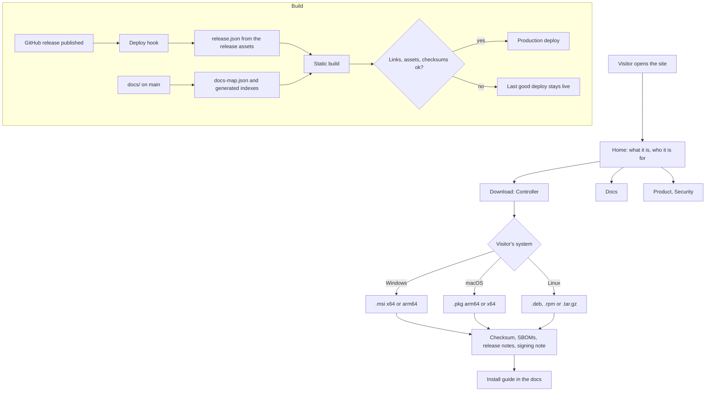

# Public website

**Status: built (CRSP303, CRSP332), waiting for the owner's Vercel setup.** `apps/web` holds Home, Product, Download (with the older versions), Docs with search, Security and a 404 page, with real console screenshots, the marketing frame in the design system and the site's own browser tests. What is not built is in section 10. Points that need the owner are in section 9.

## 1. In one paragraph

The website is the public front door of CI Runners Shared Pool. It is a static, signed-out site on Vercel, built the way Comiclex builds its public web app: no accounts, no server code, no data about the visitor. It says what the product is, shows the real console, publishes the repository's `docs/`, and gives one download: the **Controller** (the installer for the machine that runs the pool). It offers no agent download: a machine joins the pool with the command the Controller's console shows. The console that runs on the local network is a different app (`apps/controller-console`, served by the Controller) and is not part of the site. A remote app that manages a Controller from the internet is parked (CRSP305) and not specified here.

## 2. Why

**Problem.** The only public entry today is the GitHub repository. A new reader finds no short pitch, no per-system download page and no published docs.

**Users.**

- **Evaluator**: a developer or small team paying for hosted CI minutes, deciding whether to try the pool.
- **New owner**: has decided; needs the right Controller installer and the first steps.
- **Existing owner**: needs release notes and the latest version.

**Goals.**

- A visitor understands the product on one screen and can reach the right Controller installer in two clicks.
- Every download shows its checksum, its SBOMs and what is signed and what is not.
- The repository's docs are readable on the site, from one source.
- Nothing on the site needs a sign-in, a cookie or a third-party request.

**Non-goals.**

- Accounts, a dashboard, remote control or any signed-in page (CRSP305, parked).
- A download for an agent. One installer set exists for the Controller; machines join from the console.
- A hosted service, a blog, a CMS or paid plans.
- The LAN console. Its spec is `web-console`.

## 3. How it works

1. A visitor lands on Home. The page names the product, who it is for, and has two actions: Download and Docs.
2. Download shows the visitor's system first (read in the browser) and lists every system below it. Each link goes to a GitHub release asset. The site stores no binary.
3. After the download, the page points to the install guide (`docs/guides/install.md`) for the checksum, attestation and SBOM checks.
4. Docs publish the repository's `docs/` read-only. The source stays in the repository; the site copies nothing by hand.
5. Publishing a GitHub release calls a Vercel deploy hook, so the download page is never behind the release.

## 4. Pages and states

The look is a signed-out landing page in the Comiclex style: a hero, feature bands, a proof band, a closing call to action and a footer. Only the structure is taken. No text, image or code of Comiclex is reused.

| Page | Path | Purpose | Primary action |
|---|---|---|---|
| Home | `/` | Hero with one real console screenshot, who it is for, how it works in three steps, why (the study's numbers, labelled), docs links | Download |
| Product | `/product` | What the pool does, built from the feature specs' one-paragraph summaries, with console screenshots | Download |
| Download | `/download` | The Controller installer per system, checksums, SBOMs, signing note, release notes, older versions | the system's installer |
| Docs | `/docs/...` | The published `docs/` with search | Search |
| Security | `/security` | Link to `SECURITY.md`, what is signed, checksums, attestations, SBOMs | Report privately |
| 404 | any | Says the page is gone; links Home and Docs | Home |

**States.** With no JavaScript, Download lists every system. Docs search needs JavaScript; without it the docs stay readable and navigable. If the release data cannot be built, the build fails and the last good deploy stays live (R5.8). Every screenshot has alt text. On a phone the page is one column and the install steps stay readable (R6.3).

Layout, colour and imagery follow the shared Terminal look and the marketing frame (design system components 86 to 91); brand assets are the owner's call (section 9, Q5).

## 5. Functional requirements

All requirements are built (CRSP303, CRSP332) except those section 10 lists as not built.

### Content

- **R5.1** The site has the pages in section 4 and no others.
- **R5.2** Home states in one screen what the pool is, who it is for, and its two actions. It uses no term the content rules ban.
- **R5.3** Every page has one primary action (design system rule: one primary action per screen).
- **R5.4** Console screenshots come from the controller console against a seeded demo Controller, are committed under `apps/web/content/shots/`, and are regenerated by one script. They are never mock-ups. The script fails when a shot shows a real machine name, login, repository or token.
- **R5.5** Any number about savings or cost comes from `docs/studies/runs-on-vs-crsp/study.md` section 6 with its stated assumptions and date (10,000 minutes a month, rates read 25 Nov 2026), is labelled "Example", and carries the study's note that vendor numbers are vendor claims. A number labelled measured needs an owner-approved source (Q4).
- **R5.6** The site says what the pool does not do: public repositories run free on hosted runners and save nothing; savings last only while the machines are on.

### Download

- **R5.7** `/download` lists the Controller installers the release workflow builds, per system and CPU: Windows x64 and arm64 (`.msi`, `.zip`), macOS arm64 and x64 (`.pkg`, `.tar.gz`), Linux x64 and arm64 (`.deb`, `.rpm`, `.tar.gz`), named `Crsp-<version>-<os>-<arch>.<ext>` (release workflow, OPS69). No agent download is listed.
- **R5.8** A build step reads the GitHub release of this repository and writes `release.json` (version, date, per asset: name, size, SHA-256 from `SHA256SUMS`, system, CPU, format). Pages read only `release.json`. The build fails when the latest stable release lacks an asset of R5.7 or a checksum; the previous deploy stays live.
- **R5.9** The visitor's system is read in the browser and shown first. With JavaScript off, every system is listed.
- **R5.10** Every link is a GitHub release asset URL. The site hosts no binary.
- **R5.11** Each asset shows its SHA-256, and the page links `SHA256SUMS`, both SBOMs (`crsp-sbom-go.spdx.json`, `crsp-sbom-web.spdx.json`), the release notes and the install guide.
- **R5.12** The page says plainly what is signed. Today the installers are **not signed** (owner decision D58; signing turns on with the repository variable `SIGNING_ENABLED`). The page says "not signed", names the SmartScreen and Gatekeeper warnings, and names the checksum and attestation checks instead. The text comes from `docs/guides/install.md`, not from a second copy. When signing turns on, `release.json` carries the flag and the page changes with it.
- **R5.13** Older versions are listed from the release feed, newest first. The `edge` build is not offered as a download.
- **R5.14** Publishing a stable GitHub release runs a workflow that calls a Vercel deploy hook. A nightly scheduled rebuild picks up edited notes and docs.

### Docs publishing

- **R5.15** The site publishes `docs/` as `/docs`. `docs/` stays the only source; nothing under `docs/` is copied into `apps/web`.
- **R5.16** The build reads the generated `docs/docs-map.json` for navigation and `docs/llms.txt` for `/llms.txt`. It reads the generated files and never writes them.
- **R5.17** Public folders: `overview`, `features`, `guides`, `architecture`, `reference`, `studies`, `design-system`. Never published: `work`, `project`, `archive`, `review`, `specs`. Confirmation in Q6.
- **R5.18** Relative links between docs are rewritten to site paths. Mermaid blocks render at build time.
- **R5.19** Docs search is a static index built at build time and searched in the browser. No search service.
- **R5.20** A broken doc link or an unlisted public page fails the build.
- **R5.21** Each doc page shows its version and last verified date from front matter and an "Edit on GitHub" link.

## 6. Non-functional requirements

- **R6.1** Per page: Largest Contentful Paint under 2.0 s on a mid phone over 4G, under 50 kB of JavaScript, no layout shift above 0.05.
- **R6.2** Reading and downloading work with JavaScript off.
- **R6.3** Every page works at 360, 393 and 1300 px with no sideways scroll.
- **R6.4** Every image has alt text. axe finds no serious or critical issue in light or dark (design system rule: accessible).
- **R6.5** Zero third-party requests, no cookies and no analytics in v1 (Q3).
- **R6.6** Static files only. Response headers: a strict Content-Security-Policy with no inline script, HSTS, `Referrer-Policy`, `X-Content-Type-Options`. No form, so no data collected.
- **R6.7** The build runs on Windows, macOS and Linux and is deterministic from a clean checkout. Tests run on Windows and Linux; macOS builds only.
- **R6.8** Content holds no secret, real machine name or private repository name (R5.4).
- **R6.9** Each page has one `h1`, a title, a description and a canonical URL. `sitemap.xml` and `robots.txt` exist. Home and Download carry `SoftwareApplication` data (price 0, licence MIT).

## 7. Design

**Stack.** Static output, TypeScript, Vercel. The recommended generator is Astro with content collections: no JavaScript by default, Markdown suits `docs/`, islands only for the system picker and docs search. The alternatives are Vite with React (the console's stack; weak first paint and SEO for content) and VitePress or Docusaurus (docs fine, landing pages awkward). Q1 asks the owner.

**Layout.** `apps/web/` holds `src/pages`, `src/content`, `content/shots`, `scripts` (release data, docs build, link check, shots) and `vercel.json` (headers and redirects, no secrets). It imports tokens and the theme from `packages/ui` and nothing from the console app. The console rules (wizard, tables, bars) do not apply to marketing pages. The site follows design system v4 `tokens` and `content` and the CORE principles. A marketing part the design system lacks (hero, feature band) goes into `docs/design-system/next-version` with a `CHANGES` entry before the site builds it (Q5).

**One fact, one place.** The site reads release data, docs, the study and the install guide. Prose that copies a doc is a defect.

**Console name.** The Vercel project is `ci-runners-shared-pool`; its root directory is `apps/web` and it holds this new public static site (CRSP260, CRSP303). The domain is `crsp.luismc.net` (Cloudflare DNS). The LAN console SPA moves to `apps/controller-console` (CRSP306) and is served by the Controller; it never deploys to Vercel. CRSP306 moved the console to `apps/controller-console` (and the Go server to `apps/controller`), so `apps/web` is free for the site; `web-console` lists the new path.

**CI and release.** A `website.yml` workflow runs on pull requests touching `apps/web/**`, `docs/**` or `packages/ui/**`: build, link check, unit tests, axe, Playwright. The production deploy follows `main`; each pull request gets a Vercel preview; rollback is a redeploy of the previous deployment. Links to sites other than GitHub are checked weekly, not per pull request.

## 8. Failure modes

| What fails | What the visitor sees | What happens |
|---|---|---|
| GitHub API down at build | Last good site | Build fails; the next release or nightly run retries |
| Release lacks an asset or checksum | Last good site | Build fails (R5.8); the failed workflow tells the owner |
| Broken doc link | Last good site | Build fails (R5.20) |
| Vercel outage | Site unreachable | Installers still download from GitHub; docs are in the repository |
| Bad deploy | Wrong content | Redeploy the previous deployment |
| Screenshot shows private data | Nothing published | Shot script fails (R5.4) |

## 9. Left for the owner

Only the owner can do these. No agent creates the Vercel project.

- [ ] **Q1** Framework: Astro (recommended) or another (section 7).
- [ ] **Q2** Decided (CRSP303, CRSP306): the website is `apps/web`; the console moves to `apps/controller-console` and `web-console`'s code paths follow.
- [ ] **Q3** Analytics: none in v1 (recommended) or a cookieless tool.
- [ ] **Q4** Which pool and period may supply measured savings numbers, if any (R5.5).
- [ ] **Q5** Brand assets (logo, favicon, social image). Decided in CRSP332: the visual direction is the shared Terminal look; the marketing frame (site frame, hero, feature band, screenshot, prose, doc search) is design-system components 86 to 91 in `next-version`, with the tokens `--ds-frame-marketing` and `--ds-measure-prose`, and the site builds only those parts.
- [ ] **Q6** The public docs folders (R5.17), above all `design-system`, `studies` and `architecture`.
- [ ] **Q7** Vercel account and project, root directory `apps/web`, project `ci-runners-shared-pool`, domain `crsp.luismc.net` (Cloudflare), and a Deploy Hook (Settings, Git, Deploy Hooks, branch `main`) whose URL is stored as the GitHub repository secret `VERCEL_DEPLOY_HOOK_URL`. Until the secret exists, `.github/workflows/website-deploy.yml` says so and stops without error. No agent creates any of these.
- [ ] **Q8** Whether a Compare or Pricing page is wanted (the old draft had them; this one has none).

## 10. How it is proven and what is not built

**Built (CRSP303, CRSP332).** The site is `apps/web`: Vite and React, rendered to static HTML by `apps/web/scripts/build.ts` with the shared `packages/ui` parts (no app CSS). Pages: Home, Product, Download, Docs (an index with search and one page per published doc), Security and 404, with `sitemap.xml`, `robots.txt`, `llms.txt`, `search-index.json` and `release.json`. The docs build (`src/lib/docs.ts`) reads `docs/llms.txt` for the list of pages and titles and `docs/docs-map.json` (every doc it names must exist), renders Markdown with `marked`, rewrites relative links, draws Mermaid at build time to inline SVG with the theme's colours (`beautiful-mermaid`; its style block, inline style and font import are removed, so the strict policy and the no-third-party rule hold), and fails the build on a broken link or anchor, a public page that `llms.txt` does not list, or two pages with one path. Generated indexes and `changes/` notes are not pages. A picture in a doc is not copied; its words stay. Product reads the first paragraph of each feature spec. The savings example on Home reads section 6 of the study and fails the build when it changes shape (R5.5). Console shots are made by `pnpm --filter web shots` (`apps/web/shots/shots.spec.ts`: the built console, the console e2e suite's mocked API as a seeded demo Controller, and `src/lib/shotcheck.ts`, which refuses a page that shows this computer's name, the person's login, the repository owner, a token or an email address) and committed under `apps/web/content/shots/` with a manifest. R5.13: the full older-versions list from the release feed, newest first, never `edge`. R5.14: `.github/workflows/website-deploy.yml` (a published release, the Release workflow finishing, nightly, by hand with a dry run), the hook URL read from the secret `VERCEL_DEPLOY_HOOK_URL`. R5.15 to R5.21: docs publishing, search (a static word index of about 90 kB gzipped, loaded on the first key; the search box needs script and is hidden without it), the version and last-verified line, "Edit on GitHub". Release data ignores the agent installers (`CrspAgent-*`) that a release also holds: they are never listed (R5.7).

**Tests.** Unit and build tests run in the site project (`apps/web/src/**/*.test.ts(x)`, one build in `beforeAll`, no timeout above 10 s): T1, T2, T4, T5, T6, T7, T9, T13, T14, T16 and the JavaScript size part of T15. The site's own Playwright project (`apps/web/playwright.config.ts`, `apps/web/e2e/`, run by `pnpm --filter web e2e` and by `.github/workflows/website.yml`; separate from the console's e2e suite at the repository root) builds the site from the recorded release and serves it with the headers of `vercel.json`: T3 and T11 (`nojs.spec.ts`), T8 (`docs.spec.ts`), T10 (`layout.spec.ts` at 360, 393 and 1300 px, `axe.spec.ts` in light and dark), T12 (`network.spec.ts`: same-origin requests only, no cookie, the four headers, no policy violation in the console) and the LCP and layout-shift part of T15 (`perf.spec.ts`: 393 px, 4x CPU slowdown, 4G).

**Not built.** The macOS and Windows build matrix (T17): `website.yml` runs on Linux only. A per-system primary action on Download (the buttons are per file). The weekly check of links to sites other than GitHub. The Vercel project, domain and deploy hook (section 9). Brand assets (Q5). Measured savings numbers (Q4): only the study's example is shown.

| ID | Test | Layer | Covers |
|---|---|---|---|
| T1 | `release.json` from a recorded releases fixture has every system and CPU of R5.7 and no agent asset | unit | R5.7, R5.8 |
| T2 | Build fails when an asset or checksum is missing | unit | R5.8 |
| T3 | System detection picks Windows, macOS, Linux from sample user agents; without script all are listed | unit, e2e | R5.9 |
| T4 | Every download link is a release asset URL; no binary under `apps/web` | unit | R5.10 |
| T5 | The signing text equals `SIGNING_ENABLED` state and the install guide | unit | R5.12 |
| T6 | Docs build renders public folders and omits `work`, `project`, `archive`, `review`, `specs` | integration | R5.15 to R5.17 |
| T7 | Relative links and Mermaid render; a seeded broken link fails | integration | R5.18, R5.20 |
| T8 | Static search finds a known doc | e2e | R5.19 |
| T9 | `/llms.txt` equals `docs/llms.txt` | integration | R5.16 |
| T10 | axe clean, light and dark; no sideways scroll at 360, 393, 1300 px | e2e | R6.3, R6.4 |
| T11 | Pages work with JavaScript off | e2e | R6.2 |
| T12 | No third-party request, no cookie; headers present | e2e, integration | R6.5, R6.6 |
| T13 | Shot script rejects a fixture with a real login or token | unit | R5.4, R6.8 |
| T14 | One `h1`, title, description, canonical, sitemap entry per page | unit | R6.9 |
| T15 | JavaScript size and LCP within budget | perf | R6.1 |
| T16 | Release-published workflow calls the deploy hook (dry run) | workflow | R5.14 |
| T17 | Build runs on Windows, macOS, Linux | CI matrix | R6.7 |

**Suggested rows, in order:** (1) scaffold `apps/web` and its workflow; (2) release data and Download; (3) docs publishing; (4) Home, Product, Security with real screenshots; (5) SEO, accessibility, performance gates; (6) the owner's Vercel setup and launch.

**Code map.** Built: `apps/web/**`, `.github/workflows/website.yml`, `.github/workflows/website-deploy.yml`, the marketing parts in `packages/ui/src/components/Marketing.tsx`.
