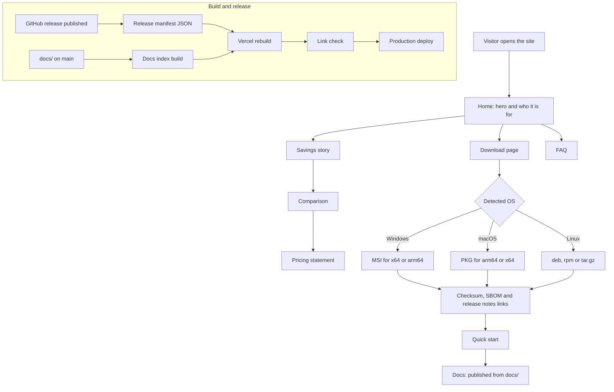
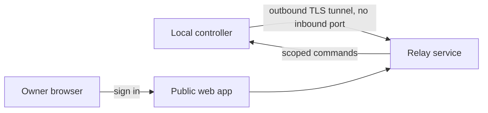

# Public website

**Status: spec only (CRSP260, plan row M). No site code exists.** Sections marked **OWNER REVIEW** need the owner's decision before any build row starts.

## 1. In one paragraph

The website is the public front door of CI Runners Shared Pool (CRSP). It is a Vercel-hosted, mostly static site. It says what CRSP is, how to download it for each operating system, how to use it in minutes (quick start with screenshots of the real console), and why it is worth using (a savings story from the pool's own numbers, a comparison with GitHub-hosted runners and runs-on, a pricing statement, a FAQ and links to the docs). Later it may grow into a web app that manages a local controller remotely (section 10, planned, out of scope for v1).

## 2. Why

**Problem.** Today the only public entry is the GitHub repository. A new reader finds no quickstart (study gap G3), no per-OS download page and no plain statement of what CRSP costs or saves.

**Users.**

- **Evaluator**: a developer or small team paying for GitHub-hosted minutes, deciding whether to try CRSP.
- **New user**: has decided, needs the right installer and the first ten minutes.
- **Existing owner**: needs release notes, docs and the latest version link.

**Goals.**

- A visitor understands CRSP in one screen and can download the right installer in two clicks.
- The quick start works as written, with screenshots of the real console, never mock-ups.
- Every claim of savings cites a number the product measured or a stated assumption.
- The docs of this repository are published, searchable and linked from the site (section 8).

**Non-goals (v1).**

- Accounts, sign-in, a dashboard or any remote control (section 10).
- A hosted CRSP service. CRSP stays on the owner's machines.
- A blog or a CMS. Content lives in the repository.
- Paid plans. See R5.9 (pricing statement).

## 3. How it works



Steps in words:

1. A visitor lands on Home. The hero states the offer in one sentence with two actions: Download and Quick start.
2. The page continues with who it is for, the savings story, the comparison, the pricing statement and the FAQ.
3. Download detects the visitor's OS from the browser, shows that OS first and lists all others. Every link points at a GitHub release asset.
4. Quick start walks install, add a machine, run a first job, with screenshots of the real console.
5. Docs are the repository's `docs/` published as a static section (section 8).
6. A GitHub release publishing triggers a rebuild so the download links are never stale (R5.20).

## 4. Pages and states

Layout only. The marketing look follows the structure of a logged-out landing page such as Comiclex's (full-width hero, then alternating feature bands, a proof band, a pricing band, a FAQ, a closing call to action and a footer). Structure is described here, not copied: no text, image, layout code or brand asset of that site is reused. **OWNER REVIEW:** the owner supplies or approves the visual direction (colour, imagery, tone).

| Page | Path | Purpose | Main action |
|---|---|---|---|
| Home | `/` | Hero, who it is for, how it works in three steps, savings story, comparison teaser, pricing, FAQ teaser, closing call to action | Download |
| Download | `/download` | Per-OS installers, checksums, SBOM, release notes, older versions | the OS's installer |
| Quick start | `/quick-start` | Install, add a machine, first green job, with console screenshots | Open the docs |
| Compare | `/compare` | Table against GitHub-hosted and runs-on; worked cost example | Download |
| Pricing | `/pricing` | The free statement and what is not included | Download |
| FAQ | `/faq` | Short answers | Quick start |
| Docs | `/docs/...` | Published `docs/` | Search |
| Changelog | `/changelog` | Release notes per version, from GitHub releases | Download |
| Security | `/security` | Link to `SECURITY.md`, supply chain facts (signing, SBOM) | Report privately |
| 404 | any | Says the page is gone, links Home and Docs | Home |

**Home bands, top to bottom.**

1. **Hero.** One sentence of value (run GitHub Actions on your own PCs), one line of proof (minutes saved), actions Download and Quick start, one real console screenshot (the Overview).
2. **Who it is for.** Three short cards: a solo developer or small team with idle PCs; a team with Windows or macOS builds that hosted runners price badly; a team that wants code and cache to stay on its own machines.
3. **How it works.** Three steps: install, add machines, change one `runs-on` label.
4. **Savings story.** Section 6.
5. **Comparison teaser.** Three rows from `/compare` and a link.
6. **Pricing statement.** Section 7.
7. **FAQ teaser and docs links.**
8. **Closing call to action and footer** (repository, security policy, docs, release feed).

**States.** Download with no JavaScript shows every OS in a list. Download when the release manifest is missing at build time fails the build (R5.21); the live site keeps the last good deploy. Screenshots have alt text (R6.4). A visitor on a phone gets a single column with the install command and a link to open the page on a PC.

## 5. Functional requirements

IDs are stable. Status of all requirements: **planned**.

### Content

- **R5.1** The site has the pages in section 4 and no others in v1.
- **R5.2** Home explains in one screen what CRSP is, who it is for and the two actions, with no unexplained term (design system content rules apply to words).
- **R5.3** Quick start has numbered steps that match `docs/guides/install.md`. Each step has a screenshot taken from the real console (R5.4).
- **R5.4** Screenshots are produced by the existing e2e screenshot tooling against a seeded demo controller, committed under `apps/website/content/shots/`, and regenerated by one script. They are never mock-ups. The regeneration script fails when a screenshot shows real machine names, user logins or tokens (a fixture check).
- **R5.5** The savings story shows the pool's own numbers: minutes saved and money avoided, from the observability feature (observability R5.15 to R5.19), as a worked example with stated assumptions. A number shown as measured must come from a real pool; otherwise it is labelled an example. **OWNER REVIEW:** which real pool and period supplies the numbers, and whether the owner approves publishing them.
- **R5.6** The cost example repeats the assumptions of `docs/studies/runs-on-vs-crsp/study.md` section 6 (10,000 minutes a month, rates read 25 Nov 2026) with their date, and links the study. Vendor numbers are labelled vendor claims.
- **R5.7** `/compare` shows CRSP against GitHub-hosted runners and runs-on, built from the study's verdict matrix. Where the study says runs-on is better (scale, isolation, reliability, cache), the site says so. No claim without a row in the study. **OWNER REVIEW:** tone and whether a named competitor appears on the public site.
- **R5.8** The comparison page carries the study's date and a note that vendor prices change.
- **R5.9** `/pricing` states: CRSP is free software under the MIT licence; there is no licence fee and no cloud bill; the owner pays for the PCs and power already owned. It also states what is not included (support, SLA, hosted capacity). **OWNER REVIEW:** the free statement is a commercial decision; a later paid tier would change this page and the pitch.
- **R5.10** The FAQ answers at least: what is CRSP, is it free, does my code leave my machines, which OSes, public repositories, what if my PCs are off (hosted fallback), how does it differ from runs-on, how do I update, how do I report a security issue. Each answer is under 60 words and links to a doc.
- **R5.11** Every page has one primary action. Download and Quick start are the only two actions on Home.

### Download

- **R5.12** `/download` lists, per OS and CPU (Windows x64 and arm64; macOS arm64 and x64; Linux x64 and arm64), the installer formats the release workflow builds: `.msi`, `.pkg`, `.deb`, `.rpm`, `.tar.gz`, `.zip`, named `Crsp-<version>-<os>-<arch>.<ext>`.
- **R5.13** The visitor's OS is detected in the browser and shown first; with JavaScript off all OSes are listed.
- **R5.14** Each link points at the GitHub release asset URL. The site hosts no binary.
- **R5.15** Each download shows its SHA-256, a link to the SBOMs (`crsp-sbom-go.spdx.json`, `crsp-sbom-web.spdx.json`) and the release notes.
- **R5.16** The page says plainly which installers are signed. The macOS `.pkg` Developer ID signing is off until the owner has a certificate (release workflow, CRSP90); the page must say "not yet signed" for it and show the Gatekeeper steps. **OWNER REVIEW:** wording of unsigned-installer guidance.
- **R5.17** Older versions are listed from the release feed, newest first.
- **R5.18** Install commands for package managers are shown only when that channel exists. None is promised in v1.

### Release-link automation

- **R5.19** A build step reads the GitHub releases API for this repository and writes `release.json` (version, date, assets with name, size, checksum, OS, CPU, format). Pages read only `release.json`.
- **R5.20** Publishing a GitHub release triggers a site rebuild (a repository `release: published` workflow calls a Vercel deploy hook; the hook URL is a secret, see section 11).
- **R5.21** The build fails if the latest release has no asset for an OS in R5.12, or if a checksum is missing. The previous deploy stays live.
- **R5.22** A nightly scheduled rebuild picks up edited release notes and docs.

### Docs publishing (gap G3)

- **R5.23** The site publishes `docs/` as `/docs`. Source of truth stays `docs/` in this repository; no copy is committed under `apps/website`.
- **R5.24** What the docs site needs from `docs/`: the folder layout by reader question (`overview`, `features`, `design-system`, `architecture`, `guides`, `reference`, `project`, `studies`); front matter (`id`, `title`, `type`, `status`, `version`); the generated `docs/docs-map.json` as the navigation tree; the generated `docs/features/index.md` and `docs/architecture/decisions.md` as index pages; `docs/llms.txt` copied to `/llms.txt`. The website build reads these generated files and never edits them.
- **R5.25** Public scope: `overview`, `features`, `guides`, `architecture`, `reference`, `studies` and `design-system` are public. `work/`, `project/` and `archive/` are never published (`work/` never reaches `main`; `project/` holds internal progress). **OWNER REVIEW:** confirm each folder, especially `project/`, `studies/` and `design-system/`.
- **R5.26** Markdown renders with the repository's relative links rewritten to site paths; Mermaid blocks render as diagrams at build time (no client script needed to read them).
- **R5.27** Docs search is built at build time (static index, client-side search). No third-party search service in v1.
- **R5.28** A broken doc link, a missing front-matter field or an unlisted page fails the build.
- **R5.29** Each doc page shows its version and last verified date from front matter, and an "Edit on GitHub" link.
- **R5.30** The same build serves `/llms.txt` so agents can read the docs.

## 6. The savings story (design of the content)

- **Shape:** one band with a stat tile row (minutes saved, money avoided, jobs run) and a one-paragraph reading, then a link to `/compare`. Stat tile follows the design system component for a stat tile; numbers follow the content rules for numbers.
- **Source of numbers:** observability "Minutes saved" (R5.15 to R5.19): minutes rounded up per job like GitHub billing, money at the matching hosted per-minute rate.
- **Honesty rules:** show the period and the assumptions; show the rate table date; say savings do not apply to public repositories (they run free on hosted runners); say the pool only saves while the PCs are on.
- **Worked example fallback:** when no approved real numbers exist, show the study's example (10,000 minutes: hosted $120, runs-on about $41, CRSP $0) labelled "Example".

## 7. Design

### 7.1 Framework choice (static first)

**Recommendation: Astro (static output) with Markdown and MDX content collections, TypeScript, deployed to Vercel.** **OWNER REVIEW.**

| Option | For | Against |
|---|---|---|
| **Astro, static** (recommended) | Ships no JS by default; content collections suit `docs/` Markdown; islands for the OS detector and search only; native Vercel adapter not needed for static; fast, good SEO | Another toolchain beside Vite/React in `apps/web` |
| Next.js | Familiar, strong Vercel fit, easy path to the future web app | Heavier runtime; more client JS than a marketing site needs; static export loses features |
| Vite plus React SPA | Same stack as the console | Client-rendered: weak SEO, slow first paint; poor fit for content |
| Docusaurus/VitePress | Docs out of the box | Marketing pages are awkward; two systems to join |

Reasons for static first: the site is content; there is no per-visitor data in v1; static output is cheap, cacheable, secure (no server to attack) and easy to test offline. When section 10 starts, the remote app is a **separate app** (`apps/remote`) on its own subdomain, so the marketing site stays static. Reversible: content is Markdown plus one JSON, so switching framework later costs only templates.

### 7.2 Repo layout

```
apps/website/
  package.json            workspace package "@crsp/website"
  astro.config.mjs
  src/pages/              home, download, quick-start, compare, pricing, faq, changelog, security, 404
  src/components/         page-only pieces (OsPicker island, StatTile wrapper)
  src/content/            faq, compare rows, quick-start steps (Markdown)
  content/shots/          real console screenshots (R5.4)
  scripts/                fetch-release.mjs, build-docs.mjs, check-links.mjs, shots.mjs
  vercel.json             headers, redirects (no secrets)
  tests/                  unit, link check, accessibility, e2e
```

`packages/ui` tokens and the shared theme are imported for colour, type and focus. The no-app-CSS rule and the shared-parts rule govern the console; the marketing site may have its own page styles but only through tokens (7.4). It does not import `apps/web`.

### 7.3 Content sources

| Content | Source |
|---|---|
| Hero, who it is for, FAQ, quick start text | Markdown in `apps/website/src/content/` |
| Downloads, version, notes | `release.json` from the GitHub releases API (R5.19) |
| Docs | `docs/` and its generated maps (R5.24) |
| Comparison | `docs/studies/runs-on-vs-crsp/study.md` (verdict matrix) read at build time |
| Savings numbers | A reviewed `savings.json` committed by the owner (R5.5) |
| Screenshots | `content/shots/` (R5.4) |

One rule: a fact appears once in the repository and the site reads it. Copy typed into a page that duplicates a doc is a defect.

### 7.4 Design-system use

UX rules live only in `docs/design-system/`. The console rules (wizard, tables, bars) mostly do not apply to marketing pages. The site uses design system v4 `tokens` (colour, type, spacing, themes light and dark, focus), `content` (words, dates, numbers) and the CORE principles by ID in the pull request checklist. Any marketing component the design system lacks (hero, feature band, pricing band) is first proposed into `docs/design-system/next-version` with a `CHANGES` entry, per AGENTS.md, before the site builds it. **OWNER REVIEW:** whether the website gets its own design-system section.

### 7.5 SEO

- One `<title>` and meta description per page, written by hand in front matter.
- Canonical URLs, `sitemap.xml`, `robots.txt`, Open Graph and social images generated at build.
- JSON-LD `SoftwareApplication` on Home and Download (name, OS list, price 0, licence MIT).
- Clean paths, no query-string content. Redirects in `vercel.json` for renamed pages.
- Docs pages are indexable; `llms.txt` is served (R5.30).
- Page weight and Core Web Vitals budgets (R6.1).

### 7.6 Analytics (privacy-first)

- Default: **no analytics** and no cookies in v1. **OWNER REVIEW:** decision needed, because a commercial pitch benefits from counts.
- If analytics are added: a cookieless, no-personal-data tool (Vercel Web Analytics or self-hosted Plausible), no cross-site tracking, no fingerprinting, no consent banner needed, the page says what is counted, and Do Not Track is honoured.
- Download counts come from GitHub release asset download counts, with no tracking on the site.
- No third-party scripts, fonts or embeds in v1; assets are self-hosted.

### 7.7 Accessibility

- Target WCAG 2.2 AA. Semantic landmarks, one `h1` per page, visible focus (design system focus token), full keyboard use including the OS picker and search.
- Colour contrast checked in light and dark; motion respects `prefers-reduced-motion`.
- Screenshots have meaningful alt text and the surrounding text carries the same information.
- Automated: axe on every page in CI (same tool the console uses, R6.6 of the web console spec). Manual: one screen reader pass before launch.

### 7.8 Security of the site

Static files only; strict `Content-Security-Policy` with no inline script (a hash for the one island), `Referrer-Policy`, `X-Content-Type-Options`, HSTS. No forms in v1, so no data collected. Deploy hook and tokens are secrets in GitHub and Vercel, never in the repository.

## 8. Non-functional requirements

- **R6.1** Performance budget per page: Largest Contentful Paint under 2.0 s on a mid phone over 4G, total JavaScript under 50 kB, no layout shift above 0.05, images with sizes and lazy loading.
- **R6.2** Works with JavaScript off for all reading and all downloads.
- **R6.3** Every page is usable at 360, 393 and 1300 px with no sideways scroll.
- **R6.4** Every image has alt text; axe reports no serious or critical issue.
- **R6.5** Zero third-party requests in v1 (privacy decision in 7.6).
- **R6.6** Build time under 5 minutes, deterministic, reproducible from a clean checkout.
- **R6.7** Every external link to a release asset resolves (link check, R5.28 and section 10).
- **R6.8** Build for ALL systems, test on Windows and Linux only. The site build and its scripts must run on Windows, macOS and Linux (no shell-only steps, paths through `node:path`, no symlinks). Automated tests run on Windows and Linux runners; macOS is built, not tested (owner rule for later rows).
- **R6.9** Content has no secret, no real machine name and no private repository name (screenshot check, R5.4).

## 9. CI, build and release

- **Workflow `website.yml`** on pull requests touching `apps/website/**`, `docs/**` or `packages/ui/**`: install, build, link check, unit tests, axe, then Playwright on Windows and Linux (R6.8). Vercel preview deploys are created by the Vercel Git integration once the owner links the project (section 11).
- **Build** = fetch release data, build docs, build site. A build with an unreachable GitHub API uses the last cached `release.json` committed as a build artifact and warns; it does not publish a stale "latest".
- **Link check**: internal links, anchors, images and external links to GitHub releases. External sites other than GitHub are checked weekly, not per pull request, so a third party outage cannot block a merge.
- **Release-link automation**: `release: published` workflow calls the deploy hook (R5.20). A nightly rebuild (R5.22).
- **Deploy**: Vercel production deploy from `main`. Preview per pull request. Rollback is a one-click redeploy of the previous deployment. One deploy per merge (agent rules).
- **Pull request gate**: the design-system checklist from AGENTS.md; the no-app-CSS scan does not apply to this app but a stylesheet scan for raw colours and sizes (tokens only) does. **OWNER REVIEW:** whether that scan is wanted.

## 10. Future: remote control (planned, out of scope for v1)

**Status: planned. Nothing in this section is built or committed to.** The site might later become a public web app where the owner manages a local controller from anywhere. The console today is deliberately for the local network (web-console non-goals). This section lists the questions that must be answered before any build. **OWNER REVIEW:** go or no-go, and whether to build this at all.

### 10.1 Candidate model



The controller opens and keeps an **outbound** connection to a relay. The owner's browser talks to the web app, which forwards scoped commands over the tunnel. No port is opened on the owner's network.

### 10.2 Security model questions

1. **Tunnel.** Own relay or an existing tunnel (a managed service)? Who runs it, and who pays? Is the tunnel end-to-end encrypted so the relay cannot read traffic? Reconnect, replay and rate limit rules?
2. **Identity.** Sign in with GitHub, as the console does? How does the web app know that this GitHub user owns this controller (pairing code shown in the local console, hashed and single use, as join codes are)?
3. **Authorisation.** Same roles (owner, admin, viewer). Which commands are allowed remotely? Proposal: read-only first; no config export, no secrets, no GitHub App key, no remove.
4. **No inbound port.** How is that proven (a test that scans listening sockets after enabling)?
5. **Data.** What crosses the relay? Logs and CI job data contain code-adjacent text (CIX7). Default: metadata only, logs fetched on demand over the tunnel and never stored on the relay.
6. **Trust of the web app.** If the public app is breached, can an attacker control every paired controller? Options: per-command signing by the owner's key, short-lived tokens, a local approval prompt for dangerous commands, a kill switch in the local console.
7. **Revocation and audit.** Unpair from the local console at once; every remote command lands in the local audit log with the remote origin.
8. **Availability.** What happens when the relay is down (local console keeps working; nothing depends on the relay).
9. **Abuse and cost.** Free for one controller? Limits per owner; terms of service; who handles a compromise report.
10. **Compliance.** The study says all data stays on the owner's machines is a CRSP strength. A relay weakens that claim; the site and docs would need to say so.
11. **Alternative.** Do nothing and document a user-run VPN or private tunnel (no service to run). Cheapest option; likely the right v1.

Out of scope for v1: all of the above. Any build row needs its own spec, security review and an architecture decision record.

## 11. Left for the owner

Only the owner can do these. The agent never creates the Vercel project.

- [ ] Create or choose the Vercel account and team; create the project; link it to `luis-mc/ci-runners-shared-pool`; set the **root directory** to `apps/website` and the build command and install command (`pnpm`), with "include source files outside the root" enabled so `docs/` and `packages/ui` are readable.
- [ ] Choose the **domain**, add it in Vercel, set DNS records, confirm HTTPS and the www redirect.
- [ ] Create the **deploy hook** in Vercel and store its URL as a GitHub Actions secret (R5.20). Store any Vercel token the same way.
- [ ] Decide which GitHub branch is production (`main`) and whether preview deploys are public or protected.
- [ ] Decide the analytics question (7.6).
- [ ] Approve the pricing statement (R5.9), the comparison tone and named competitor (R5.7), and the savings numbers and their source (R5.5).
- [ ] Approve the public docs folders (R5.25), the framework (7.1) and the visual direction (section 4).
- [ ] Provide brand assets: name wording, logo, social image, favicon.
- [ ] Decide on a macOS signing certificate or accept the unsigned wording (R5.16).
- [ ] Decide whether the remote control idea (section 10) is wanted at all.
- [ ] Set up a contact address for security reports if `SECURITY.md` does not already name one.

## 12. Failure modes

| What fails | What the visitor sees | What happens |
|---|---|---|
| GitHub API down at build | Last good site | Build uses cached `release.json` and warns; the release rebuild retries |
| Release missing an OS asset | Last good site | Build fails (R5.21); owner is told by the failed workflow |
| Broken doc link | Last good site | Build fails (R5.28) |
| Vercel outage | Site unreachable | Installers still download from GitHub; docs are in the repository |
| Bad deploy | Wrong content | One-click rollback |
| Screenshot shows private data | Not published | Fixture check fails (R5.4) |

## 13. How it is proven

All tests are **planned**. None exists yet.

| ID | Test | Layer | Covers | Runs on | Status |
|---|---|---|---|---|---|
| T1 | `release.json` is built from a recorded releases API fixture, with every OS and CPU in R5.12 | unit | R5.12, R5.19 | Windows, Linux | planned |
| T2 | Build fails when an OS asset or checksum is missing | unit | R5.21 | Windows, Linux | planned |
| T3 | OS detector picks Windows, macOS and Linux from sample user agents; no script lists all | unit, e2e | R5.13 | Windows, Linux | planned |
| T4 | Every download link targets a GitHub release asset URL; no binary under `apps/website` | unit | R5.14 | Windows, Linux | planned |
| T5 | Docs build reads `docs-map.json` and renders every public page; private folders absent from output | integration | R5.23 to R5.25 | Windows, Linux | planned |
| T6 | Relative doc links and Mermaid blocks render | integration | R5.26 | Windows, Linux | planned |
| T7 | Static search index finds a known doc by title | e2e | R5.27 | Windows, Linux | planned |
| T8 | Link check passes on the built site; a seeded broken link fails the build | integration | R5.28, R6.7 | Windows, Linux | planned |
| T9 | `llms.txt` is served and equals `docs/llms.txt` | integration | R5.30 | Windows, Linux | planned |
| T10 | Every page has one `h1`, a title, a description and a canonical URL; sitemap lists every page | unit | 7.5 | Windows, Linux | planned |
| T11 | axe finds no serious or critical issue on any page, light and dark | e2e | R6.4, 7.7 | Windows, Linux | planned |
| T12 | No horizontal scroll at 360, 393 and 1300 px | e2e | R6.3 | Windows, Linux | planned |
| T13 | Pages work with JavaScript disabled; downloads listed | e2e | R6.2, R5.13 | Windows, Linux | planned |
| T14 | Total JavaScript and LCP within budget | perf | R6.1 | Linux | planned |
| T15 | Network log shows no third-party request | e2e | R6.5 | Windows, Linux | planned |
| T16 | Response headers include the CSP, HSTS and the other headers of 7.8 | integration | 7.8 | Linux | planned |
| T17 | Screenshot script rejects a fixture containing a real login or token | unit | R5.4, R6.9 | Windows, Linux | planned |
| T18 | Every FAQ answer is under 60 words and links a doc; required questions present | unit | R5.10 | Windows, Linux | planned |
| T19 | Comparison page rows match the study's verdict matrix | unit | R5.7, R5.8 | Windows, Linux | planned |
| T20 | The site build runs on Windows, macOS and Linux (build only on macOS) | CI matrix | R6.8 | Windows, Linux, macOS (build) | planned |
| T21 | Release-published workflow calls the deploy hook (dry run) | workflow | R5.20 | Linux | planned |

Rule for later rows: build for ALL systems, test on Windows and Linux only (R6.8).

## 14. Decisions

Open, all **OWNER REVIEW**: framework (7.1), analytics (7.6), pricing statement (R5.9), competitor naming (R5.7), public docs folders (R5.25), visual direction, whether to pursue remote control (section 10).

## 15. Not built yet

Everything in this spec. Suggested later rows, in order: (1) scaffold `apps/website` and CI; (2) release data and download page; (3) docs publishing; (4) Home, Compare, Pricing, FAQ with real screenshots; (5) SEO, accessibility and performance gates; (6) owner's Vercel setup and launch. Section 10 gets its own spec if the owner says go.

## 16. Code map

Planned only: `apps/website/**` (section 7.2), `.github/workflows/website.yml`, a `release: published` workflow step. No existing code is changed by this task.
